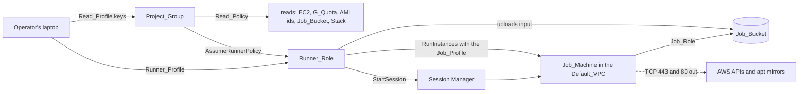

# Design Document: aws-setup

## Overview

This spec makes the AWS setup as one CloudFormation template, the Stack_Template (`cloud/aws-setup.yaml`), and writes the Setup_Guide (`docs/aws-setup.md`). The Account_Owner deploys the Stack once from AWS CloudShell in the console, with `aws cloudformation create-stack --template-body` (Q1). The Stack makes the Job_Bucket, the Job_Role with the Job_Profile, the Job_Security_Group, the Runner_Role, the Read_Policy and the Project_Group, and gives our code their names and ARNs through the Stack_Outputs. The spec also adds cfn-lint to the dev group with the Template_Test, adds `[aws].stack_name` to Config, and updates the steering, the README and the Licence_List. The steering gains the rule that every aws command names its region (Req 16.13).

Nothing in this spec calls AWS. The Template_Test and the Compliance_Check run on the laptop without credentials, and only the Account_Owner deploys the Stack (Req 17.6, 17.7). There is no AWS code: the start-command spec adds boto3 and the code that reads the Stack_Outputs.

Where a choice rests on one of the assumptions A1 to A7, which the user accepted at review, or on the review decisions Q1 to Q4, the text names it. Q1 moved the deploy and the updates to CloudShell. Q2 moved the Work_Files to `work/<Job_Id>/`, where the 60-day rule finds them by their prefix, with no tag. Q3 has Step 7 tell people to turn down the AWS CLI's offer to set up AWS tools for an AI coding agent. Q4 gives the template one parameter, the default VPC's id, as the Job_Security_Group's `VpcId`, and Step 4 looks the id up inline in CloudShell.

### Decisions on the open choices

| Choice | Decision |
|---|---|
| Resource names | All left to CloudFormation, the IAM ones included (Req 1.4, 1.5). CloudFormation makes names like `voxelis-kiroween-ProjectGroup-<random>`. They start with the Stack's name, so they're readable in the console, and the random part keeps two copies in two regions of one account apart. Names built from `${AWS::StackName}` and `${AWS::Region}` would need `CAPABILITY_NAMED_IAM`, and CloudFormation can't replace a named resource during an update. The `GroupName` output gives the Account_Owner the group's exact name. |
| Parameters | One, `DefaultVpcId` (Q4, A5, Req 1.2). The template holds its own numbers and names. |
| The Job_Security_Group's VPC (Q4) | `VpcId: !Ref DefaultVpcId`, the default VPC's id (Req 4.1). cfn-lint 1.61.0's bundled schema for `AWS::EC2::SecurityGroup` makes `VpcId` a dependency of `SecurityGroupEgress`, so the group without a `VpcId` failed the Template_Test with E3021. With the `VpcId`, outbound stays limited to TCP 443 and 80 (Req 4.4). Step 4's create-stack command looks the id up inline in CloudShell, with `describe-vpcs` and the `is-default` filter, so the id isn't printed (Req 12.6), and change sets pass `UsePreviousValue=true` (Req 12.11). The parameter's type makes CloudFormation check that the value is a VPC in the account and region, not that it's the default one, so the lookup is what picks the default VPC. The user turned down a second, empty security group whose `VpcId` the Job_Security_Group would copy, and turning E3021 off in the group's Metadata (Req 17.3). |
| The Runner_Role's policies | Two managed policies: `RunnerLaunchPolicy` for Requirement 6 and `RunnerManagePolicy` for Requirement 7, plus the Read_Policy. Once CloudFormation fills in the ARNs, each is under 3,000 characters without whitespace, under half of IAM's 6,144 limit. |
| Inline policies | None anywhere. Every permission is an `AWS::IAM::ManagedPolicy`, attached through the role's or the group's `ManagedPolicyArns` (IAM_NO_INLINE_POLICY_CHECK). |
| Launch limits (A3) | A launch needs the Job_Security_Group and a subnet of the Default_VPC, and can't use a key pair or a launch template. |
| Object deletes (A4) | Neither the Job_Role nor the Runner_Role can delete objects. The 60-day rule deletes the Work_Files. |
| The Job_Role's Session Manager permissions | AWS's documented minimum for the agent: `ssm:UpdateInstanceInformation` and the four `ssmmessages` actions. They're split by what each action takes. `UpdateInstanceInformation` gets instance ARNs in the Stack_Region, `OpenDataChannel` gets session ARNs in the Stack_Region, and the three channel actions that only take `*` get `aws:RequestedRegion`. |
| Ending and resuming own shells | The method AWS recommends on its "Sample IAM policies for Session Manager" page. A condition says the session's `aws:ssmmessages:session-id` tag equals `${aws:userid}`, and `ssmmessages:OpenDataChannel` sits in the same statement, as in AWS's current samples. AWS documents that this works for role sessions, whose tag holds `<role id>:<role session name>`, the value of `${aws:userid}`. A session-ARN prefix built from a user name would only fit IAM users. |
| The quota request history | `servicequotas:ListRequestedServiceQuotaChangeHistoryByQuota`. It takes the quota's ARN as its resource, so the Read_Policy needs no wildcard for quotas. `GetRequestedServiceQuotaChange` only takes `*` and isn't needed. |
| The Stack in the Read_Policy | `!Ref AWS::StackId`, the exact ARN of this Stack, so a later stack with the same name isn't covered. |
| The bucket policy's condition | `Bool: {aws:SecureTransport: false}` with a YAML boolean. cfn-guard's S3_BUCKET_SSL_REQUESTS_ONLY compares with the boolean `false`, and IAM accepts booleans in conditions. |
| Where the Work_Files go (Q2) | Under `work/<Job_Id>/`, with no tag. The job's `input/` and `out/` stay under `jobs/<Job_Id>/`. No role in the Stack gets `s3:PutObjectTagging`, and no lifecycle rule has a tag filter (Req 3.6, 7.7). |
| Lifecycle filters | The 60-day rule's only filter is `Prefix: work/`, with no `TagFilters`, so it can't reach anything under `jobs/` (Q2, Req 2.6, 2.8). The 7-day abort rule has no filter, so it covers the whole bucket, `jobs/` included (Req 2.7). |
| The Job_Bucket's deletion policies | `DeletionPolicy: RetainExceptOnCreate` and `UpdateReplacePolicy: Retain` (Req 2.9). `UpdateReplacePolicy` has no `RetainExceptOnCreate` value. |
| How the Template_Test runs cfn-lint | In process, with `cfnlint.api.lint_file` and `cfnlint.api.ManualArgs`. It gets `Match` objects with the rule id, the severity, the line and the message, so it parses no output and needs no subprocess or timeout. |
| How a copy deploys (Q1) | From AWS CloudShell, opened in the console with the Admin_Login, with `aws cloudformation create-stack --template-body file://aws-setup.yaml`, not with the console's upload of a template file. An update goes through a change set that the Account_Owner makes in CloudShell, reviews and then executes, never through `update-stack` (Req 12.6, 12.10, 12.11). The change set passes the same `--tags Key=project,Value=voxelis-kiroween` as the create, so the Stack keeps the Project_Tag whatever CloudFormation does with a change set that leaves `--tags` out. Before each upload to CloudShell, `rm -f aws-setup.yaml` removes any older copy. |
| The Admin_Login | Always a new IAM user, which the Account_Owner makes with the Root_Login right after the Paid_Plan, even when the account already has an admin IAM user (Req 12.4, 12.14). |
| The region in commands | Every aws command in the Setup_Guide passes `--region <your-region>`, the CloudShell ones included, because an `AWS_REGION` or `AWS_DEFAULT_REGION` variable beats the profile's region (Req 13.11, 15.3). Laptop commands also pass `--profile`. CloudShell commands pass no `--profile` (Req 13.14). |

## Architecture



### Files

| File | Change |
|---|---|
| `cloud/aws-setup.yaml` | New. The Stack_Template. |
| `tests/test_aws_setup.py` | New. The Template_Test. |
| `docs/aws-setup.md` | New. The Setup_Guide. |
| `pyproject.toml`, `uv.lock` | cfn-lint in the dev group only (Req 16.6). |
| `config.toml` | `stack_name` in `[aws]` (Req 10.4). |
| `tests/test_config.py` | `UNCHANGED_SECTIONS["aws"]` gains `stack_name` (Req 17.4). |
| `docs/third-party-licences.md` | Rows for cfn-lint, `awslabs.aws-iac-mcp-server` and the Session_Manager_Plugin (Req 16.7 to 16.9). |
| `.kiro/steering/tech.md`, `structure.md`, `rules.md` | The quota line, the `cloud/` and `docs/` lines, CNRI-Python and the two region lines (Req 16.1 to 16.4, 16.13). |
| `README.md` | An "AWS setup" section that links the Setup_Guide (Req 16.5). |

No Python code in `cloud/` or `splatpipe/` changes, and nothing outside `tests/` imports cfn-lint.

## Components and Interfaces

### The Stack_Template (`cloud/aws-setup.yaml`)

The template's top-level keys are `AWSTemplateFormatVersion: "2010-09-09"`, `Description`, `Parameters`, `Resources` and `Outputs`. `Parameters` holds only `DefaultVpcId` (Q4, A5, Req 1.2). The template has no `Transform`, no macro and no nested stack (Req 1.1). It needs no `Mappings`, `Conditions` or top-level `Metadata` either. The short-form tags `!Ref`, `!GetAtt` and `!Sub` are part of CloudFormation's YAML and need no transform.

The file starts with a YAML comment of a few lines. It says:

- what the file is, and that the Account_Owner deploys it from CloudShell by following `docs/aws-setup.md`;
- that its own numbers and names (the 60 and 7 days, the ports, the Allowed_Types, the Project_Tag and the prefixes `jobs/` and `work/`) live here and not in `config.toml`, because CloudFormation can't read `config.toml` (A5, Req 1.11);
- that changing one of them, an Allowed_Type for example, means editing this file and updating the Stack;
- that the file stays within 51,200 bytes, the most that `--template-body` takes (Req 1.12).

The `Description` is "AWS setup for the splat pipeline: a private job bucket, the job machines' role, instance profile and security group, the runner role, the read policy and the project group. One parameter: the id of this region's default VPC." Neither it nor any comment names a person, an account or an Other_Resource (Req 1.9).

#### The parameter

```yaml
Parameters:
  DefaultVpcId:
    Type: AWS::EC2::VPC::Id
    Description: ID of this region's default VPC, where the job machines start.
```

- It's the template's only parameter (Q4, Req 1.2). It has no `Default`, because the default VPC of each account and region has its own id. Step 4's create-stack command passes it, looked up inline in CloudShell, and change sets keep it with `UsePreviousValue=true` (Req 12.6, 12.11).
- Only `JobSecurityGroup` refers to it, as its `VpcId` (Req 4.1). The policies and the outputs reach the default VPC through `${JobSecurityGroup.VpcId}`, which holds the same id.

#### Fixed values

| Value | Where it's written |
|---|---|
| The Project_Tag, key `project` and value `voxelis-kiroween`, as in `[aws].project_tag` (Req 1.10) | The `Tags` of the four taggable resources (Req 1.7), and every `aws:RequestTag/project`, `aws:ResourceTag/project` and `ssm:resourceTag/project` condition |
| 60 and 7 days | The two lifecycle rules |
| TCP 443 and 80 | The two egress rules |
| The 8 Allowed_Types | The `ec2:InstanceType` condition, in the glossary's order |
| `jobs/` | The S3 statements of the Job_Role and the Runner_Role (Req 1.10) |
| `work/` | The 60-day rule's prefix and the Job_Role's S3 statements (Req 1.10) |
| `L-DB2E81BA`, `/aws/service/deeplearning/ami/x86_64/base-*` and `SSM-SessionManagerRunShell` | The Read_Policy and the Runner_Role's shell statement. These are AWS's own names, not settings. |

#### ARNs

Pseudo parameters fill in the account, the region and the partition (Req 1.3). Every ARN is a `!Sub` that starts `arn:${AWS::Partition}:`. Regional ARNs hold `${AWS::Region}`, and account fields hold `${AWS::AccountId}`. EC2 image and snapshot ARNs and SSM public parameter ARNs have an empty account field. No name holds the account id (Req 1.6).

The statement tables below use these short names. They're only for this document: the template writes each ARN out in full.

| Short name | Written in the template as |
|---|---|
| `INSTANCES` | `!Sub "arn:${AWS::Partition}:ec2:${AWS::Region}:${AWS::AccountId}:instance/*"` |
| `VOLUMES` | `!Sub "arn:${AWS::Partition}:ec2:${AWS::Region}:${AWS::AccountId}:volume/*"` |
| `ENIS` | `!Sub "arn:${AWS::Partition}:ec2:${AWS::Region}:${AWS::AccountId}:network-interface/*"` |
| `SUBNETS` | `!Sub "arn:${AWS::Partition}:ec2:${AWS::Region}:${AWS::AccountId}:subnet/*"` |
| `JOB_SG` | `!Sub "arn:${AWS::Partition}:ec2:${AWS::Region}:${AWS::AccountId}:security-group/${JobSecurityGroup.GroupId}"` |
| `DEFAULT_VPC` | `!Sub "arn:${AWS::Partition}:ec2:${AWS::Region}:${AWS::AccountId}:vpc/${JobSecurityGroup.VpcId}"` |
| `IMAGES` | `!Sub "arn:${AWS::Partition}:ec2:${AWS::Region}::image/*"` |
| `SNAPSHOTS` | `!Sub "arn:${AWS::Partition}:ec2:${AWS::Region}::snapshot/*"` |
| `SESSIONS` | `!Sub "arn:${AWS::Partition}:ssm:${AWS::Region}:${AWS::AccountId}:session/*"` |
| `SHELL_DOC` | `!Sub "arn:${AWS::Partition}:ssm:${AWS::Region}:${AWS::AccountId}:document/SSM-SessionManagerRunShell"` |
| `G_QUOTA` | `!Sub "arn:${AWS::Partition}:servicequotas:${AWS::Region}:${AWS::AccountId}:ec2/L-DB2E81BA"` |
| `BASE_AMI_IDS` | `!Sub "arn:${AWS::Partition}:ssm:${AWS::Region}::parameter/aws/service/deeplearning/ami/x86_64/base-*"` |
| `BUCKET` | `!GetAtt JobBucket.Arn` |
| `JOB_FILES` | `!Sub "${JobBucket.Arn}/jobs/*"` |
| `WORK_FILES` | `!Sub "${JobBucket.Arn}/work/*"` |
| `ALL_FILES` | `!Sub "${JobBucket.Arn}/*"` |

The template uses `!GetAtt JobSecurityGroup.GroupId` for the group's id and `!GetAtt JobSecurityGroup.VpcId` for the Default_VPC's id, inside a `!Sub` as `${JobSecurityGroup.GroupId}` and `${JobSecurityGroup.VpcId}`. Now that the group has a `VpcId` (Q4), `!Ref JobSecurityGroup` would give its id too, but the `GetAtt` forms give the right values with or without a `VpcId`, so they stay.

#### Resources

| Logical id | Type | Key properties | Req |
|---|---|---|---|
| `JobBucket` | `AWS::S3::Bucket` | `DeletionPolicy: RetainExceptOnCreate`, `UpdateReplacePolicy: Retain`, encryption, public access block, ownership controls, lifecycle rules and `Tags`. No `BucketName` and no `AccessControl`. | 1.4, 1.7, 2.1 to 2.4, 2.6 to 2.9 |
| `JobBucketPolicy` | `AWS::S3::BucketPolicy` | `Bucket: !Ref JobBucket` and the TLS-only statement | 2.5 |
| `JobSecurityGroup` | `AWS::EC2::SecurityGroup` | `GroupDescription`, `VpcId: !Ref DefaultVpcId`, two `SecurityGroupEgress` rules and `Tags`. No `GroupName` and no `SecurityGroupIngress`. | 1.4, 1.7, 4.1 to 4.4 |
| `JobPolicy` | `AWS::IAM::ManagedPolicy` | `Description` and the Job_Role's statements | 3.2 to 3.6, 7.7 |
| `JobRole` | `AWS::IAM::Role` | `Description`, the EC2 trust policy, `ManagedPolicyArns: [!Ref JobPolicy]` and `Tags` | 1.7, 3.1, 3.5 |
| `JobInstanceProfile` | `AWS::IAM::InstanceProfile` | `Roles: [!Ref JobRole]` | 3.1 |
| `ReadPolicy` | `AWS::IAM::ManagedPolicy` | `Description` and the read statements | 8.1 to 8.8 |
| `RunnerLaunchPolicy` | `AWS::IAM::ManagedPolicy` | `Description` and the launch statements | 6.1 to 6.8 |
| `RunnerManagePolicy` | `AWS::IAM::ManagedPolicy` | `Description` and the stop, image, upload and shell statements | 5.5, 7.1 to 7.7 |
| `RunnerRole` | `AWS::IAM::Role` | `Description`, the root trust policy, `ManagedPolicyArns: [!Ref ReadPolicy, !Ref RunnerLaunchPolicy, !Ref RunnerManagePolicy]` and `Tags` | 1.7, 5.1 to 5.4 |
| `AssumeRunnerPolicy` | `AWS::IAM::ManagedPolicy` | `Description` and one `sts:AssumeRole` statement | 9.2 |
| `ProjectGroup` | `AWS::IAM::Group` | `ManagedPolicyArns: [!Ref ReadPolicy, !Ref AssumeRunnerPolicy]`. No `GroupName` and no users. | 9.1, 9.3, 9.4 |

- No resource sets a name property: `BucketName`, `GroupName`, `RoleName`, `ManagedPolicyName` or `InstanceProfileName` (Req 1.4, 1.5).
- The template makes no VPC, subnet, route table or gateway (Req 4.2), no IAM user (Req 9.4), and no inline `Policies` property anywhere.
- Every policy document has `Version: "2012-10-17"`, and each statement has a `Sid` made of letters and digits.
- `!Ref` on a managed policy gives its ARN, which is what `ManagedPolicyArns` takes. A managed policy's `Description` can't change without CloudFormation replacing the policy. That's harmless here, because the policy's name is generated.
- The references go one way, so there's no cycle. `JobPolicy`, `ReadPolicy` and `RunnerManagePolicy` refer to `JobBucket`. `RunnerLaunchPolicy` refers to `JobRole`, `JobInstanceProfile` and `JobSecurityGroup`. `RunnerRole` refers to its three policies, `AssumeRunnerPolicy` to `RunnerRole`, and `ProjectGroup` to `ReadPolicy` and `AssumeRunnerPolicy`.
- The resources that CloudFormation can't tag (the Project_Group, the Job_Profile, the managed policies and the bucket policy) carry no Project_Tag themselves, because CloudFormation passes stack tags on only to resources that take tags. The Stack that holds them carries the Project_Tag as a stack tag (Req 12.7).

#### The Job_Bucket

```yaml
  JobBucket:
    Type: AWS::S3::Bucket
    DeletionPolicy: RetainExceptOnCreate
    UpdateReplacePolicy: Retain
    Metadata:
      guard:
        SuppressedRules:  # see "Suppressions"
          - S3_BUCKET_LOGGING_ENABLED  # <reason>
    Properties:
      BucketEncryption:
        ServerSideEncryptionConfiguration:
          - ServerSideEncryptionByDefault:
              SSEAlgorithm: AES256
      PublicAccessBlockConfiguration:
        BlockPublicAcls: true
        BlockPublicPolicy: true
        IgnorePublicAcls: true
        RestrictPublicBuckets: true
      OwnershipControls:
        Rules:
          - ObjectOwnership: BucketOwnerEnforced
      LifecycleConfiguration:
        Rules:
          - Id: delete-work-files-after-60-days
            Status: Enabled
            Prefix: work/
            ExpirationInDays: 60
          - Id: abort-unfinished-uploads-after-7-days
            Status: Enabled
            AbortIncompleteMultipartUpload:
              DaysAfterInitiation: 7
      Tags:
        - Key: project
          Value: voxelis-kiroween
```

- `AES256` is SSE-S3 (Req 2.4). The four public access blocks are on (Req 2.2), and `BucketOwnerEnforced` turns ACLs off (Req 2.3).
- The first rule's only filter is the prefix `work/`, with no `TagFilters`. So it deletes only Work_Files and can never reach a file under `jobs/`, whatever an upload does (Q2, Req 2.6, 2.8).
- The second rule has no filter, so it covers the whole bucket, `jobs/` included, for a broken upload of a large video (Req 2.7). It stays a rule of its own, because the first rule's filter would limit it to `work/`. It aborts unfinished uploads and deletes no object (Req 2.8).
- S3 counts the 60 days from each file's upload, rounds up to the next midnight UTC and runs lifecycle rules in the background, so a Work_File can stay a day or so past its 60 days.
- AWS's [DeletionPolicy attribute](https://docs.aws.amazon.com/AWSCloudFormation/latest/TemplateReference/aws-attribute-deletionpolicy.html) page says `RetainExceptOnCreate` works like `Retain` in every stack operation except the one that first created the resource. When that operation rolls back, CloudFormation deletes the resource. In every other operation, such as deleting the stack, CloudFormation keeps the resource and what it holds. Together with `UpdateReplacePolicy: Retain`, that means deleting the Stack, or an update that replaces the bucket, keeps the bucket and its files, and when the Stack's first create rolls back, CloudFormation deletes the bucket, which is still empty then (Req 2.9).
- `UpdateReplacePolicy: Retain` is what keeps the old bucket and its files when an update replaces the bucket. CloudFormation then takes the old bucket out of the Stack. [UpdateReplacePolicy](https://docs.aws.amazon.com/AWSCloudFormation/latest/TemplateReference/aws-attribute-updatereplacepolicy.html) takes only `Delete`, `Retain` and `Snapshot`, so it has no `RetainExceptOnCreate` value (Req 2.9).
- cfn-lint v1.61.0 accepts both values and doesn't warn about the pair. Its E3035 ([`src/cfnlint/rules/resources/DeletionPolicy.py`](https://github.com/aws-cloudformation/cfn-lint/blob/v1.61.0/src/cfnlint/rules/resources/DeletionPolicy.py)) allows `Delete`, `Retain` and `RetainExceptOnCreate` as a `DeletionPolicy`, plus `Snapshot` for the types that take snapshots, which an S3 bucket doesn't. E3036 (`UpdateReplacePolicy.py`, in the same folder) allows `Delete` and `Retain` as an `UpdateReplacePolicy`, plus `Snapshot` for those types. W3011 (`BothUpdateReplacePolicyDeletionPolicyNeeded.py`, in the same folder) checks each resource against [`update_policy_delete.json`](https://github.com/aws-cloudformation/cfn-lint/blob/v1.61.0/src/cfnlint/data/schemas/other/resources/update_policy_delete.json). That schema passes a resource that sets both attributes, whatever their values, one that sets neither, and one whose only attribute is `Delete`. `JobBucket` sets both, so W3011 stays quiet.

#### The bucket policy

```yaml
  JobBucketPolicy:
    Type: AWS::S3::BucketPolicy
    Properties:
      Bucket: !Ref JobBucket
      PolicyDocument:
        Version: "2012-10-17"
        Statement:
          - Sid: DenyRequestsWithoutTls
            Effect: Deny
            Principal: "*"
            Action: "s3:*"
            Resource:
              - !GetAtt JobBucket.Arn
              - !Sub "${JobBucket.Arn}/*"
            Condition:
              Bool:
                aws:SecureTransport: false
```

This refuses every request to the bucket and its objects that doesn't use TLS (Req 2.5). It's the shape S3_BUCKET_SSL_REQUESTS_ONLY looks for: a `Deny` statement whose condition compares `aws:SecureTransport` with the boolean `false`.

#### The Job_Security_Group

```yaml
  JobSecurityGroup:
    Type: AWS::EC2::SecurityGroup
    Metadata:
      guard:
        SuppressedRules:
          - EC2_SECURITY_GROUP_EGRESS_OPEN_TO_WORLD_RULE  # <reason>
    Properties:
      GroupDescription: "Job machines: nothing in, HTTPS and HTTP out"
      VpcId: !Ref DefaultVpcId
      SecurityGroupEgress:
        - Description: HTTPS to AWS APIs, S3, Session Manager and package mirrors
          IpProtocol: tcp
          FromPort: 443
          ToPort: 443
          CidrIp: 0.0.0.0/0
        - Description: HTTP to the Ubuntu apt mirrors
          IpProtocol: tcp
          FromPort: 80
          ToPort: 80
          CidrIp: 0.0.0.0/0
      Tags:
        - Key: project
          Value: voxelis-kiroween
```

- `VpcId: !Ref DefaultVpcId` puts the group in the Stack_Region's default VPC (Q4, Req 4.1). cfn-lint's schema for `AWS::EC2::SecurityGroup` makes `VpcId` a dependency of `SecurityGroupEgress` (E3021), so a group with outbound rules needs one. Step 3 of the Setup_Guide checks that the region has a default VPC (Req 12.5), and Step 4's create-stack command looks up its id (Req 12.6).
- Because the group lists its own egress rules, EC2 doesn't add its allow-all outbound rule. That covers SECURITY_GROUP_MISSING_EGRESS_RULE and SECURITY_GROUP_EGRESS_ALL_PROTOCOLS_RULE (Req 4.4, 11.3). With no ingress rules, nothing comes in (Req 4.3).
- Security groups don't filter traffic to the Amazon DNS server, the instance metadata service or the Amazon Time Sync Service. So a Job_Machine still looks up names, gets the Job_Role's credentials over IMDSv2 and keeps its clock right (Req 4 note).
- Rule descriptions only take letters, digits, spaces and `._-:/()#,@[]+=;{}!$*`, and the group description takes the same characters plus `&`. So the descriptions hold no apostrophes and no `&`.

#### The Job_Role and the Job_Profile

The Job_Role's trust policy lets only the EC2 service assume it (Req 3.1):

```yaml
      AssumeRolePolicyDocument:
        Version: "2012-10-17"
        Statement:
          - Effect: Allow
            Principal:
              Service: ec2.amazonaws.com
            Action: sts:AssumeRole
```

`JobPolicy` holds all of the Job_Role's permissions (Req 3.2 to 3.6):

| Sid | Actions | Resource | Condition | Req |
|---|---|---|---|---|
| `ListJobAndWorkFolders` | `s3:ListBucket` | `BUCKET` | `StringLike` `s3:prefix`: `["jobs/*", "work/*"]` | 3.2 |
| `ReadAndUploadJobFiles` | `s3:GetObject`, `s3:PutObject`, `s3:AbortMultipartUpload` | `JOB_FILES`, `WORK_FILES` | | 3.2, 3.3 |
| `SessionManagerAgentHeartbeat` | `ssm:UpdateInstanceInformation` | `INSTANCES` | | 3.4 |
| `SessionManagerAgentChannels` | `ssmmessages:CreateControlChannel`, `ssmmessages:CreateDataChannel`, `ssmmessages:OpenControlChannel` | `"*"` | `StringEquals` `aws:RequestedRegion`: `!Ref AWS::Region` | 3.4 |
| `SessionManagerAgentDataChannel` | `ssmmessages:OpenDataChannel` | `SESSIONS` | | 3.4 |

- A Job_Machine uploads each Work_File with no tag, because the 60-day rule finds the Work_Files by their prefix (Q2). So `JobPolicy` has no `s3:PutObjectTagging` (Req 3.6, 7.7), and it names each action in full, with no `s3:PutObject*` wildcard, which would also match `s3:PutObjectTagging`. `s3:PutObject` also covers each part of a multipart upload, and `s3:AbortMultipartUpload` lets a failed one be cleaned up (Req 3.3).
- A list from a Job_Machine must name a prefix under `jobs/` or `work/`, like `work/<Job_Id>/`. A list with no prefix is refused, and so is HeadBucket (see "Risks and limits").
- There's no `s3:DeleteObject` (A4, Req 3.5), and no AWS managed policy, so no `AmazonSSMManagedInstanceCore` (Req 3 note).
- The five Session Manager actions are AWS's documented minimum for the agent, from "Create a custom IAM role for Session Manager", without the KMS and logging parts. The three channel actions take no resource, which is why their statement is `*` with the region condition, and why `JobPolicy` carries the IAM_POLICYDOCUMENT_NO_WILDCARD_RESOURCE Suppression.

`JobInstanceProfile` has only `Roles: [!Ref JobRole]`.

#### The Read_Policy

| Sid | Actions | Resource | Condition | Req |
|---|---|---|---|---|
| `DescribeEc2InThisRegion` | `ec2:Describe*` | `"*"` | `StringEquals` `aws:RequestedRegion`: `!Ref AWS::Region` | 8.2 |
| `ReadJobMachineConsoles` | `ec2:GetConsoleOutput` | `INSTANCES` | `StringEquals` `aws:ResourceTag/project`: `voxelis-kiroween` | 8.3 |
| `ReadGpuQuota` | `servicequotas:GetServiceQuota`, `servicequotas:ListRequestedServiceQuotaChangeHistoryByQuota` | `G_QUOTA` | | 8.4 |
| `ReadBaseAmiIds` | `ssm:GetParameter`, `ssm:GetParameters` | `BASE_AMI_IDS` | | 8.5 |
| `ListJobBucket` | `s3:ListBucket` | `BUCKET` | | 8.6 |
| `ReadJobFiles` | `s3:GetObject` | `ALL_FILES` | | 8.6 |
| `ReadThisStack` | `cloudformation:DescribeStacks`, `cloudformation:DescribeStackEvents`, `cloudformation:DescribeStackResource`, `cloudformation:DescribeStackResources`, `cloudformation:ListStackResources` | `!Ref AWS::StackId` | | 8.7 |

- EC2's describe actions only take `*`, hence the region condition and the Suppression (Req 8.2).
- The G_Quota's ARN holds the Stack_Region, so both quota actions only reach it there (Req 8.4).
- `ListJobBucket` has no prefix condition and `ReadJobFiles` covers `ALL_FILES`, so the Read_Policy lists the whole bucket and reads every file in it, under `jobs/` and `work/` alike (Req 8.6).
- `DescribeStacks` gives the Stack's description and outputs, the two resource actions its resources, and `DescribeStackEvents` its events (Req 8.7).
- There's no `s3:ListAllMyBuckets`, no IAM action, no `sts:` action and nothing outside the Stack_Region (Req 8.6, 8.8). `sts:GetCallerIdentity` needs no permission, but it prints the account id and an ARN, so the Setup_Guide never uses it as a check.

#### The Runner_Role

The trust policy (Req 5.1, 5.2):

```yaml
      AssumeRolePolicyDocument:
        Version: "2012-10-17"
        Statement:
          - Effect: Allow
            Principal:
              AWS: !Sub "arn:${AWS::Partition}:iam::${AWS::AccountId}:root"
            Action: sts:AssumeRole
```

The root principal means "any principal in this account whose own policies allow `sts:AssumeRole` on this role", because an IAM group can't be a principal. There's no MFA condition, because Kiro runs the start command after the Approval_Prompt and can't type a code. `MaxSessionDuration` stays at its default of one hour.

`RunnerLaunchPolicy` covers Requirement 6 (A3). RunInstances checks each resource of a launch on its own, so each kind of resource gets its own statement:

| Sid | Actions | Resource | Condition | Req |
|---|---|---|---|---|
| `LaunchJobMachine` | `ec2:RunInstances` | `INSTANCES` | `StringEquals`: `ec2:InstanceType` is one of the 8 Allowed_Types, `ec2:MetadataHttpTokens` is `required`, and `aws:RequestTag/project` is `voxelis-kiroween`. `ArnEquals`: `ec2:InstanceProfile` is `!GetAtt JobInstanceProfile.Arn`. | 6.1, 6.2, 6.4, 6.5, 6.6 |
| `LaunchFromAmazonImage` | `ec2:RunInstances` | `IMAGES` | `StringEquals` `ec2:Owner`: `amazon` | 6.3 |
| `LaunchFromMachineImage` | `ec2:RunInstances` | `IMAGES` | `StringEquals`: `ec2:Owner` is `!Ref AWS::AccountId`, and `aws:ResourceTag/project` is `voxelis-kiroween` | 6.3 |
| `LaunchInDefaultVpc` | `ec2:RunInstances` | `SUBNETS`, `ENIS` | `ArnEquals` `ec2:Vpc`: `DEFAULT_VPC` | 6.7 |
| `LaunchWithJobSecurityGroup` | `ec2:RunInstances` | `JOB_SG` | | 6.7 |
| `LaunchVolumes` | `ec2:RunInstances` | `VOLUMES` | | 6.1 |
| `TagOnlyWhenCreating` | `ec2:CreateTags` | `INSTANCES`, `VOLUMES`, `ENIS`, `IMAGES`, `SNAPSHOTS` | `StringEquals` `ec2:CreateAction`: `RunInstances` or `CreateImage` | 6.8 |
| `PassJobRole` | `iam:PassRole` | `!GetAtt JobRole.Arn` | `StringEquals` `iam:PassedToService`: `ec2.amazonaws.com` | 6.5 |

- No statement covers `key-pair` or `launch-template` resources, so a launch that names a key pair or a launch template is refused (A3, Req 6.7). A launch that names no security group gets the VPC's default group, whose ARN isn't `JOB_SG`, so it's refused too.
- Every ARN holds `${AWS::Region}`, so launches only work in the Stack_Region, and there's no `ec2:StartInstances` (Req 6.1).
- A condition whose key is missing from the request fails. So a launch without the Project_Tag, without the Job_Profile or without `HttpTokens: required` is refused (Req 6.4 to 6.6).
- A launch from an EBS-backed AMI creates volumes but needs no `snapshot` resource, as AWS's RunInstances examples show, so the policy has none.
- `ec2:CreateAction` limits tagging to the request that creates the instance, volume, network interface, image or snapshot (Req 6.8). The tag keys aren't limited, so the start command can add others, like the Job_Id.

`RunnerManagePolicy` covers Requirement 7 and keeps Req 5.5:

| Sid | Actions | Resource | Condition | Req |
|---|---|---|---|---|
| `StopJobMachines` | `ec2:StopInstances`, `ec2:TerminateInstances` | `INSTANCES` | `StringEquals` `aws:ResourceTag/project`: `voxelis-kiroween` | 7.1 |
| `ImageFromJobMachine` | `ec2:CreateImage` | `INSTANCES` | `StringEquals` `aws:ResourceTag/project`: `voxelis-kiroween` | 7.2 |
| `TagNewMachineImage` | `ec2:CreateImage` | `IMAGES`, `SNAPSHOTS` | `StringEquals` `aws:RequestTag/project`: `voxelis-kiroween` | 7.2 |
| `RemoveMachineImages` | `ec2:DeregisterImage`, `ec2:DeleteSnapshot` | `IMAGES`, `SNAPSHOTS` | `StringEquals` `aws:ResourceTag/project`: `voxelis-kiroween` | 7.3 |
| `UploadJobFiles` | `s3:PutObject`, `s3:AbortMultipartUpload` | `JOB_FILES` | | 7.4 |
| `StartShellOnJobMachine` | `ssm:StartSession` | `INSTANCES` | `StringEquals` `ssm:resourceTag/project`: `voxelis-kiroween` | 7.5 |
| `StartShellDocument` | `ssm:StartSession` | `SHELL_DOC` | | 7.5 |
| `OwnShellsOnly` | `ssm:TerminateSession`, `ssm:ResumeSession`, `ssmmessages:OpenDataChannel` | `SESSIONS` | `StringEquals` `ssm:resourceTag/aws:ssmmessages:session-id`: `${aws:userid}` | 7.6 |

- A CreateImage request must tag both the new Machine_Image and its snapshots with the Project_Tag, or it's refused (Req 7.2).
- There's no action that shares, publishes, copies or exports an image or a snapshot, such as `ec2:ModifyImageAttribute`, `ec2:ModifySnapshotAttribute`, `ec2:CopyImage`, `ec2:CopySnapshot`, `ec2:ExportImage` or `ec2:CreateStoreImageTask` (Req 5.5). There's no `s3:DeleteObject` either (A4, Req 7.4).
- `UploadJobFiles` stays `s3:PutObject` and `s3:AbortMultipartUpload` on `JOB_FILES` only. The start command uploads the job's video and job record to `jobs/<Job_Id>/input/`, and only the Job_Machines upload to `work/` (Req 7.4). Like `JobPolicy`, it has no `s3:PutObjectTagging` (Req 7.7). The Runner_Role still lists and reads the whole bucket through the Read_Policy.
- AWS's tag-based StartSession samples use the condition key `ssm:resourceTag/<key>`. The shell document gets its own statement with no condition, because the document doesn't carry our tag. Since June 2024, Session Manager needs this explicit grant for `SSM-SessionManagerRunShell` when a policy names its documents (Req 7.5).
- `${aws:userid}` is written as a plain string, not inside a `!Sub`, so CloudFormation passes it through unchanged. cfn-lint's E1029 only flags `${...}` names that are the template's own references or attributes, so it doesn't flag this one. If the value ever moves into a `!Sub`, it must be written `${!aws:userid}`.
- For a role session, `aws:userid` is `<role id>:<role session name>`. Session Manager puts the same value in each session's `aws:ssmmessages:session-id` tag, so a role session can end or resume only the Debug_Shells it started (Req 7.6).

`AssumeRunnerPolicy` has one statement, `AssumeRunnerRole`, which allows `sts:AssumeRole` on `!GetAtt RunnerRole.Arn` and nothing else, with no condition (Req 9.2). No statement anywhere puts a region condition on an `sts:` action, because STS can use its global endpoint.

#### Suppressions

Each Suppression is a rule id in a resource's `Metadata.guard.SuppressedRules` list, with its reason as a YAML comment on the same line (Req 11.4, 11.5):

```yaml
    Metadata:
      guard:
        SuppressedRules:
          - S3_BUCKET_VERSIONING_ENABLED  # Versions would keep every replaced or expired job file, and its cost.
```

The expected list, from the user's probes of the Compliance_Check on drafts:

| Resource | Rule | Reason comment |
|---|---|---|
| `JobBucket` | `S3_BUCKET_LOGGING_ENABLED` | Access logs would need a second bucket, and nobody reads them for a private job bucket. |
| `JobBucket` | `S3_BUCKET_VERSIONING_ENABLED` | Versions would keep every replaced or expired job file, and its cost. |
| `JobBucket` | `S3_BUCKET_REPLICATION_ENABLED` | Job files can be made again from the video, so a copy in another region isn't worth its cost. |
| `JobBucket` | `S3_BUCKET_DEFAULT_LOCK_ENABLED` | Object lock needs versioning and would stop the 60-day rule from deleting work files. |
| `JobBucket` | `S3_BUCKET_NO_PUBLIC_RW_ACL` | ACLs are off and all four public access blocks are on. The rule wants AccessControl, which cfn-lint warns against (W3045). |
| `JobPolicy` | `IAM_POLICYDOCUMENT_NO_WILDCARD_RESOURCE` | Session Manager's channel actions only take `*`. That statement is limited to this stack's region. |
| `ReadPolicy` | `IAM_POLICYDOCUMENT_NO_WILDCARD_RESOURCE` | EC2's describe actions only take `*`. That statement is limited to this stack's region. |
| `JobSecurityGroup` | `EC2_SECURITY_GROUP_EGRESS_OPEN_TO_WORLD_RULE` | Job machines reach AWS and package mirrors on public addresses, and only TCP 443 and 80 are open. |

- `RunnerLaunchPolicy`, `RunnerManagePolicy` and `AssumeRunnerPolicy` have no `"*"` resource and get no Suppression. If the wildcard-resource rule fails on them anyway, because of ARNs that end in `/*`, that isn't an Unfit_Rule, and the Builder asks the user before suppressing it there (Req 11.7).
- A Suppression covers its whole resource. So `JobPolicy` and `ReadPolicy` keep `"*"` to the one statement their reason names.
- The final list is the one the real run on the whole template needs (see "The Compliance_Check"). It may differ from this one.

#### Outputs

| Output | Value | Description |
|---|---|---|
| `BucketName` | `!Ref JobBucket` | Name of the job bucket, which holds one jobs/<job id>/ folder and one work/<job id>/ folder per job. |
| `JobRoleArn` | `!GetAtt JobRole.Arn` | ARN of the role that job machines run as. |
| `JobInstanceProfileArn` | `!GetAtt JobInstanceProfile.Arn` | ARN of the instance profile that every job machine starts with. |
| `RunnerRoleArn` | `!GetAtt RunnerRole.Arn` | ARN of the runner role, which each person's runner profile assumes. |
| `SecurityGroupId` | `!GetAtt JobSecurityGroup.GroupId` | ID of the security group that every job machine starts with. |
| `VpcId` | `!GetAtt JobSecurityGroup.VpcId` | ID of the default VPC that holds the security group. Job machines start in its default subnets. |
| `GroupName` | `!Ref ProjectGroup` | Name of the IAM group for the people who run jobs. |

These are exactly the outputs of Req 10.1, each with a `Description` (Req 10.2). No output has an `Export` (Req 10.3).

#### Template size

`--template-body` takes at most 51,200 bytes, so the template stays within that (Req 1.12). Going by the YAML and the statement tables above, it comes to about 455 lines and 20 KB, under half the limit. The five managed policies, with every ARN written out in full, make up a bit over half of that, and the suppression comments, the outputs' descriptions and the header comment most of the rest. The `DefaultVpcId` parameter and the group's `VpcId` line add about 200 bytes (Q4).

The Builder checks the size by hand before each commit of the template, in tasks 1 and 2 of the build order, and keeps it at most 51,200 bytes (Req 1.12, 1.13). In PowerShell, `(Get-Item cloud/aws-setup.yaml).Length` prints the file's size on disk in bytes, line endings included, which is what the Account_Owner uploads to CloudShell. This is a check, not a new test, because the user's test scope stands (Req 17.5).

### The Compliance_Check (Req 11)

The Builder runs `check_cloudformation_template_compliance` from the aws-infrastructure-as-code power, and passes the whole Stack_Template as its `template_content` text. The tool runs cfn-guard's rules locally and needs no credentials. The Builder uses none of the power's tools that call AWS, such as `troubleshoot_cloudformation_deployment` (Req 17.6).

The Builder runs it after each change to the Stack_Template and before each commit of it (Req 11.1), which means in tasks 1 and 2 of the build order. For each failing rule, the Builder does this:

1. **Fixes the rule** when it applies to the Stack, as Req 11.3 lists: TLS-only requests, managed policies, explicit egress rules and no all-protocol egress. The template above is written to pass these already.
2. **Finds the resource.** The tool's output names each failing rule but shows "Unknown" as its resource. The rule id's prefix narrows the candidates: `S3_` means the bucket or its policy, `IAM_` the roles and policies, and `EC2_SECURITY_GROUP_` or `SECURITY_GROUP_` the security group. Then the Builder checks one candidate at a time. It passes the tool a cut-down template, with `AWSTemplateFormatVersion` and a `Resources` section that holds only that resource, as text, so no file is written. The references to other resources can stay, because cfn-guard reads them as plain values. The rule fails on each resource whose cut-down template still fails it.
3. **Suppresses the rule** only when it's an Unfit_Rule, in the Metadata of the resource it fails on, with its reason (Req 11.4, 11.5). The Builder adds nothing that an Unfit_Rule asks for: no access logs, versioning, replication, object lock or KMS keys (Req 11.6).
4. **Asks the user** when the rule isn't an Unfit_Rule and can't be fixed within this spec's requirements (Req 11.7).

The run on the whole template is the check of record, and it must pass (Req 11.2).

### The Template_Test (`tests/test_aws_setup.py`)

The test file looks like this:

```python
"""The Template_Test: cfn-lint finds no error or warning in cloud/aws-setup.yaml (Req 17.1 to 17.3, A6).

cfn-lint reads the template and its own bundled resource schemas. It makes no AWS call, so the test
needs no network and no credentials (Req 17.2).
"""

import re
import tomllib
from pathlib import Path

from cfnlint.api import ManualArgs, lint_file

ROOT = Path(__file__).resolve().parents[1]  # this file is in tests/, at the repo root
TEMPLATE = ROOT / "cloud" / "aws-setup.yaml"
REAL_CONFIG = ROOT / "config.toml"  # read by path, like the other tests of the real config
# A cfn-lint key in a Metadata section, which would turn checks off. A YAML comment that mentions
# cfn-lint starts with # and doesn't match.
CFN_LINT_KEY = re.compile(r"""^\s*["']?cfn-lint["']?\s*:""", re.MULTILINE)


def test_cfn_lint_finds_no_error_or_warning_in_the_stack_template() -> None:
    region = tomllib.loads(REAL_CONFIG.read_text(encoding="utf-8"))["aws"]["region"]
    assert not CFN_LINT_KEY.search(TEMPLATE.read_text(encoding="utf-8")), (
        "cloud/aws-setup.yaml turns cfn-lint checks off with a cfn-lint Metadata key. "
        "Remove it and fix the findings instead (Req 17.3).")
    matches = lint_file(TEMPLATE, config=ManualArgs(regions=[region], mandatory_checks=["E", "W"]))
    findings = [f"{match.rule.id} line {match.linenumber}: {match.message}"
                for match in matches if match.rule.severity in ("error", "warning")]
    assert not findings, ("cfn-lint found these errors and warnings in cloud/aws-setup.yaml:\n"
                          + "\n".join(findings))
```

- `regions=[region]` checks the template against the Stack_Region's resource schemas only, with the region read from the real `config.toml` with `tomllib` (A6, Req 17.1).
- `mandatory_checks=["E", "W"]` runs every error and warning rule even when a `.cfnlintrc` in the working folder or the home folder ignores it, so a file on someone's laptop can't hide a finding. The regex makes sure the template itself turns no check off (A6, Req 17.3).
- Informational findings (`I…`) don't fail the test (A6). cfn-lint doesn't run them by default anyway.
- `lint_file` reports a file that doesn't parse as an `E0000` match, so broken YAML fails the test with its line.
- Each finding in the assertion message gives the rule id, the line and cfn-lint's message.
- Before writing the test, the Builder checks that cfn-lint 1.61.0 has `cfnlint.api.lint_file(template: Path, config: ManualArgs | None)`, `ManualArgs` with the keys `regions` and `mandatory_checks`, and `Match.rule.id`, `Match.rule.severity`, `Match.linenumber` and `Match.message`. All of these are in cfn-lint's main branch today.
- The resource schemas no longer live in cfn-lint's git repo. Its PyPI release workflow ([`cd-pypi.yaml`](https://github.com/aws-cloudformation/cfn-lint/blob/v1.61.0/.github/workflows/cd-pypi.yaml)) downloads them into the package before the build, so the wheel that uv installs has them under `cfnlint/data/schemas/providers/`. cfn-lint downloads schemas only when it finds none there or in its cache, or when it's run with `--update-specs` ([`schema/manager.py`](https://github.com/aws-cloudformation/cfn-lint/blob/v1.61.0/src/cfnlint/schema/manager.py)). So the test makes no network call, as long as the installed cfn-lint has its bundled schemas. The Builder checks that `cfnlint/data/schemas/providers/us-east-1.json` exists in `.venv` before writing the test (Req 17.2).
- The test needs no fixture. The autouse fixture in `tests/conftest.py` still runs, and it doesn't matter here, because the test reads the real `config.toml` by path.

### Config (Req 10.4)

`[aws]` after the change, with only the last two lines new:

```toml
[aws]
region = "us-east-1"
project_tag = "project=voxelis-kiroween"
read_profile = "kiroween-read"
runner_profile = "kiroween-runner"
spend_variable = "APPROVED_SPEND"
# Name of the CloudFormation stack made from cloud/aws-setup.yaml. Our code finds its resources through its outputs.
stack_name = "voxelis-kiroween"
```

`UNCHANGED_SECTIONS["aws"]` in `tests/test_config.py` gets `"stack_name": "voxelis-kiroween"`, so `test_the_real_git_aws_paid_and_devlog_sections_are_unchanged` passes (Req 17.4). `[aws]` is in `NOT_PIPELINE`, so the comment check doesn't read it. The new key changes nothing for the code that reads Config: `cloud/spend.py` reads only `[aws].spend_variable`, and the guard hook reads only `[paid]`.

### The Setup_Guide (`docs/aws-setup.md`)

Rules for the whole guide:

- It's written for someone running their own copy, in plain words. It says "the job bucket" or "your read profile" rather than the glossary's terms.
- It names no person, team member, account id or region (Req 15.1). The region is the placeholder `<your-region>`, explained as "the region in `[aws].region` in `config.toml`". The Stack's name and the profile names are the values in `config.toml` (`voxelis-kiroween`, `kiroween-read` and `kiroween-runner`), and one line says a copy that changes them uses its own.
- Every aws command passes `--region <your-region>`, the value of `[aws].region`, and every command run on a laptop also passes `--profile` (Req 13.11, 15.3). The commands run in CloudShell are written for bash, CloudShell's default shell. They pass `--region` and no `--profile`, because CloudShell runs as the console's login and has no named profiles (Req 13.14).
- The `aws configure` lines pass `--region` too, so the rule has no exception, and it changes nothing they do. In AWS CLI v2's source, `aws configure set` writes only the named key, into the section of the profile that `--profile` names ([`set.py`](https://github.com/aws/aws-cli/blob/v2/awscli/customizations/configure/set.py)). The interactive `aws configure` takes each prompt's current value from that profile in the config and credentials files, and writes only the values that are typed ([`configure.py`](https://github.com/aws/aws-cli/blob/v2/awscli/customizations/configure/configure.py)). So its region prompt still shows the profile's own region, `None` for a new profile, and the person still types `<your-region>` there.
- Since version 2.36.50 ([CHANGELOG](https://github.com/aws/aws-cli/blob/v2/CHANGELOG.rst)), an interactive `aws configure` that writes values can end with the question "Configure AWS skills and the AWS MCP server for your AI coding agent(s)? [y/n/never]". It asks only on a terminal, when it finds a supported agent on the laptop, Kiro included through `~/.kiro/`, and no AWS skills are installed yet ([`hint.py`](https://github.com/aws/aws-cli/blob/v2/awscli/customizations/agenttoolkit/hint.py), [`agents.py`](https://github.com/aws/aws-cli/blob/v2/awscli/customizations/agenttoolkit/agents.py)). A yes starts `aws configure agent-toolkit`, which installs AWS skills and adds the AWS MCP server to each chosen agent's settings, for Kiro `~/.kiro/settings/mcp.json`, so Kiro would get AWS access outside the two profiles. `aws configure set` never asks. So Step 7 tells people to answer `n` (Q3, Req 13.15).
- It names, lists and describes no Other_Resource (Req 15.2). Every aws command that calls AWS reaches only the Stack, its change sets or the G_Quota, by name, or the default VPC, through Step 4's lookup with the `is-default` filter, which returns only that VPC (Q4, Req 15.3). The one other command opens a Debug_Shell on a Job_Machine by its id, which Req 15.3 allows.
- No command prints an account id, a key or an ARN (Req 13.10). Every lookup uses `--query ... --output text` to print only the values it needs, like the Stack's status or the quota's value. `create-stack` and `create-change-set` end with `> /dev/null`, because their output is the stack's or the change set's ARN. Their errors still show, on stderr.
- It suggests no account-wide setting (Req 15.4): not IAM access to billing, cost allocation tags, an account password policy, account-level S3 Block Public Access, EC2's Allowed AMIs, or Session Manager's preferences, which every user in the region shares.
- Each command is one line. The laptop commands work the same in PowerShell and in bash, except the Runner_Profile's `role_arn` line, which the guide gives for both.

Its headings, in this order. The eight steps follow Req 12.1's order.

| Heading | What it holds | Req |
|---|---|---|
| `# AWS setup` | Two sentences: the setup is one CloudFormation stack plus a few steps by hand, and the steps below go from a new AWS account to running jobs. | |
| `## Who does what` | Only the account owner uses the AWS console and CloudShell, with the new admin login and MFA, and with the root user only where Steps 1, 2 and 6 say. Only they deploy or update the stack. Everyone else uses only the AWS CLI on their own laptop, with their own keys, and so does the owner outside the console. Kiro never deploys or updates the stack, and on a laptop the guard hook blocks the commands that create or update stacks when Kiro runs them. Every command on a laptop names its profile with `--profile`, never with `AWS_PROFILE`, because AWS keys in environment variables beat `AWS_PROFILE`. Every command names its region with `--region`, because an `AWS_REGION` or `AWS_DEFAULT_REGION` environment variable beats the profile's region, even with `--profile`. The commands in CloudShell are the one exception to `--profile`: they pass only `--region`, because CloudShell runs as the console's login and has no named profiles. The placeholders and the `config.toml` values used below. | 12.8, 13.5, 13.11, 13.14, 15.1 |
| `## What the stack makes` | The resources in plain words: a private job bucket, the role and instance profile that job machines run with, their security group (nothing in, HTTPS and HTTP out), the runner role that starts and cleans up machines, the read-only policy and the project group. The bucket's layout: the copies of a job's `input/` and `out/` folders go under `jobs/<job id>/input/` and `jobs/<job id>/out/`, and stay until someone deletes them. The copy of the job's `work/` folder goes under `work/<job id>/`, and the bucket deletes each file there 60 days after its upload. The bucket also cancels any upload that's still unfinished 7 days after it started, anywhere in the bucket, and deletes the parts it got. | 12.9 |
| `## Step 1: Move the account to the paid plan` | Signed in as the root user, because the admin login only comes in Step 2: in the Billing and Cost Management console, if the account is on AWS's free plan, upgrade it to the paid plan. Why: an account on the free plan can't use every service, and AWS closes it when its credits run out or after six months. Leave the account's setting for IAM access to billing as it is. | 12.2, A2 |
| `## Step 2: Make the admin login` | Make a new admin login, even if the account already has an IAM user with administrator access, so the setup depends on no other user in the account. Signed in as the root user: IAM, Users, Create user. Name it starting with the stack's name, like `voxelis-kiroween-admin`. Give it console access with a password you choose, attach AWS's managed `AdministratorAccess` policy directly, add the tag `project` with the value `voxelis-kiroween`, and create it. Make no access keys for it. Then sign in as it, with the sign-in URL on the IAM dashboard, which holds the account id and so stays out of chats, and assign it an MFA device. From here on, use it instead of the root user, except for the budget in Step 6 when the Billing console refuses it. | 12.3, 12.4, 12.14, 13.4, 13.5, A2 |
| `## Step 3: Check the default VPC` | In the VPC console, in `<your-region>`, Your VPCs should list a VPC whose Default VPC column says Yes. If none does, choose Actions, then Create default VPC. Why: the stack's security group goes in it, job machines start in its default subnets, and Step 4's create command needs its id, so without one the stack fails. | 12.5, Q4 |
| `## Step 4: Deploy the stack` | With the admin login, pick `<your-region>` in the console's region menu and open CloudShell. If CloudShell isn't available in `<your-region>`, the console opens it in the nearest region that has it, as AWS's [CloudShell guide](https://docs.aws.amazon.com/cloudshell/latest/userguide/getting-started.html) says. That still works, because each command below passes `--region <your-region>`, which beats the region that CloudShell sets for its shell ([Working in AWS Regions](https://docs.aws.amazon.com/cloudshell/latest/userguide/working-with-aws-cloudshell.html#region-selection)). In CloudShell, first remove any older copy of the template with `rm -f aws-setup.yaml`, then choose Actions, Upload file, and upload `cloud/aws-setup.yaml` from your copy of the repo. It lands in CloudShell's home folder, where the commands below find it. Then run the create command, the wait command and the status check below, and look for `CREATE_COMPLETE`. The create command looks up the default VPC's id inline, with `describe-vpcs` and the `is-default` filter, and passes it as the stack's one parameter, so the id isn't printed. If the region has no default VPC, the lookup gives `None` and the create command fails at once with a parameter validation error, before anything is made: go back to Step 3. Why CloudShell: `--template-body` sends the template inside the request, so nothing outside the stack is made or reused. Uploading a template file in the CloudFormation console has CloudFormation keep a copy of the file in an S3 bucket outside the stack, which CloudFormation makes without the project tag, or reuses if the account already has one for the region. So don't upload the template in the console. `--template-body` takes at most 51,200 bytes, and the template stays within that. Why the stack tag: the project group, the instance profile, the managed policies and the bucket policy take no tags in CloudFormation, so the tag goes on the stack too. If the status is `ROLLBACK_COMPLETE`, the first failed event on the stack's Events tab in the CloudFormation console says why, and reading it uploads nothing. Fix that, delete the failed stack with the delete commands below, and create it again. A failed first create leaves no job bucket behind, because CloudFormation deletes the still-empty bucket when the first create rolls back, so there's nothing to clean up by hand. Only the account owner deploys the stack, never Kiro. | 12.6 to 12.8, 12.10, Q1, Q4 |
| `## Step 5: Add the people who run jobs` | For each person, the account owner included: IAM, Users, Create user, with a name that starts with the stack's name, like `voxelis-kiroween-<name>`, and no console access. Add the user to the group named by the stack's `GroupName` output, on the stack's Outputs tab, and give it the tag `project` with the value `voxelis-kiroween`. Then, on the user's Security credentials tab, Create access key, for the Command Line Interface. Hand the key id and the secret to that person privately, for example in person or through a password manager. The keys go only into that person's own AWS CLI files, so never into the repo, a chat, an email or a log. Adding someone to the group is the account owner's OK for them to run jobs on the account. The admin login has no access keys and neither profile uses an admin's keys, so Kiro never holds admin keys. | 13.1 to 13.4 |
| `## Step 6: Set a budget alert` | With the admin login, or with the root user if the Billing console refuses the admin login: Billing and Cost Management, Budgets, Create budget. A monthly cost budget for an amount you pick, with an email alert, and the tag `project` with the value `voxelis-kiroween`. The budget covers the whole account, because a budget for the tag alone needs the tag turned on as a cost allocation tag, which is an account-wide billing setting. The alert only sends an email. It stops nothing. Leave the account's setting for IAM access to billing as it is. | 12.3, 13.6, A1, A2 |
| `## Step 7: Set up your AWS CLI profiles` | Each person, in their own terminal and not through Kiro: install the AWS CLI v2, make the read profile from their keys, make the runner profile, and run the two checks (commands below). Each command passes `--profile` and `--region <your-region>`. If `aws configure` ends by offering to configure AWS skills and the AWS MCP server for your AI coding agent, answer `n`, because Kiro gets AWS access only through these two profiles. Notes: the runner role's ARN holds the account id, so it goes only into your own AWS CLI config file (`~/.aws/config`, or `%USERPROFILE%\.aws\config` on Windows), and the `role_arn` line writes it there without printing it. AWS error messages can hold the account id, so don't paste them into a chat. Don't use `aws sts get-caller-identity` as a check, because it prints the account id. The runner profile's credentials last an hour, and the CLI renews them from the read profile. The read profile's keys can also assume the runner role, because the project group allows that. So the line between the two profiles is Kiro's Approval_Prompt, the spend guard and our rules, not IAM. | 13.7 to 13.12, 13.15 |
| `## Step 8: Ask for GPU quota` | The quota is "Running On-Demand G and VT instances", code `L-DB2E81BA`. It counts vCPUs, per account and per region. A size's vCPUs: 4 for an xlarge, 8 for a 2xlarge, 16 for a 4xlarge and 32 for an 8xlarge. The Allowed_Types table below. A new account starts at 0, so no job can start until AWS approves an increase. How to ask: Service Quotas console, in `<your-region>`, AWS services, Amazon Elastic Compute Cloud (Amazon EC2), "Running On-Demand G and VT instances", Request increase at account level, for 32, so fast and default jobs can run on a g5.8xlarge. The commands that read the quota and the request's status. The runner role refuses every instance type outside the table, so using another type means changing `cloud/aws-setup.yaml` and updating the stack. | 14.1 to 14.7 |
| `## Opening a shell on a job machine` | Install the Session Manager plugin for the AWS CLI. Then, in your own terminal, run the start-session command below with your runner profile. It works only on machines with the project tag. You can end or resume only the shells that your own runner session started. Session Manager ends an idle shell after its idle timeout, 20 minutes unless the account's preferences say otherwise, and every shell ends with its machine. Kiro doesn't open shells. | 13.13 |
| `## Stack outputs` | The Stack_Outputs table below. The ARNs hold the account id, so they stay out of chats and logs. | 10.5 |
| `## Updating the stack` | When `cloud/aws-setup.yaml` changes, the account owner updates the stack in CloudShell, opened with the admin login, using the update commands below. 1: remove the old copy with `rm -f aws-setup.yaml`, then upload the new file with Actions, Upload file. 2: make a change set with `create-change-set`, under a name you pick, of letters, digits and hyphens that starts with a letter, like `update-20261120`. It passes the same stack tag as the create, so the stack keeps its project tag, and `UsePreviousValue=true` for the default VPC's id, so the stack keeps the id it was made with. 3: wait for it with `wait change-set-create-complete`. 4: review it, on the stack's Change sets tab in the CloudFormation console, or with the `describe-change-set` command below, which prints only each change's action, logical id and replacement. 5: look for `JobBucket` with a replacement of `True`, or `Conditional`, which means it may be replaced. A replacement makes a new, empty job bucket, and keeps the old one with its files outside the stack, because of the bucket's `UpdateReplacePolicy: Retain`. If that isn't what you want, delete the change set instead of executing it, and ask. 6: run `execute-change-set`, then wait with `wait stack-update-complete`. Never use `aws cloudformation update-stack`, which skips the review. IAM changes can take a few seconds to apply after the update. Kiro never runs any of these commands. | 12.8, 12.11, A7, Q1, Q4 |
| `## Removing the setup` | First terminate every job machine that's still running. Then, in this order. 1: take every person out of the project group, because CloudFormation can't delete a group that still has members. 2: note the job bucket's name from the stack's `BucketName` output, because the outputs go with the stack, then delete the stack with the delete commands below, in CloudShell. 3: empty the job bucket in the S3 console, then delete it. Deleting the stack keeps the bucket and its files, because of the bucket's `DeletionPolicy: RetainExceptOnCreate`, while the bucket policy goes with the stack. The machine images and snapshots that the runner role made aren't part of the stack: deregister them and delete their snapshots in the EC2 console. The IAM users, the admin login and the budget aren't part of the stack either. | 12.12, A7 |
| `## Another region or another name` | A copy that deploys in another region or under another name changes `[aws].region` or `[aws].stack_name` in `config.toml`, and uses those values in Steps 3, 4, 7 and 8. IAM names come from CloudFormation, so copies in two regions of one account don't clash. Each region needs its own default VPC and its own GPU quota. Two copies in one region of one account would share the project tag, so a second copy goes in another region. | 12.13 |

The commands, as the guide gives them. The ones for the account owner come first and run in CloudShell's bash, with `--region` and no `--profile` (Req 13.14).

Step 4. The first line runs before the upload and removes any older copy of the template from CloudShell's home folder, because AWS's CloudShell guide doesn't say what an upload does when a file of the same name is already there. After the upload, the second line makes the stack, the third waits for it, for up to an hour, and the fourth prints only its status. Inside the second line, `$(...)` looks up the default VPC's id with `describe-vpcs` and the `is-default` filter and passes it as the `DefaultVpcId` parameter, so the id isn't printed (Q4):

```bash
rm -f aws-setup.yaml
aws cloudformation create-stack --stack-name voxelis-kiroween --template-body file://aws-setup.yaml --capabilities CAPABILITY_IAM --tags Key=project,Value=voxelis-kiroween --parameters ParameterKey=DefaultVpcId,ParameterValue=$(aws ec2 describe-vpcs --filters Name=is-default,Values=true --query "Vpcs[0].VpcId" --output text --region <your-region>) --region <your-region> > /dev/null
aws cloudformation wait stack-create-complete --stack-name voxelis-kiroween --region <your-region>
aws cloudformation describe-stacks --stack-name voxelis-kiroween --query "Stacks[0].StackStatus" --output text --region <your-region>
```

If the create fails, the wait command stops with an error, and the status check then prints `ROLLBACK_COMPLETE`, the case Step 4 covers. If the region has no default VPC, the lookup gives `None`, and `create-stack` fails at once with a parameter validation error, because a parameter of type `AWS::EC2::VPC::Id` only takes the id of a VPC in the account and region. No stack is made, so go back to Step 3, then run the create command again.

Deleting the stack, after a failed create in Step 4 and when removing the setup:

```bash
aws cloudformation delete-stack --stack-name voxelis-kiroween --region <your-region>
aws cloudformation wait stack-delete-complete --stack-name voxelis-kiroween --region <your-region>
```

Updating the stack, with `<name>` the change set's name. The first line runs before the new file is uploaded, for the same reason as in Step 4, and the rest after. `create-change-set` passes the same `--tags` as `create-stack`, so the stack keeps its project tag: AWS's [UpdateStack](https://docs.aws.amazon.com/AWSCloudFormation/latest/APIReference/API_UpdateStack.html) reference says that leaving the tags out keeps them, but the [CreateChangeSet](https://docs.aws.amazon.com/AWSCloudFormation/latest/APIReference/API_CreateChangeSet.html) reference doesn't say, and passing them works either way. It also passes `--parameters ParameterKey=DefaultVpcId,UsePreviousValue=true`, so the stack keeps the default VPC's id it was made with (Q4).

```bash
rm -f aws-setup.yaml
aws cloudformation create-change-set --stack-name voxelis-kiroween --change-set-name <name> --template-body file://aws-setup.yaml --capabilities CAPABILITY_IAM --tags Key=project,Value=voxelis-kiroween --parameters ParameterKey=DefaultVpcId,UsePreviousValue=true --region <your-region> > /dev/null
aws cloudformation wait change-set-create-complete --stack-name voxelis-kiroween --change-set-name <name> --region <your-region>
aws cloudformation describe-change-set --stack-name voxelis-kiroween --change-set-name <name> --query "Changes[].ResourceChange.[Action,LogicalResourceId,Replacement]" --output text --region <your-region>
aws cloudformation execute-change-set --stack-name voxelis-kiroween --change-set-name <name> --region <your-region>
aws cloudformation wait stack-update-complete --stack-name voxelis-kiroween --region <your-region>
```

The review prints one line per change, like `Modify JobPolicy False`, with `None` as the replacement of a resource the change set adds. It leaves out the physical ids, which for the managed policies are ARNs that hold the account id. To drop a change set instead of executing it:

```bash
aws cloudformation delete-change-set --stack-name voxelis-kiroween --change-set-name <name> --region <your-region>
```

The rest run on a laptop, in each person's own terminal, with `--profile` and `--region`. The read profile:

```
aws configure --profile kiroween-read --region <your-region>
```

It asks for the access key id, the secret access key, the default region (type `<your-region>`) and the output format (`json`).

The runner profile's `role_arn`, in PowerShell:

```powershell
aws configure set role_arn (aws cloudformation describe-stacks --stack-name voxelis-kiroween --query "Stacks[0].Outputs[?OutputKey=='RunnerRoleArn'].OutputValue" --output text --profile kiroween-read --region <your-region>) --profile kiroween-runner --region <your-region>
```

In bash:

```bash
aws configure set role_arn "$(aws cloudformation describe-stacks --stack-name voxelis-kiroween --query "Stacks[0].Outputs[?OutputKey=='RunnerRoleArn'].OutputValue" --output text --profile kiroween-read --region <your-region>)" --profile kiroween-runner --region <your-region>
```

If the inner command prints an error instead, nothing useful is written: fix the read profile and run the line again. Then, in either shell:

```
aws configure set source_profile kiroween-read --profile kiroween-runner --region <your-region>
aws configure set region <your-region> --profile kiroween-runner --region <your-region>
```

The checks. Each prints only the Stack's status, like `CREATE_COMPLETE` or `UPDATE_COMPLETE`. The second one shows that the runner profile can assume the runner role.

```
aws cloudformation describe-stacks --stack-name voxelis-kiroween --query "Stacks[0].StackStatus" --output text --profile kiroween-read --region <your-region>
aws cloudformation describe-stacks --stack-name voxelis-kiroween --query "Stacks[0].StackStatus" --output text --profile kiroween-runner --region <your-region>
```

The G_Quota, which prints a number like `32.0`, and the status of each request to raise it, which prints lines like `CASE_OPENED 32.0`. The second query leaves out each request's ARNs and requester.

```
aws service-quotas get-service-quota --service-code ec2 --quota-code L-DB2E81BA --query "Quota.Value" --output text --profile kiroween-read --region <your-region>
aws service-quotas list-requested-service-quota-change-history-by-quota --service-code ec2 --quota-code L-DB2E81BA --query "RequestedQuotas[].[Status,DesiredValue]" --output text --profile kiroween-read --region <your-region>
```

A Debug_Shell:

```
aws ssm start-session --target <instance-id> --profile kiroween-runner --region <your-region>
```

The Allowed_Types table (Req 14.2, 14.3):

| Instance type | vCPUs | GPU | What it's for |
|---|---|---|---|
| g5.xlarge | 4 | 1 NVIDIA A10G | The smoke test |
| g5.8xlarge | 32 | 1 NVIDIA A10G | Fast and default jobs |
| g5.4xlarge | 16 | 1 NVIDIA A10G | Making the machine image, and fast and default jobs where the quota is under 32 vCPUs |
| g6e.4xlarge | 16 | 1 NVIDIA L40S | Quality jobs |
| g6.4xlarge | 16 | 1 NVIDIA L4 | Fallback |
| g5.2xlarge | 8 | 1 NVIDIA A10G | Fallback |
| g6.2xlarge | 8 | 1 NVIDIA L4 | Fallback |
| g6e.2xlarge | 8 | 1 NVIDIA L40S | Fallback |

The Stack_Outputs table (Req 10.5):

| Output | What it holds | Who uses it |
|---|---|---|
| `BucketName` | The job bucket's name | The start command, to upload `input/` and fetch `out/`. The job machines, through the start command. People reading results with their read profile. |
| `JobRoleArn` | The ARN of the role that job machines run as | Our cloud code, where it needs to name the role. Nobody types it. |
| `JobInstanceProfileArn` | The ARN of the instance profile that holds that role | The start command, which starts every job machine with it |
| `RunnerRoleArn` | The ARN of the runner role | Each person's runner profile, set once in Step 7 |
| `SecurityGroupId` | The id of the job machines' security group | The start command |
| `VpcId` | The id of the default VPC that holds the security group | The start command, which picks one of its default subnets |
| `GroupName` | The project group's name | The account owner, adding people in Step 5 |

### Steering, README and licence edits (Req 16)

Each block below is the exact new text of the line it replaces, apart from the two region lines in `rules.md`, which are added.

`.kiro/steering/tech.md`, the quota line (Req 16.1):

```markdown
- The GPU quota is per account and region. Ours allows 32 vCPUs of G instances (the GPU machines) at a time in us-east-1, and one job machine runs at a time: fast and default jobs run on a g5.8xlarge, with 32 vCPUs on 16 cores and one NVIDIA A10G. The next job waits for it to finish. A new AWS account starts at 0 and has to ask AWS for more before any job can start.
```

`.kiro/steering/structure.md`, the `cloud/` line (Req 16.3):

```markdown
- `cloud/`: only the AWS code, plus `aws-setup.yaml`, the one CloudFormation template that makes our AWS resources.
```

`.kiro/steering/structure.md`, the `docs/` line (Req 16.2):

```markdown
- `docs/`: `devlog.md` and `kiro-usage.md`, which we fill as we go for the write-up, `pipeline.md`, and `aws-setup.md`, the guide to setting up AWS.
```

It stays the only line that starts with ``- `docs/`:`` and it still names `pipeline.md`, so the structure test in `tests/test_docs.py` still passes.

`.kiro/steering/rules.md`, the fourth line of the allowed list and the line after the list, with their two-space indent (Req 16.4):

```markdown
  - ISC, PSF-2.0 and matplotlib's PSF-style licence, CNRI-Python (the licence of Python's early code), Zlib, BSL-1.0, the Unlicense and CC0

  torch, numpy, Pillow, typing-extensions, regex and splat-transform's npm packages use some of these.
```

`.kiro/steering/rules.md`, two new lines in `## AWS access`, right after the line that starts "In Python on our laptops, always name the profile with `boto3.Session(profile_name=...)`". They replace no line, and every other line of the section stays as it is (Req 16.13):

```markdown
- aws commands also pass `--region us-east-1`. An `AWS_REGION` or `AWS_DEFAULT_REGION` environment variable beats the profile's region, even with `--profile`.
- Python also passes `region_name` from `[aws].region` in `config.toml` to `boto3.Session`.
```

`README.md` gets a section after "Run the tests" (Req 16.5):

```markdown
## AWS setup

To run jobs in your own AWS account, follow [docs/aws-setup.md](docs/aws-setup.md). The account owner deploys one CloudFormation stack from `cloud/aws-setup.yaml`, and each person who runs jobs sets up two AWS CLI profiles.
```

`docs/third-party-licences.md` gets three rows in the table's style (Req 16.7 to 16.9). The cfn-lint row goes after the Hypothesis row, and the other two after the AWS CLI v2 row.

| Name | Licence | How we use it | Installed |
|---|---|---|---|
| cfn-lint | MIT-0. Its dependencies are MIT (PyYAML), BSD-3-Clause (jsonpatch, jsonpointer, networkx, sympy, mpmath), Apache-2.0 and CNRI-Python (regex) and PSF-2.0 (typing-extensions). | The template test in `tests/test_aws_setup.py` runs it on `cloud/aws-setup.yaml`. Dev group only. | Yes |
| awslabs.aws-iac-mcp-server | Apache-2.0 | Kiro runs its cfn-guard compliance check on `cloud/aws-setup.yaml` through the aws-infrastructure-as-code power. Our code doesn't import or ship it. | Yes, on the laptop, through the Kiro power |
| AWS Session Manager plugin | Apache-2.0 | Separate command line tool that people run with the AWS CLI to open a shell on a job machine. Never vendored, linked or shipped. | Not yet |

cfn-lint 1.61.0 asks for pyyaml, jsonpatch, networkx, sympy, regex and typing_extensions, and those bring jsonpointer and mpmath. The Builder checks the cfn-lint row against the packages that `uv add` really puts in `uv.lock`, and each package's licence against its own metadata, before committing (Req 16.10). If one is outside the Allowed_Licences, CNRI-Python included, the Builder stops and asks the user (Req 16.11).

## Data Models

### The Job_Bucket's layout

```
jobs/<Job_Id>/
  input/   the video and the job record, uploaded by the start command with the Runner_Role. Kept.
  out/     uploaded by the Job_Machine with the Job_Role. Kept.
work/<Job_Id>/
  <name>/  a Step's in-between files, uploaded by the Job_Machine with the Job_Role, with no tag.
           Each file is deleted 60 days after its upload.
```

A job's Bucket_Job_Folder holds the copies of its `input/` and `out/`, and its Bucket_Work_Folder holds the copy of its `work/`, with the same Step folders as `data/jobs/<Job_Id>/work/` on the laptop (Req 2.1, 12.9). The upload code, which a later spec writes, maps `data/jobs/<Job_Id>/work/` to `work/<Job_Id>/` and the rest of `data/jobs/<Job_Id>/` to `jobs/<Job_Id>/` (Q2). Nothing in the bucket deletes `input/` or `out/` files. Only a person with the Admin_Login can (A4). The 7-day rule only aborts unfinished uploads, anywhere in the bucket, and deletes no file (Req 2.7).

### The Stack_Outputs

The seven outputs in "Outputs" above, read by the Stack's name. The ARN outputs hold the account id, so the start-command spec's code keeps them out of logs and out of what Kiro prints (Req 10 note).

### `[aws]` in Config

As in "Config" above: the five keys as they are, plus `stack_name`.

## Error Handling

| What goes wrong | What the person sees | What to do |
|---|---|---|
| The region has no default VPC when the Stack is made | The lookup in Step 4's create command gives `None`, and `create-stack` fails at once with a parameter validation error, which says the value `None` for `DefaultVpcId` doesn't exist. No Stack is made. | Step 3, then run the create command again. Nothing needs cleaning up. |
| `create-stack` or `create-change-set` runs without `--capabilities CAPABILITY_IAM` | The command fails at once with an `InsufficientCapabilities` error that names `CAPABILITY_IAM`, and nothing is made | Run it again with `--capabilities CAPABILITY_IAM` |
| The template is over 51,200 bytes | `create-stack` or `create-change-set` fails at once with a `ValidationError` about the template body's length | Shorten the template, for example its comments, and check its size before committing it (Req 1.12, 1.13) |
| An `AWS_REGION` or `AWS_DEFAULT_REGION` variable names another region, like CloudShell's own region when CloudShell runs outside `<your-region>` | Nothing, because each command's `--region <your-region>` beats both. A command typed without it would run in that other region, where the Stack doesn't exist. | Keep `--region` on every command (Req 13.11) |
| A change set holds no changes | `wait change-set-create-complete` fails, and the change set's status is `FAILED`, with a reason that says it holds no changes | Nothing needs updating. Delete the change set. |
| A launch breaks a Runner_Role rule: a type outside the Allowed_Types, no Project_Tag, no Job_Profile, IMDSv2 not required, a key pair, another security group or a subnet outside the Default_VPC | `UnauthorizedOperation`, with an encoded message | Fix the start command's request. The encoded message holds ARNs and the account id, so it stays out of chats. |
| The Stack is deleted while people are still in the Project_Group | `ProjectGroup` fails to delete, and the Stack shows `DELETE_FAILED` | Remove them from the group and delete again |
| A profile check fails | An AWS error, which can hold the account id | Fix the keys, the region or the `role_arn` line, and keep the error out of chats |
| The Template_Test fails | The assertion lists each finding as `<rule id> line <n>: <message>` | Fix the template. Never turn a check off (Req 17.3). |
| A newer cfn-lint, after `uv lock --upgrade`, brings a new rule | The Template_Test fails | Fix the template, as for any finding |
| The Compliance_Check fails a rule | The rule's id, with "Unknown" as the resource | The steps in "The Compliance_Check" |
| A package that cfn-lint brings has a licence outside the Allowed_Licences | Seen while checking `uv.lock` | Stop and ask the user before committing (Req 16.11) |

## Correctness Properties

None. By the user's choice the only new test is the Template_Test, with no property tests (Req 17.5), and the Stack_Template is declarative configuration with no inputs to vary.

## Testing Strategy

- **The Template_Test** is the one new test. It runs on the CPU with no network and no credentials, and it's required, not optional. It covers Req 17.1 to 17.3. Along the way it also shows that the template parses as CloudFormation (Req 1.1), that every reference resolves, the outputs' references included (Req 10.1), that cfn-lint accepts `RetainExceptOnCreate` and `Retain` as the bucket's two policies (E3035, E3036), and that the two are set together (W3011, Req 2.9).
- **The existing suite** passes after each task with `uv run pytest`. `tests/test_config.py` checks `[aws]` with the new key (Req 10.4, 17.4), and `tests/test_docs.py` checks the new `docs/` line in `structure.md` (Req 16.2).
- **No other new test and no property test** (Req 17.5).
- **Checks the Builder makes that aren't tests:** the Compliance_Check before each commit of the template (Req 11), the template's size by hand before each commit of it, as in "Template size" (Req 1.12, 1.13), the licence of each package that cfn-lint adds (Req 16.10), that the installed cfn-lint has its bundled resource schemas, so the Template_Test needs no network (Req 17.2), and making no AWS call (Req 17.6).
- **Review:** the policy statements against Requirements 2 to 9, the guide against Requirements 10.5 and 12 to 15, and the wording of Requirement 16 are checked by review, for example by the `reviewer` agent, against the tables in this design.

## Risks and limits

- **The Read_Profile's keys can assume the Runner_Role.** The Project_Group allows that with the same keys, so IAM doesn't separate the two profiles. The line between them is Kiro's Approval_Prompt, the Spend_Guard and our rules. The Setup_Guide says so (Req 13.12).
- **`ec2:Owner` = `amazon` admits every Amazon-owned AMI,** not only the Deep Learning Base AMIs. A launch still needs an Allowed_Type, the Job_Profile, IMDSv2, the Project_Tag, the Job_Security_Group and a subnet of the Default_VPC.
- **The instance types are fixed in the template,** while `cloud.md` says machine types come from `config.toml`. The Project_Tag is written in the template too, next to `[aws].project_tag`. No test ties them together, by the user's choice. A machine type in `config.toml` outside the Allowed_Types is refused at launch, and adding one means editing the template and updating the Stack.
- **Assumed-role credentials last an hour by default.** The AWS CLI and boto3 renew them through the source profile when they run out, so a long command keeps working.
- **IAM policy edits take a few seconds to apply** after a stack update.
- **IAM can't require terminate-on-shutdown.** There's no IAM condition for `InstanceInitiatedShutdownBehavior`, so the start command sets it, as `cloud.md` asks.
- **EC2's describe actions read the whole region.** They take no resource, so the Read_Policy can describe every EC2 resource in the Stack_Region, not only ours. Our commands look up only our own things, by name or by the Project_Tag, as `rules.md` says.
- **Everything under `work/` is deleted 60 days after its upload, on purpose.** So the later upload code must never write a finished file there, and must map `data/jobs/<Job_Id>/work/` to `work/<Job_Id>/` and the rest of the job folder to `jobs/<Job_Id>/`. A result uploaded under `work/` by mistake is gone after 60 days. The bucket never deletes anything under `jobs/`, whatever an upload does, because no lifecycle rule has a tag filter and no role can tag S3 objects (Q2).
- **The Job_Role's list condition refuses a list with no prefix.** `ListJobAndWorkFolders` needs `s3:prefix` to match `jobs/*` or `work/*`, so a list of the whole bucket is refused, and so is HeadBucket, which S3 authorizes as `s3:ListBucket` with no prefix. boto3's `upload_file` and `download_file` don't call HeadBucket, so the job code's uploads and downloads still work. Job code that lists must pass a prefix, like `work/<Job_Id>/`.
- **A Debug_Shell belongs to one role session.** Each run of a Runner_Profile command can be a new role session, so only the session that started a shell can end or resume it. An idle shell ends by itself after Session Manager's idle timeout, and every shell ends with its machine.
- **A Suppression covers a whole resource.** A `"*"` statement added later to `JobPolicy` or `ReadPolicy` wouldn't be flagged. The reason comments say which statement each Suppression is for.
- **Two copies in one region of one account share the Project_Tag,** so each copy's Runner_Role could stop the other's machines. A second copy belongs in another region.
- **The default VPC's id is fixed when the Stack is made** (Q4). If the default VPC is deleted and made again, its id changes. The Account_Owner then updates the Stack with the new id, using Step 4's inline lookup in place of `UsePreviousValue=true`, and that replaces the Job_Security_Group.
- **Removing the setup leaves some things behind:** the Job_Bucket without its bucket policy, the Machine_Images and their snapshots, the IAM users, the Admin_Login and the budget. The Setup_Guide says which to remove by hand.
- **The 32-vCPU quota isn't recorded anywhere that Kiro can check yet,** accepted at review. Requirement 16.1 and Step 8 say our G_Quota is 32 vCPUs, so fast and default jobs run on a g5.8xlarge, while `tech.md` says 16 vCPUs and a g5.4xlarge until task 3 changes it. Kiro can't read the quota before the Read_Profile exists, so Step 8's quota command is the first check.
- **The Runner_Role makes snapshots only as a Machine_Image's snapshots,** through `ec2:CreateImage`, accepted at review. It has no `ec2:CreateSnapshot`, so it can't snapshot a single volume.

## Build order (4 tasks)

Rules for every task:

- Work on `feat/aws-setup`, made from `main` before task 1, never on `main`.
- Make no AWS call and never set `APPROVED_SPEND` (Req 17.6). Nothing here costs money.
- The Template_Test is required, never optional. There are no property tests, by the user's choice (Req 17.5).
- The last step of each task is its checkpoint. Run `uv run pytest` and fix what fails until every test passes. Then stage the task's files by name and commit only them with `git commit -m "<message>" -- <file> ...`. Leave `docs/devlog.md` out, because the devlog hook commits its own line after each task.

1. **cfn-lint, the Template_Test, and the bucket and the security group.**
   - Run `uv add --dev "cfn-lint>=1.61.0"`. Check that `pyproject.toml` lists it in the dev group only (Req 16.6), and check the licence of each package it adds to `uv.lock` (Req 16.10, 16.11).
   - In the same commit, because a dependency's licence line goes in with it (Req 16.12): the cfn-lint row and the `awslabs.aws-iac-mcp-server` row in the Licence_List, and CNRI-Python in `rules.md`. The MCP server's row comes now because this task runs the Compliance_Check for the first time.
   - Write `cloud/aws-setup.yaml` with the header comment, the `Description`, `JobBucket`, `JobBucketPolicy`, `JobSecurityGroup` and the outputs `BucketName`, `SecurityGroupId` and `VpcId`.
   - Write `tests/test_aws_setup.py`, after checking the cfn-lint API it uses.
   - Change the `cloud/` line in `structure.md`, now that the template is in `cloud/`.
   - Run the Compliance_Check, then fix and suppress as in "The Compliance_Check", and make the Template_Test pass.
   - Check the template's size by hand, as in "Template size", before committing it (Req 1.13).
   - Files: `pyproject.toml`, `uv.lock`, `.kiro/steering/rules.md`, `.kiro/steering/structure.md`, `docs/third-party-licences.md`, `cloud/aws-setup.yaml` and `tests/test_aws_setup.py`.
2. **The IAM part of the template.**
   - Add `JobPolicy`, `JobRole`, `JobInstanceProfile`, `ReadPolicy`, `RunnerLaunchPolicy`, `RunnerManagePolicy`, `RunnerRole`, `AssumeRunnerPolicy` and `ProjectGroup`, and the outputs `JobRoleArn`, `JobInstanceProfileArn`, `RunnerRoleArn` and `GroupName`.
   - Run the Compliance_Check on the whole template, fix and suppress, and make the Template_Test pass.
   - Check the whole template's size by hand again before committing it (Req 1.13).
   - Files: `cloud/aws-setup.yaml`.
3. **The Stack's name in Config, the quota line and the region rule.**
   - Add `stack_name` to `[aws]`, add it to `UNCHANGED_SECTIONS["aws"]` in `tests/test_config.py`, and change the quota line in `tech.md`.
   - Add the two region lines to `rules.md`, in `## AWS access`, right after the line that starts "In Python on our laptops, always name the profile with `boto3.Session(profile_name=...)`", as in "Steering, README and licence edits" (Req 16.13).
   - Files: `config.toml`, `tests/test_config.py`, `.kiro/steering/tech.md` and `.kiro/steering/rules.md`.
4. **The Setup_Guide.**
   - Write `docs/aws-setup.md` as in "The Setup_Guide". Add the README section, the Session Manager plugin row in the Licence_List and the new `docs/` line in `structure.md`.
   - Files: `docs/aws-setup.md`, `README.md`, `docs/third-party-licences.md` and `.kiro/steering/structure.md`.

This order differs a little from the one suggested. Requirement 11.1 asks for the Compliance_Check before every commit of the Stack_Template, so the check can't wait for a later task. Instead the template is split by area, and each of the two template tasks ends with the check. Each `structure.md` line goes in with the file it describes, so no commit names a file that doesn't exist yet.
