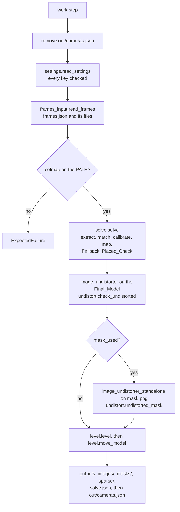
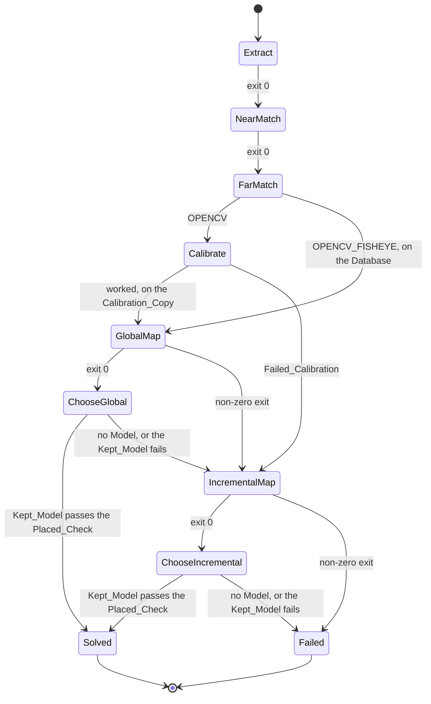

# Design Document: cameras

## Overview

This spec builds the Cameras_Step in `splatpipe/cameras/`, the second entry of the Step_List. It reads the Picks that the Frames_Step left in `work/frames/`, runs COLMAP 4.2.1 on the CPU as a separate program, and hands the Training_Step one PINHOLE camera, one levelled Pose per Placed_Frame, the points, the undistorted Picks and, when the Frames_Step used a Mask, one undistorted Mask per Placed_Frame. The Viewer gets the levelled cameras in `out/cameras.json`.

The step runs these COLMAP_Commands one at a time, each at most once:

1. `feature_extractor` on the Grey_Copies, with one camera for every Pick, and with the Mask when the Frames_Record has `mask_used`.
2. `sequential_matcher` twice on the same Database: the Near_Match_Run, then the Far_Match_Run.
3. For `"OPENCV"`: a copy of the Database, then `view_graph_calibrator` on the copy.
4. `global_mapper`, and `mapper` once when the Calibration fails or the global mapper gives up.
5. `image_undistorter` on the Final_Model, then `image_undistorter_standalone` on `mask.png` when `mask_used` is true.

Then the step levels and centres the scene with one rigid move in its own numpy code, writes the Levelled_Model with its own Model_Writer, and writes `solve.json`, then `out/cameras.json`, last.

The code has three layers, so nearly all of it is tested on a laptop with no COLMAP:

- **Pure code.** The settings checks (`settings.py`), the Frames_Contract checks (`frames_input.py`), the command lines (`commands.py`), the model file layout (the encoders and decoders in `model.py`), the levelling maths (`level.py`), the flow's decisions (the choice functions in `solve.py`) and the mask threshold (`undistort.py`). Unit and property tests run them on tiny synthetic settings, cameras, points and images.
- **One COLMAP runner.** `run_colmap(run)` in `colmap.py` is the only code that starts COLMAP. A `ColmapRun` holds the command line, the Time_Limit, the Command_Log's path, the working folder and the environment. The runner gives back a `RunResult`: the exit code or a Timeout, the seconds, and the Last_Error_Line. Tests put a stand-in in its place that returns scripted results and writes the files each command would write, so the whole flow runs without COLMAP.
- **The step's flow.** `__init__.py`, with `solve.py`, `undistort.py` and `outputs.py`, inside the Step_Runner's contract, built like the Frames_Step.

## COLMAP 4.2.1 facts this design relies on

Each fact was read in the source at the `4.2.1` tag, from `https://raw.githubusercontent.com/colmap/colmap/4.2.1/src/colmap/`, except the last row, which was checked with Homebrew's COLMAP 4.2.1 on a laptop.

| # | Fact | Source | What the design does with it |
|---|---|---|---|
| F1 | The three Model_Files are little-endian with no padding. `camera_t`, `image_t` and `point2D_t` are `uint32_t`, `point3D_t` is `uint64_t`, the camera model id is an `int`, width and height are `uint64_t`, every coordinate is a `double`. An image's name is its bytes followed by one `\0`. `kInvalidPoint3DId` is the largest `uint64_t`. | `scene/reconstruction_io_binary.cc`, `util/types.h`, `util/endian.h` | The layout under "The Model_Files", our reader and our writer. |
| F2 | PINHOLE is model id 1 with 4 parameters (fx, fy, cx, cy). OPENCV is 4 with 8 (fx, fy, cx, cy, k1, k2, p1, p2). OPENCV_FISHEYE is 5 with 8 (fx, fy, cx, cy, k1, k2, k3, k4). The upper-left image corner is (0, 0), so the upper-left pixel's centre is (0.5, 0.5). | `sensor/models.h` | The reader accepts these three models. The Fisheye_Start's principal point is (width / 2, height / 2). |
| F3 | `images.bin` holds only registered images: `WriteImagesBinary` writes `NumRegImages()` records from `RegImageIds()`, which lists the images of the registered frames in the order they were registered. `frames.bin` holds only frames with a pose. Cameras and points are written in increasing id order. | `scene/reconstruction_io_binary.cc`, `scene/reconstruction.cc` | A Model registers exactly the images in its `images.bin` (O10). Our writer sorts cameras and points by id and keeps the images' order. |
| F4 | `ReadBinary` needs `cameras.bin`, `images.bin` and `points3D.bin`, and reads `rigs.bin` and `frames.bin` only when they exist. Without them it makes one rig per camera and one frame per image, registered in `images.bin`'s order. | `scene/reconstruction.cc`, `scene/reconstruction_io_utils.cc` | Our three-file Levelled_Model reads in COLMAP, and our reader ignores `rigs.bin` and `frames.bin`. |
| F5 | A camera that is its rig's reference sensor gets its frame's pose as it is, with no arithmetic (`Frame::SensorFromWorld`). So a model that COLMAP reads and writes again keeps every pose's bytes. | `scene/frame.h` | The integration test can compare our files with COLMAP's rewrite byte for byte. |
| F6 | `WriteBinary` always writes all five files. `model_converter --output_type BIN` reads a model with `Read` and writes it with `WriteBinary`. `model_transformer` reads a model, applies a Sim3 from `--transform_path` and writes all five files. | `scene/reconstruction.cc`, `exe/model.cc` | O6. The integration test uses `model_converter`. |
| F7 | `image_undistorter` and `image_undistorter_standalone` fill the same `UndistortCameraOptions` from the same flags (`blank_pixels`, `min_scale`, `max_scale`, `max_image_size`, the four `roi_*`). Both warp through `UndistortImage`, which calls `UndistortCamera(options, camera)`, and the undistorted model's camera comes from `UndistortReconstruction`, which calls the same function. `UndistortCamera` keeps fx and fy and changes the size and the principal point. | `exe/image.cc`, `controllers/undistorters.cc`, `image/undistortion.cc` | The same camera and the same options give the Mask_Warp the Undistorted_Camera's size and PINHOLE camera. |
| F8 | The standalone's `--input_file` holds one line per image, `name MODEL width height params...`, read with `>>` into a string, `size_t` values and `double` values. It reads `image_path / name` as RGB (`Bitmap::Read`'s `as_rgb` is `true` by default) and writes `output_path / name`, so the PNG keeps its name and format. | `exe/image.cc`, `controllers/undistorters.cc`, `sensor/bitmap.h` | The camera line's numbers are written with Python's `repr`, the shortest text that reads back as the same double. The threshold reads three channels. |
| F9 | A camera whose every distortion parameter is within 1e-8 of 0 counts as undistorted, OPENCV_FISHEYE included. Then both undistorters copy the image file unwarped, and with `max_image_size` at -1 `UndistortReconstruction` leaves the camera, model included, as it is. | `scene/camera.cc`, `image/undistortion.cc`, `controllers/undistorters.cc` | C8. The threshold also takes a one-channel mask. |
| F10 | `global_mapper` reads its database into an in-memory `DatabaseCache`, decomposes relative poses in that cache, and writes nothing back to the database. It sorts its models by registered frames, largest first, before writing them. With no model it logs `Failed to create sparse model` and exits with 1. | `controllers/global_pipeline.cc`, `exe/sfm.cc` | O9. |
| F11 | `view_graph_calibrator`: with no pairs it logs `No image pairs to calibrate`, changes no camera and exits with 0. A Ceres failure logs `View graph calibration failed` and exits with 1. Otherwise each pinhole-type camera gets its estimated focal length, or its starting one when the estimate lies outside `min_focal_length_ratio` to `max_focal_length_ratio` (`N cameras rejected in view graph calibration`), and every one gets `has_prior_focal_length = true`, written with `UpdateCamera`. It fits only pinhole-type cameras. | `estimators/view_graph_calibration.cc`, `exe/sfm.cc` | O5. |
| F12 | The database's `cameras` table has `camera_id`, `model`, `width`, `height`, `params` (a blob of doubles) and `prior_focal_length`. | `scene/database_sqlite.cc` | O5. |
| F13 | Each option's C++ type, which gives its Option_Key's kind. For example `--Mapper.max_runtime_seconds` is an `int` and `--SiftExtraction.edge_threshold` a `double`. | `feature/sift.h`, `feature/extractor.h`, `feature/matcher.h`, `controllers/image_reader.h`, `controllers/pairing.h`, `estimators/two_view_geometry.h`, `estimators/view_graph_calibration.h`, `controllers/global_pipeline.h`, `sfm/global_mapper.h`, `estimators/global_positioning.h`, `estimators/rotation_averaging.h`, `estimators/bundle_adjustment.h`, `controllers/incremental_pipeline.h`, `sfm/incremental_mapper.h`, `sfm/incremental_triangulator.h`, `image/undistortion.h`, `controllers/undistorters.h` | "The settings checks". |
| F14 | `RotationAveragingReweighting` is `UNIFORM` or `INLIER_MATCH_COUNT`. `BundleAdjustmentBackend` is `CERES` or `CASPAR`, and CASPAR needs CUDA. `ba_skip_fixed_rotation_stage` and `ba_skip_joint_optimization_stage` can't both be on. | `estimators/rotation_averaging.h`, `estimators/bundle_adjustment.h`, `sfm/global_mapper.h` | O7 and the settings checks. |
| F15 | A point's `error` is -1 when it has none, and `ComputeMeanReprojectionError` averages the errors that aren't -1. | `scene/point3d.h`, `scene/reconstruction.cc` | The Solve_Record's mean reprojection error. |
| F16 | `colmap <command> -h` lists exactly the options of `references/options.md` plus the ones its notes leave out, and exits with 0. `--Group.name value` parses with negative values like `-1`. glog starts each line with a prefix like `I20261123 04:19:19.624758 0x1705ab000 sift.cc:764] `. | Homebrew's COLMAP 4.2.1, run on a laptop for the six commands with a block in `options.md` | The A16 test, the command lines, and C3. |

## Design choices to review

Each item is a proposal for the user to confirm or change. O1 to O11 are the open design items of the requirements. C1 to C11 are smaller choices this design adds.

### O1: The Time_Limits

| Command | Key | Limit (s) | What the guess is based on |
|---|---|---|---|
| `feature_extractor` | `feature_extractor_timeout_seconds` | 1800 | CPU SIFT on 400 picks, each doubled to 3200 px by `first_octave = -1`: a few seconds per pick per core, so a few minutes on 32 vCPUs. |
| `sequential_matcher` (each run) | `sequential_matcher_timeout_seconds` | 3600 | About 5,880 near pairs and 1,500 far pairs. Brute-force matching of up to 8,192 by 8,192 descriptors costs a fraction of a second per pair per core, plus RANSAC: minutes. |
| `view_graph_calibrator` | `view_graph_calibrator_timeout_seconds` | 1800 | One focal length fit and a RANSAC refit of up to 7,400 pairs: minutes. |
| `global_mapper` | `global_mapper_timeout_seconds` | 3600 | Global mapping of 400 frames takes minutes. The fixed seed turns off a solver ordering, which can make positioning slower. |
| `mapper` | `mapper_timeout_seconds` | 7200 | Incremental mapping of 400 frames with repeated global bundle adjustment on the CPU: tens of minutes. |
| `image_undistorter` | `image_undistorter_timeout_seconds` | 1800 | 400 warps and JPEG writes at quality 100: a few minutes. |
| `image_undistorter_standalone` | `image_undistorter_standalone_timeout_seconds` | 300 | One PNG: seconds. |

These are guesses, not measurements. They take the largest job the settings allow, 400 picks (`max_picks` in `[frames]`) of 1600 px on the long edge (`long_edge`), on the g5.8xlarge's 32 vCPUs, and leave several times the expected time. The first real cloud runs should replace them with measured times plus a margin.

### O2: `fisheye_fov_degrees = 120.0`

Phone ultra-wide lenses and action cameras' wide modes cover roughly 100° to 150° across the long edge, and 120° sits in the middle. The Fisheye_Start only gives the camera a starting focal length and a focal prior, and bundle adjustment refines the focal length from there (`ba_refine_focal_length` is on in both mappers). It's a guess until we have real fisheye clips.

### O3: `axis_point_min_eigen_share = 0.1` and `heading_min_degrees = 10.0`

- **0.1.** For view directions spread evenly over an arc of 2a in one plane, the smallest eigenvalue of Σ(I − d dᵀ) is n(1/2 − sin 2a / 4a) and the largest is about n, so the share is 0.1 at about 2a = 65°. A walk that keeps looking one way, within about ±30°, then gets the Point_Median, and an orbit over a quarter turn or more gets the Axis_Point. At a share of 0.1 or more, the 3 × 3 solve has a condition number of at most 10.
- **10°.** A view at least 10° from straight up or down keeps a horizontal part of at least sin 10° ≈ 0.17 of its length, so a 0.1° rotation error moves the Heading by under 0.6°. People filming a place rarely look within 10° of straight down for the first frame, and when they do, the next frame with a Heading is used.

### O4: `far_overlap = 10`

10 is COLMAP 4.2.1's own default. In quadratic mode pick i is paired with i + 1, 2, 4, …, 512. The Near_Match_Run already has i + 1 to i + 15, so the Far_Match_Run adds i + 16, 32, 64, 128 and 256, about 1,500 pairs for 400 picks. With at most 400 picks, i + 512 never exists, so 10 costs the same as 9 and keeps reaching every power of two if `max_picks` grows past 512.

### O5: How a rejected camera and a Calibration with no pairs are detected

After the Calibration exits with 0, the step reads the one camera row of the Database and of the Calibration_Copy with Python's built-in `sqlite3`, and compares them (F11, F12):

| Calibration_Copy's row, next to the Database's | Outcome |
|---|---|
| `prior_focal_length` still 0 | Failed_Calibration: it found no image pairs to calibrate. |
| `prior_focal_length` 1, and fx and fy bit for bit the same | Failed_Calibration: it rejected its focal length estimate and kept the starting one. |
| `prior_focal_length` 1, and a new focal length | The Calibration worked. |

This reads what the Calibration did to the camera, not its log text, so a reworded log line can't turn a failure into a success. A camera with no pair to fit (`No cameras to optimize`) would look rejected too, which can't happen here, because our OPENCV camera's focal length starts untrusted.

### O6: Our own Model_Writer writes the Levelled_Model

Req 10.2 and 10.9 need our writer anyway. `model_transformer` would write all five files, so the step would still have to copy three of them, and it needs a Sim3 file of its own format and one more COLMAP run (F6). Our writer is checked against COLMAP itself: the integration test runs `colmap model_converter --output_type BIN` on `work/cameras/sparse/` and compares its three files with ours byte for byte (F5).

### O7: The bundle adjustment backends are Fixed_Constants

`--GlobalMapper.ba_backend CERES`, `--Mapper.ba_local_backend CERES` and `--Mapper.ba_global_backend CERES` stay in code. COLMAP 4.2.1's only other backend is CASPAR, which needs CUDA (F14), so a key could only ever hold one value. It's the same reason `--Mapper.ba_use_gpu 0` is fixed.

### O8: The COLMAP_Folder's layout

See "The Work_Folder" under Data Models. COLMAP's folders are named `global/`, `incremental/` and `undistorted/`, never `sparse/`, so nothing in the COLMAP_Folder can be mistaken for the Levelled_Model.

### O9: OPENCV_FISHEYE's Global_Run reads the Database

`global_mapper` reads the database into memory and changes nothing in it (F10), so no copy is needed. If the Fallback runs, the Incremental_Run reads the same Database, as the Match_Runs left it.

### O10: The model file layout

See "The Model_Files" under Data Models, written out as the contract the Training_Step's reader parses. A Model registers exactly the images in its `images.bin` (F3), and the reader ignores `rigs.bin` and `frames.bin` (F4).

### O11: Key names, comments, ranges and the records' fields

- **Key names.** An option `--Group.name` gets the key `<group>_<name>`, with the group in snake case and the whole key in lower case. So `--SiftExtraction.max_num_features` is `sift_extraction_max_num_features`, and `--GlobalMapper.ba_refine_points3D` is `global_mapper_ba_refine_points3d`. An option with no group gets its command's name in front: `--descriptor_normalization` is `feature_extractor_descriptor_normalization`, and `--max_calibration_error` is `view_graph_calibrator_max_calibration_error`. The undistortion settings, which both undistorters share, start with `undistortion_`, and `--default_random_seed`, which every command shares, keeps its own name. The exceptions are the two of Req 12.2: `camera_model`, and `near_overlap` and `far_overlap`.
- **Comments.** Each Option_Key's comment starts with its option, like `# --SiftExtraction.max_num_features: most SIFT features kept per pick.`
- **Ranges.** "The settings checks" under Data Models.
- **The records.** "work/cameras/solve.json" and "out/cameras.json" under Data Models.

### Smaller choices

- **C1.** The Calibration_Copy is made with `sqlite3`'s backup API, which copies a consistent database whatever journal files lie beside it.
- **C2.** Each COLMAP_Command runs with the COLMAP_Folder as its working folder. Its environment is the step's own with `TMPDIR` and `TMP` set to `colmap/tmp/`, and with `TEST_TMPDIR` and every `GLOG_` variable removed: glog looks at `TEST_TMPDIR` before `TMPDIR`, and `GLOG_` variables could move or reformat its log. So any relative path COLMAP writes lands in the Work_Folder.
- **C3.** The Last_Error_Line drops glog's prefix (level, date, time, thread, file and line) and stops before glog's `*** Check failure stack trace: ***` line, so after a crash the Readable_Error shows the failed check, not a stack frame. The Command_Log keeps the full text. This narrows the glossary's "last line that isn't empty".
- **C4.** The Training_Images are copied from `colmap/undistorted/images/`, not moved, because Req 11.5 keeps the Undistortion's `images/` in the COLMAP_Folder. At 400 picks that's about 600 MB more on the job machine's disk.
- **C5.** The test config's `[cameras]` is the real config's `[cameras]`, read from `config.toml` with `tomllib`, with a few test values on top, instead of a second copy of about 190 values in `tests/conftest.py`.
- **C6.** When writing `out/cameras.json` fails, the step removes `solve.json` and the partial `out/cameras.json` before it fails, so no failed run leaves either file. A partly written `solve.json` is removed the same way.
- **C7.** The Placed_Check and the Axis_Point's in-front test compare with exact fractions of the settings' float values, so 0.3 of 10 Picks needs exactly 3 Placed_Frames.
- **C8.** When a mapper's bundle adjustment leaves every distortion parameter within 1e-8 of 0, as `ba_refine_extra_params = false` does, COLMAP's undistorter keeps the camera's own model and copies the picks unwarped (F9). Req 8.2 then fails the step, and its Readable_Error names `mapper_ba_refine_extra_params` and `global_mapper_ba_refine_extra_params`. Both keys' comments say to keep them on.
- **C9.** Decimal options are written in `config.toml` as TOML floats, like `sift_extraction_edge_threshold = 10.0` where `options.md` writes `10`, so the file shows which options take decimals. The value is the same.
- **C10.** When the Levelling keeps the COLMAP_Frame, the step copies every Pose and point unchanged, bit for bit, instead of applying an identity move.
- **C11.** Placed_Frames are counted by name: an image in a Model counts when its name is a Pick's `file`. An image with another name doesn't count, and a Final_Model that holds one fails Req 8.2.

## Architecture



### The solve flow

`solve.solve` is a small state machine. Each state runs at most one COLMAP_Command through the runner, and the runner's `RunResult`, with the files the command wrote, decides the next state.



Not drawn: a Timeout in any state goes to Failed (Req 2.8), and a non-zero exit of Extract, NearMatch or FarMatch goes to Failed (Req 2.9).

| State | Runs | Result, and the next state |
|---|---|---|
| Extract | `feature_extractor` | 0: NearMatch. Timeout: Failed (Req 2.8). Other: Failed (Req 2.9). |
| NearMatch | `sequential_matcher_near` | The same, then FarMatch. |
| FarMatch | `sequential_matcher_far` | The same, then Calibrate for `"OPENCV"`, or GlobalMap on the Database with the Req 5.3 warning for `"OPENCV_FISHEYE"`. |
| Calibrate | the copy, then `view_graph_calibrator` on it | Timeout: Failed. Non-zero exit, rejected camera or no pairs: the Req 5.5 warning, then IncrementalMap. Worked: GlobalMap on the Calibration_Copy. |
| GlobalMap | `global_mapper` | Timeout: Failed. Non-zero exit: the Req 6.7 warning, then IncrementalMap. 0: ChooseGlobal. |
| ChooseGlobal | reads `colmap/global/` | No Model, or a Kept_Model that fails the Placed_Check: the Req 6.7 warning, then IncrementalMap. Otherwise: Solved, from the global mapper. |
| IncrementalMap | `mapper` on the Database | Timeout: Failed. Non-zero exit: Failed (Req 6.10). 0: ChooseIncremental. |
| ChooseIncremental | reads `colmap/incremental/` | A Kept_Model that passes: Solved, from the incremental mapper. No Model counts 0 Placed_Frames (Req 6.11), so it and a failing Kept_Model are the Placed_Failure (Req 7.2). |

### Module layout

| File | What it holds | Imports |
|---|---|---|
| `splatpipe/cameras/__init__.py` | `run()`, `work()`, `Tools`, `TOOLS`, and the step's flow after `solve`: the Undistortion, the Mask_Warp, the Levelling and the writes. | stdlib, numpy, `splatpipe.errors`, `splatpipe.step`, the modules below |
| `splatpipe/cameras/__main__.py` | `main(argv)`, which calls `step_main("cameras", "splatpipe.cameras", argv)`. | stdlib, `splatpipe.step` |
| `splatpipe/cameras/settings.py` | `Range`, `OptionKey`, `OPTION_KEYS`, `TIMEOUT_KEYS`, `CamerasSettings`, `read_settings()`. | stdlib, `splatpipe.errors`, the step's `level` (for `LevelSettings`) |
| `splatpipe/cameras/frames_input.py` | `Pick`, `FramesInput`, `parse_frames_record()`, `read_frames()`. | stdlib, `splatpipe.errors`, `splatpipe.jsonio`, `splatpipe.frames.files` |
| `splatpipe/cameras/colmap.py` | `PROGRAM`, `ColmapRun`, `RunResult`, `colmap_env()`, `run_colmap()`, `last_error_line()`, `exit_text()`. The only code that starts COLMAP. | stdlib, `splatpipe.errors` |
| `splatpipe/cameras/commands.py` | `Paths`, the Fixed_Constants of the command lines, `format_value()`, `fisheye_start()`, and one builder per COLMAP command. | stdlib, `splatpipe.frames.files`, the step's `settings`, `frames_input` and `colmap` |
| `splatpipe/cameras/database.py` | `DatabaseCamera`, `copy_database()`, `read_camera()`, `calibration_failure()`. | stdlib (`sqlite3`), numpy, `splatpipe.errors` |
| `splatpipe/cameras/solve.py` | `Report`, `ModelCount`, `Solved`, `run_timed()`, `run_or_fail()`, `kept_model()`, `placed_needed()`, `model_counts()`, `solve()`. | stdlib, `splatpipe.errors`, the step's `colmap`, `commands`, `database`, `frames_input`, `model` and `settings` |
| `splatpipe/cameras/model.py` | `Camera`, `Image`, `Points`, `Model`, the encoders and decoders of the three Model_Files, `read_model()`, `read_images()`, `write_model()`. | stdlib (`struct`), numpy, `splatpipe.errors` |
| `splatpipe/cameras/undistort.py` | `check_undistorted()`, `mask_camera_line()`, `undistorted_mask()`, `read_warped_mask()`. | numpy, cv2, `splatpipe.errors`, the step's `model` |
| `splatpipe/cameras/level.py` | Pure: `LevelSettings`, `Scene`, `LevelMove`, `Levelling`, the quaternion helpers, `rotation_onto()`, `heading_turn()`, `axis_point()`, `point_median()`, `level()`, `scene_of()`, `move_model()`. | numpy, the step's `model` |
| `splatpipe/cameras/outputs.py` | The Work_Folder names, `copy_training_images()`, `write_training_masks()`, `mean_reprojection_error()`, `solve_record()`, `viewer_cameras()`, `write_record()`. | stdlib, numpy, cv2, `splatpipe.errors`, `splatpipe.jsonio`, the step's `model`, `level` and `solve` |

Every file imports only the standard library, numpy, cv2 and `splatpipe` (Req 12.13). None imports `cloud/`, boto3, torch, gsplat or pycolmap, and `tests/test_imports.py` checks it (Req 16.10). `frames_input.py` and `commands.py` take the Work_Folder names `IMAGES`, `GREY`, `MASK`, `RECORD` and `pick_name` from `splatpipe/frames/files.py`, which defines them as the contract between the two steps. cv2 only decodes and encodes the mask PNGs (Req 12.14).

## Components and Interfaces

### The step's flow (`__init__.py`)

```python
@dataclass(frozen=True)
class Tools:
    find_colmap: Callable[[], str | None]    # shutil.which(PROGRAM)
    run: Callable[[ColmapRun], RunResult]    # colmap.run_colmap

TOOLS = Tools(find_colmap=lambda: shutil.which(PROGRAM), run=run_colmap)

def run(job_id: str, preset: str | None = None, *, config: Config | None = None) -> dict[str, Any]
def work(step: StepContext) -> None
```

`run` calls `run_step("cameras", "splatpipe.cameras", job_id, preset=preset, config=config)`, like the Frames_Step. `work(step)` reads `TOOLS` when it's called, so a test's `monkeypatch` reaches it through `run_step` and the CLI. It works in this order:

1. **The earlier Viewer_Cameras.** `(step.out_folder / "cameras.json").unlink(missing_ok=True)`, before anything else (Req 11.10, A9). Any other `OSError` is the Req 11.12 failure.
2. **Settings.** `cfg = read_settings(step.settings, step.name, step.preset)`. A missing key raises the Step_Runner's own message (Req 12.7), and a bad value an `ExpectedFailure` (Req 12.8 to 12.10). Nothing else has been read yet.
3. **The Frames_Contract.** `frames = read_frames(step.job.folder / "work" / "frames", step.job.id)` (Req 1.1 to 1.4). Adds `picks` (Req 1.6, 13.1).
4. **COLMAP.** `tools.find_colmap() is None` fails with the Req 2.7 message, before any COLMAP_Command.
5. **Folders.** `paths = Paths.of(step.work_folder, frames.folder, step.out_folder)`, every path absolute (Req 2.2). It makes `colmap/`, `colmap/tmp/` and `colmap/logs/`. `env = colmap_env(paths.tmp, os.environ)` (C2).
6. **The solve.** `solved = solve(step, tools.run, cfg, frames, paths, env)`: the state machine above, which adds the command and stage timings, the counts `placed_frames`, `points3d`, `models_found`, `fallback_ran` and `kept_from_global`, and the Req 5.3, 5.5 and 6.7 warnings. It raises for every failure it names, and gives back the Final_Model, read whole.
7. **Undistortion** (`with step.timed("undistortion")`).
   1. `run_or_fail(step, tools.run, commands.image_undistorter(cfg, paths, env, solved.folder))`. A Timeout fails the step (Req 2.8), and so does a non-zero exit (Req 2.9).
   2. `undistorted = read_model(paths.undistorted / "sparse")`, then `camera = check_undistorted(undistorted, solved.placed_names, paths.undistorted / "images")` (Req 8.2).
   3. With `mask_used`: write `mask_camera_line(solved.model.cameras[0])` to `paths.mask_camera` (the Final_Model's camera before the Undistortion, Req 8.3), `run_or_fail` the Mask_Warp, `commands.image_undistorter_standalone(cfg, paths, env)`, and then `mask = read_warped_mask(paths.mask_warped / MASK, camera.width, camera.height)` gives the Undistorted_Mask (Req 8.4, 8.5). An `OSError` while writing the camera line is the Req 11.12 failure, as for every file the step writes.
8. **Levelling** (`with step.timed("levelling")`). `scene = scene_of(undistorted, frames.numbers)`, then `levelling = level(scene, cfg.level)`. `level` never raises (Req 9.12, 9.14). When it moved the scene, `levelled = move_model(undistorted, levelling.move)`, and otherwise `levelled = undistorted`, unchanged (C10). A kept frame adds `levelling.reason` as a warning (Req 9.3, 9.7, 9.10, 9.12). Adds `levelled` as 1 or 0.
9. **Writing** (`with step.timed("writing")`), in this order (Req 11.6, 11.8, A8):
   1. `copy_training_images(paths.undistorted / "images", paths.images, names)`, where `names` are the image names in `levelled`, in its order (Req 11.2).
   2. With `mask_used`: `write_training_masks(paths.masks, mask, names)` (Req 11.3). Without it, no `masks/` folder (Req 11.4).
   3. `write_model(paths.sparse, levelled)`: exactly the three Model_Files (Req 10.5).
   4. `write_record(paths.record, solve_record(...))` (Req 11.6, 11.7).
   5. `write_record(paths.viewer, viewer_cameras(levelled, frames.numbers, levelling.levelled))`, last of all (Req 11.8, 11.9). If it fails, `solve.json` is removed too (C6).

Every count goes in with `int(...)` and every timing as a float of seconds (Req 13.4). The command timings are added as soon as each command returns, whatever its result, so a failed report holds the failing command's timing (Req 13.3). The stage timings `matching`, `mapping`, `undistortion`, `levelling` and `writing` come from `step.timed`, which adds a timing only when its block finishes.

The step writes only inside `work/cameras/` and to `out/cameras.json` (Req 11.11). It relies on the Step_Runner emptying `work/cameras/` before it runs (Req 11.13). It leaves `work/frames/` as it is: COLMAP only reads from it (Req 1.7).

### settings.py

```python
OptionValue = bool | int | float | str

@dataclass(frozen=True)
class Range:
    kind: Literal["bool", "whole", "number", "name"]
    wanted: str                       # for the messages, like "a whole number above 0"
    test: Callable[[Any], bool]       # the range, on a value already of the kind

@dataclass(frozen=True)
class OptionKey:
    key: str                          # the key in [cameras], like "sift_extraction_max_num_features"
    option: str                       # COLMAP's option, like "--SiftExtraction.max_num_features"
    commands: tuple[str, ...]         # the COLMAP commands that take it
    range: Range

OPTION_KEYS: tuple[OptionKey, ...]    # one per Option_Key, in references/options.md's order
TIMEOUT_KEYS: Mapping[str, str]       # COLMAP command -> its Time_Limit key

@dataclass(frozen=True)
class CamerasSettings:
    camera_model: str
    fisheye_fov_degrees: float
    near_overlap: int                 # the Preset_Setting
    far_overlap: int
    min_placed_frames: int
    min_placed_share: float
    level: LevelSettings              # up_agreement, heading_min_degrees, the two axis point shares
    timeouts: Mapping[str, float]     # by COLMAP command
    min_vcpus: int
    min_memory_gb: int
    options: Mapping[str, OptionValue]  # every Option_Key's value, by key, camera_model included

def read_settings(settings: Mapping[str, Any], section: str, preset: str) -> CamerasSettings
```

- Each key is read with `settings[key]`, so a missing key raises the Step_Runner's message, which names `[cameras]`, `[cameras.<preset>]` and the key (Req 12.7).
- Each `Range` has one kind check, with `type()` checked exactly, so a bool is never a number (Req 12.8, A2):
  - `"bool"`: `type(v) is bool`.
  - `"whole"`: `type(v) is int` and from -2147483648 to 2147483647, the range of the C++ `int` that COLMAP 4.2.1 parses these options into.
  - `"number"`: `type(v) in (int, float)`. Config already refuses NaN and infinity.
  - `"name"`: `type(v) is str` and one of the Range's names.
- Then the Range's own test, then the cross checks of "The settings checks". A refusal names the key, its table, COLMAP's option for an Option_Key, and what the value must be: "The setting sift_extraction_max_num_features in [cameras] (COLMAP's --SiftExtraction.max_num_features) is 0, but it must be a whole number above 0. Change it to a whole number above 0." A cross check names both settings and their values, like the Frames_Step's.
- `options` holds every Option_Key's value as Config gave it, so `commands.format_value` writes an int as an int and a float as a float.
- `min_vcpus` and `min_memory_gb` are checked and kept, and never used (Req 12.11, D13).

### frames_input.py

```python
@dataclass(frozen=True)
class Pick:
    number: int                       # its Pick_Number
    file: str                         # pick_name(number), like "000000.jpg"

@dataclass(frozen=True)
class FramesInput:
    folder: Path                      # work/frames/, absolute
    pick_width: int
    pick_height: int
    mask_used: bool
    picks: tuple[Pick, ...]           # as the Frames_Record lists them

    @property
    def numbers(self) -> Mapping[str, int]   # file -> Pick_Number

def parse_frames_record(data: object, record: Path, job_id: str) -> tuple[int, int, bool, tuple[Pick, ...]]
def read_frames(folder: Path, job_id: str) -> FramesInput
```

- `read_frames` reads `folder / RECORD` with `splatpipe.jsonio.read_json`. `FileNotFoundError` is the Req 1.2 failure. Any other read error (`OSError`, `ValueError`, `RecursionError`) is the Req 1.3 failure, saying the file can't be read as JSON.
- `parse_frames_record` is pure. It refuses, naming the field (Req 1.3): a record that isn't an object; `pick_width` or `pick_height` missing or not an int above 0; `mask_used` missing or not a bool; `picks` missing, not a list, or empty; a Pick that isn't an object, or whose `number` isn't an int of 0 or more, or whose `file` isn't a str; a `file` other than `pick_name(number)`; and a `number` given twice, which would give two Picks one file and break Req 1.6.
- Then every `images/<file>` and `grey/<file>` must be a file, and `mask.png` too when `mask_used` is true, or the Req 1.4 failure names the first missing file.
- Every refusal says to run the Frames_Step again, with `uv run python -m splatpipe.frames --job <id>`.

### colmap.py

```python
PROGRAM = "colmap"                       # Fixed_Constant

@dataclass(frozen=True)
class ColmapRun:
    name: str                            # the run's name, also its timing's and its log's, like "sequential_matcher_near"
    command: str                         # COLMAP's command, like "sequential_matcher"
    args: tuple[str, ...]                # the whole command line, from PROGRAM
    timeout_seconds: float
    timeout_key: str                     # the Time_Limit key in [cameras], for the Req 2.8 message
    log: Path                            # the Command_Log, colmap/logs/<name>.log
    cwd: Path                            # the COLMAP_Folder
    env: Mapping[str, str]

    def value(self, option: str) -> str   # the argument after `option`, for the stand-in and the tests

@dataclass(frozen=True)
class RunResult:
    exit_code: int | None                # None: stopped at its Time_Limit
    seconds: float
    last_line: str                       # the Last_Error_Line, "" when the log has none

def colmap_env(tmp: Path, base: Mapping[str, str]) -> dict[str, str]
def run_colmap(run: ColmapRun) -> RunResult
def last_error_line(lines: Iterable[str]) -> str
def exit_text(code: int) -> str
```

- **`colmap_env`** is pure: `base` without `TEST_TMPDIR` and without any key that starts with `GLOG_`, with `TMPDIR` and `TMP` set to `str(tmp)` (C2, A10).
- **`run_colmap`** opens `run.log` for writing in binary (an `OSError` is the Req 11.12 failure naming the log), then runs `subprocess.run(list(run.args), stdin=subprocess.DEVNULL, stdout=log, stderr=subprocess.STDOUT, cwd=run.cwd, env=dict(run.env), timeout=run.timeout_seconds)`. That's an argument list with no shell and with standard input closed (Req 2.2). glog writes all of COLMAP's output to stderr under `--log_target stderr`; stdout goes into the same log, so the Command_Log holds everything in the order COLMAP wrote it (Req 2.10).
  - `subprocess.TimeoutExpired`: `subprocess.run` has already killed COLMAP and waited for it, so the result has `exit_code=None`.
  - `FileNotFoundError`: the Req 2.7 failure, in case `colmap` disappeared after `find_colmap`.
  - The seconds come from `time.perf_counter` around the call. The Last_Error_Line comes from reading the whole Command_Log once, line by line, with `errors="replace"`. The step holds one line at a time, so a long log needs no size limit in code.
- **`last_error_line`** goes through the lines in order, stops at the first line that holds `*** Check failure stack trace: ***`, keeps the last line before it that isn't empty, and drops glog's prefix when the line has one: a level letter (`I`, `W`, `E` or `F`), a date of 4 or 8 digits, a time, a thread id in decimal or hex, and `file:line] ` (C3, F16).
- **`exit_text`** gives `exit code 1`, or for a negative code from a signal, `exit code -6 (signal SIGABRT)`.

### commands.py

```python
@dataclass(frozen=True)
class Paths:
    frames: Path                 # work/frames/
    colmap: Path                 # work/cameras/colmap/, the COLMAP_Folder
    tmp: Path                    # colmap/tmp/, TMPDIR
    logs: Path                   # colmap/logs/
    database: Path               # colmap/database.db
    calibrated: Path             # colmap/database_calibrated.db, the Calibration_Copy
    global_models: Path          # colmap/global/
    incremental_models: Path     # colmap/incremental/
    undistorted: Path            # colmap/undistorted/
    mask_camera: Path            # colmap/mask_camera.txt
    mask_warped: Path            # colmap/mask_undistorted/
    images: Path                 # work/cameras/images/
    masks: Path                  # work/cameras/masks/
    sparse: Path                 # work/cameras/sparse/
    record: Path                 # work/cameras/solve.json
    viewer: Path                 # out/cameras.json

    @classmethod
    def of(cls, work: Path, frames: Path, out: Path) -> Paths   # resolved, so every path is absolute

def format_value(value: OptionValue) -> str
def fisheye_start(width: int, height: int, fov_degrees: float) -> tuple[float, ...]
def feature_extractor(cfg: CamerasSettings, frames: FramesInput, paths: Paths, env: Mapping[str, str]) -> ColmapRun
def sequential_matcher(cfg: CamerasSettings, paths: Paths, env: Mapping[str, str], *, far: bool) -> ColmapRun
def view_graph_calibrator(cfg: CamerasSettings, paths: Paths, env: Mapping[str, str]) -> ColmapRun
def global_mapper(cfg: CamerasSettings, paths: Paths, env: Mapping[str, str], database: Path) -> ColmapRun
def mapper(cfg: CamerasSettings, paths: Paths, env: Mapping[str, str]) -> ColmapRun
def image_undistorter(cfg: CamerasSettings, paths: Paths, env: Mapping[str, str], model: Path) -> ColmapRun
def image_undistorter_standalone(cfg: CamerasSettings, paths: Paths, env: Mapping[str, str]) -> ColmapRun
```

- **`format_value`** (Req 2.4): a bool is `"1"` or `"0"`, an int `str(v)`, a float `repr(v)` (the shortest text that reads back as the same double, like `0.006666666666666667` or `1e-05`), and a name as it is.
- **`fisheye_start`** (Req 3.4): with L = max(width, height) and θ = radians(fov_degrees), it gives (f, f, width / 2, height / 2, 0.0, 0.0, 0.0, 0.0) with f = (L / 2) / (θ / 2). The builder joins them with `,` through `format_value`, for `--ImageReader.camera_params`.
- **Every builder** gives `args` in `references/options.md`'s order: `PROGRAM`, the command, its paths, the four log options, `--default_random_seed`, then the command's options, with each Fixed_Constant where `options.md` has it and each other option at its Option_Key's value. `OPTION_KEYS` lists, for each key, the commands that take it, so a builder takes exactly its command's keys, each once (Req 2.3, 2.5). The run's `name`, `timeout_seconds`, `timeout_key`, `log`, `cwd` and `env` come from the command and `paths`.

| Builder | `name` | Paths | Fixed_Constants besides the four log options | Conditional options |
|---|---|---|---|---|
| `feature_extractor` | `feature_extractor` | `--database_path` the Database, `--image_path` `work/frames/grey` | `--camera_mode 1`, `--FeatureExtraction.type SIFT`, `--FeatureExtraction.use_gpu 0` | `--ImageReader.camera_params` with the Fisheye_Start only for `"OPENCV_FISHEYE"` (Req 3.3, 3.4). `--ImageReader.camera_mask_path` `work/frames/mask.png` only with `mask_used` (Req 3.5, 3.6). |
| `sequential_matcher(far=False)` | `sequential_matcher_near` | `--database_path` the Database | `--FeatureMatching.type SIFT_BRUTEFORCE`, `--FeatureMatching.use_gpu 0`, `--SequentialMatching.loop_detection 0`, `--SequentialMatching.quadratic_overlap 0` | `--SequentialMatching.overlap` from `near_overlap` (Req 4.1). |
| `sequential_matcher(far=True)` | `sequential_matcher_far` | the same | the same, with `--SequentialMatching.quadratic_overlap 1` | `--SequentialMatching.overlap` from `far_overlap` (Req 4.2). |
| `view_graph_calibrator` | `view_graph_calibrator` | `--database_path` the Calibration_Copy | none | |
| `global_mapper` | `global_mapper` | `--database_path` as given, `--image_path` `work/frames/images`, `--output_path` `colmap/global` | `--GlobalMapper.gp_use_gpu 0`, `--GlobalMapper.ba_ceres_use_gpu 0`, `--GlobalMapper.ba_backend CERES` | |
| `mapper` | `mapper` | `--database_path` the Database, `--image_path` `work/frames/images`, `--output_path` `colmap/incremental` | `--Mapper.ba_use_gpu 0`, `--Mapper.ba_local_backend CERES`, `--Mapper.ba_global_backend CERES` | |
| `image_undistorter` | `image_undistorter` | `--image_path` `work/frames/images`, `--input_path` the Final_Model's folder, `--output_path` `colmap/undistorted` | `--output_type COLMAP` | |
| `image_undistorter_standalone` | `image_undistorter_standalone` | `--image_path` `work/frames`, `--input_file` `colmap/mask_camera.txt`, `--output_path` `colmap/mask_undistorted` | none | |

The two undistorters take the same eleven `undistortion_*` keys (Req 2.5, 8.3). No builder passes `--help`, `--project_path`, `--log_path`, a GPU index, an image list, a vocabulary tree, any `--SequentialMatching.loop_detection_*` setting, or any ALIKED, LoMa or LightGlue option (Req 2.6).

### database.py

```python
@dataclass(frozen=True)
class DatabaseCamera:
    camera_id: int
    model_id: int
    width: int
    height: int
    params: tuple[float, ...]        # the params blob, read as little-endian doubles
    prior_focal_length: bool

def copy_database(source: Path, target: Path) -> None
def read_camera(path: Path) -> DatabaseCamera
def calibration_failure(before: DatabaseCamera, after: DatabaseCamera) -> str | None
```

- **`copy_database`** opens `source` and `target` with `sqlite3.connect` and copies with `source.backup(target)` (C1). It runs after the Far_Match_Run has exited, so no COLMAP process has the Database open (Req 2.11). A `sqlite3.Error` or `OSError` is the Req 11.12 failure naming the Calibration_Copy.
- **`read_camera`** runs `SELECT camera_id, model, width, height, params, prior_focal_length FROM cameras` (F12). Anything but exactly one row, or a database that can't be read, fails, naming the file and saying to check that COLMAP 4.2.1 is installed and to run the step again. The step gives every Pick one camera, so one row is the only right answer.
- **`calibration_failure`** is pure: `"found no image pairs to calibrate"` when `after.prior_focal_length` is false, `"rejected its focal length estimate and kept the starting one"` when fx and fy are bit for bit the same as `before`'s, and `None` when the Calibration worked (O5).

### solve.py

```python
class Report(Protocol):                  # StepContext has these three
    def add_timing(self, name: str, seconds: float) -> None: ...
    def add_count(self, name: str, value: int) -> None: ...
    def add_warning(self, text: str) -> None: ...

@dataclass(frozen=True)
class ModelCount:
    number: int                          # the Model's folder name, 0, 1, ...
    placed: int                          # its Placed_Frames

@dataclass(frozen=True)
class Solved:
    calibration_ran: bool
    calibration_failure: str | None      # why, for a Failed_Calibration
    mapper: Literal["global", "incremental"]
    fallback_reason: str | None          # why the Fallback ran
    models: tuple[ModelCount, ...]       # every Model of the run that made the Final_Model
    final: ModelCount
    folder: Path                         # the Final_Model's folder
    model: Model                         # the Final_Model, read whole
    placed_names: frozenset[str]         # its Placed_Frames' names

def run_timed(report: Report, run: Callable[[ColmapRun], RunResult], colmap_run: ColmapRun) -> RunResult
def run_or_fail(report: Report, run: Callable[[ColmapRun], RunResult], colmap_run: ColmapRun) -> RunResult
def kept_model(models: Sequence[ModelCount]) -> ModelCount | None
def placed_needed(picks: int, min_frames: int, min_share: float) -> int
def model_counts(folder: Path, numbers: Mapping[str, int]) -> tuple[ModelCount, ...]
def solve(report: Report, run: Callable[[ColmapRun], RunResult], cfg: CamerasSettings,
          frames: FramesInput, paths: Paths, env: Mapping[str, str]) -> Solved
```

- **`run_timed`** calls the runner, adds the run's timing under its `name` at once, whatever the result (Req 13.3), and raises the Req 2.8 failure for a Timeout, which never has a Fallback. Otherwise it gives the result back.
- **`run_or_fail`** is `run_timed` plus the Req 2.9 failure for a non-zero exit. The Feature_Extraction, the Match_Runs and both undistorters run through it. The Calibration and both mappers run through `run_timed`, because their non-zero exits have their own rules.

- **`kept_model`** gives `max(models, key=lambda m: (m.placed, -m.number))`, so the most Placed_Frames and the lowest Model number among those with as many, or `None` for no Model (Req 6.8).
- **`placed_needed`** gives max(`min_frames`, ⌈`Fraction(min_share)` × `picks`⌉), worked out exactly (C7). A Kept_Model passes the Placed_Check when its `placed` is at least that. That's the same as `placed >= min_frames` and `placed >= min_share × picks` with the float's exact value, because `placed` is whole (Req 7.1).
- **`model_counts`** lists the subfolders of a mapper's output folder whose names are decimal numbers, in number order, and reads each one's `images.bin` with `read_images`. `placed` counts the images whose names are in `numbers` (C11). Every image in `images.bin` is registered (F3). A Model with a missing or broken `images.bin` is the Req 10.4 failure.
- **`solve`** follows the state table:
  1. `run_or_fail` the Feature_Extraction, then, `with timed("matching")`, the Near_Match_Run and the Far_Match_Run.
  2. `with timed("mapping")`:
     1. For `"OPENCV"`: `copy_database(paths.database, paths.calibrated)`, then `run_timed` the Calibration. A non-zero exit gives the reason `"stopped with <exit_text> (<last line>)"` (A3). An exit of 0 gives `calibration_failure(read_camera(paths.database), read_camera(paths.calibrated))`. With a reason, the Req 5.5 warning and the Fallback. Without one, the Global_Run reads the Calibration_Copy (Req 6.1).
     2. For `"OPENCV_FISHEYE"`: the Req 5.3 warning, and the Global_Run reads the Database (Req 6.2, O9).
     3. `paths.global_models.mkdir()`, then `run_timed` the Global_Run. A non-zero exit gives the reason `"stopped with <exit_text> (<last line>)"` (Req 6.3). An exit of 0 lists `model_counts(paths.global_models, frames.numbers)`: none gives `"wrote no model"` (Req 6.4), and a Kept_Model under `placed_needed` gives `"placed only <k> of the <n> picks in its best model, fewer than the <needed> the step needs"` (Req 6.5). With a reason, the Req 6.7 warning and the Fallback.
     4. The Fallback: `paths.incremental_models.mkdir()`, then `run_timed` the Incremental_Run on the Database (Req 6.6). A non-zero exit fails with the Req 6.10 message. An exit of 0 lists its Models, and none counts 0 Placed_Frames (Req 6.11).
     5. Adds `fallback_ran`, `kept_from_global`, `models_found` and `placed_frames` for the run that made the Final_Model (Req 6.9, 13.1). A Kept_Model that fails the Placed_Check, or no Model, raises the Placed_Failure (Req 7.2, 7.3), before any Undistortion.
     6. Reads the Final_Model whole with `read_model` and adds `points3d`.
- Each COLMAP_Command runs at most once and only after the one before has returned (Req 2.11, 2.12). Nothing is retried.
- `timed(name)` is a small context manager in `solve.py`. It adds the block's seconds with `report.add_timing` when the block finishes, as `StepContext.timed` does, because `Report` has only the three `add_*` methods. A stage that fails adds no stage timing, but its commands' timings are already in (Req 13.3).

The warnings, with the values filled in:

- Req 5.3: "The camera model is OPENCV_FISHEYE, so the focal length calibration was skipped, because COLMAP's view_graph_calibrator only fits pinhole cameras. The fisheye camera starts from fisheye_fov_degrees = `<θ>` in [cameras]."
- Req 5.5: "The focal length calibration `<reason>`, so the global mapper didn't run and the incremental mapper ran instead."
- Req 6.7: "The global mapper `<reason>`, so the incremental mapper ran instead."

### model.py

```python
CAMERA_MODELS: Mapping[int, tuple[str, int]] = {1: ("PINHOLE", 4), 4: ("OPENCV", 8), 5: ("OPENCV_FISHEYE", 8)}
NO_POINT3D = 2**64 - 1                   # kInvalidPoint3DId
NO_ERROR = -1.0                          # a point's error when it has none
POINT2D = np.dtype([("x", "<f8"), ("y", "<f8"), ("point3d_id", "<u8")])
TRACK_ELEMENT = np.dtype([("image_id", "<u4"), ("point2d_idx", "<u4")])
FILES = ("cameras.bin", "images.bin", "points3D.bin")

@dataclass(frozen=True)
class Camera:
    camera_id: int
    model_id: int                        # a key of CAMERA_MODELS
    width: int
    height: int
    params: tuple[float, ...]            # the model's count, in the model's order

@dataclass(frozen=True)
class Image:
    image_id: int
    qvec: tuple[float, float, float, float]   # cam_from_world rotation, w x y z
    tvec: tuple[float, float, float]          # cam_from_world translation
    camera_id: int
    name: str
    points2d: np.ndarray                 # POINT2D, one per 2D point

@dataclass(frozen=True)
class Points:
    ids: np.ndarray                      # <u8, (n,)
    xyz: np.ndarray                      # <f8, (n, 3)
    rgb: np.ndarray                      # u1, (n, 3)
    errors: np.ndarray                   # <f8, (n,)
    tracks: tuple[np.ndarray, ...]       # TRACK_ELEMENT, one array per point

@dataclass(frozen=True)
class Model:
    cameras: tuple[Camera, ...]
    images: tuple[Image, ...]            # in the file's order, which COLMAP's writer keeps
    points: Points

def encode_cameras(cameras: Sequence[Camera]) -> bytes
def decode_cameras(data: bytes, path: Path) -> tuple[Camera, ...]
def encode_images(images: Sequence[Image]) -> bytes
def decode_images(data: bytes, path: Path) -> tuple[Image, ...]
def encode_points(points: Points) -> bytes
def decode_points(data: bytes, path: Path) -> Points
def read_images(path: Path) -> tuple[Image, ...]
def read_model(folder: Path) -> Model
def write_model(folder: Path, model: Model) -> None
```

- Our own code, written fresh from the layout under "The Model_Files", with `struct` and numpy (Req 10.3). The fixed parts of each record go through `struct` with explicit little-endian formats (`<`), and each image's 2D points and each point's track through `np.frombuffer` and `tobytes()` with the dtypes above, which keeps every bit, NaN payloads included.
- **Decoding** walks a `memoryview` with an offset. It refuses, with an `ExpectedFailure` that names the file and says what's wrong and to check that COLMAP 4.2.1 is installed and to run the step again (Req 10.4):
  - a file that ends inside a record or inside its count ("ends too soon, inside image 12's name");
  - a camera model id that isn't a key of `CAMERA_MODELS`;
  - a name with no `\0` before the end, or that isn't UTF-8;
  - a camera, image or point id given twice;
  - bytes left after the last record.
- **Encoding** writes the cameras and the points in increasing id order, as `WriteBinary` does, and the images in the Model's order (F3). It raises `ValueError`, a bug in our code, for an id given twice, a name with a `\0` in it, a model id it doesn't know or a parameter count that doesn't match.
- **`read_model`** reads the three files and ignores any others, `rigs.bin` and `frames.bin` included (Req 10.1, F4). A missing file is the Req 10.4 failure. **`write_model`** makes the folder and writes exactly the three files with `Path.write_bytes`. An `OSError` is the Req 11.12 failure naming the file.

### undistort.py

```python
def check_undistorted(model: Model, placed: Collection[str], images: Path) -> Camera
def mask_camera_line(camera: Camera) -> str
def undistorted_mask(image: np.ndarray) -> np.ndarray
def read_warped_mask(path: Path, width: int, height: int) -> np.ndarray
```

- **`check_undistorted`** (Req 8.2) gives the Undistorted_Camera after checking that the Undistorted_Model has exactly one camera, that it's PINHOLE, that every image uses it, that its image names are exactly `placed`, and that `images/<name>` is a file for each one. Each refusal says what the Undistortion got wrong and to run the step again. For a camera that isn't PINHOLE, it also says that COLMAP keeps a camera's own model when the camera's distortion came out as 0, which happens when `mapper_ba_refine_extra_params` or `global_mapper_ba_refine_extra_params` is false, and to set them to true (C8, F9).
- **`mask_camera_line`** (Req 8.3, F8) gives `"mask.png <MODEL> <width> <height> <p1> … <pN>\n"`, with the Final_Model's camera's model name and each parameter as `repr(float)`.
- **`undistorted_mask`** (Req 8.4) is pure. It takes a `uint8` image of 2 dimensions, or of 3 with 1, 3 or 4 channels, and gives one `uint8` channel: 255 where every channel is 255, 0 everywhere else. One channel covers the copy that COLMAP makes for a camera with no distortion (F9).
- **`read_warped_mask`** (Req 8.5) reads the file with `Path.read_bytes` and `cv2.imdecode(..., cv2.IMREAD_UNCHANGED)`. A file that can't be read or decoded, that isn't 8-bit, or that isn't `width` × `height` fails, naming the file and what's wrong and saying to run the step again. Then it gives `undistorted_mask` of it.

### level.py (pure)

```python
WORLD_UP = np.array([0.0, -1.0, 0.0])    # Fixed_Constant: the World_Up
FORWARD = np.array([0.0, 0.0, 1.0])      # Fixed_Constant: where the Heading points, +Z

@dataclass(frozen=True)
class LevelSettings:
    up_agreement: float
    heading_min_degrees: float
    axis_point_min_eigen_share: float
    axis_point_min_front_share: float

@dataclass(frozen=True)
class Scene:
    names: tuple[str, ...]               # the Placed_Frames' names, in Pick_Number order
    rotations: np.ndarray                # (n, 3, 3), each camera's R
    centres: np.ndarray                  # (n, 3), each camera's -R^T t
    points: np.ndarray                   # (m, 3)

@dataclass(frozen=True)
class LevelMove:
    rotation: np.ndarray                 # (3, 3)
    translation: np.ndarray              # (3,)

@dataclass(frozen=True)
class Levelling:
    move: LevelMove                      # the identity when the COLMAP_Frame is kept
    levelled: bool
    reason: str | None                   # the warning, when the COLMAP_Frame is kept
    mean_up_length: float | None
    scene_centre: Literal["axis_point", "point_median"] | None
    heading_camera: str | None           # the Heading_Camera's name

def scene_of(model: Model, numbers: Mapping[str, int]) -> Scene
def level(scene: Scene, settings: LevelSettings) -> Levelling
def move_model(model: Model, move: LevelMove) -> Model
```

The conventions are COLMAP's. A Pose is the cam_from_world rotation R, from the unit quaternion q = (w, x, y, z) in Hamilton's convention, and the translation t: a world point x is at R x + t in the camera, which looks along +z with x to the right and y down. For each Placed_Frame i:

- the Up_Vector u_i = Rᵢᵀ (0, −1, 0), which is minus the second row of Rᵢ;
- the View_Direction d_i = Rᵢᵀ (0, 0, 1), the third row of Rᵢ;
- the centre C_i = −Rᵢᵀ tᵢ.

`level(scene, settings)` works out the Level_Move in these steps. Any exception in them, or any value that isn't finite, keeps the COLMAP_Frame with the Req 9.12 warning, which names the error's type and message (A14). So `level` never raises.

1. **Finite input.** If any rotation, centre or point holds a value that isn't finite, keep the COLMAP_Frame (Req 9.12).
2. **Mean_Up** (Req 9.2, 9.3). m = (1/n) Σ u_i, and ℓ = |m|. If ℓ < `up_agreement`, keep the COLMAP_Frame with the Req 9.3 warning.
3. **Rotate the Mean_Up to the World_Up** (Req 9.4). With a = m / ℓ and g = (0, −1, 0), R_a = `rotation_onto(a, g)`:
   - When a · g ≥ 0: with v = a × g, c = a · g and K the cross-product matrix of v, R_a = I + K + K² / (1 + c). Here 1 + c ≥ 1, so the division is always safe. When a = g, v = 0 and R_a = I.
   - When a · g < 0: P = diag(1, −1, −1), the half turn about x, takes g to −g, so (P a) · g = −(a · g) > 0. Then R_a = `rotation_onto(P a, g)` P, a rotation that takes a to g. When a = −g, that is the Mean_Up along (0, 1, 0), P a = g and R_a = P. Every rotation that takes a to g gives the same Level_Move, because step 5 then fixes the Heading.
4. **The Heading_Camera** (Req 9.6, 9.7). With d'_i = R_a d_i, frame i has a Heading when |d'_i · g| ≤ cos(`heading_min_degrees`), which is the same as being at least `heading_min_degrees` from straight up and from straight down. The Heading_Camera h is the first such frame in Pick_Number order. With none, keep the COLMAP_Frame with the Req 9.7 warning.
5. **Turn to +Z** (Req 9.5). With (x, z) the first and third parts of d'_h and r = √(x² + z²), which is at least sin(`heading_min_degrees`) > 0:

   ```
   R_t = [[ z/r, 0, -x/r],
          [   0, 1,    0],
          [ x/r, 0,  z/r]]
   ```

   R_t turns about the y axis, so it keeps g, and it takes (x, ·, z) to (0, ·, r). The Level_Move's rotation is R = R_t R_a.
6. **The Scene_Centre** (Req 9.8 to 9.10), in COLMAP's frame, then rotated:
   - A = Σ (I − d_i d_iᵀ) and b = Σ (I − d_i d_iᵀ) C_i, with λ_min and λ_max from `numpy.linalg.eigvalsh(A)`. λ_max ≥ 2n / 3 > 0, because A's trace is 2n.
   - The eigenvalue test comes first. Only when λ_min ≥ `axis_point_min_eigen_share` × λ_max, which makes A invertible, does `level` work out the Axis_Point p = `numpy.linalg.solve(A, b)`. So parallel cameras and a single camera, whose A is singular, go to the Point_Median and never reach the solve, which would raise and give the Req 9.12 warning instead.
   - The Axis_Point is well defined when it has also passed the in-front test: the number of frames with (p − C_i) · d_i > 0 is at least `Fraction(axis_point_min_front_share)` × n (C7).
   - Well defined: s = R p, and the Scene_Centre is `"axis_point"`.
   - Otherwise, with at least one point: s is the median of the rotated points R X_j, taken along x, y and z separately (A6), and the Scene_Centre is `"point_median"`.
   - Otherwise keep the COLMAP_Frame with the Req 9.10 warning.
7. **The translation** (Req 9.11). T = −s, so the Level_Move is x' = R x + T.
8. **Finite output.** R and T must be finite, or keep the COLMAP_Frame (Req 9.12).

`move_model(model, move)` applies the whole Level_Move to every Pose and every point at once, with scale 1 (Req 9.1, 9.13):

- q_R is the unit quaternion of R, from Shepperd's method, which starts from the largest of the trace and the three diagonal terms so nothing cancels.
- Each image gets q'_i = normalise(q_i ⊗ q̄_R) and t'_i = t_i − R'_i T, with R'_i the rotation of q'_i. That follows from x = Rᵀ(x' − T): the camera sees R_i x + t_i = (R_i Rᵀ) x' + (t_i − R_i Rᵀ T). So the centres move as C'_i = R C_i + T, like the points.
- Each point gets X'_j = R X_j + T.
- The camera, every image's id, camera id, name and 2D points, and every point's id, colour, error and track stay as they are (Req 10.6 to 10.8).

The warnings, with the values filled in:

- Req 9.3: "The cameras don't agree on which way is up: their mean up vector is `<ℓ>` long, below up_agreement = `<value>` in [cameras]. So the scene was left in COLMAP's frame, which may be tilted."
- Req 9.7: "Every placed camera looks within heading_min_degrees = `<value>`° of straight up or down, so the scene couldn't be turned to face +Z and was left in COLMAP's frame, which may be tilted."
- Req 9.10: "The scene's centre couldn't be found: the cameras' view lines don't meet in a well defined point and the model has no 3D points. So the scene was left in COLMAP's frame, which may be tilted."
- Req 9.12: "Levelling the scene failed (`<type>: <message>`), so the scene was left in COLMAP's frame, which may be tilted."

### outputs.py

```python
IMAGES, MASKS, SPARSE, COLMAP = "images", "masks", "sparse", "colmap"   # Fixed_Constants (D2)
RECORD, VIEWER = "solve.json", "cameras.json"

def copy_training_images(source: Path, target: Path, names: Sequence[str]) -> None
def write_training_masks(folder: Path, mask: np.ndarray, names: Sequence[str]) -> None
def mean_reprojection_error(points: Points) -> float | None
def solve_record(solved: Solved, levelling: Levelling, camera_model: str, mean_error: float | None) -> dict[str, Any]
def viewer_cameras(model: Model, numbers: Mapping[str, int], levelled: bool) -> dict[str, Any]
def write_record(path: Path, record: dict[str, Any]) -> None
```

- **`copy_training_images`** makes `target` and copies each `source/<name>` to `target/<name>` with `shutil.copyfile`, which follows a link that `undistortion_copy_policy` made (C4).
- **`write_training_masks`** encodes the Undistorted_Mask once with `cv2.imencode(".png", mask)`, then writes the same bytes to `folder/<stem>.png` for each name, like `000000.png` for `000000.jpg` (Req 11.3). A failed encode or an `OSError` is the Req 11.12 failure naming the file.
- **`mean_reprojection_error`** averages the errors that aren't -1, as COLMAP does (F15), and gives `None` when there are none.
- **`solve_record`** and **`viewer_cameras`** are pure and give plain `int`, `float`, `bool`, `str`, `None`, `list` and `dict` values, so `check_json_value` never refuses one.
- **`write_record`** writes with `splatpipe.jsonio.write_json`. On an `OSError` it removes the partly written file, then raises the Req 11.12 failure (C6).

## Data Models

### The Work_Folder

```
work/cameras/
  colmap/                              the COLMAP_Folder, COLMAP's own files (O8)
    tmp/                               TMPDIR and TMP for every COLMAP_Command (A10)
    logs/                              one Command_Log per COLMAP_Command that ran (A10)
      feature_extractor.log
      sequential_matcher_near.log
      sequential_matcher_far.log
      view_graph_calibrator.log        OPENCV only
      global_mapper.log                unless the Calibration failed
      mapper.log                       only when the Fallback ran
      image_undistorter.log
      image_undistorter_standalone.log only with mask_used
    database.db                        the Database
    database_calibrated.db             the Calibration_Copy, OPENCV only
    global/                            the Global_Run's output: 0/, 1/, ... and project.ini
    incremental/                       the Incremental_Run's output, only when the Fallback ran
    undistorted/                       the Undistortion's output
      images/000000.jpg ...            the warped Colour_Picks
      sparse/                          the Undistorted_Model, all five files
      stereo/, run-colmap-geometric.sh, run-colmap-photometric.sh
    mask_camera.txt                    the Mask_Warp's camera line, only with mask_used
    mask_undistorted/mask.png          the Mask_Warp's output, only with mask_used
  images/000000.jpg ...                the Training_Images, one per Placed_Frame
  masks/000000.png ...                 the Training_Masks, only with mask_used
  sparse/                              the Levelled_Model, exactly three files
    cameras.bin
    images.bin
    points3D.bin
  solve.json                           the Solve_Record, written last in work/cameras/
out/
  cameras.json                         the Viewer_Cameras, written last of all
```

`work/cameras/` holds nothing else (Req 11.1), and COLMAP writes only into `colmap/` (Req 11.5). A `work/cameras/` without `solve.json` is unfinished, whatever else it holds (Req 11.6).

### The Model_Files

This is the contract the Training_Step's reader parses (D2, O10). It's COLMAP 4.2.1's binary layout, read in the source (F1 to F5). Every number is little-endian, records follow each other with no padding, and there's no header beyond each file's count.

**`cameras.bin`**

| Field | Type | Notes |
|---|---|---|
| `num_cameras` | `uint64` | 1 in the Levelled_Model. |
| then, per camera: `camera_id` | `uint32` | |
| `model_id` | `int32` | 1 PINHOLE, 4 OPENCV, 5 OPENCV_FISHEYE. The Levelled_Model holds PINHOLE only. |
| `width`, `height` | `uint64`, `uint64` | In pixels. |
| `params` | `float64` × the model's count | PINHOLE: fx, fy, cx, cy. OPENCV: fx, fy, cx, cy, k1, k2, p1, p2. OPENCV_FISHEYE: fx, fy, cx, cy, k1, k2, k3, k4. |

Cameras are in increasing `camera_id` order. A PINHOLE record is 56 bytes.

**`images.bin`**

| Field | Type | Notes |
|---|---|---|
| `num_reg_images` | `uint64` | Only registered images are written, so this is the number of Placed_Frames. |
| then, per image: `image_id` | `uint32` | |
| `qw`, `qx`, `qy`, `qz` | `float64` × 4 | The cam_from_world rotation as a unit quaternion, Hamilton's convention. |
| `tx`, `ty`, `tz` | `float64` × 3 | The cam_from_world translation. |
| `camera_id` | `uint32` | The one camera's id. |
| `name` | bytes, then one `0` byte | UTF-8 with no length in front, like `000000.jpg`. Its Training_Image is `work/cameras/images/<name>`. |
| `num_points2D` | `uint64` | |
| then, per 2D point: `x`, `y` | `float64`, `float64` | In pixels. The upper-left image corner is (0, 0), so the upper-left pixel's centre is (0.5, 0.5). The undistortion writes NaN for a point it couldn't move. |
| `point3D_id` | `uint64` | 18446744073709551615 (2⁶⁴ − 1) when the 2D point has no 3D point. |

Images are in the order the model registered them, which COLMAP keeps when it reads and writes a model. An image record is 64 bytes, plus its name and the `0` byte, plus 8, plus 24 bytes per 2D point.

**`points3D.bin`**

| Field | Type | Notes |
|---|---|---|
| `num_points3D` | `uint64` | |
| then, per point: `point3D_id` | `uint64` | |
| `x`, `y`, `z` | `float64` × 3 | In the levelled world. |
| `r`, `g`, `b` | `uint8` × 3 | From the colour picks. |
| `error` | `float64` | The mean reprojection error in pixels, -1 for none. |
| `track_length` | `uint64` | |
| then, per track element: `image_id` | `uint32` | |
| `point2D_idx` | `uint32` | The 2D point's place in that image's list, from 0. |

Points are in increasing `point3D_id` order. A point record is 51 bytes plus 8 per track element.

**The Pose convention.** A world point x is at R x + t in the camera, with R the rotation of (qw, qx, qy, qz). The camera looks along its +z axis, with +x to the right and +y down in the picture. Its centre is −Rᵀ t. When `solve.json` has `levelled: true`, the world's up is (0, −1, 0), the Heading_Camera's view, flattened, points along +Z, and the Scene_Centre is at the origin, with the scale COLMAP solved.

### `work/cameras/solve.json` (the Solve_Record)

```json
{
  "camera_model": "OPENCV",
  "calibration_ran": true,
  "calibration_failure": null,
  "mapper": "global",
  "fallback_reason": null,
  "models": [{"number": 0, "placed_frames": 118}, {"number": 1, "placed_frames": 4}],
  "final_model": 0,
  "mean_reprojection_error": 0.84,
  "levelled": true,
  "level_reason": null,
  "mean_up_length": 0.97,
  "scene_centre": "axis_point",
  "heading_camera": "000000.jpg",
  "rotation": [[0.99, 0.01, -0.12], [-0.01, 1.0, 0.02], [0.12, -0.02, 0.99]],
  "translation": [-0.41, 0.12, -2.3]
}
```

| Field | What it holds | Requirement |
|---|---|---|
| `camera_model` | The Camera_Model, `"OPENCV"` or `"OPENCV_FISHEYE"`. | 11.7 |
| `calibration_ran` | Whether the Calibration ran: `false` for `"OPENCV_FISHEYE"`. | 11.7 |
| `calibration_failure` | Why the Calibration was a Failed_Calibration, like `"rejected its focal length estimate and kept the starting one"`, else `null`. | 11.7 |
| `mapper` | Which mapper made the Final_Model: `"global"` or `"incremental"`. | 11.7 |
| `fallback_reason` | Why the Fallback ran: the Failed_Calibration's reason or the Global_Run's, as in the warning. `null` when it didn't run. | 11.7 |
| `models` | Each Model of the run that made the Final_Model, in number order: `number` and `placed_frames`. | 11.7 |
| `final_model` | The Final_Model's number. | 11.7 |
| `mean_reprojection_error` | The mean of the Final_Model's point errors that aren't -1, in pixels, `null` with none. | 11.7 |
| `levelled` | Whether the Levelling moved the scene. | 11.7 |
| `level_reason` | The warning when the Levelling kept the COLMAP_Frame, else `null`. | 11.7 |
| `mean_up_length` | The Mean_Up's length, from 0 to 1, `null` when the input wasn't finite. | 11.7 |
| `scene_centre` | `"axis_point"`, `"point_median"`, or `null` when the COLMAP_Frame was kept. | 11.7 |
| `heading_camera` | The Heading_Camera's name, or `null`. | 11.7 |
| `rotation`, `translation` | The Level_Move, x' = R x + T, as a 3 × 3 list of rows and a list of 3. The identity and zeros when the COLMAP_Frame was kept. | 11.7 |

Floats keep full precision. The numbers in the example are rounded.

### `out/cameras.json` (the Viewer_Cameras)

```json
{
  "camera": {"width": 1552, "height": 873, "fx": 1290.2, "fy": 1290.2, "cx": 776.1, "cy": 436.4},
  "levelled": true,
  "frames": [
    {"name": "000000.jpg", "quaternion_wxyz": [0.99, 0.01, -0.12, 0.0], "translation": [0.31, -0.02, 1.84]}
  ]
}
```

| Field | What it holds | Requirement |
|---|---|---|
| `camera` | The Undistorted_Camera: `width` and `height` in pixels, and `fx`, `fy`, `cx`, `cy`. | 11.9 |
| `levelled` | Whether the Levelling moved the scene. | 11.9 |
| `frames` | One object per Placed_Frame, in Pick_Number order: `name`, and its Pose from the Levelled_Model's `images.bin`, as `quaternion_wxyz` (cam_from_world, w x y z) and `translation`. | 11.9 |

It holds no points (D3). The step removes an earlier `out/cameras.json` when its own code starts, and writes a new one last of all, so a run that fails in the step's own code leaves none (A9, C6). A run that the Step_Runner stops before the step's code starts, for example on a `[cameras]` section with a missing Preset table, changes neither `work/cameras/` nor `out/cameras.json`. Both stay as the earlier run left them, next to a failed Cameras_Report, so a reader that needs this run's cameras checks that `out/reports/cameras.json` says done.

### The Cameras_Report

The Step_Runner's ordinary report at `out/reports/cameras.json` (Req 13.6). Its `settings` holds every key of `[cameras]` and the Preset's `near_overlap`.

| Field | What it holds |
|---|---|
| `counts.picks` | The Picks in the Frames_Record. |
| `counts.placed_frames` | The Final_Model's Placed_Frames, 0 when the Incremental_Run wrote no Model. |
| `counts.points3d` | The Final_Model's points. |
| `counts.models_found` | The Models of the run that made the Final_Model. |
| `counts.fallback_ran` | 1 when the Fallback ran, else 0. |
| `counts.kept_from_global` | 1 when the Final_Model came from the Global_Run, 0 when it came from the Incremental_Run. |
| `counts.levelled` | 1 when the Levelling moved the scene, 0 when it kept the COLMAP_Frame. |
| `timings.feature_extractor`, `timings.sequential_matcher_near`, `timings.sequential_matcher_far`, `timings.view_graph_calibrator`, `timings.global_mapper`, `timings.mapper`, `timings.image_undistorter`, `timings.image_undistorter_standalone` | Each COLMAP_Command that ran, in seconds, also when it failed or ran past its Time_Limit. |
| `timings.matching` | Both Match_Runs. |
| `timings.mapping` | The Calibration_Copy, the Calibration, the mappers, choosing the Final_Model and reading it. |
| `timings.undistortion` | The Undistortion, its checks, the Mask_Warp and the Undistorted_Mask. |
| `timings.levelling` | Working out and applying the Level_Move. |
| `timings.writing` | The Training_Images, the Training_Masks, the Levelled_Model, the Solve_Record and the Viewer_Cameras. |
| `warnings` | The Req 5.3, 5.5, 6.7, 9.3, 9.7, 9.10 and 9.12 warnings, when they apply. |

The mean reprojection error, the Level_Move and the reasons are in `solve.json`, because the report's counts are whole numbers (A8).

### The `[cameras]` section of `config.toml`

Appended after `[frames.quality]`, with a comment above every key (Req 12.1 to 12.5). The Option_Keys' values are those of `references/options.md`, which are COLMAP 4.2.1's defaults except where its notes say otherwise, with decimals written as TOML floats (C9).

```toml
[cameras]
# The step's own settings.
# --ImageReader.camera_model: the camera every pick shares, "OPENCV", or "OPENCV_FISHEYE" for very wide lenses.
camera_model = "OPENCV"
# Field of view across the long edge, in degrees, that an OPENCV_FISHEYE camera starts from.
fisheye_fov_degrees = 120.0
# --SequentialMatching.overlap of the far match run: pick i meets pick i + 2^k for k from 0 to this - 1.
far_overlap = 10
# Fewest picks the solved cameras must place.
min_placed_frames = 20
# Smallest share of the picks the solved cameras must place, from 0 to 1.
min_placed_share = 0.5
# Shortest mean up vector, from 0 to 1, at which the cameras agree on which way is up.
up_agreement = 0.5
# The point nearest the view lines counts when its system's smallest eigenvalue is at least this share of the largest.
axis_point_min_eigen_share = 0.1
# The point nearest the view lines counts when it's in front of at least this share of the cameras.
axis_point_min_front_share = 0.5
# A camera looking within this many degrees of straight up or down has no heading.
heading_min_degrees = 10.0
# Longest time colmap feature_extractor may run, in seconds.
feature_extractor_timeout_seconds = 1800
# Longest time each of the two colmap sequential_matcher runs may take, in seconds.
sequential_matcher_timeout_seconds = 3600
# Longest time colmap view_graph_calibrator may run, in seconds.
view_graph_calibrator_timeout_seconds = 1800
# Longest time colmap global_mapper may run, in seconds.
global_mapper_timeout_seconds = 3600
# Longest time colmap mapper, the incremental mapper, may run, in seconds.
mapper_timeout_seconds = 7200
# Longest time colmap image_undistorter may run, in seconds.
image_undistorter_timeout_seconds = 1800
# Longest time colmap image_undistorter_standalone, which warps the mask, may run, in seconds.
image_undistorter_standalone_timeout_seconds = 300
# Fewest vCPUs the job's cloud machine needs for this step. The step never checks it.
min_vcpus = 16
# Least memory the job's cloud machine needs for this step, in GB. The step never checks it.
min_memory_gb = 16

# Every COLMAP command.
# --default_random_seed: the seed each COLMAP thread's random generator starts from.
default_random_seed = 0

# colmap feature_extractor.
# --descriptor_normalization: how SIFT descriptors are normalised, "l1_root" or "l2".
feature_extractor_descriptor_normalization = "l1_root"
# --ImageReader.existing_camera_id: -1 makes a new camera instead of reusing one in the database.
image_reader_existing_camera_id = -1
# --ImageReader.default_focal_length_factor: the starting focal length, as this times the long edge.
image_reader_default_focal_length_factor = 1.2
# --FeatureExtraction.num_threads: threads for SIFT, -1 for every core.
feature_extraction_num_threads = -1
# --FeatureExtraction.max_image_size: longer picks are scaled down to this before SIFT, in pixels.
feature_extraction_max_image_size = 3200
# --SiftExtraction.max_num_features: most SIFT features kept per pick.
sift_extraction_max_num_features = 8192
# --SiftExtraction.first_octave: -1 doubles each pick first, which finds more small features.
sift_extraction_first_octave = -1
# --SiftExtraction.num_octaves: octaves in SIFT's scale space.
sift_extraction_num_octaves = 4
# --SiftExtraction.octave_resolution: levels per octave.
sift_extraction_octave_resolution = 3
# --SiftExtraction.peak_threshold: contrast a feature needs, 0.02 / 3. Change it with octave_resolution.
sift_extraction_peak_threshold = 0.006666666666666667
# --SiftExtraction.edge_threshold: features more edge-like than this are dropped.
sift_extraction_edge_threshold = 10.0
# --SiftExtraction.estimate_affine_shape: fit an affine shape to each feature. Slower, more matches.
sift_extraction_estimate_affine_shape = false
# --SiftExtraction.max_num_orientations: most orientations per feature.
sift_extraction_max_num_orientations = 2
# --SiftExtraction.upright: give every feature the upright orientation.
sift_extraction_upright = false
# --SiftExtraction.domain_size_pooling: DSP-SIFT descriptors. Slower, more matches.
sift_extraction_domain_size_pooling = false
# --SiftExtraction.dsp_min_scale: smallest scale DSP-SIFT pools over, 1 / 6.
sift_extraction_dsp_min_scale = 0.16666666666666666
# --SiftExtraction.dsp_max_scale: largest scale DSP-SIFT pools over.
sift_extraction_dsp_max_scale = 3.0
# --SiftExtraction.dsp_num_scales: scales DSP-SIFT pools over.
sift_extraction_dsp_num_scales = 10

# colmap sequential_matcher, the same for both runs.
# --FeatureMatching.num_threads: threads for matching, -1 for every core.
feature_matching_num_threads = -1
# --FeatureMatching.guided_matching: a second pass guided by each pair's geometry. Slower, more matches.
feature_matching_guided_matching = false
# --FeatureMatching.skip_geometric_verification: keep the raw matches without checking their geometry.
feature_matching_skip_geometric_verification = false
# --FeatureMatching.rig_verification: check pairs as camera rigs. Each pick here is its own frame.
feature_matching_rig_verification = false
# --FeatureMatching.skip_image_pairs_in_same_frame: don't match the images of one rig frame.
feature_matching_skip_image_pairs_in_same_frame = false
# --FeatureMatching.max_num_matches: most matches kept per pair.
feature_matching_max_num_matches = 32768
# --SiftMatching.max_ratio: ratio test between the best and the second-best match.
sift_matching_max_ratio = 0.8
# --SiftMatching.max_distance: largest descriptor distance a match may have.
sift_matching_max_distance = 0.7
# --SiftMatching.cross_check: keep only the matches that agree both ways.
sift_matching_cross_check = true
# --SiftMatching.cpu_brute_force_matcher: compare every pair of descriptors instead of using the faiss index.
sift_matching_cpu_brute_force_matcher = false
# --TwoViewGeometry.min_num_inliers: pairs with fewer inliers are marked degenerate.
two_view_geometry_min_num_inliers = 15
# --TwoViewGeometry.multiple_models: look for more than one geometry per pair.
two_view_geometry_multiple_models = false
# --TwoViewGeometry.compute_relative_pose: work out each pair's relative pose while checking it.
two_view_geometry_compute_relative_pose = false
# --TwoViewGeometry.detect_watermark: mark the pairs whose matches look like a watermark.
two_view_geometry_detect_watermark = true
# --TwoViewGeometry.multiple_ignore_watermark: with multiple_models, leave out watermark geometries.
two_view_geometry_multiple_ignore_watermark = true
# --TwoViewGeometry.watermark_detection_max_error: inlier threshold of the watermark test, in pixels.
two_view_geometry_watermark_detection_max_error = 4.0
# --TwoViewGeometry.filter_stationary_matches: drop matches that sit at the same pixel in both picks.
two_view_geometry_filter_stationary_matches = false
# --TwoViewGeometry.stationary_matches_max_error: how close counts as the same pixel, in pixels.
two_view_geometry_stationary_matches_max_error = 4.0
# --TwoViewGeometry.use_degensac: use DEGENSAC for the fundamental matrix.
two_view_geometry_use_degensac = false
# --TwoViewGeometry.use_sampson_refinement: refine each geometry on the Sampson error.
two_view_geometry_use_sampson_refinement = true
# --TwoViewGeometry.max_error: RANSAC's inlier threshold, in pixels.
two_view_geometry_max_error = 4.0
# --TwoViewGeometry.confidence: RANSAC's confidence, above 0 and at most 1.
two_view_geometry_confidence = 0.999
# --TwoViewGeometry.max_num_trials: most RANSAC trials per pair.
two_view_geometry_max_num_trials = 10000
# --TwoViewGeometry.min_inlier_ratio: pairs with a smaller inlier share are marked degenerate. 0 is off.
two_view_geometry_min_inlier_ratio = 0.0
# --TwoViewGeometry.random_seed: RANSAC's seed, so the pair checks repeat. -1 uses the thread generators.
two_view_geometry_random_seed = 0
# --SequentialMatching.expand_rig_images: also match each rig frame's other images. Each pick is its own frame.
sequential_matching_expand_rig_images = true

# colmap view_graph_calibrator.
# --cross_validate_prior_focal_lengths: check trusted focal lengths against the pairs.
view_graph_calibrator_cross_validate_prior_focal_lengths = true
# --min_calibrated_pair_ratio: share of a camera's pairs that must be calibrated already for that check.
view_graph_calibrator_min_calibrated_pair_ratio = 0.5
# --reestimate_relative_pose: refit each kept pair's relative pose with the new focal length.
view_graph_calibrator_reestimate_relative_pose = true
# --min_focal_length_ratio: estimates below this share of the starting focal length are rejected.
view_graph_calibrator_min_focal_length_ratio = 0.1
# --max_focal_length_ratio: estimates above this many times the starting focal length are rejected.
view_graph_calibrator_max_focal_length_ratio = 10.0
# --max_calibration_error: pairs with a larger calibration error are marked degenerate.
view_graph_calibrator_max_calibration_error = 2.0
# --relpose_max_error: inlier threshold of the relative pose refit, in pixels.
view_graph_calibrator_relpose_max_error = 1.0
# --relpose_min_num_inliers: fewest inliers a refitted pair keeps.
view_graph_calibrator_relpose_min_num_inliers = 30
# --relpose_min_inlier_ratio: smallest inlier share a refitted pair keeps.
view_graph_calibrator_relpose_min_inlier_ratio = 0.25

# colmap global_mapper.
# --GlobalMapper.min_num_matches: pairs with fewer inlier matches are left out.
global_mapper_min_num_matches = 15
# --GlobalMapper.ignore_watermarks: leave out the pairs marked as watermarks.
global_mapper_ignore_watermarks = false
# --GlobalMapper.num_threads: threads, -1 for every core.
global_mapper_num_threads = -1
# --GlobalMapper.random_seed: seed of rotation averaging, positioning and retriangulation. -1 uses the clock.
global_mapper_random_seed = 0
# --GlobalMapper.decompose_relative_pose: work out each pair's relative pose from its geometry first.
global_mapper_decompose_relative_pose = true
# --GlobalMapper.multiple_models: one model per connected part of the view graph.
global_mapper_multiple_models = true
# --GlobalMapper.min_model_size: models with fewer placed frames are dropped.
global_mapper_min_model_size = 3
# --GlobalMapper.ba_num_iterations: rounds of bundle adjustment.
global_mapper_ba_num_iterations = 3
# --GlobalMapper.skip_rotation_averaging: skip rotation averaging.
global_mapper_skip_rotation_averaging = false
# --GlobalMapper.skip_track_establishment: skip building the tracks.
global_mapper_skip_track_establishment = false
# --GlobalMapper.skip_global_positioning: skip global positioning.
global_mapper_skip_global_positioning = false
# --GlobalMapper.skip_bundle_adjustment: skip bundle adjustment.
global_mapper_skip_bundle_adjustment = false
# --GlobalMapper.skip_retriangulation: skip retriangulation.
global_mapper_skip_retriangulation = false
# --GlobalMapper.track_intra_image_consistency_threshold: most pixels between a track's points in one picture.
global_mapper_track_intra_image_consistency_threshold = 10.0
# --GlobalMapper.track_required_tracks_per_view: tracks per frame that end the track building. 2147483647 is no limit.
global_mapper_track_required_tracks_per_view = 2147483647
# --GlobalMapper.track_min_num_views_per_track: fewest frames a track must be seen in.
global_mapper_track_min_num_views_per_track = 3
# --GlobalMapper.track_max_num_views_per_track: tracks seen in more frames are dropped.
global_mapper_track_max_num_views_per_track = 100
# --GlobalMapper.keep_max_num_tracks: most tracks kept, the longest first. 2147483647 is no limit.
global_mapper_keep_max_num_tracks = 2147483647
# --GlobalMapper.gp_optimize_positions: global positioning moves the camera positions.
global_mapper_gp_optimize_positions = true
# --GlobalMapper.gp_optimize_points: global positioning moves the points.
global_mapper_gp_optimize_points = true
# --GlobalMapper.gp_optimize_scales: global positioning fits the scales.
global_mapper_gp_optimize_scales = true
# --GlobalMapper.gp_loss_function_scale: scale of the loss that damps outliers in global positioning.
global_mapper_gp_loss_function_scale = 0.1
# --GlobalMapper.gp_max_num_iterations: most solver iterations in global positioning.
global_mapper_gp_max_num_iterations = 100
# --GlobalMapper.ba_refine_focal_length: bundle adjustment refines the focal length.
global_mapper_ba_refine_focal_length = true
# --GlobalMapper.ba_refine_principal_point: bundle adjustment refines the principal point.
global_mapper_ba_refine_principal_point = false
# --GlobalMapper.ba_refine_extra_params: bundle adjustment refines the distortion. Keep it true for the undistortion.
global_mapper_ba_refine_extra_params = true
# --GlobalMapper.refine_sensor_from_rig: refine each camera's place in its rig. Each pick is its own frame.
global_mapper_refine_sensor_from_rig = true
# --GlobalMapper.ba_refine_rig_from_world: bundle adjustment refines the frames' poses.
global_mapper_ba_refine_rig_from_world = true
# --GlobalMapper.ba_refine_points3D: bundle adjustment refines the points.
global_mapper_ba_refine_points3d = true
# --GlobalMapper.ba_min_track_length: points seen in fewer frames stay out of bundle adjustment.
global_mapper_ba_min_track_length = 3
# --GlobalMapper.ba_ceres_loss_function_scale: scale of the loss that damps outliers in bundle adjustment.
global_mapper_ba_ceres_loss_function_scale = 1.0
# --GlobalMapper.ba_ceres_max_num_iterations: most solver iterations per bundle adjustment.
global_mapper_ba_ceres_max_num_iterations = 200
# --GlobalMapper.ba_skip_fixed_rotation_stage: skip the bundle adjustment stage that holds the rotations fixed.
global_mapper_ba_skip_fixed_rotation_stage = false
# --GlobalMapper.ba_skip_joint_optimization_stage: skip the stage that refines everything together.
global_mapper_ba_skip_joint_optimization_stage = false
# --GlobalMapper.tri_complete_max_reproj_error: retriangulation's largest error to complete a track, in pixels.
global_mapper_tri_complete_max_reproj_error = 15.0
# --GlobalMapper.tri_merge_max_reproj_error: retriangulation's largest error to merge two tracks, in pixels.
global_mapper_tri_merge_max_reproj_error = 15.0
# --GlobalMapper.tri_min_angle: retriangulation's smallest triangulation angle, in degrees.
global_mapper_tri_min_angle = 1.0
# --GlobalMapper.ra_use_gravity: rotation averaging uses gravity priors. The picks have none.
global_mapper_ra_use_gravity = false
# --GlobalMapper.ra_use_stratified: with gravity priors, solve the gravity-only pairs first.
global_mapper_ra_use_stratified = true
# --GlobalMapper.ra_max_rotation_error_deg: pairs off the averaged rotations by more are cut, in degrees. 0 keeps all.
global_mapper_ra_max_rotation_error_deg = 10.0
# --GlobalMapper.ra_reweighting: how rotation averaging weighs the pairs, "UNIFORM" or "INLIER_MATCH_COUNT".
global_mapper_ra_reweighting = "UNIFORM"
# --GlobalMapper.max_angular_reproj_error_deg: global positioning's outlier threshold, in degrees.
global_mapper_max_angular_reproj_error_deg = 1.0
# --GlobalMapper.max_normalized_reproj_error: bundle adjustment's outlier threshold, in normalised image units.
global_mapper_max_normalized_reproj_error = 0.01
# --GlobalMapper.min_tri_angle_deg: smallest triangulation angle a point keeps, in degrees.
global_mapper_min_tri_angle_deg = 1.0

# colmap mapper, the incremental mapper.
# --Mapper.min_num_matches: pairs with fewer inlier matches are left out.
mapper_min_num_matches = 15
# --Mapper.ignore_watermarks: leave out the pairs marked as watermarks.
mapper_ignore_watermarks = false
# --Mapper.multiple_models: start a new model from the picks the first couldn't place.
mapper_multiple_models = true
# --Mapper.max_num_models: most models.
mapper_max_num_models = 50
# --Mapper.max_model_overlap: most frames a new model may share with the earlier ones.
mapper_max_model_overlap = 20
# --Mapper.min_model_size: later models with fewer placed frames are dropped.
mapper_min_model_size = 10
# --Mapper.init_image_id1: image id of the starting pair's first picture, -1 to let the mapper choose.
mapper_init_image_id1 = -1
# --Mapper.init_image_id2: image id of the starting pair's second picture, -1 to let the mapper choose.
mapper_init_image_id2 = -1
# --Mapper.init_num_trials: most tries to find a starting pair.
mapper_init_num_trials = 200
# --Mapper.structure_less_registration_fallback: place a frame from its matches alone when its points can't.
mapper_structure_less_registration_fallback = true
# --Mapper.structure_less_registration_only: place frames only from their matches.
mapper_structure_less_registration_only = false
# --Mapper.extract_colors: give the points their colours from the colour picks.
mapper_extract_colors = true
# --Mapper.num_threads: threads, -1 for every core.
mapper_num_threads = -1
# --Mapper.random_seed: the mapper's seed, so runs repeat. -1 uses the thread generators.
mapper_random_seed = 0
# --Mapper.min_focal_length_ratio: frames whose focal length falls below this share of the start are filtered out.
mapper_min_focal_length_ratio = 0.1
# --Mapper.max_focal_length_ratio: frames whose focal length rises above this many times the start are filtered out.
mapper_max_focal_length_ratio = 10.0
# --Mapper.max_extra_param: frames whose distortion goes past this are filtered out.
mapper_max_extra_param = 1.0
# --Mapper.ba_refine_focal_length: bundle adjustment refines the focal length.
mapper_ba_refine_focal_length = true
# --Mapper.ba_refine_principal_point: bundle adjustment refines the principal point.
mapper_ba_refine_principal_point = false
# --Mapper.ba_refine_extra_params: bundle adjustment refines the distortion. Keep it true for the undistortion.
mapper_ba_refine_extra_params = true
# --Mapper.ba_refine_sensor_from_rig: refine each camera's place in its rig. Each pick is its own frame.
mapper_ba_refine_sensor_from_rig = true
# --Mapper.ba_local_function_tolerance: Ceres' function tolerance in local bundle adjustment.
mapper_ba_local_function_tolerance = 0.0
# --Mapper.ba_local_max_num_iterations: most solver iterations per local bundle adjustment.
mapper_ba_local_max_num_iterations = 25
# --Mapper.ba_global_frames_ratio: growth in frames since the last global bundle adjustment that starts the next.
mapper_ba_global_frames_ratio = 1.1
# --Mapper.ba_global_points_ratio: growth in points since the last global bundle adjustment that starts the next.
mapper_ba_global_points_ratio = 1.1
# --Mapper.ba_global_frames_freq: frames added since the last global bundle adjustment that start the next.
mapper_ba_global_frames_freq = 500
# --Mapper.ba_global_points_freq: points added since the last global bundle adjustment that start the next.
mapper_ba_global_points_freq = 250000
# --Mapper.ba_global_function_tolerance: Ceres' function tolerance in global bundle adjustment.
mapper_ba_global_function_tolerance = 0.0
# --Mapper.ba_global_max_num_iterations: most solver iterations per global bundle adjustment.
mapper_ba_global_max_num_iterations = 50
# --Mapper.ba_global_max_refinements: most rounds of global bundle adjustment and filtering.
mapper_ba_global_max_refinements = 5
# --Mapper.ba_global_max_refinement_change: those rounds stop when less than this share of observations change.
mapper_ba_global_max_refinement_change = 0.0005
# --Mapper.ba_local_max_refinements: most rounds of local bundle adjustment and filtering.
mapper_ba_local_max_refinements = 2
# --Mapper.ba_local_max_refinement_change: those rounds stop when less than this share of observations change.
mapper_ba_local_max_refinement_change = 0.001
# --Mapper.ba_min_num_residuals_for_cpu_multi_threading: smaller bundle adjustments run on one thread.
mapper_ba_min_num_residuals_for_cpu_multi_threading = 50000
# --Mapper.snapshot_frames_freq: write a snapshot every this many frames, 0 for none.
mapper_snapshot_frames_freq = 0
# --Mapper.fix_existing_frames: hold a continued model's frames fixed. The step never continues a model.
mapper_fix_existing_frames = false
# --Mapper.init_min_num_inliers: inliers the starting pair needs.
mapper_init_min_num_inliers = 100
# --Mapper.init_max_error: RANSAC's inlier threshold for the starting pair, in pixels.
mapper_init_max_error = 4.0
# --Mapper.init_max_forward_motion: largest share of the starting pair's motion that may point straight ahead.
mapper_init_max_forward_motion = 0.95
# --Mapper.init_min_tri_angle: parallax the starting pair needs, in degrees.
mapper_init_min_tri_angle = 16.0
# --Mapper.init_max_reg_trials: most tries to start a model from each picture.
mapper_init_max_reg_trials = 2
# --Mapper.abs_pose_max_error: RANSAC's inlier threshold to place the next frame, in pixels.
mapper_abs_pose_max_error = 12.0
# --Mapper.abs_pose_min_num_inliers: inliers a frame needs to be placed.
mapper_abs_pose_min_num_inliers = 30
# --Mapper.abs_pose_min_inlier_ratio: inlier share a frame needs to be placed.
mapper_abs_pose_min_inlier_ratio = 0.25
# --Mapper.filter_max_reproj_error: observations with a larger reprojection error are filtered out, in pixels.
mapper_filter_max_reproj_error = 4.0
# --Mapper.filter_min_tri_angle: points with a smaller triangulation angle are filtered out, in degrees.
mapper_filter_min_tri_angle = 1.5
# --Mapper.max_reg_trials: most tries to place each frame.
mapper_max_reg_trials = 3
# --Mapper.ba_local_num_images: frames in each local bundle adjustment.
mapper_ba_local_num_images = 6
# --Mapper.ba_local_min_tri_angle: smallest triangulation angle that ties a frame into local bundle adjustment.
mapper_ba_local_min_tri_angle = 6.0
# --Mapper.ba_global_ignore_redundant_points3D: leave redundant points out of global bundle adjustment.
mapper_ba_global_ignore_redundant_points3d = false
# --Mapper.ba_global_ignore_redundant_points3D_min_coverage_gain: coverage gain below which a point is redundant.
mapper_ba_global_ignore_redundant_points3d_min_coverage_gain = 0.05
# --Mapper.max_runtime_seconds: the mapper stops after this long and keeps what it built. -1 is no limit.
mapper_max_runtime_seconds = -1
# --Mapper.tri_max_transitivity: how far triangulation follows chains of matches.
mapper_tri_max_transitivity = 1
# --Mapper.tri_create_max_angle_error: largest angle error to create a point, in degrees.
mapper_tri_create_max_angle_error = 2.0
# --Mapper.tri_continue_max_angle_error: largest angle error to extend a track, in degrees.
mapper_tri_continue_max_angle_error = 2.0
# --Mapper.tri_merge_max_reproj_error: largest reprojection error to merge two tracks, in pixels.
mapper_tri_merge_max_reproj_error = 4.0
# --Mapper.tri_complete_max_reproj_error: largest reprojection error to complete a track, in pixels.
mapper_tri_complete_max_reproj_error = 4.0
# --Mapper.tri_complete_max_transitivity: how far completing a track follows chains of matches.
mapper_tri_complete_max_transitivity = 5
# --Mapper.tri_re_max_angle_error: largest angle error when retriangulating, in degrees.
mapper_tri_re_max_angle_error = 5.0
# --Mapper.tri_re_min_ratio: frames with less than this share of their matches triangulated are retriangulated.
mapper_tri_re_min_ratio = 0.2
# --Mapper.tri_re_max_trials: most retriangulation rounds per frame.
mapper_tri_re_max_trials = 1
# --Mapper.tri_min_angle: smallest triangulation angle, in degrees.
mapper_tri_min_angle = 1.5
# --Mapper.tri_ignore_two_view_tracks: don't triangulate points seen in only two frames.
mapper_tri_ignore_two_view_tracks = true

# colmap image_undistorter and image_undistorter_standalone, the same value for both.
# --copy_policy: how picks that need no warp are copied, "COPY", "SOFT_LINK" or "HARD_LINK".
undistortion_copy_policy = "COPY"
# --blank_pixels: 0 crops so no pixel is blank, 1 keeps the whole view with black edges.
undistortion_blank_pixels = 0.0
# --min_scale: smallest rescale the crop may need.
undistortion_min_scale = 0.2
# --max_scale: largest rescale the crop may need.
undistortion_max_scale = 2.0
# --max_image_size: longest edge of the warped pictures, in pixels, -1 for no cap.
undistortion_max_image_size = -1
# --roi_min_x: left edge of the crop, as a share of the width.
undistortion_roi_min_x = 0.0
# --roi_min_y: top edge of the crop, as a share of the height.
undistortion_roi_min_y = 0.0
# --roi_max_x: right edge of the crop, as a share of the width.
undistortion_roi_max_x = 1.0
# --roi_max_y: bottom edge of the crop, as a share of the height.
undistortion_roi_max_y = 1.0
# --jpeg_quality: JPEG quality of the warped picks, from 1 to 100, or -1 for 100.
undistortion_jpeg_quality = 100
# --num_threads: threads, -1 for every core.
undistortion_num_threads = -1

[cameras.fast]
# --SequentialMatching.overlap of the near match run: each pick meets the next this many picks.
near_overlap = 15

[cameras.default]
# --SequentialMatching.overlap of the near match run: each pick meets the next this many picks.
near_overlap = 15

[cameras.quality]
# --SequentialMatching.overlap of the near match run: each pick meets the next this many picks.
near_overlap = 25
```

That's 173 Option_Keys, `camera_model` included: 1 for every command, 19 for `feature_extractor`, 26 for `sequential_matcher`, 9 for `view_graph_calibrator`, 44 for `global_mapper`, 63 for `mapper` and 11 for the undistorters. With the 17 other Shared_Settings, `[cameras]` holds 190 keys, and each Preset table holds `near_overlap`.

### The Fixed_Constants

| What | Value | Why it's in code |
|---|---|---|
| The program | `colmap` | D12. |
| The log options, every command | `--log_target stderr --log_level 0 --log_severity 0 --log_color 0` | D4: the step captures every line, uncoloured, in the Command_Log. |
| `feature_extractor` | `--camera_mode 1`, `--FeatureExtraction.type SIFT`, `--FeatureExtraction.use_gpu 0` | D4: one camera; the build has SIFT only, and SiftGPU is non-commercial. |
| `sequential_matcher` | `--FeatureMatching.type SIFT_BRUTEFORCE`, `--FeatureMatching.use_gpu 0`, `--SequentialMatching.loop_detection 0`, and `--SequentialMatching.quadratic_overlap` 0 near and 1 far | D4, D6, A1: the build has no learned matchers or vocabulary tree; the two runs are defined by their pairing. |
| `global_mapper` | `--GlobalMapper.gp_use_gpu 0`, `--GlobalMapper.ba_ceres_use_gpu 0`, `--GlobalMapper.ba_backend CERES` | D4, O7: no CUDA in the build. |
| `mapper` | `--Mapper.ba_use_gpu 0`, `--Mapper.ba_local_backend CERES`, `--Mapper.ba_global_backend CERES` | D4, O7. |
| `image_undistorter` | `--output_type COLMAP` | A1: the step reads COLMAP's own layout. |
| The paths | as in `commands.py` | D4. |
| The Camera_Model names | `OPENCV`, `OPENCV_FISHEYE` | D5. |
| The Levelled_Model's camera | PINHOLE | D2. |
| The World_Up and the Heading | (0, −1, 0) and +Z | D11. |
| The Mask's values | 0 and 255 | D10. |
| The Model_Files' layout, the Work_Folder's names, `out/cameras.json` | as in Data Models | D2, D3. |

### The settings checks

A Range has a kind and a range. Each whole number must also fit a 32-bit signed int.

**Option_Keys**

| Kind and range | Keys |
|---|---|
| A TOML bool | Every key whose value in the block above is `true` or `false`. |
| A whole number: -1, or above 0 | `feature_extraction_num_threads`, `feature_matching_num_threads`, `global_mapper_num_threads`, `mapper_num_threads`, `undistortion_num_threads`, `image_reader_existing_camera_id`, `feature_extraction_max_image_size`, `undistortion_max_image_size`, `mapper_init_image_id1`, `mapper_init_image_id2`, `mapper_ba_local_max_num_iterations`, `mapper_ba_global_max_num_iterations`, `mapper_max_runtime_seconds` |
| A whole number of -1 or more | `sift_extraction_first_octave`, `two_view_geometry_random_seed`, `global_mapper_random_seed`, `mapper_random_seed` |
| A whole number of 0 or more | `default_random_seed`, `two_view_geometry_min_num_inliers`, `view_graph_calibrator_relpose_min_num_inliers`, `global_mapper_min_num_matches`, `global_mapper_min_model_size`, `global_mapper_ba_num_iterations`, `global_mapper_ba_min_track_length`, `mapper_min_num_matches`, `mapper_max_model_overlap`, `mapper_min_model_size`, `mapper_ba_min_num_residuals_for_cpu_multi_threading`, `mapper_snapshot_frames_freq`, `mapper_init_min_num_inliers`, `mapper_abs_pose_min_num_inliers`, `mapper_tri_max_transitivity`, `mapper_tri_complete_max_transitivity`, `mapper_tri_re_max_trials` |
| A whole number above 0 | `sift_extraction_max_num_features`, `sift_extraction_num_octaves`, `sift_extraction_octave_resolution`, `sift_extraction_max_num_orientations`, `sift_extraction_dsp_num_scales`, `feature_matching_max_num_matches`, `two_view_geometry_max_num_trials`, `global_mapper_track_required_tracks_per_view`, `global_mapper_keep_max_num_tracks`, `global_mapper_gp_max_num_iterations`, `global_mapper_ba_ceres_max_num_iterations`, `mapper_max_num_models`, `mapper_init_num_trials`, `mapper_ba_global_frames_freq`, `mapper_ba_global_points_freq`, `mapper_ba_global_max_refinements`, `mapper_ba_local_max_refinements`, `mapper_init_max_reg_trials`, `mapper_max_reg_trials`, `mapper_ba_local_num_images` |
| A whole number of 2 or more | `global_mapper_track_min_num_views_per_track`, `global_mapper_track_max_num_views_per_track` |
| A whole number: -1, or from 1 to 100 | `undistortion_jpeg_quality` |
| A number above 0 | `image_reader_default_focal_length_factor`, `sift_extraction_peak_threshold`, `sift_extraction_edge_threshold`, `sift_extraction_dsp_min_scale`, `sift_extraction_dsp_max_scale`, `sift_matching_max_distance`, `two_view_geometry_watermark_detection_max_error`, `two_view_geometry_stationary_matches_max_error`, `two_view_geometry_max_error`, `view_graph_calibrator_min_focal_length_ratio`, `view_graph_calibrator_max_focal_length_ratio`, `view_graph_calibrator_max_calibration_error`, `view_graph_calibrator_relpose_max_error`, `global_mapper_track_intra_image_consistency_threshold`, `global_mapper_gp_loss_function_scale`, `global_mapper_ba_ceres_loss_function_scale`, `global_mapper_tri_complete_max_reproj_error`, `global_mapper_tri_merge_max_reproj_error`, `global_mapper_max_angular_reproj_error_deg`, `global_mapper_max_normalized_reproj_error`, `mapper_min_focal_length_ratio`, `mapper_max_focal_length_ratio`, `mapper_max_extra_param`, `mapper_ba_global_frames_ratio`, `mapper_ba_global_points_ratio`, `mapper_init_max_error`, `mapper_abs_pose_max_error`, `mapper_filter_max_reproj_error`, `mapper_tri_create_max_angle_error`, `mapper_tri_continue_max_angle_error`, `mapper_tri_merge_max_reproj_error`, `mapper_tri_complete_max_reproj_error`, `mapper_tri_re_max_angle_error`, `undistortion_min_scale`, `undistortion_max_scale` |
| A number of 0 or more | `mapper_ba_local_function_tolerance`, `mapper_ba_global_function_tolerance`, `mapper_ba_global_max_refinement_change`, `mapper_ba_local_max_refinement_change` |
| A number from 0 to 1 | `two_view_geometry_min_inlier_ratio`, `view_graph_calibrator_min_calibrated_pair_ratio`, `view_graph_calibrator_relpose_min_inlier_ratio`, `mapper_init_max_forward_motion`, `mapper_abs_pose_min_inlier_ratio`, `mapper_ba_global_ignore_redundant_points3d_min_coverage_gain`, `mapper_tri_re_min_ratio`, `undistortion_blank_pixels` |
| A number above 0 and at most 1 | `sift_matching_max_ratio`, `two_view_geometry_confidence` |
| A number of degrees from 0 to 180 | `global_mapper_tri_min_angle`, `global_mapper_ra_max_rotation_error_deg`, `global_mapper_min_tri_angle_deg`, `mapper_init_min_tri_angle`, `mapper_filter_min_tri_angle`, `mapper_ba_local_min_tri_angle`, `mapper_tri_min_angle` |
| A number from 0, below 1 | `undistortion_roi_min_x`, `undistortion_roi_min_y` |
| A number above 0, at most 1 | `undistortion_roi_max_x`, `undistortion_roi_max_y` |
| One of these names | `camera_model`: `"OPENCV"`, `"OPENCV_FISHEYE"`. `feature_extractor_descriptor_normalization`: `"l1_root"`, `"l2"`. `global_mapper_ra_reweighting`: `"UNIFORM"`, `"INLIER_MATCH_COUNT"`. `undistortion_copy_policy`: `"COPY"`, `"SOFT_LINK"`, `"HARD_LINK"`. |

The kinds follow each option's C++ type in 4.2.1 (F13): a `bool` takes a TOML bool, an `int` a TOML integer, a `double` a TOML integer or float, and an enum or string a TOML string from the names this build can run. The ranges are our own sanity bounds. COLMAP's own checks still run, and a value COLMAP refuses fails its command with exit 1, which Req 2.9 reports.

**The other settings** (Req 12.10)

| Key | Kind and range |
|---|---|
| `fisheye_fov_degrees` | A number above 0 and at most 360. |
| `near_overlap`, `far_overlap`, `min_placed_frames` | A whole number above 0. |
| `min_placed_share`, `axis_point_min_front_share` | A number from 0 to 1. |
| `up_agreement`, `axis_point_min_eigen_share` | A number above 0 and at most 1. |
| `heading_min_degrees` | A number above 0 and below 90. |
| The seven `*_timeout_seconds` keys | A number above 0. |
| `min_vcpus`, `min_memory_gb` | A whole number above 0. |

**Cross checks**, after every single key has passed, each naming both settings and their values:

- `sift_extraction_dsp_min_scale` no greater than `sift_extraction_dsp_max_scale`.
- `view_graph_calibrator_min_focal_length_ratio` no greater than `view_graph_calibrator_max_focal_length_ratio`.
- `mapper_min_focal_length_ratio` no greater than `mapper_max_focal_length_ratio`.
- `global_mapper_track_min_num_views_per_track` no greater than `global_mapper_track_max_num_views_per_track`.
- `global_mapper_ba_skip_fixed_rotation_stage` and `global_mapper_ba_skip_joint_optimization_stage` not both true (F14).
- `undistortion_min_scale` no greater than `undistortion_max_scale`.
- `undistortion_roi_min_x` below `undistortion_roi_max_x`, and `undistortion_roi_min_y` below `undistortion_roi_max_y`.

Every check runs before the step reads `frames.json` or runs any COLMAP_Command (Req 12.8).

## Changes outside `splatpipe/cameras/`

| File | Change | Requirement |
|---|---|---|
| `config.toml` | The `[cameras]` section above, after `[frames.quality]`. | 12.1 to 12.5 |
| `tests/conftest.py` | `config_text` gains `[cameras]`: the real config's `[cameras]` and Preset tables, read with `tomllib`, with `min_placed_frames = 1` and every `*_timeout_seconds` at 60 on top (C5). A `set_cameras(**values)` fixture rewrites the test config with any key changed, shared or per Preset, or left out with the sentinel `MISSING`. `FakeColmap` and the `fake_colmap` fixture, and a `cameras_job` fixture that makes a Job with a tiny valid `work/frames/`. | 12.15, 16.5 |
| `splatpipe/run.py` | `STEP_LIST = (StepEntry("frames", "splatpipe.frames", True), StepEntry("cameras", "splatpipe.cameras", True))`, with the comment saying that the Cameras_Step is the second entry and that each later step spec adds its own entry after it, in order. | 14.3 |
| `tests/test_run.py` | The Step_List test asserts the list above, under a name that fits it. | 14.5 |
| `tests/test_frames_step.py` | The real-ffmpeg `run_job` test passes `steps=[entry for entry in STEP_LIST if entry.name == "frames"]`, so it still checks the Frames_Step alone, and its docstrings say so. | 14.6 |
| `tests/test_imports.py` | The Step_List check's docstring no longer says the Frames_Step is the only entry, and its loop loads `[cameras]` for each Preset from the real config. A new check reads every `splatpipe/cameras/*.py` and allows only `sys.stdlib_module_names`, numpy, cv2 and splatpipe. | 14.7, 16.10 |
| `tests/test_docs.py` | "The step list" test checks the three new phrases below and that "Until the camera solve spec adds its entry" is gone. New tests for `## Step: cameras` and the COLMAP row. | 14.8, 16.12 |
| `docs/pipeline.md` | A `## Step: cameras` section after `## Step: frames`, and "The step list" rewritten. | 15.1 to 15.7 |
| `docs/third-party-licences.md` | The COLMAP 4.2.1 row. | 15.8 |
| `.kiro/specs/frames/requirements.md` | A note under Requirement 11, criteria 3 and 4, and under Requirement 12, criterion 5: "The cameras spec added the second Step_List entry, `StepEntry("cameras", "splatpipe.cameras", True)`. This criterion describes the Step_List as the frames spec left it." The criteria's own words stay. | 14.9 |

Unchanged: `pyproject.toml` and `uv.lock` (Req 12.12), `.kiro/steering/tech.md`, every Skeleton module but `splatpipe/run.py`, the Frames_Step's code, and `tests/test_config.py`, whose comment check covers `[cameras]` as it is.

**"The step list"** gets these words in place of its paragraph about the frames step (Req 15.7): "The list holds the frames step and then the cameras step, both required: `StepEntry("frames", "splatpipe.frames", True)` and `StepEntry("cameras", "splatpipe.cameras", True)`. Each later step spec adds its own entry after the cameras step. Until the training spec adds its entry, a job is done once the cameras step is done." The test checks the phrases "The list holds the frames step and then the cameras step, both required", "Each later step spec adds its own entry after the cameras step" and "Until the training spec adds its entry, a job is done once the cameras step is done".

**`## Step: cameras`** opens with the CLI, the plain function and the order of the work, then has the Frames_Step's five parts (Req 15.1):

- `### What it reads` (Req 15.2): `work/frames/frames.json` and the fields it uses, `images/`, `grey/` and `mask.png`; that the Feature_Extraction reads the Grey_Copies while the mappers and the Undistortion read the Colour_Picks, which share their names; and that the Job's machine image needs COLMAP 4.2.1 built as `.kiro/steering/tech.md` says.
- `### What it writes` (Req 15.3): the Work_Folder tree, the Model_Files' layout tables and the Pose convention, the one PINHOLE camera, the names that match `work/cameras/images/`, the Training_Masks only with `mask_used`, the World_Up (0, −1, 0), the Heading along +Z and the Scene_Centre at the origin, that the Training_Step reads these files with its own reader, with no COLMAP or pycolmap, what the COLMAP_Folder holds, and the Solve_Record's fields.
- `### Config section` (Req 15.4): a table of every key in `[cameras]` and its Preset tables, with the COLMAP option each Option_Key sets, its value and what it does; the Fixed_Constants; and the Machine_Needs, at least 16 vCPUs and 16 GB of memory on the Job's cloud machine, which the step never checks.
- `### Step report fields` (Req 15.5): every count and timing of the Cameras_Report, and when each warning appears.
- `### Files in out/` (Req 15.6): `out/cameras.json` and its fields, removed when the step's own code starts and written last of all, so a run that fails in the step's code leaves none. A run that the step runner stops before the step's code starts leaves the earlier run's `work/cameras/` and `out/cameras.json` in place, next to a failed report.

**The COLMAP row** (Req 15.8, A15). "How we use it": "The cameras step runs `feature_extractor`, `sequential_matcher`, `view_graph_calibrator`, `global_mapper`, `mapper`, `image_undistorter` and `image_undistorter_standalone` as separate command line processes on our private machine image, built without CUDA, OpenGL, the GUI, CGAL and LSD. Never vendored or linked, and no pycolmap. On laptops, Homebrew's COLMAP 4.2.1, which holds SiftGPU, CGAL and LSD, is used only for `-h` and small CPU tests, always with `use_gpu 0`." "Installed": "Yes, on the laptop through Homebrew. Not yet on the machine image."

## Error Handling

Every failure the requirements name is an `ExpectedFailure`, so the report's `error.expected` is `true` and `readable` is the step's own message, with no traceback (Req 14.10). The one exception is a missing key, which `StepSettings` refuses with the Step_Runner's own `PipelineError`, and that report's `error.expected` is `true` too. The step writes `solve.json` only after every hand-off file, and `out/cameras.json` after it, so a run that fails in the step's own code leaves neither (Req 11.6, A9, C6).

| Where | Cause | Readable_Error says |
|---|---|---|
| Start | An earlier `out/cameras.json` that can't be removed | The file and the reason (Req 11.10, 11.12). |
| Settings | A missing key | The Step_Runner's own message, naming `[cameras]`, `[cameras.<preset>]` and the key (Req 12.7). |
| Settings | A value of the wrong kind or out of range | The key, its table, COLMAP's option for an Option_Key, and what the value must be (Req 12.8 to 12.10). |
| Settings | A cross check | Both settings and their values. |
| Frames | No `frames.json` | That the Frames_Step hasn't finished for this Job, and to run `uv run python -m splatpipe.frames --job <id>` first (Req 1.2). |
| Frames | A record that can't be read, or a bad field | The field, and to run the Frames_Step again (Req 1.3). |
| Frames | A missing Colour_Pick, Grey_Copy or Mask | The file, and to run the Frames_Step again (Req 1.4). |
| COLMAP | `colmap` not on the PATH | "COLMAP isn't installed: the program colmap isn't on the PATH. Install COLMAP 4.2.1, built without CUDA, OpenGL, the GUI, CGAL and LSD as .kiro/steering/tech.md says, then run the step again." (Req 2.7) |
| Any COLMAP_Command | Past its Time_Limit | "COLMAP's `<command>` ran longer than its limit of `<limit>` seconds, so the step stopped it. Raise `<key>` in [cameras] in config.toml, then run the step again." No Fallback (Req 2.8). |
| Extraction, matching, either undistorter | A non-zero exit | "COLMAP's `<command>` stopped with `<exit_text>` (`<Last_Error_Line>`). Check that COLMAP 4.2.1 is installed as .kiro/steering/tech.md says, then run the step again. Its output is in `<Command_Log>`." (Req 2.9) |
| Calibration | A non-zero exit, a rejected camera or no pairs | Not a failure: the Req 5.5 warning, then the Fallback. |
| Global_Run | A non-zero exit, no Model, or a Kept_Model under the limit | Not a failure: the Req 6.7 warning, then the Fallback. |
| Incremental_Run | A non-zero exit | "COLMAP's incremental mapper stopped with an error (`<exit_text>`: `<Last_Error_Line>`), so the cameras couldn't be solved. Film the place again: move slower, hold the phone steadier, overlap more between views, and film surfaces with more texture. Then make a new job from the new video." (Req 6.10) |
| Placed_Check | Too few Placed_Frames, or no Model | "Only `<k>` of the `<n>` picks could be placed, but the step needs at least `<needed>`. Film the place again: move slower, hold the phone steadier, overlap more between views, and film surfaces with more texture. Then make a new job from the new video." (Req 7.3) |
| Database | Not exactly one camera row, or a database that can't be read | The file and what's wrong, and to check that COLMAP 4.2.1 is installed and to run the step again. |
| Model_Files | Missing, ending too soon, or holding a value the layout doesn't allow | The file and what's wrong, and to check that COLMAP 4.2.1 is installed and to run the step again (Req 10.4). |
| Undistortion | Not one PINHOLE camera, an image that isn't a Placed_Frame, a missing Placed_Frame or image file | What the Undistortion got wrong, and to run the step again. For a camera that isn't PINHOLE, also the `ba_refine_extra_params` advice (Req 8.2, C8). |
| Mask_Warp | Output that can't be read, isn't 8-bit or isn't the Undistorted_Camera's size | The file and what's wrong, and to run the step again (Req 8.5). |
| Any write | An `OSError`, or a PNG that won't encode | The file and the reason, like "No space left on device", and to free some space or check that the folder can be written (Req 11.12). |
| Levelling | Anything | Not a failure: the Req 9.3, 9.7, 9.10 or 9.12 warning, and the COLMAP_Frame is kept (Req 9.14). |
| Anywhere | Any other exception | The Step_Runner's general bug message, with `expected: false`. |

## Correctness Properties

*A property is a characteristic or behavior that should hold true across all valid executions of a system-essentially, a formal statement about what the system should do. Properties serve as the bridge between human-readable specifications and machine-verifiable correctness guarantees.*

After the prework, these criteria fold into fewer properties:

- The command line criteria, Req 2.3 to 2.6, 3.2, 3.3, 3.5, 3.6, 4.1 to 4.3 and the shared undistortion settings of 8.3, fold into Property 1, the property of Req 2.13.
- Req 6.8 folds into Property 2, the property of Req 6.12, and Req 8.4 into Property 3, the property of Req 8.7.
- Req 9.1 is the pair of Properties 4 and 5. Req 9.13 folds into Property 4, because a move applied to only some Poses or points would change a distance.
- Req 9.2, 9.4, 9.5, 9.9 and 9.11 fold into Property 6, which covers Req 9.17 and 9.18 in one test: the same agreeing scenes give the level up, the +Z heading and the centred scene.

The Placed_Check (Req 7.1), the Fisheye_Start (Req 3.4) and the Failed_Calibration rules (Req 5.4) are short formulas over a few inputs, so boundary examples test them, as the Testing Strategy says. The byte-for-byte layout (Req 10.2) is checked against bytes the test assembles and against COLMAP itself, because a round trip can't show that our layout is COLMAP's.

Each property is one Hypothesis test with at least 100 examples, tagged in its docstring as `Feature: cameras, Property N: <title>`. Every oracle is written in the test with its own code and doesn't call the function it checks.

### Property 1: Command lines hold the Fixed_Constants and every option once

*For any* settings that `read_settings` accepts, either value of `mask_used`, either Camera_Model and any Pick_Size from 1 × 1 to 4000 × 4000, each of the eight command lines the builders give starts with `colmap` and its command; holds each Fixed_Constant of its command at its fixed value; holds every other option that `references/options.md` lists for its command exactly once, with the text `format_value` gives for its Option_Key's value, which reads back as the same value (a bool as `1` or `0`, an int through `int()`, a float through `float()`, a name as it is); holds `--SequentialMatching.overlap` at `near_overlap` in the Near_Match_Run and `far_overlap` in the Far_Match_Run; holds `--ImageReader.camera_params` only for OPENCV_FISHEYE and `--ImageReader.camera_mask_path` only with `mask_used`; gives both undistorters the same value for each undistortion setting; and holds no option twice, and no `--help`, `--project_path`, `--log_path`, GPU index, image list, vocabulary tree, `--SequentialMatching.loop_detection_*` setting, or ALIKED, LoMa or LightGlue option.

Strategy: each Option_Key's value drawn from its Range, the 32-bit ends of whole numbers and floats like 1e-300 and 1e300 included where the range allows, with the cross-checked pairs put in order. The test parses its oracle from `options.md`'s code blocks itself.

**Validates: Requirements 2.3, 2.4, 2.5, 2.6, 2.13, 3.2, 3.3, 3.5, 3.6, 4.1, 4.2, 4.3, 8.3**

### Property 2: The Kept_Model has the most Placed_Frames and the lowest number among ties

*For any* non-empty list of Models with distinct numbers and any Placed_Frames counts, `kept_model` gives a Model with at least as many Placed_Frames as every other Model, and with a lower number than every other Model with as many.

Strategy: 1 to 20 Models with unique numbers from 0 to 60 and counts from 0 to 4, so ties are common. The oracle is a plain loop.

**Validates: Requirements 6.8, 6.12**

### Property 3: The Undistorted_Mask is 255 exactly where every channel is 255

*For any* `uint8` image of 1 × 1 to 16 × 16 pixels with 3 channels, `undistorted_mask` gives one `uint8` channel of the same height and width that holds only 0 and 255, with 255 at exactly the pixels whose three channels are all 255.

Strategy: channel values drawn mostly from 0, 1, 254 and 255, so pixels with one channel just below 255 are common.

**Validates: Requirements 8.4, 8.7**

### Property 4: The Level_Move keeps every distance

*For any* scene of 1 to 12 cameras and 0 to 30 points, and any levelling settings, applying the Level_Move that `level` gives with `move_model` keeps the distance between every two of the camera centres and the points, within 1e-9 times (1 + the largest distance).

**Validates: Requirements 9.1, 9.13, 9.15**

### Property 5: The Level_Move's rotation is a proper rotation

*For any* scene and settings of Property 4, the Level_Move's rotation R has RᵀR within 1e-12 of I and a determinant within 1e-12 of 1, so its scale is 1, and when the Levelling keeps the COLMAP_Frame, R is exactly the identity and the translation exactly zero.

**Validates: Requirements 9.1, 9.16**

### Property 6: Cameras that agree come out level, facing +Z and centred

*For any* scene whose cameras each tilt at most 28° from one common up, with at least one point, seen through any rigid move, and any `up_agreement` up to 0.85 and `heading_min_degrees` up to 25°, `level` moves the scene, and in the moved scene the Mean_Up worked out again points along (0, −1, 0) within 1e-9, the Heading_Camera's flattened View_Direction points along +Z within 1e-9, and the Scene_Centre of the kind `level` used, worked out again, lies within 1e-9 times (1 + the scene's size) of the origin.

**Validates: Requirements 9.2, 9.4, 9.5, 9.9, 9.11, 9.17, 9.18**

### Property 7: The Model_Files round trip

*For any* model with cameras of the models PINHOLE, OPENCV and OPENCV_FISHEYE, images with any Poses, names and 2D points, and points with any positions, colours, errors and tracks, decoding what the encoders write gives back the same model, with the cameras and the points in id order and every float equal bit for bit.

Strategy: unique ids across the whole `uint32` and `uint64` ranges; any `float64`, NaN payloads and infinities included; names of up to 30 Unicode characters that UTF-8 can encode, with no `\0`; 0 to 20 2D points per image, with `NO_POINT3D` common; 0 to 8 track elements per point.

**Validates: Requirements 10.9**

## Testing Strategy

All tests run with `uv run pytest` on the CPU, with no network. Every Job is made in the temporary Jobs_Folder, never in `data/`, and every subprocess has a timeout (Req 16.13). Unit tests cover the examples, the edge cases and the messages. The seven properties cover the rules that must hold for every input. Both are required in every task, never optional (Req 16.4).

### Stand-ins

- **`FakeColmap`** in `tests/conftest.py` stands in for the `colmap` program, so the step's tests run without COLMAP (Req 16.5). The `fake_colmap` fixture builds one and installs it with `monkeypatch.setattr("splatpipe.cameras.TOOLS", ...)`, with `find_colmap` giving a fake path, or `None` when it's built with `installed=False` (Req 2.7). Its `run(colmap_run)` records the run in `runs`, then follows its script for `colmap_run.name`:
  - a name in `timeouts` gives `RunResult(None, ...)`;
  - a name in `exits`, mapped to `(code, line)`, writes the line to the Command_Log and gives that code;
  - every other run exits with 0, after writing what the real command would write:
    - `feature_extractor`: a SQLite `database.db` whose `cameras` table holds one camera of the Camera_Model at the Pick_Size, with f = 1.2 × the long edge and `prior_focal_length` 0, or the Fisheye_Start with 1.
    - `sequential_matcher_near` and `sequential_matcher_far`: nothing.
    - `view_graph_calibrator`: with `calibration="worked"`, a new focal length and `prior_focal_length` 1 in the copy; with `"rejected"`, only `prior_focal_length` 1; with `"no_pairs"`, nothing.
    - `global_mapper` and `mapper`: one Model folder per count in `global_models` or `incremental_models`, written with our Model_Writer. Model k places the next that many Picks of `--image_path`, with Poses along a walk seen through a fixed rigid move, so the Levelling has a tilt to remove, an OPENCV camera with a little distortion, and a few points. `None` writes no Model.
    - `image_undistorter`: reads `--input_path` with our reader and writes `undistorted/sparse/` with the camera turned PINHOLE and 2 pixels smaller each way, and a tiny JPEG per image in `undistorted/images/`. Flags make it keep the camera's model, add a second camera, or leave out an image.
    - `image_undistorter_standalone`: reads `mask_camera.txt` and writes `mask_undistorted/mask.png` as a three-channel PNG at the size the fake undistorter gives, with a grey edge around every black region, like bilinear sampling.
- **Fake processes** for `colmap.py`: `monkeypatch` on `subprocess.run` as `splatpipe.cameras.colmap` sees it, recording each call or raising `TimeoutExpired` or `FileNotFoundError`. One test runs a real child, `sys.executable -c` that prints a line and sleeps, with a Time_Limit of 0.2 s, so the real timeout path runs without COLMAP.
- **Missing COLMAP.** The tests that need it use `pytest.mark.skipif(shutil.which("colmap") is None, reason="COLMAP isn't installed")` (Req 16.8). Every other test passes on a machine without COLMAP.

### Tests by file

| File | What it tests |
|---|---|
| `tests/test_cameras_settings.py` | The real config's `[cameras]` holds exactly the keys of this design. Each Option_Key's value equals the value in `options.md`, which the test parses itself, but for `camera_model`, and the other keys hold the values of O1 to O4 and Req 12.3 and 12.4 (Req 12.1 to 12.5, 4.4, 8.6). Every key, given a value of the wrong kind (a bool for a number, a float for a whole number, a str for a number, an unknown name) or just outside its range, is refused with a message naming the key, its table and, for an Option_Key, its option (12.8 to 12.10). Each cross check names both settings. A missing key gives the Step_Runner's message (12.7). `set_cameras` changes one key for one test, and leaves one out (12.15). |
| `tests/test_cameras_frames_input.py` | The missing record (1.2). Each Req 1.3 fault: a record that isn't JSON, each field missing, a bool where an int belongs, an empty `picks`, a `file` that isn't `pick_name(number)`, a number given twice. Each missing file of Req 1.4. Every message names its field or file and the frames command with the Job_Id. A good record gives the Picks and `numbers` (1.6). |
| `tests/test_cameras_model.py` | Property 7. A hand-built model with one camera of each of the three models, two images (one with no 2D points, one with NaN coordinates and `NO_POINT3D`) and three points (one with an empty track), encoded and compared with bytes the test assembles from the layout tables with `struct.pack` (10.2). Decoding those bytes gives the model back. `read_model` ignores `rigs.bin` and `frames.bin` beside the three files (10.1). Each Req 10.4 fault names the file and what's wrong: a missing file, a file that ends inside each kind of record, an unknown model id, a name with no `\0`, a name that isn't UTF-8, an id given twice, bytes after the last record. |
| `tests/test_cameras_level.py` | Properties 4, 5 and 6. The Req 16.1 cases: cameras that agree; cameras that don't, half of them upside down, with the warning; a first Placed_Frame that looks straight down, so the next becomes the Heading_Camera; every frame looking straight down, with the warning; cameras on a circle looking at its centre, whose Axis_Point is that centre; parallel cameras, whose Axis_Point fails the eigenvalue test, so the Point_Median is used; outward-looking cameras, whose Axis_Point lies behind them; no points and no well defined Axis_Point, with the warning; a Mean_Up along (0, 1, 0), which takes the half turn; a NaN in a Pose, and an error raised inside the maths with `monkeypatch` on `numpy.linalg.solve`, each with the Req 9.12 warning. `rotation_onto` for a = g, a = −g and random a. Shepperd's method against the quaternion formula. A kept COLMAP_Frame leaves every Pose and point bit for bit as it was (9.13, C10). |
| `tests/test_cameras_colmap.py` | Property 1. Each builder's command line for the real config against `options.md`: the A1 values, the conditional options, and every path absolute and in its folder (1.5, 2.2, 3.1, 4.1 to 4.3, 6.1, 6.2, 6.6, 8.1). `format_value` and `fisheye_start` examples: 1600 × 900 at 120° gives f = 800 / (π / 3) ≈ 763.944, and the text reads back as the same floats. `colmap_env` drops `TEST_TMPDIR` and the `GLOG_` keys and sets `TMPDIR` and `TMP`. `run_colmap` with the fake `subprocess.run`: an argument list, `stdin=DEVNULL`, stdout to the log with stderr into it, the cwd and the env (2.2); `TimeoutExpired` gives `exit_code=None`; `FileNotFoundError` gives the Req 2.7 message; a log that can't be opened gives the Req 11.12 message. The real child stopped at 0.2 s, with its line in the log (2.10). `last_error_line` on glog lines with both date forms and with decimal and hex thread ids, on a crash's stack trace, and on an empty log. The `-h` test (16.7). |
| `tests/test_cameras_solve.py` | Property 2. With `FakeColmap` and a real `StepContext`: the order of runs for OPENCV and for OPENCV_FISHEYE (5.1, 5.3, 6.2); each Failed_Calibration kind (exit 1, exit -6, rejected, no pairs) runs no Global_Run and runs the mapper on the Database, with the warning (5.4, 5.5); each way the Global_Run gives up (exit 1, exit -6, no Model, a Kept_Model under the limit) runs the mapper once, on the Database, with the warning (6.3 to 6.7); the Final_Model comes from the right run (6.9); a Timeout of each command fails with its key and no Fallback (2.8); a non-zero exit of the extractor and of each Match_Run fails (2.9); the mapper's non-zero exit (6.10) and its exit 0 with no Model (6.11); the Calibration reads the copy and the Database's camera row is unchanged (5.2); the counts and timings in each case, the failing command's timing included (13.3); every run at most once (2.12). `placed_needed` at the edges: exactly `min_placed_frames` and one fewer, exactly `min_placed_share` of the Picks and one fewer, and 0.3 of 10 needing 3 (7.1, C7). `model_counts` ignores folders that aren't numbers and images that aren't Picks. `copy_database`, `read_camera` and `calibration_failure` on small SQLite files the test writes. |
| `tests/test_cameras_undistort.py` | Property 3. `check_undistorted`'s refusals: two cameras, an OPENCV camera (with the `ba_refine_extra_params` words), an image that isn't a Placed_Frame, a Placed_Frame missing from the model, a missing image file (8.2). `mask_camera_line` reads back to the same camera with `float()`. `read_warped_mask`: a missing file, bytes that aren't an image, a 16-bit PNG and a wrong size each fail, naming the file (8.5), and a one-channel PNG works. |
| `tests/test_cameras_step.py` | Through `splatpipe.cameras.run` with `FakeColmap`: the Work_Folder holds exactly the Req 11.1 layout, with and without `mask_used` (11.1 to 11.5); `images/` names match `images.bin`; `masks/` holds one PNG per Placed_Frame at the Undistorted_Camera's size, with only 0 and 255; `sparse/` holds exactly three files, which read as one PINHOLE camera and the Placed_Frames, with the undistorted model's ids, 2D points, colours, errors and tracks (10.5 to 10.8); `solve.json` and `out/cameras.json` hold every field as JSON_Values (11.7, 11.9); every count, timing and warning (13.1 to 13.6); an earlier `out/cameras.json` is removed at the start, also when the step then fails on a setting (11.10); a failure in the Placed_Check, in the Undistortion, and in writing a Training_Image (a write patched to raise `ENOSPC`) leaves no `solve.json` and no `out/cameras.json` (11.6, 16.11); a failed `out/cameras.json` write removes `solve.json` (C6); nothing else in `out/` changes but the report (11.11); `work/frames/` is unchanged, by hash (1.7); a second run on the same Job leaves nothing of the first (11.13); each Readable_Error names what its requirement says, has no "Traceback" and has `expected: true` (14.10, 16.9); `__main__.main` prints `cameras: done` and returns 0, or prints the error and returns 1 (14.2); and `run_job` with the real Step_List, with `FakeTools` for the Frames_Step and `FakeColmap`, gives `done` (14.4). |
| `tests/test_cameras_real.py` | The real COLMAP tests below (16.6, 16.8). |
| `tests/test_run.py`, `tests/test_frames_step.py`, `tests/test_imports.py`, `tests/test_docs.py` | The changes in "Changes outside `splatpipe/cameras/`". The doc tests check that `## Step: cameras` has its five parts and names every key of the real `[cameras]`, every count and timing of the Cameras_Report and every part of the Work_Folder, and that the COLMAP row says what Req 15.8 says (16.12). |

### The Hypothesis strategies for the levelling

- `rotations()`: a unit quaternion from four floats in [−1, 1] whose norm is at least 0.1, normalised.
- `scenes()`, for Properties 4 and 5: 1 to 12 cameras, each with a rotation from `rotations()` and a centre in [−50, 50]³, and 0 to 30 points in [−50, 50]³, with `up_agreement` in [0.05, 1], `heading_min_degrees` in [1, 89], `axis_point_min_eigen_share` in [0.01, 1] and `axis_point_min_front_share` in [0, 1].
- `agreeing_scenes()`, for Property 6: first a level scene, each camera with a yaw in [−180°, 180°] and a pitch and a roll each in [−20°, 20°], which keeps its up within 28° of the common up, and a centre in [−20, 20]³, with 1 to 30 points in [−20, 20]³. Then a rigid move with a rotation from `rotations()` and a translation in [−100, 100]³. The mean of up vectors within 28° of one direction is at least cos 28° ≈ 0.88 long, so any `up_agreement` up to 0.85 passes. After levelling, each camera's up is within 56° of the World_Up, so its view is at least 34° from straight up or down, and any `heading_min_degrees` up to 25° gives every camera a Heading.
- Coordinates stay within tens of units and quaternion norms away from 0, so the scenes are well conditioned and the float tolerances hold.

### The real COLMAP tests

1. **The integration test** (Req 16.6) makes a tiny synthetic `work/frames/` in `tmp_path` and runs the step with the real COLMAP.
   - The scene: three textured rectangles meeting at a corner, a floor, a back wall and a side wall, about 4 m across, so the scene isn't planar. Each has its own texture from a fixed numpy seed: smoothed noise at three scales, plus random rectangles and discs, which give SIFT plenty of corners.
   - The camera: a pinhole camera with f = 260 px at 320 × 240 and no distortion. It moves 2 m sideways at a constant height, with no pitch and no roll, and turns to keep looking at the corner. 30 frames.
   - The render: numpy ray casting. Each pixel's ray hits the nearest rectangle, whose texture is sampled bilinearly.
   - The picks: `images/NNNNNN.jpg` at JPEG quality 95, `grey/NNNNNN.jpg` from `splatpipe.frames.files.grey_copy`, a black 32 × 24 corner painted into every frame with a `mask.png` that blacks it out, and a `frames.json` with every Frames_Record field and `mask_used` true.
   - The settings: the real `[cameras]`, with each Time_Limit at 600 s.
   - The checks: the report is done; at least 24 of the 30 picks are placed; the Work_Folder matches Req 11.1; `sparse/` holds exactly three files; our reader reads one PINHOLE camera that every image uses; `colmap model_analyzer --path work/cameras/sparse` exits with 0 and reports `Cameras: 1`, `Registered images:` the placed count and `Points:` the `points3d` count; `colmap model_converter --output_type BIN` from `sparse/` into a folder the test makes first writes a `cameras.bin`, an `images.bin` and a `points3D.bin` equal to ours byte for byte (Req 10.2, O6); `masks/` holds one PNG per Placed_Frame, of the camera's size, with only 0 and 255 and the painted corner at 0; the levelled cameras' mean up is (0, −1, 0) within 1e-9, their centres' heights spread by less than 2 % of the path's length (the true path is level and the cameras have no pitch or roll, so their mean up is the true vertical), and the Heading_Camera that `solve.json` names has its flattened view along +Z; `out/cameras.json` matches `sparse/`; and `work/frames/` is unchanged.
2. **The `-h` test** (Req 16.7, A16) runs `colmap <command> -h` for each of the seven commands, with a 60 s timeout, and checks that every option the builders pass for the real config, with and without the Mask and for both Camera_Models, is in that command's list.

Both run on the CPU only, with every `use_gpu` at 0, and with no network.

### Build order (10 tasks, each writing its own tests)

1. **Settings.** `[cameras]` in `config.toml`, the test config's `[cameras]` and `set_cameras` in `tests/conftest.py`, `settings.py` and `tests/test_cameras_settings.py`. The cameras import check in `tests/test_imports.py` comes here too, so every later task's run checks the new package's imports.
2. **Model files.** `model.py` and `tests/test_cameras_model.py`, with Property 7.
3. **Levelling.** `level.py` and `tests/test_cameras_level.py`, with Properties 4 to 6.
4. **The Frames_Contract, the runner and the commands.** `frames_input.py`, `colmap.py`, `commands.py`, `tests/test_cameras_frames_input.py` and `tests/test_cameras_colmap.py`, with Property 1 and the `-h` test.
5. **The database and the solve flow.** `database.py`, `solve.py`, `FakeColmap` in `tests/conftest.py` and `tests/test_cameras_solve.py`, with Property 2.
6. **Undistortion and masks.** `undistort.py` and `tests/test_cameras_undistort.py`, with Property 3.
7. **Outputs and the step.** `outputs.py`, `__init__.py`, `__main__.py` and `tests/test_cameras_step.py`, but for the `run_job` test of both steps, which comes in task 10.
8. **The integration test.** `tests/test_cameras_real.py`'s synthetic scene and its run with the real COLMAP.
9. **Docs and licences.** `## Step: cameras` in `docs/pipeline.md`, the COLMAP row and their doc tests. It comes before the Step_List, because once `STEP_LIST` holds `cameras`, the existing check in `tests/test_docs.py` needs this section.
10. **The Step_List.** `splatpipe/run.py`, `tests/test_run.py`, `tests/test_frames_step.py`, the `tests/test_imports.py` docstring, "The step list" in `docs/pipeline.md` with its test, the frames spec notes, and the `run_job` test of both steps.
