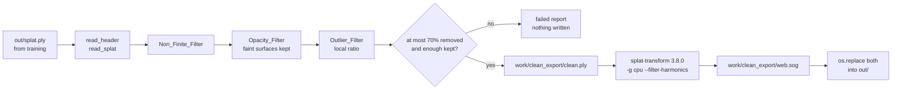

# Design Document: clean-export

## Overview

This spec builds step 08, `splatpipe/clean_export/`. It reads the trained splat at `out/splat.ply`, drops the Gaussians a viewer shouldn't see, writes what's left to `out/clean.ply`, and has Splat_Transform 3.8.0 make the small web copy, `out/web.sog`. It plugs into the Skeleton exactly like the Fake_Step: a `work(step)`, a `run()` and a `__main__.py`, with no change to any Skeleton module and no Step_List entry yet (A4).

The cleaning is three filters, in this order:

1. **Non_Finite_Filter**: a NaN or an infinity in a Required_Property, or a rotation that's all 0.
2. **Opacity_Filter** (D2): Real_Opacity under `min_opacity` (0.005), except Faint_Splats stacked into a surface. Space is cut into cubes 1/128 of the Extent. A cube keeps its Faint_Splats when it holds at least 8 of them and they make more than 10% of what the cube paints.
3. **Outlier_Filter** (D1): a Gaussian whose mean distance to its 8 nearest Gaussians is more than 8 times the median of that same number over those 8 neighbours. It's a local ratio, so the sky and the far background, where Gaussians sit far apart but evenly, stay.

There's no scale filter (D3). When the three together would remove more than 70% of the Gaussians, the step fails, writes nothing and leaves the trained splat as it is (D4).

Python 3.11 with numpy and scipy for the maths. Splat_Transform runs as a Node subprocess with `-g cpu`, so nothing here needs a GPU.

### Decisions on the open choices

| Choice | Decision |
|---|---|
| Where the cleaning numbers live (D7) | All of D1, D2 and D4's numbers are Shared_Settings in `[clean_export]`, the same for every Preset. The Preset tables hold only `web_sh_bands`, which sets how big the Web_Copy is. The Skeleton only refuses a key that's in both places, so `tests/test_clean_settings.py` checks the raw TOML tables of the real Config for this split (Req 6.13). |
| The Extent | The longest side of the axis-aligned box around the positions the Opacity_Filter is given, floaters included, because the Outlier_Filter runs after it. The cubes start at the box's lowest corner, so the longest side splits into exactly `surface_cubes` cubes and every other side into at most that many. A Gaussian's cube along each axis is `min(floor((p - low) / Extent * surface_cubes), surface_cubes - 1)`, as the glossary says. Dividing by the Extent before multiplying keeps the ratio between 0 and 1, so a tiny Extent can't overflow. An Extent of 0 puts every Gaussian in one cube (Req 2.7). |
| Grouping Gaussians by cube | `np.unique(cube_indices, axis=0, return_inverse=True)` on the `(n, 3)` integer indices, with the inverse flattened by `reshape(-1)` because numpy 2.0's shape for it changed. No key is packed into one integer, so no `surface_cubes` value can overflow one. |
| Paint without overflow (Req 2.8) | Everything is worked out as a logarithm. `log Paint = log σ(opacity) + log π + s₁ + s₂`, where `s₁` and `s₂` are the two largest of `scale_0`, `scale_1` and `scale_2`, which are already logarithms, and `log σ(x) = -logaddexp(0, -x)`, which never overflows. A cube's sums are log-sum-exp with the cube's largest term taken out first, so every `exp` gets a number at or below 0. The share test `faint_sum > share × cube_sum` becomes `log_faint - log_cube > log(share)`. |
| The faint test | Real_Opacity < t exactly when `opacity < log(t) - log1p(-t)`, because the logistic function only goes up, so no `exp` is needed. For t = 0 no Gaussian is faint, and for t = 1 every one is. |
| Nearest neighbours (D1) | `scipy.spatial.KDTree(positions).query(positions, k=neighbours + 1, workers=-1)`, then each Gaussian's own entry is taken out. With Gaussians at exactly the same spot, another one at distance 0 can come before a Gaussian's own entry, or push it out of the list, so the step takes out its own entry where it's there and the last entry where it isn't. The ratio is compared as `mean > isolation_ratio * median`. |
| The 70% check (D4) | `Fraction(removed) > as_written(max_removed_fraction) * source`, where `as_written(value) = Fraction(repr(value))`. `repr` gives the shortest decimal that reads back as the same float, which is the decimal `config.toml` holds, so `as_written(0.7)` is exactly 7/10. `Fraction(0.7)` would be the float's binary value, 0.69999999999999995559…, and would fail a splat at exactly 70% (Req 3.3). The same exact test serves `warn_kept_fraction`. |
| Counts in the report | `int(...)` around every numpy count, because `add_count` takes only a Python `int` and would fail the step as a bug on a `numpy.int64` (Req 7.3). |
| Atomic outputs (Req 4.4, 4.7, 5.6) | Both outputs are written into `work/clean_export/` first. Only when both exist does the step `os.replace` them into `out/`, the Clean_Splat and then the Web_Copy. `work/` and `out/` are in the same Job_Folder, so each move is atomic. The step removes both earlier outputs before it reads anything, so a failed run leaves neither. A crash between the two moves can leave the Clean_Splat without its Web_Copy, never the other way round, and the next run removes it. |
| Byte order | The reader takes either byte order and keeps it in the array's dtype. The writer swaps a big-endian array with `byteswap().view(dtype.newbyteorder("<"))`, which moves bytes and never goes through floating-point maths, so NaN payloads come through bit for bit. |
| Header lines | `comment` lines are copied into the Clean_Splat in their order, right after the format line, so a training tag like `comment SplatRenderMode: mip` reaches Splat_Transform. `obj_info` lines are read and dropped, and every type is written in its short spelling (`float`, `uchar`, …) from `PLY_NAMES`, because those are the forms every PLY reader takes, Splat_Transform's included. The bytes of the Gaussians don't change. The header is read and written as Latin-1, which maps every byte to one character and back. |
| Running Splat_Transform | `[node, <package>/bin/cli.mjs, ...]`, where `node` comes from `shutil.which("node")` and the entry script from the `bin` field of the installed package's `package.json`. Never the `.cmd` shim, which on Windows needs a shell, never `npx`, which downloads, and never a shell. Before it runs, the step checks that the installed version equals the version the root `package.json` pins, so a stray `npm install` can't swap in a release that writes SOG version 3, which the viewer may not read. |
| Splat_Transform's options | `-g cpu <clean.ply> --filter-harmonics <bands> <web.sog>`. `-g cpu` is a global option, so it comes before the input. No `-w`, because the Work_Folder starts empty, and no GPU-only option. |
| Test helpers | `tests/splats.py` builds Splat_Data and writes PLY bytes by hand, independent of `splatpipe/clean_export/ply.py`. Tests import it with `from splats import ...`. pytest's default `prepend` import mode puts `tests/` on `sys.path`, because `tests/` has no `__init__.py`, the same way it finds `conftest.py`. |

## Architecture



### Module layout

| File | What it holds |
|---|---|
| `splatpipe/clean_export/__init__.py` | `work(step)`, the step's own code, and `run(job_id, preset=None, *, config=None)`, its plain function. |
| `splatpipe/clean_export/__main__.py` | `main(argv)`, which calls `step_main("clean_export", "splatpipe.clean_export", argv)`. |
| `splatpipe/clean_export/settings.py` | `PRESET_KEYS`, `CleanSettings`, `is_plain_file_name()`, `as_written()` and `read_settings()`, which checks every setting. |
| `splatpipe/clean_export/ply.py` | The Format_Constants of the PLY format: `PLY_TYPES`, `PLY_NAMES`, `POSITION`, `SCALES`, `ROTATION`, `REQUIRED` and `SH_BANDS`. Then `PlyHeader`, `read_header()`, `read_splat()` and `write_splat()`. |
| `splatpipe/clean_export/filters.py` | `Cleaning`, `clean()`, the three filters `non_finite()`, `faint_to_drop()` and `isolated()`, and the limits `check_kept()` and `kept_warning()`. |
| `splatpipe/clean_export/export.py` | `PACKAGE`, `ROOT_PACKAGE`, `NODE_NEEDED`, `command()`, `arguments()` and `make_web_copy()`. |
| `package.json`, `package-lock.json` | Pin `@playcanvas/splat-transform` to exactly 3.8.0. |

The modules import each other in this order only: `settings`, `ply`, `filters`, `export`, then `__init__`. From the Skeleton the package imports `splatpipe.step` (`Config`, `StepContext`, `run_step`, `step_main`), `splatpipe.errors` (`ExpectedFailure`) and `splatpipe.config` (`REPO_ROOT`). Outside the standard library it imports numpy, in `ply.py` and `filters.py`, and scipy, in `filters.py` only.

## Components and Interfaces

### settings.py

```python
PRESET_KEYS = frozenset({"web_sh_bands"})  # the Preset_Settings; every other key is shared


def is_plain_file_name(value: object) -> bool:
    """Whether `value` is a Plain_File_Name: a str that names one file in out/ and nothing else."""


def as_written(value: int | float) -> Fraction:
    """The exact value of a number as config.toml writes it: Fraction(repr(value))."""


@dataclass(frozen=True)
class CleanSettings:
    """The checked settings of one run. Each field is named after its key."""

    section: str  # the Step_Name, for messages: clean_export, or another name in tests
    preset: str
    source_ply: str
    clean_ply: str
    web_sog: str
    min_opacity: float
    surface_cubes: int
    surface_min_faint: int
    surface_min_share: float
    neighbours: int
    isolation_ratio: float
    max_removed_fraction: float
    min_kept_splats: int
    warn_kept_fraction: float
    max_source_splats: int
    splat_transform_timeout_seconds: float
    splat_transform_output_lines: int
    web_sh_bands: int


def read_settings(values: Mapping[str, Any], section: str, preset: str) -> CleanSettings:
    """Check every setting and return them. A missing key raises the StepSettings refusal."""
```

- `read_settings` reads each key with `values[key]`, so a missing one raises the Skeleton's own `PipelineError` from `StepSettings.__missing__`, naming `[clean_export]`, `[clean_export.<preset>]` and the key (Req 6.6).
- It checks the three file names first, then the numbers, all before `work` touches a file (Req 6.8).
  - `is_plain_file_name` is true when the value is a `str`, isn't `""`, `.` or `..`, holds no `/`, no `\`, no `os.sep` and no `os.altsep`, and equals both `PurePosixPath(value).name` and `PureWindowsPath(value).name`. The Windows check refuses an absolute path and a drive-relative one like `C:x.ply`, whose name is `x.ply`, on every system. A value that isn't a `str`, like `5`, is refused here, before anything calls a string method on it.
  - The three names are compared as strings, and `clean_ply` and `web_sog` may equal neither each other nor `source_ply` (Req 6.9).
- A whole number is `type(value) is int`, so `true` and `8.0` are refused. A number is an `int` or a `float` and never a `bool`. The Config_Loader has already refused NaN and infinity. Numbers come back as `float`, and an `int` too big for a float, like a 400-digit one, raises `OverflowError` in `float()`, which is refused with the same message, as `[jobs]` does it.
- Every refusal is an `ExpectedFailure`: `The setting <key> in [<table>] is <value>, but it must be <what>. Change it in config.toml.` `<table>` is `[clean_export.<preset>]` for a key in `PRESET_KEYS` and `[clean_export]` for the rest. The value is shown with `repr`.

### ply.py

```python
# Format_Constants of the PLY and 3DGS formats.
PLY_TYPES = {"char": "i1", "int8": "i1", "uchar": "u1", "uint8": "u1",
             "short": "i2", "int16": "i2", "ushort": "u2", "uint16": "u2",
             "int": "i4", "int32": "i4", "uint": "u4", "uint32": "u4",
             "float": "f4", "float32": "f4", "double": "f8", "float64": "f8"}
# The short spelling the writer uses for each type, the one every PLY reader takes.
PLY_NAMES = {"i1": "char", "u1": "uchar", "i2": "short", "u2": "ushort",
             "i4": "int", "u4": "uint", "f4": "float", "f8": "double"}
POSITION = ("x", "y", "z")
SCALES = ("scale_0", "scale_1", "scale_2")
ROTATION = ("rot_0", "rot_1", "rot_2", "rot_3")
REQUIRED = (*POSITION, "opacity", *SCALES, *ROTATION)
SH_BANDS = {0: 0, 9: 1, 24: 2, 45: 3}  # f_rest_* count, 3 colours x coefficients, to SH_Bands


@dataclass(frozen=True)
class PlyHeader:
    path: Path
    byte_order: str  # "<" for binary_little_endian, ">" for binary_big_endian
    count: int  # the element vertex count, at least 1
    properties: tuple[tuple[str, str], ...]  # (name, numpy type code like "f4"), in file order
    comments: tuple[str, ...]  # the comment lines, as written, in order
    data_start: int  # bytes from the start of the file to the first Gaussian
    sh_bands: int

    @property
    def dtype(self) -> np.dtype: ...  # one field per property, in file order and byte order


def read_header(path: Path, shown: str) -> PlyHeader: ...
def read_splat(header: PlyHeader, shown: str) -> np.ndarray: ...
def write_splat(path: Path, shown: str, header: PlyHeader, data: np.ndarray) -> None: ...
```

`shown` is the file's name as the person sees it, like `out/splat.ply`, and every message uses it.

`read_header`:

1. Opens the file. `FileNotFoundError` gives "There's no trained splat at out/splat.ply. The training step writes it, so run training on this job first, then run this step again." (Req 1.4). Any other `OSError`, a folder in its place included, gives the reason.
2. The first line must be `ply`. Then it reads lines with `readline()` until `end_header`, each decoded as Latin-1 and stripped of a final `\r`, so `\r\n` headers read too. The end of the file before `end_header` means the header isn't whole.
3. The second line must be `format binary_little_endian 1.0` or `format binary_big_endian 1.0`. `ascii` gets its own message: an ASCII PLY can't be read here or by Splat_Transform, so training must write it as binary (Req 1.5).
4. Then each line is one of `comment …`, which is kept, `obj_info …`, which is read and dropped, `element <name> <count>` or `property <type> <name>`. There must be exactly one element, and it must be `vertex`. A `property list`, a type not in `PLY_TYPES`, a property named twice, a count that isn't a whole number, or any other line is refused. A message names a bad type or name with `repr` and points at a bad line by its number, never by echoing the line, so control characters can't garble the terminal.
5. It checks, in this order: a count of 0 (Req 1.6), every Required_Property present, naming the missing ones (Req 1.5), and the `f_rest_*` properties, which must be exactly `f_rest_0` to `f_rest_<n-1>` with `n` in `SH_BANDS` (Req 1.8).
6. Last, the length: `size - data_start` must be at least `count * dtype.itemsize`. Otherwise the file is cut short or still being written (Req 1.7).

`read_splat` seeks to `data_start` and reads with `np.fromfile(handle, dtype=header.dtype, count=header.count)`. A shorter result, because the file changed after the header was read, gets the cut-short message. The result is a structured array with one field per property, which is the Splat_Data.

`write_splat` writes `ply`, `format binary_little_endian 1.0`, the `comments`, `element vertex <len(data)>`, one `property <type> <name>` per property in the header's order with the type from `PLY_NAMES`, and `end_header`, each ending with `\n`, as Latin-1. Then it writes the Gaussians with `data.tofile(handle)`, after the byte swap for a big-endian array, then `flush()` and `os.fsync()`. An `OSError` gives "The clean splat couldn't be written to work/clean_export/clean.ply (<reason>). Check that the disk has space and the job folder can be written, then run the step again." (Req 4.5).

### filters.py

```python
@dataclass(frozen=True)
class Cleaning:
    keep: np.ndarray  # bool, one per Gaussian of the Source_Splat, True for the Kept_Splats
    source: int
    dropped_non_finite: int
    dropped_opacity: int
    dropped_outlier: int

    @property
    def kept(self) -> int: ...  # source minus the three dropped counts

    @property
    def removed(self) -> int: ...  # the Removed count


def clean(data: np.ndarray, settings: CleanSettings) -> Cleaning: ...
def non_finite(data: np.ndarray) -> np.ndarray: ...
def faint_to_drop(positions: np.ndarray, opacity: np.ndarray, scales: np.ndarray,
                  settings: CleanSettings) -> np.ndarray: ...
def isolated(positions: np.ndarray, neighbours: int, ratio: float) -> np.ndarray: ...
def check_kept(cleaning: Cleaning, settings: CleanSettings, source_shown: str) -> None: ...
def kept_warning(cleaning: Cleaning, settings: CleanSettings) -> str | None: ...
```

Every filter returns a `bool` array, `True` for the Gaussians it drops. None of them changes its inputs. Every filter given no Gaussians returns an empty array straight away, because numpy's `min` and scipy's tree refuse empty input (Req 2.13).

`clean` runs the Filter_Order (Req 2.1):

1. `non_finite(data)` over the whole Splat_Data.
2. It takes the rows that are left, by index, and copies only their positions, opacities and scales into `float64` arrays, about 56 bytes per Gaussian, instead of copying every property.
3. `faint_to_drop(...)` on those rows.
4. `isolated(...)` on the positions of the rows the Opacity_Filter kept.
5. It sets `keep` from the rows left at the end. Indexing keeps them in their original order. It returns the counts as Python `int`s.

`non_finite(data)` drops a Gaussian when `np.isfinite` is false for any Required_Property, or when `rot_0` to `rot_3` are all `== 0` (Req 2.2).

`faint_to_drop` (D2, Req 2.3 to 2.8):

1. `faint` is the faint test from the decisions table. When no Gaussian is faint, or fewer than `surface_min_faint` are faint over the whole splat, no cube can be a Faint_Surface, so it returns `faint` without working out cubes.
2. `cube` comes from the Extent and `np.unique`, as in the decisions table.
3. `log_paint` is `-np.logaddexp(0.0, -opacity) + math.log(math.pi)` plus the two largest log scales, from `np.sort(scales, axis=1)[:, 1:].sum(axis=1)`.
4. `faint_count = np.bincount(cube[faint], minlength=cubes)`, and the candidate cubes are those with `faint_count >= surface_min_faint`.
5. `log_sums(groups, values, cubes)` gives each cube's log-sum-exp: `top` from `np.maximum.at` over a `-inf` start, then `np.bincount(groups, weights=np.exp(values - top[groups]))`, then `top + log(sum)` for the cubes that have any values. `log_cube` is over every Gaussian and `log_faint` over the faint ones.
6. A candidate cube is a Faint_Surface when `more_than_share(log_faint, log_cube, surface_min_share)`, a small helper that gives `log_faint - log_cube > log(share)`. For a share of 0 the threshold is `-inf`, and for a share of 1 no cube can pass, because the faint Gaussians can't paint more than the whole cube. Both are written out, so `log(0)` is never called. The helper is tested on its own with exact inputs, like `log_cube = 0.0` and `log_faint = math.log(0.1)` for a share of exactly 0.1, which must not pass. A whole cube can't be built with a share of exactly 10%, because a faint and a solid Gaussian can't paint exactly the same amount in floating point.
7. It returns `faint & ~surface[cube]`.

The faint test itself writes out `min_opacity` 0 and 1 the same way, so `math.log(0)` and `math.log1p(-1)` are never called.

`isolated` (D1, Req 2.9 to 2.11):

1. With `n <= neighbours`, it returns all `False`.
2. It runs `KDTree(positions).query(positions, k=neighbours + 1, workers=-1)` to get `dist` and `idx`, both `(n, neighbours + 1)`.
3. For each row, it takes out the column where `idx` is the row's own index, or the last column when the row's own index isn't there. Then `dist` and `idx` are `(n, neighbours)`.
4. `mean = dist.mean(axis=1)` is the Neighbour_Distance and `median = np.median(mean[idx], axis=1)` the Neighbour_Median.
5. It returns `mean > ratio * median`. A Neighbour_Median of 0 drops any Gaussian whose Neighbour_Distance is above 0, which is what the rule says: such a Gaussian sits next to a stack of others at one spot.

`check_kept` raises `ExpectedFailure` for the 70% limit first (D4, Req 3.1 to 3.3), then for `min_kept_splats` (Req 3.6, 3.7). `kept_warning` gives the warning text of Req 3.8, or `None`. The messages are in "Error Handling".

Memory, for scale: a splat with 3 SH bands holds 62 floats, 248 bytes, per Gaussian. At the peak the step holds the Splat_Data (248), the working copy (56), the tree's own copy of the positions (32), the query's `(n, 9)` distances and indices (144), the neighbours' distances for the median (64) and the kept copy for writing (up to 248). That's roughly 800 bytes per Gaussian, so `max_source_splats = 10000000` stops at about 8 GB (Req 3.9).

### export.py

```python
PACKAGE = REPO_ROOT / "node_modules" / "@playcanvas" / "splat-transform"  # tests may patch it
ROOT_PACKAGE = REPO_ROOT / "package.json"  # pins the version
NODE_NEEDED = "Node 22 or newer"  # what splat-transform 3.8.0 needs: a fact about the tool


def command() -> list[str]: ...
def arguments(clean_ply: Path, web_sog: Path, bands: int) -> list[str]: ...
def make_web_copy(clean_ply: Path, web_sog: Path, bands: int, settings: CleanSettings,
                  shown: str) -> None: ...
```

`command()` gives `[node, cli]` or raises the Splat_Transform_Missing `ExpectedFailure` (Req 5.7) when:

- `shutil.which("node")` is `None`
- `PACKAGE / "package.json"` is missing or can't be read as JSON
- its `version` isn't the version in `ROOT_PACKAGE`'s `dependencies["@playcanvas/splat-transform"]`
- its `bin` field, a string or `{"splat-transform": "…"}`, doesn't lead to a file inside `PACKAGE`

The message is "The web copy needs splat-transform, but <why>. Install Node 22 or newer and run npm ci at the repo root, then run this step again." A version mismatch says which version is installed and which one `package.json` pins.

`arguments(...)` is `["-g", "cpu", str(clean_ply), "--filter-harmonics", str(bands), str(web_sog)]` (Req 5.2, 5.3, 5.5). The paths are absolute, so neither can start with `-`.

`make_web_copy(...)` looks `command` up when it runs, so a test can patch it, and runs `subprocess.run([*command(), *arguments(...)], cwd=<Work_Folder>, stdin=DEVNULL, stdout=PIPE, stderr=STDOUT, text=True, encoding="utf-8", errors="replace", timeout=settings.splat_transform_timeout_seconds)`. That's an argument list with no shell (Req 5.13), and stderr merged into stdout in the order they came.

- `TimeoutExpired` gives the timeout message (Req 5.9). `subprocess.run` has already killed the child by then.
- An `OSError` while starting gives Splat_Transform_Missing with the reason.
- A non-zero exit gives the exit code and the last `splat_transform_output_lines` lines of output that aren't blank, or "it printed nothing" (Req 5.8).
- Exit 0 with no file at `web_sog`, or an empty one, gives the no-file message (Req 5.10).

### `__init__.py` (the step)

```python
def run(job_id: str, preset: str | None = None, *,
        config: Config | None = None) -> dict[str, Any]:
    return run_step("clean_export", "splatpipe.clean_export", job_id, preset=preset, config=config)
```

`work(step)` does this, with every path from `step` and the settings, so it runs under any Step_Name:

1. `read_settings(step.settings, step.name, step.preset)`. Nothing has been touched yet (Req 6.8).
2. It works out the paths: `out/<source_ply>`, `out/<clean_ply>` and `out/<web_sog>`, and the work copies `work/<name>/<clean_ply>` and `work/<name>/<web_sog>`.
3. It removes both earlier outputs from `out/` with `unlink(missing_ok=True)` (Req 4.7). An `OSError` becomes a readable error naming the file.
4. Inside `step.timed("read_ply")`: `read_header`, then `add_count("source_splats", header.count)`, then the `max_source_splats` check (Req 3.9), then `read_splat`. So a too-big splat's failed report already has its count.
5. Inside `step.timed("clean")`: `clean(data, settings)`.
6. It adds `dropped_non_finite`, `dropped_opacity`, `dropped_outlier` and `kept_splats` before the next line, so a failed report has them (Req 7.2).
7. `check_kept(...)` (Req 3.1, 3.6). Then `kept_warning(...)` adds its warning, if there is one (Req 3.8).
8. Inside `step.timed("write_ply")`: `write_splat` to the work copy, from `data[cleaning.keep]`. Then `add_count("clean_ply_bytes", ...)`.
9. The bands: `min(web_sh_bands, header.sh_bands)`, with the warning of Req 5.4 when it's lower.
10. Inside `step.timed("export_web")`: `make_web_copy(...)`. Then `add_count("web_sog_bytes", ...)`.
11. `os.replace` the Clean_Splat, then the Web_Copy, into `out/`. An `OSError` becomes a readable error. When the Web_Copy's move fails, the step first removes the Clean_Splat it just moved, so `out/` still holds both or neither (Req 4.7).

`step.timed` adds its timing only when its block finishes, so a failed report holds only the timings that finished (Req 7.2). The Step_Runner writes the report itself, with `settings` holding the 16 settings (Req 7.5, 7.6).

### `__main__.py`

A copy of the Fake_Step's: `main(argv)` returns `step_main("clean_export", "splatpipe.clean_export", argv)`, and the file ends with `if __name__ == "__main__": sys.exit(main())` (Req 8.1, 8.2).

### Docs and licences (Req 9)

`docs/pipeline.md` gains `## Step: clean_export`, after `## Step: fake`, with the Fake_Step section's parts:

- An opening paragraph: what the step does, that it's optional, its CLI and its plain function.
- `### What it reads`: `out/<source_ply>`, by A1 `out/splat.ply`, which the training step writes as a Binary_PLY in the 3DGS layout. This step never writes it (Req 9.4). It also reads its settings and the pinned Splat_Transform under `node_modules/`.
- `### What it writes`: the three filters in order, each with its settings and the reason for it, the 70% limit and what happens when it's crossed, and that there's no scale filter because big Gaussians are often the sky and the far background (Req 9.8). Then the PLY write and the Web_Copy, with the Splat_Transform command.
- `### Config section`: a table of every key, its table and its value, like the Fake_Step's.
- `### Step report fields`: `settings`, every count and timing, the warnings and the errors.
- `### Files in out/`: `out/clean.ply` and `out/web.sog`. The step removes both before it writes either, so `out/` holds both from one run or neither (Req 9.3). It never touches `out/splat.ply`.

"The step list" gains one sentence: the clean and export step isn't in `STEP_LIST` yet. The first step spec that adds an entry to the list adds this one too, optional and last, after training, and later specs put their entries before it (Req 8.4, 9.5).

`docs/third-party-licences.md`:

- numpy and scipy: Installed becomes "Yes".
- Splat_Transform: the row keeps its name, "PlayCanvas splat-transform 3.8.0 (`@playcanvas/splat-transform`)". The licence cell lists the licences of its npm packages as found in `package-lock.json`, with the libraries bundled in `webgpu`'s native Dawn build noted. Installed becomes "Yes, on the laptop. Not yet on the machine image."
- Node.js, a new row. Licence: MIT, with its bundled parts as Node's own `LICENSE` file lists them. How we use it: runs splat-transform, the only thing Node is in our stack for, as a separate command line tool on laptops and the machine image, never vendored, linked or shipped. Installed: "Yes, on the laptop. Not yet on the machine image."

`README.md` gains, under "Install": the clean and export step also needs Node 22 or newer, and then `npm ci` at the repo root, which installs splat-transform 3.8.0 into `node_modules/` (Req 9.7).

## Data Models

### Splat_Data

A numpy structured array with one record per Gaussian and one field per PLY property, in file order, each with its PLY type and the file's byte order, like `[("x", "<f4"), ("y", "<f4"), …]`. `data["opacity"]` is a view of one property. `data[keep]` is a copy of the kept records in their order. The filters read only the Required_Properties and copy them to `float64`. Every other property, normals, colours, SH and anything else, is carried through untouched.

### Sections added to `config.toml`

```toml
[clean_export]
# The trained splat this step reads, a file name in out/. The training step writes it.
source_ply = "splat.ply"
# The clean splat this step writes, a file name in out/.
clean_ply = "clean.ply"
# The small copy for the web viewer that this step writes, a file name in out/.
web_sog = "web.sog"
# A Gaussian whose real opacity is under this is near-invisible and dropped, unless it's part of a faint surface.
min_opacity = 0.005
# Faint surfaces are looked for in cubes 1/surface_cubes of the splat's longest side.
surface_cubes = 128
# Fewest near-invisible Gaussians a cube needs to keep them as a faint surface.
surface_min_faint = 8
# Share of what a cube paints that its near-invisible Gaussians must pass for the cube to keep them (0.1 is 10%).
surface_min_share = 0.1
# How many nearest Gaussians the isolation check compares each Gaussian with.
neighbours = 8
# A Gaussian is isolated, and dropped, when its mean distance to its neighbours is more than this many times the median of theirs.
isolation_ratio = 8
# Most of the trained splat the cleaning may remove (0.7 is 70%). Past it the step fails and writes nothing.
max_removed_fraction = 0.7
# Fewest Gaussians the clean splat may hold.
min_kept_splats = 1000
# The report warns when the clean splat keeps less than this share of the trained splat (0.5 is half).
warn_kept_fraction = 0.5
# Most Gaussians the step reads. Cleaning needs roughly 800 bytes of memory per Gaussian.
max_source_splats = 10000000
# Longest time splat-transform may take to write the web copy, in seconds (30 minutes).
splat_transform_timeout_seconds = 1800
# How many of splat-transform's last output lines a failure message shows.
splat_transform_output_lines = 20

[clean_export.fast]
# Bands of higher spherical harmonics the web copy keeps, 0 to 3. 0 keeps the base colour only.
web_sh_bands = 0

[clean_export.default]
# Bands of higher spherical harmonics the web copy keeps, 0 to 3.
web_sh_bands = 2

[clean_export.quality]
# Bands of higher spherical harmonics the web copy keeps, 0 to 3.
web_sh_bands = 3
```

`fast` keeps no SH bands, so Splat_Transform needs no SH clustering, which is the part that runs 5 to 10 times slower on the CPU. `quality` keeps all three.

### The test config's `[clean_export]` (`tests/conftest.py`)

The same keys and values as the real section, except `min_kept_splats = 1`, `max_source_splats = 10000` and `splat_transform_timeout_seconds = 30`, so tiny splats pass and a hung stand-in can't stall the suite. `config_text` gains a keyword-only `clean_export` argument that replaces chosen values, and a value of `None` leaves the key out. The `set_clean_export(**values)` fixture rewrites the test config with those values, like `set_fail`.

### `package.json` at the repo root

```json
{
  "name": "voxelis-kiroween",
  "private": true,
  "description": "Node is only here for PlayCanvas splat-transform, which writes the web copy of a splat.",
  "license": "MIT",
  "engines": {"node": ">=22"},
  "dependencies": {"@playcanvas/splat-transform": "3.8.0"}
}
```

`npm install --save-exact @playcanvas/splat-transform@3.8.0` writes the dependency and `package-lock.json`. `"private": true` stops it from ever being published. Version 3.8.0's own `package.json` has `"bin": {"splat-transform": "bin/cli.mjs"}`, `"engines": {"node": ">=22.0.0"}` and the dependencies `webgpu` 0.4.0 and `@adobe/spz` 0.2.3, so the lockfile is small and well under 1 MB.

### `out/reports/clean_export.json` (a Clean_Report)

A done run. The numbers are made up, but they add up.

```json
{
  "step": "clean_export",
  "job_id": "20261119-142530-7f3a9c",
  "preset": "default",
  "settings": {"source_ply": "splat.ply", "clean_ply": "clean.ply", "web_sog": "web.sog",
               "min_opacity": 0.005, "surface_cubes": 128, "surface_min_faint": 8,
               "surface_min_share": 0.1, "neighbours": 8, "isolation_ratio": 8,
               "max_removed_fraction": 0.7, "min_kept_splats": 1000, "warn_kept_fraction": 0.5,
               "max_source_splats": 10000000, "splat_transform_timeout_seconds": 1800,
               "splat_transform_output_lines": 20, "web_sh_bands": 2},
  "outcome": "done",
  "started_utc": "2026-11-19T15:02:10.114+00:00",
  "finished_utc": "2026-11-19T15:03:21.630+00:00",
  "duration_seconds": 71.516,
  "timings": {"read_ply": 0.842, "clean": 6.117, "write_ply": 0.613, "export_web": 63.8},
  "counts": {"source_splats": 1204331, "dropped_non_finite": 12, "dropped_opacity": 81210,
             "dropped_outlier": 9033, "kept_splats": 1114076, "clean_ply_bytes": 276292380,
             "web_sog_bytes": 17212446},
  "warnings": [],
  "error": null
}
```

A run that crosses the 70% limit has `"outcome": "failed"`, the counts up to `kept_splats`, the timings `read_ply` and `clean`, and this `error.readable`:

> Cleaning would remove 912,004 of the 1,204,331 Gaussians in out/splat.ply (75.7%) and keep only 292,327, more than the 70% that max_removed_fraction in [clean_export] allows: 12 had a NaN or an infinity, 880,105 were near-invisible and 31,887 were isolated. So the step wrote no clean splat and no web copy, and the trained splat is still at out/splat.ply. If the scene really is this sparse, raise max_removed_fraction, lower min_opacity or raise isolation_ratio in [clean_export], then run the step again.

## Error Handling

Every failure here is an `ExpectedFailure`, so the report has `"expected": true` and the step's own message (Req 8.8). The one exception is a missing setting, which the Skeleton's `StepSettings` refuses with its own `PipelineError`, and which the Step_Runner also reports with `"expected": true`. Any other exception is a bug, and the Step_Runner gives its general message.

| Where | When | What the user sees |
|---|---|---|
| `read_settings` | A value of the wrong kind (Req 6.7) | The setting neighbours in [clean_export] is 0, but it must be a whole number above 0. Change it in config.toml. |
| `read_settings` | A file name that isn't plain (Req 6.8) | The setting clean_ply in [clean_export] is '../clean.ply', but it must be a plain file name in out/, with no folder, no drive and no .. in it. Change it in config.toml. |
| `read_settings` | Two names are the same (Req 6.9) | clean_ply and web_sog in [clean_export] are both 'clean.ply'. The trained splat, the clean splat and the web copy must be three different files, so change one of them in config.toml. |
| `work` | An earlier output can't be removed | The earlier out/clean.ply can't be removed (<reason>). Close anything that has it open, then run the step again. |
| `read_header` | No file (Req 1.4) | There's no trained splat at out/splat.ply. The training step writes it, so run training on this job first, then run this step again. |
| `read_header` | Not a PLY, ASCII, the wrong element, a bad line, missing properties, a count of 0, a bad `f_rest_*` count (Req 1.5, 1.6, 1.8) | The trained splat out/splat.ply <what's wrong>, like "lacks the properties opacity and rot_3" or "has 12 f_rest_* properties, but a splat has 0, 9, 24 or 45". Then what to do: check the training step's output. |
| `read_header`, `read_splat` | Cut short (Req 1.7) | The trained splat out/splat.ply is cut short: its header says 1,204,331 Gaussians, which need 298,674,088 bytes, but only 12,000,000 follow the header. It may still be being written, so wait for training to finish, then run this step again. |
| `work` | Too many Gaussians (Req 3.9) | The trained splat out/splat.ply holds 12,000,000 Gaussians, more than the 10,000,000 that max_source_splats in [clean_export] allows. Raise it on a machine with more memory, roughly 800 bytes per Gaussian. |
| `check_kept` | Over 70% removed (D4, Req 3.1, 3.2) | The message under "A Clean_Report" above. |
| `check_kept` | Too few kept (Req 3.6, 3.7) | Cleaning would leave 640 of the 2,000 Gaussians in out/splat.ply, fewer than the 1,000 that min_kept_splats in [clean_export] needs: … So the step wrote no clean splat and no web copy. Loosen the settings in [clean_export], or check that training finished. |
| `kept_warning` | Under `warn_kept_fraction` kept (Req 3.8) | A warning: The cleaning removed 550,000 of the 1,000,000 Gaussians (55.0%), so the clean splat keeps less than the 50% that warn_kept_fraction in [clean_export] expects. Check that the scene still looks whole. |
| `work` | Fewer SH bands than asked (Req 5.4) | A warning: web_sh_bands in [clean_export.quality] asks for 3 bands of spherical harmonics, but the trained splat has 1, so the web copy keeps 1. |
| `write_splat` | The disk is full or the file can't be written (Req 4.5) | The clean splat couldn't be written to work/clean_export/clean.ply (No space left on device). Check that the disk has space and the job folder can be written, then run the step again. |
| `command` | Splat_Transform_Missing (Req 5.7) | The web copy needs splat-transform, but Node isn't installed. Install Node 22 or newer and run npm ci at the repo root, then run this step again. |
| `make_web_copy` | A non-zero exit (Req 5.8) | splat-transform stopped with exit code 1 while making the web copy. Its last lines were: … |
| `make_web_copy` | Too slow (Req 5.9) | splat-transform didn't finish the web copy within 1800 seconds, the limit splat_transform_timeout_seconds in [clean_export] sets, so it was stopped. Raise the limit for a very big splat, then run the step again. |
| `make_web_copy` | No file (Req 5.10) | splat-transform said it finished, but wrote no web copy at work/clean_export/web.sog. Run the step again, and tell the team if it happens twice. |
| `work` | A move into `out/` fails | The clean splat couldn't be moved into out/clean.ply (<reason>). Run the step again. |

Readable_Errors give counts with thousands separators and percentages to one decimal. They never include a traceback, and they show a bad value with `repr`, so a control character can't garble the terminal.

## Correctness Properties

*A property is a characteristic or behavior that should hold true across all valid executions of a system-essentially, a formal statement about what the system should do. Properties serve as the bridge between human-readable specifications and machine-verifiable correctness guarantees.*

The strategies, shared by Properties 1 and 2. Hypothesis draws the shape of each example: how many Gaussians, how they clump, where the bad values go and the settings. The bulk values come from `np.random.default_rng(seed)`, with the seed drawn by Hypothesis, because drawing hundreds of floats one by one runs past the roughly 8 KB that Hypothesis allows per example and trips its `data_too_large` health check.

```python
bad = st.sampled_from([math.nan, math.inf, -math.inf])

@st.composite
def splats(draw):
    """1 to 60 Gaussians in 1 to 4 clumps, each clump's spread 0 (all at one spot), 0.001, 1 or 100,
    with a few lone Gaussians up to 10,000 units out, plus a uid property 0, 1, 2, … so a test
    can tell which Gaussians were kept. The rng gives opacity logits from -12 to 12, so many are
    faint, log scales from -12 to 12, so some are huge, and rotations from -1 to 1, all float32.
    Up to 5 values in the Required_Properties are then set to NaN or an infinity, and up to 2
    rotations to all 0."""

@st.composite
def clean_settings(draw):
    """CleanSettings with every cleaning number drawn over its whole valid range: min_opacity,
    surface_min_share, max_removed_fraction and warn_kept_fraction from 0 to 1, surface_cubes
    1 to 256, surface_min_faint and neighbours 1 to 12, isolation_ratio above 0 up to 20, and
    min_kept_splats 1 to 60. The file names are the real ones."""
```

Clumps give the Opacity_Filter cubes with many Faint_Splats in them and the Outlier_Filter tight groups, lone Gaussians and Gaussians at the same spot, so both sides of every rule turn up.

### Property 1: The cleaning never removes more than `max_removed_fraction`

*For any* Splat_Data from `splats()` and settings from `clean_settings()`, with numpy's overflow, invalid-value and divide-by-zero errors set to raise, `cleaning = clean(data, settings)` raises nothing, and:

- `cleaning.source == len(data)`, and `source == kept + dropped_non_finite + dropped_opacity + dropped_outlier`.
- When `Fraction(cleaning.removed) > as_written(settings.max_removed_fraction) * cleaning.source`, `check_kept` raises `ExpectedFailure`. Its message holds the phrases that carry the counts, each with its number, like `remove 8 of the 10 Gaussians`, `keep only 2` and `3 had a NaN or an infinity`, so a small count can't pass the test by turning up inside `70%`.
- Otherwise, when `cleaning.kept < settings.min_kept_splats`, it raises `ExpectedFailure` for that.
- Otherwise it returns, and `Fraction(cleaning.removed) <= as_written(settings.max_removed_fraction) * cleaning.source`.

`as_written` is the code's own helper, so this property can't catch a wrong reading of the setting. The unit test that 7 removed of 10 passes at `0.7` and 8 of 10 fails does.

**Validates: Requirements 2.8, 3.1, 3.2, 3.3, 3.4, 3.6**

### Property 2: The cleaning never changes the Gaussians it keeps

*For any* Splat_Data from `splats()` and settings from `clean_settings()`, with `before = data.copy()` and `cleaning = clean(data, settings)`:

- `data.tobytes() == before.tobytes()`: nothing was changed in place.
- `cleaning.keep` is a `bool` array of shape `(len(data),)`.
- With `kept = data[cleaning.keep]`, `kept["uid"]` is strictly increasing, so the Kept_Splats are in their original order with none repeated, and `kept.tobytes() == before[kept["uid"]].tobytes()`, so each is bit for bit the Gaussian it was.

**Validates: Requirements 2.1, 2.14**

### Property 3: A Dense_Grid of opaque, finite Gaussians loses nothing

*For any* lattice of 1 to 6 points along each axis, spacing from 0.01 to 100, corner from -100 to 100 on each axis, and 0 to 3 SH bands, all drawn by Hypothesis, with per-Gaussian values from a seeded rng: opacity logits from 0 to 10 (Real_Opacity at least 0.5), log scales from -10 to 10, finite rotations that aren't all 0, and finite SH coefficients, all stored as `float32`, `clean(grid, settings)` keeps every Gaussian, with every dropped count 0. The settings come from the real `config.toml`, read by path, for the `default` Preset. The cleaning settings are shared, so the Preset doesn't change them.

Why it holds: a brute-force pass over every lattice shape this strategy can draw, with more than 8 points, found that no Gaussian's Neighbour_Distance is more than 1.53 times another's (worst shape 1×3×3), and the worst ratio to a Neighbour_Median is 1.42 (shape 1×2×6). So whichever neighbours the tree picks when distances tie, the ratio stays far under `isolation_ratio = 8`. Lattices of 8 points or fewer are kept whole by Req 2.11, and no Gaussian is faint.

**Validates: Requirements 2.12, 2.15**

### Property 4: The Clean_Splat survives the round trip

*For any* Splat_Data with the Required_Properties, 0, 9, 24 or 45 `f_rest_*` properties and up to 3 extra properties of any type in `PLY_TYPES`, its properties in any order, either byte order, either spelling of each type, up to 3 `comment` lines of Latin-1 text without line breaks, and an `obj_info` line or not, all drawn by Hypothesis, and 1 to 40 Gaussians whose bytes come from a seeded rng, so NaNs with any payload turn up, with the source PLY written by `tests/splats.py`:

`write_splat` after `read_header` and `read_splat`, then `read_header` and `read_splat` on what it wrote, gives:

- the same property names in the same order, with the same numpy types
- the same `comments` in the same order, and no `obj_info` line
- `byte_order == "<"` and `count == len(data)`
- bytes equal to the source's records converted to little-endian by byte swap

**Validates: Requirements 1.2, 4.1, 4.2, 4.3**

Properties 1 to 3 run on arrays in memory. Property 4 touches files on every example, in a `tempfile.TemporaryDirectory` per example because pytest's `tmp_path` lasts for the whole test. All four use `@settings(deadline=None)`, because scipy's first tree and a slow disk can each take longer than Hypothesis's default deadline, and at least 100 examples, the default.

## Testing Strategy

All tests run with `uv run pytest` on the CPU, with no network and only tiny synthetic splats (Req 10.1). Unit tests cover the examples, the edge cases and every message. The four properties cover the rules that must hold for every input. The suite passes on a machine without Node, where the one real Splat_Transform test is skipped with its reason (Req 10.6).

### Helpers and fixtures

- `tests/splats.py`, imported with `from splats import ...`:
  - `splat_dtype(sh_rest=0, *, order="<", extra=())` gives the 3DGS fields in the usual order: `x y z nx ny nz f_dc_0-2 f_rest_* opacity scale_0-2 rot_0-3`, then `extra`.
  - `make_splat(positions, *, opacity=4.0, scales=-3.0, sh_rest=0, order="<", extra=())` gives Splat_Data at the given positions, with a rotation of `(1, 0, 0, 0)` and scalars broadcast.
  - `ply_bytes(data, *, comments=(), types=None, format_line=None, newline="\n")` writes a header by hand from the dtype and appends `data.tobytes()`. It's independent of `ply.py`, so the reader is tested against bytes it didn't write (Req 10.3).
  - `dense_grid(shape, spacing, corner)` gives lattice positions.
- `tests/conftest.py` gains:
  - the test config's `[clean_export]` and `set_clean_export(**values)` (Req 6.15)
  - `splat_job(data, **ply_options)`, which makes a Job with `new_job` and writes `out/splat.ply` from `ply_bytes`, then returns the Job_Id
  - `stand_in_transform(mode)`, which patches `export.command` to give `[sys.executable, <script>]`, a small Python script in `tmp_path`. It records its arguments in a JSON file, then does one of these: `write` writes a few bytes to the last argument, `fail` prints 30 numbered lines and exits with 3, `silent` exits with 0 and writes nothing, `empty` writes an empty file, and `hang` sleeps 60 seconds. It returns a function that reads the recorded arguments. So every test of Req 5.7 to 5.10 runs a real subprocess, with no Node.
- Subprocess tests pass a timeout, set `PYTHONIOENCODING=utf-8` and read the output as UTF-8, as the pipeline-core spec's working rules say (Req 10.7).

### Tests by file

| File | What it tests |
|---|---|
| `tests/test_clean_setup.py` | `pyproject.toml`'s runtime dependencies hold numpy and scipy and no GPU package, and `uv.lock` holds no `torch`, `gsplat`, `nvidia-*` or `cuda-*` package (6.10). `package.json` pins exactly `"3.8.0"` and `package-lock.json` installs 3.8.0 (6.11). No file under `splatpipe/`, read with `rglob` and `imports_of` from `tests/test_imports.py`, imports torch, torchvision, torchaudio, gsplat, moge, fused_ssim, nvdiffrast, cupy, pycuda, triton, jax or tensorflow (6.14, 8.5). The Licence_List has a Node.js row that says it's never vendored, linked or shipped, and its splat-transform row names 3.8.0 and says it's installed (9.6). `README.md` names `npm ci` and Node 22 (9.7). Using `doc_parts` and `doc_part` from `tests/test_docs.py`: `docs/pipeline.md` has `## Step: clean_export` with its five `###` parts (9.1, 9.2). Its "Files in out/" part names `out/clean.ply` and `out/web.sog` and says the step removes both before it writes either (9.3). Its "What it reads" part names `out/splat.ply` and says the step never writes it (9.4). "The step list" names the step (9.5). The section names the seven cleaning settings of Req 6.4 (9.8). |
| `tests/test_clean_settings.py` | The real `[clean_export]` loads for each Preset, its raw TOML tables hold exactly the shared keys of Req 6.2 in `[clean_export]` and `web_sh_bands` alone in each Preset table, and it holds the values of Req 6.4 (6.1 to 6.4, 6.13). Each bad kind of value for each key is refused, naming the key and the right table, `[clean_export.fast]` for `web_sh_bands`: `true`, `8.0` for a whole number, `"8"`, 0, -1, 1.5 for a fraction, 4 for `web_sh_bands`, and a 400-digit integer for a number (6.7). Bad file names: `5`, `""`, `.`, `..`, `../x.ply`, `a/b.ply`, `a\b.ply`, `/x.ply`, `C:x.ply` and `C:\x.ply` (6.8). `clean_ply` equal to `web_sog`, and either equal to `source_ply`, are refused (6.9). A missing key raises the Skeleton's message naming `[clean_export]`, `[clean_export.fast]` and the key, through `read_settings` on a real `StepSettings` (6.6). `as_written(0.7) == Fraction(7, 10)` and `as_written(1) == 1`. |
| `tests/test_clean_ply.py` | Little-endian and big-endian files read to the same values. A `\r\n` header reads. Comments come back in order, and an `obj_info` line is read and left out of the written file. Each refusal of Req 1.4 to 1.8 names the file and its problem, and none echoes a whole bad line: no file, a folder in its place, no `ply` line, no `end_header`, `ascii`, `format binary_little_endian 2.0`, a `face` element, two elements, a `property list`, a type `half`, a name twice, a count of `-1` or `1e3`, a count of 0, a missing `rot_3`, `f_rest_*` counts of 3 and 12, `f_rest_0` to `f_rest_8` with `f_rest_4` missing, and a body one byte short. `write_splat` writes `binary_little_endian`, the kept count and the short type spellings, so a source with `float32` comes out with `float`, and raises the readable error naming the file when the folder doesn't exist (4.5). Property 4. |
| `tests/test_clean_filters.py` | The Non_Finite_Filter drops NaN, `inf` and `-inf` in each Required_Property, and a rotation of all 0, and keeps a NaN in `f_dc_0` (2.2). The Opacity_Filter drops a Gaussian at Real_Opacity 0.004 and keeps one at 0.006. In one cube, 8 Faint_Splats painting well over 10% are kept, 7 are dropped, and 8 whose share is just under 10% are dropped. `more_than_share` is false for a share of exactly 0.1 given exact inputs (2.3 to 2.6, 10.12). Faint_Splats spread one per cube are dropped. Identical positions make one cube (2.7). With numpy's errors set to raise, opacity logits of ±3e38 and log scales of ±3e38 go through, and `min_opacity` 0 and 1 and `surface_min_share` 0 and 1 work (2.8). The Outlier_Filter drops one Gaussian 100 units from a tight cluster. In a separate splat, it keeps a tight cluster and a sparse, even shell of Gaussians 50 units around it, like a sky (10.12). A Gaussian built at exactly 8 times its Neighbour_Median is kept, and one just over is dropped (2.9). 8 Gaussians or fewer are all kept (2.11). 12 Gaussians at one spot plus one nearby work, with no error (2.9). A Gaussian with log scales of 10, about 22,000 units, is kept (2.12, 10.12). Every filter given no Gaussians drops none (2.13). `clean` runs the Filter_Order: a NaN Gaussian isn't anyone's neighbour, and a faint Gaussian dropped by the Opacity_Filter doesn't count in the Outlier_Filter (2.1). The counts add up and are Python `int`s (2.16, 7.3). `check_kept` passes 7 removed of 10 and fails 8 of 10 at 0.7, and its message holds every count phrase, the 70% and `out/splat.ply` (3.1 to 3.3). `min_kept_splats` and `kept_warning` (3.6 to 3.8). Properties 1, 2 and 3. |
| `tests/test_clean_export.py` | `arguments(...)` starts with `-g cpu`, before the input, holds `--filter-harmonics` and the band count, ends with the output, and holds none of `--filter-floaters`, `--filter-cluster`, `-F`, `-C`, `.voxel.json` or `.webp` (5.2, 5.3, 5.5, 10.9). With `shutil.which` patched to give `None`, `command()` says Node is missing. With `PACKAGE` patched to an empty folder, it says splat-transform isn't installed, and with a `package.json` there for version 3.9.0, it names both versions (5.7). With `stand_in_transform`: `fail` gives exit code 3 and the last 20 lines, lines 10 to 29, `hang` with a 1-second limit gives the timeout message within a few seconds, `silent` and `empty` give the no-file message, and `write` passes. `subprocess.run` is spied on to show it gets a list and no `shell=True` (5.8 to 5.10, 5.13). The real test, below. |
| `tests/test_clean_step.py` | With `stand_in_transform("write")`: a done run writes `out/clean.ply`, which reads back with the kept count, and `out/web.sog`. The report has every count and timing of Req 7.1, the 16 settings, and outcome done (7.1, 7.5, 7.6). The source's bytes are the same after a done run and after a failed one (1.9, 10.8). A run over 70% fails with the message, `expected: true`, the counts up to `kept_splats`, and neither output in `out/`, even when both were there from an earlier run (3.1, 3.5, 7.2, 10.10). A missing source, a too-big source and a bad setting each fail with their message. A `fail` stand-in leaves neither output in `out/` (4.4, 5.6, 10.10). A second done run replaces both outputs (4.7, 8.6). Listing the Job_Folder before and after a done run shows changes only under `work/clean_export/`, the two outputs and the report (8.7, 10.11). `web_sh_bands = 3` on a splat with 1 band passes `--filter-harmonics 1` and warns (5.4). A warning for `warn_kept_fraction` (3.8). `clean_export.__main__.main([...])` returns 0 and prints `clean_export: done`, and returns 1 with the readable error on stderr and no "Traceback" (8.2). A subprocess runs `[sys.executable, "-m", "splatpipe.clean_export", "--job", "../x"]` from the repo root and exits with 1, the readable error on stderr and no "Traceback" (8.2). `STEP_LIST` is still `()` (8.3). |

### The real Splat_Transform test (Req 10.6, 10.7)

It's in `tests/test_clean_export.py`. It's skipped with the reason "Node isn't installed" when `shutil.which("node")` is `None`, and with "splat-transform isn't installed: run npm ci at the repo root" when `PACKAGE / "package.json"` is missing. It writes a 4×4×4 Dense_Grid of 64 Gaussians with 1 SH band and one `comment` line through `write_splat`, so Splat_Transform reads exactly the kind of file the step writes, runs `make_web_copy` with 1 band and a 120-second limit, and checks that the `.sog` starts with the zip signature `PK\x03\x04` and that its `meta.json` says `"version": 2` and a count of 64. Version 2 is what 3.8.0 writes, as the `splat-files` skill says.

### Build order (9 tasks, each writing its own tests)

1. Dependencies and licences: numpy and scipy with `uv add`, `package.json` and `package-lock.json` for 3.8.0, the licence check of every package in the lockfile, the Licence_List and the README, with the setup tests in `tests/test_clean_setup.py`.
2. Settings: `[clean_export]` in `config.toml`, the package's `__init__.py` as a docstring for now, `settings.py`, and the test config's section and `set_clean_export`, with `tests/test_clean_settings.py`.
3. The PLY reader and writer, `ply.py`, with `tests/splats.py`, its unit tests and Property 4 in `tests/test_clean_ply.py`.
4. The Non_Finite_Filter and the Opacity_Filter in `filters.py`, with their unit tests in `tests/test_clean_filters.py`.
5. The Outlier_Filter in `filters.py`, with its unit tests.
6. `clean`, `check_kept` and `kept_warning`, with their unit tests and Properties 1, 2 and 3.
7. `export.py` and `stand_in_transform`, with `tests/test_clean_export.py` and the real Splat_Transform test.
8. The step itself, `work`, `run` and `__main__.py`, with `splat_job` and `tests/test_clean_step.py`.
9. `docs/pipeline.md`, with the doc tests added to `tests/test_clean_setup.py`.

The unit and property tests in every task are required, never optional.
