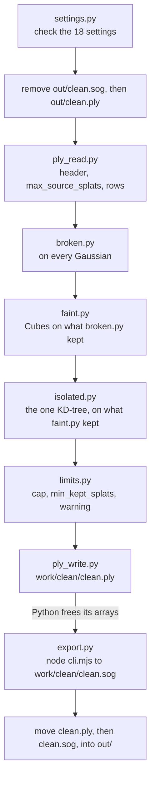

# Design Document: clean

## Overview

This spec builds the Clean_Step in `splatpipe/clean/`. It reads the Source_Splat, `out/train.ply`, which the training step writes. It drops the Gaussians a viewer shouldn't see in three filters that run on the CPU with numpy and scipy. It writes the Kept_Splats as the Clean_Splat, `out/clean.ply`, and then runs PlayCanvas splat-transform 3.8.0 under Node, with its GPU work on the CPU, to make the Viewer_Copy, `out/clean.sog`.

The step is built like the Fake_Step: `work(step)`, `run(job_id, preset=None, *, config=None)` and a `__main__.py` that calls `step_main`. It isn't in `STEP_LIST` (A9), so it runs through its own CLI, `uv run python -m splatpipe.clean --job <id> [--preset P]`. No Skeleton module or pipeline-core test changes.

Everything is sized for the 8 vCPUs and 8 GB a Step gets on the job machine (A7). numpy and scipy are the only new Python packages. Node runs only splat-transform.

### Decisions on the open choices

Each row is settled here from the requirements, the repo or the tools' docs. The first review's answers are in "Review decisions" at the end.

| Choice | Decision |
|---|---|
| Module layout | One module per part: the settings, PLY reading, PLY writing, the neighbour search, each filter, the Filter_Order, the Requirement 3 limits and the splat-transform subprocess. See "Module layout". |
| Splat_Data in memory | One numpy structured array, packed, fields in the file's property order with their declared types. A big-endian file is byte-swapped in place right after reading, so the array is always little-endian. |
| Which PLY elements are read | Only `vertex`. An element before it is skipped by its size, and an element after it isn't read. The Clean_Splat holds only the `vertex` element (Req 4.1, 4.2). |
| How the filters pass sets on | As increasing index arrays into the Splat_Data, never as copies of rows. Boolean masks keep the original order (Req 2.18). |
| Neighbour search | `scipy.spatial.cKDTree`, built once, by the Isolated_Filter, on the set the Faint_Filter kept (Req 2.13). The Faint_Filter searches for no neighbours. |
| Cubes | Each axis's Cube coordinate is `np.floor_divide(p - low, edge)`, kept as float64, and the rows are grouped with `np.lexsort` and a scan for changes, so no Cube coordinate is ever cast to an integer (Req 2.6 to 2.8, 2.11). See `faint.py`. |
| Paint | Worked in the log domain and shifted by each Cube's largest log Paint before any `exp`, so every `exp` is of a value at or below 0 (Req 2.9, 2.11). See `faint.py`. |
| Worker threads | `cKDTree.query(workers=max(1, max_workers))`, because scipy refuses 0 workers, and `--max-workers <max_workers>` for splat-transform, where 0 means inline. |
| Real_Scale | Never computed as a number. Paint uses the stored scales, which are already logarithms, so no `exp` of a stored scale is ever taken (Req 2.11). |
| Real_Opacity | Never computed as a number either. The Faint_Filter uses its logarithm, `-np.logaddexp(0, -opacity)`, which is finite for every finite stored opacity (Req 2.11). |
| The isolation test | `Neighbour_Distance / Neighbour_Median > isolation_ratio`, with the median above 0, which can't overflow for any finite centres and any setting. |
| Query chunking | None. The Python peak is about 4.4 GB at `max_source_splats`, in the Isolated_Filter's query, inside the 8 GB (see "Memory"). |
| Running splat-transform | `node <repo>/node_modules/@playcanvas/splat-transform/bin/cli.mjs ...`, with `node` from `shutil.which`, an argument list and no shell, as Requirement 5.2 says. `bin/cli.mjs` is the `bin` entry in 3.8.0's `package.json` (checked on the npm registry). |
| Output name suffixes | `clean_ply` must end in `.ply` and `clean_sog` in `.sog`, exactly and in lower case, because splat-transform picks its reader and writer from the extension, and only a `.sog` output is one bundled file (Req 5.1, 6.9). |
| Comparing the three file names | Case-insensitively (`str.casefold`), because `Train.ply` and `train.ply` are one file on Windows and macOS (Req 6.10). |
| Order of the removals and the moves | The Viewer_Copy is removed first, then the Clean_Splat. The Clean_Splat moves into `out/` first, then the Viewer_Copy. See "The two-output guarantee". |
| splat-transform's output | Captured, written whole to `work/clean/splat-transform.log`, summed up in a Job_Log line at its start and one at its end, and its last `TAIL_CHARS` (2000) characters go into the Readable_Error on a failure (Req 5.11, 6.5). |

## Architecture



`work(step)` runs these stages in this order. Every check that can refuse the settings comes before anything in the Job_Folder is opened, written or removed (Req 6.9). The earlier Step_Outputs are removed before either new one is written (Req 4.8). Every Requirement 3 check comes before either Step_Output is written (Req 3.7). Both Step_Outputs are made in the Work_Folder and move into `out/` only once both exist (Req 4.5, 4.11, 5.9).

### Module layout

| File | What it holds |
|---|---|
| `splatpipe/clean/__init__.py` | `run()`, `work(step)` and the stage order: the settings, the removal of the old Step_Outputs, the clean phase, the export phase and the moves. |
| `splatpipe/clean/__main__.py` | `main(argv)`, which calls `step_main("clean", "splatpipe.clean", argv)`, and `if __name__ == "__main__": sys.exit(main())`. |
| `splatpipe/clean/settings.py` | `CleanSettings`, `check_settings()` and `check_plain_name()` (Req 6.6 to 6.10). |
| `splatpipe/clean/ply_read.py` | The PLY Format_Constants, `PlyProperty`, `PlyHeader`, `read_header()` and `read_splat()` (Req 1). |
| `splatpipe/clean/ply_write.py` | `header_bytes()` and `write_splat()` (Req 4.1 to 4.4, 4.6). |
| `splatpipe/clean/neighbours.py` | `positions()`, `nearest_others()`, which queries a tree and drops each Gaussian from its own row (Req 2.16). |
| `splatpipe/clean/broken.py` | `broken_keep()` (Req 2.2, 2.3). |
| `splatpipe/clean/faint.py` | `log_opacity()`, `log_paint()`, `cube_groups()` and `faint_keep()` (Req 2.4 to 2.11). |
| `splatpipe/clean/isolated.py` | `isolated_keep()` (Req 2.12 to 2.15). |
| `splatpipe/clean/filters.py` | `Kept` and `run_filters()`: the Filter_Order, the index bookkeeping, the counts and the freeing between stages (Req 2.1, 2.17). |
| `splatpipe/clean/limits.py` | `check_source_count()` and `check_limits()`, pure functions with their Readable_Errors (Req 3). |
| `splatpipe/clean/export.py` | `NODE_VERSION`, `CLI`, `TAIL_CHARS`, `find_splat_transform()`, `splat_transform_argv()` and `export_sog()` (Req 5, 6.5). |

`__init__.py` imports the other modules, and `__main__.py` imports only `splatpipe.step`. Each of the others imports only modules listed above it in this table, from `settings.py` down, so there are no cycles. From `splatpipe`, the package imports `splatpipe.step` (`StepContext`, `StepSettings`, `Config`, `run_step`), `splatpipe.errors` (`ExpectedFailure`) and `splatpipe.config` (`REPO_ROOT`, for `node_modules/`). Outside the standard library it imports only numpy and `scipy.spatial` (Req 8.5). No Skeleton module imports it.

The filter modules and `limits.py` hold pure functions of arrays and numbers, with no files and no `StepContext`, so each is unit-testable on its own and the property tests need no Job.

## Components and Interfaces

### settings.py

```python
@dataclass(frozen=True)
class CleanSettings:
    # The sixteen Shared_Settings of Req 6.2, from [clean]
    train_ply: str                          # Plain_File_Name, read from out/
    clean_ply: str                          # Plain_File_Name ending in .ply
    clean_sog: str                          # Plain_File_Name ending in .sog
    min_opacity: float                      # 0 to 1
    faint_cube_divisions: int               # above 0
    faint_min_per_cube: int                 # above 0
    faint_min_paint_share: float            # 0 up to but not including 1
    extent_trim_percent: float              # 0 up to but not including 50
    neighbours: int                         # above 0
    isolation_ratio: float                  # above 0
    max_removed_fraction: float             # 0 to 1
    min_kept_splats: int                    # above 0
    warn_kept_fraction: float               # 0 to 1
    max_source_splats: int                  # above 0
    max_workers: int                        # 0 to 8, 0 runs splat-transform's encoding inline
    splat_transform_timeout_seconds: float  # above 0
    # The two Preset_Settings of Req 6.3, from [clean.<preset>]
    sog_sh_bands: int                       # 0 to 3
    sh_iterations: int                      # above 0

def check_settings(settings: StepSettings) -> CleanSettings
def check_plain_name(key: str, value: object, suffix: str | None) -> str
```

`check_settings` reads each key with `settings[key]`, so a missing key is the Step_Runner's own refusal through `StepSettings.__missing__`, which names `[clean]`, `[clean.<preset>]` and the key, with no new code (Req 6.6). Then it checks, in this order, and raises `ExpectedFailure` at the first problem:

1. Each whole number (Req 6.7): `min_kept_splats`, `max_source_splats`, `neighbours`, `faint_cube_divisions`, `faint_min_per_cube` and `sh_iterations` above 0, `sog_sh_bands` from 0 to 3, and `max_workers` from 0 to 8. A whole number is `type(value) is int`, so `True` and `4.0` are refused.
2. Each number (Req 6.8): `min_opacity`, `warn_kept_fraction` and `max_removed_fraction` from 0 to 1, `faint_min_paint_share` from 0 up to but not including 1, `extent_trim_percent` from 0 up to but not including 50, and `isolation_ratio` and `splat_transform_timeout_seconds` above 0. A number is an `int` or a `float` but never a `bool`. Config already refuses NaN and infinity (pipeline-core Req 5.7), so a number here is finite. An `int` too big for a float is refused as out of range, the way `[jobs]` refuses one.
3. The three names, each with `check_plain_name` (Req 6.9).
4. The clashes (Req 6.10): `clean_ply`, `clean_sog` and `train_ply` must differ from each other after `casefold()`. The message names the two settings that clash and their values, and says that names differing only in case are one file on Windows.

Each message in steps 1 and 2 names the setting, `[clean]` or `[clean.<preset>]`, the value and what it must be, like "In [clean], neighbours is 0, but it must be a whole number above 0. Change it to one, like 8." The ranges are the requirements' own, so the check has no pairs: no setting's range depends on another's. Floats are given back as `float(value)`, so `extent_trim_percent = 1` works like `1.0`.

`check_plain_name(key, value, suffix)` accepts a `str` that is a Plain_File_Name and refuses everything else, naming the setting and what's wrong with the value. It refuses, in order: a value that isn't a `str`; `""`; a name holding `/`, `\`, `os.sep` or `os.altsep`; `.` and `..`; a name holding `:`, which covers a Windows drive-relative path like `C:clean.ply` and an NTFS stream like `clean.ply:x`; a name holding a NUL or another control character below U+0020, which the OS can't take as a name and which would garble the message, so such a value isn't echoed; a name that `PurePosixPath` or `PureWindowsPath` calls absolute or gives a drive. With no separator in it, a name has one part, so "holding no `..` part" is the same as not being `..`. When `suffix` is given, the name must end with it exactly, in lower case: `.ply` for `clean_ply` and `.sog` for `clean_sog`, so `clean.PLY` is refused (Req 6.9). `train_ply` has no suffix rule, because the step reads that file by its content.

### ply_read.py

```python
# Format_Constants: the PLY scalar types, the 3DGS names and the f_rest_* counts. They describe
# the file format, not our choices, so they stay in code (Req 1.3).
PLY_TYPES = {"char": "i1", "int8": "i1", "uchar": "u1", "uint8": "u1",
             "short": "i2", "int16": "i2", "ushort": "u2", "uint16": "u2",
             "int": "i4", "int32": "i4", "uint": "u4", "uint32": "u4",
             "float": "f4", "float32": "f4", "double": "f8", "float64": "f8"}
REQUIRED = ("x", "y", "z", "opacity", "scale_0", "scale_1", "scale_2",
            "rot_0", "rot_1", "rot_2", "rot_3")
SH_BANDS = {0: 0, 9: 1, 24: 2, 45: 3}  # f_rest_* count -> SH_Bands: 3 channels of 3, 8 or 15 coefficients

@dataclass(frozen=True)
class PlyProperty:
    name: str
    ply_type: str                   # as declared, like "float" or "float32"

@dataclass(frozen=True)
class PlyHeader:
    path: Path
    byte_order: str                 # "<" or ">"
    comments: tuple[str, ...]       # every comment and obj_info line, verbatim, in file order
    count: int                      # element vertex <count>
    properties: tuple[PlyProperty, ...]
    data_offset: int                # bytes before the first vertex row
    sh_bands: int
    def dtype(self, byte_order: str) -> np.dtype   # packed, one field per property, in file order

def read_header(path: Path) -> PlyHeader
def read_splat(header: PlyHeader) -> np.ndarray
```

`read_header` opens the file with `open(path, "rb")` and never with a write mode, so the step can't change the Source_Splat (Req 1.11). It reads the header line by line with `readline()`, decodes each line as Latin-1, which maps every byte to one character and back, and strips one `\n` and then one `\r`, so a header written with `\r\n` reads too. A file that isn't a PLY fails on its first or second line, so there's no size cap on the header. The rules:

- Line 1 is exactly `ply`. Line 2 is `format <ascii|binary_little_endian|binary_big_endian> 1.0`. `ascii` is refused as Req 1.7 says, with "splat-transform can't read an ascii PLY either".
- After that, each line is `comment ...`, `obj_info ...`, `element <name> <count>`, `property <type> <name>`, `property list <type> <type> <name>` or `end_header`. Anything else, a `property` line before the first `element`, a count that isn't a whole number of 0 or more, a type not in `PLY_TYPES` and a property name used twice in one element are each refused under Req 1.7, naming the line number and the line.
- `comment` and `obj_info` lines are kept verbatim, in file order, wherever they sit in the header (Req 4.3).
- A list property in `vertex` is refused under Req 1.8, naming it. A list property in an element before `vertex` is refused too, because the reader can't tell where the vertex rows start. An element after `vertex` is never read, list or not.
- `data_offset` is the header's length in bytes plus `count × row size` of each element before `vertex`.
- A file with no `vertex` element, or whose `vertex` lacks any of `REQUIRED`, is refused under Req 1.7, naming every missing property. A 2DGS file (no `scale_2`) and a file with `opacity_linear` in place of `opacity` land here, as the out-of-scope list says.
- A `vertex` count of 0 is refused under Req 1.9.
- The number of `f_rest_*` names, matched with `re.fullmatch(r"f_rest_[0-9]+", name)`, must be a key of `SH_BANDS`. Any other count is refused under Req 1.5, naming the count and the four counts allowed.
- Last, `os.stat(path).st_size` must be at least `data_offset + count × row size`. A shorter file is refused under Req 1.10. A longer one is fine, because elements after `vertex` follow it.

`FileNotFoundError` gives the Req 1.6 message, which names the file and says the training step writes it, so training has to run first. Any other `OSError`, like a folder in the file's place or no permission to read it, gives an `ExpectedFailure` naming the file and `error.strerror`.

`read_splat` reads the rows with `np.fromfile(header.path, dtype=header.dtype(header.byte_order), count=header.count, offset=header.data_offset)`, which reads straight into the array with no second copy. Because `fromfile` returns fewer rows without an error when the file is short, a short result is refused under Req 1.10 too, which covers a file that shrank after the size check. For a big-endian file it then calls `data.byteswap(inplace=True)` and `data = data.view(header.dtype("<"))`, which swaps every field in place and keeps every value bit for bit, NaN payloads included, with no second copy. Every property of `vertex` is a field of the array, with its name, type and position, the Required_Properties and the Carried_Properties alike (Req 1.2, 1.4).

### ply_write.py

```python
def header_bytes(header: PlyHeader, count: int) -> bytes
def write_splat(path: Path, header: PlyHeader, data: np.ndarray, rows: np.ndarray) -> int
```

`header_bytes` writes `ply`, `format binary_little_endian 1.0`, every kept `comment` and `obj_info` line in its original order, `element vertex <count>`, one `property <declared type> <name>` line per property in the source's order, and `end_header`, each ending in `\n`, encoded as Latin-1 so each comment's bytes come back exactly (Req 4.1 to 4.3). A comment that sat between property lines in the source now sits before the `element` line, with the comments' order kept.

`write_splat` makes `kept = data[rows]`, the one copy of the Kept_Splats, opens `path` with mode `"xb"`, writes `header_bytes(header, len(rows))`, then `kept.tofile(handle)`, and returns `path.stat().st_size` for `clean_ply_bytes`. `path` is `work/clean/<clean_ply>`, and the Step_Runner has just emptied the Work_Folder, so `"xb"` never meets an old file. An `OSError` while opening or writing removes the partial file and raises `ExpectedFailure` naming the file and `error.strerror`, like "There's no space left on the device" (Req 4.6).

### neighbours.py

```python
def positions(data: np.ndarray, rows: np.ndarray) -> np.ndarray   # (len(rows), 3) float64, C order
def nearest_others(tree: cKDTree, rows: np.ndarray, k: int,
                   workers: int) -> tuple[np.ndarray, np.ndarray]
```

`positions` fills a new float64 array column by column from `x`, `y` and `z` at `rows`. A float32 value converts to float64 exactly, so every Centre_Distance is worked out in float64 from the stored centres (Req 2.16). The Faint_Filter uses the same array for its Cubes.

`nearest_others` returns, for the tree's points `rows`, the Centre_Distances and the tree indices of their `k` nearest other points, each `(len(rows), k)`. The caller makes sure the tree holds more than `k` points. Only the Isolated_Filter calls it, with every point.

1. It calls `tree.query(points, k=list(range(1, k + 2)), workers=workers)`, where `points` is `tree.data` itself when `rows` is every point, and `tree.data[rows]` otherwise. `k` is passed as a list of ranks, because an `int` `k` of 1 makes scipy drop the second axis.
2. It drops each point from its own row (Req 2.16). The point is usually in the first column at distance 0, but with coincident centres another point at distance 0 can come first, and with more than `k + 1` coincident centres the point can be missing from its row. So `is_self = idx == rows[:, None]`, and a row with no `True` gets `True` in its last column. Every entry of such a row is at distance 0, so dropping the last one still leaves `k` nearest others.
3. It turns `is_self` into `others` in place, with `np.logical_not(is_self, out=is_self)`, makes the trimmed distances, `dist[others].reshape(n, k)`, and frees the raw distances. Then it makes the trimmed indices the same way and frees the raw indices. So its peak is both raw arrays, the mask and the trimmed distances (see "Memory").

Among neighbours at exactly the same distance, the tree's own order decides which are "the `k` nearest", as A10 settles. That choice can change a Neighbour_Median but never a Neighbour_Distance.

### broken.py

```python
def broken_keep(data: np.ndarray) -> np.ndarray   # bool, one per Gaussian
```

A Gaussian is kept when `np.isfinite` holds for every field in `REQUIRED` and its quaternion isn't all zero: `~((rot_0 == 0) & (rot_1 == 0) & (rot_2 == 0) & (rot_3 == 0))` (Req 2.2). A quaternion's length is 0 exactly when all four components are ±0, so the test needs no squares, which would overflow in float32 for components above about 1.8e19 and raise under the tests' error settings. `np.isfinite` on an integer field is always true. It reads no field outside `REQUIRED`, so a NaN or an infinity in a colour or another Carried_Property stays, and `write_splat` carries it into the Clean_Splat unchanged (Req 2.3, A11). The rule looks at one Gaussian's own values only, so running it again on what it kept keeps everything (Req 2.19).

### faint.py

```python
# Format_Constants: the π in Paint, and float32's smallest gap, which bounds how small a Cube matters.
LOG_PI = math.log(math.pi)
FLOAT32_HALF_STEP = 2.0 ** -150   # half the smallest gap between two float32 values, 2**-149
HUGE_DIVISIONS = 2 ** 279         # Extent < 2**129, so this many divisions or more make an edge below the half step

def log_opacity(stored: np.ndarray) -> np.ndarray                       # log Real_Opacity, float64, at most 0
def log_paint(log_alpha: np.ndarray, top_two: np.ndarray) -> np.ndarray  # log Paint, float64
def cube_groups(points: np.ndarray, s: CleanSettings) -> tuple[np.ndarray, np.ndarray]
def faint_keep(points: np.ndarray, stored_opacity: np.ndarray, top_two: np.ndarray,
               s: CleanSettings) -> np.ndarray                          # bool, one per row of points
```

`points` is the set the Faint_Filter was given, which is what the Broken_Filter kept, as from `positions`, so every centre is finite. `stored_opacity` is that set's `opacity` as float64. `top_two` is the sum of its two largest stored scales, `np.maximum(s0, s1) + np.maximum(np.minimum(s0, s1), s2)` in float64: one addition of two float32 values, at most 6.8e38, so it can't overflow. Because `exp` only grows, the two largest stored scales are the logarithms of the two largest Real_Scales. The Faint_Filter builds no KD-tree and searches for no neighbours.

`log_opacity` is `-np.logaddexp(0.0, -stored)`, log Real_Opacity, which numpy works out as `log1p(exp(...))` of a value at or below 0. It's finite and at most 0 for every finite stored opacity: -3.4e38 gives -3.4e38, 0 gives -log 2 and 3.4e38 gives 0. Only underflow can happen inside it, and it's right: the `exp` of a very negative number really is 0 to float64. So it runs inside `np.errstate(under="ignore")` (Req 2.11).

`log_paint` is `log_alpha + LOG_PI + top_two`, log Paint, from Paint = Real_Opacity × π × the two largest Real_Scales. Every term is finite, so the sum is finite, between about -1.0e39 and 6.8e38, and no `exp` of a stored scale is ever taken (Req 2.11).

`cube_groups(points, s)` puts every Gaussian in its Cube and returns `order`, the rows sorted by Cube, and `starts`, which is `True` at the first sorted row of each Cube. It works from the whole set it was given, before anything is dropped (Req 2.6):

1. **The Trimmed_Box.** For each axis, `low = np.percentile(points[:, j], t)` and `high = np.percentile(points[:, j], 100 - t)`, with `t = extent_trim_percent` and numpy's default linear interpolation, one axis at a time so each call copies one column. They run inside `np.errstate(under="ignore")`, because the interpolation between two tiny values can underflow.
2. **The Extent** is `max(0.0, max(high - low))`. The `max` with 0 keeps a box that rounding made a hair inside out from giving a negative Extent.
3. **One Cube** when the Extent is 0: `order` is every row in turn, and `starts` is `True` only at the first (Req 2.8, A12).
4. **The Cube_Edge** is `extent / faint_cube_divisions`. A `faint_cube_divisions` of `HUGE_DIVISIONS` or more skips the division and takes the centre path of step 5, because Python can't turn an int above about 1.8e308 into a float, and the Extent is below 2^129, so such a count gives an edge below `FLOAT32_HALF_STEP` anyway.
5. **Each axis's Cube coordinate** is `np.floor_divide(p - low, edge)`, kept in a `(3, n)` float64 array `cells`, one contiguous row per axis: `np.subtract(points[:, j], low[j], out=cells[j])` for each axis, then `np.floor_divide(cells, edge, out=cells)`, inside `np.errstate(under="ignore")`, so no temporary array is made. Floor division counts a Cube's low face in and its high face out, as the glossary says. The coordinate stays a float64 and is never cast to an integer, so a far-off centre can't overflow anything: `p - low` is at most 6.8e38 in size, and with an edge above 2^-150 the quotient is below 2^279, far inside float64 (Req 2.7, 2.11). When the edge is at most `FLOAT32_HALF_STEP`, the coordinate is the centre itself instead. Two different float32 values are at least 2^-149, two such edges, apart, so on each axis they're in different Cubes, and equal ones are in the same one: grouping by the centres is exactly grouping by the Cubes.
6. **Grouping.** `order = np.lexsort((cells[2], cells[1], cells[0]))`, three stable typed sorts of float64 keys. Each key is a contiguous row, so `lexsort` sorts it where it is, with no copy. Then `starts[0] = True`, and for each axis, `col = cells[j][order]` and `starts[1:] |= col[1:] != col[:-1]`, one axis at a time. `!=` on float64 treats -0.0 and 0.0 as equal, which is the same rule as the test's dict of Cubes, where `-0.0 == 0.0` and both hash alike. Then the coordinates are freed.

`np.unique(cells.T, axis=0, return_inverse=True)` would give the same groups, but it copies the coordinates into one row per Gaussian, views each row as one structured value and sorts those through numpy's generic field-by-field comparison, which is slower than three typed sorts and leaves the equality rule to that comparison. The lexsort and the scan state the rule in the code.

`faint_keep` then does this, all from the set it was given and before it drops anything (Req 2.6):

1. An empty set gives back an empty array, because it has no Trimmed_Box (Req 2.10).
2. `la = log_opacity(stored_opacity)`. A Gaussian is a Faint_Gaussian when `la < math.log(min_opacity)`. No Gaussian is one when `min_opacity` is 0, because no Real_Opacity is below 0. Every Gaussian is one when `min_opacity` is 1, because every Real_Opacity of a finite stored opacity is below 1, so `faint_keep` doesn't trust `la < 0` there, which the underflow in `log_opacity` makes false for a stored opacity above about 745. Every Gaussian that isn't a Faint_Gaussian is kept (Req 2.4).
3. With no Faint_Gaussian, it returns every row as kept at once, and makes no Cubes.
4. `lp = log_paint(la, top_two)`, worked in place into `la`, and `order, starts = cube_groups(points, s)`.
5. In sorted order: `g = np.cumsum(starts) - 1`, each row's Cube from 0 to `m - 1`; `bounds = np.flatnonzero(starts)`; `lp_s = lp[order]`; and `faint_s = faint[order]`.
6. The shift: `top = np.maximum.reduceat(lp_s, bounds)` is each Cube's largest log Paint, `lp_s -= top[g]` makes every value at most 0, and `np.exp(lp_s, out=lp_s)`, inside `np.errstate(under="ignore")`, gives each Gaussian's Paint divided by its Cube's largest Paint, from 0 to 1. Only underflow can happen (Req 2.11).
7. The per-Cube sums, with `np.bincount` on the Cube index: `cube_paint = np.bincount(g, weights=lp_s, minlength=m)`, and, over the Faint_Gaussians' rows only, `faint_paint = np.bincount(g[faint_s], weights=lp_s[faint_s], minlength=m)` and `faint_count = np.bincount(g[faint_s], minlength=m)`. Both Paints are the real ones divided by the same positive number, the Cube's largest Paint, so the test below gives the real rule's answer. Every Gaussian in a Cube counts toward its Cube_Paint, faint or not.
8. The test of Req 2.9, needed only for the Cubes with `faint_count > 0`, because the others hold no Faint_Gaussian to keep or drop: a Cube keeps its Faint_Gaussians when `faint_count >= min(faint_min_per_cube, n + 1)` and `faint_paint > faint_min_paint_share * cube_paint`, a product with no division. The `min` with `n + 1` changes no answer, because no Cube holds more than `n`, and keeps a very large setting from meeting an int64 array. With `faint_min_paint_share` at 0, the paint condition holds for every Cube with a Faint_Gaussian, because every real Paint is above 0, so `faint_keep` takes it as met rather than trust a sum that could have underflowed (see "Numerical care").
9. A row is kept when it isn't a Faint_Gaussian or its Cube passes: `keep_s = ~faint_s | cube_keeps[g]`, then `keep[order] = keep_s` puts the answers back in the set's order. So only the Cubes that hold a Faint_Gaussian decide anything (Req 2.5, 2.9).

The shifted Cube_Paint is at least 1, because the Cube's largest Paint adds `exp(0)`. Real Paint is never 0, since every Real_Opacity and Real_Scale of a finite stored value is above 0, so the Cube_Paint of 0 that Req 2.9 mentions can't arise here, and the product test holds as written either way.

### isolated.py

```python
def isolated_keep(points: np.ndarray, s: CleanSettings, workers: int) -> np.ndarray
```

1. A set of `neighbours` Gaussians or fewer is kept whole, with no tree (Req 2.14).
2. Otherwise it builds `cKDTree(points)`, the step's only tree, and calls `nearest_others(tree, all rows, neighbours, workers)`.
3. `nd = dist.mean(axis=1)`, the Neighbour_Distances of the whole set, before anything is dropped (Req 2.13). Then it frees `dist`.
4. `around = nd[idx]`, then frees `idx`, then `med = np.median(around, axis=1, overwrite_input=True)`, the Neighbour_Medians, from the same set's Neighbour_Distances (Req 2.13). `overwrite_input=True` lets numpy partition `around` in place, so the median makes no working copy. With an even `neighbours`, like 8, numpy's median is the mean of the middle two.
5. A Gaussian is kept when `med == 0` (Req 2.15) or `nd / med <= isolation_ratio`, with the division taken only where `med > 0` (Req 2.12). `nd` is at most about 1.2e39, the largest distance between finite float32 centres. A non-zero Centre_Distance is at least 2^-149, the smallest float32 step, so a non-zero `med` is at least 2^-149 / (2 × `neighbours`), about 8.8e-47 at 8. The ratio so stays below about 1.7e84 × `neighbours`, and `neighbours` is below the set's size here, so it can't overflow, whatever `isolation_ratio` is.

### filters.py

```python
@dataclass(frozen=True)
class Kept:
    rows: np.ndarray            # indices into the Splat_Data, increasing
    dropped_broken: int
    dropped_faint: int
    dropped_isolated: int

def run_filters(data: np.ndarray, s: CleanSettings,
                add_count: Callable[[str, int], None]) -> Kept
```

`run_filters` runs the Filter_Order on the Splat_Data and hands each filter what the one before it kept (Req 2.1):

1. `rows1 = np.flatnonzero(broken_keep(data))`. It adds `dropped_broken`.
2. It builds `points1 = positions(data, rows1)`, and the stored opacity and the two largest stored scales' sum at `rows1`, and calls `faint_keep`. Then `rows2 = rows1[keep]`, `points2 = points1[keep]`, and it frees `points1` and the faint arrays, which only live inside this stage. It adds `dropped_faint`.
3. It calls `isolated_keep(points2, ...)`, then `rows3 = rows2[keep]`, and frees `points2`. It adds `dropped_isolated` and `kept_splats`.

Each count is added through `add_count`, which is `step.add_count`, as soon as its filter is done, so a failure later in the step leaves the counts already worked out in the Clean_Report, and no others (Req 2.17, 7.2). Every count is `int(...)` of a numpy size, so the Step_Runner's exact-`int` check never refuses one (Req 7.3). Indexing an index array with a boolean mask keeps the order, so `rows3` is increasing and every filter gives back a subset in the original order, with no Gaussian added or repeated (Req 2.18). The filters never write to `data`.

### limits.py

```python
def check_source_count(count: int, s: CleanSettings) -> None
def check_limits(source: int, kept: Kept, s: CleanSettings) -> str | None   # the warning, or None
```

Both are pure and raise `ExpectedFailure`.

- `check_source_count` refuses `count > max_source_splats` (Req 3.1). It runs on the header's count, before `read_splat`, so the rows are never read. The message gives both numbers and says that `max_source_splats` in `[clean]` can be raised on a machine with more memory.
- `check_limits` works out `capped = kept.dropped_faint + kept.dropped_isolated` and `removed = capped / source`, then checks in this order (Req 3.7):
  1. `removed > max_removed_fraction` fails (Req 3.2). The message gives the Source_Splat's count, each filter's drops, the Removed_Fraction and the cap as percentages, says that the broken Gaussians don't count toward the cap, and names the settings in `[clean]` to loosen: `min_opacity`, `faint_min_per_cube` and `faint_min_paint_share` lower, `faint_cube_divisions` lower for bigger Cubes, `isolation_ratio` higher, and `max_removed_fraction` higher (Req 3.3).
  2. `len(kept.rows) < min_kept_splats` fails (Req 3.5), with the source count, the count left, each filter's drops and the same settings to loosen, plus `min_kept_splats` itself.
  3. `len(kept.rows) / source < warn_kept_fraction` returns the warning, with both counts and the Removed_Fraction (Req 3.6).

The step stops at the cap. It never keeps part of the removals, so nothing ranks one Gaussian against another (Req 3.4). Because all three checks come before the Clean_Splat is written, a failure here writes neither Step_Output, and the earlier ones were already removed (Req 3.2, 3.5, 4.8). An `ExpectedFailure` makes the Clean_Report failed with `expected: true`, and the Job_Runner, once the step is in the list, ends the Job done with warnings, with `out/train.ply` untouched (Req 3.8).

### export.py (the splat-transform subprocess)

```python
NODE_VERSION = 22   # Format_Constant: 3.8.0's package.json has "engines": {"node": ">=22.0.0"}
CLI = Path("node_modules", "@playcanvas", "splat-transform", "bin", "cli.mjs")  # 3.8.0's bin entry
TAIL_CHARS = 2000   # Req 6.5: most characters of splat-transform's output in a Readable_Error

def find_splat_transform(repo_root: Path = REPO_ROOT) -> tuple[str, Path]
def splat_transform_argv(node: str, cli: Path, source: Path, target: Path,
                         bands: int, s: CleanSettings) -> list[str]
def export_sog(source: Path, target: Path, bands: int, s: CleanSettings, log_file: Path,
               *, run: Callable[..., subprocess.CompletedProcess[bytes]] = subprocess.run,
               find: Callable[[], tuple[str, Path]] = find_splat_transform) -> int
```

`find_splat_transform` checks both Node and the package before it refuses, so its Readable_Error says which of the two is missing, or that both are (Req 5.10):

- `shutil.which("node")` is `None`: "Node isn't installed, or `node` isn't on the PATH. The clean step needs Node 22 or newer for splat-transform. Install it, then run `npm ci` at the repo root."
- `(repo_root / CLI).is_file()` is false: "splat-transform isn't installed: `node_modules/@playcanvas/splat-transform/bin/cli.mjs` is missing. Run `npm ci` at the repo root, with Node 22 or newer."
- Both: one message that says both are missing, then the two steps in order: install Node 22 or newer, then run `npm ci` at the repo root.

The Node version in each message is `NODE_VERSION`, a Format_Constant of the tool.

`splat_transform_argv` gives, in this order, because splat-transform's command line is positional, `[GLOBAL OPTIONS] input [ACTIONS] output [ACTIONS]`, and an action applies to the input it follows:

```python
[node, str(cli),
 "-w", "-g", "cpu", "-i", str(s.sh_iterations), "--max-workers", str(s.max_workers),  # global options
 str(source),                                                                       # the Clean_Splat in work/clean/
 "-H", str(bands),                                                                  # an action on that input
 str(target)]                                                                       # work/clean/<clean_sog>
```

- The list starts with `node`, as `shutil.which` found it, and the installed `bin/cli.mjs`, so nothing is downloaded at run time (Req 5.2).
- `-w` lets it overwrite, `-g cpu` puts its GPU work on the CPU, so it needs no GPU and no Vulkan driver (Req 5.3), `-i` is the SH compression iterations and `--max-workers` the worker threads (Req 5.6). `-H` is the short form of `--filter-harmonics` in splat-transform 3.8.0's README, the same option (Req 5.4).
- Nothing else goes in: no `--filter-floaters`, `--filter-cluster`, `--decimate` or `-N`, and the output is a `.sog`, never `.voxel.json` or `.webp` (Req 5.7).
- `source` and `target` are absolute, because the Work_Folder is under the resolved Job_Folder, so neither can start with `-`.
- `bands` is `min(sog_sh_bands, the Source_Splat's SH_Bands)`. When that lowers `sog_sh_bands`, `work` first adds the warning "The <preset> preset keeps <n> bands of spherical harmonics in the viewer copy, but the trained splat has only <m>, so the viewer copy keeps <m>." (Req 5.5).

`export_sog` runs `run(argv, cwd=target.parent, stdin=subprocess.DEVNULL, stdout=subprocess.PIPE, stderr=subprocess.STDOUT, timeout=s.splat_transform_timeout_seconds, check=False)`, an argument list with no shell (Req 5.8). The working folder is the Work_Folder, so any stray file splat-transform makes lands there (Req 8.7). stderr is merged into stdout, so the output keeps its own order and its last lines are the real last lines. The output stays bytes and is decoded with `encoding="utf-8", errors="replace"`, as `probe.py` does with ffprobe's.

The command starts `node` itself, with the package's `bin/cli.mjs` as its script. `node_modules/.bin/splat-transform` is a shell script on Linux and a `.cmd` shim on Windows, and a `.cmd` needs `cmd.exe` to run it. Running `node` directly gives one code path on the Windows laptops and the Linux job machine, and it means the child Python waits on, and kills on a timeout, is `node` itself, not a `cmd.exe` that would leave `node` running.

What it does with each outcome:

| Outcome | What `export_sog` does |
|---|---|
| `OSError` from `run`, like no permission to run `node` | `ExpectedFailure` naming the `node` path and `error.strerror`. |
| `subprocess.TimeoutExpired` | `subprocess.run` has already killed the child, with `SIGKILL` on Linux and `TerminateProcess` on Windows, and waited for it. splat-transform's workers are threads inside that one `node` process, so they stop with it. The output so far is in `error.stdout`, always bytes or `None`, whatever the text setting. `ExpectedFailure`: "splat-transform didn't finish within <limit> seconds, so the clean step stopped it. Raise splat_transform_timeout_seconds in [clean], or use a preset with fewer sh_iterations." plus the tail (Req 5.12). |
| A non-zero exit | `ExpectedFailure`: "splat-transform failed with exit code <n> while it made the viewer copy. Its last lines were:" plus the tail, then "The whole output is in work/clean/splat-transform.log. splat-transform 3.8.0 needs Node 22 or newer, and `node --version` shows yours." A negative code on Linux is a signal, so -9 says "It was stopped by signal 9, which often means the machine ran out of memory." (Req 5.11). |
| Exit 0, but `target` is missing or 0 bytes | `ExpectedFailure`: "splat-transform said it was done, but it wrote no viewer copy at <target>." plus the tail (Req 5.13). |
| Exit 0 and `target` has bytes | Returns `target.stat().st_size`, for `clean_sog_bytes` (Req 5.14). |

In every case the whole decoded output is written to `log_file`, `work/clean/splat-transform.log`, first. The tail is the last `TAIL_CHARS` characters of the output, cut back to the start of a line, after three clean-ups: `\r\n` becomes `\n`, each line keeps only what follows its last `\r` (what a terminal shows after a progress bar redraws), and ANSI colour codes and other control characters except `\n` and `\t` are removed. So the Readable_Error holds splat-transform's own words with no traceback (Req 5.11).

The step logs with `logging.getLogger(__name__)`, so the lines land in `out/job.log` when the Job_Runner runs the step, and go nowhere when the step runs alone. It logs one INFO line as splat-transform starts, with the bands, the iterations and the workers, and one when it ends, with the exit code, the seconds and the bytes written. On Linux, the end line also gives `resource.getrusage(resource.RUSAGE_CHILDREN).ru_maxrss`, the peak memory of the largest child the process has waited for. Run through the step's own CLI, the only child is splat-transform, so this line is how the first real job measures it (Open item O1).

### \_\_init\_\_.py (run and work)

```python
def run(job_id: str, preset: str | None = None, *, config: Config | None = None) -> dict[str, Any]:
    return run_step("clean", "splatpipe.clean", job_id, preset=preset, config=config)

def work(step: StepContext) -> None:
    s = check_settings(step.settings)                     # Req 6.6 to 6.10, before anything is touched
    ply_out, sog_out = step.out_folder / s.clean_ply, step.out_folder / s.clean_sog
    remove_outputs(sog_out, ply_out)                      # Req 4.8: the Viewer_Copy first
    written = clean_and_write(step, s)                    # every array it made is freed when it returns
    gc.collect()                                          # before node starts (see "Memory")
    bands = viewer_bands(step, s, written.sh_bands)       # adds the Req 5.5 warning when it lowers them
    with step.timed("export_sog"):
        sog_bytes = export_sog(written.ply, step.work_folder / s.clean_sog, bands, s,
                               step.work_folder / "splat-transform.log")
    step.add_count("clean_sog_bytes", sog_bytes)
    move_outputs([(written.ply, ply_out), (step.work_folder / s.clean_sog, sog_out)])
```

`clean_and_write` does the reading, the filters, the limits and the write:

```python
    header = read_header(step.out_folder / s.train_ply)   # inside step.timed("read_ply")
    step.add_count("source_splats", header.count)
    check_source_count(header.count, s)                   # Req 3.1, before the rows are read
    data = read_splat(header)
    kept = run_filters(data, s, step.add_count)           # inside step.timed("clean")
    warning = check_limits(header.count, kept, s)         # Req 3.2 to 3.7, before anything is written
    if warning is not None:
        step.add_warning(warning)
    size = write_splat(step.work_folder / s.clean_ply, header, data, kept.rows)  # step.timed("write_ply")
    step.add_count("clean_ply_bytes", size)
    return Written(ply=step.work_folder / s.clean_ply, sh_bands=header.sh_bands)
```

`step.timed` adds its timing only when its block finishes, so a failed stage adds no timing, and every count is added the moment it's known. A failed Clean_Report so holds exactly the counts and timings worked out before the failure (Req 7.2). The `Written` it returns holds only a path and a number, so none of the arrays outlive it.

`remove_outputs` calls `unlink(missing_ok=True)` on the Viewer_Copy, then on the Clean_Splat, and only tries the Clean_Splat once the Viewer_Copy is gone (Req 4.8). An `OSError`, like a file that another program holds open on Windows, is an `ExpectedFailure` naming the file and the reason, and saying to close the program that has it open (Req 4.9). It's raised before either new Step_Output exists, so it leaves the files it hadn't removed yet: both, when the Viewer_Copy can't be removed, or the earlier Clean_Splat alone, when only the Clean_Splat can't be. Never an old Viewer_Copy without the Clean_Splat it was made from (Req 4.10, 4.13).

`move_outputs` is in the next section.

### The two-output guarantee (Req 4.5, 4.8 to 4.13, 5.9, 8.6)

`work` runs in four phases, and what `out/` holds after a failure depends only on the phase it stopped in:

| Phase | What a failure the step sees leaves in `out/` |
|---|---|
| 1. `check_settings`, before anything in the Job_Folder is touched | The earlier pair, as it was, because nothing was removed yet (Req 4.10, 6.9). |
| 2. `remove_outputs` | What it hadn't removed yet, as above (Req 4.9). |
| 3. Everything from `clean_and_write` to `export_sog` | Neither Step_Output. Phase 2 removed both, and the new ones are still in `work/clean/` (Req 4.10). |
| 4. `move_outputs` | Neither Step_Output, by the clean-up below (Req 4.10). |

That holds for an `ExpectedFailure`, an Unexpected_Error and Ctrl+C alike, because phase 3 writes nothing into `out/` and phase 4 cleans up on `BaseException`. `work` does nothing after `move_outputs` returns, and `clean_sog_bytes` is added before it, so no failure can come after both files are in `out/`.

Both Step_Outputs are whole before either moves: the Clean_Splat is closed, and splat-transform has exited with 0 and left a non-empty Viewer_Copy (Req 4.11). Then `move_outputs` calls `os.replace` for the Clean_Splat, then straight after for the Viewer_Copy. `work/clean/` and `out/` are in one Job_Folder on one file system, so each `os.replace` is a rename, which is atomic on its own: `out/` never holds a half-written file (Req 4.5, 5.9).

The two renames together aren't atomic. No file system call on Linux or Windows renames two files as one.

- **An exception between them**, an `OSError` from the second rename or Ctrl+C included: `move_outputs` catches `BaseException`, removes whatever it had already moved into `out/`, and raises again, an `OSError` as an `ExpectedFailure` naming the file and the reason. `out/` then holds neither Step_Output (Req 4.10). Ctrl+C still stops the run, because the `KeyboardInterrupt` goes on up after the clean-up, as the Step_Runner expects.
- **A hard stop between them**, like `SIGKILL`, the OOM killer or a power cut, in the microseconds between two renames: `out/` holds this run's Clean_Splat, whole, and no Viewer_Copy. No Clean_Report says done, because the Step_Runner removed the earlier report before `work` ran and writes the new one only after `work` returns. The next run of the step removes the lone file before it writes anything (Req 4.12).
- **A hard stop between the two removals** of phase 2 leaves the earlier Clean_Splat alone, with no done Clean_Report, and the next run removes it the same way (Req 4.12). A Ctrl+C that lands in the same microseconds, between the two `unlink` calls, does the same.

The Viewer_Copy is removed first and moved last, so a Viewer_Copy in `out/` always means the Clean_Splat it was made from is there too, at every point of a run, a hard stop included (Req 4.13). The one file a hard stop can leave alone is a whole Clean_Splat. The review accepted that gap ("Review decisions", Q4), and the Pipeline_Doc says to trust the pair only when `out/reports/clean.json` says done (Req 9.3).

A power cut can also lose data the OS hadn't written to disk yet. The Skeleton doesn't guard against that for any file it writes, so this step doesn't either: there is no `fsync`.

## Memory

`max_source_splats` is 8,000,000 in Config. A7 gives the Splat_Data a quarter of the 8 GB, and 8,000,000 Gaussians of 62 float32 properties take 8,000,000 × 248 = 1.98 GB, under 2 GB. The other three quarters are for the rest of the Python side and, after it, splat-transform. The table works out the Python side at that worst case: N = 8,000,000 Gaussians, `neighbours` k = 8, and nothing dropped, so each stage keeps N. GB here is 10⁹ bytes.

| Array | Size | Lives |
|---|---|---|
| Splat_Data, the structured array, 62 × float32 | N × 248 B = 1.98 GB | From `read_splat` until the Clean_Splat is written |
| Broken_Filter mask and its `isfinite` temporaries | 8 MB each | Only inside `broken_keep` |
| Index arrays `rows1`, `rows2`, `rows3` (int64) | 64 MB each, at most 2 at once | Each until the next one is made |
| Positions, (N, 3) float64 | 192 MB | One set at a time. `points2 = points1[keep]` is made before `points1` is freed. |
| Faint inputs: stored opacity, the two largest stored scales' sum, and log Real_Opacity, which becomes log Paint in place, float64 | 3 × 64 MB | Only inside the faint stage |
| Faint: the Faint_Gaussian mask and its sorted copy, bool | 8 MB each | Only inside `faint_keep` |
| Cube coordinates, (3, N) float64, one contiguous row per axis, made in place by `subtract` and `floor_divide` | 192 MB | Only inside `cube_groups`, freed once the groups are found |
| `order` from `lexsort` (int64), and its stable sort's merge buffer, at most N/2 indices | 64 MB + 32 MB | `order` until `faint_keep` returns, the buffer only while one key is sorted. Each key is a contiguous row, so `lexsort` copies none of them. |
| The scan: one sorted coordinate row, its comparison and `starts` (bool) | 64 MB + 8 MB + 8 MB | The row and the comparison only while that axis is compared |
| Per row in sorted order: the Cube index `g` (int64) and the sorted log Paint, shifted and turned into Paint in place (float64), plus either the `top[g]` gather it subtracts or, for the faint sums, the Faint_Gaussians' rows of `g` and of the Paint | At most 4 × 64 MB | Only inside `faint_keep` |
| Per Cube, at most N Cubes: `bounds` (int64), `top`, `cube_paint` and `faint_paint` (float64) and `faint_count` (int64) | At most 5 × 64 MB | Only inside `faint_keep`. A real scene has far fewer Cubes than Gaussians. |
| A cKDTree on N points | About 0.25 GB: a 64 MB index array plus its nodes. It uses the positions as they are, with no copy, because they're already C-ordered float64. At the default `leafsize` of 16, the median splits give 2^19 leaves of about 15 points and about 1 million nodes of 9 words, 75 MB, in a vector that can hold up to twice that, because it grows by doubling while the tree is built. This is an estimate from scipy's node layout, not a measurement. | Only inside `isolated_keep`, the only tree the step builds |
| A query's raw results, (N, k + 1) float64 distances and int64 indices | 576 MB + 576 MB = 1.15 GB | Freed one at a time as `nearest_others` trims them |
| The self mask, (N, k + 1) bool | 72 MB | Only inside `nearest_others`. It's turned into the mask of the others in place, with `np.logical_not(..., out=...)`, so there's never a second one. |
| Trimmed distances and indices, (N, k) each | 512 MB + 512 MB | Distances until the means are made, indices until the gather |
| Peak inside `nearest_others` | 1.74 GB: both raw arrays 1.15 + mask 0.07 + trimmed distances 0.51. The other moment, raw indices 0.58 + mask 0.07 + both trimmed 1.02 = 1.67 GB, is lower. | |
| Isolated: Neighbour_Distances, Neighbour_Medians, float64 | 64 MB each | Inside `isolated_keep` |
| Isolated: the gather `nd[idx]`, (N, k) float64 | 512 MB | The median partitions it in place (`overwrite_input=True`), so there's no working copy |
| Kept rows copy for the write | Up to 1.98 GB | Only inside `write_splat` |

The peaks, adding the Python interpreter with numpy and scipy loaded, about 0.15 GB:

- **Faint stage**, in its worst case, where every Gaussian is a Faint_Gaussian and every one is in a Cube of its own. While the groups are found: Splat_Data 1.98 + index 0.06 + positions 0.19 + faint inputs 0.19 + the Faint_Gaussian mask 0.01 + Cube coordinates 0.19 + `order` with the scan's row, comparison and `starts`, 0.14, which is more than `order` with lexsort's merge buffer, + 0.15 = **2.9 GB**. Once the coordinates are freed: Splat_Data 1.98 + index 0.06 + positions 0.19 + faint inputs 0.19 + masks 0.02 + `order` and `starts` 0.07 + per-row arrays 0.26 + per-Cube arrays 0.32 + 0.15 = **3.2 GB**. When the set holds no Faint_Gaussian, the stage makes no Cubes at all. gsplat's default strategy prunes Gaussians under an opacity of 0.005 while it trains, so a real splat holds few.
- **Isolated stage**: Splat_Data 1.98 + indices 0.13, which are `rows2` and the `np.arange` of every row that `nearest_others` compares the tree's answers with, + positions 0.19 + tree 0.25 + query 1.74 + 0.15 = **4.4 GB**. Before its tree is built, `points1`, the faint inputs and every faint array have been freed: `faint_keep` has returned, and `run_filters` drops `points1` once it has made `points2`.
- **Write**: Splat_Data 1.98 + kept copy 1.98 + index 0.06 + 0.15 = **4.2 GB**. The tree and every query array are gone by then.

So the Python peak is about 4.4 GB at the cap, inside the 8 GB, and the Isolated_Filter's neighbour query holds it. The step builds one tree, so there is no second query to add to it. The query arrays grow with `neighbours`: each extra neighbour adds about 0.2 GB at the cap, so the arithmetic above holds for the Config's 8, as A7 says. There's no chunking ("Review decisions", Q3).

**Time of the Cubes at the cap.** The percentiles partition one 64 MB column at a time, and `floor_divide`, which takes an exact remainder for each of the 24 million coordinates, is one pass over them: well under a few seconds together. The cost is the `lexsort`: three stable sorts of 8 million contiguous float64 keys through one index array, about N log₂ N ≈ 1.8 × 10⁸ comparisons each, with scattered reads after the first. That's an estimate of 5 to 10 seconds on one core, not a measurement, next to the minutes splat-transform takes under `-g cpu`. The `bincount` and `reduceat` passes are linear. The Clean_Report's `clean` timing measures all of it on the first real job.

**Python lets go of its arrays before splat-transform starts.** `clean_and_write` holds every array as a local, and `run_filters`, `faint_keep`, `isolated_keep` and `write_splat` hold theirs as locals too, so each array's last reference goes when its function returns. On Linux, glibc's `malloc` gives any allocation above its mmap threshold, which never rises above 32 MB, a memory map of its own, and `free` hands that map back to the OS at once, so each of the large arrays, 64 MB or more, is returned when it's freed. The cKDTree's nodes go with the tree object. `work` then calls `gc.collect()` for anything held in a reference cycle, and only after that starts `node`. While splat-transform runs, the Python process holds about 0.15 GB. A test checks with `tracemalloc`, which numpy reports its array memory to, that nothing numpy allocated in `clean_and_write` is still held after it returns (see "Testing Strategy").

**splat-transform's own peak is unmeasured.** Its peak memory for N Gaussians with spherical harmonics under `-g cpu` hasn't been measured, by us or in its docs, so this design gives no figure for it. What the step does to stay safe anyway:

- It runs splat-transform only after Python has freed its arrays, so `node` has about 7.8 GB to itself.
- Its input is at most `max_source_splats` Gaussians, so the Clean_Splat is at most 1.98 GB.
- `max_workers` caps its worker threads. The Config's 4 is splat-transform's own default (A7), kept until the peak is measured.
- Every Preset keeps all 3 SH bands (Req 6.4), so every Viewer_Copy runs the SH compression, the costliest part on the CPU. The Presets differ only in `sh_iterations`, 10, 10 and 20, which sets how long it runs.
- If `node` runs out of memory, Linux's OOM killer stops it, `subprocess.run` gets exit code -9, and the step fails with the Readable_Error that says the machine probably ran out of memory. The step is optional, so the Job still ends done with warnings, and `out/train.ply` is untouched.

Measuring splat-transform's peak on the first real job is Open item O1.

## Numerical care

- **Real_Opacity.** Its logarithm, `-np.logaddexp(0, -opacity)`, is finite and at most 0 for every finite stored opacity, ±3.4e38 included, and only takes `exp` of a value at or below 0. Only underflow is allowed, inside `np.errstate(under="ignore")`, because the `exp` of -1000 really is 0 to float64 (Req 2.11).
- **Real_Scale.** Never worked out. Paint adds the two largest stored scales, which are already logarithms, so a stored scale of ±3.4e38 gives a finite log Paint and no `exp` of a stored scale is taken anywhere (Req 2.11).
- **Paint.** Each Cube's Paints are divided by the Cube's largest one before they're summed, as `exp(log Paint - the Cube's largest log Paint)`, so every `exp` is of a value at or below 0: nothing overflows, and the shifted Cube_Paint is at least 1. Dividing both sides of the test by the same positive number keeps its answer, so `faint_paint > faint_min_paint_share * cube_paint` on the shifted sums is the real rule of Req 2.9, a product with no division (Req 2.9, 2.11).
- **Underflow in the Paint sums.** A shifted Paint below 2^-1074 becomes 0, so each Cube's sums can lose up to its count times 2^-1074. With `faint_min_paint_share` at 0 the real test only asks for a Faint_Paint above 0, which every Cube with a Faint_Gaussian has, so `faint_keep` doesn't compute it. With a share above 0, the right side of the test is at least the share, because the shifted Cube_Paint is at least 1, so the lost amount can change the answer only for a share below about 10⁻³⁰⁰, which no scene uses. Above that, the test's answer differs from exact arithmetic only when Faint_Paint is within float64's rounding of the product, a relative n × 2^-53 for a Cube of n Gaussians.
- **The Trimmed_Box.** `np.percentile` with linear interpolation on finite float64 centres gives finite corners. Its interpolation can underflow between two tiny values, which is allowed. The Extent is `max(0, longest side)`, so rounding can't make it negative.
- **Cube placement.** The coordinate is `np.floor_divide(p - low, edge)`, kept as float64 and never cast to an integer, so no centre overflows anything: `p - low` is at most 6.8e38 in size, and with an edge above 2^-150 the quotient is below 2^279. numpy's float floor division is Python's: it takes the exact remainder with `fmod` first, so it gives exactly the floor of `(p - low) / edge` for the float64 difference while that quotient is below 2^51 in size. So the one rounding is in `p - low`, at most half a unit in its last place. A Gaussian therefore gets the Cube the glossary gives it, from the computed low corner and Cube_Edge, on every axis except in two places:
  - **On a face.** A centre within a relative 2^-53 of a Cube face, that is within |q| × 2^-53 Cube_Edges of it where q is its distance from the low corner in Cube_Edges, can land in the Cube on the other side.
  - **Very far out.** More than 2^51 Cube_Edges from the low corner, the floor division's own rounding can be off by one, and past 2^53 float64 doesn't hold every whole number, so a Gaussian there can land in a neighbouring Cube, and neighbouring Cubes can be read as one. At the Config's 128 divisions that starts 2^44, about 1.8 × 10¹³, Extents from the Trimmed_Box.

  In both places every Gaussian still lands in exactly one Cube, and Gaussians with the same stored centre always land in the same one. No real scene reaches either. A Gaussian within 1,000 Extents of the box has |q| under 1.3 × 10⁵, so its face band is under 1.5 × 10⁻¹¹ of a Cube_Edge, and a centre in it sits on the face to that precision, where either Cube is as true a reading of the rule as float64 can give. And 1.8 × 10¹³ Extents from a 10 m scene is about 1.8 × 10¹⁴ m away, farther than Pluto. When the edge is at most 2^-150, the Cubes are grouped by the centres themselves, which is exact for every finite centre (see `faint.py`). The test's dict reference places the centres with Python's `//` on the same float64 values, which is the same algorithm, so it agrees with `faint_keep` bit for bit.
- **The quaternion.** Zero length is tested as all four components being ±0, with no squares (Req 2.2).
- **Distances.** The tree is built on float64 copies of the float32 centres, which convert exactly. The largest difference between two finite float32 values is about 6.8e38, and its square, about 4.6e77, is far inside float64, so the tree's distances can't overflow. Non-finite centres never reach a tree, because the Broken_Filter runs first.
- **The median over `neighbours` values.** `np.median` along the last axis, in place. For an even count it's the mean of the middle two, the usual definition. Neighbour_Distances are means of distances, which are never negative, so the median is 0 exactly when more than half of the neighbours have a Neighbour_Distance of 0, meaning each of those has all its own nearest others on the same spot. Then the Gaussian is kept (Req 2.15).
- **The isolation ratio.** `nd / med` is taken only where `med > 0`, with `np.divide(..., where=med > 0)`, so there's no division by 0. It stays below about 1.7e84 × `neighbours` for any finite centres, as `isolated.py` works out, so `isolation_ratio` can be any number above 0 without an overflow.
- **Too few Gaussians.** The Isolated_Filter keeps a set of `neighbours` Gaussians or fewer whole and builds no tree (Req 2.14), so it never asks the tree for more points than it holds, which scipy would answer with infinite distances and out-of-range indices. The Faint_Filter needs no neighbours, so a set of any size, one Gaussian included, has Cubes.
- **Coincident centres.** `nearest_others` finds the Gaussian's own index wherever it is in its row, and drops the last column when it isn't there, which happens only when more than `k + 1` centres coincide, so a Gaussian is never its own neighbour (Req 2.16).
- **Ties.** Two other Gaussians at exactly the same distance can't both be the `k`-th nearest, and the tree's order picks one, as A10 settles. That can change a Neighbour_Median, never a Neighbour_Distance. The Faint_Filter has no ties to break.
- **In the tests.** Every filter test runs inside `np.errstate(all="raise")`, so an overflow, an invalid value or a division by 0 anywhere in the filters fails the test (Req 2.11). Only the underflow each function allows on purpose, inside its own `np.errstate(under="ignore")`, passes.

## Data Models

### Splat_Data

One numpy structured array with `count` rows and one field per property of the `vertex` element, in the file's order, with the declared type: `float` gives `<f4`, `uchar` gives `u1`, `double` gives `<f8`. The dtype is packed, with no padding, so one row is exactly one PLY row and `itemsize` is the row size. For the standard 3DGS layout of A1 that's 62 float32 fields and 248 bytes:

```text
x y z nx ny nz f_dc_0 f_dc_1 f_dc_2 f_rest_0 ... f_rest_44 opacity scale_0 scale_1 scale_2 rot_0 rot_1 rot_2 rot_3
```

The step reads meaning into the eleven Required_Properties only, by name, never by position. Every other field is a Carried_Property, carried through as raw bytes.

### Sections added to `config.toml`

Appended after `[fake]`, with every value Requirement 6.4 gives and a comment on the line directly above every key (Req 6.1, 6.4, 6.18). The existing check in `tests/test_config.py` also accepts a comment at the end of a key's line, so `tests/test_clean_repo.py` checks the stricter rule of Req 6.18 for these four tables itself.

```toml
[clean]
# File in out/ that the training step writes and the clean step reads.
train_ply = "train.ply"
# File in out/ that the clean step writes: the clean splat, a binary PLY. Must end in .ply.
clean_ply = "clean.ply"
# File in out/ that the clean step writes: the small copy for the web viewer. Must end in .sog.
clean_sog = "clean.sog"
# Real opacity, 0 to 1, below which a Gaussian is faint and judged with the rest of its cube.
min_opacity = 0.005
# Cube side for the faint filter: the trimmed box's longest side divided by this, a whole number above 0.
faint_cube_divisions = 128
# Fewest faint Gaussians a cube must hold to keep them.
faint_min_per_cube = 8
# A cube keeps its faint Gaussians only if they paint more than this share of the cube, 0 up to 1.
faint_min_paint_share = 0.10
# Percent of the centres trimmed from each end of each axis for the trimmed box, 0 up to 50.
extent_trim_percent = 1
# Number of nearest other Gaussians the isolated filter looks at.
neighbours = 8
# Drop a Gaussian whose mean neighbour distance is over this many times its neighbours' median.
isolation_ratio = 8.0
# Largest share of the Gaussians the faint and isolated filters may drop before the step stops.
max_removed_fraction = 0.70
# Fewest Gaussians the clean splat may hold. Fewer fails the step.
min_kept_splats = 10000
# Warn when the clean splat keeps less than this share of the trained splat's Gaussians.
warn_kept_fraction = 0.5
# Most Gaussians the step takes in. Their data is a quarter of the job machine's 8 GB.
max_source_splats = 8000000
# Worker threads for the neighbour search and splat-transform, 0 to 8. 0 runs splat-transform inline.
max_workers = 4
# Longest time splat-transform may take to write the viewer copy, in seconds.
splat_transform_timeout_seconds = 3600

[clean.fast]
# Bands of higher spherical harmonics kept in the viewer copy, 0 to 3.
sog_sh_bands = 3
# Iterations of splat-transform's spherical harmonic compression.
sh_iterations = 10

[clean.default]
# Bands of higher spherical harmonics kept in the viewer copy, 0 to 3.
sog_sh_bands = 3
# Iterations of splat-transform's spherical harmonic compression.
sh_iterations = 10

[clean.quality]
# Bands of higher spherical harmonics kept in the viewer copy, 0 to 3.
sog_sh_bands = 3
# Iterations of splat-transform's spherical harmonic compression.
sh_iterations = 20
```

That's eighteen settings: the sixteen Shared_Settings of Req 6.2 in `[clean]`, and the two Preset_Settings of Req 6.3 in each Preset table. All three Presets clean the splat the same way, and only `sh_iterations` differs between their Viewer_Copies.

### The test config's `[clean]`

`tests/conftest.py` adds `CLEAN_SHARED` and `CLEAN_PRESETS`, two dicts with the real keys, and `config_text` writes them as `[clean]` and its three Preset tables after the Fake_Step sections, in every test config (Req 6.16). The values are the real ones, except:

- `min_kept_splats = 1`, so a splat of a few dozen Gaussians can pass.
- `max_workers = 1`, so the tests start no extra threads.
- `splat_transform_timeout_seconds = 60`, so the real splat-transform run has a timeout like every other subprocess in the suite (Req 10.7).
- `sh_iterations = 1` in every Preset, so the real run is quick.
- The three Presets keep 0, 1 and 3 SH bands, where the real ones all keep 3, so the argument-list test sees a different band count for each Preset, and a test can reach the Req 5.5 warning with a splat of fewer bands.

A new fixture, `set_clean(**values)`, rewrites the test config with chosen `[clean]` values for one test, the way `set_fail` does for `fail`. A key of a Preset table is given as `fast__sog_sh_bands=1`. Tests of the pure functions build a `CleanSettings` straight from the same dicts with `clean_settings(**values)` in `tests/splats.py`.

### `out/reports/clean.json` (the Clean_Report)

The Step_Runner's ordinary Step_Report, written by the Step_Runner (Req 7.6). A done run:

```json
{
  "step": "clean",
  "job_id": "20261119-142530-7f3a9c",
  "preset": "default",
  "settings": {"train_ply": "train.ply", "clean_ply": "clean.ply", "clean_sog": "clean.sog",
               "min_opacity": 0.005, "faint_cube_divisions": 128, "faint_min_per_cube": 8,
               "faint_min_paint_share": 0.1, "extent_trim_percent": 1, "neighbours": 8,
               "isolation_ratio": 8.0, "max_removed_fraction": 0.7, "min_kept_splats": 10000,
               "warn_kept_fraction": 0.5, "max_source_splats": 8000000, "max_workers": 4,
               "splat_transform_timeout_seconds": 3600, "sog_sh_bands": 3, "sh_iterations": 10},
  "outcome": "done",
  "started_utc": "2026-11-19T15:02:10.114+00:00",
  "finished_utc": "2026-11-19T15:06:51.890+00:00",
  "duration_seconds": 281.776,
  "timings": {"read_ply": 3.92, "clean": 41.7, "write_ply": 4.11, "export_sog": 231.8},
  "counts": {"source_splats": 2412337, "dropped_broken": 12, "dropped_faint": 30418,
             "dropped_isolated": 8873, "kept_splats": 2373034,
             "clean_ply_bytes": 588513782, "clean_sog_bytes": 37102512},
  "warnings": [],
  "error": null
}
```

The numbers in this example are made up to show the shape, not measured. `settings` holds the eighteen settings, which the Step_Runner puts there itself as Config gives them, so `extent_trim_percent` shows as the `1` written in `config.toml` (Req 7.7). Each count is an `int` and each timing a number of seconds (Req 7.3). There's no `removed_percent` count, because `add_count` refuses a float (Req 7.4).

A run that stops at the Removal_Cap holds `source_splats`, the three `dropped_*` counts and `kept_splats`, and the timings `read_ply` and `clean`, and nothing else, because it failed before the write (Req 7.2). Its `error.readable` is the Readable_Error of Req 3.3, and `error.expected` is `true` (Req 8.8).

## Error Handling

Every failure that Requirements 1, 3, 4, 5 and 6 name is an `ExpectedFailure`, except a missing setting, which is the Step_Runner's own `PipelineError` by Req 6.6. The Step_Runner treats both alike, so the Clean_Report's `error.expected` is `true` and `error.readable` is the message itself (Req 8.8). Each message says what went wrong and what to do, names the file or the setting, and holds no traceback. The step's CLI prints it on stderr and exits with 1 (Req 8.2).

| Failure | Raised by | What the Readable_Error says |
|---|---|---|
| A setting missing from `[clean]` and its Preset table (6.6) | `StepSettings.__missing__`, a `PipelineError` | The Step_Runner's own message, naming `[clean]`, `[clean.<preset>]` and the key. |
| A whole-number setting that isn't a whole number in its range (6.7) | `check_settings` | The setting, its section and what it must be, like "a whole number from 0 to 8". |
| A number setting that isn't a number in its range (6.8) | `check_settings` | The setting, its section and what it must be, like "a number from 0 up to but not including 50". |
| `train_ply`, `clean_ply` or `clean_sog` isn't a Plain_File_Name, or `clean_ply` or `clean_sog` lacks its exact, lower-case `.ply` or `.sog` ending (6.9) | `check_plain_name` | The setting and what's wrong with the value: a `/`, a `\`, a `:`, `..`, a control character, empty, absolute or the wrong ending. A value with control characters isn't echoed. |
| Two of the three names are the same, ignoring case (6.10) | `check_settings` | The two settings and their values, that names differing only in case are one file on Windows, and that the step would overwrite the trained splat or its own other output. |
| An earlier Step_Output in `out/` can't be removed (4.9) | `remove_outputs` | The file, the OS's reason, and to close any program that has it open. |
| The Source_Splat doesn't exist (1.6) | `read_header` | The file, that the training step writes it, and that training has to run first. |
| The Source_Splat can't be opened, like a folder in its place | `read_header` | The file and the OS's reason. |
| Not a PLY, an `ascii` PLY, a header line we can't read, no `vertex` element, or missing Required_Properties (1.7) | `read_header` | The file and what's wrong, with the line number for a header line and every missing property by name. A 2DGS splat or an `opacity_linear` one lands here. |
| A list property in `vertex`, or in an element before it (1.8) | `read_header` | The element and the property. |
| A `vertex` count of 0 (1.9) | `read_header` | That the trained splat holds no Gaussians. |
| An `f_rest_*` count that isn't 0, 9, 24 or 45 (1.5) | `read_header` | The count and the four counts allowed. |
| Data shorter than the header says (1.10) | `read_header`, `read_splat` | The file, the bytes it has and the bytes it needs, and that it's cut short or still being written. |
| More Gaussians than `max_source_splats` (3.1) | `check_source_count` | Both numbers, and that the setting can be raised on a machine with more memory. |
| The Removed_Fraction is over `max_removed_fraction` (3.2, 3.3) | `check_limits` | The source count, each filter's drops, the fraction and the cap, that broken Gaussians don't count, and the settings to loosen. |
| Fewer than `min_kept_splats` left (3.5) | `check_limits` | The source count, the count left, each filter's drops and the settings to loosen. |
| The Clean_Splat can't be written, like a full disk (4.6) | `write_splat` | The file and the OS's reason. The partial file is removed. |
| Node is missing, or splat-transform isn't installed, or both (5.10) | `find_splat_transform` | Which of `node` and `bin/cli.mjs` is missing, or both, to run `npm ci` at the repo root, and Node 22 or newer. |
| `node` can't be started | `export_sog` | The `node` path and the OS's reason. |
| splat-transform exits with a non-zero code (5.11) | `export_sog` | The exit code, the tail of its output, where the whole output is, and the Node version it needs. |
| splat-transform runs past `splat_transform_timeout_seconds` (5.12) | `export_sog` | The limit, that the step stopped it, what to change, and the tail. |
| splat-transform exits with 0 but writes no file, or an empty one (5.13) | `export_sog` | That it wrote no viewer copy at that path, and the tail. |
| A move into `out/` fails (4.5, 4.10, 4.11, 5.9) | `move_outputs` | The file and the OS's reason. Whatever had moved is removed first. |

What may escape as an Unexpected_Error, with the Step_Runner's general bug message and the full Technical_Detail: a bug in the step's own code, like an `IndexError` or a `NotJsonError` from a wrong count type; a `MemoryError`, which means the memory arithmetic was wrong for that splat and the team should see it; and an error from inside numpy or scipy. Ctrl+C isn't caught, after `move_outputs` has cleaned up. A hard kill writes no report at all, and the next run of the step starts by removing both Step_Outputs.

## Supporting changes

- **`pyproject.toml`.** `uv add numpy scipy` puts both in `[project].dependencies`, with the lower bounds uv writes, and updates `uv.lock` (Req 6.11). The comment that says the GPU packages stay out stays. No torch, gsplat, CUDA or `nvidia-*` package is added. The step needs scipy 1.6 or newer for `workers` and numpy 1.17 or newer for `fromfile(offset=)`, which any version uv picks for Python 3.11 meets.
- **`package.json` and `package-lock.json`, at the repo root** (Req 6.12). `package.json` is `{"private": true, "name": "voxelis-kiroween-tools", "license": "MIT", "engines": {"node": ">=22"}, "dependencies": {"@playcanvas/splat-transform": "3.8.0"}}`. The version has no `^` or `~`, so it's exactly 3.8.0. The lockfile comes from `npm install` once, and from then on everyone installs with `npm ci`, which installs exactly the lockfile. `node_modules/` is already in `.gitignore`.
- **The Licence_List** (Req 6.13, 9.7). Each row changes in the same commit as the dependency it describes, as `.kiro/steering/rules.md` asks. The numpy and scipy rows say "Yes" under Installed in the task that runs `uv add numpy scipy`. In the same task as the lockfile: the splat-transform row says 3.8.0 and "Yes" under Installed, the npm row says "Yes", and a new Node row reads like the other tool rows: "Separate command line tool that runs splat-transform. Never vendored, linked or shipped." That task reads every package in `package-lock.json` with its `license` field and names each one in the Licence_List with its licence, in the splat-transform row's licence cell or in a row of its own, replacing that cell's general "Its npm packages are MIT, BSD-3-Clause and ISC". From the npm registry, 3.8.0 depends on `webgpu` 0.4.0 (MIT) and `@adobe/spz` 0.2.3 (ISC), and has `playcanvas` `^2.0.0` as a peer dependency, which npm 7 and newer install too. `webgpu` ships prebuilt Dawn native binaries, so its line notes what they bundle, as the bundled-libraries rule asks. If any package is copyleft, non-commercial, has no clear licence or has any other licence that isn't on the permissive list, the task stops and asks the user.
- **`docs/pipeline.md`** (Req 9). A `## Step: clean` section after `## Step: fake`, with the parts the Fake_Step's has: `### What it reads`, `### What it writes`, `### Config section`, `### Step report fields` and `### Files in out/`. It states the training step's contract from A1, that every other property is carried through unchanged, a NaN or an infinity in a colour included, and that the step never writes `out/train.ply` (Req 9.4, A11). It says the whole step is CPU work for 8 vCPUs and 8 GB, and that the Viewer_Copy is SOG meta version 2, because splat-transform is pinned at 3.8.0, so the web viewer has to be read against the version 2 spec (Req 9.6). Its "Files in out/" part names both Step_Outputs and states the guarantees of "The two-output guarantee" (Req 9.3): the step removes both before it writes either, the Viewer_Copy first; a failure after that removal leaves neither; a hard stop can leave a whole Clean_Splat alone, this run's between the two moves into `out/` or the earlier one between the two removals, with no done Clean_Report, and the next run removes it first; a Viewer_Copy never sits in `out/` without the Clean_Splat it was made from; and the pair is to be trusted only when `out/reports/clean.json` says done. Its "Config section" part lists the eighteen settings with their values and what each does. The "The step list" section gains a sentence: the clean step isn't in `STEP_LIST` yet, the first spec with a Step worth running adds the entries, and the clean step's goes last, as an optional step (Req 8.4, 9.5). Its list of planned optional steps calls this step "clean" in place of "clean and export".
- **`README.md`** (Req 9.8). Under "Install", after `uv sync`: the clean step also needs Node 22 or newer and `npm ci` at the repo root, which installs splat-transform 3.8.0 into `node_modules/`, and the tests that run it are skipped without them.
- **`tests/conftest.py`**. The `[clean]` section in the test config and the `set_clean` fixture.

## Correctness Properties

*A property is a characteristic or behavior that should hold true across all valid executions of a system-essentially, a formal statement about what the system should do. Properties serve as the bridge between human-readable specifications and machine-verifiable correctness guarantees.*

After the prework, I merged the properties that overlap. Req 1.2 to 1.4 and 4.1 to 4.4 are one round trip, Property 9. Req 2.1, 2.17 and 2.18 are Property 1, which composes the three filters itself. Req 2.2, 2.3 and 2.19 are Property 2. Req 2.20 and 2.21 get one property each, 4 and 5, because each Local_Filter has its own reference. Req 2.16 gets its own property, 3, because the neighbour search's facts can be checked on coincident pairs that the Isolated_Filter's reference can't take. Req 2.23, 3.2 and 3.4 are Property 7. Req 2.11 is Property 8. Req 6.9 and 6.10 are Property 10, because a file-name check is a rule over every string. "The step never changes the Gaussians it keeps" is Property 1 for the filters and Property 9 for the file. Req 2.8 and 2.15 need many coincident centres, which Req 10.13 keeps out of the property tests, so they're unit tests.

Each property is one Hypothesis test with at least 100 examples, the default, and `deadline=None`, because a cKDTree build's time varies on a laptop. Its docstring is tagged `Feature: clean, Property N: <title>`. Every filter property runs inside `np.errstate(all="raise")`. Every property but the grid's avoids ties at a Gaussian's `neighbours`-th nearest (Req 10.13), as "Strategies" says. Hypothesis refuses function-scoped fixtures like `tmp_path` with `@given`, so Property 9 writes into a `tempfile.TemporaryDirectory()` it makes itself, as pipeline-core's Property 5 does.

### Property 1: The filters run in order and keep an ordered subset

*For any* Splat_Data and settings, `run_filters` gives back increasing rows of the Splat_Data, none repeated, and they're exactly the rows that `broken_keep`, then `faint_keep` on what it kept, then `isolated_keep` on what that kept, give when the test calls them one after the other. The Splat_Data's bytes are the same after `run_filters` as before. Each `dropped_*` count is the size of its stage's input less the size of its output, and `dropped_broken + dropped_faint + dropped_isolated + kept_splats` is the source count.

**Validates: Requirements 2.1, 2.17, 2.18**

### Property 2: The Broken_Filter keeps exactly the Gaussians that can be drawn

*For any* Splat_Data, NaNs and infinities in any property included, a Gaussian is kept by `broken_keep` exactly when all eleven Required_Properties are finite and its quaternion isn't four zeros, checked by an oracle that looks at each Gaussian with `math.isfinite` and `==` one value at a time. So a NaN or an infinity in a Carried_Property never changes the answer. Running `broken_keep` again on what it kept keeps all of them.

**Validates: Requirements 2.2, 2.3, 2.19**

### Property 3: No Gaussian is its own neighbour

*For any* set of more than `k` centres, coincident pairs included, in which no Gaussian has two others at the Centre_Distance of its `k`-th nearest, `nearest_others` gives each Gaussian `k` tree indices, none of them its own and none twice. They're exactly its `k` nearest others found by brute force, and their distances are the brute-force Centre_Distances to them.

**Validates: Requirements 2.16**

### Property 4: The Faint_Filter keeps exactly what the cube rule keeps

*For any* set of 0 to 60 Gaussians with finite Required_Properties, stored opacities from -12 to 12 and stored scales from -8 to 3, and any valid settings, `faint_keep` keeps a Gaussian exactly when a reference written separately in the test does. The reference works on the whole set it's given, in plain Python:

- Real_Opacity is `1 / (1 + math.exp(-o))`, and the Faint_Gaussians are those below `min_opacity`.
- The Trimmed_Box's corners come from `np.percentile` on each axis, because the glossary defines them by it. The Extent and the Cube_Edge follow.
- Each Gaussian's Cube is the tuple of `(p - low) // edge` on the three axes, with Python's `//` on the same float64 values, used as the key of a dict. When the Extent is 0, every Gaussian gets the same key.
- Paint is Real_Opacity × π × the product of the two largest `math.exp(scale)`. Each dict entry's Cube_Paint and Faint_Paint are summed with `math.fsum`.
- A Cube keeps its Faint_Gaussians when it holds at least `faint_min_per_cube` of them and its Faint_Paint is above `faint_min_paint_share` times its Cube_Paint. Every other Gaussian is kept.

The reference takes no logarithm and shifts no sum, so it's a separate path to the same rule. In these value ranges none of its `exp` calls overflows, and Property 8 covers the rest. A draw is dropped with `assume` when a Real_Opacity is within a relative 1e-9 of `min_opacity`, or a Cube's Faint_Paint is within a relative 1e-9 of `faint_min_paint_share` times its Cube_Paint, because there the two paths can round to different answers. A draw is also dropped when its Cube_Edge is above 0 but at most `FLOAT32_HALF_STEP`, which takes subnormal centres or more than 2^279 divisions, and which a unit test covers. The Cubes themselves need no allowance, because Python's `//` and numpy's `floor_divide` are one algorithm on the same float64 values (see "Numerical care").

**Validates: Requirements 2.4, 2.5, 2.6, 2.7, 2.9, 2.10, 2.20**

### Property 5: The Isolated_Filter keeps exactly what its rule keeps

*For any* set of finite centres in which no Gaussian has two others at the Centre_Distance of its `neighbours`-th nearest, and any valid settings, `isolated_keep` keeps a Gaussian exactly when a reference does. The reference keeps the whole set when it holds `neighbours` Gaussians or fewer. Otherwise it works out by brute force with `math.dist`, on the set it's given, each Gaussian's `neighbours` nearest others, its Neighbour_Distance, and the median of those neighbours' Neighbour_Distances with `statistics.median`. It keeps the Gaussian when the median is 0 or the distance is at most `isolation_ratio` times the median. A draw within a relative 1e-9 of that threshold is dropped with `assume`.

**Validates: Requirements 2.12, 2.13, 2.14, 2.21**

### Property 6: A dense, opaque grid loses nothing

*For any* evenly spaced grid of more than `neighbours` Gaussians, with finite properties, unit quaternions, any finite scales and every Real_Opacity at or above `min_opacity`, `run_filters` with the real Config's `[clean]` settings keeps every Gaussian: all three `dropped_*` counts are 0. This must hold however the tree breaks the many ties a grid has. No Gaussian of such a grid is a Faint_Gaussian, so the Faint_Filter keeps them all whatever their Cubes, and the property tests the Isolated_Filter on even spacing.

**Validates: Requirements 2.22**

### Property 7: The Removal_Cap holds, and broken Gaussians don't count toward it

*For any* Splat_Data and settings, `run_filters` followed by `check_limits` raises the Removal_Cap's `ExpectedFailure` exactly when the Gaussians that passed the Broken_Filter but were dropped later, counted by the test from Property 2's oracle and the kept rows, are more than `max_removed_fraction` of the source count. The test compares `capped / source > max_removed_fraction` in float64, the same comparison `check_limits` makes, so a share exactly at the cap, like 7 of 10 at 0.7, passes in both. When `check_limits` doesn't raise the cap's failure, the share is at most `max_removed_fraction`, whatever it then refuses or warns about, and no Clean_Splat is ever written from part of the removals. The test tells the cap's failure from the `min_kept_splats` one by its first sentence.

**Validates: Requirements 2.23, 3.2, 3.4**

### Property 8: Large stored values change nothing and raise no floating-point error

*For any* set of Gaussians whose stored opacities, stored scales and centres are any finite float32 values, ±3.4e38 and the subnormals included, and any valid settings, `faint_keep` raises no `FloatingPointError` under `np.errstate(all="raise")`, `log_opacity` gives finite values of at most 0, and `log_paint` gives finite values.

And *for any* set of Gaussians and settings, adding one constant `c` to every stored scale and multiplying every centre by `2**m` leaves `faint_keep`'s answer the same. The strategy draws `c` up to ±10⁶, which puts every Real_Scale far outside float64's range, and `m` from -20 to 20, with every value and every result exact in float32. In exact arithmetic neither change moves a Cube or a share test: a power of two passes exactly through the percentiles, the Extent and the floor division, and the shift multiplies every Paint by the same factor, e^(2c). So a changed answer can only come from an overflow, an underflow or an infinity. The shift moves log Paint's rounding by up to about 10⁻¹⁰, so a draw whose share test is within a relative 10⁻⁶ of its threshold is dropped with `assume`.

**Validates: Requirements 2.11**

### Property 9: A Clean_Splat reads back bit for bit

*For any* PLY layout and rows, meaning any byte order, property order, mix of PLY types, `f_rest_*` count of 0, 9, 24 or 45, extra non-standard properties, comment lines, elements before and after `vertex`, values including NaNs with payloads, infinities and -0.0, and any increasing subset of rows that isn't empty, because the reader refuses a count of 0, reading the test's own PLY bytes with `read_header` and `read_splat`, writing the subset with `write_splat`, and reading the result back gives the same property names in the same order with the same declared types, the same comment lines in the same order, `binary_little_endian`, a vertex count equal to the subset's size, and the subset's values with every field's raw bytes equal, compared as unsigned integers so a NaN compares bit for bit.

**Validates: Requirements 1.2, 1.3, 1.4, 4.1, 4.2, 4.3, 4.4**

### Property 10: The file-name checks accept exactly the plain, distinct names

*For any* string, `check_plain_name(key, value, None)` returns it exactly when an oracle written without the code's helpers accepts it: not empty, not `.` or `..`, and holding none of `/`, `\`, `:` or a character below U+0020. With a suffix, the name must also end in exactly that suffix, in lower case. Otherwise it raises `ExpectedFailure` naming the setting. And *for any* three names that pass, `check_settings` refuses them exactly when two of them are equal after `str.casefold`, naming both settings.

**Validates: Requirements 1.12, 4.7, 5.15, 6.9, 6.10**

### Strategies

The strategies live in `tests/splats.py`, next to the PLY builder:

- **Layouts** for Property 9: the standard 3DGS layout of A1 with its properties shuffled, plus `st.lists` of extra properties named `extra_<n>`, each with a type from `PLY_TYPES`. The byte order is `st.sampled_from("<>")`. Comments are `st.lists` of Latin-1 text with no line breaks, always including `SplatRenderMode: mip` or `postshot.anti_aliasing=1` in some draws. An optional `element meta 2` with two `uchar` properties goes before or after `vertex`.
- **Values** per field come from `st.from_dtype`, which gives NaN, infinities, -0.0 and subnormals for floats and the full range for integers, so the round trip sees every bit pattern.
- **Splats** for Properties 1, 2 and 7: 1 to 60 Gaussians. Centres are a mix of lattice points, clusters and far outliers up to ±3e38, each with a jitter that comes from its index, `(i * 0.618033…) % 1`, scaled small. Clusters let some Cubes hold enough Faint_Gaussians to keep them. Stored opacities are mostly in -12 to 12, so Faint_Gaussians and the rest both turn up, plus `st.sampled_from` of the exact logit of `min_opacity` and ±3.4e38. Stored scales are mostly -8 to 3 with the same extremes. Quaternions are mostly unit, plus all-zero ones. NaNs and infinities go into Required_Properties, up to every Gaussian, and into Carried_Properties, so Property 7 sees splats where the Broken_Filter takes more than `max_removed_fraction` and the step still mustn't stop.
- **Splats for the references**, Properties 4 and 5: the same lattice, clusters and jitter with finite Required_Properties in the ranges each property states. Property 4 takes 0 to 60 Gaussians, so the empty set is drawn too, and Property 5 takes 1 to 60.
- **Splats for the extremes**, Property 8: any finite float32 values from `st.floats(width=32)`, ±3.4e38 and the subnormals sampled on purpose. The invariance half draws stored scales as multiples of 1/4 from -8 to 3 and `c` as a multiple of 1/4, so every `scale + c` is exact in float32, and centres from 2^-10 to 2^10 in size or 0, so every `2**m` multiple is exact.
- **Ties** (Req 10.13): every strategy but the grid's and Property 3's checks by brute force that each Gaussian's Centre_Distances to the others are all different, and drops a draw that fails with `assume`. Every set a filter is given is a subset of the draw, so none of them has two others at any Gaussian's `neighbours`-th nearest. Property 3 searches one set only, so its strategy also draws coincident pairs and checks the rule of Req 10.13 itself, on that set and its `k`. The index-based jitter makes failing draws rare, well under the rate that fails Hypothesis's `filter_too_much` health check, while Hypothesis still shrinks towards small, plain splats. Near-threshold draws are dropped the same way.
- **Settings**: `min_opacity` 0 to 1 with 0, 0.005 and 1 among the sampled values, `faint_cube_divisions` 1 to 300 with 128, `faint_min_per_cube` 1 to 10 with 8, `faint_min_paint_share` 0 up to 1 with 0 and 0.10, `extent_trim_percent` 0 up to 50 with 0 and 1, `neighbours` 1 to 10, `isolation_ratio` 0.5 to 20, `max_removed_fraction` 0 to 1 with 0.7, and `max_workers` 0 to 2.
- **Grids** for Property 6: `nx`, `ny` and `nz` from 1 to 6 with a product above 8, a spacing per axis of `2**e` for `e` from -8 to 8, and an origin of whole multiples of the spacing, so every centre is exact in float32 and the grid really is even. Stored opacities are drawn at least 0.001 above the logit of `min_opacity`, so rounding can't make one faint, quaternions are random unit ones, and scales are any finite float32 values.
- **Names** for Property 10: `st.text()`, plus the lone characters `/`, `\`, `:`, `.`, `\x00`, `\n`, `\u2215` (division slash) and `\uff0f` (fullwidth slash) inserted into a good name at a random place, plus `..`, `C:clean.ply`, `/abs.ply`, `clean.ply:x` and `clean.PLY` for the suffix case. The three-name half draws good names and their case variants, like `Clean.ply` and `CLEAN.PLY`, so clashes turn up often.

## Testing Strategy

All tests run with `uv run pytest` on the CPU, with no network, on tiny synthetic splats that the tests build as bytes themselves, in `tmp_path` or a `TemporaryDirectory` (Req 10.1, 10.3). No splat file is committed. The unit tests cover the examples, the edge cases and every Readable_Error. The ten properties cover the rules that must hold for every input. Both kinds are required in every task, never optional (Req 10.2).

### Building splats (`tests/splats.py`)

- `ply_bytes(fields, rows, *, byte_order="<", comments=(), before=(), after=(), eol=b"\n")` writes the header by hand and packs the rows with `struct`, from its own small table of PLY types to `struct` codes. It shares no code with `ply_read.py` or `ply_write.py`, so a reader test isn't checked against the reader's own logic. A bulk path packs with numpy, for the one test that needs 20,000 Gaussians.
- `standard_fields(sh_count=45, normals=True)` gives A1's layout. `gaussians(n, ...)` fills plain values: unit quaternions, Real_Opacities above `min_opacity`, stored scales from -8 to 3 and centres on a jittered lattice.
- `clean_settings(**values)` builds a `CleanSettings` from the test config's dicts with chosen changes.
- `put_source(job_id, data)` writes `out/train.ply` into a Job made with the `new_job` fixture.
- `tests/fake_splat_transform.py` is a stand-in for splat-transform, a Python script that a test runs in place of `cli.mjs` by giving `export_sog` a `find` that returns `(sys.executable, that script)`. It reads `FAKE_SPLAT_TRANSFORM` from its environment: `ok` writes a few bytes to the last argument, `fail` prints 3,000 characters of lines with `\r` progress redraws and colour codes and exits with 3, `silent` exits with 0 and writes nothing, `empty` writes 0 bytes, and `hang` sleeps for 60 seconds. So the real subprocess, its timeout, the kill and the decoding are tested on every machine, with no Node (Req 10.6).

### Tests by file

| File | What it tests |
|---|---|
| `tests/test_clean_ply.py` | Property 9. Each byte order, `\r\n` header lines, elements before and after `vertex`, and every PLY type read back right. The `f_rest_*` counts 0, 9, 24 and 45 give 0 to 3 bands, and 1, 8, 44 and 46 are refused naming the count (1.5). A missing file names the training step (1.6). Not a PLY, `ascii`, no `vertex`, a bad header line, an unknown type, a property listed twice, a missing `scale_2` and `opacity_linear` in place of `opacity` are each refused with the file and the problem, and missing properties by name (1.7). A list property in `vertex` (1.8), a count of 0 (1.9), and a file one byte or one row short (1.10). The carry-through example: `nx`, `ny`, `nz`, a `double` property called `confidence`, and the comments `SplatRenderMode: mip` and `postshot.anti_aliasing=1` come back with the same names, order, types, values and comments (10.12, 1.4, 4.1, 4.3). A write that fails with `ENOSPC` names the file and the reason and leaves no partial file (4.6). |
| `tests/test_clean_filters.py` | Properties 1 to 6 and 8. `broken_keep` on NaN, ±infinity and `(0, -0.0, 0, 0)` quaternions, and on a NaN in a colour, which stays (2.2, 2.3). `log_opacity` of 0, ±1, ±40, ±1000 and ±3.4e38, and `log_paint` with stored scales of ±3.4e38 (2.11). The cube rule (2.4, 2.5, 2.9): a Cube of `faint_min_per_cube` Faint_Gaussians that paint more than `faint_min_paint_share` of it keeps them all, one with a stored opacity of -1000 included, and the same Cube one Faint_Gaussian short, or with a little less Faint_Paint, drops them all, while a Gaussian at or above `min_opacity` beside them is always kept. `min_opacity` at 0 makes no Faint_Gaussian, and at 1 makes every Gaussian one, a stored opacity of 3.4e38 included. A `faint_min_paint_share` of 0 keeps a Cube whose Faint_Paint underflows next to a bright Gaussian. With `extent_trim_percent` at 0 and corners at 0 and 32, a centre exactly on a Cube face goes to the Cube above it, and one a float64 step below the face goes to the Cube below (2.7). A set of 200 Gaussians with one far outlier: at `extent_trim_percent` 0 the outlier sets the Cube_Edge, and at 1 it doesn't and lands in a far Cube of the same size (2.6, 2.7). A centre at 3e38 raises nothing (2.11). Every centre the same gives one Cube, and so does a set of one (2.8). An empty set gives an empty answer (2.10). `HUGE_DIVISIONS` divisions, and subnormal centres with a tiny Extent, take the centre path, and each distinct centre gets a Cube of its own. An isolated set of `neighbours` Gaussians is kept whole (2.14), coincident centres give a median of 0 and are kept (2.15), and one far Gaussian next to a tight cluster is dropped (2.12). A Gaussian the Faint_Filter drops is no longer anyone's neighbour in the Isolated_Filter, which shows the Filter_Order and that each filter gets the set before it (2.1, 2.13). `nearest_others` with more than `k + 1` coincident centres (2.16). |
| `tests/test_clean_limits.py` | Property 7 and Property 10. Over `max_source_splats` refuses with both numbers, and a count equal to it passes (3.1). The cap's message holds the counts, the fraction, the cap, the note on broken Gaussians and the settings (3.3). A splat where 90% are broken and nothing else is dropped passes with the cap at 0.7. `min_kept_splats` at one under, exactly and one over (3.5). `warn_kept_fraction` likewise, with both counts and the fraction in the warning (3.6). A splat that breaks both the cap and `min_kept_splats` gives the cap's message (3.7). Every kind check of Req 6.7, with a `bool`, a `float` for a whole number, a value out of range, and a `str` for a number. Every number setting of Req 6.8 refused for a `bool`, a `str`, an `int` too big for a float and a value just outside its range, and the ends each range includes accepted, each range checked on its own (6.8). Same names in different case (6.10). `clean.ply` for `clean_sog` and `clean.sog` for `clean_ply` refused for the ending. |
| `tests/test_clean_export.py` | The argument list for each test Preset: `node` and the repo's `cli.mjs` first, then `-w`, `-g cpu`, `-i <sh_iterations>` and `--max-workers <max_workers>` before the input, `-H <bands>` right after the input, and the `.sog` last, with no `--filter-floaters`, `--filter-cluster`, `--decimate`, `-N`, `.voxel.json` or `.webp` (5.2 to 5.4, 5.6, 5.7, 10.9). A `find` that sees no `node`, and one whose repo root has no `node_modules`, each give the Req 5.10 message (5.10). With the stand-in script: `fail` gives the exit code and a tail of at most `TAIL_CHARS` characters that starts on a line, with no `\r`, no colour codes and no "Traceback" (5.11); `hang` with a 0.5-second timeout gives the limit in the message within a few seconds, and the child is gone afterwards (5.12); `silent` and `empty` give the Req 5.13 message (5.13); `ok` gives the size (5.14). `run` is called with a list and without `shell=True` (5.8). A stand-in `run` that returns -9 gives the out-of-memory hint. The whole output lands in the log file in every case. The real run: skipped unless `shutil.which("node")` finds Node and the repo has `cli.mjs`, with a reason that says which is missing (10.6). It makes a `.sog` from 64 Gaussians with SH 3, `-H 1`, `-i 1` and `--max-workers 0`, with a 60-second timeout (10.7), and checks that it's a zip whose `meta.json` says `"version": 2` (5.1, 9.6). |
| `tests/test_clean_step.py` | End to end through `splatpipe.clean.run` and `__main__.main`, with `splatpipe.clean.export_sog` patched to call the real `export_sog` with the stand-in script, and once with the real splat-transform, skipped as above. A done run writes both Step_Outputs, and the report has exactly the counts and timings of Req 7.1, as `int`s and seconds, no `removed_percent`, the eighteen settings, and `out/reports/clean.json` (7.1, 7.3, 7.4, 7.6, 7.7, 5.14). A spy on `Path.unlink` shows the Viewer_Copy removed before the Clean_Splat, and a removal that raises `PermissionError`, for each file in turn, names the file and leaves the files not yet removed (4.8, 4.9, 4.13). A lone `out/clean.ply`, as a hard stop leaves it, is removed before anything is written (4.12). Ctrl+C, raised by a stand-in `export_sog`, leaves neither Step_Output and still stops the run (4.10). `out/train.ply`'s SHA-256 is the same after a done run and after a run that stops at the cap (1.11, 10.8). Listing the Job_Folder before and after a done run shows only `work/clean/`, the two Step_Outputs and the report changed (8.7, 10.11). With the stand-in set to `fail`, `out/` holds neither Step_Output, an old pair from an earlier run included, and a following done run writes both again (4.8, 10.10). A second done run with another Preset replaces both (8.6). While the stand-in runs, `out/` doesn't hold the new Clean_Splat yet (4.5, 5.9). A second rename that raises leaves neither Step_Output (the two-output guarantee). A count over `max_source_splats` fails before the rows are read, shown by a spy on `read_splat` (3.1). A missing setting, removed with `set_clean`, fails with the Step_Runner's message (6.6). A failed report at each stage holds exactly the counts and timings worked out before it (7.2). Every failure has `expected: true` (3.8, 8.8). The Req 3.6 and 5.5 warnings land in `warnings` (7.5). `main(["--job", id])` prints `clean: done` and returns 0, and returns 1 with the readable error on stderr and no "Traceback" when the step fails (8.2). One subprocess, `[sys.executable, "-m", "splatpipe.clean", "--job", "../x"]` from the repo root, exits with 1, which proves the module path (8.2). The memory test, below (8.9). |
| `tests/test_clean_repo.py` | The real `config.toml`, read by path: `[clean]` loads for each Preset with exactly the keys of Req 6.2 and 6.3 and the values of Req 6.4, and `check_settings` accepts it (6.1 to 6.4, 6.14). `max_source_splats` is at most `2 * 10**9 // 248`, a quarter of 8 GB at 62 float32 properties (6.17). Read as text, every key in the four `[clean]` tables has a comment on the line directly above it (6.18). Every `*.py` under `splatpipe/`, found with `rglob` and read with `ast` the way `tests/test_imports.py` does, imports none of `torch`, `torchvision`, `gsplat`, `cupy`, `pycuda`, `triton`, `nvidia` or `cuda` (6.15). The files in `splatpipe/clean/` import only the standard library, numpy, scipy and `splatpipe`, and nothing from `cloud` (8.5). `pyproject.toml`'s dependencies hold numpy and scipy and no GPU package (6.11). `package.json` pins `@playcanvas/splat-transform` at exactly `3.8.0`, and `package-lock.json` resolves it to 3.8.0 (6.12). The name of each package in `package-lock.json` appears in the Licence_List (6.13). The `## Step: clean` section has its five parts by name, says both outputs are removed first, names `train.ply` and `binary_little_endian`, and says SOG version 2 and 8 GB (9.1 to 9.4, 9.6). "The step list" says the clean step isn't in `STEP_LIST` yet (9.5). The Licence_List rows for Node, splat-transform 3.8.0, numpy, scipy and npm (9.7). The README names `npm ci` and Node 22 (9.8). `splatpipe.clean` has `work` and `run`, and its `__main__` has `main` (8.1). |

`tests/test_run.py` keeps `assert STEP_LIST == ()` and its three "No steps are set up yet" assertions, and no pipeline-core test changes (Req 8.3).

### The memory test (Req 8.9)

It checks the arithmetic in "Memory" for numpy's arrays, which `tracemalloc` sees. It runs the step through `run()` on 20,000 Gaussians on a jittered lattice, every one a Faint_Gaussian, with `set_clean` values that put each in a Cube of its own (`faint_cube_divisions` at 10⁶) and make each Cube keep it (`faint_min_per_cube` at 1). So the Faint_Filter makes as many Cubes as it can and keeps every Gaussian, and every later stage runs at full size. `tracemalloc` is started first, and `export_sog` is patched with a stand-in that reads `tracemalloc.get_traced_memory()` the moment it's called:

- At that moment, after `clean_and_write` has returned and `gc.collect()` has run, the traced memory is back within 1 MB of where it started. So no array outlives the clean phase, and splat-transform would start with Python's arrays gone.
- The traced peak is at most 600 bytes per Gaussian above the start. The table's figure for numpy's arrays at the isolated stage, the largest, is about 510 bytes per Gaussian: 248 for the Splat_Data, 16 for `rows2` and the `arange`, 24 for the positions, 8 for the tree's index array and 217 inside `nearest_others`. The faint stage's is about 390 and the write's about 500. The rest is slack. The cKDTree's nodes aren't traced, which is why the table's figure for them is an estimate.

### How long the suite takes

On a laptop CPU, the clean tests should add about 30 to 60 seconds to `uv run pytest`. The references and the tie check are brute force on at most 60 Gaussians, so each property takes a few seconds. The real splat-transform run takes a few seconds more, when Node is there. The stand-in's `hang` case waits for its 0.5-second timeout. No test uses a GPU, and none needs the network once `npm ci` has run.

## Size of the work

The design splits along the "Module layout" table into fewer than 10 tasks, each writing its own unit and property tests. Each filter module is pure, so each can be built and tested before `__init__.py` exists. `package.json`, `package-lock.json` and their Licence_List lines belong in one task with `export.py`, because Req 6.13 puts the lockfile and the licence check in the same task. The task list itself is the next phase's.

## Review decisions

The first review settled the open questions of the earlier draft. The requirements now hold each answer, and the design above follows them.

- **The faint rule.** The first draft's Faint_Filter, an opacity floor plus a neighbour test on overlapping faint Gaussians, became the cube rule of A3: no opacity floor, every Faint_Gaussian judged with the rest of its Cube, and no neighbour search. So the step builds one KD-tree, the Isolated_Filter's.
- **Q1, which neighbours count when two are equally near.** The KD-tree's own order (A10). The property tests avoid such ties, and the dense-grid property holds whatever the order (Req 10.13).
- **Q2, the values the requirements didn't give.** The proposed values, except `sog_sh_bands`, which is 3 in every Preset so every Viewer_Copy keeps its view-dependent colour (Req 6.4). `sh_iterations` stays 10, 10 and 20.
- **Q3, chunked neighbour queries.** No chunking. The unchunked query keeps the Python peak at about 4.4 GB, inside the 8 GB ("Memory"), and `neighbours` gets no upper bound beyond Req 6.7's.
- **Q4, the gap between the two moves.** Accepted. A hard stop between the renames can leave a whole Clean_Splat alone, with no done report, and the next run removes it first (Req 4.12). The Pipeline_Doc says to trust the pair only when `out/reports/clean.json` says done (Req 9.3).
- **Q5, where the tail's length lives.** In code, as `TAIL_CHARS = 2000`, which Req 6.5 now names beside the Format_Constants.
- **Q6, a NaN or an infinity in a colour.** Carried into the Clean_Splat unchanged (A11). No `-N` goes to splat-transform, and the Broken_Filter checks only the Required_Properties.

## Open items for the first real job

- **O1.** Measure splat-transform's peak memory and time for the real Clean_Splat, with `-g cpu` and each Preset's bands, from the step's end line in the log, which gives `ru_maxrss` on Linux, when the step runs through its own CLI. Then settle `max_workers` and `splat_transform_timeout_seconds` (Q2), and check the Memory section's estimate for the cKDTree.
- **O2.** Check that splat-transform 3.8.0 under `-g cpu` doesn't need the `webgpu` package's native Dawn library to load on the job machine's image. If it does and it fails, the step fails with splat-transform's own message under Requirement 5.11.

## Traceability

| Requirement | Design sections |
|---|---|
| 1.1 | `__init__.py` (`clean_and_write`), `settings.py` |
| 1.2 to 1.4 | `ply_read.py`, Data Models (Splat_Data), Property 9 |
| 1.5, 1.7 to 1.10 | `ply_read.py`, Error Handling, Testing Strategy (`test_clean_ply.py`) |
| 1.6 | `ply_read.py`, Error Handling |
| 1.11 | `ply_read.py` (opened read-only), Testing Strategy (`test_clean_step.py`) |
| 1.12 | `settings.py` (`check_plain_name`), Property 10 |
| 2.1 | Architecture, `filters.py`, Property 1 |
| 2.2, 2.3 | `broken.py`, Property 2 |
| 2.4, 2.5 | `faint.py` (`faint_keep`), Property 4 |
| 2.6, 2.7 | `faint.py` (`cube_groups`), Numerical care (Cube placement), Property 4 |
| 2.8 | `faint.py` (`cube_groups`, step 3), Testing Strategy (`test_clean_filters.py`) |
| 2.9 | `faint.py` (`faint_keep`, steps 5 to 9), Numerical care (Paint, underflow in the Paint sums), Property 4 |
| 2.10 | `faint.py` (`faint_keep`, step 1), Property 4 |
| 2.11 | `faint.py`, Numerical care, Property 8 |
| 2.12, 2.13 | `isolated.py`, Numerical care, Property 5 |
| 2.14, 2.15 | `isolated.py`, Numerical care, Property 5, Testing Strategy (`test_clean_filters.py`) |
| 2.16 | `neighbours.py`, Numerical care (coincident centres), Property 3 |
| 2.17 | `filters.py`, Property 1 |
| 2.18 | `filters.py`, Decisions on the open choices (how the filters pass sets on), Property 1 |
| 2.19 | `broken.py`, Property 2 |
| 2.20 | `faint.py`, Property 4 |
| 2.21 | `isolated.py`, Property 5, Review decisions (Q1) |
| 2.22 | Property 6, Review decisions (Q1) |
| 2.23 | `limits.py`, Property 7 |
| 3.1 | `limits.py` (`check_source_count`), `__init__.py`, Memory |
| 3.2, 3.4 | `limits.py` (`check_limits`), Property 7 |
| 3.3, 3.5 to 3.7 | `limits.py`, Error Handling, Testing Strategy (`test_clean_limits.py`) |
| 3.8 | `limits.py`, Error Handling |
| 4.1 to 4.4 | `ply_write.py`, Property 9 |
| 4.5 | `__init__.py`, The two-output guarantee |
| 4.6 | `ply_write.py`, Error Handling |
| 4.7 | `settings.py`, Property 10 |
| 4.8 to 4.13 | `__init__.py` (`remove_outputs`, `move_outputs`), The two-output guarantee, Review decisions (Q4) |
| 5.1 to 5.4, 5.6 to 5.8 | `export.py` (`splat_transform_argv`, `export_sog`) |
| 5.5 | `export.py`, `__init__.py` (`viewer_bands`) |
| 5.9 | `export.py`, The two-output guarantee |
| 5.10 to 5.13 | `export.py`, Error Handling |
| 5.14 | `ply_write.py`, `export.py`, `__init__.py`, Data Models (the Clean_Report) |
| 5.15 | `settings.py`, Property 10 |
| 6.1 to 6.4, 6.18 | Data Models (`config.toml`), Review decisions (Q2), Testing Strategy (`test_clean_repo.py`) |
| 6.5 | Decisions on the open choices, `export.py` (`TAIL_CHARS`), Review decisions (Q3, Q5) |
| 6.6 to 6.10 | `settings.py`, Error Handling, Property 10 |
| 6.11 to 6.13 | Supporting changes |
| 6.14, 6.15, 6.17 | Testing Strategy (`test_clean_repo.py`), Memory |
| 6.16 | Data Models (the test config) |
| 7.1 to 7.7 | `__init__.py`, `filters.py`, Data Models (the Clean_Report) |
| 8.1, 8.2 | Module layout, `__init__.py`, Testing Strategy (`test_clean_step.py`) |
| 8.3, 8.4 | Overview, Supporting changes (`docs/pipeline.md`), Testing Strategy |
| 8.5 | Module layout, Testing Strategy (`test_clean_repo.py`) |
| 8.6, 8.7 | The two-output guarantee, `export.py` (its working folder) |
| 8.8 | Error Handling |
| 8.9 | Memory, Decisions on the open choices (workers), Testing Strategy (the memory test) |
| 9.1 to 9.8 | Supporting changes, Testing Strategy (`test_clean_repo.py`) |
| 10.1 to 10.12 | Correctness Properties, Testing Strategy |
| 10.13 | Correctness Properties (Strategies, ties), Property 6, Review decisions (Q1) |
