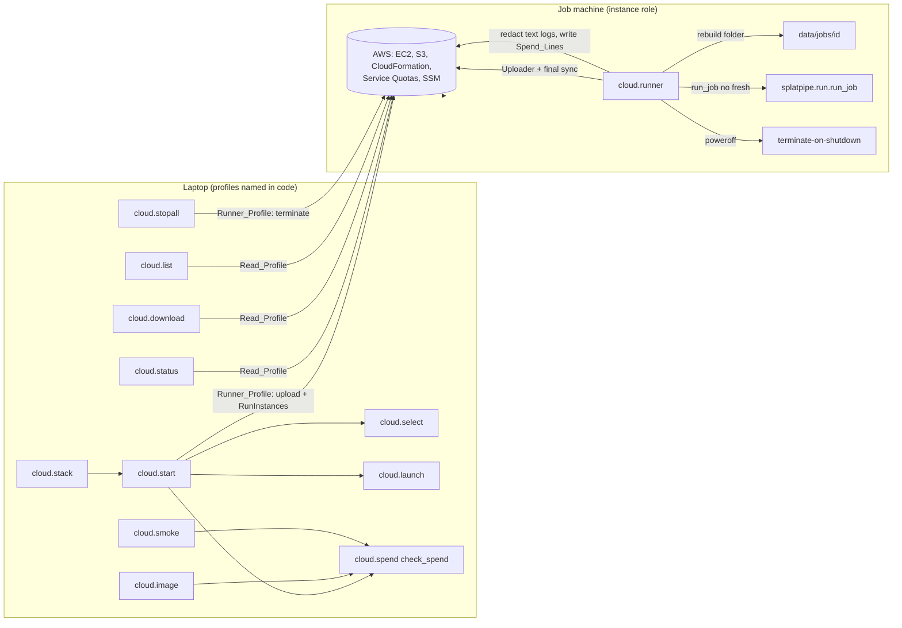

# Design Document: cloud-jobs

## Overview

This spec builds Cloud_Jobs, the cloud wrapper under `cloud/` that runs a whole Job on one EC2 machine. It adds the `[cloud]` Config section and its reader, the AWS seam and the Stack_Output resolver, the machine-type selection, the launch request and its in-command fallback, the User_Data, the Start_Command, the machine-side Cloud_Runner, the Image_Build and the Smoke_Test, the Spend_Lines and the free Status, Download, List and Stop_All commands, plus the dependency, licence, doc, steering and skill updates.

Cloud_Jobs only wraps the Pipeline. It calls pipeline-core's public functions (`make_job`, `run_job`) and changes nothing in `splatpipe/`. Everything AWS lives under `cloud/`, boto3 is imported only there, and the one real AWS construction is `boto3.Session(profile_name=..., region_name=...)`, named in code, never through `AWS_PROFILE` or the default chain. Every number comes from `config.toml`. Every paid command passes the Spend_Guard (`cloud/spend.py`, already built) first. Every tool and dependency gets a Licence_List row in the same commit.

The whole spec is CPU-only and offline to build and test: a Fake_AWS records calls and returns canned replies, the Fake_Step stands in for real Steps, and `splatpipe.run.STEP_LIST` stays empty, so no pipeline-core test changes and no real paid run happens while carrying out this spec.

### Decisions on the open choices

| Choice | Decision |
|---|---|
| The AWS seam | A narrow `Aws` protocol in `cloud/aws.py` with just the operations the code needs (describe/run/stop/terminate/create-image/console, service-quotas get, s3 upload/download/list/get/put, cloudformation describe-stacks, ssm get-parameter). `BotoAws` is the one real implementation and the only place boto3 clients are made. Tests pass a `FakeAws` (in `tests/fake_aws.py`) that implements the same protocol over in-memory dicts and records a call timeline. This keeps boto3 out of every other module and lets every test run with no network. |
| The launch request builder | A pure function, `build_run_instances_request(...)`, returns the request dict. `Aws.run_instances(request)` sends exactly that dict. So Property 4 asserts on the dict the code builds, and what it asserts is what EC2 receives. |
| What gates the Spend_Guard | `check_spend()` gates the first *paid AWS action*: the first S3 upload and the `RunInstances` call. The free, local and read-only work before it (the Code_Archive, `make_job`'s local Job_Folder, the quota/image/marker reads needed to build the money quote) is not a paid run. This reads Req 6.1's "creates, uploads or starts anything" as "creates an AWS resource, uploads or launches", matching rules.md ("nothing paid starts") and Req 6.6's "no upload and no launch". `make_job` runs before the quote so a bad video fails for free, before anyone is asked to approve spend. Confirmed by the user. |
| Where the Uploader learns a Step finished | From `out/job.log`. `run_job` logs `"<name>: done"` / `"<name>: failed, ..."` when a Step returns, after `run_step` has finished writing its report with `write_json`. The Uploader tails the log and uploads a Step's report only once it has seen that Step's outcome line, so it never uploads a half-written report and needs no change to `run_job` (assumption A, Req 10.3). The final authoritative sync after `run_job` returns uploads everything, so the uploaded set is deterministic (Req 10.5). |
| The resume rule | The Cloud_Runner calls `run_job(job_id, steps=..., config=...)` with no Fresh_Option and inherits pipeline-core's resume exactly. It never pre-filters Steps. Property 7 states resume as pipeline-core defines it (first non-Finished_Step onward; a Finished_Step after it may rerun), matching Req 8.13 of pipeline-core, so there is no contradiction (assumption B). |
| The Spend_Line id | Each line carries `id = "<job_id>:<label>:<n>"`, where `n` is the count of lines with that `(job_id, label)` already in the Spend_File when the line is written. Re-downloading and re-merging is then idempotent (same ids), while a genuine rerun of a Step writes a higher `n` (a new line). The merge dedups by `id` (Req 12.4). |
| The Account_Redaction | One helper, `account_redaction(text)`, replaces every maximal run of exactly 12 digits with `<account>` using `(?<!\d)\d{12}(?!\d)`, so an 11- or 13-digit run is left alone. Laptop commands redact AWS errors, console output and job logs before printing; the machine redacts the text logs it uploads. JSON reports are never passed through it, because they hold no account id (Req 13.7, 13.6, 10.10, 1.9). |
| Reading `[cloud]` | `cloud/config.py` calls `splatpipe.config.load_config(path)` first, so the Config_Loader's Pipeline_Section checks (NaN, infinity, TOML dates) run over `[cloud]` (Req 2.1), then re-reads the file's `[cloud]` table with `tomllib` and checks the cloud-specific keys itself (Req 2.2). It adds no accessor to `splatpipe/config.py`, which is `splatpipe/` code this spec must not touch. |
| The `list` module name | `cloud/list.py`, run as `uv run python -m cloud.list`. A module file named `list.py` doesn't bind the builtin `list` in its own namespace, so the builtin stays available inside it. |
| Node and tests | The laptop tests are pure Python and never run `npm`. `package.json` and `package-lock.json` only pin splat-transform 3.8.0 for the Machine_Image's `npm ci` and for the Licence_List; the clean-export spec reuses them (assumption G). |

## Architecture



### Module layout

All new files are under `cloud/`. `cloud/aws-setup.yaml` does not change (see "Stack coverage"). Nothing in `splatpipe/` changes.

| File | What it holds |
|---|---|
| `cloud/__init__.py` | Exists. Docstring only. |
| `cloud/spend.py` | Exists. The Spend_Guard, `check_spend()` and `SpendRefused`. Unchanged. |
| `cloud/errors.py` | `CloudError`, `CapacityUnavailable`, and `run_cloud_cli()`, the shared CLI wrapper that redacts and prints no traceback. |
| `cloud/redact.py` | `account_redaction()`. |
| `cloud/config.py` | The Cloud_Config: `load_cloud_config()`, `CloudConfig`, `MachineSpec`, `PresetPlan`, `RunPlan` (smoke/image timings). |
| `cloud/aws.py` | `make_session()`, the `Aws` protocol, `BotoAws`, `laptop_aws()`, `machine_aws()`, and the small data classes `InstanceInfo` and `ImageInfo`. The only module that imports boto3. |
| `cloud/stack.py` | `StackOutputs` and `resolve_stack()`. |
| `cloud/select.py` | `Needs`, `step_needs_over()`, `fits_hard_needs()`, `select_candidates()`, `running_vcpus()`, `admit()`, `launch_plan()`. Pure. |
| `cloud/launch.py` | `build_run_instances_request()`, `client_token()`, `launch_with_fallback()`. |
| `cloud/userdata.py` | `UserDataValues`, `render_user_data()`, the Cap_Deadline variable name. |
| `cloud/repo.py` | git helpers: `uncommitted()`, `archive_head()`, `head_commit()`, `lock_hashes()`. |
| `cloud/spend_file.py` | `spend_line()`, `estimated_cost()`, `rough_cost()`, `append_spend_line()`, `merge_spend_file()`, `LABEL_MACHINE`, `LABEL_IMAGE`, `LABEL_SMOKE`. |
| `cloud/start.py` | `start_job()` and `main()`. The Start_Command. |
| `cloud/runner.py` | `run_cloud_job()`, `Uploader`, `rebuild_job_folder()`, `CAP_DEADLINE_ENV`. The machine-side Cloud_Runner. |
| `cloud/image.py` | `build_image()`, `install_script()`, `main()`. The Image_Build. |
| `cloud/smoke.py` | `run_smoke()`, `smoke_marker_key()`, `image_id_from_marker()`, `main()`. The Smoke_Test. |
| `cloud/status.py` | `status()` and `main()`. |
| `cloud/download.py` | `download()` and `main()`. |
| `cloud/list.py` | `list_machines()` and `main()`. |
| `cloud/stopall.py` | `stop_all()` and `main()`. |

Dependency direction under `cloud/`: `errors`, `redact`, `config`, `aws`, `stack`, `select`, `launch`, `userdata`, `repo`, `spend_file` are leaf-ish and import only the standard library, boto3 (in `aws` only), `cloud.spend`, and earlier `cloud` modules. `start`, `image`, `smoke`, `status`, `download`, `list`, `stopall` and `runner` are the entry points that compose them. `runner` imports `splatpipe.run`; `start` imports `splatpipe.make`. No `cloud` module imports torch, gsplat or any GPU package, so every `cloud` module imports on a laptop, which the import check enforces (Req 1.1, 1.2, 16.7).

### The Fake_AWS seam

`cloud/aws.py` defines the one interface every other module depends on. Real code builds `BotoAws` from a named Session; tests build `FakeAws`.

```python
@dataclass(frozen=True)
class InstanceInfo:
    id: str
    type: str
    state: str                  # "pending", "running", "shutting-down", "stopping", "stopped", "terminated"
    zone: str
    launch_time: str            # ISO-8601, as AWS returns it
    state_reason: str

@dataclass(frozen=True)
class ImageInfo:
    id: str
    name: str
    state: str                  # "available", "pending", ...
    creation_date: str
    tags: dict[str, str]

class Aws(Protocol):
    region: str
    # EC2 reads
    def tagged_instances(self, states: Sequence[str]) -> list[InstanceInfo]: ...
    def type_zones(self, instance_type: str) -> list[str]: ...        # DescribeInstanceTypeOfferings
    def default_subnets(self, vpc_id: str) -> dict[str, str]: ...     # zone -> subnet id
    def tagged_images(self) -> list[ImageInfo]: ...                   # owners=self, project tag
    def console_output(self, instance_id: str) -> str: ...
    def gpu_quota(self) -> float: ...                                 # Service Quotas L-DB2E81BA
    def ssm_parameter(self, name: str) -> str: ...
    # EC2 writes
    def run_instances(self, request: Mapping[str, Any]) -> InstanceInfo: ...
    def stop_instance(self, instance_id: str) -> None: ...
    def wait_stopped(self, instance_id: str) -> None: ...
    def create_image(self, instance_id: str, name: str, tags: Mapping[str, str]) -> str: ...
    def wait_image_available(self, image_id: str) -> None: ...
    def terminate_instances(self, instance_ids: Sequence[str]) -> None: ...
    # S3
    def s3_upload(self, local: Path, key: str) -> None: ...
    def s3_download(self, key: str, local: Path) -> None: ...
    def s3_list(self, prefix: str) -> list[str]: ...
    def s3_get_text(self, key: str) -> str: ...
    def s3_put_text(self, key: str, text: str) -> None: ...
    def s3_exists(self, key: str) -> bool: ...
    # CloudFormation
    def stack_outputs(self, stack_name: str) -> dict[str, str]: ...

def make_session(region: str, profile: str | None) -> "boto3.Session":
    """boto3.Session(region_name=region) with profile_name=profile only when profile is not None."""

def laptop_aws(config: Config, *, profile_key: str) -> BotoAws:
    """A BotoAws whose Session names the region from [aws].region and the profile from
    [aws].<profile_key> ('read_profile' or 'runner_profile'). Never AWS_PROFILE (Req 1.6)."""

def machine_aws(region: str) -> BotoAws:
    """A BotoAws whose Session names only the region, so the job machine uses its instance role (Req 1.7)."""
```

- `make_session` is the only place a Session is built. `BotoAws` makes the five service clients from that one Session and keeps them (one session per process, as the skill advises for IMDSv2 throttling).
- `BotoAws.run_instances` auto-converts a botocore `ClientError` whose code is `InsufficientInstanceCapacity` or `Unsupported` into `CapacityUnavailable(code, zone, instance_type)`, and any other `ClientError` or `BotoCoreError` into a `CloudError` whose message is `account_redaction(str(error))`. So no other module ever touches botocore, and no AWS error reaches a chat unredacted (Req 1.9, 5.5).
- `BotoAws` passes `UserData` as plain text in the request; botocore base64-encodes it for `RunInstances` (the skill's note).
- Every describe passes the Project_Tag filter, so Cloud_Jobs looks up only our own resources (Req 1.8, 13.5). `tagged_instances` filters `tag:project=voxelis-kiroween` and the given states; `tagged_images` filters `owners=self` and the tag.
- `FakeAws` implements the same methods over dictionaries and records an ordered `calls` list of `(op, key)` tuples, so Property 6 can assert `check_spend` preceded the first `s3_upload`/`run_instances`, and unit tests can assert which profile a command's `Aws` was built with (tests construct the command with an injected `FakeAws` and separately assert `laptop_aws` names the right profile).

## Components and Interfaces

### cloud/errors.py

```python
class CloudError(Exception):
    """A refusal or failure whose message is a Readable_Error, already Account_Redacted."""

class CapacityUnavailable(Exception):
    """AWS has no On-Demand capacity for a type in a zone (InsufficientInstanceCapacity/Unsupported).
    Not a CloudError: the launch loop catches it to try the next zone or type (Req 5.1)."""
    code: str
    zone: str
    instance_type: str

def run_cloud_cli(action: Callable[[], int]) -> int:
    """Run a cloud CLI body. On PipelineError, SpendRefused or CloudError, print the message
    (Account_Redacted) on stderr and return 1. On any other Exception, print a general bug message
    with the error's type and Account_Redacted message and return 1. No traceback either way.
    SystemExit (argparse) and KeyboardInterrupt pass through."""
```

`run_cloud_cli` mirrors `splatpipe.errors.run_cli` but also catches `SpendRefused` (from `cloud.spend`) and `CloudError`, and redacts every message it prints (Req 13.6). `make_job` raises `PipelineError`, which `run_cloud_cli` prints as-is.

### cloud/redact.py

```python
_ACCOUNT = re.compile(r"(?<!\d)\d{12}(?!\d)")

def account_redaction(text: str) -> str:
    """Replace every maximal run of exactly 12 digits with <account>. An 11- or 13-digit run is
    left alone. Used on AWS errors, console output and text logs, never on JSON reports (Req 13.7)."""
    return _ACCOUNT.sub("<account>", text)
```

### cloud/config.py (the Cloud_Config)

```python
@dataclass(frozen=True)
class MachineSpec:
    type: str
    vcpus: int
    memory_gb: float
    gpu_memory_gb: float
    price_per_hour_usd: float
    price_date: str

@dataclass(frozen=True)
class RunPlan:
    expected_minutes: float          # for the money quote
    cap_minutes: float               # the Time_Cap

@dataclass(frozen=True)
class PresetPlan:
    fallback: tuple[str, ...]        # ordered Allowed_Type names, primary first
    expected_minutes: float
    cap_minutes: float

@dataclass(frozen=True)
class CloudConfig:
    types: dict[str, MachineSpec]            # one per Allowed_Type
    presets: dict[str, PresetPlan]           # "fast", "default", "quality"
    smoke: RunPlan                           # expected/cap for the smoke test (single type, no fallback list)
    image: RunPlan                           # expected/cap for the image build
    upload_margin_minutes: float
    poll_seconds: float
    ipv4_usd_per_hour: float
    gp3_usd_per_gb_month: float
    root_gb: float                           # root-volume size in GB for every machine (150)
    smoke_instance_type: str
    image_builder_type: str
    base_ami_parameter: str
    def spec(self, instance_type: str) -> MachineSpec        # CloudError naming the type if absent
    def preset_plan(self, preset: str) -> PresetPlan

def load_cloud_config(path: Path | None = None) -> CloudConfig:
    """Validate the whole file as pipeline Config, then read and check the [cloud] table."""
```

- `load_cloud_config` calls `splatpipe.config.load_config(path)` first (default `path` is `splatpipe.config.CONFIG_PATH`), so the Config_Loader refuses NaN, infinity and TOML dates in `[cloud]` like any Pipeline_Section (Req 2.1). Then it re-reads the file with `tomllib` and builds `CloudConfig` from the raw `[cloud]` table.
- Every missing or wrong-typed key is a `CloudError` that names the key and what it must be (Req 2.2): a missing `[cloud]`, a `types` entry missing `gpu_memory_gb`, a `price_per_hour_usd` that isn't a number, a `fallback` that isn't a list of strings, and so on. Prices must be finite numbers `> 0`; minutes `> 0`; `memory_gb` and `gpu_memory_gb` finite numbers `> 0`; a `price_date` a non-empty string.
- It checks the cross-table rules the Test_Suite also checks (Req 2.10): every `fallback` entry is a key of `types`; `smoke_instance_type` and `image_builder_type` are keys of `types`; there are exactly the three Presets.
- `CloudConfig.from_mapping(data)` lets a test build a Cloud_Config from a dict without a file, so selection and launch tests need no `config.toml` on disk.

### cloud/stack.py

```python
@dataclass(frozen=True)
class StackOutputs:
    bucket: str                  # BucketName
    job_role_arn: str            # JobRoleArn
    job_instance_profile_arn: str  # JobInstanceProfileArn
    runner_role_arn: str         # RunnerRoleArn
    security_group_id: str       # SecurityGroupId
    vpc_id: str                  # VpcId
    group_name: str              # GroupName

def resolve_stack(aws: Aws, stack_name: str) -> StackOutputs:
    """Read the Stack's outputs by name and map the seven keys. A missing output or stack is a
    CloudError naming what's missing (Req 1.3). Holds no id or ARN literal; everything comes from AWS."""
```

The output keys match `cloud/aws-setup.yaml`'s `Outputs` exactly (`BucketName`, `JobRoleArn`, `JobInstanceProfileArn`, `RunnerRoleArn`, `SecurityGroupId`, `VpcId`, `GroupName`). `stack_name` comes from `[aws].stack_name`.

### cloud/select.py (choosing the machine)

```python
@dataclass(frozen=True)
class Needs:
    min_memory_gb: float
    min_gpu_memory_gb: float      # 0 means no GPU need
    min_vcpus: int                # informational only; never excludes a type (soft)

def step_needs_over(step_names: Sequence[str], config: Config, preset: str) -> Needs:
    """The hard needs across the Steps that will run, read from each Step's own Config section for
    `preset` via splatpipe.config.Config.step_settings(name, preset): the largest min_memory_gb,
    the largest min_gpu_memory_gb, and the largest min_vcpus (soft). A key a Step omits counts as 0,
    so a missing key means no need in that dimension. An empty list gives zero needs (assumption E)."""

def fits_hard_needs(spec: MachineSpec, needs: Needs) -> bool:
    """Memory and GPU memory are hard: spec.memory_gb >= needs.min_memory_gb and
    spec.gpu_memory_gb >= needs.min_gpu_memory_gb. vCPUs are never checked (Req 3.2). Every Allowed_Type
    has a GPU, so a zero min_gpu_memory_gb imposes no constraint."""

def select_candidates(preset: str, needs: Needs, cc: CloudConfig) -> list[str]:
    """The preset's Fallback_List, in order, keeping only types that fit the hard needs (Req 3.1, 3.3).
    Empty result is a CloudError naming the unmet need (Req 3.4)."""

def running_vcpus(instances: Sequence[InstanceInfo], cc: CloudConfig) -> int:
    """Sum of cc.spec(i.type).vcpus over our non-terminated instances (Req 4.2)."""

def admit(candidates: Sequence[str], running: int, quota: float, cc: CloudConfig) -> list[str]:
    """Keep candidates, in order, where running + spec.vcpus <= quota (Req 4.3). quota == 0 is a
    CloudError pointing to the Setup_Guide (Req 4.4). No candidate fitting the quota is a CloudError
    giving the quota, running and the smallest candidate's vCPUs (Req 4.5)."""

def launch_plan(admitted: Sequence[str], aws: Aws, outputs: StackOutputs,
                cc: CloudConfig) -> list[tuple[str, str, str]]:
    """Ordered (instance_type, subnet_id, zone) attempts: for each admitted type in order, each zone
    that both offers the type (type_zones) and has a default subnet (default_subnets), so the launch
    loop tries zones before moving to the next type (Req 5.1)."""
```

- `select_candidates` and `admit` are pure and order-preserving, which is what Property 3 asserts. The selection decision is `admit(select_candidates(preset, step_needs_over(steps, config, preset), cc), running_vcpus(...), quota, cc)`.
- With `STEP_LIST` empty, `step_needs_over([], config, preset)` gives zero needs, so every type would pass the hard filter. The Start_Command never reaches selection with an empty list, because it refuses an empty `STEP_LIST` up front (Req 7.2). Tests that exercise selection with Fake_Steps pass `Needs` objects directly to the pure `select_candidates`/`admit`/`fits_hard_needs`, and tests of `step_needs_over` build a pipeline `Config` whose Fake_Step sections carry `min_vcpus`, `min_memory_gb` and `min_gpu_memory_gb`; `splatpipe.run.STEP_LIST` is set to a fake list only through `monkeypatch`, which never changes the shipped empty default (Req 16.6).

### cloud/launch.py (the launch request and the fallback)

```python
def build_run_instances_request(*, image_id: str, instance_type: str, subnet_id: str,
                                instance_profile_arn: str, security_group_id: str,
                                user_data: str, client_token: str, project_tag: tuple[str, str],
                                job_id: str | None) -> dict[str, Any]:
    """The pure RunInstances request. Property 4 asserts on it (Req 8.9)."""

def client_token(label: str, attempt: int) -> str:
    """A ClientToken from a Job_Id (or a smoke/image label) and the attempt index, so repeating one
    attempt starts nothing new and each zone/type attempt gets a fresh token (Req 5.6)."""

def launch_with_fallback(aws: Aws, plan: Sequence[tuple[str, str, str]],
                         build: Callable[[int, str, str], dict[str, Any]]
                         ) -> tuple[InstanceInfo, str, str]:
    """Try each (type, subnet, zone) in order. build(attempt, type, subnet) makes the request with a
    per-attempt client token. On CapacityUnavailable, move to the next attempt (Req 5.1). On any other
    error (a CloudError), stop and raise, starting nothing more (Req 5.5). On success, return the
    instance, its type and its zone (Req 5.3). An exhausted plan is a CloudError listing the types and
    zones tried (Req 5.4)."""
```

The request dict (Req 8.1–8.8):

```python
{
    "ImageId": image_id,
    "InstanceType": instance_type,
    "MinCount": 1,
    "MaxCount": 1,
    "SubnetId": subnet_id,
    "SecurityGroupIds": [security_group_id],
    "IamInstanceProfile": {"Arn": instance_profile_arn},
    "MetadataOptions": {"HttpTokens": "required", "HttpEndpoint": "enabled"},
    "InstanceInitiatedShutdownBehavior": "terminate",
    "ClientToken": client_token,
    "UserData": user_data,
    "TagSpecifications": [
        {"ResourceType": "instance", "Tags": _tags(project_tag, job_id)},
        {"ResourceType": "volume", "Tags": [_tag(project_tag)]},
        {"ResourceType": "network-interface", "Tags": [_tag(project_tag)]},
    ],
}
```

`_tags` adds the Job_Id tag to the instance only when `job_id` is given (a Job machine, not the image builder). No `KeyName`, `LaunchTemplate`, `InstanceMarketOptions` or `DisableApiTermination` key is present, so the machine is On-Demand, the Stop_All_Command can terminate it, and the Runner_Role's rules are met. The request satisfies every condition in `RunnerLaunchPolicy`: an Allowed_Type, `MetadataHttpTokens=required`, the Project_Tag on the instance, the Job_Profile ARN, the Job_Security_Group, a subnet of the Default_VPC, and an Amazon or own-tagged image.

### cloud/userdata.py (the User_Data)

```python
CAP_DEADLINE_ENV = "SPLATPIPE_CAP_DEADLINE"   # the Cap_Deadline variable the Cloud_Runner sets (Req 10.7)

@dataclass(frozen=True)
class UserDataValues:
    job_id: str
    bucket: str
    region: str
    preset: str
    image_id: str
    code_archive_key: str
    cap_minutes: int
    upload_margin_minutes: int
    uv_lock_hash: str
    package_lock_hash: str
    role: str = "job"            # "job", "smoke" or "image"

def render_user_data(values: UserDataValues) -> str:
    """The bootstrap bash script, LF-only, at most 16 KB (Req 8.7, 8.8). Property 5 asserts on it."""
```

`render_user_data` checks every value (the Job_Id through `splatpipe.jobs.check_job_id`; the bucket, region and hashes against safe patterns; the minutes as whole numbers) and `shlex.quote`s each one into a template that joins its lines with `\n`:

```bash
#!/bin/bash
set -euo pipefail
trap 'poweroff' EXIT                 # power off when the script ends, done or failed
shutdown -h +<cap_minutes>           # the Time_Cap backstop, in case anything below hangs
export JOB_ID=<q> BUCKET=<q> AWS_DEFAULT_REGION=<q> PRESET=<q> IMAGE_ID=<q> ...
# fetch the Code_Archive from s3://$BUCKET/<code_archive_key> with the instance role, extract to /opt/job,
# then: /opt/job/.venv/bin/python -m cloud.<role>_runner --job "$JOB_ID"
```

- The `trap` comes before the cap line, so a failure on the cap's own line still powers the machine off; the cap comes next, so a hang anywhere later still ends it (the skill's ordering, Req 8.7, 10.8).
- `role` picks the on-machine entry point: `cloud.runner` for a Job, the Smoke_Test's checks for `smoke`, and the install script for `image` (the Image_Build passes `install_script()` as the whole User_Data instead, so `render_user_data` is used for Jobs and the Smoke_Test).
- The script never holds AWS keys; the machine uses its instance role (the skill, Req 1.7).
- `render_user_data` asserts the rendered text is `<= 16384` bytes and raises a `CloudError` if a caller ever makes it longer; today it is a few hundred bytes. If a future value pushes it over, the fallback is to drop a params file into the bucket and fetch it, noted for that spec.

### cloud/repo.py (the git checks and the Code_Archive)

```python
def uncommitted(paths: Sequence[str], *, cwd: Path) -> list[str]:
    """Paths among splatpipe/, cloud/ and config.toml with uncommitted changes (Req 7.3)."""
def head_commit(*, cwd: Path) -> str:
    """The HEAD commit sha (Req 7.4)."""
def archive_head(dest: Path, *, cwd: Path) -> None:
    """`git archive HEAD` into the tar at dest (Req 7.4)."""
def lock_hashes(*, cwd: Path) -> tuple[str, str]:
    """The sha-256 of HEAD's uv.lock and package-lock.json, to compare with the image's tags (Req 7.5, 7.6)."""
```

These shell out to `git` (a dev tool). Tests build a tiny real repo in `tmp_path` and skip, with a reason, when `git` isn't found, as pipeline-core does for ffprobe.

### cloud/spend_file.py (Spend_Lines and the Spend_File)

```python
LABEL_MACHINE = "machine"        # the machine's time outside the Steps
LABEL_IMAGE = "image-build"
LABEL_SMOKE = "smoke-test"

def estimated_cost(seconds: float, price_per_hour_usd: float) -> float:
    """seconds / 3600 * price, rounded to cents."""

def rough_cost(minutes: float, spec: MachineSpec, cc: CloudConfig) -> float:
    """The money quote: minutes/60 * (price + ipv4_usd_per_hour) plus the root volume's gp3 storage
    for the same time (root_gb * gp3_usd_per_gb_month * minutes/ (60*730)) (Req 6.3)."""

def spend_line(*, job_id: str, label: str, instance_type: str, seconds: float,
               price_per_hour_usd: float, index: int) -> dict[str, Any]:
    """One Spend_Line: id, job_id, label, instance_type, seconds, estimated_usd, estimate=true (Req 12.3)."""

def append_spend_line(aws: Aws, job_id: str, line: Mapping[str, Any]) -> None:
    """Read jobs/<job_id>/out/spend.jsonl from the bucket, append the line, put it back (machine side)."""

def merge_spend_file(local_path: Path, new_lines: Iterable[Mapping[str, Any]]) -> int:
    """Add the new lines to data/spend.jsonl, skipping any id already there. Returns how many were added.
    Idempotent (Req 12.4). Writes only under data/ (Req 12.5)."""
```

The machine writes per-Step lines (label = the Step_Name, `seconds` = the report's `duration_seconds`) and one `LABEL_MACHINE` line for the rest of its time, into the Job's `out/spend.jsonl`, which the Uploader syncs (Req 12.1, 12.2). The laptop Image_Build and Smoke_Command each append a `LABEL_IMAGE`/`LABEL_SMOKE` line for their machine's measured time to `data/spend.jsonl` directly. The Status_Command and Download_Command read the Job's `out/spend.jsonl` from the bucket and `merge_spend_file` its lines into `data/spend.jsonl` without duplicates (Req 12.4).

### cloud/start.py (the Start_Command)

```python
def start_job(video: str | Path, *, preset: str | None = None, start: float | None = None,
              end: float | None = None, aws: Aws | None = None, config: Config | None = None,
              cloud_config: CloudConfig | None = None, repo_root: Path | None = None,
              environ: Mapping[str, str] | None = None) -> str:
    """Make and launch a Job. Returns the Job_Id. All checks are free until check_spend; the first
    S3 upload and RunInstances come only after it returns (Req 6.1, 6.6)."""

def main(argv: list[str] | None = None) -> int
```

`start_job` runs in this order, free and read-only work first (Req 7):

1. `entries = splatpipe.run.STEP_LIST`. If empty, raise the same `PipelineError` text `splatpipe.run` gives ("No steps are set up yet…"), before anything (Req 7.2).
2. `uncommitted([...])` over `splatpipe/`, `cloud/` and `config.toml`; a non-empty result is a `CloudError` naming the paths (Req 7.3).
3. `head = head_commit()` and `archive_head(archive)` into the local Job area; `lock_hashes()` (Req 7.4).
4. Build the Runner_Profile `Aws`; `outputs = resolve_stack(aws, stack_name)`.
5. `image = newest tagged available image`, else a `CloudError` pointing to the Image_Build_Command (Req 7.9).
6. Compare the lock hashes with the image's `uv_lock_hash`/`package_lock_hash` tags; a mismatch is a `CloudError` saying to rebuild the image (Req 7.5, 7.6).
7. `smoke_marker_key(image.id)` must exist in the bucket, else a `CloudError` pointing to the Smoke_Command (Req 7.7).
8. `make_job(video, start=..., end=..., preset=..., config=config)` makes the local Job_Folder and Job_Record (Req 7.1). Its own checks fail here, for free, before any spend.
9. `needs = step_needs_over([e.name for e in entries], config, preset)`; `candidates = select_candidates(preset, needs, cc)`; `quota = aws.gpu_quota()`; `running = running_vcpus(aws.tagged_instances(live), cc)`; `admitted = admit(candidates, running, quota, cc)`; `plan = launch_plan(admitted, aws, outputs, cc)` (Req 3, 4, 5).
10. Build the quote: the first admitted type, the one that will actually launch first (its price, the Preset's Expected_Time, `rough_cost` over the Expected_Time), and the worst case, the dearest type that fits the hard needs on the Fallback_List (`max` price over `select_candidates(...)`, which may be dearer than any admitted type) run to the Preset's `cap_minutes`. Then `check_spend(machine=..., expected_time=..., rough_cost=..., environ=environ)` (Req 6.1, 6.3, 3.6). This is the first thing that can be a paid gate; one yes covers the whole Fallback_List, since only one type ever launches (Req 3.7).
11. Upload the video, the Code_Archive and the Job_Record to `jobs/<id>/input/` with the Runner_Profile (Req 7.8).
12. `render_user_data(...)`; `launch_with_fallback(aws, plan, build)`; report the type and zone it got (Req 5.3).

`main` parses `video`, `--start`, `--end` and `--preset` inside `run_cloud_cli`, builds the Runner_Profile `Aws` from `[aws].runner_profile`, and prints the Job_Id and the launched type and zone.

### cloud/runner.py (the Cloud_Runner)

```python
CAP_DEADLINE_ENV = "SPLATPIPE_CAP_DEADLINE"

def rebuild_job_folder(aws: Aws, job_id: str, jobs_folder: Path) -> None:
    """Download jobs/<id>/input/*, and any jobs/<id>/out/* and work/<id>/* from an earlier run, into
    the local Job_Folder, so run_job sees the same reports it would on a resumed laptop run (Req 10.1)."""

class Uploader:
    """Watches out/job.log and uploads each finished Step's report, work/ and out/ files as they appear,
    mapping work/ -> work/<id>/ and the rest -> jobs/<id>/ (Req 10.2). sync_all() uploads everything;
    it runs as the final authoritative sync after run_job returns (Req 10.2, 10.5)."""
    def sync(self) -> None
    def sync_all(self) -> None

def run_cloud_job(job_id: str, *, aws: Aws, config: Config, cloud_config: CloudConfig,
                  steps: Sequence[StepEntry] | None = None, now: Callable[[], datetime] = ...,
                  shutdown: Callable[[], None] = ...) -> dict[str, Any]:
    """Rebuild the folder, run run_job, upload results, write Spend_Lines, redact text logs, power off.
    Returns the Job_Summary. Testable with injected steps, now and shutdown, and the Fake_AWS (Req 10.11)."""
```

`run_cloud_job` works in this order:

1. Read the archived `uv.lock`/`package-lock.json` hashes and compare with the image's recorded hashes (from IMDS tags or the User_Data). A mismatch writes a redacted failure note, uploads it, and raises a `CloudError`, then still powers off in the `finally` (Req 10.9).
2. `rebuild_job_folder(...)` (Req 10.1).
3. Set `os.environ[CAP_DEADLINE_ENV]` to `now() + (cap_minutes - upload_margin_minutes)` as an ISO UTC instant, for a Step to read (Req 10.7). `splatpipe/` reads it in a later spec; no current Step does, so `splatpipe/` is unchanged.
4. Start the `Uploader` (best-effort, exceptions swallowed, poll every `poll_seconds`).
5. `summary = splatpipe.run.run_job(job_id, steps=steps, config=config)` with no Fresh_Option (Req 10.1, 10.4).
6. Stop the Uploader; write per-Step and `LABEL_MACHINE` Spend_Lines from the reports' `duration_seconds` and the machine's elapsed time (Req 12.1, 12.2).
7. Redact `out/job.log`, the runner's own log and `cloud-init-output.log`, and write the redacted copies in place of the originals before upload (Req 10.10); JSON reports are uploaded unchanged (they hold no account id).
8. `Uploader.sync_all()` — the final authoritative sync, so the uploaded set equals the local `out/`, reports and logs (Req 10.5).
9. In `finally`, `shutdown()` (default runs `poweroff`), so the machine ends even on an exception (Req 10.6). The User_Data's `trap` and cap are the backstops if the Python never reaches here (Req 10.8).

The Cloud_Runner never changes `run_job`; it only wraps it. Because the Uploader keys off `out/job.log`'s outcome lines, which `run_job` writes after each `run_step` returns and after `write_json` has finished, it never uploads a half-written report (Req 10.3).

### cloud/image.py (the Image_Build)

```python
def install_script(cc: CloudConfig) -> str:
    """The builder's User_Data: the whole install, as bash. Asserted structurally, never run in tests."""

def build_image(*, aws: Aws, config: Config, cloud_config: CloudConfig, outputs: StackOutputs,
                repo_root: Path, environ: Mapping[str, str] | None = None) -> str:
    """Build the Machine_Image and return its id. check_spend first (Req 9.10)."""

def main(argv: list[str] | None = None) -> int
```

`install_script` contains, every version pinned (Req 9.2, 9.3, 9.4): `uv sync` from the repo's `uv.lock`; ffmpeg built with zscale; COLMAP 4.2.1 from source with `-DCUDA_ENABLED=OFF -DOPENGL_ENABLED=OFF -DGUI_ENABLED=OFF -DCGAL_ENABLED=OFF -DLSD_ENABLED=OFF`; gsplat 1.5.3 and fused-ssim compiled with `TORCH_CUDA_ARCH_LIST="8.6;8.9"`; the MoGe-2 weights; Node and `npm ci` from `package-lock.json`; `cloud-init clean --logs --machine-id` and removal of `~/.aws` before the image is made. The Pipeline's own code is never baked in (Req 9.5).

`build_image` (Req 9.9), after `check_spend`: read the Base_AMI id from `cc.base_ami_parameter` with `ssm_parameter`; `admit` the `image_builder_type` against the quota; `build_run_instances_request` with the builder's root volume size in a `BlockDeviceMappings` entry (CreateImage can't resize later) and `install_script` as the User_Data, launched through `launch_with_fallback`; wait for the install to finish; `stop_instance` + `wait_stopped` (an API stop never triggers terminate-on-shutdown, the skill's stop-first rule); `create_image(builder, name, tags)` with the Project_Tag and the `uv_lock_hash`/`package_lock_hash` tags in the same call, so the image and its snapshots carry them (Req 9.7, 9.8); `wait_image_available`; `terminate_instances([builder])`. It appends a `LABEL_IMAGE` Spend_Line for the builder's measured time. The Machine_Image's root volume keeps `DeleteOnTermination` true (Req 9.7), and the Runner_Role has no action that could share, copy or export it (Req 9.6).

### cloud/smoke.py (the Smoke_Test)

```python
def smoke_marker_key(image_id: str) -> str:
    """jobs/_smoke/<image_id>.json, under jobs/ so the machine (Job_Role) writes it and the Read_Profile
    reads it (Req 11.3)."""
def image_id_from_marker(key: str) -> str:
    """The image id back out of a marker key; smoke_marker_key and this round-trip."""

def run_smoke(*, aws: Aws, config: Config, cloud_config: CloudConfig, outputs: StackOutputs,
              environ: Mapping[str, str] | None = None) -> None:
    """Launch one g5.xlarge from the current image, run the GPU paths and the fake-step Cloud_Runner path,
    write the Smoke_Marker on pass, measure boot-to-working. check_spend first (Req 11.1, 11.2, 11.4)."""
def main(argv: list[str] | None = None) -> int
```

`run_smoke`, after `check_spend`: find the current Machine_Image; `admit` the `smoke_instance_type` against the quota; launch it with the Req 8 request and the Smoke_Test's `cap_minutes`, whose User_Data runs every GPU code path for a few seconds on a tiny synthetic scene and runs the Cloud_Runner end to end on a tiny Fake_Step Job (Req 11.2); on pass the machine writes the Smoke_Marker keyed to the image id (Req 11.3); the machine ends itself (Req 11.4). It appends a `LABEL_SMOKE` Spend_Line. Each later spec that adds a GPU code path adds it to the Smoke_Test (Req 11.5). The GPU work runs only on the real machine; the CPU Test_Suite checks the launch request, the marker-key round-trip and the fake-step path with the Fake_AWS.

### cloud/status.py, download.py, list.py, stopall.py

```python
def status(job_id: str, *, aws: Aws, outputs: StackOutputs, data_root: Path) -> dict[str, Any]
def download(job_id: str, *, aws: Aws, outputs: StackOutputs, data_root: Path) -> None
def list_machines(*, aws: Aws) -> list[InstanceInfo]
def stop_all(*, aws: Aws) -> list[str]        # the ids it terminated
```

- `status` reads `jobs/<id>/out/job.json` and the reports from the bucket with the Read_Profile, reports the Job's progress, and `merge_spend_file`s the Job's `out/spend.jsonl` into `data/spend.jsonl` (Req 13.1, 12.4). It redacts any AWS error before printing (Req 13.6).
- `download` fetches `jobs/<id>/out/*` and the reports into `data/jobs/<id>/out/` with the Read_Profile, and merges the Spend_Lines (Req 13.2).
- `list_machines` lists our non-terminated instances by the Project_Tag with the Read_Profile, showing each type, state and launch time, and its `main` prints them with no account id or ARN (Req 13.3, 13.5).
- `stop_all` terminates our non-terminated instances by the Project_Tag with the Runner_Profile, as the last-resort end, and calls no Spend_Guard (Req 13.4, 6.5).

Each `main` runs inside `run_cloud_cli` and builds its `Aws` from the right profile key: `read_profile` for status, download and list; `runner_profile` for stop-all (Req 1.4, 1.5).

## Data Models

### Spend_Line (`data/spend.jsonl` and the Job's `out/spend.jsonl`)

```json
{
  "id": "20261119-142530-7f3a9c:frames:0",
  "job_id": "20261119-142530-7f3a9c",
  "label": "frames",
  "instance_type": "g5.8xlarge",
  "seconds": 184.2,
  "estimated_usd": 0.11,
  "estimate": true
}
```

`label` is a Step_Name, or `machine`, `image-build` or `smoke-test`. `estimate` is always `true`. The merge dedups by `id`.

### Smoke_Marker (`jobs/_smoke/<image_id>.json` in the Job_Bucket)

```json
{"image_id": "ami-0123456789abcdef0", "passed_utc": "2026-11-20T10:15:00+00:00", "boot_to_ready_seconds": 142.0}
```

Written by the machine (Job_Role, under `jobs/`) when the Smoke_Test passes; read by the Start_Command (Read_Profile).

### Sections added to `config.toml`

`[git]`, `[aws]`, `[paid]`, `[devlog]`, `[jobs]`, `[fake]` and the Fake_Step's Preset tables stay as they are. `[cloud]` is appended, every key with a comment (Req 2.9). Prices and sizes are the AWS us-east-1 Linux On-Demand values published 2026-11-21, each type carrying that `price_date` (Req 2.3).

```toml
[cloud]
# How many minutes before the Time_Cap a Step should stop and save, for the Cap_Deadline.
upload_margin_minutes = 10
# How often the status command and the machine's uploader poll, in seconds.
poll_seconds = 20
# Price of one in-use public IPv4 address, in US dollars per hour.
ipv4_usd_per_hour = 0.005
# Price of gp3 root storage, in US dollars per GB per month.
gp3_usd_per_gb_month = 0.08
# Root volume size in GB for every machine (jobs, smoke test and image builder).
root_gb = 150
# The instance type the smoke test runs on.
smoke_instance_type = "g5.xlarge"
# The instance type the image build runs on.
image_builder_type = "g5.4xlarge"
# The public SSM parameter that holds the current Base_AMI id.
base_ami_parameter = "/aws/service/deeplearning/ami/x86_64/base-oss-nvidia-driver-gpu-ubuntu-24.04/latest/ami-id"

# One Machine_Spec per Allowed_Type. The type name holds a dot, so its table header is quoted,
# or TOML would read [cloud.types.g5.xlarge] as nested tables. memory_gb and gpu_memory_gb are the
# hard needs a Step's section is checked against; vcpus is the soft need and the G-quota cost.
# Prices are us-east-1 Linux On-Demand, published 2026-11-21.
[cloud.types."g5.xlarge"]
# vCPUs, the cost against the G quota.
vcpus = 4
# RAM in GB, a hard need.
memory_gb = 16
# GPU memory in GB (NVIDIA A10G), a hard need.
gpu_memory_gb = 24
# us-east-1 On-Demand price per hour, in US dollars, on price_date.
price_per_hour_usd = 1.006
# The date price_per_hour_usd was read.
price_date = "2026-11-21"

[cloud.types."g5.2xlarge"]
# vCPUs, the cost against the G quota.
vcpus = 8
# RAM in GB, a hard need.
memory_gb = 32
# GPU memory in GB (NVIDIA A10G), a hard need.
gpu_memory_gb = 24
# us-east-1 On-Demand price per hour, in US dollars, on price_date.
price_per_hour_usd = 1.212
# The date price_per_hour_usd was read.
price_date = "2026-11-21"

[cloud.types."g5.4xlarge"]
# vCPUs, the cost against the G quota.
vcpus = 16
# RAM in GB, a hard need.
memory_gb = 64
# GPU memory in GB (NVIDIA A10G), a hard need.
gpu_memory_gb = 24
# us-east-1 On-Demand price per hour, in US dollars, on price_date.
price_per_hour_usd = 1.624
# The date price_per_hour_usd was read.
price_date = "2026-11-21"

[cloud.types."g5.8xlarge"]
# vCPUs, the cost against the G quota.
vcpus = 32
# RAM in GB, a hard need.
memory_gb = 128
# GPU memory in GB (NVIDIA A10G), a hard need.
gpu_memory_gb = 24
# us-east-1 On-Demand price per hour, in US dollars, on price_date.
price_per_hour_usd = 2.448
# The date price_per_hour_usd was read.
price_date = "2026-11-21"

[cloud.types."g6.2xlarge"]
# vCPUs, the cost against the G quota.
vcpus = 8
# RAM in GB, a hard need.
memory_gb = 32
# GPU memory in GB (NVIDIA L4), a hard need.
gpu_memory_gb = 24
# us-east-1 On-Demand price per hour, in US dollars, on price_date.
price_per_hour_usd = 0.9776
# The date price_per_hour_usd was read.
price_date = "2026-11-21"

[cloud.types."g6.4xlarge"]
# vCPUs, the cost against the G quota.
vcpus = 16
# RAM in GB, a hard need.
memory_gb = 64
# GPU memory in GB (NVIDIA L4), a hard need.
gpu_memory_gb = 24
# us-east-1 On-Demand price per hour, in US dollars, on price_date.
price_per_hour_usd = 1.3232
# The date price_per_hour_usd was read.
price_date = "2026-11-21"

[cloud.types."g6e.2xlarge"]
# vCPUs, the cost against the G quota.
vcpus = 8
# RAM in GB, a hard need.
memory_gb = 64
# GPU memory in GB (NVIDIA L40S), a hard need.
gpu_memory_gb = 48
# us-east-1 On-Demand price per hour, in US dollars, on price_date.
price_per_hour_usd = 2.24208
# The date price_per_hour_usd was read.
price_date = "2026-11-21"

[cloud.types."g6e.4xlarge"]
# vCPUs, the cost against the G quota.
vcpus = 16
# RAM in GB, a hard need.
memory_gb = 128
# GPU memory in GB (NVIDIA L40S), a hard need.
gpu_memory_gb = 48
# us-east-1 On-Demand price per hour, in US dollars, on price_date.
price_per_hour_usd = 3.00424
# The date price_per_hour_usd was read.
price_date = "2026-11-21"

[cloud.presets.fast]
# Ordered fallback. Primary g5.8xlarge is pinned; the rest are tunable.
fallback = ["g5.8xlarge", "g5.4xlarge", "g6.4xlarge", "g5.2xlarge", "g6.2xlarge"]
# Expected run time in minutes, for the money quote.
expected_minutes = 30
# The Time_Cap in minutes, the hard backstop when something hangs.
cap_minutes = 120
[cloud.presets.default]
# Ordered fallback. Primary g5.8xlarge is pinned; the rest are tunable.
fallback = ["g5.8xlarge", "g5.4xlarge", "g6.4xlarge"]
# Expected run time in minutes, for the money quote.
expected_minutes = 60
# The Time_Cap in minutes, the hard backstop when something hangs.
cap_minutes = 180
[cloud.presets.quality]
# Primary g6e.4xlarge and fallback g6e.2xlarge are pinned (assumption D), the 48 GB L40S class.
fallback = ["g6e.4xlarge", "g6e.2xlarge"]
# Expected run time in minutes, for the money quote.
expected_minutes = 120
# The Time_Cap in minutes, the hard backstop when something hangs.
cap_minutes = 360

# Expected/cap for the smoke test and the image build (settled in Q2).
[cloud.smoke]
# Expected run time in minutes, for the money quote.
expected_minutes = 10
# The Time_Cap in minutes.
cap_minutes = 30
[cloud.image]
# Expected run time in minutes, for the money quote.
expected_minutes = 45
# The Time_Cap in minutes.
cap_minutes = 120
```

A Step's needs are not in `[cloud]`. Each Step keeps `min_vcpus`, `min_memory_gb` and `min_gpu_memory_gb` in its own section (Shared_Setting or per-Preset); the selection reads them through `step_settings` for the Job's Preset, a missing key meaning no need. The Fake_Step carries them in the test configs only.

## Error Handling

| Where | Raised | What the user sees |
|---|---|---|
| A Cloud_Config key missing or wrong-typed | `CloudError` naming the key | The CLI prints the message and exits 1. |
| No Stack, or a missing Stack_Output | `CloudError` | Same. Nothing is launched. |
| Selection: no type fits the hard needs, quota is 0, or nothing fits the quota | `CloudError` naming the unmet need or the quota numbers | Same, before any paid action (Req 3.4, 4.4, 4.5). |
| An uncommitted change, a lock-hash drift, no Smoke_Marker, no Machine_Image | `CloudError` with the fix | Same, before any paid action (Req 7.3, 7.5–7.7, 7.9). |
| The Spend_Guard refusing | `SpendRefused` | `run_cloud_cli` prints it; nothing is uploaded or launched (Req 6.2). |
| A launch with no capacity in a zone or type | `CapacityUnavailable` (caught) | The loop tries the next zone, then the next type (Req 5.1). |
| A launch failing for any other reason, or the plan exhausted | `CloudError` (redacted) | The loop stops and starts nothing more (Req 5.4, 5.5). |
| Any AWS error from `BotoAws` | `CloudError` with `account_redaction(str(error))` | A readable, account-free message. |
| A bug in the cloud code reaching a CLI | anything | `run_cloud_cli` prints a redacted bug message and exits 1, no traceback. |
| A bad command line | argparse | Usage and exit 2. |

Exit codes match pipeline-core: 0 on success, 1 on a refusal or failure, 2 on a usage error. No message holds a traceback, and every printed message is Account_Redacted (Req 1.9, 13.6).

### Stack coverage (Req 1.10)

Every AWS action Cloud_Jobs makes maps to a statement already in `cloud/aws-setup.yaml`, so no change to the template is needed:

- DescribeStacks on this stack, `ec2:Describe*` (instances, type offerings, subnets, images), `ec2:GetConsoleOutput` on tagged instances, `servicequotas:GetServiceQuota` on `L-DB2E81BA`, `ssm:GetParameter` on the Base_AMI parameter, and S3 list/read on the whole bucket — all in the `ReadPolicy`, which both the Read_Profile and the Runner_Role carry.
- `ec2:RunInstances` with the Allowed_Type, IMDSv2, Project_Tag, Job_Profile, own/Amazon image, Default_VPC subnet and Job_Security_Group — the `RunnerLaunchPolicy`, including `CreateTags` on create and `PassRole` of the Job_Role. The hash tags on a CreateImage call ride the same `CreateTags`/`CreateAction: CreateImage` allowance and carry no `aws:TagKeys` restriction.
- `ec2:StopInstances`, `ec2:TerminateInstances`, `ec2:CreateImage` (+ tag image and snapshots), and S3 upload under `jobs/` — the `RunnerManagePolicy`.
- On the machine, the Job_Role lists/reads/uploads under `jobs/` and `work/` (the rebuild download, the result upload and the Smoke_Marker write).

No action needs a permission the Stack lacks. If the review finds one, it goes to the Account_Owner to add by updating the Stack, not worked around (Req 1.10).

## Correctness Properties

*A property is a characteristic or behavior that should hold true across all valid executions of a system-essentially, a formal statement about what the system should do. Properties serve as the bridge between human-readable specifications and machine-verifiable correctness guarantees.*

After the prework I merged redundant criteria. Req 1.9 and 10.10 fold into Property 1. Req 2.1 folds into Property 2. Req 3.1, 3.2, 3.3, 4.2, 4.3 and 4.5 fold into Property 3. Req 8.1 to 8.8 fold into Property 4. Req 8.7, 8.8 and the Cap_Deadline presence fold into Property 5. Req 6.1 and 6.6 fold into Property 6. Req 10.1 to 10.3 fold into Property 8, while the resume decision stays its own Property 7. Req 12.1 to 12.3 are content checked by examples; only the merge is universal, so Property 9 covers Req 12.4. The IaC-like Image_Build, the GPU Smoke_Test, and every dependency, doc and import check are example, smoke or structural tests, per the workflow's "when NOT to use PBT". The three properties Requirement 16 names are Properties 6 (Req 6.6), 4 (Req 8.9) and 7 (Req 10.4). Each property is one Hypothesis test with at least 100 examples, tagged `Feature: cloud-jobs, Property N: <title>`.

### Property 1: Account_Redaction clears exactly 12-digit runs

*For any* string, `account_redaction` replaces every maximal run of exactly 12 digits with `<account>`, leaves every maximal digit run of any other length unchanged, changes no non-digit character, and is idempotent, so `account_redaction(account_redaction(s)) == account_redaction(s)` and the result holds no maximal 12-digit run.

**Validates: Requirements 13.6, 13.7, 1.9, 10.10**

### Property 2: Cloud_Config refuses a corrupted key by name

*For any* valid `[cloud]` mapping and any single corruption of it (a required key removed, or one key's value given a wrong type, including NaN, infinity or a TOML date where a number belongs), `load_cloud_config` raises an error whose message names the corrupted key, while the un-corrupted mapping loads to a `CloudConfig`.

**Validates: Requirements 2.1, 2.2**

### Property 3: Selection keeps the right types in order

*For any* set of Machine_Specs, any Preset Fallback_List over them, any aggregate `Needs`, any GPU quota and any running-vCPU total, `admit(select_candidates(...), running, quota, cc)` returns a sublist of the Fallback_List in its original order such that a type is present exactly when its `memory_gb` is at least `min_memory_gb`, its `gpu_memory_gb` is at least `min_gpu_memory_gb`, and `running + its vcpus <= quota`; its vCPU count alone never removes it. When no type qualifies, the call raises instead.

**Validates: Requirements 3.1, 3.2, 3.3, 4.2, 4.3, 4.5**

### Property 4: Every launch request carries the required settings

*For any* image id, Allowed_Type, subnet, instance-profile ARN, security-group id, Job_Id (or none, for the builder) and User_Data, `build_run_instances_request(...)` returns a dict with `MinCount == MaxCount == 1`, `InstanceInitiatedShutdownBehavior == "terminate"`, `MetadataOptions == {"HttpTokens": "required", "HttpEndpoint": "enabled"}`, the given instance-profile ARN, the given security group, the given subnet, the Project_Tag on the instance, the volume and the network interface (and the Job_Id tag on the instance exactly when a Job_Id is given), the given User_Data, and no `KeyName`, `LaunchTemplate`, `InstanceMarketOptions` or `DisableApiTermination` key.

**Validates: Requirements 8.1, 8.2, 8.3, 8.4, 8.5, 8.6, 8.9**

### Property 5: Every User_Data script is safe and complete

*For any* valid `UserDataValues`, `render_user_data` returns text that begins with `#!/bin/bash`, uses only `\n` line endings, is at most 16384 bytes, places the `poweroff` trap before the Time_Cap line and the Time_Cap line before any download or run, carries the Time_Cap from the given `cap_minutes`, and interpolates every given value so that each appears `shlex.quote`d (recovering the original value when the line is split with `shlex`).

**Validates: Requirements 8.7, 8.8, 10.7**

### Property 6: Nothing paid happens before the Spend_Guard returns

*For any* Preset, chosen type and inputs, when a paid command (the Start_Command, the Image_Build_Command or the Smoke_Command) runs against the Fake_AWS, no `s3_upload` and no `run_instances` call is recorded before `check_spend` has returned without raising; and when the Spend_Guard raises, the Fake_AWS records no `s3_upload` and no `run_instances` at all.

**Validates: Requirements 6.1, 6.6**

### Property 7: The Cloud_Runner resumes exactly where run_job does

*For any* set of earlier Step_Reports in the Job_Bucket over a Step_List of required and optional Fake_Steps, the Cloud_Runner runs exactly the Steps `run_job` runs: it resumes from the first Step that is not a Finished_Step and never reruns a Step that finished before that resume point, while a Finished_Step after the first unfinished one may run again, exactly as pipeline-core defines resume. The oracle is pipeline-core's own `read_earlier`/`first_to_run` applied to the reports the Cloud_Runner downloaded.

**Validates: Requirements 10.4**

### Property 8: The uploaded set equals the Job's own files

*For any* Fake_Step Job the Cloud_Runner runs, once it finishes the set of keys the Uploader has uploaded equals the Job's `out/` files, reports and logs on the machine (with `work/` mapped to `work/<id>/` and the rest to `jobs/<id>/`), and every uploaded report key holds text that parses as a complete JSON object.

**Validates: Requirements 10.2, 10.3, 10.5**

### Property 9: Merging Spend_Lines is idempotent and deduplicated

*For any* starting Spend_File and any list of Spend_Lines, `merge_spend_file` leaves the file holding exactly the union by `id` of the lines already there and the new ones, so merging the same lines again adds nothing and the file never holds two lines with the same `id`.

**Validates: Requirements 12.4**

## Testing Strategy

All tests run with `uv run pytest` on the CPU, with no network, no GPU and no AWS account, building any tiny synthetic data themselves (Req 16.1). A `FakeAws` in `tests/fake_aws.py` implements the `Aws` protocol over in-memory dicts and records an ordered call timeline; a `cloud_config(**overrides)` helper builds a valid `CloudConfig` from a dict; a `git_repo(tmp_path)` helper makes a tiny committed repo and skips with a reason when `git` is absent. No test sets `APPROVED_SPEND` for a path that would launch (Req 16.8); the Spend_Guard tests pass their own `environ` mapping, as pipeline-core's do. Property tests use Hypothesis with the default 100 examples and `@settings(deadline=None)` where they touch the filesystem.

These are new files only. No pipeline-core or clean-export test changes: adding `[cloud]` (with comments) keeps pipeline-core's comment check green without editing it, `splatpipe.run.STEP_LIST` stays `()` so `tests/test_run.py` is untouched, and the cloud import check is a new file, not an edit to `tests/test_imports.py` (Req 16.6).

### Tests by file

| File | What it tests |
|---|---|
| `tests/test_cloud_config.py` | Property 2. The real `config.toml` `[cloud]` loads; there are 8 `types`, each with a full Machine_Spec; each Preset `fallback` is non-empty and all entries are Allowed_Types; the pinned primaries/fallbacks and the Q2 minutes are present; `[cloud]` holds no `[cloud.needs.*]` table; the filled prices and sizes match the 2026-11-21 values; `smoke_instance_type` and `image_builder_type` are Allowed_Types (Req 2.3, 2.4, 2.6, 2.7, 2.10). A `[cloud]` with `nan`, `inf` or a date is refused by the Config_Loader naming the key (Req 2.1). |
| `tests/test_cloud_redact.py` | Property 1. Examples: a real-shaped ARN's 12-digit field becomes `<account>`; an 11- and a 13-digit number survive; a 12-digit number that is not an account id is still replaced (Req 13.7). |
| `tests/test_cloud_stack.py` | `resolve_stack` maps the seven outputs from a Fake_AWS DescribeStacks; a missing output is a `CloudError` naming it (Req 1.3). A structural check that no `cloud/*.py` holds a 12-digit literal or an `arn:` literal (Req 1.3, 1.9). |
| `tests/test_cloud_aws.py` | With `boto3.Session` patched to record kwargs, `laptop_aws` names the region and the chosen profile and never `AWS_PROFILE`; `machine_aws` names the region and no profile (Req 1.6, 1.7). `BotoAws` turns a capacity `ClientError` into `CapacityUnavailable` and any other into a redacted `CloudError` (Req 5.5, 1.9), with botocore stubbed. |
| `tests/test_cloud_select.py` | Property 3. Edge case: `admit` with quota 0 raises pointing to the Setup_Guide (Req 4.4). Examples: `select_candidates` raises naming the unmet memory or GPU-memory need (Req 3.4); `step_needs_over` reads `min_vcpus`/`min_memory_gb`/`min_gpu_memory_gb` from a Step's own section for a Preset and treats a missing key as no need (Req 2.7); `launch_plan` orders types then zones (Req 5.1). |
| `tests/test_cloud_launch.py` | Property 4. Examples over the Fake_AWS: capacity in zone A fails then zone B succeeds; one type's `Unsupported` moves to the next type; an ambiguous error stops the loop with nothing launched; exactly one successful `run_instances`; the client token differs per attempt (Req 5.1, 5.3, 5.4, 5.5, 5.6, 5.7). |
| `tests/test_cloud_userdata.py` | Property 5. Examples: a tricky Job_Id-shaped value is `shlex.quote`d; a value failing its pattern raises; the Cap_Deadline variable name is the documented constant (Req 8.8, 10.7). |
| `tests/test_cloud_repo.py` | A dirty `splatpipe/`/`cloud/`/`config.toml` is listed by `uncommitted`; a clean repo gives none; `archive_head` writes a tar and `head_commit` the sha; `lock_hashes` changes when a lockfile changes (Req 7.3, 7.4). Skipped with a reason when `git` is absent. |
| `tests/test_cloud_start.py` | Property 6 (for the Start_Command). Examples: an empty `STEP_LIST` raises the "No steps are set up yet" text with no upload/launch (Req 7.2); each of the uncommitted, lock-drift, no-marker, no-image, quota-full and unmet-need refusals happens before any paid action (Req 3.4, 4.5, 7.3, 7.5–7.7, 7.9); on the happy path the video, Code_Archive and Job_Record are uploaded to `jobs/<id>/input/` and one machine launches, reporting its type and zone (Req 7.1, 7.8, 5.3). The quote's rough and worst-case numbers come from Config prices (Req 6.3). Uses a committed `git_repo`, a Fake_AWS with an image, a marker and quota, and a monkeypatched fake `STEP_LIST`. |
| `tests/test_cloud_runner.py` | Properties 7 and 8. Examples: `rebuild_job_folder` downloads `input/` and any earlier `out/`/`work/` (Req 10.1); a lock-hash drift stops with a readable error and still powers off (Req 10.9); `CAP_DEADLINE_ENV` is set to start + cap − margin (Req 10.7); uploaded `job.log` and `cloud-init-output.log` are Account_Redacted while reports are byte-for-byte (Req 10.10); `shutdown` is called exactly once, after the final sync (Req 10.6); per-Step and `machine` Spend_Lines are written (Req 12.1, 12.2). |
| `tests/test_cloud_spend.py` | Property 9. Examples: `spend_line` carries the id, label, type, seconds, `estimated_usd == seconds/3600*price` and `estimate == true` (Req 12.3); `rough_cost` adds the IPv4 and root-storage terms (Req 6.3); `merge_spend_file` writes only under `data/` (Req 12.5). |
| `tests/test_cloud_image.py` | Structural: `install_script` holds the COLMAP OFF flags, `TORCH_CUDA_ARCH_LIST="8.6;8.9"`, `npm ci`, gsplat 1.5.3, fused-ssim and the MoGe-2 weights, and a `cloud-init clean` before imaging (Req 9.2, 9.3, 9.4). With the Fake_AWS: `build_image` calls `check_spend` first (Req 9.10), reads the Base_AMI from SSM, stops the builder before `create_image`, tags the image and snapshots with the Project_Tag and the two lock hashes, waits for `available`, terminates the builder, and appends an `image-build` Spend_Line (Req 9.1, 9.7, 9.8, 9.9). Its launch request reuses Property 4. It also checks the Licence_List holds the image-tool rows, the COLMAP row naming its OFF flags (Req 14.5), landing in this task's commit alongside `install_script`. |
| `tests/test_cloud_smoke.py` | `smoke_marker_key`/`image_id_from_marker` round-trip for any image id (Req 11.3). With the Fake_AWS: `run_smoke` calls `check_spend` first, launches one `smoke_instance_type` from the current image with the Req 8 request and the smoke `cap_minutes`, and appends a `smoke-test` Spend_Line (Req 11.1, 11.4). The GPU paths run only on the real machine (Req 11.2, noted, not run on CPU). |
| `tests/test_cloud_commands.py` | With the Fake_AWS and a seeded bucket: `status` reads the summary and reports, and merges Spend_Lines without duplicates (Req 13.1, 12.4); `download` fetches `out/` into `data/jobs/<id>/out/` and merges Spend_Lines (Req 13.2); `list_machines` returns our tagged non-terminated instances and `main` prints type/state/launch-time with no account id (Req 13.3, 13.5); `stop_all` terminates them with no `check_spend` call (Req 13.4, 6.5). Each command built its `Aws` with the right profile key (Req 1.4, 1.5). AWS errors are redacted before printing (Req 13.6). |
| `tests/test_cloud_imports.py` | No file under `splatpipe/` imports `cloud`, boto3, torch, gsplat or another GPU package; boto3 appears only under `cloud/`; no `cloud/*.py` imports a GPU package at module level, so every `cloud` module imports on a laptop (Req 1.1, 1.2, 16.7). |
| `tests/test_cloud_docs.py` | `pyproject.toml` has boto3 in the main deps and no GPU package (Req 14.1, 14.2); `package.json`/`package-lock.json` pin splat-transform 3.8.0 (Req 14.4); the Licence_List has rows for boto3, botocore, s3transfer, jmespath, python-dateutil, six and urllib3, and a row for each npm package in `package-lock.json` (Req 14.3) (the image-tool rows are checked in `tests/test_cloud_image.py`); the Pipeline_Doc has the cloud-run section, the `SPLATPIPE_CAP_DEADLINE` variable and the per-Step Step_Needs plan, and says the cloud run is not a Step and adds no Step_List entry (Req 15.2, 15.7); the README has the "Run your own copy" section with the ~$1.20/~45-min image-build note (Req 15.1); `tech.md`'s one-at-a-time line is now quota-based (Req 15.3); the aws-jobs skill has the one-yes-covers-the-Fallback_List line, the quota-based admission line and the console redaction note (Req 15.4, 15.5, 15.6). |

### Build order (9 tasks, each writing its own tests)

Each task works on `feat/cloud-runner`, adds only its files, runs the whole suite (including `tests/test_guard.py` and the unchanged pipeline-core tests), and commits by name. The unit and property tests in every task are required, never optional.

1. **The `[cloud]` section, the Cloud_Config and the dependencies.** `config.toml` `[cloud]`; `cloud/config.py`; `pyproject.toml` boto3 and `uv.lock`; root `package.json` and `package-lock.json`; the Licence_List rows. Tests: `tests/test_cloud_config.py` (Property 2) and `tests/test_cloud_docs.py`'s dependency and licence parts.
2. **Redaction, errors, the AWS seam and the Stack.** `cloud/redact.py`, `cloud/errors.py`, `cloud/aws.py`, `cloud/stack.py`, `tests/fake_aws.py`. Tests: `tests/test_cloud_redact.py` (Property 1), `tests/test_cloud_aws.py`, `tests/test_cloud_stack.py`.
3. **Selecting the machine.** `cloud/select.py`. Tests: `tests/test_cloud_select.py` (Property 3).
4. **The launch request and the User_Data.** `cloud/launch.py`, `cloud/userdata.py`. Tests: `tests/test_cloud_launch.py` (Property 4), `tests/test_cloud_userdata.py` (Property 5).
5. **The Start_Command.** `cloud/start.py`, `cloud/repo.py`, `cloud/spend_file.py` (the quote helpers). Tests: `tests/test_cloud_start.py` (Property 6), `tests/test_cloud_repo.py`.
6. **The Cloud_Runner.** `cloud/runner.py`, the rest of `cloud/spend_file.py` (the machine-side writing). Tests: `tests/test_cloud_runner.py` (Properties 7 and 8).
7. **The Image_Build and the Smoke_Test.** `cloud/image.py`, `cloud/smoke.py`, and the Licence_List rows for the image tools (Base_AMI, gsplat, fused-ssim, MoGe-2 weights, Node, ffmpeg-with-zscale, COLMAP), added in the same commit as the `install_script` that names them (rules.md: a tool's licence row lands in its tool's commit). Tests: `tests/test_cloud_image.py`, `tests/test_cloud_smoke.py`.
8. **Status, download, list, stop-all and the Spend_File merge.** `cloud/status.py`, `cloud/download.py`, `cloud/list.py`, `cloud/stopall.py`, the merge in `cloud/spend_file.py`. Tests: `tests/test_cloud_commands.py`, `tests/test_cloud_spend.py` (Property 9).
9. **Docs, steering, skill and the import checks.** `docs/pipeline.md` (the cloud-run section, the Cap_Deadline variable, the Step_Needs plan), `README.md`, `.kiro/steering/tech.md`, and the aws-jobs skill. Tests: `tests/test_cloud_imports.py` and the doc/steering/skill parts of `tests/test_cloud_docs.py`.

## Open points for the tasks phase and the review

- **Req 6.1 wording.** The design gates the Spend_Guard on the first paid AWS action (upload, `RunInstances`), with `make_job`'s local folder and the AWS reads before it treated as free. The review should confirm this reading of "creates, uploads or starts anything".
- **Config prices and sizes (confirmed).** The user filled `price_per_hour_usd`, `memory_gb` and `gpu_memory_gb` per type and `root_gb = 150` from AWS's us-east-1 Linux On-Demand list published 2026-11-21, recorded as each type's `price_date`.
- **Fallback_List order beyond the pinned types (confirmed).** The user kept the fallback ordering as designed (fast/default primary g5.8xlarge, quality g6e.4xlarge → g6e.2xlarge pinned; the rest tunable in Config).
- **The Smoke_Marker gate (confirmed).** The user kept the gate as a hard refusal in the Start_Command (Req 7.7).
- **ffmpeg-with-zscale on the private image.** The ffmpeg build links libzimg for the zscale filter on the private, never-distributed image; task 9 verifies zimg's licence for the Licence_List row before committing, and asks the user if it is not permissive (Req 14.6).
- **The splat-transform npm tree.** The exact `package-lock.json` dependency set (and therefore the Licence_List rows) is generated when task 1 creates the lockfile; task 1 adds one row per package and stops to ask if any is non-permissive (Req 14.6).
