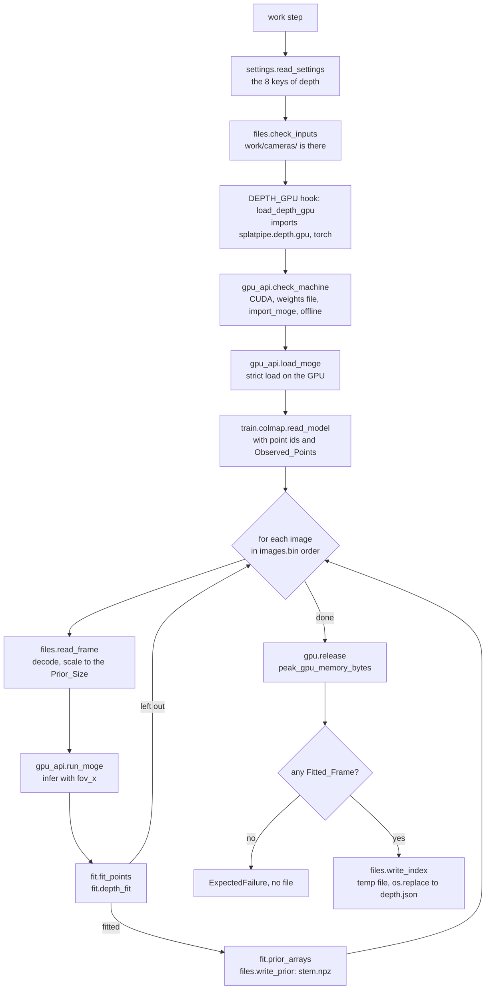
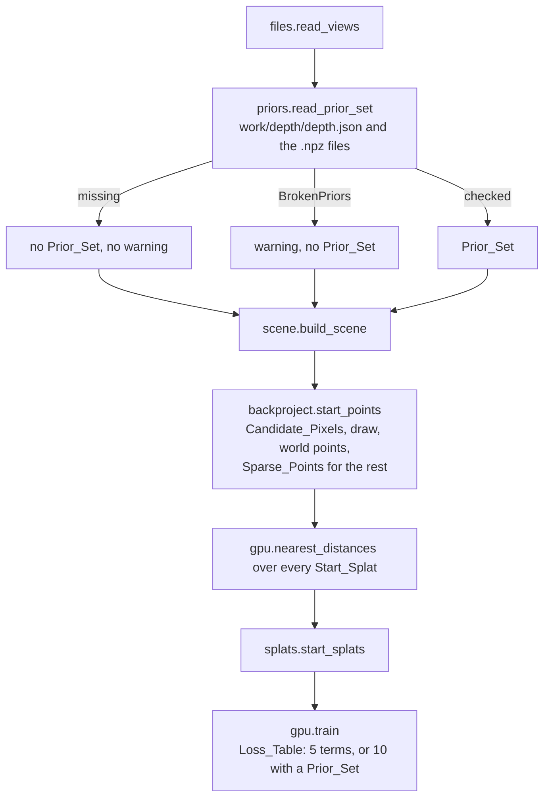

# Design Document: depth-priors

## Overview

This spec builds the Depth_Step in `splatpipe/depth/`, an Optional_Step between the Camera_Solve_Step and the Train_Step, and changes the Train_Step so it trains with what the Depth_Step writes. The Depth_Step runs MoGe-2 on every Frame at the Prior_Size, fits each Frame's inverse depth to the camera solve's own points with a two-pass robust fit, and writes each Fitted_Frame as one `.npz` Prior_File in `work/depth/`, then the Prior_Index, `work/depth/depth.json`, last. When the Prior_Index is there and passes its checks, the Train_Step starts extra splats on plain surfaces from the Priors and adds five Prior_Terms to its loss. When it isn't, the Train_Step trains exactly as the splat-training spec says.

The code keeps the three layers the splat-training design set up:

- **Pure maths** (`splatpipe/depth/fit.py`, `splatpipe/train/prior_views.py`, `splatpipe/train/backproject.py`, the new functions in `splatpipe/train/schedules.py`): numpy and standard-library functions on arrays and numbers. They read no file and import no torch, so every rule is tested on tiny made-up data on a laptop.
- **CPU I/O** (`splatpipe/train/priors.py`, the Prior_Format; `splatpipe/depth/files.py`; the changed Model_Reader in `splatpipe/train/colmap.py`).
- **The two GPU modules**: the Depth_GPU_Module, `splatpipe/depth/gpu.py`, the only file that imports MoGe and huggingface_hub, and the Train_Step's GPU_Module, `splatpipe/train/gpu.py`, which gains the Prior_Terms. Each is reached through one hook that the tests replace with a stand-in.

`splatpipe/depth/__init__.py` ties the Depth_Step together inside the Step_Runner's contract, like the Fake_Step and the Train_Step. `splatpipe/depth/smoke.py` runs the Depth_Smoke_Check's flow with the same load, the same MoGe call, the same Prior_Format and the same Trainer, and `cloud/smoke_runner.py` wraps it. The Machine_Image's install gains MoGe's code, utils3d_moge and huggingface-hub's tree less hf-xet, each pinned and installed with `--no-deps`.

### Decisions on the open choices

| Choice | Decision |
|---|---|
| Where the Prior_Format lives (Req 7.11) | `splatpipe/train/priors.py`. The Depth_Step already imports the Train_Step's Model_Reader, Training_Size rule and frame decoder, so `splatpipe.depth` imports `splatpipe.train` and never the other way. If the format lived in `splatpipe/depth/`, importing it from `splatpipe/train/__init__.py` would run `splatpipe/depth/__init__.py`, which imports `splatpipe.train` while that package is half set up. One direction keeps the import order safe. The Depth_Step's own file code, `splatpipe/depth/files.py`, wraps the writer with the Depth_Step's error messages. |
| The hook (Req 1.8) | `splatpipe/depth/__init__.py` holds `DEPTH_GPU: Callable[[], DepthGpu] = load_depth_gpu`, read when `work` runs. `load_depth_gpu()` imports `splatpipe.depth.gpu` with `importlib.import_module` and gives back the module, whose six functions make up the `DepthGpu` protocol. Tests `monkeypatch` `splatpipe.depth.DEPTH_GPU` with a function that gives a `FakeDepthGpu`. So `import splatpipe.depth` imports no torch, MoGe or huggingface_hub (Req 3.15). |
| What the Depth_GPU_Module decides | Nothing the user sees. It gives facts (CUDA there or not, peak memory), arrays, or one of four exceptions defined on the CPU side in `splatpipe/depth/gpu_api.py`: `MissingPackage`, `WrongCheckpoint`, `DepthOutOfMemory` and `OfflineModeOff`. The CPU functions `check_machine`, `load_moge` and `run_moge` turn the first three into the Expected_Failures of Req 3.2, 3.11 and 3.13, so every refusal is tested on the CPU with the stand-in. |
| An import that fails (Req 3.2) | Two places. `load_depth_gpu()` turns a `ModuleNotFoundError` for `torch`, which the Depth_GPU_Module imports at its top, into the Req 3.2 failure, and lets any other import error up as an Unexpected_Error, as `load_gpu` does. `import_moge()` imports huggingface_hub and `moge.model.v2` inside the function, and turns any `ModuleNotFoundError` from those two statements into `MissingPackage(<top-level name>)`, because nothing of ours runs inside them: a missing module there is always a package missing from the image, like `utils3d_moge` or `httpx`. |
| Offline mode (Req 3.6–3.8, A16) | `import_moge()` sets `os.environ["HF_HUB_OFFLINE"] = "1"` as its first statement, then imports `huggingface_hub.constants` and `moge.model.v2`, then checks `huggingface_hub.constants.HF_HUB_OFFLINE is True`. huggingface_hub 1.26.0 reads the variable once, when `constants` is first imported (moge-depth skill), so the check fails only when something imported huggingface_hub earlier in the process. Then it raises `OfflineModeOff`, a `RuntimeError` and not a `PipelineError`, so the Step_Runner reports an Unexpected_Error with its message in the Technical_Detail. The variable stays set for the rest of the process, which only keeps every later import offline too. |
| Loading the checkpoint (Req 3.9–3.11) | Our own strict load, as the skill's example does: `torch.load(path, map_location="cpu", weights_only=True)`, `MoGeModel(**checkpoint["model_config"])`, `load_state_dict(checkpoint["model"])` with its default `strict=True`, then `.to("cuda").eval()`, left in float32. `torch.load` refusing the file (`pickle.UnpicklingError`, `EOFError`, a `RuntimeError` from its zip reader), a value that isn't a dict holding `model_config` and `model`, a `TypeError` from the constructor and the strict load's `RuntimeError` all become `WrongCheckpoint`, with a short reason. A file torch can't read at all is not the MoGe-2 checkpoint either, so it gets the same message. torch's `OutOfMemoryError` is a `RuntimeError` too, so it's caught first, around the `.to("cuda")` alone. No `from_pretrained`, `hf_hub_download` or `init_weights` (Req 3.10). |
| Releasing the GPU (Req 3.14, A16) | `load_model` gives back a small handle, `_Loaded`, that holds the network. `release(handle)` sets the handle's network to `None`, runs `gc.collect()` and `torch.cuda.empty_cache()`, and takes `None` too, for a load that failed. The step calls it in a `finally` that starts just before the load. The two out-of-memory paths clear their own locals and raise `DepthOutOfMemory(...) from None`, so no traceback keeps a tensor alive while the Train_Step starts. torch's caching allocator would also hand any cached blocks to the Train_Step in the same process. |
| Per-frame timings (Req 9.2, 9.3) | `StepContext.add_timing` replaces a timing, so `report.Timings` keeps the running sum of `infer`, `fit` and `write` and calls `add_timing` with the new sum each time a frame's block ends. A failed report then holds the sums up to the last block that ended, which is what the step had worked out. `load_model` is one block, timed with `step.timed`. |
| The fit's inputs (Req 5) | `depth_fit` takes the Targets, 1 / z, and the MoGe_Values, 1 / MoGe's depth, as float64 arrays, the quantities Requirement 5 fits. The Relative_Depth_Error, \|1 / p − z\| / z with p = scale × MoGe_Value + offset, is worked out as \|t / p − 1\| with t the Target, which is the same number with one division fewer. The Metres_Per_Unit of a Fit_Point, MoGe's depth / z, is t / m with m its MoGe_Value. |
| A MoGe normal that isn't finite | MoGe's `normal` should be finite wherever its `mask` is true. The Depth_Step also leaves out of a Prior any pixel whose normal isn't finite, besides Req 5.11's rule, so every Prior_File it writes passes the Train_Step's finite check (Req 10.4). The test is on the float32 values written, so a fitted inverse depth that rounds to 0 or overflows in float32 gets no prior either. |
| Scaling a Prior up (Req 10.6, 10.7) | Our own taps, not `F.interpolate`, so the CPU and the GPU use one tested rule. `upscale_taps(stored, target)` gives, per axis, integer index maps `i0`, `i1` and the float32 weight `w1` of `i1`, worked out in integers from the pixel centres (below). `upscale` and `prior_pixel_mask` are written with indexing and arithmetic only, so they take numpy arrays on the CPU and torch tensors on the GPU. The back-projection runs them in numpy and the Trainer in torch. |
| The Depth_Weight's rule on the GPU (Req 11.7) | `prior_views.depth_weight(rate, gradient, settings, xp=np)` uses only `xp.exp`, `xp.where` and operators, which numpy and torch both have with the same meaning here. The Trainer calls the same function with `xp=torch` on the view's gradient tensor, so the rule the property tests check is the code the Trainer runs. The Brightness_Gradient itself is worked out once per Prior_View on the CPU, with OpenCV and numpy, and goes to the GPU as float32. |
| Memory of the per-view inputs | Each Prior_View's Prior stays at the Prior_Size on the GPU, 17 bytes a pixel: about 2.5 MB at 512 × 288 and 1.0 GB for 400 views (D1). Its Brightness_Gradient is float32 at the Training_Size: 5.8 MB at 1600 × 900 and 2.3 GB for 400 views. With the splat-training design's 2.3 GB of images and masks, that's about 5.6 GB of views on the 24 GB GPU, before the splats. The Plain_Pixel test and the weight are worked out from the gradient each Iteration, which costs a few elementwise operations on one image. |
| The Loss_Table (Req 13.1, 13.13) | `_TERMS` keeps exactly the splat-training spec's five rows. A second table, `_PRIOR_TERMS`, holds the five Prior_Terms, and the Trainer's table for a run is `_TERMS` with no Prior_Set and `_TERMS + _PRIOR_TERMS` with one. Each row stays `(name, weight setting, function)`. The `depth` row's weight setting is `None`, meaning 1, because its Depth_Weight is inside the term (Req 13.5). Every term function now takes one `_Inputs` record, the Iteration's inputs, in place of the six arguments it took, because the Prior_Terms need the Rendered_Depth and the scaled-up Prior too. The five old terms compute what they computed before. |
| Which terms an Iteration works out (Req 13.14, 13.15) | `schedules.active_terms(i, settings, has_priors, view_has_prior)`, a pure function that gives the names in Loss_Table order. The Trainer works out exactly those terms and counts every other row as 0. The rule for the five old terms moves into it unchanged from `_loss`. |
| Safe arithmetic in the Prior_Terms | Every division and every unit-length step works on a value first made safe with `torch.where` (a Rendered_Depth of 0 replaced by 1, a prior inverse depth outside the Prior_Pixels replaced by 1, and in every unit-length step a squared length of 0 replaced by 1 before its square root, so the vector stays 0 there and no small number has to be hard-coded), and the masks pick with `torch.where`, never by multiplying. So no pixel left out of a term can put a NaN into the loss or its gradient. |
| A mean over no pixels | Each Prior_Term is a sum over its pixels divided by `max(count, 1)`, with the count kept as a tensor so the CPU doesn't wait for it. A Prior_View whose Prior_Pixels are all masked, for instance, adds 0. |
| The Depth_Normal's sign (Req 13.8) | The cross product is turned so its dot product with the pixel's ray, ((x + 0.5 − cx) / fx, (y + 0.5 − cy) / fy, 1), isn't above 0. That's the same as facing the camera for any point on the ray in front of it, and it needs no depth at the centre pixel, which Req 13.8 doesn't ask for. |
| The draw of the Back_Projected_Splats (Req 12.2) | One generator of its own, `np.random.default_rng(seed)`, separate from the one `choose_points` makes with the same seed. The Candidate_Pixels of every Prior_View, in view order and then in row-major pixel order, are numbered 0 to C − 1. `generator.choice(C, B, replace=False)` draws B = min(Back_Project_Budget, C) of the numbers, which are sorted and mapped back to (view, pixel). numpy's `choice` without replacement doesn't build a permutation of C when B is small next to C. |
| The Model_Reader's point ids (Req 2.4–2.6, A1) | Each keypoint block is read as one numpy structured array (`<f8`, `<f8`, `<i8`) and only its point id column is kept. `points3D.bin`'s point id, which the reader skipped before, is now kept as `uint64`. `read_model` keeps, per image, the distinct non-negative keypoint ids that are ids of points, in the order of their first keypoint. A duplicate point id, which COLMAP never writes, maps to its first point. Nothing new is refused. |
| The Depth_Smoke_Check's flow (Req 16) | `splatpipe/depth/smoke.py` holds the Prior_Smoke_Scene and `run_smoke_depth(config, sizes, scratch, depth_gpu, gpu)`, so the Test_Suite runs the whole check on the CPU with both stand-ins. `cloud/smoke_runner.py`'s `_check_depth` only builds the sizes from `[cloud.smoke]` and calls `load_depth_gpu()` and `load_gpu()` inside the function. |
| The packages on the image (D4, O3) | MoGe's code and utils3d_moge from their pinned commits with `--no-deps`, then huggingface-hub 1.26.0 and the 13 packages of D4's list at the versions MoGe's `uv.lock` gives, with `--no-deps`, then an import check that fails the build. hf-xet, which huggingface-hub declares, stays off (D4). The pins, why hf-xet can stay off, and the check against torch 2.7.1, wheel 0.48.0 and gsplat 1.5.3 are under "The machine image". |
| Dependencies on the laptop | None. `pyproject.toml` and `uv.lock` stay as they are (Req 15.5). numpy, OpenCV and the standard library cover every CPU part. |

## Architecture

### The depth step



### The train step's new parts



### Module layout

| File | What it holds | Imports |
|---|---|---|
| `splatpipe/depth/__init__.py` | `run()`, `work()`, the hook `DEPTH_GPU`, and the step's flow: the counts, the timings, the warning and the failures. | stdlib, numpy, `splatpipe.errors`, `splatpipe.step`, `splatpipe.train.colmap`, `splatpipe.train.files`, `splatpipe.train.priors`, `splatpipe.train.scene`, the depth CPU modules |
| `splatpipe/depth/__main__.py` | `main(argv)`, which calls `step_main("depth", "splatpipe.depth", argv)`. | stdlib, `splatpipe.step` |
| `splatpipe/depth/settings.py` | `DepthSettings` and `read_settings()`, the checks of Req 8.3. | stdlib, `splatpipe.errors` |
| `splatpipe/depth/fit.py` | Pure: `field_of_view()`, `geometry_pixels()`, `FitPoints`, `fit_points()`, `spread()`, `FitOutcome`, `depth_fit()`, `prior_arrays()` and `job_metres_per_unit()`. | stdlib, numpy, `splatpipe.train.colmap`, `splatpipe.train.scene`, `splatpipe.train.priors`, and `splatpipe.depth.settings` and `splatpipe.depth.gpu_api` for types |
| `splatpipe/depth/files.py` | `check_inputs()`, `read_frame()`, `write_prior_file()` and `write_prior_index()`, which turn an `OSError` into the Req 7.10 failure. | stdlib, numpy, cv2, `splatpipe.errors`, `splatpipe.train.files`, `splatpipe.train.priors` |
| `splatpipe/depth/report.py` | `Tally`, the Frames left out by reason, `Timings`, the running sums, `left_out_warning()` and `no_fit_failure()`. | stdlib, `splatpipe.errors` |
| `splatpipe/depth/gpu_api.py` | The Depth_GPU_Module's interface as the CPU sees it: `MoGeOutput`, the `DepthGpu` protocol, the four exceptions, `load_depth_gpu()`, `check_machine()`, `load_moge()` and `run_moge()`. | stdlib, numpy, `splatpipe.errors`, `splatpipe.depth.settings` |
| `splatpipe/depth/gpu.py` | The Depth_GPU_Module: `probe()`, `import_moge()`, `load_model()`, `infer()`, `release()` and `peak_memory_bytes()`. | stdlib, numpy, torch at its top; huggingface_hub and moge inside `import_moge` and `load_model`; `splatpipe.depth.gpu_api` |
| `splatpipe/depth/smoke.py` | `DepthSmokeSizes`, `check_moge_output()`, `prior_smoke_scene()` and `run_smoke_depth()`. | stdlib, numpy, `splatpipe` |
| `splatpipe/train/priors.py` (new) | The Prior_Format: its Fixed_Constants, `Prior`, `PriorEntry`, `PriorIndex`, `PriorSet`, `BrokenPriors`, `prior_path()`, `write_prior()`, `write_index()`, `load_prior()`, `load_index()`, `check_prior()` and `read_prior_set()`. | stdlib, numpy, `splatpipe.jsonio`, `splatpipe.train.colmap` for types |
| `splatpipe/train/prior_views.py` (new) | Pure: `brightness()`, `brightness_gradient()`, `plain_pixels()`, `depth_weight()`, `PriorTaps`, `upscale_taps()`, `nearest_rows()`, `upscale()`, `prior_pixel_mask()`, `ViewPrior` and `view_prior()`. | stdlib, numpy, cv2, `splatpipe.train.priors` and `splatpipe.train.settings` for types |
| `splatpipe/train/backproject.py` (new) | Pure: `back_project_budget()`, `landed_pixels()`, `candidate_pixels()`, `draw_candidates()`, `world_points()`, `StartPoints` and `start_points()`. | stdlib, numpy, `splatpipe.train.*` CPU modules |
| `splatpipe/train/colmap.py` | The Model_Reader gains the point ids and the Observed_Points. | as before |
| `splatpipe/train/schedules.py` | Gains `SPLAT_TERMS`, `PRIOR_TERMS`, `TERM_WEIGHTS`, `depth_schedule()`, `depth_normal_start()`, `normal_on()` and `active_terms()`. | stdlib, numpy, `splatpipe.train.settings` for types |
| `splatpipe/train/settings.py`, `scene.py`, `files.py`, `smoke.py`, `__init__.py`, `gpu_api.py` | The changes under "Changes to the Train_Step". | as before |
| `splatpipe/train/gpu.py` | The Trainer gains the Prior_Set's views, the `"RGB+ED"` render, the Normal_Render, the Depth_Normals and the five Prior_Terms. | as before: torch, gsplat, fused_ssim |

Every file of `splatpipe/depth/` but `gpu.py` imports only the standard library, numpy, cv2 and `splatpipe` (Req 18.8). `splatpipe/depth/gpu.py` adds torch at its top and huggingface_hub and moge inside functions, and nothing else. The Train_Step's import rules stay as they are: only `splatpipe/train/gpu.py` imports torch, gsplat and fused_ssim, and the new train modules import none of them (Req 14.9). No file imports `cloud/` or boto3.

## Components and Interfaces

### The depth step's flow (`splatpipe/depth/__init__.py`)

```python
DEPTH_GPU: Callable[[], DepthGpu] = load_depth_gpu  # the hook: read when work runs

def run(job_id: str, preset: str | None = None, *, config: Config | None = None) -> dict[str, Any]
def work(step: StepContext) -> None
```

`run` calls `run_step("depth", "splatpipe.depth", job_id, preset=preset, config=config)`. `work(step)` does the step's work in the order of Req 1.4:

1. **Settings.** `cfg = read_settings(step.settings, step.name, step.preset)` (Req 8.3, 8.6).
2. **Inputs there.** `cameras = step.job.folder / "work" / CAMERAS`, then `check_inputs(cameras)`: `images/` a folder and the three model files files, in that order, reading nothing (Req 2.2).
3. **GPU module.** `gpu = DEPTH_GPU()`, which refuses a machine with no torch (Req 3.2).
4. **The machine.** `check_machine(gpu, cfg)`: `gpu.probe()` must say CUDA (Req 3.3); `Path(cfg.moge_weights).is_file()` (Req 3.5); then `gpu.import_moge()` (Req 3.2, 3.6–3.8). It checks no GPU memory (Req 3.4).
5. **Load** (`try` from here, with the `finally` of step 8). `with step.timed("load_model"): handle = load_moge(gpu, cfg)` (Req 3.9–3.13).
6. **Model.** `model = read_model(cameras / SPARSE)` (Req 2.3–2.6). Adds `images`. Then `width, height = training_size(model.camera.width, model.camera.height, cfg.long_edge)`, the Prior_Size, and adds `prior_width` and `prior_height` (Req 4.1). `fov = field_of_view(model.camera.width, model.camera.fx)` (Req 4.3).
7. **Each Frame**, for each image of `model.images` in order (Req 2.8, 4.5):
   1. Timed into `infer`: `rgb = read_frame(cameras, image.name, model.camera, width, height)` (Req 2.7, 4.2), then `output = run_moge(gpu, handle, rgb, fov, cfg, image.name)` (Req 4.4, 4.6, 3.13).
   2. Timed into `fit`: `points = fit_points(model, image, output, width, height)` and `outcome = depth_fit(points.targets, points.moge_values, cfg)` (Req 5). `tally.add(outcome.kind)`, and the four tally counts are added again with their new values.
   3. When `outcome.kind == "fitted"`, timed into `write`: `write_prior_file(step.work_folder, image.name, prior_arrays(output, outcome))` (Req 7.1, 7.10), and the image's `PriorEntry` joins the list.
8. **Release**, in the `finally`, once the loop ends or anything from step 5 on fails: `gpu.release(handle)`, with `handle` still `None` when the load failed, then `peak_gpu_memory_bytes` from `gpu.peak_memory_bytes()` (Req 3.14, 9.1).
9. **No fit.** With `tally.fitted == 0`, `raise no_fit_failure(tally, cfg)` (Req 7.7). No Prior_File was written, so `work/depth/` is empty.
10. **Warning.** With some Frames left out, `step.add_warning(left_out_warning(tally))` (Req 7.9).
11. **Index**, timed into `write`: `write_prior_index(step.work_folder, PriorIndex(...))`, written last (Req 7.3, 7.6). Its `metres_per_unit` is `job_metres_per_unit` of the entries (Req 6.2).

Every count is added with `int(...)` as soon as it's known, so a failed report holds exactly what the step had worked out (Req 9.3, 9.4). The step writes only `work/depth/<stem>.npz`, `work/depth/depth.json.tmp` while the index is written, and `work/depth/depth.json` (Req 1.9), and relies on the Step_Runner emptying `work/depth/` first (Req 1.11). A failure at any point before step 11 leaves no Prior_Index, and a failed index write removes its temporary file, so a failed run never leaves one (Req 7.8).

### `splatpipe/depth/settings.py`

```python
@dataclass(frozen=True)
class DepthSettings:
    long_edge: int
    moge_weights: str
    resolution_level: int
    use_fp16: bool
    fit_min_points: int
    fit_miss_ratio: float
    fit_max_median_error: float
    min_gpu_memory_gb: int  # the cloud-only Step_Need, checked and kept, never used (Req 3.4, 8.5)

def read_settings(settings: Mapping[str, Any], section: str, preset: str) -> DepthSettings
```

Built like `splatpipe/train/settings.py`, with its own small table of kinds so it imports nothing private from the Train_Step: each key is read with `settings[key]`, so a missing key raises the Step_Runner's own message (Req 8.6), and its value is checked with `type()` exactly, so a bool is never a number. The kinds (Req 8.3): `long_edge`, `fit_min_points` and `min_gpu_memory_gb` whole numbers above 0; `resolution_level` a whole number from 0 to 9; `use_fp16` `true` or `false` (`type(value) is bool`); `moge_weights` a `str` of one or more characters; `fit_miss_ratio` and `fit_max_median_error` numbers above 0, kept as floats. A refusal reads "The setting `<key>` in [depth] is `<value>`, but it must be `<kind>`. Change it to `<kind>`.", with the value shown as TOML writes it. Every key is a Shared_Setting, so its table is always `[depth]`.

### `splatpipe/depth/fit.py` (pure)

```python
def field_of_view(width: int, fx: float) -> float
def geometry_pixels(output: MoGeOutput) -> np.ndarray

@dataclass(frozen=True)
class FitPoints:
    targets: np.ndarray      # (n,) float64: 1 / z, in 1 / camera solve units
    moge_values: np.ndarray  # (n,) float64: 1 / MoGe's depth, in 1 / metres

def fit_points(model: SparseModel, image: ModelImage, output: MoGeOutput,
               width: int, height: int) -> FitPoints
def spread(values: np.ndarray) -> tuple[float, float]  # (Spread, median)

@dataclass(frozen=True)
class FitOutcome:
    kind: str  # "fitted", "few_points", "flat" or "poor_fit"
    fit_points: int  # the first fit's points
    kept_points: int  # the second fit's points, 0 when there was no second fit
    scale: float | None  # the second fit's, for "fitted"
    offset: float | None
    median_error: float | None
    metres_per_unit: float | None

def depth_fit(targets: np.ndarray, moge_values: np.ndarray, settings: DepthSettings) -> FitOutcome
def prior_arrays(output: MoGeOutput, outcome: FitOutcome) -> Prior
def job_metres_per_unit(entries: Sequence[PriorEntry]) -> float
```

**Field_Of_View** (Req 4.3): `math.degrees(2 * math.atan(width / (2 * fx)))`, from the Shared_Camera's full width and fx, both in pixels. Scaling the frame doesn't change it.

**Geometry_Pixels** (Req 4.7): `output.mask & np.isfinite(output.depth) & (output.depth > 0)`.

**Fit_Points** (Req 5.1, A2). With R and t the image's world-to-camera rotation and translation (`scene.world_to_camera`), and the image's Observed_Points' rows of `model.points`, `p`:

- camera point c = R p + t, and z = c₃;
- only points with z > 0 go on (in front of the camera);
- the projection with the Shared_Camera at its full size, u = fx · c₁ / z + cx and v = fy · c₂ / z + cy, in COLMAP's pixel convention, where the top-left pixel's centre is (0.5, 0.5);
- only points with 0 ≤ u < W and 0 ≤ v < H go on (inside the Frame);
- the Prior_Size pixel under the projection is (min(⌊u · w / W⌋, w − 1), min(⌊v · h / H⌋, h − 1)), the stored pixel whose footprint holds (u, v) under Req 7.2's convention. The `min` only guards a product that rounds up to w;
- only points on a Geometry_Pixel go on.

Each point left is a Fit_Point, with Target t = 1 / z and MoGe_Value m = 1 / MoGe's `depth` at its pixel, both in float64.

**Spread**: with numpy's median μ(x), Spread(x) = mean(|x − μ(x)|).

**The Depth_Fit** (Req 5.2–5.9). With n Fit_Points, N = `fit_min_points` (10), r = `fit_miss_ratio` (3) and E = `fit_max_median_error` (0.15):

1. n < N: `"few_points"` (Req 5.2).
2. First fit. Spread(m) = 0: `"flat"` (Req 5.3). Otherwise s₁ = Spread(t) / Spread(m) and o₁ = μ(t) − s₁ · μ(m) (Req 5.4).
3. Misses: dᵢ = |s₁ · mᵢ + o₁ − tᵢ|. Keep the points with dᵢ ≤ r · μ(d) (Req 5.5).
4. Fewer than N kept: `"few_points"`. Spread of the kept m is 0: `"flat"` (Req 5.6).
5. Second fit on the kept points with the same formulas: s₂ and o₂. s₂ = 0: `"flat"` (Req 5.7). s₂ is a ratio of Spreads, so it's never below 0.
6. Over **every** Fit_Point, the kept and the dropped (Req 5.8): pᵢ = s₂ · mᵢ + o₂, and the Relative_Depth_Error eᵢ = |tᵢ / pᵢ − 1| when pᵢ > 0, else infinity. This equals |1 / pᵢ − zᵢ| / zᵢ with zᵢ = 1 / tᵢ.
7. μ(e) > E: `"poor_fit"`. Otherwise `"fitted"`, with scale s₂, offset o₂ and `median_error` μ(e) (Req 5.9). numpy's median of an array holding infinities sorts them last, and a median that lands on or between infinities is infinite, so it fails the check.
8. A Fitted_Frame's Metres_Per_Unit is μ(tᵢ / mᵢ) over the kept points, the median of MoGe's depth / z (Req 6.1).

Every step works in float64. The "at least half are kept" argument of the requirements' note holds for numpy's median of either parity: with n even, μ(d) is the mean of the two middle misses, so at least n / 2 misses are at most μ(d), and r ≥ 1 keeps all of them.

**The Prior's arrays** (Req 5.11, 7.1). With the Geometry_Pixels G, f = float32(s₂ · (1 / depth) + o₂) worked out in float64 at G inside `np.errstate(over="ignore", divide="ignore", invalid="ignore")`, and keep = G ∧ f finite ∧ f > 0 ∧ every normal component finite:

- `inverse_depth` = f where keep, else 0, float32;
- `normal` = MoGe's normal where keep, else 0, float32;
- `mask` = keep, bool.

**The job's Metres_Per_Unit** (Req 6.2): numpy's median of the entries' `metres_per_unit`.

### `splatpipe/depth/files.py`

```python
def check_inputs(cameras: Path) -> None
def read_frame(cameras: Path, name: str, camera: Camera, width: int, height: int) -> np.ndarray
def write_prior_file(folder: Path, name: str, prior: Prior) -> None
def write_prior_index(folder: Path, index: PriorIndex) -> None
```

- **`check_inputs`** checks `images/` then each of `MODEL_FILES` in `sparse/`, with `train.files`' names, and refuses the first one missing: "The depth step needs `<path>`, which the camera solve step writes, but it isn't there. Run the camera solve step on this job first." (Req 2.2).
- **`read_frame`** reads `images/<name>` with the Train_Step's own `read_training_image`, so it fails with the Train_Step's Expected_Failures for a missing file, a file OpenCV can't decode and a frame that isn't the Shared_Camera's size (Req 2.7). Then `scaled_down` with `INTER_AREA` to the Prior_Size when it's larger, and `cv2.cvtColor(..., cv2.COLOR_BGR2RGB)`. It gives the (h, w, 3) uint8 RGB frame. The division by 255 happens on the GPU (Req 4.2).
- **`write_prior_file`** calls `priors.write_prior(prior_path(folder, name), prior)` and **`write_prior_index`** calls `priors.write_index(folder, index)`. Each turns an `OSError` into "The file `<path>` couldn't be written (`<reason>`). Free some space on the disk, or check that you can write to `<folder>`, then run the step again." (Req 7.10).

### `splatpipe/depth/report.py`

```python
@dataclass
class Tally:
    frames: int = 0
    fitted: int = 0
    few_points: int = 0
    flat: int = 0
    poor_fit: int = 0
    def add(self, kind: str) -> None

@dataclass
class Timings:
    def add(self, step: StepContext, name: str, seconds: float) -> None  # running sum, then add_timing

def left_out_warning(tally: Tally) -> str
def no_fit_failure(tally: Tally, settings: DepthSettings) -> ExpectedFailure
```

The step adds the tally as `fitted_images`, `few_points_images`, `flat_images` and `poor_fit_images`. The two texts:

- Req 7.9: "Depth priors were made for `<fitted>` of `<frames>` frames. Of the others, `<few>` had too few of the camera solve's points, `<flat>` were flat and `<poor>` fitted poorly, so they train without a depth prior."
- Req 7.7 (D3): "None of the `<frames>` frames fitted the camera solve's points, so no depth priors were made: `<few>` had fewer than `<fit_min_points>` of the points, `<flat>` were flat, and `<poor>` fitted poorly, with a median depth error above `<fit_max_median_error>`. The job goes on and trains without depth priors."

### `splatpipe/depth/gpu_api.py` (the Depth_GPU_Module's interface, on the CPU)

```python
DEPTH_GPU_MODULE = "splatpipe.depth.gpu"

@dataclass(frozen=True)
class MoGeOutput:
    depth: np.ndarray   # (h, w) float32, camera-space z in metres, +inf where mask is false
    normal: np.ndarray  # (h, w, 3) float32, unit, camera frame, facing the camera; 0 where mask is false
    mask: np.ndarray    # (h, w) bool, true where MoGe found geometry

class DepthGpu(Protocol):
    def probe(self) -> bool: ...  # torch sees CUDA. Resets the peak memory count.
    def import_moge(self) -> None: ...  # MissingPackage, OfflineModeOff
    def load_model(self, weights: Path) -> object: ...  # WrongCheckpoint, DepthOutOfMemory(None)
    def infer(self, model: object, rgb: np.ndarray, fov_x: float, resolution_level: int,
              use_fp16: bool, frame: str) -> MoGeOutput: ...  # DepthOutOfMemory(frame)
    def release(self, model: object | None) -> None: ...
    def peak_memory_bytes(self) -> int: ...

class MissingPackage(Exception): package: str
class WrongCheckpoint(Exception): reason: str
class DepthOutOfMemory(Exception): frame: str | None  # None while loading
class OfflineModeOff(RuntimeError): ...  # an Unexpected_Error (Req 3.8)

def load_depth_gpu() -> DepthGpu
def check_machine(gpu: DepthGpu, settings: DepthSettings) -> None
def load_moge(gpu: DepthGpu, settings: DepthSettings) -> object
def run_moge(gpu: DepthGpu, model: object, rgb: np.ndarray, fov_x: float,
             settings: DepthSettings, frame: str) -> MoGeOutput
```

- **`load_depth_gpu`** imports `DEPTH_GPU_MODULE` through this module's own `importlib`, so a test can replace it. A `ModuleNotFoundError` whose missing module, up to its first dot, is `torch` becomes the Req 3.2 failure, naming torch. Anything else goes up as it is.
- **`check_machine`**: no CUDA is the Req 3.3 failure; a `moge_weights` that isn't a file is the Req 3.5 failure, before `import_moge` runs; `MissingPackage` from `import_moge` is the Req 3.2 failure naming the package. `OfflineModeOff` goes up as it is.
- **`load_moge`** calls `gpu.load_model(Path(settings.moge_weights))`. `WrongCheckpoint` becomes the Req 3.11 failure and `DepthOutOfMemory` the Req 3.13 failure "while the step loaded MoGe-2".
- **`run_moge`** calls `gpu.infer(...)` with `resolution_level` and `use_fp16` from the settings (Req 4.4). `DepthOutOfMemory` becomes the Req 3.13 failure naming the Frame.

The Depth_Step and the Depth_Smoke_Check both load and call MoGe through these three functions, so the smoke check runs the step's own load and call (Req 16.2).

### `splatpipe/depth/gpu.py` (the Depth_GPU_Module)

The module's docstring says it holds no code copied from MoGe and calls MoGe's API only. Its functions:

- **`probe()`**: `torch.cuda.is_available()`, and with CUDA `torch.cuda.reset_peak_memory_stats()`, so `peak_memory_bytes` counts from the GPU check on (Req 9.1).
- **`import_moge()`**: `os.environ["HF_HUB_OFFLINE"] = "1"` first, then `import huggingface_hub.constants` and `from moge.model.v2 import MoGeModel` inside a `try` that turns `ModuleNotFoundError` into `MissingPackage((error.name or "moge").partition(".")[0])`, then the offline check of Req 3.7, raising `OfflineModeOff("huggingface_hub was imported before HF_HUB_OFFLINE was set, so it isn't offline. ...")` when `huggingface_hub.constants.HF_HUB_OFFLINE` isn't `True` (Req 3.6–3.8).
- **`load_model(weights)`**: `from moge.model.v2 import MoGeModel` again, which is only a lookup in `sys.modules` now; the strict load of the decisions table; `.to(_DEVICE).eval()` with no dtype change (Req 3.9, 3.11, 3.12). Gives back `_Loaded(net)`.
- **`infer(model, rgb, fov_x, resolution_level, use_fp16, frame)`**: `image = torch.from_numpy(rgb).to(_DEVICE).permute(2, 0, 1).float() / 255`, the (3, h, w) RGB floats from 0 to 1 (Req 4.2); `out = model.net.infer(image, fov_x=fov_x, resolution_level=resolution_level, use_fp16=use_fp16)`, leaving `num_tokens`, `force_projection` and `apply_mask` at MoGe's defaults (Req 4.4); then `MoGeOutput(depth=out["depth"].float().cpu().numpy(), normal=out["normal"].float().cpu().numpy(), mask=out["mask"].cpu().numpy().astype(bool))` (Req 4.6). Copying to numpy is allowed on inference tensors, so no clone is needed. `torch.cuda.OutOfMemoryError` becomes `DepthOutOfMemory(frame)`.
- **`release(model)`** and **`peak_memory_bytes()`** as the decisions table says.

### `splatpipe/depth/smoke.py` (the Depth_Smoke_Check's flow, on the CPU side)

```python
@dataclass(frozen=True)
class DepthSmokeSizes:
    train: SmokeSizes  # the Train_Smoke_Check's eight numbers
    normal_start: int  # [cloud.smoke].depth_normal_start_step

def check_moge_output(output: MoGeOutput, side: int) -> int
def prior_smoke_scene(sizes: SmokeSizes, seed: int, folder: Path
                      ) -> tuple[SparseModel, list[ImagePixels], PriorSet]
def run_smoke_depth(config: Config, sizes: DepthSmokeSizes, scratch: Path,
                    depth_gpu: DepthGpu, gpu: Gpu) -> str
```

`run_smoke_depth` (Req 16.2–16.9):

1. **MoGe's part.** The `[depth]` settings of the default Preset through the step's own `read_settings`, then `check_machine` and `load_moge`, the step's own (Req 16.2). The made-up image is `np.random.default_rng(seed).integers(0, 256, (p, p, 3), dtype=np.uint8)` with p = `image_pixels` and `seed` from `[train]`, and its camera is a made-up PINHOLE camera with W = fx = p, so `fov_x = field_of_view(p, p)`, about 53.1°. One `run_moge`, then `release` in a `finally`. `check_moge_output` passes when `depth`, `normal` and `mask` are (p, p) float32, (p, p, 3) float32 and (p, p) bool, and `depth` and `normal` are finite and `depth` above 0 wherever `mask` is true, and gives back the number of Geometry_Pixels (Req 16.3). Each failure is a `PipelineError` that says which array was wrong and how.
2. **The Prior_Smoke_Scene** (Req 16.4, A5). `train.smoke.smoke_scene(sizes.train, seed)`, the training check's cameras and points, with each image's rows from p // 2 down painted one grey, (128, 128, 128), so each image holds a plain area. Its Observed_Points are empty, so no point rules a pixel out. Each image gets a made-up Prior at the Prior_Size, which is p × p because p is below `[depth].long_edge`: `inverse_depth` 1.0 everywhere, the plane through the origin square to the camera, which is `_RADIUS` = 1 in front of each camera; `normal` (0, 0, −1) everywhere, facing the camera; `mask` true everywhere. The Priors and their Prior_Index, with the scene's camera and poses, go into `scratch/depth/` through the Prior_Writer, and come back through `read_prior_set(scratch / "depth", model)`, the Train_Step's own reader and checks. These are numpy functions that import no torch.
3. **Training with the Priors** (Req 16.5). `train.smoke.smoke_settings(config, sizes.train, normal_start_step=sizes.normal_start)`, so the check trains with the Train_Smoke_Check's settings except the Normal_Start. Then the step's own `build_scene` with the Prior_Set, `start_points`, `nearest_distances` over every Start_Splat, `start_splats`, `gpu.train(scene, start, settings, None)`, the Exposure_Bake, the PLY_Writer with every splat, dropping none, and the PLY_Check.
4. It passes only when MoGe's part passed, the Trainer ran every Planned_Iteration, at least one Back_Projected_Splat started and the PLY_Check passed (Req 16.8). The log line: "MoGe-2 found geometry at `<g>` of `<p²>` pixels; trained `<n>` iterations with depth priors, from `<b>` back-projected and `<s>` sparse splats, to `<k>` splats, and the PLY check passed". Any failure raises with its own message (Req 16.9).

With the real Config and the `[cloud.smoke]` numbers, the run's Prior_Terms come on as Req 16.7 needs. Every image has a Prior, so every Iteration is on a Prior_View. The Depth_Normal_Start is round(0.23333333333333334 × 30) = 7, so `depth_normal` and `normal_consistency` run on Iterations 7 to 29. The Normal_Start is `depth_normal_start_step` = 8 with `normal_every` = 4, so `normal` runs on 8, 12, …, 28. `depth` and `flatten` run on all 30. The Back_Project_Budget is min(⌊0.3333333333333333 × 400⌋, 500,000) = 133, and the Candidate_Pixels number about 31 × 64 per image (31 × 32 in image 0, whose left half is masked), about 6,900 in all, so 133 Back_Projected_Splats start. The 200 Sparse_Points all fit in the 267 places left, so the run starts from 333 splats, and MCMC's one refine, at Iteration 20, grows them to 349.

`cloud/smoke_runner.py` imports `DepthSmokeSizes` and `run_smoke_depth` from `splatpipe.depth.smoke` and `load_depth_gpu` from `splatpipe.depth.gpu_api` at the top, and none of those imports a GPU package. `_check_depth(context)` builds the sizes from `context.cloud_config.smoke_checks` and calls `run_smoke_depth(context.config, sizes, context.scratch, load_depth_gpu(), load_gpu())`, looking both loaders up in its own module when it runs, so a test can patch each with a stand-in (Req 16.10). `SMOKE_CHECKS` gains `SmokeCheck("depth", _check_depth)` after `moge-weights` and before `training` (Req 16.1). The check has no time limit of its own, like the training check. On the Machine_Image that runs Jobs today, which has no MoGe code, `import_moge` raises `MissingPackage("moge")`, so the check fails with the Req 3.2 message until the user runs the next Image_Build (Req 16.11, A19).

### Changes to the Model_Reader (`splatpipe/train/colmap.py`)

```python
@dataclass(frozen=True)
class ModelImage:
    image_id: int
    quaternion: np.ndarray
    translation: np.ndarray
    camera_id: int
    name: str
    observed_ids: np.ndarray  # (K,) uint64: the Observed_Points' ids, distinct, in first-keypoint order

@dataclass(frozen=True)
class SparseModel:
    camera: Camera
    images: tuple[ModelImage, ...]
    points: np.ndarray     # (P, 3) float64
    colours: np.ndarray    # (P, 3) uint8
    point_ids: np.ndarray  # (P,) uint64, in the file's order

def observed_rows(model: SparseModel, image: ModelImage) -> np.ndarray  # (K,) int64 rows of points
```

- `_POINT` becomes `"<QdddBBB8xQ"`, which keeps the point id and still reads past the error (Req 2.6). The ids go into one `(P,)` uint64 array.
- `_read_image` reads the keypoint count, then checks the 24 × count bytes are there with `_Cursor._need`, then reads them as `np.frombuffer(data, dtype=[("x", "<f8"), ("y", "<f8"), ("id", "<i8")], count=count, offset=offset)` and keeps only the `id` column. x and y are never kept (Req 2.6). It keeps the ids that are 0 or more, distinct, in the order of their first keypoint: `ids[np.sort(np.unique(ids, return_index=True)[1])]`.
- `read_model` then turns each image's kept ids, all 0 or more, into uint64, and keeps only the ids that are ids of points, with `np.isin` against `point_ids` (Req 2.4). Both arrays are uint64 before the comparison: numpy compares an int64 array with a uint64 one as float64, which can't tell apart two ids above 2⁵³ that differ only in their last bits. A keypoint id of −1 or of no point is no observation, and no model is refused for it (Req 2.5).
- `observed_rows` maps each observed id to the row of the first point with that id, through a sorted copy of `point_ids` and `np.searchsorted`.

The cost is one vectorised read per image: 400 images of 5,000 keypoints are 2,000,000 rows. The train step's smoke scene and the tests that build a `ModelImage` or `SparseModel` by hand pass the new fields: `smoke_scene` gives point ids 1 to P and no Observed_Points.

### The Prior_Format (`splatpipe/train/priors.py`)

```python
PRIOR_FOLDER = "depth"     # work/depth/
PRIOR_INDEX = "depth.json"
PRIOR_FORMAT = 1
PRIOR_ARRAYS = ("inverse_depth", "normal", "mask")

@dataclass(frozen=True)
class Prior:
    inverse_depth: np.ndarray  # (h, w) float32
    normal: np.ndarray         # (h, w, 3) float32
    mask: np.ndarray           # (h, w) bool

@dataclass(frozen=True)
class PriorEntry:
    name: str
    quaternion: tuple[float, float, float, float]
    translation: tuple[float, float, float]
    scale: float
    offset: float
    fit_points: int
    kept_points: int
    median_error: float
    metres_per_unit: float

@dataclass(frozen=True)
class PriorIndex:
    camera: tuple[int, int, float, float, float, float]  # width, height, fx, fy, cx, cy
    prior_width: int
    prior_height: int
    metres_per_unit: float
    priors: tuple[PriorEntry, ...]

@dataclass(frozen=True)
class PriorSet:
    index: PriorIndex
    priors: dict[str, Prior]  # by image name, in the index's order

class BrokenPriors(Exception):  # path and what failed; the Train_Step turns it into a warning
    path: Path
    what: str

def prior_path(folder: Path, name: str) -> Path   # folder / f"{name.removesuffix('.jpg')}.npz"
def write_prior(path: Path, prior: Prior) -> None
def write_index(folder: Path, index: PriorIndex) -> None
def load_prior(path: Path) -> Prior
def load_index(path: Path) -> PriorIndex
def check_prior(path: Path, prior: Prior, width: int, height: int) -> None
def read_prior_set(folder: Path, model: SparseModel) -> PriorSet | None
```

- **`write_prior`** is `np.savez(path, inverse_depth=..., normal=..., mask=...)`, numpy's uncompressed format, with the three arrays as little-endian float32, float32 and bool. **`write_index`** writes the index's JSON_Values with `splatpipe.jsonio.write_json` to `depth.json.tmp` in the same folder, then `os.replace` to `depth.json`, one rename on one file system (Req 7.6). On an `OSError` it removes the temporary file, then raises.
- **`load_prior`** reads with `np.load(path, allow_pickle=False)` as a context manager, so no object array, and no code, can be loaded (Req 7.5). The file must hold exactly the three names. It checks no values. **`load_index`** reads with `read_json` and checks every field's JSON type exactly: `format` an `int` (so `true` isn't 1), the camera's width and height ints and the four others floats or ints, `priors` a list of objects with exactly the fields of Req 7.3. A file that can't be read or parsed, or a field of the wrong type, is a `BrokenPriors`.
- **`check_prior`** is the semantic check of Req 10.4 for one file: each array (h, w), (h, w, 3) and (h, w) at `prior_height` × `prior_width`, of dtypes float32, float32 and bool, every value finite, `inverse_depth` above 0 where `mask` is true and 0 where it's false.
- **`read_prior_set`** gives `None` when `folder / PRIOR_INDEX` isn't a file (Req 10.2). Otherwise it loads the index and checks, in this order: `format` 1; `camera` equal to the Shared_Camera's width, height, fx, fy, cx and cy; `prior_width` and `prior_height` whole numbers above 0; one or more priors; each `name` the name of an image in `images.bin`, once; each `quaternion` and `translation` equal, value for value, to that image's in `images.bin`; and then each Prior_File, at `prior_path(folder, name)` from that checked name, never a path from the index, through `load_prior` and `check_prior` (Req 10.4, A13). The first check that fails raises `BrokenPriors(path, what)`, so one bad file drops the whole Prior_Set (A9).

### Prior views on the CPU (`splatpipe/train/prior_views.py`, pure)

```python
def brightness(pixels: np.ndarray) -> np.ndarray            # (H, W) float64 from (H, W, 3) uint8 RGB
def brightness_gradient(grey: np.ndarray) -> np.ndarray     # (H, W) float32
def plain_pixels(gradient, settings: TrainSettings)         # gradient < plain_gradient, numpy or torch
def depth_weight(rate: float, gradient, settings: TrainSettings, xp=np)

@dataclass(frozen=True)
class PriorTaps:  # the scale-up from the Prior_Size to the Training_Size, one axis each
    rows: tuple[np.ndarray, np.ndarray, np.ndarray]     # i0, i1 int64 (H,), w1 float32 (H,)
    columns: tuple[np.ndarray, np.ndarray, np.ndarray]  # i0, i1 int64 (W,), w1 float32 (W,)
    nearest_rows: np.ndarray     # (H,) int64
    nearest_columns: np.ndarray  # (W,) int64

def upscale_taps(stored: int, target: int) -> tuple[np.ndarray, np.ndarray, np.ndarray]
def prior_taps(prior_width: int, prior_height: int, width: int, height: int) -> PriorTaps
def upscale(stored, taps: PriorTaps)                 # (H, W) or (H, W, 3), numpy or torch
def prior_pixel_mask(mask, keep, taps: PriorTaps)    # (H, W) bool, numpy or torch

@dataclass(frozen=True)
class ViewPrior:
    prior: Prior              # at the Prior_Size, as read
    gradient: np.ndarray      # (H, W) float32, the Brightness_Gradient at the Training_Size

def view_prior(pixels: np.ndarray, prior: Prior) -> ViewPrior
```

**Brightness and its gradient** (Req 11.1, 11.2, A12). I = `cv2.cvtColor(pixels, cv2.COLOR_RGB2GRAY)` / 255 in float64, OpenCV's grey value of the 8-bit Training_Image at the Training_Size. With J = `np.pad(I, 1, mode="edge")`, which repeats the border pixels outward, gx = (J[1:−1, 2:] − J[1:−1, :−2]) / 2 and gy = (J[2:, 1:−1] − J[:−2, 1:−1]) / 2, and the Brightness_Gradient is float32(√(gx² + gy²)). Every later test reads this float32 array, on the CPU and on the GPU alike.

**Plain_Pixels** (Req 11.3): `gradient < settings.plain_gradient`.

**The Depth_Weight** (Req 11.5, D2). With the Iteration's Depth_Schedule value `rate`, the falloff a = `depth_gradient_falloff` and the floor f = `depth_weight_floor`:

```python
def depth_weight(rate, gradient, settings, xp=np):
    product = rate * xp.exp(-settings.depth_gradient_falloff * gradient)
    lifted = plain_pixels(gradient, settings) & (product < settings.depth_weight_floor)
    return xp.where(lifted, settings.depth_weight_floor, product)
```

So a Plain_Pixel's weight is max(rate · e^(−a·g), f) and every other pixel's is rate · e^(−a·g). With `xp=torch` the arguments are a float and a tensor, and `torch.where` takes the floor as a Python scalar.

**The taps** (Req 10.6). Pixel centres are aligned: training pixel X, whose centre is at (X + 0.5) · (camera size / T) camera pixels, sits at the stored coordinate src = (X + 0.5) · S / T − 0.5, for S stored and T target pixels. `upscale_taps` works it out in integers, with q = (2X + 1) · S − T over a denominator of 2T:

- q ≤ 0: i0 = 0 and w1 = 0, the clamp at the first pixel;
- otherwise i0 = q // (2T) and w1 = (q mod 2T) / (2T), as float32;
- i1 = min(i0 + 1, S − 1), and w1 = 0 where i1 = i0, at the last pixel.

The nearest stored pixel is `(2X + 1) · S // (2T)`, the one under the training pixel's centre, as `scene.keep_mask` takes it (`nearest_rows`).

**`upscale`** gathers the four taps with broadcast index arrays, `stored[r0[:, None], c0[None, :]]` and its three siblings, and blends them: top = a·(1 − wc) + b·wc, bottom = c·(1 − wc) + d·wc, value = top·(1 − wr) + bottom·wr, with the weights shaped to broadcast over a channel axis. numpy and torch both index and broadcast this way. For `normal`, the Trainer then sets each scaled-up normal to unit length, n / ‖n‖, with the safe unit-length step of the decisions table, so a blend of length 0 stays 0 (Req 10.6).

**`prior_pixel_mask`** (Req 10.7). A tap draws on its stored pixel when its weight is above 0. The weight of i0 is 1 − w1, which is always above 0, and i1's is w1. So a training pixel is a Prior_Pixel when it isn't a Masked_Pixel (`keep`, or every pixel when the view has no Mask_File) and

mask[r0, c0] ∧ (wc = 0 ∨ mask[r0, c1]) ∧ (wr = 0 ∨ mask[r1, c0]) ∧ (wr = 0 ∨ wc = 0 ∨ mask[r1, c1]) ∧ mask[nearest_r, nearest_c].

The nearest pixel is always one of the taps with a weight above 0: with frac(src) below ½ it's i0, otherwise i1, whose weight is then at least ½, and at the clamped edges it's i0. So the last term never changes the result, and it stays because Req 10.7 names it. Where a stored pixel without a Prior has weight 0, as when a training pixel's centre falls exactly on a stored centre, it doesn't count, so a pixel whose sample uses only Prior pixels is kept. Each training pixel whose bilinear sample does use a stored pixel with no Prior is left out, so the 0s outside MoGe's mask never blend into the depth at the mask's edge (A13).

**`view_prior`** gives the Prior as read and the gradient of the view's pixels. `scene.build_scene` calls it for each Prior_View.

### Back-projected starting splats (`splatpipe/train/backproject.py`, pure)

```python
def back_project_budget(settings: TrainSettings) -> int
def landed_pixels(points: np.ndarray, view: TrainingView, width: int, height: int) -> np.ndarray
def candidate_pixels(view: TrainingView, points: np.ndarray, taps: PriorTaps,
                     settings: TrainSettings, width: int, height: int) -> np.ndarray
def draw_candidates(counts: Sequence[int], budget: int, seed: int) -> np.ndarray
def world_points(columns: np.ndarray, rows: np.ndarray, inverse_depth: np.ndarray,
                 intrinsics: np.ndarray, world_to_camera: np.ndarray) -> np.ndarray

@dataclass(frozen=True)
class StartPoints:
    points: np.ndarray   # (N, 3) float64: the Sparse_Points used, then the Back_Projected_Splats
    colours: np.ndarray  # (N, 3) uint8
    sparse: int          # Sparse_Points used
    back_projected: int  # Back_Projected_Splats

def start_points(model: SparseModel, scene: Scene, settings: TrainSettings) -> StartPoints
```

- **`back_project_budget`** (A7): min(⌊`backproject_share` × `max_splats`⌋, `backproject_max`), with `math.floor`: 333,333 for `fast` (1,000,000 splats) and 500,000 for `default` and `quality`.
- **`landed_pixels`** (Req 12.1, O5): an (H, W) bool array, true at each training pixel an Observed_Point of that Frame lands on. With the view's scaled K and world-to-camera matrix, a point lands when its camera-space z is above 0 and (⌊u⌋, ⌊v⌋), with u = fx·x / z + cx and v = fy·y / z + cy, is inside the Training_Size. Each point rules out only that one pixel.
- **`candidate_pixels`** (Req 12.1): `prior_pixel_mask(...) & plain_pixels(view.prior.gradient, settings) & ~landed_pixels(...)`.
- **`draw_candidates`** (Req 12.2): with C = Σ counts and B = min(budget, C), `np.sort(np.random.default_rng(seed).choice(C, B, replace=False))`, B distinct numbers with an equal chance for each Candidate_Pixel. B = 0 draws nothing and touches no generator state that anything else reads.
- **`world_points`** (Req 12.3): for training pixel (x, y), z = 1 / ι with ι the scaled-up `inverse_depth` there as float64, the camera point c = ((x + 0.5 − cx) / fx · z, (y + 0.5 − cy) / fy · z, z), and the world point Rᵀ(c − t), with R and t from the view's world-to-camera matrix and K the view's scaled intrinsics. Every step is float64.
- **`start_points`** (Req 12.2–12.8): with no Prior_Set, exactly `choose_points(model.points, model.colours, max_splats, seed)`, so the Start_Splats are the splat-training spec's (Req 12.8). With one: the Candidate_Pixels of each Prior_View in scene order and their counts; `draw_candidates`; the chosen pixels mapped back to (view, flat index) through the cumulative counts and `np.flatnonzero`, then `world_points` and each pixel's 8-bit RGB colour (Req 12.4); then `choose_points(model.points, model.colours, max_splats − B, seed)` for the Sparse_Points (Req 12.6). The points go Sparse_Points first, then the Back_Projected_Splats in view and pixel order. The candidate masks of every view are kept from the count to the mapping, 1.4 MB a view at 1600 × 900 and 0.6 GB for 400, so each is worked out once.

The Back_Projected_Splats then go through the same `nearest_distances` and `start_splats` as the Sparse_Points, together, so they take their size from the same 3-nearest-neighbour rule and the same opacity, identity rotation and zero `f_rest` (Req 12.4, 12.5).

### Changes to the Schedules (`splatpipe/train/schedules.py`)

```python
SPLAT_TERMS = ("l1", "ssim", "opacity_reg", "scale_reg", "erank")
PRIOR_TERMS = ("depth", "normal", "flatten", "depth_normal", "normal_consistency")
TERM_WEIGHTS: dict[str, str | None]  # each term's weight setting, None for depth (weight 1)

def depth_schedule(start: float, end: float, planned: int) -> tuple[float, ...]
def depth_normal_start(planned: int, fraction: float) -> int
def normal_on(iteration: int, start: int, every: int) -> bool
def active_terms(iteration: int, settings: TrainSettings, has_priors: bool,
                 view_has_prior: bool) -> tuple[str, ...]
```

- **`depth_schedule`** (Req 11.4, 11.6, A4): `planned + 1` values, value i = start × (end / start)^(i / planned) for i from 1 to planned − 1, with value 0 set to `start` and value `planned` set to `end` outright. Unlike `means_lr_schedule` it takes no running minimum, because `depth_weight_end` may be above `depth_weight_start`. The Trainer plans it from `steps`, whether or not it stops early.
- **`depth_normal_start`** (Req 13.11): `round(fraction × planned)`, the Erank_Start's rounding: 1,633, 3,500 and 7,000 for the real Presets.
- **`normal_on`** (Req 13.6): `iteration >= start and (iteration - start) % every == 0`.
- **`active_terms`** (Req 13.15) gives, in Loss_Table order:
  - `l1`, `ssim`, `opacity_reg` and `scale_reg` when their weight isn't 0;
  - `erank` when `erank_reg` isn't 0 and the Iteration is at or after the Erank_Start;
  - only with `has_priors`:
    - `depth` when `view_has_prior`;
    - `normal` when `view_has_prior`, `normal_weight` isn't 0 and `normal_on(i, normal_start_step, normal_every)`;
    - `flatten` when `flatten_reg` isn't 0, on every Iteration (A6);
    - `depth_normal` and `normal_consistency` when `view_has_prior`, their weight isn't 0 and the Iteration is at or after the Depth_Normal_Start.

  So a Training_Image with no Prior gets only the five splat-training terms and `flatten` (Req 13.12), and with no Prior_Set the function is the splat-training rule (Req 13.13, 13.18).

### Changes to the Train_Step's other modules

- **`settings.py`** (Req 14.1, 14.2): `TrainSettings` gains the 15 keys, after `gpu_memory_slack` and before `min_vcpus`, with the kinds of Req 14.2 from the existing kind table: `_ABOVE_ZERO` for `plain_gradient`, `depth_weight_start`, `depth_weight_end` and `depth_error_cap`; `_ZERO_OR_MORE` for `depth_gradient_falloff`, `depth_weight_floor` and the four weights; `_WHOLE_ZERO_OR_MORE` for `normal_start_step` and `backproject_max`; `_WHOLE_ABOVE_ZERO` for `normal_every`; `_ZERO_TO_ONE` for `depth_normal_start_fraction` and `backproject_share`. That makes 50 Shared_Settings and 3 Preset_Settings.
- **`scene.py`** (Req 10.8): `TrainingView` gains `prior: ViewPrior | None = None`, the view's Prior in its View_Record, `None` for an empty prior. `Scene` gains `taps: PriorTaps | None = None`, `None` with no Prior_Set. `build_scene(model, pixels, width, height, settings, priors=None)` calls `view_prior` for each image named in the Prior_Set and `prior_taps(prior_width, prior_height, width, height)` once.
- **`files.py`**: `_training_image` and `_scaled_down` become public, `read_training_image` and `scaled_down`, so the Depth_Step decodes frames with the same code and the same Expected_Failures (Req 2.7). Their behaviour doesn't change.
- **`smoke.py`**: `smoke_settings(config, sizes, **overrides)` takes extra `[train]` values to replace, for the Depth_Smoke_Check's `normal_start_step`. `smoke_scene` passes the Model_Reader's new fields. The training check's own run is unchanged.
- **`gpu_api.py`**: the `Gpu` protocol's signatures stay as they are, because the Scene carries the Priors. `non_finite_message`'s docstring says it lists every Loss_Term of the run's Loss_Table.
- **`__init__.py`**: the flow below.

### Changes to the Train_Step's flow (`splatpipe/train/__init__.py`)

Step 6, timed as `load`, becomes (Req 10.1, 14.6, 14.7):

1. `model = read_model(cameras / SPARSE)` and the counts, as before.
2. The Training_Size and `read_views`, as before.
3. **The Prior_Set.** `priors = read_prior_set(step.job.folder / "work" / PRIOR_FOLDER, model)` inside `try`, and on `BrokenPriors`, `step.add_warning(...)` with the Req 10.3 warning and `priors = None` (Req 10.2–10.4, A9). With a Prior_Set, adds `prior_images`.
4. `scene = build_scene(model, pixels, width, height, cfg, priors)`.
5. **Start points.** `start = start_points(model, scene, cfg)`. With a Prior_Set, adds `backprojected_splats`. When `start.sparse` is below the number of Sparse_Points, the warning is Req 3.11's with no Prior_Set and Req 12.7's with one.
6. `nearest_distances(start.points, ...)` and `start_splats(start.points, start.colours, distances, cfg)`, and `start_splats` counts every Start_Splat (Req 14.4).

The two new warnings:

- Req 10.3: "The depth priors in work/depth/ weren't used, because `<file>` `<what>`. Training ran without depth priors."
- Req 12.7: "The camera solve gave `<P>` points, more than the `<left>` places this preset's splat budget of `<budget>` leaves after `<B>` splats started from the depth priors, so training started from `<left>` of the points, chosen at random."

With no `work/depth/depth.json`, the flow is the splat-training spec's exactly, with no new count or warning (Req 14.3, A14).

### Changes to the Trainer (`splatpipe/train/gpu.py`)

The licence note at the top stays, and its "Changes:" line adds "the depth-prior losses and the normal render", because those are our own additions to the adapted loop. Nothing in the file names `rasterization_inria_wrapper`, `rasterization_2dgs_inria_wrapper` or `export_splats`, and the Prior_Terms are written fresh from Requirement 13's formulas on gsplat's library API (Req 13.17).

**New records.**

```python
@dataclass(frozen=True)
class _ViewPrior:  # one Prior_View's prior on the GPU (D1)
    inverse_depth: torch.Tensor  # [h, w] float32, at the Prior_Size
    normal: torch.Tensor         # [h, w, 3] float32
    mask: torch.Tensor           # [h, w] bool
    gradient: torch.Tensor       # [H, W] float32, the Brightness_Gradient

# _View gains:   prior: _ViewPrior | None
# _Training gains:
#     table: tuple[_Row, ...]        # _TERMS, or _TERMS + _PRIOR_TERMS with a Prior_Set
#     has_priors: bool
#     taps: _Taps | None             # PriorTaps' arrays on the GPU
#     rays: torch.Tensor | None      # [H, W, 3]: ((x + 0.5 − cx) / fx, (y + 0.5 − cy) / fy, 1)
#     depth_rates: tuple[float, ...] # the Depth_Schedule of Iterations 0 to steps

@dataclass(frozen=True)
class _PriorInputs:  # one Prior_View's inputs to the Prior_Terms at one Iteration
    depth: torch.Tensor               # [H, W] the Rendered_Depth
    inverse_depth: torch.Tensor       # [H, W] the scaled-up prior, 1 outside the Prior_Pixels
    normal: torch.Tensor              # [H, W, 3] the scaled-up prior normal, unit length
    pixels: torch.Tensor              # [H, W] bool, the Prior_Pixels
    weights: torch.Tensor             # [H, W] the Depth_Weight
    rendered: torch.Tensor | None     # [H, W, 3] the Normal_Render, unit length
    rendered_ok: torch.Tensor | None  # [H, W] bool, the Normal_Render's length above 0
    surface: torch.Tensor | None      # [H, W, 3] the Depth_Normal
    surface_ok: torch.Tensor | None   # [H, W] bool, a Depth_Normal there

@dataclass(frozen=True)
class _Inputs:  # one Iteration's inputs to every Loss_Term
    corrected: torch.Tensor  # [H, W, 3], the Corrected_Render
    target: torch.Tensor     # [H, W, 3], the Training_Image
    view: _View
    params: torch.nn.ParameterDict
    settings: TrainSettings
    extent: float
    prior: _PriorInputs | None
```

**Set-up.** `_set_up` uploads each view's prior with its pixels, and with a Prior_Set also the taps, the rays from the scaled intrinsics and `depth_schedule(depth_weight_start, depth_weight_end, steps)`. The table is `_TERMS + _PRIOR_TERMS` when `scene.taps` isn't `None`, else `_TERMS`.

**Each Iteration** (Req 13.2, 13.10, 13.12, 13.14):

```python
on = active_terms(i, settings, run.has_priors, view.prior is not None)
rgb, depth, info = _render(run, i, view, with_depth=view.prior is not None)
corrected = rgb @ fix[:, :3].T + fix[:, 3]
prior = None if view.prior is None else _prior_inputs(run, i, view, depth, on)
terms, loss = _loss(run.table, _Inputs(corrected, target, view, run.params, settings, extent, prior), on)
```

The order after the loss stays the splat-training spec's: `backward` when the loss has a gradient, `_check_finite` with every term of `run.table` and the total (Req 13.16), every optimiser's step, the Means_LR of the next Iteration and the strategy's `step_post_backward`.

- **`_render`** calls `rasterization()` as before, with `render_mode="RGB+ED"` when `with_depth` and `"RGB"` otherwise (Req 13.2, 13.12, 13.13). In `"RGB+ED"` it splits `colors[0]` into the RGB, `[..., :3]`, and the expected depth, `[..., 3]`. gsplat's expected depth is the accumulated depth divided by the alpha, clamped below at 1e-10, so a pixel no splat covers has a depth of 0.
- **`_prior_inputs`** works out, on the GPU, with the CPU module's functions and `xp=torch`: the scaled-up `inverse_depth` and `normal` with `upscale`, the normal set to unit length; the Prior_Pixels with `prior_pixel_mask` and the view's keep mask; the weights with `depth_weight(run.depth_rates[i], view.prior.gradient, settings, torch)`; the Normal_Render only when `normal` or `normal_consistency` is in `on`; the Depth_Normal only when `depth_normal` or `normal_consistency` is in `on` (Req 13.10).
- **`_splat_normals(params, viewmat)`** (Req 13.3): the quaternions to unit length, then the rotation matrices by the same formula as `scene.world_to_camera`, w first; the column of each splat's smallest scale, picked with `argmin` over the log scales and `gather`, the shortest axis in the world frame; turned into the camera frame with the view's world-to-camera rotation; and multiplied by −1 where its dot product with the splat's centre in the camera frame, R·mean + t, is above 0.
- **`_normal_render(run, view)`** (Req 13.4): a second `rasterization()` with the same means, quaternions, scales and opacities, the Splat_Normals as `colors` of shape [N, 3], `sh_degree=None`, the same `viewmats`, `Ks`, size and Near_Plane, `packed=False`, `rasterize_mode="classic"` and `render_mode="RGB"`. With `sh_degree=None` gsplat uses the colours as given, with no +0.5 and no clamp (gsplat-training skill), so negative components survive. The render is set to unit length where its length is above 0, and `rendered_ok` marks those pixels.
- **`_depth_normals(depth, rays)`** (Req 13.8): the points P = depth · ray at every pixel; on the interior pixels the central differences dx = (P[y, x+1] − P[y, x−1]) / 2 and dy = (P[y+1, x] − P[y−1, x]) / 2; n = dx × dy, turned so n · ray ≤ 0, then set to unit length. `surface_ok` is true on the interior pixels whose four neighbours have a Rendered_Depth above 0 and whose n has a length above 0, and false on the border.

**The Prior_Terms.** Each mean is over its pixels P with `torch.where(P, value, 0).sum() / P.sum().clamp_min(1)`. With ι the scaled-up inverse depth, z the Rendered_Depth, w the Depth_Weight, c = `depth_error_cap` (1), n_p the prior normal, n_r the Normal_Render and n_d the Depth_Normal, all in the view's camera frame:

| Name | Weight setting | Value | Pixels | Req |
|---|---|---|---|---|
| `depth` | none (1) | w · min(\|1/z − ι\| / ι, c), with the error c where z ≤ 0 | Prior_Pixels | 13.5 |
| `normal` | `normal_weight` (0.05) | 1 − n_r · n_p | Prior_Pixels ∧ `rendered_ok` | 13.6 |
| `flatten` | `flatten_reg` (1.0) | mean over splats of min(exp(log scales)) / Scene_Extent | every splat | 13.7 |
| `depth_normal` | `depth_normal_weight` (0.05) | 1 − n_d · n_p | Prior_Pixels ∧ `surface_ok` | 13.9 |
| `normal_consistency` | `normal_consistency_weight` (0.015) | 1 − n_r · n_d | Prior_Pixels ∧ `surface_ok` ∧ `rendered_ok` | 13.10 |

Req 13.4's rule, that a pixel where the Normal_Render's length is 0 is left out, applies to the two terms that use the Normal_Render. The `depth` and `depth_normal` terms don't use it, and it isn't made on every Iteration they run, so leaving those pixels out of them would change their pixels from one Iteration to the next. Such a pixel has no splat over it, so its Rendered_Depth is 0 and the `depth` term counts it at the cap. That's a constant, so it adds no gradient: what puts splats there is the colour loss, the Back_Projected_Splats and MCMC's relocation.

In the `depth` term, z is first made safe as `torch.where(z > 0, z, 1)` and ι is 1 outside the Prior_Pixels, so no division can give an infinity; the `min` with c means a splat right in front of the camera adds at most c and no gradient beyond it (Req 13.5). The Depth_Weight is inside the term, so the term goes into the loss as it is. Every normal is in the view's camera frame: MoGe gives its normals there (and the Prior_Format keeps them there), the Splat_Normals are turned into it, and the Depth_Normals are built from camera-frame points. All three face the camera, so a wall square to the camera has a normal near (0, 0, −1) in each.

**The tables.**

```python
_TERMS = (                                   # exactly the splat-training spec's five (Req 13.13)
    ("l1", "l1_weight", _l1),
    ("ssim", "ssim_weight", _ssim),
    ("opacity_reg", "opacity_reg", _opacity_reg),
    ("scale_reg", "scale_reg", _scale_reg),
    ("erank", "erank_reg", _erank),
)
_PRIOR_TERMS = (                             # added after them with a Prior_Set (Req 13.1)
    ("depth", None, _depth),
    ("normal", "normal_weight", _normal),
    ("flatten", "flatten_reg", _flatten),
    ("depth_normal", "depth_normal_weight", _depth_normal),
    ("normal_consistency", "normal_consistency_weight", _normal_consistency),
)
```

`_loss(table, inputs, on)` gives each row's value, the term's own value when its name is in `on` and a zero otherwise, and the loss, Σ weight × value over the rows in `on`, with a weight of 1 for `None`. The names and weight settings of the two tables equal `schedules.SPLAT_TERMS`, `schedules.PRIOR_TERMS` and `schedules.TERM_WEIGHTS`, which a laptop test checks by reading `gpu.py` with `ast`.

**Cost.** On a Prior_View, from the Depth_Normal_Start on, each Iteration renders twice, once for the colours and depth and once for the normals, and the second render's backward pass adds about as much again (O4). Before the Depth_Normal_Start only every fourth Iteration from the Normal_Start renders twice. The rest of the new work is elementwise on one image.

## Data Models

### The dataclasses between the modules

Every dataclass is frozen, unless the table says otherwise, and holds numpy arrays or plain values, never a torch tensor, so the CPU modules and the tests build and read them without a GPU.

| Dataclass | Module | Holds | Made by | Read by |
|---|---|---|---|---|
| `DepthSettings` | `depth/settings.py` | The 8 checked `[depth]` settings. | `read_settings` | every depth function |
| `MoGeOutput` | `depth/gpu_api.py` | One Frame's `depth` (h, w) float32, `normal` (h, w, 3) float32 and `mask` (h, w) bool. | `infer`, the stand-in | `fit_points`, `prior_arrays`, `check_moge_output` |
| `FitPoints` | `depth/fit.py` | One Frame's Targets and MoGe_Values, (n,) float64 each. | `fit_points` | `depth_fit` |
| `FitOutcome` | `depth/fit.py` | The kind, the two point counts, and for a Fitted_Frame the scale, offset, median error and Metres_Per_Unit. | `depth_fit` | the step, `prior_arrays` |
| `Tally`, `Timings` | `depth/report.py` | The Frames by outcome; the running sums of three timings. Not frozen. | the step | the step |
| `DepthSmokeSizes` | `depth/smoke.py` | The Train_Smoke_Check's `SmokeSizes` and `depth_normal_start_step`. | `cloud/smoke_runner.py` | `run_smoke_depth` |
| `ModelImage`, `SparseModel` | `train/colmap.py` | As before, plus each image's `observed_ids` and the model's `point_ids`. | `read_model`, `smoke_scene` | everything that reads the model |
| `Prior` | `train/priors.py` | One Prior's three arrays at the Prior_Size. | `prior_arrays`, `load_prior` | `write_prior`, `check_prior`, `view_prior` |
| `PriorEntry`, `PriorIndex` | `train/priors.py` | The Prior_Index's fields. | the Depth_Step, `load_index` | `write_index`, `read_prior_set` |
| `PriorSet` | `train/priors.py` | The checked index and the Priors by name. | `read_prior_set` | `build_scene` |
| `PriorTaps` | `train/prior_views.py` | The two axes' taps and nearest maps from the Prior_Size to the Training_Size. | `prior_taps` | `upscale`, `prior_pixel_mask`, the Trainer |
| `ViewPrior` | `train/prior_views.py` | One Prior_View's `Prior` and its Brightness_Gradient (H, W) float32. | `view_prior` | `TrainingView`, the back-projection, the Trainer |
| `StartPoints` | `train/backproject.py` | The points and colours the Start_Splats start from, and how many of each kind. | `start_points` | the step, `run_smoke_depth` |
| `TrainingView`, `Scene` | `train/scene.py` | As before, plus `prior` and `taps`. | `build_scene` | the Trainer |
| `TrainSettings` | `train/settings.py` | The 53 checked settings. | `read_settings`, `smoke_settings` | everything in the Train_Step |

### The Prior_Format (`work/depth/`, the contract with whatever makes Priors)

```
work/depth/
  <stem>.npz       one Prior_File per Fitted_Frame, <stem> being the image's name without .jpg
  depth.json       the Prior_Index, written last
```

**A Prior_File** is numpy's uncompressed `.npz`, written with `np.savez` and read with `np.load(path, allow_pickle=False)`, holding exactly these three arrays, h = `prior_height` and w = `prior_width`:

| Array | Shape | dtype | Holds |
|---|---|---|---|
| `inverse_depth` | (h, w) | `<f4` | The Fitted_Inverse_Depth, scale × (1 / MoGe's depth) + offset, in 1 / camera solve units, above 0 at each pixel with a prior, and 0 at every other pixel. |
| `normal` | (h, w, 3) | `<f4` | MoGe's unit normal at each pixel with a prior, in the camera frame of the Frame's Image_Pose, x right, y down, z forward, turned to face the camera; (0, 0, 0) at every other pixel. |
| `mask` | (h, w) | `\|b1` | True exactly at the pixels with a prior. |

Stored pixel (x, y) is centred at ((x + 0.5) × W / w, (y + 0.5) × H / h) in the Shared_Camera's pixels, where W × H is the camera's size and the top-left pixel's centre is (0.5, 0.5), as COLMAP and MoGe both put it (Req 7.2). Every value is finite.

**The Prior_Index** holds only JSON_Values, floats at full precision:

```json
{
  "format": 1,
  "camera": {"width": 1920, "height": 1080, "fx": 1450.0, "fy": 1450.0, "cx": 960.0, "cy": 540.0},
  "prior_width": 512,
  "prior_height": 288,
  "metres_per_unit": 1.8734,
  "priors": [
    {
      "name": "000000.jpg",
      "quaternion": [0.9982, 0.0121, -0.0583, 0.0034],
      "translation": [0.412, -0.077, 1.935],
      "scale": 0.5312,
      "offset": 0.0071,
      "fit_points": 412,
      "kept_points": 377,
      "median_error": 0.0431,
      "metres_per_unit": 1.9021
    }
  ]
}
```

| Field | Holds |
|---|---|
| `format` | 1, the Prior_Format's version, an int. |
| `camera` | The Shared_Camera the Priors were made for: width and height as ints, fx, fy, cx and cy as `cameras.bin` gives them. |
| `prior_width`, `prior_height` | The Prior_Size w and h, ints above 0. |
| `metres_per_unit` | The job's Metres_Per_Unit, reported and never applied (Req 6.4). |
| `priors` | One object per Fitted_Frame, in `images.bin`'s order. |
| `name` | The image's name in `images.bin`. Its Prior_File's path is derived from it, and the index names no path (Req 7.4). |
| `quaternion`, `translation` | The image's Image_Pose, (w, x, y, z) and (x, y, z), exactly as `images.bin` gives them, before any normalising. |
| `scale`, `offset` | The second fit's scale and offset. |
| `fit_points`, `kept_points` | The first and the second fit's points. |
| `median_error` | The median Relative_Depth_Error, over every Fit_Point. |
| `metres_per_unit` | This Frame's Metres_Per_Unit. |

The index is written last, to `depth.json.tmp` and then renamed, so a reader never finds a half-written one, and a Depth_Step that fails leaves none (Req 7.6, 7.8). A `work/depth/` with Prior_Files and no `depth.json` is read as no priors.

**How the Train_Step reads it.** It reads `depth.json` only when it's a file. It checks the index against `images.bin` and `cameras.bin` (Req 10.4), so Priors made for an earlier camera solve are found out by their camera or a pose and dropped. It reads each Prior_File by the path derived from a checked name and checks its three arrays. Any failed check drops every Prior, with one warning. On the GPU it scales each Prior up to the Training_Size with the taps above: bilinear for `inverse_depth` and `normal`, each normal then set to unit length, and the nearest stored pixel for `mask`. A training pixel counts as a Prior_Pixel only when it isn't a Masked_Pixel and every stored pixel its bilinear sample draws on with a weight above 0 has a prior.

### The Depth_Report (`out/reports/depth.json`)

The Step_Runner's ordinary report (Req 9.6). Its `settings` holds the 8 Shared_Settings of `[depth]`.

| Field | What it is | Req |
|---|---|---|
| `counts.images` | The Frames: the images of `images.bin`. | 9.1 |
| `counts.prior_width`, `counts.prior_height` | The Prior_Size. | 9.1 |
| `counts.fitted_images` | The Fitted_Frames. | 9.1 |
| `counts.few_points_images`, `counts.flat_images`, `counts.poor_fit_images` | The Frames left out for each reason. | 9.1 |
| `counts.peak_gpu_memory_bytes` | `torch.cuda.max_memory_allocated()` from the GPU check on, added once the model began to load. | 9.1 |
| `timings.load_model` | Building and loading the MoGe_Model. | 9.2 |
| `timings.infer`, `timings.fit`, `timings.write` | Decoding and MoGe; the Fit_Points and Depth_Fits; the Prior_Files and the Prior_Index. Sums over the Frames. | 9.2 |
| `warnings` | Req 7.9's, when some Frames were left out. | 9.5 |

The Metres_Per_Unit and the fits' numbers aren't whole, so they go in the Prior_Index instead (A3).

### The Train_Report's changes (`out/reports/train.json`)

Its `settings` holds the 50 Shared_Settings of `[train]` and the Preset's three, with or without a Prior_Set (A14). With a Prior_Set it also holds `counts.prior_images`, the Prior_Views, and `counts.backprojected_splats`, and `counts.start_splats` counts the Back_Projected_Splats too (Req 14.4). It can hold the Req 10.3 warning and the Req 12.7 warning in place of Req 3.11's (Req 14.5). Reading the Prior_Set and setting up the Back_Projected_Splats count in `timings.load` (Req 14.6). With no `work/depth/depth.json` the counts, timings and warnings are exactly the splat-training spec's (Req 14.3).

### The `[depth]` section of `config.toml`

Between `[frames.quality]` and `[train]`, in step order (Req 8.1, 8.2):

```toml
[depth]
# Longest edge of the depth priors, in pixels. A smaller camera isn't scaled up.
long_edge = 512
# The MoGe-2 ViT-B normal weights on the machine image. A test keeps it equal to MOGE_WEIGHTS in cloud/image.py.
moge_weights = "/opt/models/moge-2-vitb-normal/model.pt"
# How much detail MoGe-2 sees, from 0 to 9. 9 is MoGe's default, its most detail.
resolution_level = 9
# Whether MoGe-2 runs its network in half precision, as it does by default.
use_fp16 = true
# Fewest of the camera solve's points a frame needs in each of its two fits to get a depth prior.
fit_min_points = 10
# The second fit leaves out the points that miss the first fit by more than this times the median miss.
fit_miss_ratio = 3
# A frame gets no depth prior when its median relative depth error is above this.
fit_max_median_error = 0.15
# Least GPU memory the job's machine needs for this step, in GB. The step never checks it.
min_gpu_memory_gb = 16

# Every [depth] setting is shared, so this preset table is empty.
[depth.fast]

# Every [depth] setting is shared, so this preset table is empty.
[depth.default]

# Every [depth] setting is shared, so this preset table is empty.
[depth.quality]
```

`min_gpu_memory_gb` is the Depth_Step's one Step_Need. `cloud/select.py`'s `step_needs_over` takes the largest over every Step, and the Train_Step's 24 GB and 48 GB already cover 16, so no Fallback_List loses a type and the cloud code doesn't change (Req 8.5, A10).

### The `[train]` additions

Fifteen Shared_Settings after `gpu_memory_slack`, before `min_vcpus`, each with its comment (Req 14.1):

```toml
# A pixel whose brightness gradient, in grey from 0 to 1 per pixel, is below this is plain. Untested on real footage.
plain_gradient = 0.02
# On textured pixels the depth loss's weight is times exp(-this x the gradient).
depth_gradient_falloff = 10
# Weight of the depth loss at the first iteration.
depth_weight_start = 1.0
# Weight of the depth loss after the last planned iteration. It falls exponentially in between.
depth_weight_end = 0.01
# Lowest weight of the depth loss on a plain pixel.
depth_weight_floor = 0.1
# Largest relative inverse depth error one pixel adds to the depth loss.
depth_error_cap = 1.0
# Weight of the loss between the splats' rendered normals and the priors' normals. 0 turns it off.
normal_weight = 0.05
# Iteration at which that normal loss starts.
normal_start_step = 3000
# From normal_start_step, that normal loss runs on every this many iterations.
normal_every = 4
# Weight of the splats' mean smallest scale in units of the scene extent, with depth priors only. 0 turns it off.
flatten_reg = 1.0
# Weight of the loss between the rendered depth's normals and the priors' normals. 0 turns it off.
depth_normal_weight = 0.05
# Weight of the loss between the splats' rendered normals and the rendered depth's normals. 0 turns it off.
normal_consistency_weight = 0.015
# Share of the iterations after which the two rendered-depth normal losses are on: the float nearest 7/30.
depth_normal_start_fraction = 0.23333333333333334
# Share of the preset's splat budget that may start from the depth priors: the float nearest 1/3.
backproject_share = 0.3333333333333333
# Most splats that may start from the depth priors. 0 turns that off.
backproject_max = 500000
```

### The `[cloud.smoke]` key (A5)

After `train_sh_degree_interval` (Req 16.6):

```toml
# Iteration at which the depth check's prior normal loss starts, so every prior loss runs within train_steps.
depth_normal_start_step = 8
```

`SmokeChecks` gains `depth_normal_start_step: int`, which `_read_smoke_checks` reads with a new `_whole_or_zero` helper: a whole number of 0 or more, never a bool or a float, refused with the loader's Readable_Error naming `depth_normal_start_step for [cloud.smoke]`.

### Test config

`tests/conftest.py` gains `DEPTH`, the 8 `[depth]` settings at their real values, `depth_text(depth)` and a `depth` argument to `config_text`, which writes `[depth]` and its three empty Preset tables between `[frames]` and `[train]`, and `set_depth(**values)`, built like `set_frames` (Req 8.8). `TRAIN` gains the 15 new keys at their real values (Req 14.10). `FakeDepthGpu` and the `fake_depth_gpu` fixture are under "Stand-ins".

## The machine image

### The install's new step

`install_script` in `cloud/image.py` gains a step after the GPU packages, step 7; the weights become step 8, Node step 9 and the clean-up step 10:

```bash
# 7. MoGe's code and utils3d-moge at the commits MoGe pins, both --no-deps, so moderngl, trimesh,
#    gradio, pipeline and FlexGEMM stay off. Then huggingface-hub, which MoGe-2 imports, and the
#    packages it needs, each at the version in MoGe's uv.lock, also --no-deps. The hf-xet it
#    declares stays off: huggingface-hub imports it only inside functions and downloads over
#    plain HTTP without it, and the depth step downloads nothing.
uv pip install --python "$VENV_PY" --no-deps \
  "moge @ git+https://github.com/microsoft/MoGe@74fbce054ebed49800de42d0ad0e83495065719a" \
  "utils3d-moge @ git+https://github.com/EasternJournalist/utils3d-moge@62f09d58509485564e24d5d9f6aac9ee9ebc0c37"
uv pip install --python "$VENV_PY" --no-deps huggingface-hub==1.26.0 click==8.4.2 \
  filelock==3.32.2 fsspec==2026.7.0 httpx==0.28.1 httpcore==1.0.9 h11==0.16.0 anyio==4.14.2 \
  idna==3.18 certifi==2026.7.22 packaging==25.0 pyyaml==6.0.3 tqdm==4.70.0 typing-extensions==4.16.0
# The build fails here unless MoGe-2's model class imports, offline, which proves that nothing on
# its import path is missing.
HF_HUB_OFFLINE=1 "$VENV_PY" -c "from moge.model.v2 import MoGeModel"
```

The import check runs under `set -euo pipefail` and the failure trap, so a failed import prints the failure marker and powers the builder off, as the gsplat and fused-ssim check does (Req 15.3). `uv pip install` from a git URL builds the package in an isolated build environment, which fetches its build backend only for the build and installs nothing else, so `--no-deps` keeps every declared dependency off (Req 15.1, 15.2). On the second install command, `--no-deps` also keeps off hf-xet, the one package huggingface-hub declares that D4 leaves out (Req 15.12). Both install commands carry `--no-deps`, and the 14 pins fill three lines. git is already on the builder from step 1. `MOGE_WEIGHTS`'s comment says that the Depth_Step finds the Weights_File through `moge_weights` in `[depth]`, which a test keeps equal to `MOGE_WEIGHTS` (Req 15.11). The module's and `install_script`'s docstrings name the new step.

### O3: the pins, read from MoGe's `uv.lock` at `74fbce05`

Read from the lock file itself, parsed with `tomllib`. Each package appears once in the lock.

| Package | Pin | Needs, on Linux x86-64 and Python 3.11 |
|---|---|---|
| huggingface-hub | 1.26.0 | click, filelock, fsspec, hf-xet (on x86-64, left off the image: D4), httpx, packaging, pyyaml, tqdm, typing-extensions |
| click | 8.4.2 | colorama on Windows only |
| filelock | 3.32.2 | nothing |
| fsspec | 2026.7.0 | nothing |
| httpx | 0.28.1 | anyio, certifi, httpcore, idna |
| httpcore | 1.0.9 | certifi, h11 |
| h11 | 0.16.0 | nothing |
| anyio | 4.14.2 | idna, and typing-extensions below Python 3.13; exceptiongroup only below 3.11 |
| idna | 3.18 | nothing |
| certifi | 2026.7.22 | nothing |
| packaging | 25.0 | nothing |
| pyyaml | 6.0.3 | nothing |
| tqdm | 4.70.0 | colorama on Windows only |
| typing-extensions | 4.16.0 | nothing |

So D4's list is the whole tree but for hf-xet, which D4 leaves off: no other package outside it is needed. The check against what's already on the image, from each package's metadata on PyPI:

- torch 2.7.1 requires `filelock`, `typing-extensions>=4.10.0` and `fsspec` with no upper bound. 3.32.2, 4.16.0 and 2026.7.0 meet them.
- wheel 0.48.0, which brings `packaging` to the image today, requires `packaging>=24.0`. 25.0 meets it. It may be older than the `packaging` that step 6 installs, which is fine for wheel, and nothing else on the image bounds it.
- gsplat 1.5.3 requires `ninja`, `numpy`, `jaxtyping`, `rich>=12`, `torch` and `typing_extensions` only below Python 3.8. None of the pins touches them, and jaxtyping 0.3.2 and rich 14.1.0 need none of the pinned packages.
- Our own `uv.lock` installs none of these packages on the image: `uv sync --no-dev` brings boto3, botocore, jmespath, numpy, opencv-python-headless, python-dateutil, s3transfer, scipy, six and urllib3 only.

No pin conflicts, so O3's pins are settled.

### Why hf-xet stays off (D4)

huggingface-hub 1.26.0 declares hf-xet, but nothing on the MoGe-2 path imports it. In huggingface_hub's source at tag `v1.26.0`:

- Every `hf_xet` import is inside a function: `file_download.py:534`, inside `xet_get`; `utils/_xet.py:134`; `hf_api.py:14457` and `:14665`; `_commit_api.py:637`; and `_upload_pipeline.py:420`. None runs on import.
- `file_download.py` imports, at lines 56–57, only `is_xet_available` and helpers from `utils/_xet.py`. `is_xet_available` (`utils/_runtime.py:157–162`) checks hf_xet's installed version with `importlib.metadata.version` and imports nothing.
- Without hf_xet, the download code at `file_download.py:1930–1951` falls back to `http_get`, plain HTTP.

The Depth_Step never downloads anything: `import_moge` sets `HF_HUB_OFFLINE=1` before huggingface_hub is imported, and the Weights_File is a local file loaded by path, with no `from_pretrained` or `hf_hub_download` call (Req 3.6, 3.10). `install_script` runs no `pip check` or `uv pip check`, so huggingface-hub's missing declared dependency doesn't fail the build.

What proves that nothing on the MoGe-2 path is missing is step 7's import check, `HF_HUB_OFFLINE=1 "$VENV_PY" -c "from moge.model.v2 import MoGeModel"`. `moge/model/v2.py` imports `hf_hub_download` at its top, so the check loads huggingface_hub's download code and the helpers above, and every package they and MoGe import at module level. A missing one fails the build (Req 15.3, 15.12). So hf-xet gets no pin and no Licence_List row.

### The user-data size

The install script is 7,849 bytes today, measured with the real Config and the bucket and prefix of `tests/test_cloud_image.py`. The new step 7 is 1,177 bytes, its comments included, and step 9 becoming step 10 adds 1 byte, so the script comes to 9,027 bytes, under EC2's 16,384-byte limit, which `install_script` already enforces (Req 15.4).

### The Licence_List

New rows, each "Cloud image only" and "Not yet" installed, and no row for hf-xet (Req 15.7):

| Name | Licence | How we use it |
|---|---|---|
| huggingface-hub 1.26.0 | Apache-2.0 | MoGe-2's code imports it at the top of `moge/model/v2.py`. The depth step sets `HF_HUB_OFFLINE=1` and loads the weights by path, so it never downloads anything. Installed with `--no-deps` at the version in MoGe's `uv.lock`, so hf-xet, which it declares, stays off the image. |
| click 8.4.2 | BSD-3-Clause | Command line helpers for huggingface-hub. Comes in through huggingface-hub. Its Windows-only colorama isn't installed. |
| httpx 0.28.1 | BSD-3-Clause | huggingface-hub's HTTP client, which makes no request offline. Comes in through huggingface-hub. |
| httpcore 1.0.9 | BSD-3-Clause | The HTTP core of httpx. Comes in through httpx. |
| h11 0.16.0 | MIT | HTTP/1.1 for httpcore. Comes in through httpcore. |
| anyio 4.14.2 | MIT | Async helpers for httpx. Comes in through httpx. |
| idna 3.18 | BSD-3-Clause | International domain names for httpx and anyio. Comes in through httpx. |
| pyyaml 6.0.3 | MIT. Its Linux wheels' C extension is built with libyaml, also MIT. | Reads YAML for huggingface-hub. Comes in through huggingface-hub. |
| utils3d-moge at `62f09d58509485564e24d5d9f6aac9ee9ebc0c37` | MIT, Copyright (c) 2022 EasternJournalist | The geometry helpers MoGe-2 calls. Installed with `--no-deps` at the commit MoGe pins, so its moderngl stays off. |

Changed rows (Req 15.8, 15.9, 17.7):

- **filelock**, **fsspec**, **typing-extensions**: their versions, 3.32.2, 2026.7.0 and 4.16.0, and "Comes in through torch and huggingface-hub", with anyio added for typing-extensions. fsspec's row also says that PyPI's metadata for 2026.7.0 gives no licence field and that its `LICENSE` at the `2026.7.0` tag is BSD-3-Clause.
- **packaging**: 25.0, "Comes in through wheel and huggingface-hub".
- **certifi**: 2026.7.22, "Used unmodified. Comes in only through httpx and httpcore, on the machine image, which Samarth OKs. Cloud image only." In the same task, rules.md's named-exceptions line for certifi and tqdm becomes exactly "- certifi (MPL-2.0) and tqdm (MPL-2.0 and MIT): used unmodified. On the cloud machine image, certifi comes in through httpx and httpcore, and tqdm through huggingface-hub. Samarth OKs certifi's." Neither the row nor the line names requests, which isn't installed anywhere: our `uv.lock` has neither requests nor certifi, and the image doesn't add requests. That task changes no other line of rules.md (Req 15.9, D5).
- **tqdm**: 4.70.0, "Used unmodified. Comes in through huggingface-hub. Cloud image only."
- **MoGe code**: "The depth model's code, installed with `--no-deps` at commit `74fbce054ebed49800de42d0ad0e83495065719a`. Of its git dependencies only utils3d-moge is installed, and pipeline and FlexGEMM stay off. Cloud image only."
- **opencv-python-headless**: its "How we use it" also says that the depth step decodes the camera solve's JPEG frames and scales them down, and still says that it never reads or writes video.

## Changes outside `splatpipe/depth/` and `splatpipe/train/`

| File | Change | Requirement |
|---|---|---|
| `splatpipe/run.py` | `STEP_LIST` gains `StepEntry("depth", "splatpipe.depth", False)` between the Frames_Step and the Train_Step. Its comment says the camera solve spec puts its entry between the Frames_Step and the Depth_Step, so the order becomes frames, cameras, depth, train, clean. | 1.3 |
| `config.toml` | `[depth]` and its three empty Preset tables, the 15 `[train]` keys and `[cloud.smoke]`'s `depth_normal_start_step`. | 8.1, 8.2, 14.1, 16.6 |
| `cloud/config.py` | `SmokeChecks.depth_normal_start_step` and `_whole_or_zero`. | 16.6 |
| `cloud/smoke_runner.py` | `_check_depth`, its imports and `SmokeCheck("depth", _check_depth)` after `moge-weights`. The module docstring's list of checks names it. | 16.1, 16.10 |
| `cloud/image.py` | Install step 7, the renumbered steps, the docstrings and `MOGE_WEIGHTS`'s comment. | 15.1–15.4, 15.11 |
| `tests/conftest.py` | `DEPTH`, `depth_text`, `config_text`'s `depth` argument, `set_depth`, the 15 `TRAIN` keys, `FakeDepthGpu` and `fake_depth_gpu`, and `FakeGpu` recording the Scene and the Start_Splats it's given. | 8.8, 14.10 |
| `tests/camera_files.py` | A plane scene for the depth tests: cameras looking at one plane, points on it, each image's keypoints naming its points, and a function that gives each Frame's exact MoGe_Output for a chosen metres per unit. | 18.1, 18.4 |
| `tests/test_run.py` | The Step_List test asserts the four entries of Req 1.3. | 18.12 |
| `tests/test_frames_step.py` | The real-Step_List test, `test_run_job_with_the_real_step_list_fails_at_train_once_the_frames_step_is_done`, expects frames done, depth failed with the Req 2.2 message for `work/cameras/images`, train failed, clean not run and the Job failed. | 1.10, 18.12 |
| `tests/test_imports.py` | The depth checks of Req 18.8, the fresh-process `import splatpipe.depth`, `NEVER_PACKAGES` gaining `moge`, `utils3d-moge`, `huggingface-hub` and `hf-xet`, and the Step_List test loading `[depth]` too. | 15.5, 18.8 |
| `tests/test_cloud_imports.py` | `GPU_PACKAGES` gains `huggingface_hub`, `utils3d_moge`, `utils3d` and `hf_xet`. `splatpipe/depth/gpu.py` may import torch, moge and huggingface_hub, and no other file under `splatpipe/` but the GPU_Module may import any of them. | 18.9 |
| `tests/test_cloud_image.py` | The step 7 checks of Req 15.10. The weights test keeps its curl and sha256 checks, and its assertion that the script names no huggingface package becomes: the weights are still fetched with curl from the pinned revision, and `huggingface-hub` appears only as `huggingface-hub==1.26.0` in step 7. | 15.10 |
| `tests/test_cloud_config.py`, `tests/fake_aws.py` | The `[cloud.smoke]` mappings gain the key, the corruption cases gain −1, 1.5, `true` and `"8"`, and the real-config test checks 8. | 16.6, 16.12 |
| `tests/test_cloud_smoke_runner.py` | The order test gains `depth` between `moge-weights` and `training`. The laptop test of the GPU checks includes `depth`, failing with the Req 3.2 message. A new test runs `_check_depth` with both loaders patched with stand-ins. | 16.1, 16.12 |
| `tests/test_docs.py`, `tests/test_cloud_docs.py` | The docs checks of Req 17.9 and the Step_Needs row's sentence. | 17.6, 17.9 |
| `docs/pipeline.md` | Below. | 17.1–17.6 |
| `docs/third-party-licences.md` | The rows under "The Licence_List". | 15.7–15.9, 17.7 |
| `.kiro/steering/rules.md` | Its named-exceptions line for certifi and tqdm, as under "The Licence_List", in the same task as the certifi row. No other line. | 15.9 |
| `.kiro/skills/moge-depth/SKILL.md` | The sentences of Req 17.8, below. | 17.8 |

Nothing else changes. `pyproject.toml`, `uv.lock`, `cloud/select.py`, `cloud/start.py`, `cloud/runner.py` and the Fallback_Lists stay as they are (Req 8.5, 15.5). rules.md changes only its certifi line (D5). The splat-training requirements file stays as it is, and the Pipeline_Doc says what's true now (A18).

### The Pipeline_Doc

A new `## Step: depth` section goes after `## Step: frames` and before `## Step: train`, built like the train section: a paragraph with the CLI, `uv run python -m splatpipe.depth --job <id> [--preset P]`, and `splatpipe.depth.run(job_id, preset=None)`, that it's optional, and the order of its work, then (Req 17.1, 17.2):

- **What it reads**: the Camera_Solve_Output's frames and Sparse_Model, read with the train step's reader, no masks; `[depth]`; the MoGe-2 weights at `moge_weights`. That it runs only on the GPU machine image with MoGe's code, loads the weights by path with `HF_HUB_OFFLINE=1`, and downloads nothing.
- **What it writes**: the whole Prior_Format above: `work/depth/<stem>.npz` with `inverse_depth`, `normal` and `mask`, their dtypes, units, camera frame and pixel centres; `work/depth/depth.json` and its fields; that the index is written last; how the train step scales a Prior up and which pixels count as Prior_Pixels. Then the fit in words: the Fit_Points, the two passes, the 15% check, the Metres_Per_Unit, and that nothing is rescaled.
- **Config section**: every `[depth]` key, its table and value, the empty Preset tables, and the need of a GPU with 16 GB, which the step never checks.
- **Step report fields**: every count and timing of the Depth_Report, the warning, the kinds of Expected_Failure, and that the job goes on and trains without priors when the step fails.
- **Files in out/**: none but its report.

The `## Step: train` section gains (Req 17.3): that the step reads `work/depth/` when `depth.json` is there, what it checks and when it warns and trains without priors; the Back_Projected_Splats, their budget and how the Sparse_Points fill the rest; the five Prior_Terms with their weights and when each is on, and that with no priors the loss holds only the five splat-training terms; the 15 new keys in its Config section; `counts.prior_images` and `counts.backprojected_splats` and the two new warnings; and that the loss-not-finite message lists every Loss_Term of the run's loss table.

The changed parts, each with the words its test looks for:

| Part | New words | Requirement |
|---|---|---|
| The step list | "The list holds the frames step, required, the depth step, optional, the train step, required, and then the clean step, optional", with the four entries; "The camera solve spec puts its entry between the frames step and the depth step, so the order becomes frames, cameras, depth, train, clean"; "Until the camera solve spec adds its entry, a job runs the frames step, fails the depth step and goes on, and then fails at the train step, because the camera solve output is missing". The three sentences these replace go. | 17.4 |
| What each step asks the machine for | The Depth priors row stays "a GPU with 16 GB VRAM", and the paragraph after the table says "The depth step's need is `min_gpu_memory_gb` in `[depth]`, 16, which the train step's 24 GB already covers." | 17.6 |
| The smoke test | A bullet after the MoGe-2 weights bullet: "In the depth check, MoGe-2 loads from the image's weights the way the depth step loads it and runs on a tiny made-up image. Then the real trainer trains a tiny made-up scene with made-up depth priors, with every prior loss and some splats started from the priors, and the PLY writer and the PLY check run on its splat. Its own number, `depth_normal_start_step`, is in `[cloud.smoke]`." The last sentence names the training check and the depth check as the checks later specs added. | 17.5 |

`tests/test_docs.py` checks the new step list sentences and that the old ones are gone; that `## Step: depth` comes after `## Step: frames` and before `## Step: train` with its five parts; that its parts name every key of the real `[depth]`, read by path, every count and timing of the Depth_Report as `counts.<name>` and `timings.<name>`, `work/depth/depth.json`, and `inverse_depth`, `normal` and `mask`; that `## Step: train` names every new key of the real `[train]`; and that the smoke test part names the depth check and `depth_normal_start_step` (Req 17.9). The `opencv-python-headless` row's test also looks for the depth step's JPEG frames.

### The moge-depth skill

Each sentence that says what the depth-priors spec would decide now says what it decided, and the sentence on MoGe's git dependencies says what this spec installs (Req 17.8):

- The pin table's "The image doesn't have MoGe's code yet." becomes "The image gets MoGe's code at this commit, with `--no-deps`, at the next image build after the depth-priors spec (step 7 of `cloud/image.py`)."
- "The depth-priors spec decides how the step finds the file, for example the same path in `config.toml`." becomes "The depth step finds it through `moge_weights` in `[depth]`, which a test keeps equal to `MOGE_WEIGHTS`."
- The "On our image" column's "no" for utils3d_moge and huggingface_hub becomes "from the next image build".
- In the bullet on licence rows under "Our rules that touch this", the sentence "MoGe's code and weights have rows, and the code's row covers the three git dependencies." becomes: "MoGe's code and weights have rows, and so does utils3d-moge, which the image installs with `--no-deps` at the commit MoGe pins. MoGe's other git dependencies, pipeline and FlexGEMM, aren't installed, as the code's row says."
- In the same bullet, the sentence "huggingface-hub has none yet, and nor do click, hf-xet, httpx, pyyaml, anyio, httpcore, idna and h11, which come in through it." becomes: "huggingface-hub 1.26.0 has one, and so do click, httpx, pyyaml, anyio, httpcore, idna and h11, which come in through it, and filelock, fsspec, packaging, typing-extensions, certifi and tqdm, whose rows say so. hf-xet, which huggingface-hub declares, has none, because the image leaves it off: huggingface_hub 1.26.0 imports it only inside functions and downloads over plain HTTP without it, and the depth step downloads nothing."
- In the same bullet, "One way to keep the list to what runs: install `moge` and `utils3d_moge` from their pinned commits with `--no-deps`, plus huggingface-hub and what it needs. The depth-priors spec decides." becomes: "So the image installs `moge` and `utils3d_moge` from their pinned commits with `--no-deps`, and huggingface-hub and those 13 packages at the versions in MoGe's `uv.lock`, each with `--no-deps` too, from the next image build (step 7 of `cloud/image.py`). moderngl, trimesh, gradio, pipeline and FlexGEMM stay off."

## Error Handling

Every failure that Requirements 2 to 9 name is an `ExpectedFailure`, or for a missing key the Step_Runner's own `PipelineError`, so the report's `error.expected` is `true` and `readable` is the step's message (Req 1.7). Each message says what went wrong and what to do, shows any name from a file with `repr()`, and holds no traceback. The Job goes on after any of them, because the Depth_Step is optional, and the Train_Step finds no Prior_Index and trains without priors (Req 1.5, 7.8).

### The Depth_Step's failures, in the order the step meets them

| Trigger | Raised in | Readable_Error says | Req |
|---|---|---|---|
| A key missing from `[depth]` | `StepSettings.__missing__` | The Step_Runner's message, naming `[depth]`, `[depth.<preset>]` and the key. | 8.6 |
| A value of the wrong kind, a bool where a number belongs included | `settings.read_settings` | "The setting resolution_level in [depth] is 10, but it must be a whole number from 0 to 9. Change it to a whole number from 0 to 9." | 8.3 |
| `images/` or a model file missing | `files.check_inputs` | "The depth step needs `<path>`, which the camera solve step writes, but it isn't there. Run the camera solve step on this job first." | 2.2 |
| torch can't be imported | `gpu_api.load_depth_gpu` | "The depth step runs only on a GPU machine image built with MoGe's code, and this machine has no torch. Rebuild the machine image with `uv run python -m cloud.image`, or run the job there with `uv run python -m cloud.start`." | 3.2 |
| torch sees no CUDA GPU | `gpu_api.check_machine` | "The depth step needs an NVIDIA GPU, but torch can't see one on this machine. Check the driver with nvidia-smi, or run the job with `uv run python -m cloud.start`." | 3.3 |
| `moge_weights` isn't a file | `gpu_api.check_machine` | "The MoGe-2 weights aren't at `<path>`, the moge_weights setting in [depth]. The image build downloads them there, so rebuild the machine image with `uv run python -m cloud.image`." | 3.5 |
| MoGe, utils3d_moge, huggingface_hub or a package they import missing | `gpu_api.check_machine`, from `MissingPackage` | As for torch, naming the package. | 3.2 |
| The checkpoint can't be loaded, isn't a dict with `model_config` and `model`, or fails the strict load | `gpu_api.load_moge`, from `WrongCheckpoint` | "The file at `<path>` isn't the MoGe-2 ViT-B normal checkpoint (`<reason>`). Rebuild the machine image with `uv run python -m cloud.image`." | 3.11 |
| Out of GPU memory while loading | `gpu_api.load_moge`, from `DepthOutOfMemory(None)` | "The GPU ran out of memory while the depth step loaded MoGe-2. The job goes on and trains without depth priors." | 3.13 |
| The Model_Reader refuses the model | `train.colmap` | The Model_Reader's own message, as the Train_Step gives it. | 2.3 |
| A Frame with no file, that can't be decoded, or of another size | `train.files.read_training_image` | The Train_Step's own messages. | 2.7 |
| Out of GPU memory on a Frame | `gpu_api.run_moge`, from `DepthOutOfMemory(name)` | "The GPU ran out of memory while the depth step ran MoGe-2 on the frame `<name>`. The job goes on and trains without depth priors." | 3.13 |
| No Frame fits | `report.no_fit_failure` | Req 7.7's message with the four counts, under `report.py`. | 7.7 |
| Writing a Prior_File or the Prior_Index fails | `files.write_prior_file`, `files.write_prior_index` | "The file `<path>` couldn't be written (`<reason>`). Free some space on the disk, or check that you can write to `<folder>`, then run the step again." | 7.10 |

### The Unexpected_Error of A16, and bugs

`OfflineModeOff` is a `RuntimeError`, so the Step_Runner gives it `expected: false`, its general bug message, and its own message in `technical`: "huggingface_hub was imported before HF_HUB_OFFLINE was set, so it isn't offline and could download. This is a bug in the depth step." (Req 3.8). Any other exception, a failed import of our own code included, is a bug the same way. `MissingPackage`, `WrongCheckpoint` and `DepthOutOfMemory` never reach the Step_Runner, because `check_machine`, `load_moge` and `run_moge` turn them into Expected_Failures. Every path out of the step after the load starts goes through the `finally` that releases the model.

### The Train_Step's new failure paths

None of them fails the Train_Step. A missing `work/depth/depth.json` means no priors and no warning (Req 10.2). Every check of Req 10.4 that fails raises `BrokenPriors`, which the step turns into the Req 10.3 warning, and training goes on without priors (A9). A `BrokenPriors` names the file and what failed, like "has the camera fx 1450.0, but cameras.bin's is 1452.5", "names the image 'x.jpg', which images.bin doesn't hold", "has the pose of an earlier camera solve for '000012.jpg'", "holds the arrays ['inverse_depth', 'mask'], but a prior file holds exactly inverse_depth, normal and mask", "has inverse_depth of shape (288, 511), but the index's prior size is 288 x 512", "has inverse_depth 0.0 at a pixel its mask marks" or "can't be read as a .npz file (`<reason>`)". A loss that isn't finite stops the Trainer with `NonFiniteLoss`, whose message now lists every term of the run's Loss_Table (Req 13.16).

### The Depth_Smoke_Check's failures

`run_smoke_depth` raises, and the smoke runner catches, prints and logs, then runs the next check (Req 16.9). The Depth_Step's own Expected_Failures print as their messages, the Req 3.2 one included on today's image (A19). `check_moge_output` raises a `PipelineError` that names the array and what was wrong, like "MoGe-2's depth is (64, 63), but the image is 64 x 64" or "MoGe-2's normal holds a NaN where its mask is true". A `BrokenPriors` from reading the Prior_Smoke_Scene back is a `PipelineError` with its message. A run of fewer Iterations than `train_steps`, or one with no Back_Projected_Splat, is a `PipelineError` saying so. `NonFiniteLoss`, and any other error, prints with its type.

## Open points

| Point | Status | What the design does |
|---|---|---|
| O2: `plain_gradient` | Open, for the review | The design keeps 0.02 on A12's gradient, about 5 grey levels per pixel, untested on real footage, and its comment in `config.toml` says so. |
| O3: the exact pins | Settled | The pins above come from MoGe's `uv.lock`, D4's list is the whole tree but for hf-xet, which D4 leaves off, and none conflicts with torch 2.7.1, wheel 0.48.0 or gsplat 1.5.3. |
| O4: the consistency term's cost | Open, kept as asked | From the Depth_Normal_Start on, each Prior_View Iteration renders twice. The design gives no number, because nothing is timed on a GPU before the user's smoke test and first Job. The smoke test log gives the check's seconds, and a Job's `timings.train` shows the cost. |
| O5: one pixel per point | Open, for the review | `landed_pixels` rules out only the one training pixel each Observed_Point lands on. Widening it to a block is a change to that one function and its tests. |

Req 13.4 says that a pixel where the Normal_Render's length is 0 is left out of the `normal` and `normal_consistency` terms, the two that use the Normal_Render, and not out of `depth` and `depth_normal` (under "Changes to the Trainer").

Req 5.12 and 5.13 state two choices of Properties 2 and 3 below:

- **Distinct MoGe_Values in Property 2.** With exactly affine data every Miss is rounding noise, so rounding decides which points the second fit keeps. If most points shared one MoGe_Value, the kept points could all be that value and the Frame would come out flat. So Req 5.12 asks for distinct MoGe_Values, and the generator draws them.
- **The offset's error in Properties 2 and 3** is measured against the largest Target, max(|offset|, max t), because an offset near 0 has no meaningful relative error while its rounding is relative to the Targets it's subtracted from.

## Correctness Properties

*A property is a characteristic or behavior that should hold true across all valid executions of a system-essentially, a formal statement about what the system should do. Properties serve as the bridge between human-readable specifications and machine-verifiable correctness guarantees.*

The seven properties are the ones Req 18.2 names: the four the request asked for (exact affine recovery, recovery with outliers, the floor on Plain_Pixels and the loss terms with no priors), the two round trips A17 added (the Prior_Format and the back-projection), and the Model_Reader's widened round trip. After the prework I folded these criteria into them:

- Req 2.4 to 2.6 fold into Property 1: the round trip only passes when every point id and Observed_Point comes back and every x, y, error and track is read past right.
- Req 5.4 folds into Property 2 and Req 5.5 into Property 3.
- Req 7.1 and 7.3 fold into Property 4, which reads every array and field back.
- Req 11.5's rule, and both its criteria 8 and 9, are Property 5.
- Req 12.3 folds into Property 6.
- Req 13.13 and 13.14 fold into Property 7.

The Fit_Points, the left-out reasons and the 15% boundary, the Metres_Per_Unit, the Prior checks, the taps and the Prior_Pixels, the Brightness and its gradient, the Depth_Schedule's ends, the Normal_Start and the Depth_Normal_Start, the Candidate_Pixels, the draw and the budget stay example-based unit tests, as Req 18.1 asks: each is a short rule whose examples pin it, and a property would restate it. The GPU code, the Depth_GPU_Module and the Trainer's Prior_Terms, runs only in the Smoke_Test, which the user runs.

Each property is one Hypothesis test with at least 100 examples, `@settings(max_examples=100, deadline=None)`, tagged in its docstring as `Feature: depth-priors, Property N: <title>`. Tests that write files make a `tempfile.TemporaryDirectory()` per example. Every oracle is written in the test and doesn't call the function it checks.

### Property 1: The Model_Reader reads back what was written, point ids and Observed_Points included

*For any* PINHOLE Shared_Camera, any list of images with that camera's id, distinct valid names, non-zero quaternions, translations and keypoints with any point ids, and any list of points with any ids, colours, errors and tracks, `read_model` on the files `tests/camera_files.py`'s `write_model` writes gives the same camera, the same images in order with the same ids, quaternions, translations, camera ids and names, the same point positions, colours and point ids, every float and id equal bit for bit, and for each image the Observed_Points of Req 2.4: the distinct keypoint ids of 0 or more that are ids of points, in the order of their first keypoint.

Strategy: the splat-training spec's Property 1 strategy, with point ids drawn from 0 to 2⁶³ − 1 and a few at 2⁶³ and above, which no keypoint can name, duplicates allowed now and then; keypoint ids drawn from −1, from the points' ids, from ids of no point, and repeated within an image. The oracle for the Observed_Points walks the keypoints in order with a `set`.

**Validates: Requirements 2.9, 2.4, 2.5, 2.6**

### Property 2: Exactly affine data is recovered

*For any* 2 × `fit_min_points` or more distinct MoGe_Values above 0, any scale above 0 and any offset that keeps every Target above 0, where each Target is the scale times its MoGe_Value plus the offset, `depth_fit` with the real `[depth]` settings keeps the Frame as a Fitted_Frame, with its scale within a relative error of 10⁻⁹ of the true scale and its offset within 10⁻⁹ × max(|offset|, the largest Target) of the true offset.

Strategy: n from 20 to 100; the MoGe_Values m = k / 20 for distinct whole numbers k from 1 to 400, so from 0.05 to 20 per metre; the scale s log-uniform from 10⁻³ to 10³; the offset o = s × f with f uniform from −0.9 × min(m) to max(m), so every Target is at least 0.1 × s × min(m) and |o| is at most s × max(m); the Targets t = s × m + o in float64.

Why the bounds make it hold: with exact data every Miss is rounding noise. At least n / 2 points have a Miss of at most the median Miss, whatever its parity, so the second fit keeps at least 10 points. Their MoGe_Values are distinct, so their Spread is at least that of 10 neighbouring values, 2.5 × 0.05 = 0.125, and max(m) / Spread is at most 160. Each Target holds a rounding error of about 1.1 × 10⁻¹⁶ × T, with T ≤ 2 s max(m). So the two Spreads are off by about 2.2 × 10⁻¹⁶ × T and 2.2 × 10⁻¹⁶ × max(m), and the scale's relative error is about 6.6 × 10⁻¹⁶ × 160 ≈ 10⁻¹³, the offset's under 10⁻¹³ × T. Both are four orders of magnitude inside 10⁻⁹. The median Relative_Depth_Error is of the same tiny size, so the 15% check passes, and the second scale is near s, above 0. Distinct values are needed because, with exact data, rounding decides which points the second fit keeps: had most points shared one MoGe_Value, the kept points could all be that one, with a Spread of 0, and the Frame would come out flat.

**Validates: Requirements 5.12, 5.4**

### Property 3: Up to a tenth of points moved far off are dropped, and the true fit is recovered

*For any* arithmetic progression of 20 or more MoGe_Values above 0, any scale above 0, any offset that keeps every Target above 0, and any set of one point up to a tenth of the points whose Targets are each moved up by a factor λ from 6 to 7 of the true Targets' range R, `depth_fit` with the real `[depth]` settings drops every moved point in its second fit and keeps the Frame as a Fitted_Frame, with the true scale within a relative error of 10⁻⁹ and the true offset within 10⁻⁹ × max(|offset|, the largest true Target).

Strategy: n from 20 to 100; m_i = a + i × d for i from 0 to n − 1, with a from 0.05 to 1 and d from 0.01 to 0.2, in a shuffled order; s and o as in Property 2, with f from −0.9 a to a + (n − 1) d; k from 1 to ⌊n / 10⌋ moved indices, at least 2 choices as n ≥ 20, each Target moved to t_j + λ_j × R with R = s (n − 1) d and λ_j drawn from 6 to 7. A moved Target only goes up, so every Target stays above 0. The test also checks `kept_points` against an oracle that leaves out exactly the moved points.

Why the bounds make it hold, in exact arithmetic (rounding is about 10⁻¹⁵ R, far below the margins):

1. The MoGe_Values' Spread is D = d × n / 4 for even n and d × (n² − 1) / (4n) for odd n, so R / (s D) < 4.
2. The moved Targets lie above every true Target, so the Targets' median is a true Target at most k places from the middle: c = μ(t) − (s μ(m) + o) is from 0 to k s d ≤ 0.106 R, for n ≥ 20.
3. The Targets' Spread is s D + E with −c ≤ E ≤ c + (k / n) × 7R, so the first scale's relative error δ is at most (c + 0.7 R) / (s D) ≤ 0.401 + 2.8 = 3.201.
4. A point's Miss is |δ × s (m_i − μ(m)) + c − Δ_i|, with Δ_i its move. At least n / 2 + 1 true points lie within 0.3 n + 1 places of the middle, where s |m_i − μ(m)| ≤ 0.368 R, so the median Miss is at most 3.201 × 0.368 R + 0.106 R ≤ 1.284 R, and 3 times it at most 3.85 R.
5. A moved point's Miss is at least 6 R − 3.201 × R / 2 − 0.106 R ≥ 4.29 R, above 3.85 R, so every moved point is dropped.
6. The second fit keeps at least n / 2 ≥ 10 points, all true and with distinct MoGe_Values, on which the data is exactly affine, so Property 2's argument recovers s and o. Their Spread is at least 2.5 d ≥ 0.025 against a largest MoGe_Value of at most 20.8. The true points' errors are near 0 and they're at least nine tenths of the points, so the median Relative_Depth_Error passes the 15% check.

Why every unmoved point is kept, so `kept_points` is n − k: the steps above show the moved points are dropped, and this part rests on the Spread and on measurement. With k ≥ 1, the moved points raise the Targets' Spread by about 2.7 k R / n or more, so the first scale is steeper than s by a clear margin. The first fit's line then crosses the true line, where an unmoved point's Miss is 0, within about 9% of the MoGe_Values' range from their centre, and the unmoved Misses grow evenly from there towards both ends. Measured over about 190,000 random and worst-case draws, the largest unmoved Miss is at most about 0.73 of the limit, 3 × the median Miss, and the smallest moved Miss at least 2.5 times it, with 0 failures. With k = 0 none of this holds: the data is exactly affine, every Miss is rounding noise, and the 3 × rule can drop unmoved points. For n = 20, MoGe_Values 0.5 + i × 0.01, scale 10 and offset 0, `depth_fit` gives the scale 10.0 and the offset 0.0 but keeps 16 points. That's why Property 2 covers exact data, checking the scale and offset but not `kept_points`, and Property 3 starts at k = 1.

**Validates: Requirements 5.13, 5.5**

### Property 4: The Prior_Reader reads back what the Prior_Writer wrote, bit for bit

*For any* Prior_Index with one or more entries of distinct valid names and any finite values of the right JSON types, and any Priors of any Prior_Size with any finite float32 `inverse_depth` and `normal` and any `mask`, `load_index` of the file `write_index` writes and `load_prior` of each file `write_prior` writes give back the same index values, every float equal bit for bit, and the same three arrays with the same shapes, the same dtypes, float32, float32 and bool, and the same bits.

Strategy: 1 to 4 entries; names of 1 to 12 characters from lowercase ASCII letters, digits, `_` and `-`, starting with a digit, plus `.jpg`, made unique. Each example writes one Prior_File per name, and the tests run on Windows laptops too, so the names must be file names there: Windows refuses names with `?`, `*`, `<`, `>`, `|` or `"`, and names like `con`, and its file system folds case, so `A.jpg` and `a.jpg` would write one file. A name starting with a digit is never a reserved one. Which names the Prior_Format takes is the Model_Reader's rule, which Property 1 checks; the camera's width and height from 1 to 10,000 and its other values, the poses, scales, offsets, errors and Metres_Per_Unit finite floats, −0.0, subnormals and values near ±1e308 included; point counts from 0 to 10⁶; Prior_Sizes from 1 × 1 to 8 × 8; array values from `st.floats(width=32, allow_nan=False, allow_infinity=False)`. Floats are compared through `struct.pack("<d", x)` and arrays through `.view(np.uint32)`. The test also opens each `.npz` with `np.load` and checks it holds exactly the three names.

**Validates: Requirements 7.12, 7.1, 7.3**

### Property 5: The Depth_Weight never falls below the floor on a Plain_Pixel, and is the plain product elsewhere

*For any* Planned_Iterations of 1 or more, any Iteration from 0 to Planned_Iterations, any `depth_weight_start` and `depth_weight_end` above 0, any `depth_weight_floor` and `depth_gradient_falloff` of 0 or more, any `plain_gradient` above 0 and any Brightness_Gradients of 0 or more, `depth_weight` with the Iteration's Depth_Schedule value r gives every Plain_Pixel a weight of at least `depth_weight_floor`, equal to max(r × exp(−falloff × g), floor), and every other pixel a weight equal to r × exp(−falloff × g), within floating-point rounding.

Strategy: Planned_Iterations from 1 to 40,000 and an Iteration up to it, with 0 and the last drawn often; the start and end from 10⁻⁶ to 10³; the floor from 0 to 10; the falloff from 0 to 10³, 0 included; `plain_gradient` from 10⁻⁶ to 1; 1 to 50 gradients from 0 to 10, with 0, `plain_gradient` itself and its float neighbours planted, drawn as float64 arrays and as float32 arrays. The floor is compared as the weight's dtype holds it: exactly for float64, and as the nearest float32 for float32, the Trainer's type. The products are compared with `np.isclose(rtol=1e-12)` against the test's own r × exp(−falloff × g).

**Validates: Requirements 11.8, 11.9, 11.5**

### Property 6: Projecting a Back_Projected_Splat gives back its pixel and its depth

*For any* PINHOLE camera at the Training_Size, any Image_Pose with a quaternion of length above 0, any training pixel and any scaled-up `inverse_depth` above 0 there, projecting the point `world_points` gives with the same scaled camera and pose gives the pixel's centre, (x + 0.5, y + 0.5), and a camera-space z of 1 / `inverse_depth`, each within a relative error of 10⁻⁹.

Strategy: width and height from 1 to 2,000; fx and fy from 200 to 2,000; cx from 0 to the width and cy from 0 to the height; quaternion components from −1 to 1 with a length of at least 0.1; translation components from −4 to 4; the pixel anywhere in the image; `inverse_depth` a float32 from 0.125 to 2, so z is from 0.5 to 8, the camera solve's usual scale. The test projects with its own float64 code, R x + t and K's formula. The bounds keep |t| × fx / z below about 3 × 10⁴, so the float64 round trip's error stays below about 3 × 10⁻¹¹ pixels, 20 times inside the bound at the smallest pixel centre, 0.5.

**Validates: Requirements 12.10, 12.3**

### Property 7: With no Prior_Set, an Iteration works out exactly the splat-training terms

*For any* checked `[train]` settings, any Planned_Iterations, any Iteration below them and either value of `view_has_prior`, `active_terms(i, settings, False, view_has_prior)` gives exactly the splat-training rule: each of `l1`, `ssim`, `opacity_reg` and `scale_reg` whose weight isn't 0, then `erank` when its weight isn't 0 and the Iteration is at or after round(`erank_start_fraction` × Planned_Iterations), in that order, and never a Prior_Term.

Strategy: the five weights each 0 a third of the time and otherwise from 10⁻⁶ to 10; `erank_start_fraction` from 0 to 1 with 0, 7/30 and 1 drawn often; Planned_Iterations from 1 to 40,000; the Iteration from 0 to Planned_Iterations − 1, with the Erank_Start and its neighbours drawn often; every Prior_Term setting drawn across its whole valid range, so none of them can matter. The settings go through `read_settings`, so only checked settings are drawn.

**Validates: Requirements 13.18, 13.13, 13.14**

## Testing Strategy

All tests run with `uv run pytest` on the CPU, with no GPU, no network and no AWS account. Every model, image, Prior and splat file is tiny and made in the test, under `tmp_path` or a `tempfile.TemporaryDirectory()`, every Job is made in the test config's Jobs_Folder, and nothing goes in `data/` or git (Req 18.13). Unit tests cover the examples, the edge cases and every message. The seven properties cover the rules that must hold for every input. Both are required in every task, never optional (Req 18.3). The two GPU modules' new code runs only in the Smoke_Test, which the user runs: no task runs an Image_Build or a Smoke_Test or sets `APPROVED_SPEND` (Req 15.6).

### Stand-ins

- **`FakeDepthGpu`**, in `tests/conftest.py`, the Depth_Stand_In. It's built with whether CUDA is there, and records every call in order: `probe`, `import_moge`, `load_model` with its path, each `infer` with its arguments, `release` with its handle, and `peak_memory_bytes`. `infer` gives the MoGe_Output the test hands it for each Frame, or by default the exact output of the plane scene in `tests/camera_files.py`. It can be set to raise `MissingPackage("moge")`, `OfflineModeOff`, `WrongCheckpoint("...")`, `DepthOutOfMemory(None)` from `load_model` or `DepthOutOfMemory(name)` from the n-th `infer`. The `fake_depth_gpu` fixture installs each one it builds with `monkeypatch.setattr("splatpipe.depth.DEPTH_GPU", lambda: gpu)`, so a run through `splatpipe.depth.run`, `run_step`, the CLI or `run_job` uses it.
- **`FakeGpu`**, the GPU_Stand_In, also records the `Scene` and the Start_Splats its `train` gets, so the Train_Step's tests read the Priors in the View_Records, the taps and the Back_Projected_Splats.
- **`tests/camera_files.py`** gains a plane scene: four cameras of 16 × 12 pixels looking at the plane z = 3 from different places, 30 points on the plane each seen by every camera, each image's keypoints naming its points with a few −1s and ids of no point mixed in, and `plane_moge_output(model, image, width, height, metres_per_unit)`, which gives MoGe's exact depth for the plane at each Prior_Size pixel, the plane's normal facing the camera, and a mask that's true everywhere, or false on the pixels a test asks for. With it every Frame fits exactly and the Metres_Per_Unit is the one the test chose.
- **Imports and the disk.** `load_depth_gpu`'s tests replace `importlib.import_module` as `gpu_api` sees it, to raise `ModuleNotFoundError` with `name` set to `torch` or to another name, and check the module name it asks for is `DEPTH_GPU_MODULE`, the file `tests/test_imports.py` reads. No laptop test imports either GPU module. A full disk is an `OSError(errno.ENOSPC, "No space left on device")` from a patched `np.savez`, `write_json` or `os.replace`.

### Tests by file

| File | What it tests |
|---|---|
| `tests/test_depth_settings.py` | The real config, read by path, has `[depth]` with exactly the 8 Shared_Settings and values of Req 8.2 and three empty Preset tables, for each Preset (8.1, 8.2, 18.10). `moge_weights` equals `cloud.image.MOGE_WEIGHTS` (8.4). Each key with a value outside its kind, a bool where a number belongs and a number where `use_fp16` belongs, gives a message naming the key, `[depth]` and the kind (8.3). A missing key gives the Step_Runner's message (8.6). `set_depth` changes one key for one test (8.8). With the real Config and Step_List, `step_needs_over` gives 24, 24 and 48 GB for the three Presets and every type on each Fallback_List still fits (8.5, 18.10). |
| `tests/test_depth_fit.py` | Properties 2 and 3. `field_of_view(1920, 960)` is 90°. `geometry_pixels` leaves out a false mask, an infinite depth and a depth of 0 (4.7). `fit_points` on the plane scene keeps the points in front, inside the Frame and on a Geometry_Pixel, and leaves out one behind the camera, one outside the image, one on a pixel with no geometry, one whose keypoint id was −1 and one whose id names no point (5.1, A1). `depth_fit` gives `"few_points"` for 9 points, `"flat"` for equal MoGe_Values in the first and in the second fit, and `"poor_fit"` when the dropped points alone push the median error over (5.2, 5.3, 5.6, 5.8); a hand-made set whose median error is exactly 0.15 fits and one just above doesn't (5.9). `prior_arrays` gives 0s and `mask` false at a negative fitted value, at one that rounds to 0 or overflows in float32, and at a non-finite normal (5.11). The Metres_Per_Unit of the plane scene is the one chosen, per Frame and for the job (6.1, 6.2). |
| `tests/test_depth_files.py` | `check_inputs` refuses each of the four missing paths in turn, reading nothing (2.2). `read_frame` scales a JPEG of a known BGR colour down with `INTER_AREA` to the Prior_Size and gives RGB, and keeps a camera smaller than 512 at its size; it refuses a missing file, junk bytes and a JPEG one pixel wider with the Train_Step's messages (2.7, 4.1, 4.2). `write_prior_file` and `write_prior_index` turn ENOSPC into the Req 7.10 message, and the index write leaves no `depth.json` or `depth.json.tmp` (7.6, 7.10). |
| `tests/test_depth_gpu_api.py` | `load_depth_gpu` turns a missing `torch` into the Req 3.2 failure, lets another missing name through, and asks for `DEPTH_GPU_MODULE` (3.2). `check_machine` refuses no CUDA, then a missing weights file with no `import_moge` call, then `MissingPackage("utils3d")` naming it, in that order, and checks no memory (3.2–3.5). `load_moge` and `run_moge` turn `WrongCheckpoint` and `DepthOutOfMemory` into their messages, naming the frame (3.11, 3.13), and `run_moge` passes `resolution_level` and `use_fp16` from the settings (4.4). |
| `tests/test_depth_step.py` | With `FakeDepthGpu` and the plane scene, through `splatpipe.depth.run` (18.4–18.7): a done run leaves one `.npz` per Frame and `depth.json`, whose fields and Metres_Per_Unit are the plane's, read back by `read_prior_set` against the model; the report holds the counts and four timings and the 8 settings (7.1–7.4, 9.1, 9.2, 9.4, 9.6). The order of Req 1.4 from the stand-in's call log, and from pairs of faults: a bad setting with no `work/cameras/` gives the setting's message, no `work/cameras/` gives the camera solve message with no stand-in call, a refusing probe with a corrupt `points3D.bin` gives the GPU message, and the model is read only after `load_model` (1.4, 3.1). Every Expected_Failure that needs no GPU, each naming what its requirement says, with `expected: true` and no "Traceback" (1.7, 18.7). `OfflineModeOff` gives `expected: false` with its message in `technical` (3.8). One Frame whose mask leaves too few Fit_Points gives the Req 7.9 warning with the counts (7.9, 9.5). No Frame fitting fails with the Req 7.7 message and leaves `work/depth/` empty (7.7, D3). `DepthOutOfMemory` on the third Frame fails with its name, leaves no index, and the report holds the counts and timings of the first two (3.13, 7.8, 9.3). `release` is called once after a done run, a no-fit run, an out-of-memory run and a failed load, and never before `load_model` (3.14). The frames go to `infer` in `images.bin`'s order, a junk file in `images/` and a `masks/` folder are never opened (2.1, 2.8, 4.5). A second run after a junk file is put in `work/depth/` leaves no junk (1.11). Listing the Job_Folder before and after a done run shows only `work/depth/` files and `out/reports/depth.json` new (1.9, 18.6). `__main__.main` prints `depth: done` and gives 0, or prints the Readable_Error and gives 1 (1.1, 1.2). `run_job` with both stand-ins and the plane scene gives `done`; with the depth stand-in refusing, `done with warnings`, with the depth step's entry `failed` and its message (1.5, 1.6). |
| `tests/test_depth_smoke.py` | `check_moge_output` passes a good output and refuses a wrong shape, a wrong dtype, a NaN normal and a depth of 0 where the mask is true, each with its message (16.3). `prior_smoke_scene` passes the Train_Step's own prior checks on the CPU, and its images have plain lower halves (16.4). With the real Config and `[cloud.smoke]`, `active_terms` turns every Prior_Term on at least once in the 30 Iterations, and `start_points` starts 133 Back_Projected_Splats and all 200 Sparse_Points (16.7, 18.11). `run_smoke_depth` with both stand-ins writes and checks `train.ply` and gives the log line, and fails with a readable message when MoGe's output is wrong, the stand-in runs fewer Iterations or no Back_Projected_Splat starts (16.8, 16.9). |
| `tests/test_train_colmap.py` | Property 1, and every refusal of the splat-training spec still refused exactly, with keypoints of −1 and of unknown ids refused nowhere (2.5). A keypoint id of 2⁵³ + 1 next to a point id of 2⁵³ is no observation. `observed_rows` maps ids to rows, a duplicate id to its first row. |
| `tests/test_train_priors.py` | Property 4. `read_prior_set` gives `None` with no `depth.json` (10.2) and with Prior_Files but no index. Each check of Req 10.4 refused with `BrokenPriors` naming the file and what failed: JSON that won't parse, `format` 2 and `true`, each camera value changed, a size of 0, no priors, an unknown name, a repeated name, a changed quaternion value and translation value, a missing `.npz`, a file with a fourth array, an array of another shape or dtype, a NaN, a 0 `inverse_depth` under a true mask and a non-zero one under a false mask. An `.npz` holding an object array is refused by `np.load` with `allow_pickle=False` (7.5). The index names no path (7.4). |
| `tests/test_train_prior_views.py` | Property 5. `brightness` of known colours against `cv2.cvtColor` (11.1). `brightness_gradient` of a ramp, a step and a 1 × 1 image, with the border repeated (11.2). `plain_pixels` at the cutoff itself is false and just below true (11.3). `upscale_taps` from 2 to 4, 3 to 7 and 4 to 4 against an oracle with `Fraction`s, and the clamps at both ends (10.6). `upscale` of a constant gives the constant and of a ramp the ramp's values at the centres. `prior_pixel_mask` at a mask's edge leaves out each pixel whose sample uses a false pixel with a weight above 0 and keeps one whose weight there is 0, and leaves out every Masked_Pixel (10.7). |
| `tests/test_train_backproject.py` | Property 6. `back_project_budget` gives 333,333, 500,000 and 500,000 for the real Presets, and 0 with `backproject_max` 0 (A7). `landed_pixels` marks a point's pixel and ignores a point behind the camera and one outside the image (12.1, O5). `candidate_pixels` leaves out textured, non-Prior and landed pixels (12.1). `draw_candidates` gives the same draw for the same seed, distinct numbers, and every candidate when there are fewer than the budget (12.2). `start_points` with no Prior_Set equals `choose_points` (12.8); with one it gives the colours of the drawn pixels, Sparse_Points first, and at most `max_splats` − B Sparse_Points (12.4, 12.6). |
| `tests/test_train_schedules.py` | Property 7. `depth_schedule` gives 1.0 at Iteration 0 and 0.01 at the last for each real Preset, and 0.1 halfway (11.4, 11.6). `depth_normal_start` gives 1,633, 3,500 and 7,000 (13.11). `normal_on` at 2,999, 3,000, 3,003 and 3,004 (13.6). `active_terms` with a Prior_Set: a view with no Prior gets the five terms and `flatten` (13.12); a Prior_View gets `depth` from 0, `normal` on its Iterations, and the two Depth_Normal terms from the Depth_Normal_Start; each weight of 0 turns its term off (13.9, 13.10, 13.14). |
| `tests/test_train_settings.py` | The real config's `[train]` has exactly the 50 Shared_Settings and 3 Preset_Settings, the 15 new ones at Req 14.1's values (14.1, 18.10). Each new key's kinds refused with the message (14.2). |
| `tests/test_train_step.py` | With `FakeGpu` (18.5): a run with a Prior_Set from the plane scene gives the Trainer a Scene whose Prior_Views hold their Priors and gradients and whose taps match the Prior_Size, Start_Splats with the Back_Projected_Splats after the Sparse_Points, and the counts `prior_images` and `backprojected_splats` (10.1, 10.8, 12.5, 14.4). A broken `depth.json` and a Prior_File for an earlier camera solve, a changed pose, each give the Req 10.3 warning and a Scene with no priors (10.3, A9). A run with no `work/depth/` gives exactly the splat-training counts, timings and warnings, with the 53 settings (10.2, 14.3). More Sparse_Points than the budget leaves gives the Req 12.7 warning (12.7). |
| `tests/test_frames_step.py` | The real Step_List run of Req 18.12, with the Frames_Step's stand-in tools (1.10, 18.12). |
| `tests/test_train_gpu_api.py` | `non_finite_message` with the ten terms and the total (13.16). |
| `tests/test_imports.py` | The depth import checks of Req 18.8: every `splatpipe/depth/*.py` but `gpu.py` imports only the standard library, numpy, cv2 and splatpipe; `gpu.py` imports torch only at its top and moge and huggingface_hub only inside functions, its text sets `HF_HUB_OFFLINE` on a line before those imports, passes `weights_only=True`, and names no `from_pretrained`, `hf_hub_download` or `init_weights` (3.6, 3.9, 3.10); `DEPTH_GPU_MODULE` names that file; a fresh process that imports `splatpipe.depth` and each of its CPU modules holds no torch, moge, utils3d_moge or huggingface_hub (3.15). The train checks still pass with the three new train modules. `splatpipe/train/gpu.py`'s `_TERMS` and `_PRIOR_TERMS`, read with `ast`, hold the names and weight settings of `SPLAT_TERMS`, `PRIOR_TERMS` and `TERM_WEIGHTS`, and `_TERMS` exactly the splat-training spec's five (13.1, 13.13). Its text calls `depth_weight` and names none of the banned functions (11.7, 13.17). `NEVER_PACKAGES` refuses `moge`, `utils3d-moge`, `huggingface-hub` and `hf-xet` in `pyproject.toml` and `uv.lock` (15.5). |
| `tests/test_cloud_imports.py` | Req 18.9's exemptions for the two GPU modules. |
| `tests/test_cloud_image.py` | Step 7 installs each MoGe_Package with its exact pin and `--no-deps`, after the GPU packages and before the weights; runs `HF_HUB_OFFLINE=1 "$VENV_PY" -c "from moge.model.v2 import MoGeModel"`; names none of `moderngl`, `trimesh`, `gradio`, `flex-gemm`, `hf-xet`, `hf_xet` or `pipeline` on any line outside its comments, case ignored, because step 7's comment names the packages that stay off and the script's opening comment says "Pipeline"; and the script stays within 16 KB (15.1–15.4, 15.10, 15.12). The licence rows of Req 15.7 each exist once, and no row is hf-xet's. The certifi row names httpx and httpcore, rules.md holds D5's line for certifi and tqdm exactly, and neither that row nor that line names requests. The MoGe code row names `--no-deps` and its commit, and the filelock, fsspec, packaging and typing-extensions rows name huggingface-hub (15.7–15.9). |
| `tests/test_cloud_smoke_runner.py`, `tests/test_cloud_config.py` | The checks under "Changes outside" (16.1, 16.6, 16.12). |
| `tests/test_docs.py`, `tests/test_cloud_docs.py` | The Pipeline_Doc and Licence_List checks of Req 17.9 and 17.6. |
