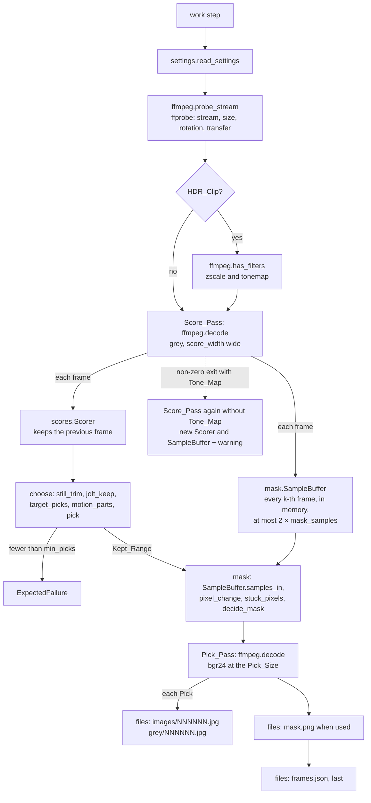

# Design Document: frames

## Overview

This spec builds the Frames_Step in `splatpipe/frames/`, the first entry of the Step_List. It reads the Used_Part of the Job's video twice through the ffmpeg command line tool. The Score_Pass gives small grey Score_Frames, which the step scores, keeping a thinned set of them in memory for the Mask. The step then cuts the still ends, drops the jolted frames, picks frames spread over the camera's movement and finds the pixels stuck to the camera. The Pick_Pass gives the Picks in colour, which the step saves as JPEGs with their grey copies. Last, it writes `mask.png` when it uses a Mask, and `frames.json`.

The code is split in two layers:

- **Pure maths** (`scores.py`, `choose.py`, `mask.py`): numpy and OpenCV functions on arrays, and two small classes that take frames one at a time, the `Scorer` and the `SampleBuffer`. They run no tool and touch no file, so every rule is tested on tiny synthetic frames on a laptop.
- **I/O** (`ffmpeg.py`, `files.py`): ffprobe, ffmpeg and the files in the Work_Folder. Each tool call is a small function with a pure part (the command, the parsing) that is tested without the tool.

`__init__.py` ties the two together inside the Step_Runner's contract, like the Fake_Step.

### Decisions on the open choices

| Choice | Decision |
|---|---|
| How the colour transfer is read (A7) | The Frames_Step runs its own ffprobe call, in `splatpipe/frames/ffmpeg.py`. `splatpipe/probe.py` stays as it is. The step needs more than the colour transfer: the stream's index, width, height, rotation and sample aspect ratio, which the Job_Maker doesn't need. Its messages must also name `ffprobe_timeout_seconds` in `[frames]` (Req 1.9), while `probe_video`'s name `[jobs]`. So the Skeleton, `make.py` and their tests don't change. The cost is one more ffprobe run per Job, well under a second. |
| Where the fractional seconds go (A11) | In `frames.json` as float seconds: the seconds cut at each end, the Kept_Range's start and end, each Pick's Frame_Time, and the Mask_Coverage as a share from 0 to 1. The Frames_Report holds only whole-number frame counts, `mask_used` as 1 or 0, and the four timings. No millisecond counts, and no numbers hidden in warning text. |
| Reading each frame's time next to its pixels | ffmpeg writes raw frames to stdout and runs `showinfo=checksum=0` as the last filter, which logs each frame's `pts_time` on stderr. A thread reads stderr line by line, so ffmpeg never blocks on it. The k-th frame on stdout pairs with the k-th showinfo line. `-fps_mode passthrough` stops ffmpeg from repeating or dropping frames (Req 1.5). This needs ffmpeg 5.1 or newer (D5), which the Pipeline_Doc states for the machine image (Req 12.8). |
| Frame_Times that don't increase (Req 1.6) | The Frame_Gate drops a frame whose time is missing (`NOPTS`) or isn't after the last kept frame's time, in both passes. A dropped frame isn't a Score_Frame and isn't counted in `decoded_frames`. The step never invents a time. |
| The Used_Part's edges | ffmpeg gets `-ss` and `-to` as input options, with the start rounded down and the end rounded up to the microsecond. So ffmpeg's cut always holds the Used_Part. The Frame_Gate then makes the exact cut, start ≤ Frame_Time < end (Req 1.4). Frame_Time = the `-ss` value + ffmpeg's `pts_time`. Without `-copyts`, that's the time from the start of the file, the clock players show and the Trim uses. |
| Exact frame sizes | The step works out the Displayed_Shape, the Score_Frame's size and the Pick_Size in Python, and gives ffmpeg `scale=W:H,setsar=1`. So every frame on the pipe has a known byte count, whatever the rotation or aspect ratio, and the Mask's sizes are known before ffmpeg runs. |
| Mask_Samples with bounded memory (Req 1.12, 7.1, A15) | The Mask_Samples depend on the Kept_Range, which is known only after the whole Score_Pass. So the Score_Pass feeds each Score_Frame to a `SampleBuffer` as well as to the `Scorer`. The buffer keeps every k-th Score_Frame by Frame_Number in memory, from Frame_Number 0 and with k = 1 to start. Whenever it holds more than 2 × `mask_samples` frames, it drops every other one and doubles k. After the Still_Trim, the Mask_Samples are the buffered frames inside the Kept_Range, thinned to at most `mask_samples`. Nothing goes to disk, so the Work_Folder only ever holds the A10 layout. For a portrait 16:9 video the worst case is 480 frames of 320 × 569 pixels at one byte each, about 87 MB, and that's the step's largest use of memory. The cost, which A15 accepts, is that there are about 240 samples rather than exactly 240, fewer when the Still_Trim cuts a large share of the Used_Part, and that they aren't exactly even over the Kept_Range. `SampleBuffer` lives in `mask.py`, because only the Mask uses it. It's numpy only, with no I/O. |
| Tone_Map and scaling order | Each pass scales first, then tone maps, then converts: `scale=W:H,setsar=1,<Tone_Map>,format=gray` or `format=bgr24`. The float tone map then runs at 320 px or at the Pick_Size, not at 4K. Both passes use the same order, so each Pick shows the same view as its Score_Frame (Req 1.7). |
| Tone_Map numbers (A13) | `tonemap_npl` and `tonemap_desat` are Shared_Settings in `[frames]`. `settings.py` checks them with the other settings, and `ffmpeg.tone_map_filter` writes them into the Tone_Map's filter text. The `hable` curve and the BT.709 names stay in code as Fixed_Constants. |
| zscale missing (Req 2.4, O1) | Before the Score_Pass of an HDR_Clip, the step runs `ffmpeg -hide_banner -filters` once and looks for `zscale` and `tonemap`. When either is missing, both passes run without the Tone_Map and the report gets the Req 2.4 warning. So the step works whatever O1's answer is. If Samarth doesn't OK zimg, the machine image's ffmpeg is built without libzimg, every HDR_Clip takes the warning path, and nothing in the code changes. The Homebrew ffmpeg on our laptops has no zscale today, so laptop runs take that path too. |
| Matching the Pick_Pass to the Score_Pass | By Frame_Time. Both passes run the same input options and the same filters up to the size and format, so ffmpeg gives the same frames with the same `pts_time` text, and so the same floats. The Pick_Pass saves the first frame whose Frame_Time is a Pick's. A Pick it never sees is the Req 8.9 failure. |
| JPEG and PNG writing | `cv2.imencode` makes the bytes and `Path.write_bytes` writes them. So a full disk is an `OSError` with its reason, which the step turns into the Req 8.10 message. cv2 never reads or writes video. |
| How tests replace the tools | `__init__.py` reads the module constant `TOOLS`, a `Tools` holding the three tool functions. Step tests `monkeypatch` it with stand-ins that give synthetic frames. Tests of `ffmpeg.py` itself `monkeypatch` `subprocess.run` and `subprocess.Popen` as `ffmpeg.py` sees them. |
| scipy | The clean-export spec decides scipy. This spec adds only numpy and `opencv-python-headless` (A12). |

## Architecture



### Module layout

| File | What it holds | Imports |
|---|---|---|
| `splatpipe/frames/__init__.py` | `run()`, `work()`, `Tools`, `TOOLS`, the Fixed_Constants for the HDR transfers, and the step's flow: the passes, the counts, the warnings and the failures. | stdlib, numpy, `splatpipe.errors`, `splatpipe.step`, the modules below |
| `splatpipe/frames/__main__.py` | `main(argv)`, which calls `step_main("frames", "splatpipe.frames", argv)`. | stdlib, `splatpipe.step` |
| `splatpipe/frames/settings.py` | `FramesSettings` and `read_settings()`, the checks of Req 9.6 and 9.7. | stdlib, `splatpipe.errors` |
| `splatpipe/frames/scores.py` | Pure: `sharpness()`, `motion()`, `contrast()`, `Scores`, `Scorer`, `score_shape()` and `pick_size()`. | numpy, cv2 |
| `splatpipe/frames/choose.py` | Pure: `window_bounds()`, `still_trim()`, `jolt_keep()`, `target_picks()`, `motion_parts()` and `pick()`. | numpy |
| `splatpipe/frames/mask.py` | Pure: `SampleBuffer`, `spread()`, `pixel_change()`, `stuck_pixels()`, `MaskChoice`, `decide_mask()` and `mask_image()`. | numpy |
| `splatpipe/frames/ffmpeg.py` | I/O and its pure parts: `VideoInfo`, `parse_stream()`, `probe_stream()`, `parse_filters()`, `has_filters()`, `seek_text()`, `TONE_MAP`, `ToneMap`, `tone_map_filter()`, `DecodePlan`, `decode_command()`, `parse_frame_time()`, `FrameGate`, `DecodeFailed` and `decode()`. | stdlib, numpy, `splatpipe.errors` |
| `splatpipe/frames/files.py` | I/O and its pure parts: the Work_Folder names (Fixed_Constants), `pick_name()`, `grey_copy()`, `write_jpeg()`, `write_png()`, `frames_record()` and `write_record()`. | stdlib, numpy, cv2, `splatpipe.errors`, `splatpipe.jsonio` |

The pure modules import no `subprocess`, no `pathlib` and no `splatpipe` module. Every file in the package imports only the standard library, numpy, cv2 and `splatpipe` (Req 9.9), and `tests/test_imports.py` checks it (Req 13.10).

## Components and Interfaces

### The step's flow (`__init__.py`)

```python
HDR_TRANSFERS = ("arib-std-b67", "smpte2084")  # Fixed_Constants: HLG and PQ, as ffprobe names them

@dataclass(frozen=True)
class Tools:
    probe: Callable[[Path, float], VideoInfo]                       # ffmpeg.probe_stream
    has_filters: Callable[[Collection[str], float], bool]           # ffmpeg.has_filters
    decode: Callable[[DecodePlan, float, Callable[[float, np.ndarray], None]], None]  # ffmpeg.decode

TOOLS = Tools(probe=probe_stream, has_filters=has_filters, decode=decode)

def run(job_id: str, preset: str | None = None, *, config: Config | None = None) -> dict[str, Any]
def work(step: StepContext) -> None
```

`run` calls `run_step("frames", "splatpipe.frames", job_id, preset=preset, config=config)`, like the Fake_Step. `work(step)` reads `TOOLS` when it's called, so a test's `monkeypatch` is seen through `run_step` and the CLI. It works in this order:

1. **Settings.** `cfg = read_settings(step.settings, step.name, step.preset)`. A missing key raises the Step_Runner's own `PipelineError` through `StepSettings.__missing__` (Req 9.5). A bad value raises `ExpectedFailure` (Req 9.6, 9.7). Nothing has run yet.
2. **Probe** (`with step.timed("probe")`). `info = TOOLS.probe(step.job.video_path, cfg.ffprobe_timeout_seconds)`. Then `score_w, score_h = score_shape(info.width, info.height, cfg.score_width)` and `pick_w, pick_h = pick_size(info.width, info.height, cfg.long_edge)`. The counts `pick_width` and `pick_height` are added here. When `info.colour_transfer in HDR_TRANSFERS`, `TOOLS.has_filters(("zscale", "tonemap"), cfg.ffprobe_timeout_seconds)` decides whether the Tone_Map can run. When it can, `tone_map = ToneMap(cfg.tonemap_npl, cfg.tonemap_desat)` (Req 2.2, A13). When it can't, `tone_map` is `None` and the Req 2.4 warning is added. Every other video gets `None` too (Req 2.3).
3. **Score_Pass** (`with step.timed("score_pass")`). A new `Scorer` and a new `SampleBuffer(cfg.mask_samples)` take each frame. The pass's `on_frame(time, frame)` calls `scorer.add(time, frame)`, then `buffer.add(frame)`, and keeps nothing itself. If the pass ran with the Tone_Map and raises `DecodeFailed`, the step adds the Req 2.5 warning with the error's last line, sets `tone_map` to `None`, and runs the pass again with a new `Scorer` and a new `SampleBuffer`, so nothing from the failed pass is kept (Req 2.5, 2.6). Any other `DecodeFailed` goes up as the Req 1.10 failure. With no Score_Frame, the step fails with the Req 1.11 message. Then `decoded_frames` is added.
4. **Choose** (`with step.timed("choose")`). In order:
   1. `kept = still_trim(times, motions, end_seconds, ...)`. Adds `still_start_frames`, `still_end_frames` and `kept_frames`.
   2. `n = target_picks(kept_seconds, cfg)`. Adds `target_picks`.
   3. `keep = jolt_keep(times[a:b+1], sharpness[a:b+1], ...)`. When `keep.sum() < n`, the Candidates are the whole Kept_Range, `jolt_dropped_frames` is 0 and the Req 5.3 warning is added. Otherwise the Candidates are the kept frames and `jolt_dropped_frames` is the number dropped.
   4. `parts = motion_parts(...)`, then `picks = pick(parts, candidates, sharpness)`. Adds `picks`.
   5. When `len(picks) < cfg.min_picks`, the step fails with the Req 6.10 message. No Pick_Pass runs, and no Colour_Pick, Grey_Copy, Mask or Frames_Record exists yet (Req 6.9).
   6. `samples = [frame for _, frame in buffer.samples_in(kept.first, kept.last)]` gives the Mask_Samples (Req 7.1), and `choice = decide_mask(samples, ...)` decides the Mask (Req 7.2–7.7). Adds `mask_samples`, `mask_pixels` and `mask_used`.
5. **Pick_Pass** (`with step.timed("pick_pass")`). It makes `images/` and `grey/`, then decodes at the Pick_Size in `bgr24` with the Score_Pass's `tone_map`, the same `ToneMap` or `None`. Each frame whose Frame_Time is a Pick's is saved as its Colour_Pick and its Grey_Copy, once. When fewer Picks were saved than chosen, the step fails with the Req 8.9 message.
6. **Mask and record.** When the Mask is used, `write_png(work/frames/mask.png, mask_image(...))`. Then `write_record(work/frames/frames.json, frames_record(...))`, last of all (Req 8.7).

Steps 3 and 4 run in one helper, which gives back the Scores, the Kept_Range, the Picks and the `MaskChoice` but not the `SampleBuffer`. So the buffered frames are freed before the Pick_Pass, which holds one colour frame at a time (Req 1.12).

The step writes nothing before the Pick_Pass, so a run that fails before it leaves `work/frames/` empty. The step never writes to `out/` (Req 8.8). It relies on the Step_Runner emptying `work/frames/` before it runs (Req 11.11).

Every count is added with `int(...)` and every value bound for JSON is turned from a numpy type into `int`, `float` or `bool`, because `check_json_value` refuses numpy scalars (Req 10.4). Each count is added as soon as it's worked out, and `StepContext.timed` adds a timing only when its block finishes. So a failed report holds exactly what the step had worked out before it failed (Req 10.3).

The warnings, with the values filled in:

- Req 2.4: "The video is HDR (colour transfer `<transfer>`), but this ffmpeg has no zscale or tonemap filter, so the frames were read without tone mapping and the picks' colours may look flat. An ffmpeg built with zscale fixes the colours."
- Req 2.5: "The video is HDR (colour transfer `<transfer>`), but ffmpeg failed to tone map it (`<last line>`), so the frames were read without tone mapping and the picks' colours may look flat. An ffmpeg built with a working zscale fixes the colours."
- Req 5.3: "The jolt filter kept only `<k>` frames, fewer than the `<n>` picks this job aims for, so it was skipped and every kept frame could be picked."

### settings.py

```python
@dataclass(frozen=True)
class FramesSettings:
    score_width: int
    tonemap_npl: float       # the Tone_Map's nominal peak brightness, in nits (A13)
    tonemap_desat: float     # the Tone_Map's highlight desaturation, 0 for none (A13)
    still_motion: float
    motion_window_seconds: float
    min_still_seconds: float
    blip_seconds: float
    jolt_ratio: float
    jolt_window_seconds: float
    mask_samples: int
    mask_ratio: float
    mask_min_coverage: float
    mask_max_coverage: float
    jpeg_quality: int
    long_edge: int
    seconds_per_pick: float
    max_picks: int
    min_picks: int
    min_vcpus: int
    min_memory_gb: int
    ffmpeg_timeout_seconds: float
    ffprobe_timeout_seconds: float
    base_picks: int          # the Preset_Setting

def read_settings(settings: Mapping[str, Any], section: str, preset: str) -> FramesSettings
```

- It reads each key with `settings[key]`, so a missing key raises the Step_Runner's message (Req 9.5).
- Each kind has one check, and a refusal names the key, the table (`[frames]`, or `[frames.<preset>]` for `base_picks`) and what the value must be (Req 9.6):
  - whole number above 0: `type(v) is int and v > 0`
  - whole number of 2 or more: `mask_samples`
  - whole number from 1 to 100: `jpeg_quality`
  - number above 0: `type(v) in (int, float) and v > 0`, then `float(v)`. `tonemap_npl` is one of these.
  - number of 0 or more: `tonemap_desat`, with the same check but `v >= 0`
  - number from 0 to 1: `jolt_ratio`, `mask_ratio`, `mask_min_coverage` and `mask_max_coverage`, both ends included
  - `type(v)` is checked exactly, so a bool is never a number. Config already refuses NaN and infinity.
- `tonemap_npl` and `tonemap_desat` are checked for every video, before ffprobe runs, even though only an HDR_Clip uses them, so a bad value fails the same way on every Job.
- Then it refuses `mask_min_coverage > mask_max_coverage`, `min_picks > base_picks` and `base_picks > max_picks`, naming both settings and their values (Req 9.6, 9.7).
- `min_vcpus` and `min_memory_gb` are checked and kept but never used: they're for the cloud spec (Req 9.10).

### scores.py (pure)

```python
def sharpness(frame: np.ndarray) -> float   # variance of cv2.Laplacian(frame, cv2.CV_64F)
def motion(previous: np.ndarray | None, frame: np.ndarray) -> float
def contrast(frame: np.ndarray) -> float

@dataclass(frozen=True)
class Scores:
    times: np.ndarray       # float64, Frame_Time, strictly increasing
    sharpness: np.ndarray   # float64
    motion: np.ndarray      # float64, motion[0] == 0
    contrast: np.ndarray    # float64

class Scorer:
    def add(self, time: float, frame: np.ndarray) -> None
    def result(self) -> Scores

def score_shape(width: int, height: int, score_width: int) -> tuple[int, int]
def pick_size(width: int, height: int, long_edge: int) -> tuple[int, int]
```

- A frame is a 2-D `uint8` array, brightness 0 to 255.
- `sharpness` uses OpenCV's 3×3 Laplacian (`ksize=1`) with its default border, which is a Fixed_Constant, and returns `float(lap.var())`. A variance is never negative.
- `motion` is 0 when `previous` is `None` (Req 3.4). Otherwise it's `np.abs(frame.astype(np.int16) - previous).sum(dtype=np.int64) / frame.size`. The sum is an exact integer, so the result is never above 255.
- `contrast` takes `h = np.bincount(frame.ravel(), minlength=256)`, `s1 = h @ v` and `s2 = h @ v²` as Python ints, and returns `math.sqrt(n·s2 − s1²) / n`. The numerator is exact, so a frame that's half 0 and half 255 gives exactly 127.5 and no frame gives more (Req 3.7).
- `Scorer.add` scores the frame against the frame before, then keeps a reference to this frame alone. It appends the four numbers to Python lists. So it holds at most two frames, its own previous one and the caller's current one, whatever the stream's length (Req 1.12). `result()` gives the lists as arrays.
- `score_shape` gives `(score_width, max(1, round_half_up(height × score_width / width)))`, worked out in integers (Req 3.1). A video narrower than `score_width` is scaled up for scoring. Only the Picks are never scaled up.
- `pick_size` gives `(width, height)` when `max(width, height) <= long_edge`. Otherwise the long edge becomes `long_edge` and the short edge `max(1, round_half_up(short × long_edge / long))`, in integers (Req 8.1).

### choose.py (pure)

```python
def window_bounds(times: np.ndarray, seconds: float) -> tuple[np.ndarray, np.ndarray]
def still_trim(times: np.ndarray, motion: np.ndarray, end: float, *, still_motion: float,
               window_seconds: float, min_still_seconds: float, blip_seconds: float) -> Kept
def jolt_keep(times: np.ndarray, sharpness: np.ndarray, *, ratio: float,
              window_seconds: float) -> np.ndarray          # bool, one per Kept_Range frame
def target_picks(kept_seconds: float, *, base_picks: int, seconds_per_pick: float,
                 max_picks: int) -> int
def motion_parts(times: np.ndarray, motion: np.ndarray, kept_end: float, n: int) -> np.ndarray
def pick(parts: np.ndarray, candidates: np.ndarray, sharpness: np.ndarray) -> np.ndarray

@dataclass(frozen=True)
class Kept:
    first: int                    # a: the Kept_Range's first Frame_Number
    last: int                     # b: its last, inclusive
    start_seconds: float          # times[a]
    end_seconds: float            # times[b + 1], or `end` when b is the last frame
    cut_start_seconds: float      # the Still_Start's length when cut, else 0.0
    cut_end_seconds: float        # the Still_End's length when cut, else 0.0
```

- **Windows (A2).** For frame i and a length L, with `h = L / 2`, the Window is every j with `times[i] - h <= times[j] <= times[i] + h`. `window_bounds` gives `lo = searchsorted(times, times - h, "left")` and `hi = searchsorted(times, times + h, "right")`, the same comparisons. The frame itself is always inside.
- **Still_Trim (Req 4).**
  1. `still[i] = float(np.mean(motion[lo[i]:hi[i]])) < still_motion`, over the whole Used_Part.
  2. Each maximal run of frames that aren't still, from p to q, lasts `t[q+1] − t[p]`, or `end − t[p]` when q is the last frame. A run shorter than `blip_seconds` is a Blip and counts as still. The others are the Moving_Stretches (A1).
  3. With no Moving_Stretch, the Kept_Range is every frame and nothing is cut (Req 4.7).
  4. Otherwise let p₁ be the first Moving_Stretch's first frame and q_k the last one's last frame. The Still_Start lasts `t[p₁] − t[0]`. When that's at least `min_still_seconds`, a = p₁, else a = 0. The Still_End lasts `end − t[q_k + 1]`, or 0 when q_k is the last frame. When that's at least `min_still_seconds`, b = q_k, else b = n − 1 (Req 4.4–4.6).

  a ≤ p₁ ≤ q_k ≤ b, so the Kept_Range is one Stretch with at least one frame and holds every Moving_Stretch (Req 4.8, 4.9). Kept_Seconds is `end_seconds − start_seconds`.
- **Jolt_Filter (Req 5.1).** `keep[i] = sharpness[i] >= ratio * float(np.median(sharpness[lo[i]:hi[i]]))`, with windows over the Kept_Range only. When every Sharpness is 0, every frame is kept.
- **Target_Picks (Req 6.1, A3).** `min(max_picks, max(base_picks, math.ceil(kept_seconds / seconds_per_pick)))`. 240 s with `fast` gives 120 and 420 s gives 210 (Req 6.2).
- **Motion_Parts (Req 6.3, 6.4).** The Motion_Position of Kept_Range frame k is `pos[k] = sum(motion[1..k])` of the Kept_Range's frames, so `pos[0] = 0`, and the total is `pos[-1]`. When the total is above 0, `part = min(n − 1, floor(pos × n / total))`. When it's 0, the same formula runs on `times − times[0]` with the total `kept_end − times[0]`, which is above 0 because every Frame_Time is before the Used_Part's end. Multiplying and dividing by positive numbers and `floor` never break the order, so the parts never go down along the Kept_Range, the first frame is in part 0, and when the total is above 0 the last frame is in part n − 1.
- **Picker (Req 6.5–6.7).** `pick` walks the Candidates in Frame_Number order and keeps, for each part, the first Candidate with the highest Sharpness, replacing it only on a strictly higher one. A part with no Candidate gives nothing. It returns the chosen Frame_Numbers in order, which is Frame_Time order because the parts never go down. So there are at most n Picks, all different (Req 6.8).

### mask.py (pure)

```python
class SampleBuffer:
    def __init__(self, samples: int) -> None      # samples: mask_samples, 2 or more
    def add(self, frame: np.ndarray) -> None      # the next Score_Frame, in Frame_Number order
    @property
    def stride(self) -> int                       # k: 1, 2, 4, ...
    @property
    def numbers(self) -> list[int]                # the Frame_Numbers it holds, increasing
    def samples_in(self, first: int, last: int) -> list[tuple[int, np.ndarray]]

def spread(count: int, samples: int) -> list[int]                   # the places to keep
def pixel_change(frames: Sequence[np.ndarray]) -> np.ndarray | None  # float64, None with < 2
def stuck_pixels(change: np.ndarray, ratio: float) -> np.ndarray     # bool
@dataclass(frozen=True)
class MaskChoice:
    samples: int                  # how many Mask_Samples
    stuck: np.ndarray | None      # bool at the Score_Frame's size, None with < 2 samples
    coverage: float               # Mask_Coverage, 0.0 with < 2 samples
    used: bool
def decide_mask(frames: Sequence[np.ndarray], *, ratio: float,
                min_coverage: float, max_coverage: float) -> MaskChoice
def mask_image(stuck: np.ndarray, width: int, height: int) -> np.ndarray   # uint8, 0 and 255
```

- **`SampleBuffer`** (Req 1.12, A15) holds a list of `(Frame_Number, frame)` pairs, a count of the frames it has been given, and k, from 1. With m = `samples`:
  - `add` gives the frame the next Frame_Number, n, from 0. The Score_Pass gives it every Score_Frame in order, as it gives the `Scorer`, so n is the frame's own Frame_Number. When n is a multiple of k, it appends the pair. When the list then holds more than 2m pairs, it keeps every other pair from the first (`held[::2]`) and doubles k. The one pair over 2m in that moment is the current frame, so the step still holds no more than the frame before, the current frame and 2m buffered frames.
  - That keeps the rule exact. Just before a halving, the list holds the 2m + 1 multiples of k from 0 to n, so n = 2m·k. Keeping every other one from the first leaves the multiples of 2k up to n, n included, which are m + 1 pairs. So after every `add`, with N frames given, the list holds exactly the multiples of k below N: all N frames while N ≤ 2m, and m + 1 to 2m frames after that. `stride` gives k.
  - It keeps a reference to each frame it holds and never copies one, so it relies on `decode` giving a new array for every frame.
  - `samples_in(first, last)` (Req 7.1) takes the c pairs whose Frame_Number is from `first` to `last`, in order. It gives all of them when c ≤ m, and otherwise the m pairs at the places `spread(c, m)`.
- **`spread(count, samples)`** gives every place from 0 to `count − 1` when `count <= samples`. Otherwise, with c = `count` and m = `samples`, it gives `(i·(c − 1) + (m − 1) // 2) // (m − 1)` for i from 0 to m − 1. That's round-half-up in integers. The first place is 0 and the last is c − 1. The places all differ because each step, (c − 1)/(m − 1), is more than 1, and the gaps between neighbours differ by at most 1.
- `pixel_change` (Req 7.2) adds up `|next − previous|` as int32 over each pair of neighbouring samples and divides by the number of pairs.
- `stuck_pixels` (Req 7.3) is `change < ratio * float(np.median(change))`. When the median is 0, as in a still scene, no pixel is stuck.
- `decide_mask` (Req 7.4, 7.5, 7.7): `MaskChoice.samples` is `len(frames)`. With fewer than 2 samples it gives no Mask and a coverage of 0. Otherwise the coverage is `float(stuck.mean())`, and `used` is `min_coverage <= coverage <= max_coverage`. Nothing grows, shrinks or smooths the stuck pixels (Req 7.6).
- `mask_image` (Req 7.8) makes the image at the Pick_Size, which may be larger or smaller than the Score_Frame. Output pixel (x, y) takes the Score pixel `((2y + 1)·sh // (2·ph), (2x + 1)·sw // (2·pw))`, the one whose area holds the output pixel's centre. Stuck pixels become 0 and the others 255. The index maps are integer arrays, so there's no interpolation and no other value.

### ffmpeg.py (I/O)

```python
@dataclass(frozen=True)
class VideoInfo:
    stream_index: int            # ffprobe's index of the first video stream that isn't cover art
    width: int                   # the Displayed_Shape: rotation and aspect ratio applied
    height: int
    colour_transfer: str | None  # as ffprobe reports it, None when it reports none

def parse_stream(data: object) -> VideoInfo
def probe_stream(path: Path, timeout_seconds: float) -> VideoInfo
def parse_filters(text: str) -> frozenset[str]
def has_filters(names: Collection[str], timeout_seconds: float) -> bool
def seek_text(seconds: float, *, up: bool) -> str

# Fixed_Constants: the Tone_Map's filters, with the hable curve and BT.709. Config gives npl and desat.
TONE_MAP = ("zscale=t=linear:npl={npl},format=gbrpf32le,zscale=p=bt709,"
            "tonemap=tonemap=hable:desat={desat},zscale=t=bt709:m=bt709:r=tv,format=yuv420p")

@dataclass(frozen=True)
class ToneMap:
    npl: float                   # tonemap_npl
    desat: float                 # tonemap_desat

def tone_map_filter(tone_map: ToneMap) -> str

@dataclass(frozen=True)
class DecodePlan:
    video: Path
    stream_index: int
    start: float                 # the Used_Part, from the Job_Record
    end: float
    width: int                   # the frame size on the pipe
    height: int
    colour: bool                 # bgr24 when True, gray when False
    tone_map: ToneMap | None     # None: decode without the Tone_Map

def decode_command(plan: DecodePlan) -> list[str]
def parse_frame_time(line: str) -> float | None | NotAFrame
class FrameGate:
    def __init__(self, start: float, end: float) -> None
    def accept(self, time: float | None) -> bool
class DecodeFailed(ExpectedFailure):
    last_line: str
def decode(plan: DecodePlan, timeout_seconds: float,
           on_frame: Callable[[float, np.ndarray], None]) -> None
```

- **`probe_stream`** runs `["ffprobe", "-v", "error", "-print_format", "json", "-show_streams", "file:" + str(path.resolve())]` with `subprocess.run(..., capture_output=True, stdin=subprocess.DEVNULL, timeout=timeout_seconds)` (Req 1.3). `FileNotFoundError`, `TimeoutExpired`, a non-zero exit and unreadable output each raise `ExpectedFailure` (Req 1.8–1.10). The timeout message names `ffprobe_timeout_seconds` in `[frames]`.
- **`parse_stream`** takes the first stream with `codec_type == "video"` whose `disposition.attached_pic` isn't 1, as `probe.py` does.
  - `width` and `height` must be ints above 0.
  - A `sample_aspect_ratio` of `N:M` with both above 0 multiplies the width by N/M, rounded half up. `0:1`, `N/A` or a missing one counts as square.
  - The rotation is the first `rotation` in `side_data_list`, else `tags.rotate`, else 0. Width and height swap when `abs(rotation % 180 - 90) < 1`, which is when ffmpeg's own autorotate turns the picture on its side.
  - `colour_transfer` is `color_transfer` when it's a non-empty string, else `None`.
  - A stream without a usable size is an `ExpectedFailure` that says ffprobe found no picture size and to check that the video plays.
- **`has_filters`** runs `["ffmpeg", "-hide_banner", "-nostdin", "-filters"]` with the same `subprocess.run` options and `ffprobe_timeout_seconds` as its limit, since it's a quick query like ffprobe. `parse_filters` takes the second word of each filter line. ffmpeg missing raises the Req 1.8 failure. A timeout or a non-zero exit means "no", so the step warns and goes on without the Tone_Map.
- **`seek_text`** writes seconds with exactly six decimals, never in exponent form, rounding down for the start and up for the end. So ffmpeg's cut always holds the Used_Part, within one microsecond.
- **`decode_command`** gives:

  ```
  ffmpeg -nostdin -hide_banner -nostats -loglevel info
         -ss <seek_text(start)> -to <seek_text(end, up=True)> -i file:<absolute path>
         -map 0:<stream_index> -an -sn -dn
         -vf scale=<W>:<H>,setsar=1[,<tone_map_filter(plan.tone_map)>],format=<gray|bgr24>,showinfo=checksum=0
         -fps_mode passthrough -f rawvideo pipe:1
  ```

  ffmpeg's autorotation stays on, so both passes turn the picture the same way (Req 1.7). The Tone_Map part is there only when `plan.tone_map` isn't `None`.
- **`tone_map_filter`** fills `TONE_MAP`'s `{npl}` with `tonemap_npl` and its `{desat}` with `tonemap_desat` (Req 2.2, A13). The rest of `TONE_MAP`, the `hable` curve and the BT.709 names, is a Fixed_Constant. Each number is written as `repr(float(value))`, like `100.0`, `0.25` or `1e-05`. ffmpeg reads that as a plain number, and it never holds the `:` or `,` that would end a filter option. With the values in `config.toml` it gives:

  ```
  zscale=t=linear:npl=100.0,format=gbrpf32le,zscale=p=bt709,tonemap=tonemap=hable:desat=0.0,zscale=t=bt709:m=bt709:r=tv,format=yuv420p
  ```
- **`parse_frame_time`** reads a line that starts with the `Parsed_showinfo_<n>` log context and holds `n:`, `pts:` and `pts_time:`. It gives the `pts_time` as a float, `None` for `NOPTS`, or `NOT_A_FRAME` for every other line, like showinfo's config and side data lines.
- **`FrameGate`** works out each Frame_Time as `float(seek_text(start)) + pts_time`. It accepts a time when it isn't `None`, is at or after `start`, is before `end`, and is after the last time it accepted (Req 1.4, 1.6). It keeps only that last time.
- **`decode`**:
  1. Starts `subprocess.Popen(command, stdin=DEVNULL, stdout=PIPE, stderr=PIPE)`. `FileNotFoundError` raises the Req 1.8 failure for ffmpeg.
  2. Starts a daemon thread that reads stderr line by line, decoded as UTF-8 with `errors="replace"`. It puts each frame time on a `queue.Queue` and keeps the last non-empty line that isn't a showinfo line. At the end of stderr it puts an end marker.
  3. Starts a `threading.Timer(timeout_seconds, kill)` that marks the run as timed out and kills ffmpeg.
  4. Reads exactly `W × H × channels` bytes at a time from stdout. For each full frame it takes the next time from the queue. When the gate accepts the time, it calls `on_frame(time, np.frombuffer(data, np.uint8).reshape(...))`. Each frame is a new array over its own `bytes`, which `decode` never reuses, so `on_frame` may keep it, as the `Scorer` and the `SampleBuffer` do. `decode` itself holds one frame at a time (Req 1.12).
  5. In a `finally` block it cancels the timer, kills ffmpeg if it's still running, waits for it, joins the thread and closes the pipes. An exception from `on_frame`, like a failed JPEG write, goes up after this cleanup.
  6. A timeout wins over every error it causes and raises the Req 1.9 failure naming `ffmpeg_timeout_seconds` in `[frames]`. A non-zero exit raises `DecodeFailed` with the last line (Req 1.10). A frame without a showinfo line, or output that ends inside a frame, raises `ExpectedFailure` saying ffmpeg's output couldn't be read and to install ffmpeg 5.1 or newer (Req 1.14, D5).

### files.py (I/O)

```python
IMAGES, GREY = "images", "grey"            # Fixed_Constants (A10): the contract with the camera solve
RECORD, MASK = "frames.json", "mask.png"

def pick_name(number: int) -> str          # f"{number:06d}.jpg"
def grey_copy(bgr: np.ndarray) -> np.ndarray         # cv2.equalizeHist(cv2.cvtColor(bgr, BGR2GRAY))
def write_jpeg(path: Path, image: np.ndarray, quality: int) -> None
def write_png(path: Path, image: np.ndarray) -> None
def frames_record(...) -> dict[str, Any]              # pure: the Frames_Record, plain JSON types
def write_record(path: Path, record: dict[str, Any]) -> None
```

- `write_jpeg` and `write_png` encode with `cv2.imencode(".jpg", image, [cv2.IMWRITE_JPEG_QUALITY, quality])` or `cv2.imencode(".png", image)` and write with `Path.write_bytes`. An `OSError` raises `ExpectedFailure` naming the file and `error.strerror`, like "No space left on device" (Req 8.10). So does a failed encode.
- `write_record` calls `splatpipe.jsonio.write_json` and turns an `OSError` into the same failure.

## Data Models

### The Work_Folder (A10)

```
work/frames/
  images/000000.jpg ...   the Colour_Picks, at the Pick_Size, JPEG at jpeg_quality
  grey/000000.jpg ...     the Grey_Copies: same names and size, grey, histogram-equalised
  mask.png                the Mask, only when the step uses one
  frames.json             the Frames_Record, written last
```

The step writes nothing else there, and nothing at all before the Pick_Pass: the Mask_Samples stay in memory. A Work_Folder without `frames.json` is unfinished, whatever else it holds.

### `work/frames/frames.json` (the Frames_Record)

```json
{
  "colour_transfer": "arib-std-b67",
  "tone_mapped": false,
  "still_start_seconds": 2.4,
  "still_end_seconds": 0.0,
  "kept_start_seconds": 3.9,
  "kept_end_seconds": 61.2,
  "target_picks": 120,
  "jolt_filter_skipped": false,
  "pick_width": 1600,
  "pick_height": 900,
  "mask_coverage": 0.0131,
  "mask_used": true,
  "mask_file": "mask.png",
  "picks": [
    {"number": 0, "file": "000000.jpg", "frame_number": 117, "seconds": 3.9,
     "sharpness": 812.5, "motion": 2.1, "contrast": 48.0}
  ]
}
```

| Field | What it holds | Requirement |
|---|---|---|
| `colour_transfer` | ffprobe's `color_transfer`, or `null` when it reported none. | 2.7 |
| `tone_mapped` | Whether the Tone_Map ran in both passes. | 2.7 |
| `still_start_seconds`, `still_end_seconds` | The seconds the Still_Trim cut at each end, 0.0 when it cut nothing there. | 4.10 |
| `kept_start_seconds`, `kept_end_seconds` | The Kept_Range's start and end, measured as a Stretch is. | 4.10 |
| `target_picks` | Target_Picks. | 8.6 |
| `jolt_filter_skipped` | Whether the step skipped the Jolt_Filter. | 8.6 |
| `pick_width`, `pick_height` | The Pick_Size. | 8.6 |
| `mask_coverage` | The Mask_Coverage, from 0 to 1, at the Score_Frame's size. 0.0 with fewer than 2 Mask_Samples. | 7.9 |
| `mask_used` | Whether the step uses the Mask. | 7.9 |
| `mask_file` | `"mask.png"` when the Mask is used, else `null`. | 7.9 |
| `picks` | One object per Pick in Frame_Time order: `number`, `file` (its name in both `images/` and `grey/`), `frame_number`, `seconds` (its Frame_Time), `sharpness`, `motion` and `contrast`. | 3.6, 8.6 |

Every value is a plain `int`, `float`, `bool`, `str`, `None`, `list` or `dict`. Floats keep full precision, because the camera solve may match on `seconds`.

### The Frames_Report

The Step_Runner's ordinary report at `out/reports/frames.json` (Req 10.6). Its `settings` holds the 22 Shared_Settings and `base_picks`.

| Field | What it holds |
|---|---|
| `counts.decoded_frames` | Score_Frames in the Used_Part. |
| `counts.still_start_frames`, `counts.still_end_frames` | Frames the Still_Trim cut at each end. |
| `counts.kept_frames` | Frames in the Kept_Range. |
| `counts.jolt_dropped_frames` | Frames the Jolt_Filter dropped, 0 when it was skipped. |
| `counts.target_picks`, `counts.picks` | Target_Picks and the Picks made. |
| `counts.mask_samples`, `counts.mask_pixels`, `counts.mask_used` | The Mask_Samples, the Stuck_Pixels at the Score_Frame's size, and 1 or 0. |
| `counts.pick_width`, `counts.pick_height` | The Pick_Size. |
| `timings.probe` | ffprobe, and the filter check for an HDR_Clip. |
| `timings.score_pass` | The Score_Pass, its second try included, with the scoring and the Sample_Buffer. |
| `timings.choose` | The Still_Trim, the Jolt_Filter, the Picker and the Mask, the choice of the Mask_Samples included. |
| `timings.pick_pass` | The Pick_Pass with its JPEG writes. |
| `warnings` | The Req 2.4, 2.5 and 5.3 warnings, when they apply. |

### The `[frames]` section of `config.toml`

Appended after `[fake.quality]`, with a comment above every key (Req 9.1–9.3):

```toml
[frames]
# Width of the small grey frames the step scores, in pixels.
score_width = 320
# Nominal peak brightness, in nits, that zscale maps an HDR video from. Only HDR videos use it.
tonemap_npl = 100
# How much tonemap desaturates the bright highlights of an HDR video. 0 turns it off.
tonemap_desat = 0.0
# Mean motion over the window below which a frame counts as still, from 0 to 255.
still_motion = 1.0
# Length of the window for the still test, in seconds.
motion_window_seconds = 1
# Shortest still start or still end that gets cut off, in seconds.
min_still_seconds = 2
# Moving parts shorter than this count as still, in seconds.
blip_seconds = 0.5
# A frame is jolted when its sharpness is below this share of the window's median.
jolt_ratio = 0.6
# Length of the window for the jolt test, in seconds.
jolt_window_seconds = 1
# Most frames used to find the pixels stuck to the camera.
mask_samples = 240
# A pixel is stuck when its change is below this share of the median change.
mask_ratio = 0.2
# Smallest share of the frame the stuck pixels must cover for the mask to be used.
mask_min_coverage = 0.002
# Largest share of the frame the stuck pixels may cover for the mask to be used.
mask_max_coverage = 0.25
# JPEG quality of the picks and their grey copies, from 1 to 100.
jpeg_quality = 95
# Longest edge of the picks, in pixels. A smaller video isn't scaled up.
long_edge = 1600
# Seconds of kept video per pick, when that gives more than the preset's base_picks.
seconds_per_pick = 2
# Most picks a job gets.
max_picks = 400
# Fewest picks a job can go on with.
min_picks = 30
# Fewest vCPUs the job's cloud machine needs for this step. The step never checks it.
min_vcpus = 16
# Least memory the job's cloud machine needs for this step, in GB. The step never checks it.
min_memory_gb = 16
# Longest time each of the two ffmpeg reads of the video may take, in seconds.
ffmpeg_timeout_seconds = 1800
# Longest time ffprobe, or ffmpeg listing its filters, may take, in seconds.
ffprobe_timeout_seconds = 30

[frames.fast]
# Fewest picks the step aims for.
base_picks = 120

[frames.default]
# Fewest picks the step aims for.
base_picks = 150

[frames.quality]
# Fewest picks the step aims for.
base_picks = 200
```

## Changes outside `splatpipe/frames/`

| File | Change | Requirement |
|---|---|---|
| `pyproject.toml` | `uv add numpy opencv-python-headless`. No scipy, which the clean-export spec decides, and no GPU package. | 9.8 |
| `docs/third-party-licences.md` | numpy and `opencv-python-headless` become "Yes", and scipy's row stays "Not yet". OpenCV's "How we use it" names the Laplacian, histogram equalisation and JPEG and PNG encoding of frames ffmpeg decoded, and says it never reads or writes video. The ffmpeg row says ffmpeg decodes the frames of the Used_Part and tone maps HDR video with `zscale` and `tonemap` when the ffmpeg build has both filters, so the row stays true whatever O1's answer is. A zimg row only after Samarth's OK (O1). | 12.6, 12.7 |
| `config.toml` | The `[frames]` section above. | 9.1–9.3 |
| `splatpipe/run.py` | `STEP_LIST = (StepEntry("frames", "splatpipe.frames", True),)`, with the comment saying the Frames_Step is the first entry and each later step spec adds its entry after it, in order. `_NO_STEPS` stays for a caller's empty list. | 11.3–11.5 |
| `tests/conftest.py` | `config_text` gains a `[frames]` section with its three Preset tables: all 22 Shared_Settings at the real values, `tonemap_npl = 100` and `tonemap_desat = 0.0` included, except `min_picks = 1`, `base_picks` 2, 3 and 4, and both timeouts at 60, so tiny clips pass. A `set_frames(**values)` fixture rewrites the test config with any of its keys changed, shared or per Preset. | 9.11 |
| `tests/test_run.py` | In `test_the_step_list_starts_empty_and_is_the_default_list`, renamed for the new list, `STEP_LIST == ()` becomes the D1 list. `test_an_empty_step_list_is_refused_before_out_changes`, which passes `steps=None` as well as `[]`, and the CLI test that expects "No steps are set up yet" set `splatpipe.run.STEP_LIST` to `()` with `monkeypatch`. The subprocess test of `python -m splatpipe.run --job ../x` expects "That isn't a job id." | 11.6 |
| `tests/test_imports.py` | The Step_List check's docstrings no longer say the list starts empty, and the check now loads `[frames]` for each Preset. A new test reads every `splatpipe/frames/*.py` and allows only `sys.stdlib_module_names`, numpy, cv2 and splatpipe. A dependency test reads `pyproject.toml` and `uv.lock` and finds numpy and `opencv-python-headless` as runtime dependencies, and no plain `opencv-python`, torch, gsplat, `nvidia-*` or `cuda-*` package. It neither needs nor refuses scipy, so the clean-export spec can decide scipy without changing this test. | 9.8, 11.7, 13.10 |
| `tests/test_docs.py` | The existing Step_List check finds `## Step: frames`. New tests check its five parts, the Step_Needs, the Work_Folder layout, the ffmpeg 5.1 line and the new "The step list" wording. | 11.8, 12.1–12.5, 12.8 |
| `docs/pipeline.md` | A `## Step: frames` section with the five parts, and "The step list" rewritten for D1. The section says the Job's machine image needs ffmpeg and ffprobe 5.1 or newer, because the step uses `-fps_mode`, and that Ubuntu 24.04's packaged ffmpeg, 6.1, is new enough (D5). | 12.1–12.5, 12.8 |
| `.kiro/specs/pipeline-core/requirements.md` | A note under Requirement 8, criterion 2 saying the frames spec added the first Step_List entry. The criterion's words stay. | 11.9 |

`splatpipe/probe.py`, `make.py`, `step.py` and the Fake_Step don't change.

## Error Handling

Every failure the requirements name is an `ExpectedFailure`, so the report's `error.expected` is `true` and `readable` is the step's own message (Req 11.10). No message holds a traceback.

| Where | Cause | Readable_Error says |
|---|---|---|
| Settings | A missing key | The Step_Runner's own message, naming `[frames]`, `[frames.<preset>]` and the key (Req 9.5). |
| Settings | A wrong kind of value | The key, its table and what it must be, like "`jpeg_quality` in [frames] is 0, but it must be a whole number from 1 to 100" or "`tonemap_desat` in [frames] is -0.5, but it must be a number of 0 or more" (Req 9.6). |
| Settings | `min_picks > base_picks`, `base_picks > max_picks`, or `mask_min_coverage > mask_max_coverage` | Both settings and their values (Req 9.6, 9.7). |
| Any tool | ffmpeg or ffprobe not installed | Which tool is missing, and to install ffmpeg, which includes ffprobe (Req 1.8). |
| ffprobe | Past `ffprobe_timeout_seconds` | The limit in seconds, and to raise `ffprobe_timeout_seconds` in [frames] (Req 1.9). |
| ffprobe | Non-zero exit | ffprobe's last stderr line, and to check that the video plays (Req 1.10). |
| ffprobe | Output that isn't the JSON we asked for | That ffprobe printed output we couldn't read, and to install a recent ffmpeg. |
| ffprobe | No video stream with a size | That ffprobe found no picture size, and to check that the video plays. |
| A Decode_Pass | Past `ffmpeg_timeout_seconds` | The limit, and to raise `ffmpeg_timeout_seconds` in [frames] (Req 1.9). |
| Score_Pass with the Tone_Map | Non-zero exit | Not a failure: a warning, then the pass again without the Tone_Map (Req 2.5). |
| A Decode_Pass | Non-zero exit otherwise | ffmpeg's last stderr line, and to check that the video plays (Req 1.10). |
| A Decode_Pass | A frame without a showinfo time, or output ending inside a frame | That ffmpeg's output couldn't be read, and to install ffmpeg 5.1 or newer (Req 1.14, D5). |
| Score_Pass | No Score_Frame in the Used_Part | That no frames could be read from the chosen part of the video, and to check that the video plays (Req 1.11). |
| Choose | Fewer Picks than `min_picks` | How many Picks the video gave and how many the step needs, and to film a longer video that moves slowly and steadily through the place, in good light, without long still parts (Req 6.10). |
| Pick_Pass | Fewer Picks saved than chosen | "ffmpeg gave back `<k>` of the `<n>` picks" (Req 8.9). |
| Any write | `OSError`, or an encode that fails | The file's path and the reason, like "No space left on device" (Req 8.10). |
| Anywhere | Any other exception | The Step_Runner's general bug message, `expected: false`. |

The step writes no file before the Pick_Pass, so a run that fails before it leaves `work/frames/` empty, with nothing to clean up. A failed run never leaves `frames.json`, because it's the last write.

## Correctness Properties

*A property is a characteristic or behavior that should hold true across all valid executions of a system-essentially, a formal statement about what the system should do. Properties serve as the bridge between human-readable specifications and machine-verifiable correctness guarantees.*

After the prework I merged some criteria into one property each:

- Req 3.3 and 3.5 fold into Property 1, the range property of Req 3.7.
- Req 1.6 folds into Property 3.
- Req 4.4, 4.5, 4.7 and 4.8 fold into Property 5, the property of Req 4.9.
- Req 6.6 folds into Property 8, and Req 6.7 into Property 9, the property of Req 6.8.
- The Sample_Buffer's rule in Req 1.12 and the choice of the Mask_Samples in Req 7.1 fold into Property 10, because the choice works on what the buffer holds.
- Req 7.3 to 7.7 fold into Property 11, the property of Req 7.11.

Target_Picks (Req 6.1) has no property, because one would only restate the formula. Its examples are unit tests. The setting checks (Req 9.6, 9.7) are parametrised examples, as config checks should be. The Tone_Map's filter text (Req 2.2) is a fixed template with two numbers in it, so examples check it. How many frames the step holds at once (Req 1.12, 13.7) is checked with `weakref`s on a long stream, as the Testing strategy says.

Each property is one Hypothesis test with at least 100 examples, tagged in its docstring as `Feature: frames, Property N: <title>`. Frames are small: at most 12 × 16 pixels and at most 60 frames, except Property 10's streams of up to 2,000 frames of 1 × 1. Times are drawn as running sums of gaps from 0.001 s to 2 s, so they strictly increase. Every oracle is written in the test with its own code and doesn't call the function it checks.

### Property 1: Scores stay in range

*For any* two `uint8` frames of the same shape, `motion(previous, frame)` is from 0 to 255 and equals the mean of `abs(frame − previous)` worked out in Python ints, `motion(None, frame)` is 0, `sharpness(frame)` is 0 or more, and `contrast(frame)` is from 0 to 127.5 and within 1e-9 of `numpy.std(frame)`.

Strategy: `hypothesis.extra.numpy.arrays(np.uint8, shapes)`, plus frames that are all 0, all 255, and half 0 and half 255, which gives exactly 127.5.

**Validates: Requirements 3.3, 3.4, 3.5, 3.7**

### Property 2: Frame sizes keep the shape and never grow a Pick

*For any* Displayed_Shape from 1 × 1 to 8000 × 8000 and any `score_width` and `long_edge` from 1 to 4000, `score_shape` gives exactly `score_width` and a height of at least 1 within 0.5 of `height × score_width / width`. `pick_size` gives a size no larger than the video in either edge, a long edge equal to `min(long_edge, the video's long edge)`, and a short edge of at least 1 within 0.5 of the proportional value. The size is the video's own when its long edge is at most `long_edge`. The test checks with `fractions.Fraction`.

**Validates: Requirements 3.1, 8.1**

### Property 3: The Frame_Gate keeps exactly the Used_Part, in order

*For any* Used_Part `start < end` and any sequence of reported times, each a float or `None`, in any order and with repeats, the times `FrameGate.accept` takes are exactly those that aren't `None`, are at or after `start`, are before `end`, and are greater than every time taken before them. So the taken times strictly increase and all lie in the Used_Part.

Strategy: times from `st.none() | st.floats(-10, 700)` mixed with `start`, `end` and repeats of earlier draws.

**Validates: Requirements 1.4, 1.6**

### Property 4: The seek text holds the Used_Part

*For any* finite float from 0 to 1e6, `seek_text(x, up=False)` and `seek_text(x, up=True)` are digits with one `.` and exactly six decimals, never an exponent. Read back as `Fraction`, the first is at most x and the second at least x, each within 1e-6 of x.

**Validates: Requirements 1.4**

### Property 5: The Still_Trim keeps one Stretch that holds all the movement

*For any* list of at least one Score_Frame with strictly increasing Frame_Times, any Motions from 0 to 255, a Used_Part end after the last Frame_Time, and any positive `still_motion`, `motion_window_seconds`, `min_still_seconds` and `blip_seconds`, `still_trim` gives `0 <= first <= last <= n − 1`. An oracle works out the Moving_Stretches from the definitions. With none, the Kept_Range is every frame and nothing is cut. Otherwise every frame of every Moving_Stretch is inside the Kept_Range. When `first > 0`, frames `0..first−1` hold no Moving_Stretch frame and last at least `min_still_seconds`, and the same holds at the end.

Strategy: Motions drawn mostly near the threshold (`st.sampled_from([0, still_motion, 2 × still_motion, 255])` mixed with floats), so stills, Blips and Moving_Stretches all show up.

**Validates: Requirements 4.4, 4.5, 4.7, 4.8, 4.9**

### Property 6: The Jolt_Filter keeps exactly the frames that meet its rule

*For any* Kept_Range with strictly increasing Frame_Times, any Sharpness values of 0 or more, any `jolt_ratio` from 0 to 1 and any positive `jolt_window_seconds`, `jolt_keep(...)[i]` is true exactly when Sharpness i is at least `jolt_ratio` times the median Sharpness of the frames j with `t_i − w/2 <= t_j <= t_i + w/2`. The oracle finds those frames with a plain loop, not `searchsorted`.

**Validates: Requirements 5.1, 5.5**

### Property 7: Motion_Parts are in range and in order

*For any* Kept_Range with strictly increasing Frame_Times, a Kept_Range end after its last Frame_Time, any Motions from 0 to 255 (all 0 included) and any Target_Picks n from 1 to 400, `motion_parts` gives one whole number per frame, each from 0 to n − 1, never going down, with the first frame in part 0. When the total Motion is above 0, the last frame is in part n − 1, and each frame's Motion_Position lies within 1e-9 × total of its part's range `[p·total/n, (p+1)·total/n]`. When the total is 0, the same holds for the frame's time since the first frame, against the Kept_Range's length.

**Validates: Requirements 6.3, 6.4**

### Property 8: Each Motion_Part gives its sharpest, earliest Candidate

*For any* non-decreasing list of parts, any set of Candidates among its frames and any Sharpness values, with many equal values drawn, `pick` gives, for each part that holds a Candidate, that part's Candidate with the highest Sharpness, the earliest of them on a tie, and nothing for a part without a Candidate.

**Validates: Requirements 6.5, 6.6**

### Property 9: Picks are few, different, inside the Kept_Range and in order

*For any* Score_Frames with strictly increasing Frame_Times, any Kept_Range inside them, any Candidates inside the Kept_Range, any Motions and Sharpness values, and any Target_Picks n from 1 to 400, the Frame_Numbers from `motion_parts` then `pick` number at most n, are all different Candidates inside the Kept_Range and the Used_Part, and have strictly increasing Frame_Times.

**Validates: Requirements 6.7, 6.8**

### Property 10: The Sample_Buffer thins evenly and the Mask_Samples stay in the Kept_Range

*For any* stream of n frames, n from 1 to 2,000, and any `mask_samples` m from 2 to 40, fed one at a time to `SampleBuffer(m)`: after every `add`, with N frames given so far, the buffer holds all N frames while N ≤ 2m. After that it holds m + 1 to 2m frames, whose Frame_Numbers are exactly the multiples below N of a power of 2, k, which `stride` gives. Then, for any Kept_Range `0 <= first <= last <= n − 1`, with c the number of held Frame_Numbers from `first` to `last`, `samples_in(first, last)` gives min(c, m) pairs in Frame_Number order, each holding the very array that was fed with its Frame_Number. It gives all c when c ≤ m. Otherwise it gives m, with the first and last of the c included, and the gaps between neighbours' places among the c differ by at most 1. So there are at most m Mask_Samples, all inside the Kept_Range.

Strategy: each frame is a new 1 × 1 `uint8` array, kept by the test so it can check identity. The oracle doesn't read the buffer: its k is the smallest power of 2 with ceil(N / k) ≤ 2m, its Frame_Numbers are `range(0, N, k)`, and for the choice it counts those Frame_Numbers in `[first, last]` itself.

**Validates: Requirements 1.12, 7.1**

### Property 11: The Mask is unused or covers the allowed share

*For any* list of 0 to 8 Mask_Samples of one small shape, some with a planted region that never changes, any `mask_ratio` from 0 to 1, and any `mask_min_coverage <= mask_max_coverage` from 0 to 1, `decide_mask` either uses no Mask or uses one whose Mask_Coverage is from `mask_min_coverage` to `mask_max_coverage`. With fewer than 2 samples it uses none. Otherwise its stuck pixels are exactly those whose mean absolute change, worked out by the oracle, is below `mask_ratio` times the median, with nothing grown, shrunk or smoothed.

**Validates: Requirements 7.3, 7.4, 7.5, 7.6, 7.7, 7.11**

### Property 12: The Mask image holds only black and white at the Pick_Size

*For any* boolean stuck array from 1 × 1 to 12 × 16 and any Pick_Size from 1 × 1 to 40 × 40, `mask_image` gives a `uint8` array of the Pick_Size holding only 0 and 255. Each pixel is 0 exactly when the Score pixel whose area holds the pixel's centre is stuck. The oracle finds that pixel with `Fraction` arithmetic.

**Validates: Requirements 7.8**

## Testing Strategy

All tests run with `uv run pytest` on the CPU, with no network. The maths tests build tiny numpy frames themselves. The ffmpeg tests make tiny clips with ffmpeg in `tmp_path`, give every subprocess a timeout, and never touch `data/` or git (Req 13.11). Unit tests cover the examples, edge cases and messages. The twelve properties cover the rules that must hold for every input. Both are required in every task, never optional (Req 13.3).

### Stand-ins

- **`FakeTools`** in `tests/conftest.py` is a `Tools` built from a list of synthetic `(time, frame)` pairs. Its `decode` gives grey frames at the plan's size for a grey plan, and colour frames for a colour plan, made from the same pair so the test can tell which frame became which Pick. It records every plan, and it can be set to report no filters, fail the first pass with the Tone_Map after a few frames, give fewer frames in the Pick_Pass, or raise. It can also be built from a count and a function that makes pair k on demand, so a test can feed a long stream without holding it. Tests `monkeypatch` `splatpipe.frames.TOOLS` with it and run the step through `splatpipe.frames.run`, so the Step_Runner and the real report are part of each test.
- **Fake processes** for `ffmpeg.py`: `monkeypatch` `subprocess.run` and `subprocess.Popen` as `splatpipe.frames.ffmpeg` sees them. A fake `Popen` gives stdout and stderr from bytes, raises `FileNotFoundError`, exits with 1 after a chosen stderr line, or hangs: its stdout is the read end of an `os.pipe()` whose write end its `kill()` closes. With a test timeout of 0.2 s, the hang test checks the Req 1.9 message.
- **Missing ffmpeg.** Tests that need it use `pytest.mark.skipif(shutil.which("ffmpeg") is None or shutil.which("ffprobe") is None, reason="ffmpeg and ffprobe aren't installed")`. The real Tone_Map test is also skipped, with its reason, when `has_filters(("zscale", "tonemap"), 30)` is false (Req 13.5). Every other test passes on a machine without ffmpeg (Req 13.6).

### Tests by file

| File | What it tests |
|---|---|
| `tests/test_frames_settings.py` | The real config, read by path, has `[frames]` with exactly the 22 Shared_Settings and values of Req 9.2, `tonemap_npl = 100` and `tonemap_desat = 0.0` among them, and `base_picks` 120, 150 and 200 (9.1–9.3). The comment check in `tests/test_config.py` covers it with no change. Each key with a wrong value, a bool where a number belongs included, gives a message naming the key, the table and what it must be (9.6). For the Tone_Map's numbers, `tonemap_npl = 0` and `tonemap_desat` of -0.5 or `true` are refused, and `tonemap_desat = 0` is accepted. The cross checks name both settings (9.7). A missing key gives the Step_Runner's message (9.5). `set_frames` changes one key for one test (9.11). |
| `tests/test_frames_scores.py` | Property 1. `sharpness` equals a numpy oracle Laplacian with reflect-101 borders on small frames, and is 0 on a flat frame (3.2). The first frame's Motion is 0 (3.4). `Scorer.result` keeps time, Sharpness, Motion and Contrast for each frame (3.6). Property 2, and `pick_size` examples: 3840 × 2160 gives 1600 × 900, and 64 × 48 stays 64 × 48. |
| `tests/test_frames_choose.py` | Properties 5 to 9. The Still_Trim: a still start of 3 s is cut and one of 1.5 s isn't (4.4–4.6), a 0.3 s Blip inside a still start doesn't end it (4.2), a still middle between two Moving_Stretches is kept (4.8), and a still clip is kept whole (4.7), each with its cut seconds and Kept_Range seconds (4.10). The Jolt_Filter drops one blurred frame among sharp ones. Target_Picks gives 120 for 240 s and 210 for 420 s with `fast`, and stops at `max_picks` (6.1, 6.2). The Picker with a total Motion of 0, with empty Motion_Parts, and with equal Sharpness, where the earlier frame wins (6.4–6.6). |
| `tests/test_frames_mask.py` | Properties 10 to 12. `SampleBuffer` examples: with `mask_samples` = 2, 10 frames leave Frame_Numbers 0, 4 and 8, with `stride` 4. A Kept_Range of 0 to 9 then gives the samples 0 and 8, one of 3 to 9 gives 4 and 8, and one of 5 to 7 gives none, so no Mask (7.1, 7.7). `spread(5, 3)` gives 0, 2 and 4. Req 1.12 and 13.7: 20,000 frames of 4 × 4 go through a `Scorer` and a `SampleBuffer` with `mask_samples` = 3, one at a time as the Score_Pass feeds them, while the test keeps only a `weakref` to each. After every frame, the buffer holds at most 6 frames, and every frame still alive is the current one, the one before it or one the buffer holds. A 4 × 6 corner that never changes on moving noise is found as the Mask, with its coverage (7.3, 7.4). A still scene, with a median change of 0, gives no Mask. A planted region over 25 % gives no Mask (7.5). 0 or 1 samples give no Mask (7.7). `pixel_change` equals a numpy oracle (7.2). `mask_image` scales a 2 × 2 stuck array to 4 × 4 as 2 × 2 blocks. |
| `tests/test_frames_files.py` | `pick_name` gives 6-digit names. `grey_copy` equals `cv2.equalizeHist` of the frame's grey. `write_jpeg` and `write_png` write files `cv2.imdecode` reads back at the right size, the PNG 8-bit with only 0 and 255. A `write_bytes` that raises `OSError(ENOSPC)`, or a failed encode, names the file and the reason (8.10). `frames_record` given numpy values passes `check_json_value` and holds every field (2.7, 3.6, 4.10, 7.9, 8.6). |
| `tests/test_frames_ffmpeg.py` | Properties 3 and 4. `parse_stream` on sample ffprobe JSON: cover art skipped, `rotation: -90` and `tags.rotate = "90"` swap the edges, `180` doesn't, `sample_aspect_ratio` `4:3` widens, `0:1` doesn't, a missing `color_transfer` gives `None`, and a stream without a size is refused (2.1). `parse_frame_time` on real showinfo lines from ffmpeg 5.1, 6, 7 and 9 (the laptops have 9.0.2), `NOPTS` and side data lines. `parse_filters` on a sample `-filters` listing. `decode_command` is a list that starts with `ffmpeg -nostdin`, ends with `pipe:1`, holds `file:` and the absolute path of `-clip.mp4`, `-fps_mode passthrough` and `-map 0:<index>`, and has the Tone_Map only when the plan has a `ToneMap`. `tone_map_filter(ToneMap(100.0, 0.0))` gives exactly the filter text shown under `tone_map_filter`, and `ToneMap(203.5, 0.25)` puts `npl=203.5` and `desat=0.25` in it with the `hable` and BT.709 parts unchanged. A grey and a colour plan differ only in size and format (1.3, 1.5, 1.7, 2.2, 2.3). With fake processes: ffmpeg and ffprobe missing, a timeout and an exit of 1, each with its message (1.8–1.10). Real ffmpeg: a 3 s `testsrc` clip at 10 fps with Trim 1.0 to 2.0 gives exactly the 10 frames from 1.0 to 1.9 (1.4), and a clip whose frames are 0.1 s apart and then 0.3 s apart gives those times within 1 ms (1.5, 1.6). The real Tone_Map on a clip tagged HLG runs, or is skipped without `zscale`. |
| `tests/test_frames_step.py` | With `FakeTools` through `splatpipe.frames.run`: the Work_Folder holds exactly `images/`, `grey/`, `frames.json` and `mask.png` when a Mask is used, with matching names, same-size Grey_Copies and an 8-bit PNG of 0 and 255 at the Pick_Size (7.8, 8.3–8.5). Every report count and timing, as ints and floats (10.1, 10.2, 10.4, 10.6). `frames.json` passes `check_json_value` and holds every field (8.6). The plans use the Job_Record's Trim (1.1). An HDR stand-in with filters runs both passes with the Tone_Map, and both plans' `ToneMap` holds `tonemap_npl` and `tonemap_desat` as `set_frames` set them. Without filters, neither, with the warning. A first pass that gives a few frames and then fails with the Tone_Map runs again without it, with the warning and ffmpeg's line, and the Pick_Pass follows. `decoded_frames` and `mask_samples` count only the second pass's frames, because the retry starts a new `Scorer` and a new `SampleBuffer` (2.2–2.7, 10.5). The jolt skip and its warning (5.2–5.4). Too few Picks: the message, no Pick_Pass plan, no files but an empty Work_Folder, and the counts worked out so far (6.9, 6.10, 10.3, 13.8). No frames in the Used_Part (1.11). A Pick_Pass that gives fewer Picks leaves no `frames.json` (8.7, 8.9, 13.8). A `write_bytes` that raises `OSError(ENOSPC)` names the file and the reason (8.10). A Score_Pass of 5,000 frames that `FakeTools` makes one at a time, with `mask_samples` set to 3, never has more than 8 of them alive at once, counted with `weakref`: the frame before, the current frame and the buffer's 6 (1.12, 13.7). Nothing new appears in `out/` but the report (8.8). Each Readable_Error names what its requirement says and has no "Traceback" (11.10, 13.9). `__main__.main` prints `frames: done` and returns 0, or prints the error and returns 1 (11.1, 11.2). Real ffmpeg, skipped without it: a 2 s clip whose frame k has brightness 16 + 10k, through `run_job` with the real Step_List, gives `done`, the A10 layout, and each Colour_Pick's mean grey within 4 of its Score_Frame's (8.2, 11.4, 13.4). A 64 × 48 clip gives 64 × 48 Picks (8.1). |
| `tests/test_run.py` | The four changes of Req 11.6. An empty list given by the caller is still refused (11.5). |
| `tests/test_imports.py` | The Step_List check loads `[frames]` for each Preset (11.7). The new frames import check (9.9, 13.10) and the dependency check (9.8). |
| `tests/test_docs.py` | `## Step: frames` and its five parts, the Step_Needs, the Work_Folder layout and the two COLMAP and training lines, "The step list" naming the Frames_Step as the first, required entry, numpy and `opencv-python-headless` marked "Yes" in the Licence_List, the ffmpeg row naming `zscale` and `tonemap`, and the frames section saying the machine image needs ffmpeg and ffprobe 5.1 or newer and Ubuntu 24.04 ships 6.1 (12.1–12.6, 12.8). |

### Build order (10 tasks, each writing its own tests)

1. Dependencies and settings: `uv add numpy opencv-python-headless`, the Licence_List rows (numpy and `opencv-python-headless` to "Yes", scipy left at "Not yet") with the ffmpeg row's tone map words (12.6, which puts them in the same task as the dependencies), `[frames]` in `config.toml` with `tonemap_npl` and `tonemap_desat`, the `[frames]` section and `set_frames` in `tests/conftest.py`, and `settings.py` with `tests/test_frames_settings.py`. The frames import check (13.10) and the dependency check (9.8) come here too, so every later task's test run checks the new package's imports.
2. `scores.py`: the scores, `Scorer`, `score_shape` and `pick_size`, with Properties 1 and 2 and the scores tests. The memory test comes in task 5, with the `SampleBuffer`.
3. `choose.py`, part 1: `window_bounds`, `still_trim` and `jolt_keep`, with Properties 5 and 6 and their unit tests.
4. `choose.py`, part 2: `target_picks`, `motion_parts` and `pick`, with Properties 7 to 9 and their unit tests.
5. `mask.py`, the `SampleBuffer` included, and `files.py`, with Properties 10 to 12, the mask and buffer tests, `tests/test_frames_files.py` and the Req 13.7 memory test.
6. `ffmpeg.py` without the Tone_Map: probe, decode, the gate and the seek text, with Properties 3 and 4, the fake-process tests and the real ffmpeg tests.
7. The step: `__init__.py` and `__main__.py`, with `FakeTools` and `tests/test_frames_step.py`, the step's own memory check included, except the HDR cases.
8. The Tone_Map: `TONE_MAP`, `ToneMap` and `tone_map_filter` with `tonemap_npl` and `tonemap_desat`, `has_filters`, the fallback and the warnings, with their stand-in tests and the real Tone_Map test that's skipped without `zscale`. The task stops for Samarth's OK before it adds the zimg row, and adds no zimg row without it (O1, 12.7).
9. Docs: the `## Step: frames` section in `docs/pipeline.md`, with the line that the Job's machine image needs ffmpeg and ffprobe 5.1 or newer and Ubuntu 24.04 ships 6.1, and its doc tests (12.1–12.4, 12.8). It comes before the Step_List, because once `STEP_LIST` holds `frames`, the existing check in `tests/test_docs.py` needs this section.
10. The Step_List: `splatpipe/run.py`, `tests/test_run.py`, `tests/test_imports.py`, "The step list" in `docs/pipeline.md` with its doc test, and the pipeline-core note (11.3–11.9, 12.5), with the real end-to-end `run_job` test.

## Open item

**O1 (Req 12.7):** zimg, which ffmpeg's `zscale` needs, is under the WTFPL, which isn't on our permissive list. This design doesn't settle it. The Tone_Map path works either way: with no `zscale`, HDR_Clips get no Tone_Map and a warning, and the step is done. Task 8 stops for Samarth's answer before it adds a zimg row to the Licence_List. If the answer is no, the machine image's ffmpeg is built without libzimg, and any other tone map is a change of its own.

**Resolved:** Samarth OKed zimg, so task 8 added the zimg row to the Licence_List. His answer is under O1 in `requirements.md`.

Two facts for whoever builds the machine image. The step needs ffmpeg 5.1 or newer for `-fps_mode` (D5), so Ubuntu 22.04's packaged ffmpeg (4.4) is too old. Ubuntu 24.04's packaged ffmpeg (6.1) is new enough, as the Pipeline_Doc says (Req 12.8), but its `libavfilter9` depends on `libzimg2`, so it brings zimg with it. A "no" on O1 therefore means an ffmpeg built from source or a build without libzimg.
