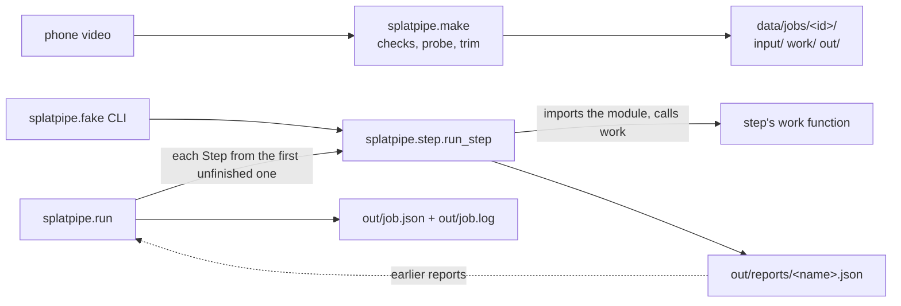

# Design Document: pipeline-core

## Overview

This spec builds the Skeleton of `splatpipe/`, which the real Steps plug into later. It covers making a Job from a video, the Job_Folder, the settings and Presets, the Step_Reports, running one Step or a whole Job, picking a Job up where it stopped, the Fake_Step, the Spend_Guard in `cloud/spend.py`, and `docs/pipeline.md`. Everything is Python 3.11 with the standard library only. ffprobe is the one outside tool, and it runs as a command line program.

### Decisions on the open choices

| Choice | Decision |
|---|---|
| The Job_Maker's module | `splatpipe/make.py`, run as `uv run python -m splatpipe.make <video> [--start S] [--end E] [--preset P]`. The name matches `splatpipe.run`. |
| The Skeleton's own Config section | `[jobs]`. It's also a module name (`splatpipe/jobs.py`), so a Step can't take it as a Step_Name either way. |
| Job_Status spellings in JSON | `"done"`, `"done_with_warnings"`, `"failed"` |
| Step_Outcome spellings in JSON | `"done"`, `"failed"`, `"not_run"` |
| Spellings in the Job_Log and on screen | The plain words: "done", "done with warnings", "failed", "not run". |
| How tests make the Fake_Step fail | A shared setting, `fail`, in the Fake_Step's section: `"none"`, `"expected"` or `"unexpected"`. The real `config.toml` has `fail = "none"` and a comment saying only tests change it. Tests set it in their own config. |
| How tests run the Fake_Step under several names | A Step_List entry holds the Step_Name and the module separately. A test lists `StepEntry("fake_a", "splatpipe.fake", required=True)`, `StepEntry("fake_b", "splatpipe.fake", required=False)` and so on. The test config that `tests/conftest.py` writes into `tmp_path` has `[fake_a]`, `[fake_b]` and `[fake_c]`, each with its Preset tables, next to `[fake]`. Every public function takes `config: Config \| None = None`, where `None` means the file at `splatpipe.config.CONFIG_PATH`, which is the real `config.toml` outside the tests. The conftest points `CONFIG_PATH` at the test config with `monkeypatch`, so CLI tests, which call `main([...])` and can't pass `config=`, read it too. The real `config.toml` only has `[fake]`. Because `fail` is a setting, each name gets its own failure mode. |
| Where the MP4/MOV extensions and the format name live | In code, as constants in `splatpipe/make.py`: `VIDEO_EXTENSIONS = (".mp4", ".mov")` and `CONTAINER_FAMILY = "mov,mp4,m4a,3gp,3g2,mj2"`. They aren't tuning numbers. They define what the Pipeline accepts, and the copy's name (`input/video.mp4` or `.mov`), the Readable_Error text and the later Steps all depend on them. A comment above them says so. |
| Writing JSON | `json.dumps(value, ensure_ascii=True, allow_nan=False, indent=2) + "\n"`, written as UTF-8 with `\n` line endings. With `ensure_ascii=True` every Python string survives the round trip, lone surrogates included, because they're written as `\udXXX` escapes. The one exception is a string that holds a high surrogate directly followed by a low one. `json.loads` would join the two into one character, so `check_json_value` refuses that string. |
| Where a run starts (A3) | `first_to_run` is a pure function that picks the first Step to run from each Step's earlier state. `run_from` is the run loop: it gets the running of one Step as a function and touches no files. `read_earlier` is the only part that reads the earlier reports, and it never raises because of what it finds. So Property 7 tests the whole decision without files. |
| The Spend_Guard and Config | `cloud/spend.py` reads `config.toml` itself with `tomllib` and doesn't import `splatpipe`. Req 11.1 asks for the standard library only. This also keeps the guard working when the Pipeline package is broken, and the money decision stays in one short file. |

## Architecture



### Module layout

| File | What it holds |
|---|---|
| `splatpipe/__init__.py` | Exists. Docstring only. |
| `splatpipe/errors.py` | `PipelineError`, `ExpectedFailure`, and `run_cli()`, the shared CLI wrapper. |
| `splatpipe/config.py` | The Config_Loader: `REPO_ROOT`, `CONFIG_PATH`, `PRESETS`, `NOT_PIPELINE`, `JOBS_SECTION`, `Config`, `load_config()`, `check_preset()`, `JobsSettings` and `StepSettings`. |
| `splatpipe/jsonio.py` | `NotJsonError`, `check_json_value()`, `write_json()` and `read_json()`. |
| `splatpipe/jobs.py` | The Job_Id pattern, `new_job_id()`, `check_job_id()`, `job_folder()`, `JobRecord`, `Job`, `open_job()`, `write_record()` and `remove_tree()`. |
| `splatpipe/probe.py` | The Video_Probe: `ProbeResult`, `probe_video()` (runs ffprobe) and `parse_probe()` (pure). |
| `splatpipe/make.py` | The Job_Maker: `VIDEO_EXTENSIONS`, `CONTAINER_FAMILY`, `used_part()` (the pure trim), `make_job()` and `main()`. |
| `splatpipe/step.py` | The Step_Runner: `STEP_NAME`, `RESERVED_NAMES`, `check_step_name()`, `StepContext`, `run_step()` and `step_main()`, the shared CLI for Steps. |
| `splatpipe/run.py` | The Job_Runner: `StepEntry`, `STEP_LIST` (empty), `Earlier`, `check_step_list()`, `read_earlier()`, `first_to_run()`, `run_from()`, `job_status()`, `run_job()` and `main()`. |
| `splatpipe/fake/__init__.py` | The Fake_Step: `work(step)` (its own code) and `run(job_id, preset=None, *, config=None)` (its plain function). |
| `splatpipe/fake/__main__.py` | The Fake_Step's CLI: `main(argv)`, which calls `step_main("fake", "splatpipe.fake", argv)`. |
| `cloud/spend.py` | The Spend_Guard: `SpendRefused` and `check_spend()`. |
| `docs/pipeline.md` | The Pipeline_Doc. |

Each Skeleton module imports only Skeleton modules that come before it in this order: `errors`, `config`, `jsonio`, `jobs`, `probe`, `make`, `step`, `run`. So there are no import cycles. A step package imports Skeleton modules, and no Skeleton module imports a step package.

Every step package follows the same contract, and the Fake_Step is its working example:

- `splatpipe/<Step_Name>/__init__.py` defines `work(step: StepContext) -> None` (the Step's own code) and a plain function `run(job_id, preset=None, *, config=None)` that calls `run_step(...)`.
- `splatpipe/<Step_Name>/__main__.py` defines `main(argv)` and ends with `if __name__ == "__main__": sys.exit(main())`.

## Components and Interfaces

### errors.py

```python
class PipelineError(Exception):
    """A refusal or failure whose message is a Readable_Error: what went wrong and what to do."""

class ExpectedFailure(PipelineError):
    """Raised by a Step's own code for a failure it foresees, like too few sharp frames."""

def run_cli(action: Callable[[], int]) -> int:
    """Run a CLI body. PipelineError: print its message on stderr and return 1.
    Any other Exception: print a general message with the error's type and message, return 1.
    No traceback is printed in either case."""
```

### config.py (the Config_Loader)

```python
REPO_ROOT = Path(__file__).resolve().parents[1]
CONFIG_PATH = REPO_ROOT / "config.toml"   # tests point this at their own file
PRESETS = ("fast", "default", "quality")
NOT_PIPELINE = frozenset({"git", "aws", "paid", "devlog"})
JOBS_SECTION = "jobs"

def load_config(path: Path | None = None) -> Config      # None: CONFIG_PATH, looked up at call time
def check_preset(name: object) -> str                     # refuses, listing fast, default, quality

class Config:
    def __init__(self, data: Mapping[str, Any], source: str = "config") -> None
    def jobs(self) -> JobsSettings
    def step_settings(self, name: str, preset: str) -> StepSettings

@dataclass(frozen=True)
class JobsSettings:
    jobs_folder: Path            # absolute
    default_preset: str
    max_video_bytes: int
    max_video_seconds: float
    min_used_seconds: float
    ffprobe_timeout_seconds: float

class StepSettings(dict[str, Any]):
    section: str                 # "fake", used in messages
    preset: str
    def __missing__(self, key: str) -> NoReturn   # PipelineError naming [<name>], [<name>.<preset>] and the key
```

- `load_config` reads the file with `tomllib`. A missing file or a TOML syntax error is a `PipelineError` that names the file.
- `Config.__init__` deep-copies the data. Then it walks every Pipeline_Section, meaning every top-level table whose name isn't in `NOT_PIPELINE`, dotted Preset tables included. It refuses NaN, infinity, and `datetime`, `date` and `time` values, with the section and the key path in the message (Req 5.7). Tests can build a `Config` straight from a dict, or write TOML to `tmp_path` and call `load_config(path)`.
- `jobs()` reads the six keys of `[jobs]`. A missing key is refused with `[jobs]` and the key in the message (Req 5.8). It also refuses a wrong type, a bool where a number belongs, a number that isn't above 0, and a default Preset that isn't one of the three (Req 5.9). A relative `jobs_folder` is joined to `REPO_ROOT`, never to the current directory. Tests always give an absolute `tmp_path` path.
- `step_settings(name, preset)` checks the preset first. Then it checks the section `[name]` in this order (Req 5.6):
  1. The section exists and is a table.
  2. Every value in it that's a table is named after a Preset, so `[fake.other]` and `other = {…}` are refused by name.
  3. All three Preset tables exist.
  4. The three Preset tables have the same keys. A key missing from some is named, with the tables it's missing from.
  5. No key is both shared and per-Preset.

  It returns `StepSettings({**shared, **preset_table})` (Req 5.5). Arrays and inline tables inside a Preset table are plain values.
- Only `[fake]` and the sections of the Steps in the Step_List are Step_Sections, and only `step_settings` reads them, one name at a time (Req 5.11). `Config` keeps no list of Step_Sections. So a section that a later spec adds and that isn't a Step_Section, like `[cloud]`, needs no code change. It's still a Pipeline_Section: `Config.__init__` refuses NaN, infinity and dates in it (Req 5.7), and the comment check covers its keys (Req 5.2, 5.10).

### jsonio.py

```python
class NotJsonError(ValueError):
    """A value that isn't a JSON_Value. The message names the field, like `counts.frames` or `settings.sizes[2]`."""

def check_json_value(value: object, field: str) -> None
def write_json(path: Path, value: object) -> None
def read_json(path: Path) -> Any
```

- `check_json_value` accepts the exact types `dict` (with `str` keys), `list`, `str`, `int`, `float` (finite only), `bool` and `None`, nested in any way. It refuses everything else and names the field path: tuples (which `json` would quietly turn into lists), sets, non-string keys (which `json` would quietly turn into strings), NaN, infinity, subclasses such as `IntEnum`, and objects like a numpy `int64`. Exact types are what make the round trip give back the same types.
- It also refuses two kinds of value that have an accepted type but that `json` can't give back, naming the field path the same way:
  - A `str`, as a value or as a key, that holds a high surrogate directly followed by a low one, as two characters. `ensure_ascii=True` writes them as two `\udXXX` escapes, and `json.loads` joins those into one character. A lone surrogate passes.
  - An `int` with more digits than Python writes as text, `sys.get_int_max_str_digits()` (4300 by default, and 0 turns the limit off). `json.dumps` would raise a plain `ValueError` on it that names no field. The check never calls `str()` on the int, which would raise the same error. It compares `abs(value)` with `10 ** limit`, and only when `value.bit_length()` is above `3 * limit`, so a normal int costs one `bit_length()` call.
- `write_json` calls `check_json_value(value, path.stem)`, then `json.dumps(value, ensure_ascii=True, allow_nan=False, indent=2) + "\n"`, then `path.write_text(text, encoding="utf-8", newline="\n")`. Because of `ensure_ascii=True` the file is plain ASCII, which is also valid UTF-8, with no `\r`.
- `read_json` calls `json.loads(path.read_text(encoding="utf-8"), parse_constant=…, parse_float=…)`. The `parse_constant` hook refuses `NaN`, `Infinity` and `-Infinity`. The `parse_float` hook refuses a number too big for a float, like `1e400`, which `float()` would read as infinity. Both refuse with `NotJsonError`, so reading only gives JSON_Values too. Every refusal of a file's content is a `ValueError`: `UnicodeDecodeError`, `json.JSONDecodeError` and `NotJsonError` all are.

### jobs.py

```python
JOB_ID = re.compile(r"[0-9]{8}-[0-9]{6}-[0-9a-f]{6}")  # safety check, kept in code (Req 1.6)

def new_job_id(now: datetime | None = None, random_part: str | None = None) -> str
def check_job_id(value: object) -> str
def job_folder(job_id: str, jobs_folder: Path) -> Path
def open_job(job_id: str, config: Config) -> Job
def write_record(folder: Path, record: JobRecord) -> None
def remove_tree(path: Path) -> None

@dataclass(frozen=True)
class JobRecord:
    job_id: str
    preset: str
    start_seconds: float
    end_seconds: float
    source_name: str
    source_bytes: int
    video_seconds: float
    video_file: str              # "video.mp4" or "video.mov", inside input/

@dataclass(frozen=True)
class Job:
    id: str
    folder: Path                 # resolved
    record: JobRecord
    @property
    def video_path(self) -> Path  # folder / "input" / record.video_file
```

- `new_job_id` uses `datetime.now(timezone.utc)` and `secrets.token_hex(3)` unless `now` and `random_part` are given. An aware `now` is converted to UTC, and a naive one is refused with `ValueError`. The id is built from zero-padded fields, `f"{t.year:04d}{t.month:02d}{t.day:02d}-{t.hour:02d}{t.minute:02d}{t.second:02d}-{random_part}"`, and not with `strftime("%Y")`, because glibc doesn't zero-pad years before 1000.
- `check_job_id` refuses anything that isn't a `str` or for which `JOB_ID.fullmatch(value)` is `None`. The pattern uses explicit ASCII classes, never `\d` or `$` (Req 1.2, 1.3). The message gives the expected form, `YYYYMMDD-HHMMSS-xxxxxx`, and leaves the bad string out, so a line break or a control character in it can't garble the terminal.
- `job_folder` checks the id, then resolves `jobs_folder / job_id` and `jobs_folder`. It refuses unless the resolved Jobs_Folder is in the resolved Job_Folder's `.parents` (Req 1.4, 1.5). `Path.resolve()` follows symlinks and junctions, so a Job_Folder that's a link pointing elsewhere is refused. On Windows, `PureWindowsPath` compares without regard to case.
- `open_job` runs `job_folder`, checks that the folder exists, and reads `input/job.json` with `read_json`. It refuses with a `PipelineError` when the folder is missing, the file is missing or unreadable, or a field is missing, has the wrong type, or holds a bad value (Req 7.2, 7.3). The checks are: `job_id` equals the folder's id, `preset` is a Preset, the numbers are finite and not negative, `source_bytes` is an `int`, and `video_file` is exactly `video.mp4` or `video.mov`.
- `remove_tree(path)` calls `shutil.rmtree(path, onerror=_clear_read_only)`. Python 3.11 has `onerror`, not `onexc`. The handler does `os.chmod(path, stat.S_IWRITE)` and retries the call once. If the retry fails too, the error goes up. `rmtree` removes links inside the tree without following them.

### probe.py (the Video_Probe)

```python
@dataclass(frozen=True)
class ProbeResult:
    format_name: str
    has_video: bool
    video_seconds: float | None  # None when neither the stream nor the container gives a usable length

def probe_video(path: Path, timeout_seconds: float) -> ProbeResult
def parse_probe(data: object) -> ProbeResult
```

- `probe_video` runs `subprocess.run(["ffprobe", "-v", "error", "-print_format", "json", "-show_format", "-show_streams", "file:" + str(path.resolve())], capture_output=True, stdin=subprocess.DEVNULL, timeout=timeout_seconds)`. It takes an argument list and never a shell string. The `file:` prefix and the absolute path mean a name starting with `-`, or one holding `:`, is never read as an option or a protocol (Req 2.6).
- Each failure is a `PipelineError` that says what happened and what to do (Req 2.7):
  - `FileNotFoundError`: "ffprobe isn't installed. Install ffmpeg, which includes ffprobe, and make sure `ffprobe` runs in a terminal."
  - `TimeoutExpired`: the timeout in seconds.
  - A non-zero exit: the first line of ffprobe's stderr, decoded with `errors="replace"`.
  - Output that isn't JSON, or isn't shaped as below: "ffprobe printed output we couldn't read."
- `parse_probe` reads:
  - `format.format_name`, which must be a `str`.
  - The streams with `codec_type == "video"`. A stream with `disposition.attached_pic == 1` (cover art) isn't counted as a video stream.
  - The length: the first video stream's `duration`, falling back to `format.duration` (Req 2.10). ffprobe gives durations as strings and can give `"N/A"`. A duration counts only when `float()` reads it and the result is finite and above 0. Otherwise it counts as missing, and so do NaN, infinity, 0, negatives and text.

### make.py (the Job_Maker)

```python
# In code on purpose: these define what the Pipeline accepts. They aren't tuning numbers.
VIDEO_EXTENSIONS = (".mp4", ".mov")
CONTAINER_FAMILY = "mov,mp4,m4a,3gp,3g2,mj2"

def used_part(video_seconds: float, start: float | None, end: float | None,
              minimum: float) -> tuple[float, float]
def make_job(video: str | Path, *, start: float | None = None, end: float | None = None,
             preset: str | None = None, config: Config | None = None,
             probe: Callable[[Path, float], ProbeResult] = probe_video,
             new_id: Callable[[], str] = new_job_id) -> str
def main(argv: list[str] | None = None) -> int
```

`used_part` is the Trim, a pure function of the Video_Length, the start, the end and the minimum. It returns the given start (or `0.0`) and the given end (or `video_seconds`) unchanged, or raises `PipelineError`. It runs these checks in this order:

1. A given value that's NaN, infinite or negative is refused (Req 3.4).
2. A given value after `video_seconds` is refused, with the Video_Length in the message (Req 3.5).
3. A start that isn't before the end is refused (Req 3.6).
4. `end - start < minimum` is refused, with the minimum in the message, also when no Trim was given (Req 3.7).

Values only reach the subtraction once they're between 0 and the Video_Length, so it can't overflow.

`make_job` finishes every check before it creates or copies anything (Req 2.1, 2.5, 2.13):

1. Make the id with `new_id()` and get its folder with `job_folder()`. Refuse if the folder exists (Req 4.7).
2. `check_preset(preset)` when a Preset is given, else `check_preset(config.jobs().default_preset)` (Req 4.4–4.6).
3. `Path(video).is_file()`, or refuse (Req 2.2).
4. `suffix.lower() in VIDEO_EXTENSIONS`, or refuse: "Only MP4 and MOV videos are accepted" (Req 2.3).
5. `stat().st_size <= max_video_bytes`, or refuse, with the limit as `f"{limit / 2**30:g} GB"`, which gives "4 GB" (Req 2.4).
6. `probe(path.resolve(), ffprobe_timeout_seconds)`. Then the format name must be exactly `CONTAINER_FAMILY` (Req 2.8). There must be a video stream (Req 2.9) and a length (Req 2.11), and the length must be at most `max_video_seconds`, with both numbers in the message (Req 2.12).
7. Check that the start and end are `int`, `float` or `None` and not a `bool`, convert them to `float` (an overflow is refused), then call `used_part(...)`.

Then it builds the job:

1. `jobs_folder.mkdir(parents=True, exist_ok=True)`.
2. `folder.mkdir()` with `exist_ok=False`. A `FileExistsError` here is the same refusal as in Req 4.7, and nothing is removed, because the folder isn't ours.
3. Make `input/`, `work/` and `out/`.
4. `shutil.copyfile` the video to `input/video<ext>` (Req 4.2).
5. `write_record` the Job_Record (Req 4.3).

Any exception after step 2 calls `remove_tree(folder)`. An `OSError` then becomes a `PipelineError` that says the copy failed and to check the free space (Req 4.8). Anything else, Ctrl+C included, is raised again after the cleanup.

`main` uses argparse with `allow_abbrev=False`. It takes a `video` positional, `--start` and `--end` (`type=float`) and `--preset` (`choices=PRESETS`). It has no `--job` option, so `--job …` is a usage error: exit 2, and no Job is made (Req 4.10). On success it prints the Job_Id alone on stdout and returns 0 (Req 4.9). `make.py` ends with `if __name__ == "__main__": sys.exit(main())`, so `python -m splatpipe.make` runs `main`. Without it the command would do nothing and exit 0.

### step.py (the Step_Runner)

```python
STEP_NAME = re.compile(r"[a-z][a-z0-9_]*")
RESERVED_NAMES = frozenset({"errors", "config", "jsonio", "jobs", "probe", "make", "step", "run",
                            "git", "aws", "paid", "devlog"})

def check_step_name(name: object) -> str

@dataclass
class StepContext:
    name: str
    preset: str
    job: Job
    settings: StepSettings
    work_folder: Path            # job.folder / "work" / name
    out_folder: Path             # job.folder / "out"
    timings: dict[str, float]
    counts: dict[str, int]
    warnings: list[str]
    def add_timing(self, name: str, seconds: float) -> None   # finite, >= 0, not bool
    def timed(self, name: str) -> ContextManager[None]       # time.perf_counter, then add_timing
    def add_count(self, name: str, value: int) -> None        # exact int, >= 0
    def add_warning(self, text: str) -> None                  # non-empty str

def run_step(name: str, module: str, job_id: str, *, preset: str | None = None,
             config: Config | None = None) -> dict[str, Any]
def step_main(name: str, module: str, argv: list[str] | None) -> int
```

- `check_step_name` runs before a Step_Name is used in any path (Req 7.8). It refuses names that don't match `STEP_NAME.fullmatch`, and names in `RESERVED_NAMES`, which are the Skeleton's module names, `jobs` and the sections in `NOT_PIPELINE`. A real Step's module is `splatpipe.<Step_Name>`, so a Step called `run` or `config` would collide with the Skeleton's own module. A test keeps the set complete (see Testing).
- The `add_*` methods refuse a bad name or value straight away with `NotJsonError`, naming the field (`timings.<name>`, `counts.<name>`, `warnings[<i>]`) (Req 6.8). Adding a name a second time replaces its value. A refusal is raised inside the Step's code, so it becomes an Unexpected_Error in that Step's report, and the report never holds a bad value.

`run_step` works in two parts. First it opens the Job. A failure here raises `PipelineError` and writes no report (Req 7.2, 7.3):

1. `check_step_name(name)`.
2. `config = load_config()` when `config` is `None`.
3. `job = open_job(job_id, config)`.
4. `preset = check_preset(preset)` if one was given, else `job.record.preset` (Req 7.4).

Then it runs the Step. A failure here becomes a failed report:

1. `out/reports/<name>.json` is removed with `unlink(missing_ok=True)`, and `out/reports/` is made if it's missing (A1, Req 7.5).
2. The start time is taken.
3. Inside `try`:
   1. `step_settings(name, preset)`.
   2. The Work_Folder is checked: its resolved path must have the resolved Job_Folder among its `.parents`. If it doesn't, the Step fails with a Readable_Error and nothing is touched (Req 7.7).
   3. The Work_Folder is emptied: `remove_tree` if it exists, then `mkdir(parents=True)` (A1).
   4. `importlib.import_module(module).work` is looked up. An import error or a missing `work` is an Unexpected_Error.
   5. `work(context)` runs.
4. `except PipelineError` (an `ExpectedFailure` included): the readable message is `str(error)` (Req 6.5).
5. `except Exception`: the readable message is general: "The `<name>` step stopped because of an error in its code. This is a bug, not a problem with your video. Send `out/reports/<name>.json` to the team." (Req 6.6).
6. The report is built and written with `write_json`, then returned (Req 6.1–6.4). Its `settings` is `dict(settings)`, a plain copy, because `check_json_value` accepts only the exact type `dict` and would refuse the `StepSettings` subclass. `KeyboardInterrupt` and `SystemExit` aren't caught, so Ctrl+C still stops a run.

`run_step` only ever touches `work/<name>/` and `out/reports/<name>.json`. `input/`, the other Steps' Work_Folders and the other Steps' reports stay as they are (Req 7.6). So do the Step's own files in `out/` other than its report. The Step's own code replaces or removes what it wrote there in an earlier run (Req 7.10).

`run_step` never reads the Step's earlier report, so it runs every Step it's given, a Finished_Step included. A Step's own function and CLI always run the Step, and only the Job_Runner skips Finished_Steps (Req 7.9).

`step_main` parses `--job` (required) and `--preset` (`choices=PRESETS`) inside `run_cli`. When the outcome is `done` it prints `<name>: done` on stdout and returns 0. When it's `failed` it prints the readable error on stderr and returns 1, whether the Step is required or optional (Req 9.3).

### run.py (the Step_List and the Job_Runner)

```python
@dataclass(frozen=True)
class StepEntry:
    name: str        # Step_Name: config sections, report, Work_Folder
    module: str      # splatpipe.<Step_Name> for real Steps
    required: bool

STEP_LIST: tuple[StepEntry, ...] = ()   # each step spec adds its own entry, in order (A2)

@dataclass(frozen=True)
class Earlier:
    """What a Step's report from an earlier run says, read before this run removes anything."""
    state: str                           # "missing", "unreadable", "done" or "failed"
    readable_error: str | None = None    # the report's error.readable, kept when state is "failed"

def check_step_list(entries: Sequence[StepEntry]) -> None
def read_earlier(job: Job, name: str) -> Earlier
def first_to_run(entries: Sequence[StepEntry], earlier: Sequence[Earlier], fresh: bool) -> int
def run_from(entries: Sequence[StepEntry], earlier: Sequence[Earlier], start: int,
             run_one: Callable[[StepEntry], tuple[str, str | None]]) -> list[dict[str, Any]]
def job_status(steps: Sequence[Mapping[str, Any]]) -> str
def run_job(job_id: str, *, steps: Sequence[StepEntry] | None = None,
            config: Config | None = None, fresh: bool = False) -> dict[str, Any]
def main(argv: list[str] | None = None) -> int
```

Each `StepEntry` holds the Step_Name, the module and whether the Step is required (Req 8.1). `run.py` keeps the Step_List as module name strings and imports no step package (Req 12.4).

The restart rule (A3) lives in four small functions. Only `read_earlier` reads a file:

- `read_earlier(job, name)` reads `out/reports/<name>.json` with `read_json`. It never raises because of what it finds:
  - No file gives `Earlier("missing")`.
  - Any other `OSError` (no permission to read it, say), a `ValueError` (not UTF-8, not JSON, or `NaN`) or a `RecursionError` (JSON nested too deeply) gives `Earlier("unreadable")`.
  - So does a value that isn't a `dict` whose `step` is `name`, whose `job_id` is `job.id` and whose `outcome` is `"done"` or `"failed"`. A report for another Step or another Job never counts.
  - Otherwise the state is the report's outcome. For `"failed"`, `readable_error` is the report's `error.readable` when that's a string, and `None` when it isn't.

  `missing` and `unreadable` never count as finished, so a broken report just means the Step isn't finished.
- `first_to_run(entries, earlier, fresh)` is pure. With `fresh` it returns 0 (Req 8.14). Otherwise it returns the index of the first entry that isn't a Finished_Step, meaning its state is neither `done` nor, for an Optional_Step, `failed`. It returns `len(entries)` when every entry is a Finished_Step (Req 8.13, 8.15). Whether a Step is required comes from its `StepEntry`, never from the report. It pairs the two lists with `zip(..., strict=True)`, so lists of different lengths raise.
- `run_from(entries, earlier, start, run_one)` is the run loop. It touches no files. It gets the running of one Step as `run_one`, which returns the outcome and the readable error. It returns the Job_Summary's `steps` list, in Step_List order, each item with the keys `step`, `required`, `outcome`, `reused` and `readable_error`:
  - Each entry before `start` gets its earlier state as its outcome, its earlier readable error and `reused: true`. `run_one` isn't called for it (Req 8.16, 8.17).
  - From `start` on, `run_one` runs each entry in turn, and the entry gets the outcome and readable error it returns, with `reused: false`. A failed Optional_Step doesn't stop the loop (Req 8.7).
  - After a failed Required_Step, `run_one` isn't called again. Every later entry gets `not_run`, no readable error and `reused: false` (Req 8.6).
- `job_status(steps)` gives `"failed"` when a Required_Step's outcome is `failed`. It gives `"done_with_warnings"` when none is and some Step's outcome is `failed`, a reused one included, and `"done"` otherwise (A4, Req 8.8, 8.17).

`run_job` works in this order:

1. `entries = STEP_LIST if steps is None else tuple(steps)` (Req 8.3).
2. An empty list is refused, "No steps are set up yet…", before anything is written (Req 8.10).
3. `check_step_list` refuses an invalid or reserved Step_Name (Req 7.8), a Step_Name that's listed twice (Req 8.11), and a module that isn't `splatpipe.<something>` (Req 12.2), all before any Step runs.
4. `config = load_config()` when `config` is `None`, then `job = open_job(job_id, config)`. The config is loaded once and passed to every `run_step`.
5. `earlier = [read_earlier(job, entry.name) for entry in entries]` reads the earlier report of each listed Step.
6. `start = first_to_run(entries, earlier, fresh)`.
7. `out/job.json` and the reports of `entries[start:]` are removed with `unlink(missing_ok=True)`, before any Step runs. The reports of `entries[:start]` and of Steps outside the Step_List stay. So a Step that ends up `not_run` has no report left over from an earlier run (A3, Req 8.9). Every refusal comes before this point, so a refused run removes nothing.
8. The Job_Log is opened, as below. It gets the run's first line, `job <id>: <n> steps, preset <preset>`, and, when `start > 0`, one line that names the skipped Steps with their earlier outcomes (Req 8.18).
9. `steps = run_from(entries, earlier, start, run_one)`. Here `run_one` logs "started", calls `run_step(entry.name, entry.module, job_id, config=config)`, which uses the Job_Record's Preset (Req 8.4), and logs the outcome. Then it returns the outcome and the report's readable error. A failed Optional_Step's line holds its Step_Name and readable error (Req 8.7). `run_step` does the import, so each module is imported only when its Step is about to run, and a skipped Step's module isn't imported at all (Req 8.5). Each `not_run` entry then gets a "not run" line.
10. `job_status(steps)` gives the status, which is logged. The Job_Summary is written and returned, with `failed_step` and the top-level `readable_error` taken from the failed Required_Step's entry when there is one (Req 8.8). When `start == len(entries)`, no Step runs, and the summary comes from the earlier reports alone (Req 8.15).

A `PipelineError` from `run_step`, for example because the Job_Folder was deleted mid-run, stops the run with that message, and no summary is written.

The Job_Log is a `logging.StreamHandler` on the `splatpipe` logger, never the root logger, writing to a file that `run_job` opens itself with `open(path, mode, encoding="utf-8", errors="backslashreplace", newline="\n")`:

- Without `fresh`, `mode` is `"a"`. The run adds its lines to the end of `job.log` and starts the file when it's missing, so the log keeps every run of the Job (Req 8.18). With `fresh`, `mode` is `"w"`, so the run starts a new `job.log` (Req 8.19).
- The handler's formatter uses UTC (`converter = time.gmtime`).
- The logger's level is set to INFO for the run, and the old level is put back afterwards.
- A `finally` block removes the handler, closes it and closes the file at the end of every run, so many Jobs in one test process on Windows never leave a file open in `tmp_path`.
- Later Steps that log with `logging.getLogger(__name__)` land in the Job_Log for free.

`main` parses `--job` and `--fresh` (`action="store_true"`) inside `run_cli`, calls `run_job(job_id, fresh=args.fresh)` and prints `Job <id>: <status in words>` on stdout. When every Step in the summary is reused, the line adds that every Step had already finished, so nothing ran, and that `--fresh` runs them all again. It returns 0 for `done` and `done_with_warnings` (Req 9.4). A run where every Step had already finished is always one of those two, because a failed Required_Step is never a Finished_Step, so it returns 0 (Req 9.5). For `failed` it prints the failed Step's readable error on stderr and returns 1. Like `make.py`, `run.py` ends with `if __name__ == "__main__": sys.exit(main())`.

### fake/ (the Fake_Step)

`work(step)` does this:

1. Reads `step.job.video_path.stat().st_size`.
2. Inside `step.timed("write_files")`, writes `settings["files"]` files of `settings["file_bytes"]` bytes each into `step.work_folder`, named `file-000.txt` and so on.
3. Adds the counts `files_written` (the number it wrote) and `video_bytes`.
4. Adds the warning "This is the fake step. It writes test files and makes no splat."
5. Checks `settings["fail"]`:
   - `"expected"`: raises `ExpectedFailure` with its own Readable_Error, which says the step was set to fail by `fail = "expected"` in `[<name>]` and to set `fail = "none"`.
   - `"unexpected"`: raises `RuntimeError`.
   - Any other value except `"none"`: raises `ExpectedFailure`, naming the key.
6. Writes the result file `out/<name>.txt` as one UTF-8 line with `\n`, replacing the one from an earlier run. A failed run writes no result file and leaves an earlier one where it is, because the Step_Runner doesn't touch a Step's files in `out/` (Req 7.10).

The counts, the timing and the warning come before the `fail` check, so a failed report shows Req 6.4. All paths come from `step`, so the same code runs as `fake`, `fake_a` or `fake_b`.

### cloud/spend.py (the Spend_Guard)

```python
class SpendRefused(Exception):
    """Nothing paid may start. The message says why and what to do."""

def check_spend(*, machine: str, expected_time: str, rough_cost: str,
                environ: Mapping[str, str] | None = None,
                config_path: Path | None = None) -> None
```

- It uses the standard library only (`os`, `tomllib`, `pathlib`, `collections.abc`) and never imports `splatpipe`.
- `config_path` defaults to `Path(__file__).resolve().parents[1] / "config.toml"`.
- `environ` defaults to `os.environ` and is only read, with `.get`. The guard never sets or changes an environment variable (Req 11.7).
- It raises `SpendRefused` in each of these cases:
  - Config can't be opened or parsed, or `[aws].spend_variable` is missing or isn't a non-empty string (Req 11.6).
  - A description part is empty, because nobody can approve a run they can't see.
  - `environ.get(name) != "1"`, compared exactly, with no stripping (Req 11.4, 11.5).
- The refusal message, where `<VAR>` is the name read from `[aws].spend_variable` (`APPROVED_SPEND` today): "Refused to start `<machine>` for `<expected_time>` (`<rough_cost>`): this run costs money and `<VAR>` isn't set to exactly 1. Get a yes in the chat for that machine, time and cost, then run this one command again with `<VAR>=1`."
- It returns `None` when the call may go on.

### Docs (Req 13)

`docs/pipeline.md` starts with the Skeleton:

- the Job_Folder layout
- the Job_Record fields
- the Step_Report format
- the Presets and the Config layout (`[jobs]`, `[<Step_Name>]` and its three Preset tables, a comment on every key)
- the Step_List, with the planned Steps:
  - Required_Steps: picking frames, solving cameras and training
  - Optional_Steps: clean and export and depth priors
- the Job_Runner, the Job_Summary and the Job_Log
- a part headed "Running a job again" (Req 13.8), which says:
  - Without `--fresh`, the Job_Runner skips the Finished_Steps at the start of the Step_List: each Step whose report says done, and each Optional_Step whose report says failed. It runs every Step from the first unfinished one on, a Finished_Step after that one included.
  - Before any Step runs, it removes the summary and the reports of the Steps it's about to run. The skipped Steps keep their reports. They show `"reused": true` in the summary, and their earlier outcomes count toward the Job_Status.
  - When every Step has finished, nothing runs, the summary comes from the reports, and the CLI exits with 0.
  - Without `--fresh`, the run adds to the end of `job.log`, with a line that names the skipped Steps. `--fresh` runs every Step and starts a new `job.log`.
  - A single Step's CLI always runs its Step.
  - Use `--fresh` after changing settings in `config.toml` or a Step's code, or after running an earlier Step by hand, because the Job_Runner doesn't check whether a Finished_Step's inputs changed.
- a part headed "A Step's files in out/" (Req 13.9). It says the Step_Runner removes only a Step's own report and empties only its own Work_Folder. It leaves the Step's other files in `out/` alone, so each Step's own code replaces or removes what it wrote there in an earlier run.
- the CLIs and their exit codes, `--fresh` included

Then it has one `## Step: <Step_Name>` section per Step, each saying what the Step reads, what it writes, its Config section and its Step_Report fields. Each one has a part headed "Files in out/" that lists every file the Step writes to `out/`, or says it writes none (Req 13.9). This spec writes `## Step: fake`, which says the step specs copy the Fake_Step as their working example. Its "Files in out/" part lists `out/fake.txt`: a done run replaces it, and a failed run leaves an earlier one in place.

In `.kiro/steering/structure.md`, the `docs/` line lists `pipeline.md`, and a new line says every step spec updates its own section of `docs/pipeline.md` as part of its tasks.

In `docs/third-party-licences.md`, the ffmpeg row becomes "ffmpeg and ffprobe", in the same task as the Video_Probe. Its "How we use it" column says:

- ffprobe reads the video's container, streams and length when a Job is made.
- ffmpeg extracts the frames.
- Both are separate command line tools, on our private machine image and on laptops for the tests, never vendored or linked.

## Data Models

### `input/job.json` (the Job_Record)

```json
{
  "job_id": "20261119-142530-7f3a9c",
  "preset": "fast",
  "start_seconds": 1.5,
  "end_seconds": 12.48,
  "source_name": "Kitchen walk.MOV",
  "source_bytes": 48213775,
  "video_seconds": 12.48,
  "video_file": "video.mov"
}
```

`start_seconds` and `end_seconds` are the Used_Part. `source_name` is the original name without its folder. `video_file` is the copy's name inside `input/`, so Steps never guess the extension.

### `out/reports/<Step_Name>.json` (a Step_Report)

```json
{
  "step": "fake",
  "job_id": "20261119-142530-7f3a9c",
  "preset": "fast",
  "settings": {"fail": "none", "file_bytes": 16, "files": 1},
  "outcome": "done",
  "started_utc": "2026-11-19T14:25:31.204+00:00",
  "finished_utc": "2026-11-19T14:25:31.209+00:00",
  "duration_seconds": 0.005,
  "timings": {"write_files": 0.0011},
  "counts": {"files_written": 1, "video_bytes": 48213775},
  "warnings": ["This is the fake step. It writes test files and makes no splat."],
  "error": null
}
```

The times are `datetime.now(timezone.utc).isoformat(timespec="milliseconds")`. `duration_seconds` comes from `time.perf_counter()`, rounded to 3 decimals. `settings` is `null` when the settings couldn't be loaded. When the outcome is `"failed"`, `error` holds:

```json
"error": {
  "readable": "The fake step was set to fail by fail = \"expected\" in [fake]. Set fail = \"none\" to make it pass.",
  "expected": true,
  "technical": {
    "type": "splatpipe.errors.ExpectedFailure",
    "message": "The fake step was set to fail by fail = \"expected\" in [fake]. Set fail = \"none\" to make it pass.",
    "traceback": "Traceback (most recent call last):\n  File ..."
  }
}
```

`technical` is the Technical_Detail: the type's qualified name, `str(error)`, and `"".join(traceback.format_exception(error))`.

### `out/job.json` (the Job_Summary)

```json
{
  "job_id": "20261119-142530-7f3a9c",
  "preset": "fast",
  "fresh": false,
  "status": "failed",
  "started_utc": "2026-11-19T14:25:31.200+00:00",
  "finished_utc": "2026-11-19T14:25:31.240+00:00",
  "duration_seconds": 0.04,
  "steps": [
    {"step": "fake_a", "required": false, "outcome": "failed", "reused": false, "readable_error": "The fake step was set to fail …"},
    {"step": "fake_b", "required": true, "outcome": "failed", "reused": false, "readable_error": "The fake step was set to fail …"},
    {"step": "fake_c", "required": true, "outcome": "not_run", "reused": false, "readable_error": null}
  ],
  "failed_step": "fake_b",
  "readable_error": "The fake step was set to fail …"
}
```

`failed_step` and the top-level `readable_error` are `null` unless the status is `"failed"`. `fresh` says whether the run had the Fresh_Option. `reused` is `true` for a Finished_Step that the run skipped, whose `outcome` and `readable_error` come from its earlier report, and `false` for a Step that ran or wasn't reached (Req 8.16).

After `fake_b` is fixed, a run without `--fresh` skips `fake_a`, an Optional_Step that failed, and runs `fake_b` and `fake_c`. Its summary has `"status": "done_with_warnings"`, because the reused failure of `fake_a` counts (Req 8.17), and these steps:

```json
"steps": [
  {"step": "fake_a", "required": false, "outcome": "failed", "reused": true, "readable_error": "The fake step was set to fail …"},
  {"step": "fake_b", "required": true, "outcome": "done", "reused": false, "readable_error": null},
  {"step": "fake_c", "required": true, "outcome": "done", "reused": false, "readable_error": null}
]
```

### `out/job.log` (the Job_Log)

The first run above, then the run without `--fresh` after the fix, added to the end of the same file:

```
2026-11-19T14:25:31Z INFO job 20261119-142530-7f3a9c: 3 steps, preset fast
2026-11-19T14:25:31Z INFO fake_a: started
2026-11-19T14:25:31Z WARNING fake_a: failed, optional so the job goes on: The fake step was set to fail …
2026-11-19T14:25:31Z INFO fake_b: started
2026-11-19T14:25:31Z ERROR fake_b: failed, required so the job stops: The fake step was set to fail …
2026-11-19T14:25:31Z INFO fake_c: not run
2026-11-19T14:25:31Z INFO job 20261119-142530-7f3a9c: failed
2026-11-19T14:40:12Z INFO job 20261119-142530-7f3a9c: 3 steps, preset fast
2026-11-19T14:40:12Z INFO skipped, finished in an earlier run: fake_a (failed)
2026-11-19T14:40:12Z INFO fake_b: started
2026-11-19T14:40:12Z INFO fake_b: done
2026-11-19T14:40:12Z INFO fake_c: started
2026-11-19T14:40:12Z INFO fake_c: done
2026-11-19T14:40:12Z INFO job 20261119-142530-7f3a9c: done with warnings
```

With `--fresh`, the file would hold only the second run, and `fake_a` would run again in place of the skipped line.

### Sections added to `config.toml`

`[git]`, `[aws]`, `[paid]` and `[devlog]` stay exactly as they are (Req 5.3). These sections are appended:

```toml
[jobs]
# Folder that holds every job folder. A relative path is read from the repo root.
jobs_folder = "data/jobs"
# Preset a job gets when none is chosen: "fast", "default" or "quality".
default_preset = "fast"
# Largest video accepted, in bytes (4 GB).
max_video_bytes = 4294967296
# Longest video accepted, in seconds (10 minutes).
max_video_seconds = 600
# Shortest part of the video a job may use, in seconds.
min_used_seconds = 3
# Longest time ffprobe may take to read a video, in seconds.
ffprobe_timeout_seconds = 30

[fake]
# The test step. Only tests change this: "none", "expected" or "unexpected".
fail = "none"
# Size of each small file the fake step writes, in bytes.
file_bytes = 16

[fake.fast]
# Number of small files the fake step writes.
files = 1

[fake.default]
# Number of small files the fake step writes.
files = 2

[fake.quality]
# Number of small files the fake step writes.
files = 3
```

## Error Handling

| Where | What's raised | What the user sees |
|---|---|---|
| A check in the Skeleton (Job_Id, Job_Folder, Config, Preset, video, probe, Trim, Step_List) | `PipelineError(readable)` | The CLI prints the message on stderr and exits 1. Nothing is created and no report is written. |
| A Step's own foreseen failure | `ExpectedFailure(readable)` | A failed Step_Report with `expected: true` and the Step's own message. The Step's CLI prints it and exits 1. |
| A `PipelineError` while a Step runs (its settings, a missing setting through `StepSettings.__missing__`, a Work_Folder outside the Job_Folder) | `PipelineError` | The same as an Expected_Failure: the message is already readable. |
| Any other `Exception` while a Step runs, a failed import included | Anything | A failed Step_Report with `expected: false`, the general readable message and the full Technical_Detail. |
| A bad value added to a report | `NotJsonError` (a `ValueError`) naming the field | The same as any other exception inside a Step. Outside a Step, `write_json` raises it before anything is written. |
| An earlier Step_Report the Job_Runner can't use: missing, not JSON, holding `NaN`, not an object, for another Step or Job, or with another outcome | Nothing. `read_earlier` catches `OSError`, `ValueError` and `RecursionError` and checks the shape itself | The Step counts as not finished and runs again. Its report is removed before the first Step runs. |
| A bug in the Skeleton itself, reaching a CLI | Anything | `run_cli` prints "splatpipe stopped because of a bug (`<Type>: <message>`). Tell the team the command you ran." and exits 1, without a traceback. |
| A bad command line | argparse | argparse prints the usage and the error and exits 2. |
| The Spend_Guard refusing | `SpendRefused` | The cloud code catches it, prints the message and starts nothing. |

The exit codes (Req 9) are:

| Code | Meaning |
|---|---|
| 0 | `make` made the Job, a Step's outcome is `done`, or the Job is `done` or `done_with_warnings`, a Job where every Step had already finished included. |
| 1 | A refusal, a failed Step or a failed Job. |
| 2 | A usage error. |

Readable_Errors say what went wrong and what to do, with the numbers from Config in them. They never include a traceback. A Job_Id or Step_Name that fails its pattern check isn't echoed back, because it may hold line breaks or control characters.

## Correctness Properties

*A property is a characteristic or behavior that should hold true across all valid executions of a system-essentially, a formal statement about what the system should do. Properties serve as the bridge between human-readable specifications and machine-verifiable correctness guarantees.*

After the prework I merged some properties. Req 1.1 and 1.3 fold into Properties 2 and 1. Req 3.1 to 3.7 fold into Properties 3 and 4, and Req 11.4 folds into Property 6. Req 8.13 to 8.17 fold into Property 7, the property of Req 8.20. Properties 3 and 4 stay separate because Req 14.6 names 3.8 and 3.9 separately. Each property is one Hypothesis test with at least 100 examples (the default), tagged in its docstring as `Feature: pipeline-core, Property N: <title>`.

The strategies share these pieces, defined in the test files:

```python
DIGITS, HEX = "0123456789", "0123456789abcdef"
valid_ids = st.from_regex(r"[0-9]{8}-[0-9]{6}-[0-9a-f]{6}", fullmatch=True)
tricky = st.sampled_from(["/", "\\", "..", "\n", "\r", "\x00", " ", "A", "F", "g", "-",
                          "\u0663", "\uff10", "\u00b2", "\u200b"])  # Arabic-Indic 3, fullwidth 0, superscript 2, zero-width space
# st.text() can't give lone surrogates in Hypothesis 6.170 (checked); this one can, like "\ud800".
any_text = st.text() | st.text(st.characters(codec=None, exclude_categories=()))
```

### Property 1: The Job_Id_Check accepts exactly the pattern

*For any* string, `check_job_id` returns the string unchanged when the string is 22 characters long, has `-` at positions 8 and 15, has ASCII digits at positions 0 to 7 and 9 to 14, and has characters from `0123456789abcdef` at positions 16 to 21. For every other string it raises `PipelineError`. This oracle is written without regular expressions, so it doesn't share a bug with the code.

Strategy: `st.one_of(st.text(), any_text, valid_ids, near_misses, valid_ids.map(lambda s: s + "\n"), valid_ids.map(lambda s: "../" + s), valid_ids.map(lambda s: s.replace("-", "\\")), valid_ids.map(str.upper))`. `near_misses` takes a valid id and inserts, replaces or deletes one character at a random position, using `tricky`. That covers the slash, the backslash, `..`, a trailing newline, non-ASCII digits and uppercase.

**Validates: Requirements 1.2, 1.3, 1.7**

### Property 2: Every Job_Id the Job_Maker makes passes the check

*For any* UTC time and any random part of 6 lowercase hex characters, `check_job_id(new_job_id(now=t, random_part=r))` accepts the id. Reading the fields back gives `t`'s year, month, day, hour, minute and second, and `r`.

Strategy: `st.datetimes(timezones=st.just(timezone.utc))`, which covers years 1 to 9999, so a year before 1000 catches an unpadded `%Y`. The random part is `st.binary(min_size=3, max_size=3).map(bytes.hex)`, the same shape as `secrets.token_hex(3)`.

**Validates: Requirements 1.1, 1.8**

### Property 3: The Trim accepts exactly the valid Used_Parts

*For any* Video_Length, minimum length, start and end, where the start and the end are each missing or any float (NaN, infinity and negative numbers included), `used_part` returns a result exactly when all of these hold for `s = 0.0 if start is None else start` and `e = length if end is None else end`:

- every given value is finite and at least 0
- every given value is at most the length
- `s < e`
- `e - s >= minimum`

Otherwise it raises `PipelineError`.

Strategy: `length = st.floats(min_value=0, max_value=1e6, exclude_min=True)` and `minimum = st.floats(min_value=0, max_value=1e3, exclude_min=True)`. The start and the end each come from `st.one_of(st.none(), st.floats(), st.floats(min_value=-1, max_value=2 * length), st.sampled_from([0.0, -0.0, length, -1.0, math.nan, math.inf, -math.inf]))`, drawn with `st.data()` after the length. `st.floats()` already gives NaN, ±infinity, negatives and subnormals.

**Validates: Requirements 3.4, 3.5, 3.6, 3.7, 3.8**

### Property 4: An accepted Trim gives back its own values

*For any* Video_Length and any Trim that Property 3's rule accepts, `used_part` returns `(start, end)` equal to the given start (or `0.0` when none is given) and the given end (or the Video_Length when none is given). No value is moved into the video.

Strategy: a composite that draws mostly valid Trims. It draws a length, a minimum up to the length, a start that's `None` or in `[0, length - minimum]`, and an end that's `None` or in `[start + minimum, length]`, where a missing start counts as 0. Rounding can make `start + minimum` come out just above `length`, and `st.floats` raises `InvalidArgument` when its `min_value` is above its `max_value`. Hypothesis likes boundary values, so it would find that case and fail the test at random. The composite therefore calls `assume(start + minimum <= length)` before it draws the end. Then `assume(rule(...))` drops the other rare float-rounding misses.

**Validates: Requirements 3.1, 3.2, 3.3, 3.9**

### Property 5: Step_Reports survive the round trip

*For any* report-shaped dict made of JSON_Values, `read_json(path)` after `write_json(path, report)` gives a value that's strictly equal to the report. Strictly equal means the same types all the way down, so `True` doesn't come back as `1` and `1.0` doesn't come back as `1`, plus the same keys in the same order and the same float signs. The bytes on disk decode as ASCII, end with `\n` and hold no `\r`.

Strategy:

```python
json_values = st.recursive(
    st.none() | st.booleans() | st.integers() | st.floats(allow_nan=False, allow_infinity=False) | any_text,
    lambda inner: st.lists(inner, max_size=4) | st.dictionaries(any_text, inner, max_size=4),
    max_leaves=12,
)
```

Each Step_Report field is filled with values of its kind:

- `step`: `st.from_regex(r"[a-z][a-z0-9_]{0,15}", fullmatch=True)`
- `preset`: `st.sampled_from(PRESETS)`
- `settings`: `None` or a dict of `json_values`
- `timings`: dicts of finite floats ≥ 0
- `counts`: dicts of ints ≥ 0
- `warnings`: lists of `any_text`
- `error`: `None` or a dict of `any_text`

Lone surrogates come through `any_text`. The shared `any_text` almost never draws one, though: only 3 of 1,000 reports held a lone surrogate. So the `any_text` in `tests/test_jsonio.py` has a third part, `st.tuples(st.text(), st.characters(codec=None, categories=["Cs"]), st.text()).map("".join)`, which always puts one surrogate between two strings that hold none. With it, 28 to 37 of the 100 reports in a run held a lone surrogate, over three runs. That `any_text` also leaves out every string that holds a high surrogate directly followed by a low one, because `json.loads` would read the pair back as one character, so `check_json_value` refuses such a string. The filter is on `any_text` itself, so it covers dict keys too. Hypothesis refuses function-scoped fixtures like `tmp_path` with `@given`, so the test writes into a `tempfile.TemporaryDirectory()` it makes itself.

**Validates: Requirements 6.7, 6.9**

### Property 6: The Spend_Guard allows only exactly "1"

*For any* value of the Spend_Variable, or with it unset, `check_spend(..., environ=env)` returns only when the value is exactly the string `"1"`. Otherwise it raises `SpendRefused`, with a message that holds the machine, the expected time, the rough cost and the variable's name.

Strategy: `st.none() | st.text() | any_text | st.sampled_from(["1", " 1", "1 ", "1\n", "\n1", "01", "1.0", "+1", "\uff11", "\u0661", "true", "yes", "", "0"])`. That's fullwidth 1 and Arabic-Indic 1 among them. `None` means `env = {}`, and a value means `env = {name: value}`. The config is the real `config.toml`, which is only read, so the name is `APPROVED_SPEND`. The test passes its own mapping and never touches `os.environ`.

**Validates: Requirements 11.4, 11.5, 11.8**

### Property 7: A run picks up at the first unfinished Step

*For any* Step_List whose Steps are each required or optional, any earlier state for each Step (`missing`, `unreadable`, `done` or `failed`), any outcome for each Step if it runs (`done` or `failed`), and `fresh` true or false, with a stand-in `run_one` that records each call and returns the Step's drawn outcome, all of these hold:

- `first_to_run` returns `start`. That's 0 with `fresh`. Without it, it's the number of finished Steps at the start of the list, which is the whole list when every Step is finished. A finished Step is one whose earlier state is `done`, or `failed` for an Optional_Step.
- `run_from` calls `run_one` for exactly the Steps from `start` on, in order, up to and including the first Required_Step whose outcome is `failed`.
- In the result, each Step before `start` has its earlier state as its outcome, its earlier readable error and `reused: true`. Each Step that ran has its drawn outcome, the readable error `run_one` gave and `reused: false`. Each Step after the stop is `not_run`, with no readable error and `reused: false`.
- `job_status` gives `failed` when a Required_Step's outcome is `failed`. It gives `done_with_warnings` when none is and some Step's outcome is `failed`, a reused one included, and `done` otherwise.

The oracle works all of this out from the drawn tuples with its own code. It never calls `first_to_run`, `run_from` or `job_status`. The test touches no files and no Config, so it needs no temporary folder.

Strategy:

```python
plans = st.lists(
    st.tuples(
        st.booleans(),                                                 # required
        st.sampled_from(["missing", "unreadable", "done", "failed"]),  # earlier state
        st.sampled_from(["done", "failed"]),                           # outcome if it runs
    ),
    min_size=1, max_size=8,
)
```

`fresh` is drawn with `st.booleans()`. Step `i` is `StepEntry(f"s{i}", "splatpipe.fake", required)`, with `Earlier(state, "earlier error" if state == "failed" else None)`. The stand-in returns `(outcome, "new error" if outcome == "failed" else None)`, so the test can tell an earlier readable error from a new one. Short lists already reach every case: a Job where every Step has finished, a failed Required_Step that isn't skipped, a finished Step after an unfinished one, and a failed Optional_Step that's skipped. One unit test checks that `run_job` follows the same decision on a real Job (see "The restart tests").

**Validates: Requirements 8.6, 8.8, 8.13, 8.14, 8.15, 8.16, 8.17, 8.20**

## Testing Strategy

All tests run with `uv run pytest` on the CPU, with no network and only tiny synthetic files (Req 14.1). Unit tests cover the examples, edge cases and error messages. The seven properties above cover the rules that must hold for every input.

### Fixtures (`tests/conftest.py`)

- An autouse fixture writes a test `config.toml` into `tmp_path` and points `splatpipe.config.CONFIG_PATH` at it with `monkeypatch`, so no test can reach the real `data/` folder (Req 14.2).
  - `jobs_folder` is `(tmp_path / "jobs").as_posix()`. Forward slashes keep Windows backslashes out of the TOML string.
  - Its `[jobs]` has a tiny `max_video_bytes`.
  - It has `[fake]`, `[fake_a]`, `[fake_b]` and `[fake_c]`, each with Preset tables and `fail = "none"`.
  - A helper rewrites the file with a different `fail` for chosen names.
- Tests of the real config read `REPO_ROOT / "config.toml"` by path.
- Any config a test builds itself keeps `jobs_folder` inside `tmp_path`. Only the test of a relative `jobs_folder` in `test_config.py` uses another one, and it makes no Job.
- `dir_link(link, target)` makes a folder link for the link tests. It tries `os.symlink(target, link, target_is_directory=True)` first. Windows only allows that with admin rights or Developer Mode, so when it raises `OSError` on Windows, the helper makes a directory junction with `_winapi.CreateJunction(str(target), str(link))`, which needs no extra rights. `Path.resolve()` follows junctions too. A link test is skipped, with the reason, only when neither works, so the link checks still run on a normal Windows laptop.
- Subprocess tests pass `timeout=60`, set `PYTHONIOENCODING=utf-8` in the child's environment and read its output as UTF-8. So a hung child can't stall the suite, and a Windows code page can't break the decoding.
- `fake_probe(...)` builds a stand-in Video_Probe that returns a chosen `ProbeResult` and records its calls. It replaces ffprobe in every unit test (Req 14.3).
- `new_job(...)` makes a Job from a few bytes named `clip.mp4`, with the fake probe and a fixed `new_id`.
- `work_calls` patches `splatpipe.fake.work` with `monkeypatch`, to a wrapper that records each call's Step_Name and then runs the real `work`. It returns the list of names. `run_step` looks `work` up when it runs, so the wrapper sees every run, through the Job_Runner or a Step's own CLI.

### Tests by file

| File | What it tests |
|---|---|
| `tests/test_errors.py` | `run_cli` returns the action's code. A `PipelineError` prints only its message on stderr and gives 1. Any other `Exception` prints the bug message with the error's type and message and gives 1. Neither prints "Traceback", and `SystemExit` passes through (9.1, 9.2). |
| `tests/test_jsonio.py` | `check_json_value` refuses a tuple, a set, an `int` key, NaN, ±infinity, an `IntEnum`, an `object()`, and a string or a key holding a high surrogate directly followed by a low one, each with the field path in the message, nested ones too (`settings.a[1].b`) (6.8). A 4301-digit int at `settings.a[0]`, positive or negative, is refused with the field named, and a 4300-digit one passes the check and survives `write_json` then `read_json`. The test takes the limit from `sys.get_int_max_str_digits()`, 4300 by default, and is skipped when the limit is off (6.8, 6.9). `read_json` refuses `NaN` in a file, and `1e400`, a number too big for a float. Property 5 (6.7, 6.9). |
| `tests/test_config.py` | `step_settings` merges shared and Preset settings (5.4, 5.5). Each broken layout from Req 5.6 is refused, naming the section and the key or table: a missing Preset table, a key in only some Preset tables, a key both shared and per-Preset, a non-Preset table, and `fast = 1`. NaN, `inf`, a date, a time and a datetime in a Pipeline_Section are refused by name, while a date in `[devlog]` is not (5.7). A missing `[jobs]` key and a missing Step setting through `StepSettings.__missing__` are refused by name (5.8). A bad Preset and a bad default Preset are refused, listing the three (5.9). A relative `jobs_folder` is joined to the repo root even when the current directory is elsewhere (`monkeypatch.chdir`). On the real config: `[jobs]` holds its six values (5.1), `[git]`, `[aws]`, `[paid]` and `[devlog]` equal their current values (5.3), the comment check passes (5.2, 5.10, 10.2), and `[fake]` loads for each of the three Presets (5.11, 10.2). The Step_List check in `tests/test_imports.py` loads the other Step_Sections the same way (5.11). A config with a `[cloud]` table next to `[jobs]` and `[fake]` loads with no code change, and `nan` in `[cloud]` is refused by name (5.7). |
| `tests/test_jobs.py` | Properties 1 and 2. `JOB_ID.pattern` is the pattern string (1.6). A Job_Folder that's a link to outside the Jobs_Folder is refused. It uses `dir_link`, so it runs on Windows without admin rights and is skipped, with the reason, only when no kind of link can be made (1.4, 1.5). `open_job` refuses a missing folder, a missing, broken, `NaN`-holding or field-lacking `job.json`, and a record whose `job_id` differs from its folder's (7.3). `remove_tree` removes a tree with a read-only file in it. |
| `tests/test_probe.py` | With `subprocess.run` monkeypatched, the command is a list, starts `ffprobe -v error -print_format json -show_format -show_streams`, ends with `file:` plus the absolute path for a file named `-clip.mp4`, and passes the given timeout on to `subprocess.run` (2.6). `test_make.py` checks that `make_job` gives the probe the configured timeout. ffprobe missing, a timeout, an exit of 1 and non-JSON output each give their own readable error (2.7). `parse_probe` takes the stream's duration, falls back to the container's for `"N/A"` or no duration, gives `None` when neither is a finite number above 0 (`"nan"`, `"inf"`, `"0"`, `"-1"`, missing), and doesn't count cover art as video (2.9 to 2.11). The real test makes a 4-second clip and checks its length within 0.25 s (see below). |
| `tests/test_make.py` | For each failing check (bad preset, missing path, a folder, `.mkv`, `.mp4.txt`, a file over the limit, the wrong format, no video stream, no length, over 600 s, a bad Trim), the Jobs_Folder has no new folder (2.1, 2.13). The extension check passes `.MP4` and `.Mov` (2.3). The size message gives the configured limit, and `4294967296` gives "4 GB" (2.4). The probe spy isn't called when the extension or the size fails (2.5). The format name must be exact (2.8). Over the length limit gives both numbers (2.12). The Trim messages give the length and the minimum, and a 2-second video with no Trim is refused (3.5, 3.7). Properties 3 and 4. A good job has `input/`, `work/` and `out/`, the copy at `input/video.mov` for `.MOV`, the original's bytes and mtime unchanged, the Job_Record fields, and the chosen or default Preset (4.1 to 4.6). An existing folder from a fixed `new_id` is refused and stays unchanged (4.7). A failing `shutil.copyfile` or `write_record` leaves no Job_Folder (4.8). `main([video])` prints only the id and returns 0 (4.9). `main(["--job", id, video])` exits 2 and makes no Job (4.10). A subprocess runs `[sys.executable, "-m", "splatpipe.make", str(tmp_path / "missing.mp4")]` with `cwd` set to the repo root and checks exit code 1, the readable error on stderr and no "Traceback". It reads the real config but stops at the missing file, before anything is made (9.2). |
| `tests/test_step.py` | `check_step_name` refuses `""`, `Fake`, `../x`, `a-b`, `1x`, `a\n` and every reserved name. `RESERVED_NAMES` holds every `splatpipe/*.py` stem except `__init__`, plus `NOT_PIPELINE` and `jobs`, so a new Skeleton module that isn't added to the set fails the test. Running `fake` writes `out/reports/fake.json` with every field (6.1, 6.2) and the Fake_Step's files, counts, timing, warning and result file (10.1, 10.3, 10.4). `fail = "expected"` gives the Step's own message and `expected: true` (6.3, 6.5, 10.5). `fail = "unexpected"` gives the general message naming the Step and the `RuntimeError` in `technical` (6.6, 10.6). Both keep the earlier timings, counts and warning (6.4). An `add_count(…, 1.0)` inside a Step fails it with `counts.<name>` in the technical message (6.8). `--preset quality` overrides the record and is recorded (7.4). A stale report and a stale read-only file in the Work_Folder are gone after a run (7.5). `input/`, `work/other/` and `out/reports/other.json` are byte-for-byte unchanged (7.6). A Work_Folder linked outside the Job_Folder with `dir_link` fails the Step and its target keeps its files (7.7). A bad job id or a missing Job_Folder raises with no report (7.2, 7.3). `fake.__main__.main([...])` returns 0 for done and 1 for failed, with the readable error on stderr and no "Traceback" (7.1, 9.1 to 9.3). On a Job whose `fake` report already says `done`, a second `splatpipe.fake.run(job_id)` and a second `fake.__main__.main(["--job", id])` both run `work` again, as `work_calls` shows (7.9). A run with `fail = "expected"` leaves an earlier `out/fake.txt` and an earlier `out/fake-old.bin` byte for byte the same, while `out/reports/fake.json` becomes the new failed report (7.10). |
| `tests/test_run.py` | End to end with Fake_Steps (10.7, 14.7). All done gives `done`. `fake_a` optional and failing, then `fake_b` done, gives `done_with_warnings` with the log line for `fake_a` (8.7). `fake_a` done, `fake_b` required and failing, then `fake_c`, gives `failed`, `fake_c` `not_run` with no report, and the summary's `failed_step` and `readable_error` (8.6, 8.8). The order and the Preset from the record are checked through the reports (8.4). A first run's summary has `fresh: false` and every `reused` false (8.16). An empty list is refused before `out/` changes (8.10). A duplicate name is refused before any report exists (8.11). A module outside `splatpipe` is refused (12.2). `importlib.import_module` is spied on in `splatpipe.step` to show each import comes right before its Step runs (8.5). `job.log` has the start and outcome lines (8.12). After 20 runs in one process, half of them with `fresh`, `tmp_path` can be deleted, and the `splatpipe` logger has no handler left and its old level back. The default list is `STEP_LIST` (8.2, 8.3). With `splatpipe.run.STEP_LIST` set to a test list through `monkeypatch`, `run.main` returns 0 for `done` and `done_with_warnings` and 1 for `failed` (9.4). One subprocess test runs `[sys.executable, "-m", "splatpipe.fake", "--job", "../x"]` and `[sys.executable, "-m", "splatpipe.run", "--job", "../x"]` with `cwd` set to the repo root, to prove the module paths work from there. Each checks exit code 1, the readable error on stderr and no "Traceback". `splatpipe.run` refuses the empty Step_List before it reads anything. `splatpipe.fake` reads the real config and refuses the id before any path is used. So neither writes a file (9.2). Property 7 and the restart tests: see below. |
| `tests/test_spend.py` | Property 6. The message has the three parts and the instructions (11.2, 11.5). A temporary config naming `SPLATPIPE_TEST_SPEND` is honoured (11.3). This test sets that variable to "1" in `os.environ` with `monkeypatch`, so the default path is tested without ever setting `APPROVED_SPEND`. Every call that leaves `environ` as `None` uses that temporary config, with `SPLATPIPE_TEST_SPEND` set or removed through `monkeypatch`, so an `APPROVED_SPEND` left in a developer's shell can't change a result. A missing file, broken TOML, no `[aws]`, no `spend_variable`, an empty name and an empty description part are each refused (11.6). `os.environ` is equal before and after allowed and refused calls, and a `MappingProxyType` passed as `environ` is never written (11.7). |
| `tests/test_imports.py` | Reads files with `ast` and runs no Step (12.5). Its Step_List check also loads each entry's Step_Section from the real config for each of the three Presets (5.11). See below. |
| `tests/test_docs.py` | `docs/pipeline.md` has the Skeleton headings and a `## Step: <name>` section for `fake` and for every entry in `STEP_LIST` (13.1 to 13.3). `structure.md`'s `docs/` line names `pipeline.md` and says step specs update their section (13.4, 13.5). The ffmpeg row in the Licence_List mentions ffprobe (13.6). The part headed "Running a job again" names `--fresh`, `config.toml` and running a Step by hand (13.8). The part headed "A Step's files in out/" exists, each `## Step: <name>` section has a part headed "Files in out/", and the `fake` one lists `out/fake.txt` (13.9). |

### The restart tests (Req 8.9, 8.13 to 8.20, 9.5)

These cases are in `tests/test_run.py`. They use `fake_a`, `fake_b` and `fake_c`, the helper that sets `fail`, and `work_calls`, which records whose `work` runs. Each case says which Steps are required where that matters. `main` always runs `STEP_LIST`, which is empty in this spec, so a case that calls `main` first sets `splatpipe.run.STEP_LIST` to the case's list with `monkeypatch`.

- **Picking up after a failed Required_Step.** `fake_a` is done, `fake_b` is required and fails, and `fake_c` isn't run. With `fake_b` fixed, a run without `fresh` runs `work` for `fake_b` and `fake_c` only. `fake_a`'s report and Work_Folder are byte for byte unchanged, and only `fake_a` has `reused: true` (8.13, 8.16).
- **A failed Optional_Step isn't run again.** `fake_a` is done, `fake_b` is optional and fails, and `fake_c` is required and fails. With only `fake_c` fixed, the next run runs `work` for `fake_c` only. The status is `done_with_warnings`, because `fake_b`'s reused failure counts (8.17).
- **Fresh.** After a done run, `run_job(..., fresh=True)` and `main(["--job", id, "--fresh"])` each run `work` for every Step. Every `reused` is false, and the summary has `fresh: true` (8.14).
- **What's removed at the start.** All three Steps are done. Then `fake_b`, a Required_Step, is run by hand with `run_step` and `fail = "expected"`, so its report says failed, and an unlisted `out/reports/other.json` is added. In the next run, without `fresh` and with `fake_b` still set to fail, a wrapper around `work` checks, as `fake_b`'s `work` starts, that `out/job.json` and `out/reports/fake_c.json` are gone and `out/reports/fake_a.json` is still there. After the run, `fake_c` is `not_run` and has no report, and `fake_a.json` and `other.json` are byte for byte unchanged (8.9).
- **Everything finished.** After a `done_with_warnings` run, with `fake_a` optional and failing and `fake_b` and `fake_c` done, `main(["--job", id])` runs no `work`, says that nothing ran and returns 0. The summary comes from the earlier reports: every `reused` is true, `fake_a` keeps its readable error, and the status is still `done_with_warnings` (8.15, 8.17, 9.5).
- **Reports that don't count.** `fake_a` is done, and then its report is replaced by text that isn't JSON, a file holding `NaN`, a JSON array, a report whose `step` is `fake_b`, one whose `job_id` is another Job's, or one whose `outcome` is `"not_run"`. Each time, the next run starts at `fake_a`. `read_earlier` gives `missing` with no file, and `unreadable` for each of these cases and for a folder in the report's place, without raising.
- **A Finished_Step after an unfinished one.** All three Steps are done, and then `fake_b`'s report is removed. A run without `fresh` skips `fake_a` and runs `fake_b` and `fake_c`, though `fake_c` had finished (8.13).
- **The Job_Log.** After two runs without `fresh`, `job.log` holds both runs' lines in order, and the second run's lines include the one that names the skipped Steps. After a run with `fresh`, it holds only that run's lines (8.18, 8.19).
- **`run_job` follows the decision.** One test builds a Job whose earlier reports mix the four states, over required and optional Steps. Before the run, it works out `start` with `first_to_run` from `read_earlier`. Then it checks that `work_calls` starts at `entries[start]` and that `reused` is true for `entries[:start]` only, with and without `fresh` (8.20). Property 7 covers the decision for every other mix, without files.

### The import checks (Req 12)

Each check reads only the files listed here:

- **No AWS check (12.1).** It reads every `*.py` under `splatpipe/`, recursively (`rglob`), so step folders added later are covered too. It collects every `import`, every `from … import`, and every `importlib.import_module("…")` or `__import__("…")` with a constant string, anywhere in the file, inside functions included. It fails, giving the file and the line, when a top-level name is `cloud`, `boto3`, `botocore`, `s3transfer`, `awscrt`, `awscli`, `aiobotocore` or `aioboto3`. A relative import can't leave `splatpipe`, so it's always fine here.
- **Standard library only check (12.3, 11.1).** It reads only:
  - the Skeleton's own modules, `splatpipe/*.py`, with `glob` and not `rglob`
  - `splatpipe/fake/**/*.py`
  - `cloud/spend.py`

  The allowed top-level names are `sys.stdlib_module_names` plus `splatpipe`. `cloud/spend.py` may use the standard library only. In `splatpipe/*.py`, each `splatpipe.X` import, `from splatpipe import X` included, must name a Skeleton module (`splatpipe/X.py` exists) and never a step package. Relative imports are resolved against the file's package first. A new step folder such as `splatpipe/frames/` isn't read by this check, so it can import numpy, scipy and OpenCV.
- **No Step module on import (12.4).** This follows from the rule above: `run.py` and everything it imports are Skeleton modules that import no step package. On top of that, one subprocess runs `import splatpipe.run` and checks that every `splatpipe.*` name in `sys.modules` is a Skeleton module.
- **The Step_List (12.2, 5.11).** The test imports `splatpipe.run`, which runs no Step, and checks each `STEP_LIST` entry:
  - its module is `splatpipe.<name>`
  - its name passes `check_step_name`
  - its Step_Section loads from the real config, read by path, with `step_settings(name, preset)` for each of the three Presets (5.11)
  - it isn't the Fake_Step (A2)

  The list starts empty, so this check has nothing to load until a step spec adds its entry. `[fake]` is checked in `tests/test_config.py`.

### The config comment check (Req 5.2, 5.10)

A helper in `tests/test_config.py` uses `tomllib` itself as the judge, so it never has to parse strings by hand:

1. **Split into statements.** Starting at a line, it adds following lines until `tomllib.loads` accepts the group. A multi-line array, like `[paid].aws`, is then one statement, and its inner lines are never read as keys or headers. A group that never parses fails the test, giving the line.
2. **Sections.** A statement starting with `[` is a header. Its top-level name is the first key of the parsed dict, so `[fake.fast]` and `["fake".fast]` both give `fake`. Every section except `[git]`, `[aws]`, `[paid]` and `[devlog]` is a Pipeline_Section, so new sections are covered without editing the test, Step_Sections or not, like a later `[cloud]`. Keys above the first header are skipped.
3. **Comments.** A key statement in a Pipeline_Section has a comment when one of these holds:
   - The statement right before it is a comment-only line with text after the `#`.
   - Cutting its first line at some `#`, and keeping the later lines, leaves TOML that parses to the same dict, with text after that `#`.

   A `#` inside a string makes the cut text fail to parse or parse to a different value, so it's never taken for a comment.

The helper has its own unit tests:

- `a = "x#y"` has no comment.
- `a = "x#y"  # real` has one.
- A comment two lines above doesn't count.
- A `["x"]` line inside a multi-line array isn't a header.
- A key under `[fake.fast]` counts as `[fake]`'s.
- A key with no comment under `[cloud]`, a section that isn't a Step_Section, fails the check.

### The real ffprobe test (Req 14.4, 14.5)

The test is skipped when `shutil.which("ffmpeg") is None or shutil.which("ffprobe") is None`, with the reason "ffmpeg and ffprobe aren't installed". It makes `tmp_path / "-clip.mp4"`, a name starting with `-` on purpose, by running `ffmpeg -nostdin -v error -f lavfi -i testsrc=duration=4:size=64x48:rate=5 -c:v mpeg4 -pix_fmt yuv420p file:<absolute path>`. That's an argument list with a 60-second timeout. `mpeg4` is used because every ffmpeg build has it. The test then checks:

- `probe_video` gives `CONTAINER_FAMILY`, a video stream and a length within 0.25 s of 4.
- `make_job` with the real probe makes a Job from the clip. The test passes a config built from the test config with only `max_video_bytes` raised above the clip's size, so the Jobs_Folder stays in `tmp_path`. It never builds that config from the real `config.toml`, whose `jobs_folder` is the real `data/jobs`.

### Build order (9 tasks, each writing its own tests)

1. `errors.py` and `jsonio.py`, with the `run_cli` tests in `tests/test_errors.py`, and Property 5 and the JSON refusal tests in `tests/test_jsonio.py`.
2. `config.py` and the new `config.toml` sections, with the config tests and the comment check. `[fake]` loads for each Preset here (Req 5.11).
3. `jobs.py` and `tests/conftest.py` with the temporary config and `dir_link`, with Properties 1 and 2 and the `open_job` and `remove_tree` tests.
4. `probe.py` and the Licence_List's ffmpeg row, in the same task and commit (Req 13.7), with the probe tests, the real `probe_video` test, and the licence row test, which starts `tests/test_docs.py`.
5. `make.py`, with Properties 3 and 4, the Job_Maker and CLI tests, and the real `make_job` test added to `tests/test_probe.py`. `tests/conftest.py` gains `fake_probe` and `new_job`.
6. `step.py` and `splatpipe/fake/`, with the Step_Runner and Fake_Step tests, the cases for Req 7.9 and 7.10 included. `tests/conftest.py` gains the helper that sets `fail`, and `work_calls`.
7. `run.py`, with the restart rule and `--fresh`, Property 7, and the Job_Runner, restart, end-to-end and subprocess tests.
8. `cloud/spend.py`, with Property 6 and the guard tests.
9. `docs/pipeline.md`, with the restart rule and the parts on files in `out/` (Req 13.8, 13.9), the `structure.md` lines and the import checks, the Step_List's Step_Section check included (Req 5.11). It comes with the other doc tests in `tests/test_docs.py` and with `tests/test_imports.py`.

The unit and property tests in every task are required, never optional.
