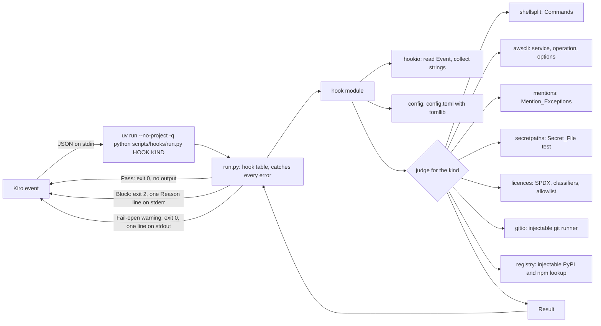

# Design Document

## Overview

This design builds the eight hooks of `requirements.md`, the Runner (`scripts/hooks/run.py`), the licence check script and `config.toml`. Every hook except tests-after-task runs the Runner, which loads that hook's own module from `scripts/hooks/` and turns every error into the hook's exit code. The hook modules share a few standard-library modules: one reads the Event, one loads the Config, one splits shell text into Commands, one parses aws commands, one finds Mention_Exceptions, one matches Secret_File paths, and one judges licences. Each guard is a pure function from an Event, the kind of call and a context to a Verdict, so the tests call it directly with synthetic Events and never need Kiro, the network or a real AWS account.

The sections don't follow the requirement numbering. Each section names the requirements it covers, and the table at the end maps every acceptance criterion to the part of the design and the test that covers it.

### Design decisions

These choices go beyond the requirements. Each one is small and fails closed.

1. **Policy lives in the Config, grammar and plumbing live in code.** A setting is a value someone might change to change what the hooks allow, block or wait for: names, prefixes, lists, limits, patterns. Those are all in `config.toml` (Requirement 2.7). Facts about how PowerShell, bash, cmd.exe, git, aws, uv, pip and npm read their own arguments aren't settings. Changing them wouldn't change our policy, only break the parser, so they live in code next to the parser that uses them. The Runner's own table of hooks and the location of the hooks' state files live in `run.py` (decision 8).
2. **The entry's kind decides the rules.** Each Hook_Entry's Launcher names the kind of call it checks: `shell`, `tools` or `read`. A guard applies that kind's rules to every call that reaches it through that entry, whatever tool name the Event gives (Requirement 1.21). The guards still look for commands and paths in every string value (Requirement 1.5).
3. **The dialect comes from the tool name.** The tool name only decides how shell text is read. `execute_pwsh` and `control_pwsh_process` are read as PowerShell, `execute_bash`, `control_bash_process` and `shell` as POSIX sh, and `execute_cmd` as cmd.exe. Any other or missing tool name is read both as PowerShell and as POSIX sh, and every Command either reading finds is judged. cmd.exe rules also apply inside `cmd /c`.
4. **Heredocs and here-strings are data.** Their bodies aren't split into Commands, so file text written through the shell can't cause false blocks. A body that feeds `python`, such as `python - <<'EOF'`, is checked as Python code, the same as `python -c`. A body that feeds a shell (`bash <<EOF`) is split into Commands. The Spend_Name check (Requirement 4) reads every body.
5. **`cd` changes where later paths resolve.** A `cd`, `Set-Location`, `sl`, `chdir`, `pushd` or `Push-Location` earlier in the same chain, and git's `-C`, change the folder that later relative paths resolve against. The target may start with a Home_Spelling, which resolves to the home folder (Requirement 20.5). Without this, `cd pipeline && git add frames` would test the wrong folder, and guard-secrets would resolve a later `..` against the wrong folder.
6. **git long-option prefixes count.** git accepts any unambiguous prefix of a long option (`--al` for `--all`), so Guard_Git treats any prefix of a blocked long option, at least one letter after `--`, as that option. An ambiguous prefix makes git itself fail, so blocking it costs nothing.
7. **An added line is compared by content.** A line counts as added when the commit's version of a file holds it and the HEAD version holds no identical line. This needs no diff parsing, works the same for staged, new and untracked files, and runs in linear time.
8. **The hook state lives in `data/hooks/`, and the Runner owns its location.** `data/` is already git-ignored, and the Spend_Log lives there too. The Start_Record (`data/hooks/task-start.json`) and the saved Devlog_Warnings (`data/hooks/devlog-warnings.txt`) go there, and the folder is created when first needed. The Runner must save a Devlog_Warning even when the Config is broken (Requirement 15.11), so these locations are constants in `run.py`, for the same reason that the Runner's list of hooks is (Requirement 1.19). Branch_Check, Devlog and Session_Status import them from there, so there is one source. This adds one item to the exceptions of Requirement 2.7.
9. **Git calls get their own time limit.** Requirement 2.6 lists the time limits that must exist. The Config also gets `git_seconds`, the budget for all git calls in one hook run, so a hung git process makes the guard block instead of running into the hook timeout.
10. **A matcher holds one selector, so guard-paid gets one entry per selector.** The installed Kiro IDE 1.4.154 (agent extension 1.1.873) reads a Hook_Entry's `matcher` as one string. A string with no regex characters other than `.`, `*` and `?` is matched against the tool's ID, its alias and each of its tags, such as `shell`, `read`, `@mcp` or `@powers`. Every matcher is also compiled as a regular expression and tested against the tool ID. A matcher with `|` in it is only a regular expression, so `@mcp|@powers` matches no tool, because no tool ID holds `@`. So one matcher can't list `@mcp` and `@powers`, and guard-paid gets three Hook_Entries: `shell`, `@mcp` and `@powers`, with the last two running the same `tools` Launcher. guard-secrets keeps two: in 1.4.154, `grep_search` carries the `read` tag, so the matcher `read` selects the file read tools and the text search (see "Hook files").
11. **Secret_File paths are compared as text.** guard-secrets lowercases a path, turns every `\` into `/` and resolves `.` and `..` itself, without asking the file system, so the result is the same on Windows, macOS and Linux (choice I in the requirements) and no file needs to exist.
12. **git's own rules tell a branch from a folder.** An argument after `--` is always a path. An argument that git's ref-name rules forbid in a branch name (a wildcard, a leading `:`, `.`, `..` or a trailing slash) is always a path. Only a folder that could also be a branch makes guard-git ask git, with one `git rev-parse` call inside the git time limit, and a failed call blocks (see "guard-git").

## Architecture



### Module layout

```
config.toml                      every number and setting (Requirement 2)
scripts/
  __init__.py                    empty, makes scripts a package for the tests
  check_licences.py              Licence_Checker (Requirement 12)
  hooks/
    __init__.py                  empty
    run.py                       the Runner: hook table, error catching, state-file locations
    hookio.py                    Event reading, string collection, Verdict, Result, main helpers
    config.py                    finds the Repo_Root, loads config.toml, typed accessors
    shellsplit.py                splits shell text into Commands (PowerShell, POSIX sh, cmd.exe)
    awscli.py                    parses one AWS_Command
    mentions.py                  finds the Mention_Exception arguments of a Command
    cloudcmd.py                  finds Cloud_Commands and Inline_AWS_Code
    secretpaths.py               Home_Spellings, path normalisation, the Secret_File test
    gitio.py                     GitRunner protocol and the real runner (subprocess with a deadline)
    secret_scan.py               Secret patterns from the Config, scanning of added lines
    licences.py                  SPDX parsing, licence statements, Allowlist, PEP 503 names
    registry.py                  PyPI and npm lookups behind a Lookup protocol
    guard_paid.py                guard-paid
    guard_git.py                 guard-git
    guard_licence.py             guard-licence
    guard_secrets.py             guard-secrets
    branch_check.py              branch-check
    devlog.py                    devlog
    session_status.py            session-status
    licence_allowlist.txt        the Allowlist (Requirement 11)
.kiro/hooks/
  guard-paid.json  guard-git.json  guard-licence.json  guard-secrets.json
  branch-check.json  tests-after-task.json  devlog.json  session-status.json
tests/
  conftest.py                    fixtures: temporary repo, Config copy, fake runners
  hook_events.py                 builders for synthetic Events
  hook_strategies.py             Hypothesis strategies for Requirement 19
  test_run.py  test_hookio.py  test_config.py  test_shellsplit.py  test_awscli.py  test_mentions.py
  test_guard_paid.py  test_secretpaths.py  test_guard_secrets.py  test_guard_git.py  test_secret_scan.py
  test_licences.py  test_guard_licence.py  test_check_licences.py
  test_branch_check.py  test_devlog.py  test_session_status.py
  test_hook_files.py  test_hook_speed.py  test_docs.py  test_properties.py
```

No module shares a name with a standard-library module (so `secret_scan` and `secretpaths`, not `secrets`), and none is named after an installed package.

### How the hooks are started (Requirement 1.1)

Every command action is the Launcher, for example `uv run --no-project -q python scripts/hooks/run.py guard-git shell`. It has no shell operators, quotes or variables, so cmd.exe, PowerShell and POSIX shells all read it as the same words. A guard's Launcher ends with the kind of call its entry checks. The Launchers of branch-check, devlog and session-status end with the hook's name.

| Platform | What happens |
|---|---|
| Windows, Kiro IDE | Kiro runs the command in the project root. uv finds `.venv\Scripts\python.exe` (Python 3.11) and runs it without reading `pyproject.toml`, so uv never locks, syncs or installs anything on a hook run. `-q` keeps uv's own messages off stderr. |
| macOS and Linux, Kiro IDE | The same, with `.venv/bin/python`. |
| Kiro Web | The same command in the cloud workspace. uv must be on PATH there and must find a Python 3.11. The Live_Check_Task confirms both (Requirement 17.6). |

The Runner and the hook modules need only the standard library, so the `.venv` never needs a package for them. These facts were measured with uv 0.12.5 on the Windows laptop on 19 November 2026:

- `uv run --no-project` runs the Python 3.11.0 in the repo's `.venv`, even when `pyproject.toml` can't be parsed. `--no-sync` exits 2 on such a file, which is why the Launcher doesn't use it.
- When the script exits 2, uv exits 2. uv's own errors exit 2, and so does Python when the script file is missing, so a missing Runner or a failing uv blocks a guarded call.
- An uncaught Python exception exits 1, which Kiro IDE 1.1.14 lets through on Pre Tool Use. So no exception may escape the Runner, not even while it loads a hook's module.

If uv isn't on PATH at all, the hook can't start, and the shell's "not found" code isn't 2, so the guards let calls through and branch-check lets tasks start. On Session Start, Kiro shows the shell's error as a warning. The requirements accept this, and the README says how to switch a hook off.

### The Runner: `scripts/hooks/run.py` (Requirements 1.11 to 1.13 and 1.17 to 1.20)

```
python scripts/hooks/run.py <hook> [<kind>]
```

The Runner is the only file a Launcher names. It holds the hook table, which it never reads from the Config (Requirement 1.19):

| Hook | Module | Fails | Kinds it takes |
|---|---|---|---|
| `guard-paid` | `scripts.hooks.guard_paid` | closed | `shell`, `tools` |
| `guard-git` | `scripts.hooks.guard_git` | closed | `shell` |
| `guard-licence` | `scripts.hooks.guard_licence` | closed | `shell` |
| `guard-secrets` | `scripts.hooks.guard_secrets` | closed | `shell`, `read` |
| `branch-check` | `scripts.hooks.branch_check` | closed | none |
| `devlog` | `scripts.hooks.devlog` | open | none |
| `session-status` | `scripts.hooks.session_status` | open | none |

It also holds the hooks' state-file locations (design decision 8): `STATE_DIR = ("data", "hooks")`, `START_RECORD = "task-start.json"` and `DEVLOG_WARNINGS = "devlog-warnings.txt"`, plus `save_devlog_warning(root, line)`, which appends one line to the warnings file and ignores every error of its own.

What the Runner does, in order:

1. **Reads its arguments.** A hook name that isn't in the table, a kind the hook doesn't take, a missing kind for a guard, a kind for a hook that takes none, or extra arguments make it write one line to stderr that starts with `run.py: ` and exit 2, for example `run.py: unknown hook "guard-pay". Fix the command in .kiro/hooks/, the known hooks are guard-paid, guard-git, ...` or `run.py: guard-paid doesn't take the kind "read". Fix the command in .kiro/hooks/, guard-paid takes shell or tools.` (Requirement 1.20). The line starts with `run.py: ` rather than a hook's name, because the name may be the unknown part. The unknown name goes through the Runner's own `_one_line`, so it can't add a second line. This exit 2 can't block a message or a task through a fail-open hook, because the hook-file tests check that every Launcher names a hook and kind in the table (Requirement 17.3) and that the fail-open hooks sit only on SessionStart and PostTaskExec, where exit 2 blocks nothing (Requirement 17.9).
2. **Checks the Python version.** Python older than 3.11 is a failure of the hook (step 5), with the problem "needs Python 3.11 or newer, found 3.x". `run.py` uses only syntax that Python 3.8 can parse, so an older Python still gets this far.
3. **Puts the Repo_Root on `sys.path`.** The Repo_Root is two folders above `run.py`. When Python runs `scripts/hooks/run.py` as a file, it puts `scripts/hooks/` on the path, not the Repo_Root.
4. **Runs the hook.** It swaps `sys.stdout` and `sys.stderr` for in-memory buffers, so nothing a module prints can reach Kiro by accident. Then, inside one `try` that catches `BaseException`, it imports the hook's module with `importer` (`importlib.import_module` unless a test passes another) and calls `module.main(kind, stdin, root)`, which returns a `Result(code, out, err)`. `kind` is the Launcher's kind, or `None` for a hook that takes none. `stdin` is the binary stream the Runner was given, and `None`, which a real hook run passes, means `sys.stdin.buffer`. `root` is the `root` a test passed to the Runner, or else the Repo_Root from step 3. `BaseException` covers a `SyntaxError` or `ImportError` while the module or anything it imports loads, a missing name, `SystemExit`, `KeyboardInterrupt`, `RecursionError` and `MemoryError` (Requirement 1.18).
5. **Turns a failure into the hook's exit code.** For a fail-closed hook it builds a Block: `<hook>: couldn't run its own code (<Type>: <message>), so <what> stay blocked until it runs. Fix scripts/hooks/ or config.toml with a file-write tool, rewriting the file whole if the read tools are blocked too, or ask the user to switch <hook> off in the Agent Hooks panel.` `<what>` is "shell calls", "power and MCP calls", "file reads and text searches" or "spec tasks", from the kind (Requirement 1.12). Both ways out need no tool that a guard blocks (see "Fixing a hook that blocks everything" under Error handling). For a fail-open hook it builds exit 0 with one line on stdout: `devlog: couldn't run (<Type>: <message>), so no devlog line was added. Fix scripts/hooks/devlog.py.` or `session-status: couldn't show the status (<Type>: <message>). Fix scripts/hooks/session_status.py or config.toml.` (Requirement 1.13).
6. **Checks the Result.** A fail-closed hook's Result must be exit 0 with no output, or exit 2 with exactly one line on stderr. A fail-open hook's Result must be exit 0 with nothing on stderr, and Devlog's must have at most one line on stdout. Session_Status's stdout is its status of up to four lines, which `status` keeps within `[session_status].max_lines` (Property 33), so the Runner, which never reads the Config, passes it on as it is. Anything else counts as a failure (step 5), so a bug in a module can't produce an exit code or output that the hook's rule forbids (Requirements 1.8, 1.10 and 19.19).
7. **Writes and exits.** It restores the real streams, writes the output as UTF-8 bytes to `sys.__stdout__.buffer` or `sys.__stderr__.buffer`, so a Windows code page can't mangle it, flushes, and ends with `os._exit(code)`, so a stdin reader still waiting on a pipe that never closes can't delay the exit. A failed write is ignored and the exit code stands. For devlog, every line written to stdout is first saved with `save_devlog_warning`, whether `finish` returned it or the Runner built it in step 5, so saving lives in one place and no line is saved twice (Requirements 15.10 and 15.11).

`_one_line` in the Runner replaces every run of C0 and C1 control characters, DEL, U+2028 and U+2029 with one space and strips the ends. That covers every character `str.splitlines()` breaks on. It is a copy of `hookio.one_line`, kept in the Runner so a broken `hookio` can't stop the Runner from writing one line. A unit test checks that both give the same result.

A syntax error in `run.py` itself can't be caught, because Python reads the whole file before it runs any of it, and exits 1. The `ast` check in `tests/test_run.py` parses every file under `scripts/`, so such a file fails the tests before it's committed (requirements, out of scope).

### Imports

The tests import the modules as a package, such as `from scripts.hooks import guard_git`. That works because `pyproject.toml` already sets `pythonpath = ["."]` and the design adds empty `scripts/__init__.py` and `scripts/hooks/__init__.py`. The Runner imports a hook's module the same way, after step 3, so a test and a hook run load the same code.

`scripts/check_licences.py` puts the Repo_Root on `sys.path` the same way. It isn't a hook, so it needs no Runner: a person runs it and reads the traceback. The project isn't installed into `.venv` (it has no build system), so nothing else puts the Repo_Root on the path.

Heavy standard-library modules (`urllib.request`, `ssl`, `importlib.metadata`, `difflib`, `subprocess`) are imported only inside the functions that use them, so an Event with nothing to check never pays for them (Requirement 1.11). guard-secrets' `read` kind imports only `hookio`, `config` and `secretpaths` (Requirement 20.7).

## Components and Interfaces

Each component's full behaviour is in its own section below. This table is the index.

| Component | Module | Main interface | Requirements |
|---|---|---|---|
| Runner | `run.py` | `main(argv, stdin=None, root=None, importer=importlib.import_module) -> int`, `HOOKS`, `STATE_DIR`, `START_RECORD`, `DEVLOG_WARNINGS`, `save_devlog_warning` | 1.11 to 1.13, 1.17 to 1.20, 15.11, 19.19 |
| Event reader | `hookio` | `read_stdin`, `parse_event`, `dialects`, `guard_main`, `quiet_main`, `block`, `allow`, `one_line` | 1.3 to 1.10, 1.14, 1.21 |
| Config loader | `config` | `repo_root()`, `load(root) -> Config` | 2 |
| Shell splitter | `shellsplit` | `split(text, dialect, cwd, home) -> list[Command]`, `program_name` | 1.6, 1.7, 20.5 |
| aws parser | `awscli` | `parse(cmd) -> AwsCall` | 5, 6, 21.4 |
| Mention finder | `mentions` | `mention_words(cmd) -> set[int]` | 4.2, 20.2 |
| Cloud and inline-code finder | `cloudcmd` | `cloud_module(cmd) -> str or None`, `inline_aws(code) -> InlineFinding or None` | 3.3 to 3.5, 7.2, 7.3 |
| Secret_File test | `secretpaths` | `normalise(text, cwd, home) -> NormPath`, `is_secret_file(path, cfg)`, `pieces(text)`, `names_secret_file(text, cwd, home, cfg)` | 20.3 to 20.6 |
| git runner | `gitio` | `GitRunner`, `real_git(deadline)`, `current_branch`, `head_commit` | 8, 9, 13, 15, 16 |
| Secret scanner | `secret_scan` | `added_lines(new, old)`, `scan(lines, patterns) -> Finding or None` | 9.5, 9.6 |
| Licence logic | `licences` | `pep503`, `parse_spdx`, `spdx_allowed`, `judge_statements`, `load_allowlist`, `find_entry`, `is_blocked_package` | 10, 11, 12.3 |
| Registry lookup | `registry` | `Lookup`, `http_lookup(cfg)` | 10.2, 10.6 |
| Guard_Paid | `guard_paid` | `main(kind, stdin, root)`, `judge_shell(event, ctx)`, `judge_tools(event, ctx)`, `judge_aws(cmd, cfg)` | 3 to 7 |
| Guard_Secrets | `guard_secrets` | `main(kind, stdin, root)`, `judge_shell(event, ctx)`, `judge_read(event, ctx)` | 20, 21 |
| Guard_Git | `guard_git` | `main(kind, stdin, root)`, `judge_shell(event, ctx)` | 8, 9 |
| Guard_Licence | `guard_licence` | `main(kind, stdin, root)`, `judge_shell(event, ctx)`, `package_adds(cmd)` | 10 |
| Licence_Checker | `scripts/check_licences.py` | `main(argv) -> int` | 12 |
| Branch_Check | `branch_check` | `main(kind, stdin, root)`, `judge(event, ctx)` | 13 |
| Tests_After_Task | `.kiro/hooks/tests-after-task.json` | agent prompt | 14 |
| Devlog | `devlog` | `main(kind, stdin, root)`, `finish(event, ctx) -> str`, `build_line(...) -> str` | 15 |
| Session_Status | `session_status` | `main(kind, stdin, root)`, `status(event, ctx) -> str`, `spend_sums(path, today)`, `instances(ctx)`, `take_warnings(root)` | 16 |

Every hook module has `main(kind, stdin=None, root=None) -> Result`, which the Runner calls with the Launcher's kind, the stdin stream and the Repo_Root (step 4 of the Runner). The guards' `main` returns `hookio.guard_main("<hook>", kind, {kind: judge, ...}, stdin, root)`, and Devlog's and Session_Status's returns `hookio.quiet_main("<hook>", body, stdin, root)`. The judges and bodies take a `Context`, so the tests call them directly.

## Data Models

| Type | Fields | Used by |
|---|---|---|
| `Event` | `raw`, `strings`, `tool_name`, `cwd`, `session_id`, `event_name` | every hook |
| `Context` | `cfg: Config`, `root: Path`, `home: Path or None`, `git: GitRunner`, `lookup: Lookup`, `aws: AwsRunner`, `now: Callable[[], datetime]` | every judge and body |
| `Verdict` | `blocked: bool`, `reason: str` | Guards, Branch_Check |
| `Result` | `code: int`, `out: str`, `err: str` | the Runner and every `main` |
| `Word` | `text`, `raw`, `span`, `quoted`, `expands` | shellsplit |
| `Redirect` | `direction: "in" or "out"`, `target: Word` | shellsplit |
| `Command` | `words`, `env`, `program`, `depth`, `in_script_wrapper`, `redirects`, `stdin_text`, `cwd`, `index` | the Guards |
| `AwsCall` | `service`, `operation`, `options`, `positionals`, `buckets` | Guard_Paid, Guard_Secrets |
| `NormPath` | `parts: tuple[str, ...]` (lowercase, no `.` or `..`), `rooted: bool` | secretpaths |
| `GitCall` | `sub`, `args`, `cwd` | Guard_Git |
| `StagedFile` | `path: str` (repo-relative, `/`), `size: int`, `content: Callable[[], bytes]`, `head: bytes or None`, `source: "index" or "worktree"` | Guard_Git |
| `SecretPattern` | `kind: str`, `regex: re.Pattern`, `not_all_hex: bool` | secret_scan |
| `Finding` | `line: int`, `kind: str` | Guard_Git |
| `Statement` | `source: "expression" or "license" or "classifier"`, `text` | licences |
| `Judgement` | `allowed`, `licence`, `why` | Guard_Licence, Licence_Checker |
| `SpdxNode` | `Leaf(id)`, `With(leaf, exception)`, `And(left, right)`, `Or(left, right)` | licences |
| `AllowEntry` | `name`, `prefix`, `version`, `licence`, `place`, `reason`, `line` | licences |
| `PackageSpec` | `ecosystem`, `name`, `version`, `source`, `raw` | licences, used by Guard_Licence and registry |
| `PackageAdd` | `tool`, `group`, `specs` | Guard_Licence |
| `Installed` | `ecosystem`, `name`, `version`, `stmts` | Licence_Checker |
| `Direct` | `ecosystem`, `name`, `where: "project" or "optional" or "group" or "package.json"` | Licence_Checker |
| Start_Record | JSON file `data/hooks/task-start.json`: `{"head": str or null, "time": str, "spec": str or null, "task": str or null}` | Branch_Check writes, Devlog reads |
| Devlog_Warning store | text file `data/hooks/devlog-warnings.txt`, one warning per line, oldest first | Devlog and the Runner append, Session_Status reads and deletes |
| Spend_Log line | JSON object per line in `data/spend.jsonl`: `time` (ISO 8601, UTC), `job`, `instance_id`, `instance_type`, `usd`. This spec only reads it. The cloud spec writes it. | Session_Status |

## Shared plumbing (Requirement 1)

### hookio: reading the Event

```python
@dataclass(frozen=True)
class Event:
    raw: dict | list | str | int | float | bool | None   # parsed JSON
    strings: tuple[str, ...]        # every string value, depth first (Requirement 1.5)
    tool_name: str | None           # only picks the shell dialect (design decision 3)
    cwd: Path                       # the call's working directory (Requirement 1.14)
    session_id: str | None
    event_name: str | None          # SessionStart, PreTaskExec, PostTaskExec, PreToolUse, ...

class EventError(Exception): ...   # stdin wasn't complete JSON

def read_stdin(limit_s: float, stream: BinaryIO | None = None) -> bytes: ...
def parse_event(data: bytes, repo_root: Path) -> Event: ...   # raises EventError
```

- `read_stdin` reads raw bytes in 64 KiB chunks on a daemon thread and waits for EOF until `limit_s` (`[hooks].stdin_seconds`) has passed. Then it returns what arrived so far (Requirement 1.4). Kiro IDE 1.x writes and closes stdin straight away, so the limit only matters for a channel that never closes. Because the reader is a daemon thread and the Runner ends with `os._exit`, a stdin that never closes can't keep the process alive.
- The bytes are decoded as UTF-8 with `errors="replace"` (Requirement 1.3), then parsed with `json.loads`. Empty input or invalid JSON raises `EventError`.
- `strings` is collected with an explicit stack, not recursion, so deeply nested JSON can't raise `RecursionError`. Dict keys aren't collected, only values.
- **Field lookups by normalised key.** A few fields are needed by name: the tool name, the working directory, the session ID and the event name. A key matches when its name, lowercased with every `_` and `-` removed, equals the wanted name: `toolname`, `cwd` or `workingdirectory`, `sessionid`, `hookeventname`. So `tool_name`, `toolName` and `ToolName` all match. These lookups only pick the dialect, folders and the devlog's fields. Commands and paths are always looked for in every string value.
- **Working directory.** The deepest non-empty `cwd` wins, so `tool_input.cwd` beats the top-level `cwd`. A relative value resolves against the Repo_Root. With no `cwd` at all, it's the Repo_Root (Requirement 1.14).
- **Event name.** If no `hook_event_name` key exists, any string value equal (ignoring case) to a known trigger name counts: `SessionStart`, `agentSpawn`, `PreTaskExec`, `PostTaskExec`, `PreToolUse`.

### hookio: the dialect

```python
def dialects(event: Event) -> tuple[Dialect, ...]: ...
```

`dialects` returns `(POWERSHELL,)` for `execute_pwsh` and `control_pwsh_process`, `(CMD,)` for `execute_cmd`, `(POSIX,)` for `execute_bash`, `control_bash_process` and `shell`, and `(POWERSHELL, POSIX)` for any other or missing tool name (design decision 3). The tool name never decides which rules apply. That comes from the kind in the Launcher (Requirement 1.21).

### hookio: Verdict, Result and the mains

```python
@dataclass(frozen=True)
class Verdict:
    blocked: bool
    reason: str = ""            # one line, starts with "<hook>: "

@dataclass(frozen=True)
class Result:
    code: int                   # 0, or 2 for a Block
    out: str = ""               # at most one line, for stdout
    err: str = ""               # at most one line, for stderr

def allow() -> Verdict: ...
def block(hook: str, what: str, instead: str) -> Verdict: ...
def one_line(text: str) -> str: ...
def guard_main(hook: str, kind: str | None, judges: Mapping[str | None, Callable[[Event, Context], Verdict]],
               stdin: BinaryIO | None = None, root: Path | None = None, ctx: Context | None = None) -> Result: ...
def quiet_main(hook: str, body: Callable[[Event | None, Context], str],
               stdin: BinaryIO | None = None, root: Path | None = None, ctx: Context | None = None) -> Result: ...
```

- `block` builds `"<hook>: <what>. <instead>."` and passes it through `one_line`, which turns every run of control characters into one space and strips the ends. That covers every character `str.splitlines()` treats as a line break (`\n`, `\r`, `\x0b`, `\x0c`, `\x1c` to `\x1e`, `\x85`, U+2028 and U+2029) and every other character in Unicode category Cc. A file name, package name or path that holds a line break can't add a second line (Requirements 1.8, 1.9 and 19.7).
- The names and numbers in every Reason (profiles, region, bucket prefix, size limit, branch names, the feature prefix) are filled in from the Config. The Reasons in this document show today's values.
- `guard_main` does the work of every Guard's `main` and of Branch_Check's (which passes `{None: judge}`). It loads the Config from `root`, reads `stdin`, parses the Event, builds the real `Context` and calls the judge for `kind`. `stdin` is a binary stream, and `None` means `sys.stdin.buffer`. `root` is the Repo_Root, and `None` means `config.repo_root()`. A test that passes `ctx` gives the Config and the Repo_Root through it. A Pass is `Result(0)` (Requirement 1.10). A Block is `Result(2, err=reason)` (Requirement 1.8). A `ConfigError` or `EventError` becomes a Block whose Reason names the hook, the problem and the fix (Requirement 1.12), for example `guard-git: couldn't read config.toml (line 12: expected '='). Fix it with a file-write tool, rewriting it whole if the read tools are blocked too, or ask the user to restore it with git or switch guard-git off in the Agent Hooks panel.` Any other exception is left to the Runner, which turns it into a Block the same way.
- `quiet_main` does the work of Devlog's and Session_Status's `main`, with the same `stdin` and `root`. It catches every `Exception` and returns `Result(0, out=<one line naming the hook and the problem>)` for one, so a failing body still gets its own wording. It returns `Result(0, out=<the body's text>)` otherwise. Anything it doesn't catch, the Runner does (Requirement 1.13).
- The tests pass their own `stdin` and `root` to a hook's `main`, or their own `stdin` and `ctx` to `guard_main` and `quiet_main`, so they run a hook in-process.

The `Context` holds the loaded Config, the Repo_Root, the home folder (`Path.home()`, or `None` when it can't be found) and the injectable parts: `git: GitRunner`, `lookup: Lookup`, `aws: AwsRunner` and `now`. The mains build the real parts lazily, on first use, so a hook run imports only the parts its judge calls, and guard-secrets' `read` kind imports none of `gitio`, `registry` or `session_status`. The tests build fakes. `hookio` types `git`, `lookup` and `aws` as plain callables, so it imports none of those modules itself.

### config: loading config.toml (Requirement 2.1)

```python
def repo_root() -> Path: ...                  # Path(__file__).resolve().parents[2]
def load(root: Path | None = None) -> Config: ...
class ConfigError(Exception): ...
```

`load` reads `config.toml` with `tomllib.load` (binary mode), checks that every key below exists with the right type, and returns a frozen `Config` dataclass with one attribute per table. A missing file, a TOML error or a missing or wrong-typed key raises `ConfigError` with the key's dotted name, which the guards turn into a Block.

### shellsplit: from shell text to Commands (Requirements 1.6, 1.7 and 20.5)

```python
class Dialect(Enum): POWERSHELL, POSIX, CMD

@dataclass(frozen=True)
class Word:
    text: str                  # after quotes and escapes are removed
    raw: str                   # as written
    span: tuple[int, int]      # offsets in the original string
    quoted: bool
    expands: bool              # holds $(...), backticks, $NAME, ${...}, $env:, %NAME% outside single quotes

@dataclass(frozen=True)
class Redirect:
    direction: Literal["in", "out"]
    target: Word

@dataclass(frozen=True)
class Command:
    words: tuple[Word, ...]    # environment prefixes removed
    env: tuple[tuple[str, str], ...]   # NAME=value prefixes and env assignments
    program: str               # see "Program" below
    depth: int                 # 0 at top level, +1 inside each wrapper or subshell
    in_script_wrapper: bool    # inside bash -c, sh -c, cmd /c, pwsh/powershell -Command, iex
    redirects: tuple[Redirect, ...]
    stdin_text: str | None     # heredoc or here-string body fed to this Command
    cwd: Path                  # folder relative paths resolve against
    index: int                 # position in the whole chain, for "earlier Command" rules

class SplitError(Exception): ...

def split(text: str, dialect: Dialect, cwd: Path, home: Path | None = None) -> list[Command]: ...
def program_name(word: str) -> str: ...
```

- **Tokenising.** Each dialect has its own tokenizer:
  - POSIX: `'...'` literal, `"..."` with `\` escapes for `"`, `\`, `$` and backtick, `\` escapes outside quotes, `$(...)`, backticks, `(...)` subshells, `{ ...; }` groups.
  - PowerShell: `'...'` literal with `''` for a quote, `"..."` with backtick escapes and `""`, backtick escapes outside quotes, `$(...)`, `@(...)`, `(...)`, `{...}` script blocks, `@'...'@` and `@"..."@` here-strings, `#` and `<# #>` comments, and the `--%` stop-parsing token, which makes the rest of the line one word.
  - cmd.exe: `"..."` toggles, `^` escapes, `%NAME%` expansion.
  - Each tokenizer records every Word's raw text and source span.
- **Chains.** `;`, `&&`, `||`, `|`, `&` (POSIX and cmd.exe background or chain) and line breaks end a Command. In PowerShell a leading `&` is the call operator instead (see wrappers).
- **Nesting.** `$(...)`, backticks, `(...)`, `@(...)` and `{...}` are split recursively. Their Commands are added with `depth + 1`, and the outer Command keeps the group as one Word.
- **Redirects.** `<`, `0<` and `<>` with their target are input redirects. `>`, `>>`, `>|`, `2>`, `&>` and `*>` are output redirects, and so are the targets of `Out-File`, `Set-Content`, `Add-Content` and `Tee-Object`. A target written straight after the operator (`<.env`) counts the same. Redirect words aren't part of `words`. PowerShell reserves `<`, but the splitter still records it, so a reader never gets less checking than another dialect would give.
- **Environment prefixes.** Leading `NAME=value` words (POSIX), `env [-i] [-u NAME] [NAME=value]... cmd`, and `set NAME=value &&` (cmd.exe) move into `env`. The Command's words start at the real program.
- **Wrappers.** The words after a wrapper are split again and added as Commands with `depth + 1`:

  | Kind | Wrappers | What is split again |
  |---|---|---|
  | Script wrapper | `bash -c`, `sh -c`, `zsh -c`, `dash -c`, `cmd /c`, `cmd /k`, `cmd /s /c`, `pwsh -Command` / `-c`, `powershell -Command` / `-c`, `Invoke-Expression`, `iex` | The script word, parsed again (POSIX for `sh`, cmd.exe for `cmd`, PowerShell for `pwsh`, `powershell`, `iex`). Marked `in_script_wrapper`. |
  | Argv wrapper | the PowerShell call operator `&`, `npx [options] <package>`, `uv run [options]`, `env` | The remaining words, as the inner Command's argv. `uv run`'s and `npx`'s own options are skipped, with the values of the ones that take a value (`--with`, `--python`/`-p`, `--project`, `--directory`, `--group`, `--extra`, `--env-file`, `--package`, `--index`, `-y`...). |

  `uv run -m X` and `uv run --module X` become `python -m X`, and `uv run path.py` becomes `python path.py`. The values of `uv run`'s skipped options stay visible to guard-secrets as words of the outer Command, so `uv run --env-file .env python x.py` is still judged on `.env`.
- **Heredocs and here-strings** (design decision 4). POSIX `<<WORD`, `<<-WORD`, `<<'WORD'` and `<<"WORD"`, and PowerShell `@'...'@` or `@"..."@` piped into a Command, become that Command's `stdin_text`. When the Command's Program is a shell (`bash`, `sh`, `zsh`, `pwsh`, `powershell`) the body is split again as a script wrapper.
- **cd tracking** (design decision 5). A Command `cd X`, `Set-Location X`, `sl X`, `chdir X`, `pushd X` or `Push-Location X` (also with `-Path X` or `-LiteralPath X`) sets `cwd` for the Commands after it in the same chain, when `X` is literal text or starts with a Home_Spelling followed by `/`, `\` or the end. A Home_Spelling resolves to `home`. Any other form, such as a variable or `$(...)`, leaves `cwd` unchanged. A relative `X` resolves against the current `cwd`.
- **Program.** `program_name` takes the first word, drops any folder (split on `/` and `\`), drops a trailing `.exe`, `.cmd` or `.bat`, and lowercases it, so `C:\Program Files\Amazon\AWSCLIV2\aws.EXE` becomes `aws`.
- **Failure.** An unclosed quote, here-string, heredoc, `$(` or `(` raises `SplitError`. The guards then check the raw text for any word they guard (their trigger words below). If one is there, the guard blocks with `"<hook>: couldn't read the command (unclosed quote or bracket). Close the quotes and try again."` If not, the text is ignored (Requirement 1.7).

### mentions: the Mention_Exception arguments (Requirements 4.2 and 20.2)

```python
def mention_words(cmd: Command, top_level_only: bool) -> set[int]: ...   # indexes into cmd.words
```

An argument is a mention when it is one of these, and holds no `$(`, no backtick, and no variable reference (`$NAME`, `${`, `$env:`, `%NAME%`):

| Command | Arguments that are mentions |
|---|---|
| `git commit` | the value of `-m`, `--message`, `-m<msg>` and `--message=<msg>` |
| `git grep` | its pattern words and the values of `-e` |
| `git log` | `--grep=`, `-S`, `-G` and their separate-word values |
| `grep`, `rg` | the first non-option word and the values of `-e` and `--regexp` (not `-f` or `--file`, whose value is a file to read) |
| `findstr` | its search strings and `/C:` values (not `/G:`, whose value is a file to read) |
| `Select-String` | the value of `-Pattern` |
| `pytest` (also via `python -m pytest` and `uv run`) | the value of `-k` |

Guard_Paid passes `top_level_only=True`, which also returns nothing for the forms Requirement 4.3 puts outside every Mention_Exception (see "guard-paid"). Guard_Secrets passes `top_level_only=False`: a commit message or search pattern inside `bash -c` still can't read a file.

### Prefilter (Requirement 1.11)

Before splitting, each guard checks whether a string value holds any of its trigger words, ignoring case. The words come from the Config:

| Guard | Trigger words |
|---|---|
| Guard_Paid | `aws`, the Paid_Command Programs, `cloud`, `boto3`, `botocore`, `call_boto3` and the Spend_Names |
| Guard_Git | `git` |
| Guard_Licence | `uv`, `pip`, `pip3`, `npm` and `python` |
| Guard_Secrets (`shell`) | `aws` and the `.env` file name, unless the Event's `cwd` is inside a `.aws` folder, in which case every value is split |

A string value with none of them is skipped without splitting. For an Event that gives a guard nothing to check, the guard's time is Python's start-up, the Runner, the imports of `json`, `tomllib`, `re`, `pathlib` and `dataclasses`, one TOML parse and one search per string value. On the Windows laptop, Python 3.11's start-up with those imports measured 220 to 310 ms, and the whole Launcher (uv plus Python) 330 to 390 ms. So the 500 ms limit holds, but with less room than it looks, and every heavier import stays inside the function that needs it. The speed test measures it (see "Testing strategy").

Kiro IDE runs the Pre Tool Use hooks one after another, and runs every one even after an earlier one blocks ([hook payload reference](https://awslabs.github.io/aidlc-workflows/reference/kiro-ide-hook-payload/)). So each shell call waits for four Launchers, about 1.4 s on the Windows laptop (choices 9 and D in the requirements), and Kiro IDE shows a "Run Command Hook" card for each.

## config.toml (Requirement 2)

The whole file this spec adds. Later specs add their own tables. Every key is required, and `config.load` checks its type.

```toml
# Every number and setting in the repo. Read with tomllib.

[hooks]
stdin_seconds = 5          # how long a hook waits for stdin to close (Requirement 1.4)
idle_ms = 500              # an Event with nothing to check must finish within this (Requirement 1.11)
read_ms = 500              # guard-secrets must judge a File_Read_Call within this (Requirement 20.7)
git_seconds = 10           # budget for all git calls in one hook run

[git]
max_file_bytes = 1048576   # 1 MB
main_branch = "main"
feature_prefix = "feat/"
video_extensions = ["mp4", "mov", "m4v", "avi", "mkv", "webm", "3gp", "hevc", "mts", "m2ts", "wmv", "flv", "mpg", "mpeg"]
blocked_extensions = ["ply", "sog", "npz", "pt", "safetensors", "ckpt"]
image_extensions = ["jpg", "jpeg", "png", "webp", "gif", "bmp", "tif", "tiff", "heic", "heif", "avif", "exr"]
image_folder = "docs/"

# Secrets. Each pattern is a Python regex. "context" patterns only count after one of their names.
[[git.secrets]]
kind = "AWS access key ID"
pattern = '(?:AKIA|ASIA|ABIA|ACCA|A3T[A-Z0-9])[A-Z2-7]{16}'

[[git.secrets]]
kind = "AWS secret access key"
pattern = '''(?i:aws_?secret_?access_?key|secret_?access_?key|aws_?secret)["']?\s*[:=]\s*["']?(?P<value>[A-Za-z0-9/+]{40})(?![A-Za-z0-9/+=])'''
not_all_hex = true         # a 40-digit hex value is a git SHA, never a key

[[git.secrets]]
kind = "AWS session token"
pattern = '''(?:IQoJb3JpZ2luX2Vj|FwoGZXIvYXdz)[A-Za-z0-9/+=]{50,}|(?i:aws_?session_?token|aws_?security_?token)["']?\s*[:=]\s*["']?[A-Za-z0-9/+=]{100,}'''

[[git.secrets]]
kind = "AWS account ID in an ARN"
pattern = 'arn:aws(?:-cn|-us-gov)?:[A-Za-z0-9-]*:[A-Za-z0-9-]*:\d{12}:'

[[git.secrets]]
kind = "private key"
pattern = '-----BEGIN[ A-Z0-9]*PRIVATE KEY[ A-Z]*-----'

[[git.secrets]]
kind = "GitHub token"
pattern = '(?:ghp|gho|ghu|ghs|ghr)_[A-Za-z0-9]{36,}|github_pat_[A-Za-z0-9_]{60,}'

[[git.secrets]]
kind = "Hugging Face token"
pattern = 'hf_[A-Za-z0-9]{30,}'

[[git.secrets]]
kind = "npm token"
pattern = 'npm_[A-Za-z0-9]{36}'

[[git.secrets]]
kind = "PyPI token"
pattern = 'pypi-AgE[A-Za-z0-9_-]{50,}'

[aws]
region = "us-east-1"
project_tag = "project=voxelis-kiroween"
read_profile = "kiroween-read"
runner_profile = "kiroween-runner"
spend_variable = "APPROVED_SPEND"
bucket_prefix = "voxelis-kiroween-"
account_fields = ["OwnerId", "Account", "AccountId"]
account_field_suffix = "Arn"            # any field whose name ends in this
read_prefixes = ["describe-", "list-", "get-"]
stop_calls = ["ec2 stop-instances", "ec2 terminate-instances"]
s3_high_level = ["ls", "cp", "sync", "mv", "rm"]

[secrets]
aws_folder = ".aws"                      # every file inside a folder with this name is a Secret_File
env_file = ".env"                        # this name, and every name that starts with it plus "."
configure_get_words = ["key", "secret", "token", "account", "arn", "mfa"]
# The Secret_AWS_Commands other than "configure get": aws service and operation.
aws_commands = ["configure export-credentials", "s3 presign"]

[cloud]
modules = ["cloud.start", "cloud.smoke_test", "cloud.list", "cloud.stop_all"]
free = ["cloud.list", "cloud.stop_all"]

[paid]
# aws service and operation.
aws = [
  "ec2 run-instances", "ec2 start-instances", "ec2 request-spot-instances",
  "ec2 request-spot-fleet", "ec2 create-fleet", "ec2 create-image",
  "cloudformation create-stack", "cloudformation update-stack",
  "cloudformation deploy", "cloudformation execute-change-set",
]
# Every call to these services that isn't a Read_Call is paid.
aws_services = ["batch", "ecs", "sagemaker"]
# Other programs and the subcommand that makes them paid.
other = ["cdk deploy", "cdk watch", "sam deploy", "sam sync", "terraform apply"]
program_aliases = { "aws-cdk" = "cdk" }
# The boto3 and call_boto3 names of the paid operations. Each also matches its CamelCase form.
inline_operations = [
  "run_instances", "start_instances", "request_spot_instances", "request_spot_fleet",
  "create_fleet", "create_image", "create_stack", "update_stack",
  "create_change_set", "execute_change_set",
]

[session_status]
aws_seconds = 10           # time limit for the describe-instances call (Requirement 16.10)
max_lines = 4
spend_log = "data/spend.jsonl"

[devlog]
path = "docs/devlog.md"
commit_message = "Devlog: {task}"    # {task} is the task, or "task finished" when the Event has none

[licences]
lookup_seconds = 20        # all registry lookups for one Shell_Call together
pypi_url = "https://pypi.org/pypi/{name}/json"
pypi_version_url = "https://pypi.org/pypi/{name}/{version}/json"
npm_url = "https://registry.npmjs.org/{name}/{version}"   # {version} is "latest" when nothing is pinned
allowlist = "scripts/hooks/licence_allowlist.txt"
licence_table = "docs/third-party-licences.md"
blocked_packages = ["opencv-python", "opencv-contrib-python", "opencv-contrib-python-headless"]
dev_group = "dev"

# Allowed_Licences. rules_name is the wording rules.md uses, which the tests look for there.
[[licences.allowed]]
id = "MIT"
rules_name = "MIT"
spellings = ["MIT License", "The MIT License", "Expat", "MIT/Expat"]
classifiers = ["License :: OSI Approved :: MIT License"]

[[licences.allowed]]
id = "MIT-0"
rules_name = "MIT-0"
spellings = ["MIT No Attribution"]
classifiers = ["License :: OSI Approved :: MIT No Attribution License (MIT-0)"]

[[licences.allowed]]
id = "MIT-CMU"
rules_name = "MIT-CMU"
spellings = ["CMU License"]
classifiers = ["License :: OSI Approved :: CMU License (MIT-CMU)"]

[[licences.allowed]]
id = "BSD-2-Clause"
rules_name = "BSD-2-Clause"
spellings = ["BSD 2-Clause", "Simplified BSD", "FreeBSD", "BSD-2"]
classifiers = ["License :: OSI Approved :: BSD License"]

[[licences.allowed]]
id = "BSD-3-Clause"
rules_name = "BSD-3-Clause"
spellings = ["BSD", "BSD License", "BSD 3-Clause", "3-Clause BSD License", "New BSD", "Modified BSD", "BSD-3"]
classifiers = ["License :: OSI Approved :: BSD License"]

[[licences.allowed]]
id = "0BSD"
rules_name = "0BSD"
spellings = ["Zero-Clause BSD", "BSD Zero Clause License"]
classifiers = ["License :: OSI Approved :: Zero-Clause BSD (0BSD)"]

[[licences.allowed]]
id = "Apache-2.0"
rules_name = "Apache-2.0"
spellings = ["Apache 2.0", "Apache 2", "Apache License 2.0", "Apache License, Version 2.0", "Apache License Version 2.0", "Apache Software License", "ASL 2.0"]
classifiers = ["License :: OSI Approved :: Apache Software License"]

[[licences.allowed]]
id = "ISC"
rules_name = "ISC"
spellings = ["ISC License", "ISCL"]
classifiers = ["License :: OSI Approved :: ISC License (ISCL)"]

[[licences.allowed]]
id = "PSF-2.0"
rules_name = "PSF-2.0"
spellings = ["PSF", "PSFL", "Python Software Foundation License"]
classifiers = ["License :: OSI Approved :: Python Software Foundation License"]

[[licences.allowed]]
id = "LicenseRef-matplotlib"
rules_name = "matplotlib's PSF-style licence"
spellings = ["matplotlib", "Matplotlib License"]
classifiers = []

[[licences.allowed]]
id = "Zlib"
rules_name = "Zlib"
spellings = ["zlib/libpng", "zlib License"]
classifiers = ["License :: OSI Approved :: zlib/libpng License"]

[[licences.allowed]]
id = "BSL-1.0"
rules_name = "BSL-1.0"
spellings = ["Boost Software License 1.0", "Boost"]
classifiers = ["License :: OSI Approved :: Boost Software License 1.0 (BSL-1.0)"]

[[licences.allowed]]
id = "Unlicense"
rules_name = "the Unlicense"
spellings = ["The Unlicense"]
classifiers = ["License :: OSI Approved :: The Unlicense (Unlicense)"]

[[licences.allowed]]
id = "CC0-1.0"
rules_name = "CC0"
spellings = ["CC0", "CC0 1.0 Universal"]
classifiers = ["License :: CC0 1.0 Universal (CC0 1.0) Public Domain Dedication"]

# SPDX exceptions allowed after WITH.
[[licences.allowed_exceptions]]
id = "LLVM-exception"
rules_name = "LLVM exception"
```

Notes on the values:

- The Spend_Names aren't a separate list. They are `[aws].spend_variable` and `[aws].runner_profile`, so they can't drift apart from the profile names.
- The Account_Field rule is `account_fields` plus any field whose name ends in `account_field_suffix`, compared ignoring case (Requirement 2.3).
- The Paid_Command list is `[paid].aws`, `[paid].aws_services`, `[paid].other` and the Cloud_Commands that `[cloud].free` doesn't name (Requirement 2.5).
- The Secret_AWS_Commands are `aws configure get` of a setting whose name holds a `[secrets].configure_get_words` entry, plus `[secrets].aws_commands` (Requirement 2.9).
- The Home_Spellings aren't settings. They are how shells write the home folder, so they live in `secretpaths` next to the code that reads them (design decision 1).
- The secret patterns are settings because someone may tune them, so they're in the Config, written as TOML literal strings so the backslashes stay as they are. `config.load` compiles each one and reports a pattern that doesn't compile as a `ConfigError`.
- The registry URLs are settings because a mirror could replace them.
- `[git].feature_prefix` and `[git].main_branch` are what the Reasons name and what Branch_Check and Guard_Git compare against.
- The state folder and its file names aren't here. They are constants in `run.py` (design decision 8).

## Hook files (Requirements 1.1, 17.1 to 17.3 and 17.9)

Each file is in Kiro's v1 format. Every command action is the Launcher. The `timeout` (seconds, on the hook entry) is longer than the sum of the time limits its hook can use, so it's also longer than the longest one (Requirement 17.2):

| Hook_File | Entry | Trigger | Matcher | Launcher ends with | Time limits the hook uses | Timeout |
|---|---|---|---|---|---|---|
| `guard-paid.json` | guard-paid (shell) | PreToolUse | `shell` | `run.py guard-paid shell` | stdin 5 s | 15 |
| | guard-paid (MCP) | PreToolUse | `@mcp` | `run.py guard-paid tools` | stdin 5 s | 15 |
| | guard-paid (powers) | PreToolUse | `@powers` | `run.py guard-paid tools` | stdin 5 s | 15 |
| `guard-git.json` | guard-git | PreToolUse | `shell` | `run.py guard-git shell` | stdin 5 s, git 10 s | 20 |
| `guard-licence.json` | guard-licence | PreToolUse | `shell` | `run.py guard-licence shell` | stdin 5 s, lookups 20 s | 30 |
| `guard-secrets.json` | guard-secrets (shell) | PreToolUse | `shell` | `run.py guard-secrets shell` | stdin 5 s | 10 |
| | guard-secrets (read) | PreToolUse | `read` | `run.py guard-secrets read` | stdin 5 s, then 0.5 s to decide | 10 |
| `branch-check.json` | branch-check | PreTaskExec | none | `run.py branch-check` | stdin 5 s, git 10 s | 20 |
| `tests-after-task.json` | tests-after-task | PostTaskExec | none | agent prompt | none | none (ignored for agent actions) |
| `devlog.json` | devlog | PostTaskExec | none | `run.py devlog` | stdin 5 s, git 10 s | 20 |
| `session-status.json` | session-status | SessionStart | none | `run.py session-status` | stdin 5 s, git 10 s, aws 10 s | 30 |

What the matchers select in Kiro IDE 1.4.154 (design decision 10):

- `shell` selects the tools tagged `shell`: `execute_pwsh`, `execute_bash`, `control_pwsh_process`, `control_bash_process`, `list_processes` and `get_process_output`. As a regular expression it also selects any tool whose ID holds `shell`. Every one of them gets the shell rules (Requirement 1.21). `control_pwsh_process` can start a command, so its `command` value must be judged too, and the process tools that only take a terminal ID are Neutral_Commands.
- `@mcp` selects every MCP tool. Their IDs look like `mcp_<server>_<tool>`, and their tags are `@<server>/<tool>`, `@<server>` and `@mcp`.
- `@powers` selects `kiro_powers` and the power tools whose IDs look like `power/<power>/<server>::<tool>`.
- `read` selects the tools tagged `read`: `read_file`, `read_files`, `read_code`, `list_directory`, `file_search` and `grep_search`, plus a few that run deferred tools, such as `tool_call`. As a regular expression it also selects any tool whose ID holds `read`. So the one matcher `read` selects the file read tools and `grep_search` (Requirement 20.1). The read rules block only a call that names a Secret_File, so the extra tools cost time, not false blocks. A separate `grep_search` entry would run guard-secrets twice on every text search, so there is none. If a later Kiro build stops tagging `grep_search` as `read`, its Live_Check fails, and the fix is a `grep_search` entry.

**Time per read.** Every call that the `read` entry selects waits for one Launcher, 330 to 390 ms on the Windows laptop. guard-secrets decides within `[hooks].read_ms` (500 ms) counting Python's start-up, without starting another process or using the network (Requirement 20.7).

For example, `.kiro/hooks/guard-paid.json`:

```json
{
  "version": "v1",
  "hooks": [
    {
      "name": "guard-paid (shell)",
      "description": "Blocks paid commands, the spend names and aws calls without the read profile.",
      "trigger": "PreToolUse",
      "matcher": "shell",
      "action": { "type": "command", "command": "uv run --no-project -q python scripts/hooks/run.py guard-paid shell" },
      "timeout": 15
    },
    {
      "name": "guard-paid (MCP)",
      "trigger": "PreToolUse",
      "matcher": "@mcp",
      "action": { "type": "command", "command": "uv run --no-project -q python scripts/hooks/run.py guard-paid tools" },
      "timeout": 15
    },
    {
      "name": "guard-paid (powers)",
      "trigger": "PreToolUse",
      "matcher": "@powers",
      "action": { "type": "command", "command": "uv run --no-project -q python scripts/hooks/run.py guard-paid tools" },
      "timeout": 15
    }
  ]
}
```

The other files follow the same shape. Where Kiro's `createHook` tool is available, the Implementer creates each file with it, for the first entry. `createHook` writes one entry per file, so the extra entries of guard-paid and guard-secrets are added by editing the JSON. Whichever way a file is written, `tests/test_hook_files.py` checks the result.

The tests-after-task entry:

```json
{
  "version": "v1",
  "hooks": [
    {
      "name": "tests-after-task",
      "description": "Runs the tests after every spec task.",
      "trigger": "PostTaskExec",
      "action": {
        "type": "agent",
        "prompt": "A spec task just finished. Run `uv run pytest -q` now. Exit code 5 only means there are no tests yet, which is fine. If a test fails, fix it before you start the next task, and tell the user if the fix changes a requirement. If a property test caught a real bug, add one line to `docs/devlog.md` with the property, the smallest failing input and the fix. If that input looks like a key, a token or an account ARN, describe its shape instead of pasting it, because guard-git blocks a commit that adds one."
      }
    }
  ]
}
```

That prompt covers Requirements 14.1 to 14.4.

`tests/test_hook_files.py` checks every Hook_File (Requirements 17.3 and 17.9):

- the triggers, matchers and timeouts in the table above, and that each timeout is longer than the sum of the Config's time limits that its hook uses
- that every command action is exactly `uv run --no-project -q python scripts/hooks/run.py <hook>` plus a kind, for a hook in `run.HOOKS`, with the kind that fits the matcher: `shell` for `shell`, `tools` for `@mcp` and `@powers`, `read` for `read`, and no kind for an entry with no matcher
- that every entry that runs a hook `run.HOOKS` marks as failing open sits on SessionStart or PostTaskExec, the triggers where exit 2 blocks nothing. Checking for those two, rather than against a list of blocking triggers, also rules out PreCompact and any trigger Kiro adds later.
- that the tests-after-task prompt names `uv run pytest -q` and exit code 5, says to fix failures before the next task and to tell the user when a fix changes a requirement, and asks for the devlog line with the property, the smallest failing input and the fix, with a key-shaped input described by its shape

## guard-paid (Requirements 3 to 7)

`scripts/hooks/guard_paid.py`:

```python
def main(kind: str, stdin=None, root=None) -> Result: ...   # guard_main("guard-paid", kind, {"shell": judge_shell, "tools": judge_tools}, stdin, root)
def judge_shell(event: Event, ctx: Context) -> Verdict: ...
def judge_tools(event: Event, ctx: Context) -> Verdict: ...
def judge_shell_text(text: str, dialects: tuple[Dialect, ...], cwd: Path, ctx: Context) -> Verdict: ...
def judge_tool_strings(strings: Sequence[str], ctx: Context) -> Verdict: ...
def judge_aws(cmd: Command, cfg: Config) -> Verdict: ...
```

The `shell` entry's calls go to `judge_shell`, which runs `judge_shell_text` on every string value, whatever tool name the Event gives (Requirements 1.21 and 3.1). The `@mcp` and `@powers` entries' calls go to `judge_tools`, which runs `judge_tool_strings` on all the string values. The checks below run in the order given, and the first one that blocks gives the Reason, so a paid command always gets the Paid_Reason even if it also lacks the profile.

The Paid_Reason is `"guard-paid: blocked <what>: this costs money, give the user the command and the rough cost, they run it."`, where `<what>` names the Command, such as `aws ec2 run-instances`, `cloud.start` or `APPROVED_SPEND`.

### Shell_Call rules, for each string value

1. **Prefilter.** A value with none of guard-paid's trigger words is skipped.
2. **Spend_Names** (Requirements 4.1 to 4.3 and 19.1). Find every match of `APPROVED_SPEND` and `kiroween-runner` in the raw text, ignoring case. The heredoc and here-string bodies are part of the raw text. Each match that lies outside every Mention_Exception span blocks with the Paid_Reason.
   - A Mention_Exception span is the raw span of a word that `mentions.mention_words(cmd, top_level_only=True)` returns, for a Command that isn't inside a script wrapper.
   - A Command that is a script wrapper or sits inside one (`bash -c`, `sh -c`, `cmd /c`, `pwsh -Command`, `powershell -Command`, `iex`), a `python -c` code word, a Command with an output redirect to a file named `.env` or `.env.*`, and the Commands `export`, `set`, `setx`, `env`, `$env:...` assignments and `[Environment]::SetEnvironmentVariable(...)` never have Mention_Exception spans (Requirement 4.3).
   - When every match sits inside a Mention_Exception span, this step lets the value go on to the other steps (Requirement 4.2).
3. **Split** with `shellsplit.split` for each dialect in `dialects(event)`. A `SplitError` blocks when the raw text holds a trigger word (Requirement 1.7). The Commands of every dialect are judged. A Command found by any reading can block.
4. **Paid_Command** (Requirements 3.2 and 19.6). For each Command, at any depth:
   - `aws` with a service and operation in `[paid].aws`, or a service in `[paid].aws_services` and an operation that isn't a Read_Call, blocks with the Paid_Reason. The service and operation come from `awscli.parse` (below).
   - A Program in `[paid].other` (after `[paid].program_aliases`, and after an `npx` wrapper drops any `@version`), where the paid subcommand appears among the Command's argument words as a whole word ignoring case, blocks with the Paid_Reason. `terraform -chdir=infra apply` and `cdk --profile x deploy` are both caught.
5. **Cloud_Command** (Requirements 3.3, 6.4). `cloudcmd.cloud_module(cmd)` returns the module a Command runs, or `None`:
   - `python -m cloud.X` (any Python Program: `python`, `python3`, `python3.11`, `py`, `pythonw`, with Python's own options such as `-u`, `-X utf8` or `-W ignore` before `-m`, including `-m` inside a cluster like `-um`)
   - `python cloud/X.py`, `python .\cloud\X.py`, or any path that resolves inside `<Repo_Root>/cloud/`, which gives `cloud.X`, or `cloud.a.b` for `cloud/a/b.py`
   - `python -c CODE` where `CODE` matches `import cloud.X`, `from cloud.X import`, or `from cloud import X, Y`, which gives every module named. `import cloud` alone names no module.
   - The same forms after `uv run`, `uv run -m` and `uv run --module`.

   A module in `[cloud].free` is a Free_Cloud_Command and never blocks on its own account. Any other module, including one not listed in `[cloud].modules`, blocks with the Paid_Reason.
6. **Inline_AWS_Code** (Requirements 3.4 and 3.5). `cloudcmd.inline_aws(code)` looks at each `python -c` code word, and at each `stdin_text` fed to a Python Program (design decision 4). Code is Inline_AWS_Code when it holds `boto3`, `botocore` or `call_boto3` as a whole identifier.
   - If the code also names an operation from `[paid].inline_operations`, in snake_case or CamelCase (`run_instances` or `RunInstances`), or makes a client or resource for a service in `[paid].aws_services`, it blocks with the Paid_Reason.
   - Otherwise it blocks with `"guard-paid: Python code that calls AWS can't name the profile safely. Use the aws CLI with --profile kiroween-read, --region us-east-1 and --query, or uv run python -m cloud.list."`
7. **AWS_Command rules.** Each `aws` Command goes through `judge_aws` (below).

A Shell_Call passes only when no step blocks for any string value. The "let run" criteria (Requirements 6.1 to 6.4) mean that the named Command doesn't block on its own account. Other Commands in the same call are still judged, by guard-paid and by the other guards.

### awscli: reading one AWS_Command

```python
@dataclass(frozen=True)
class AwsCall:
    service: str | None
    operation: str | None
    options: dict[str, list[str]]   # "--profile" -> ["kiroween-read"], in order, both spellings
    positionals: list[str]          # after the operation, for example s3 paths
    buckets: list[str]              # from s3:// words and --bucket values

def parse(cmd: Command) -> AwsCall: ...
```

- The AWS CLI accepts its global options anywhere. `parse` reads the words left to right. `--name=value` is split at the first `=`. `--name value` takes the next word as the value when `--name` is a global option that takes one (`--profile`, `--region`, `--output`, `--query`, `--endpoint-url`, `--color`, `--ca-bundle`, `--cli-binary-format`, `--cli-read-timeout`, `--cli-connect-timeout`), and for any other `--name` when the next word doesn't start with `--`. Flags such as `--debug`, `--no-paginate`, `--no-cli-pager` and `--no-sign-request` take no value.
- The service is the first word that isn't an option or an option's value, and the operation is the second. For `aws s3 cp a s3://b/k`, the service is `s3`, the operation `cp` and the positionals `a` and `s3://b/k`. For `aws configure get aws_access_key_id`, the service is `configure`, the operation `get` and the positional the setting's name.
- The words after the operation that aren't options are positionals.
- `buckets` holds the text between `s3://` and the next `/` in any word, and every `--bucket` value. A word that only holds `s3://` gives an empty bucket name, which isn't an Our_Bucket.

### judge_aws: the rules for one AWS_Command (Requirements 5, 6 and 19.2 and 19.3)

Checked in this order. The first one that fails gives the Reason.

| Step | Check | Reason (after `guard-paid: `) |
|---|---|---|
| 1 | Paid_Command (step 4 above) | the Paid_Reason |
| 2 | `--profile` is present, and every `--profile` value equals `kiroween-read` (5.1, 5.2, 19.3). An `AWS_PROFILE` in `env` doesn't count. | `aws commands need --profile kiroween-read in the command. AWS_PROFILE doesn't count, because keys in the environment beat it.` |
| 3 | `--region` is present, and every value equals `us-east-1` (5.3) | `aws commands need --region us-east-1 in the command, because an AWS_REGION variable beats the profile's region.` |
| 4 | not `sts get-caller-identity` (5.9) | `aws sts get-caller-identity prints the account ID. To check that the profile works, run a describe call with --query instead.` |
| 5 | not `iam` with an operation starting `list-` (5.8) | `IAM list calls show the older project's resources. Look up our own by name with a get call and --query.` |
| 6 | not `s3 ls` without an `s3://` positional, and not `s3api list-buckets` (5.6) | `listing every bucket shows the older project's buckets. Name a bucket that starts with voxelis-kiroween-.` |
| 7 | every name in `buckets` starts with `[aws].bucket_prefix` (5.7) | `only buckets that start with voxelis-kiroween- are ours. Name one of ours.` |
| 8 | a Read_Call (operation starts with a `[aws].read_prefixes` entry) has `--query` (5.4) | `aws describe, list and get calls need a --query. Add one that keeps only the fields you need and no OwnerId, Account, AccountId or ...Arn field.` |
| 9 | no `--query` value names an Account_Field (5.5) | `the --query field <name> would put the account ID in the chat. Leave it out.` |

The S3_High_Level_Commands (`ls`, `cp`, `sync`, `mv`, `rm`) aren't Read_Calls, so step 8 doesn't ask them for a `--query` (Requirement 6.3). Stop_Calls aren't Read_Calls either, so with the profile and region they pass (Requirement 6.2). `aws configure get` isn't a Read_Call (its operation is `get`, not `get-...`), so guard-paid asks it only for the profile and region, and guard-secrets judges which settings it may print.

**Account_Field names in a `--query`.** The JMESPath text is scanned for identifiers. Raw string literals (`'...'`) and JSON literals (`` `...` ``) are skipped, quoted identifiers (`"..."`) are read without their quotes, and the names of JMESPath functions directly followed by `(` are skipped. An identifier is an Account_Field when it equals an `[aws].account_fields` entry, or ends in `[aws].account_field_suffix`, ignoring case. So `Reservations[].Instances[].{id: InstanceId, p: IamInstanceProfile.Arn}` is blocked for `Arn`, and `[?Tags[?Key=='OwnerId']]` isn't, because `'OwnerId'` there is a string literal.

### Power_Call and MCP_Call rules (Requirement 7)

`judge_tool_strings` looks at each string value on its own:

1. **Inline_AWS_Code, one line or many** (7.2, 7.3). If `cloudcmd.inline_aws(value)` finds boto3, botocore or `call_boto3` code, the value blocks. It gets the Paid_Reason when the code names a paid operation, or makes a client for a service in `[paid].aws_services`, as in step 6 above. It gets this Reason otherwise: `"guard-paid: a power can't name --profile kiroween-read. Run the aws CLI in the shell with --profile kiroween-read, --region us-east-1 and --query instead."` The AWS MCP Server's `aws___run_script` sends its code this way.
2. **Multi-line text that isn't Inline_AWS_Code** (7.5), such as a CloudFormation template, an IAM policy, UserData or file contents, is skipped.
3. **One-line values** (after stripping surrounding whitespace):
   - A value that mentions a Spend_Name, ignoring case, blocks with the Paid_Reason (7.4). Mention_Exceptions don't apply here.
   - A value that `shellsplit` reads as exactly one Command whose Program is `aws`, in either PowerShell or POSIX reading, is judged by the shell rules: steps 4 and 7 above, so the Paid_Command check and `judge_aws` (7.1).
   - Any other one-line value is data. `ec2:RunInstances` in a policy, or a search phrase, passes (7.6).

So a cfn-lint, cfn-guard or documentation-search call on a template whose policies name `ec2:RunInstances` and `kiroween-runner` passes: the template is multi-line text that isn't Inline_AWS_Code, and the other values are file paths, rule names or search phrases that aren't aws commands (7.7). The unit test for 7.7 builds that exact Event.

### Known limits of guard-paid

These follow from the requirements' out-of-scope list and are documented in `docs/kiro-usage.md`:

- A `--query` that selects whole objects, such as `Reservations[].Instances[]`, can still print an account ID inside a nested ARN or `OwnerId`. The guard only checks the field names a query names. The Reason for a missing `--query` tells Kiro to keep only the fields it needs.
- A power or MCP tool that runs arbitrary shell commands is judged by the Requirement 7 rules, not the shell rules. We have no such tool.
- A template squeezed onto one line that names `kiroween-runner` is blocked by Requirement 7.4. Templates passed as normal multi-line text pass (Requirement 7.7).
- AWS Tools for PowerShell cmdlets (`New-EC2Instance`) and `python -m awscli` aren't checked. Neither is installed.
- The `@mcp` and `@powers` entries rely on Kiro's documented selectors. If a power's tools ever reach Kiro under a tag neither selects, guard-paid doesn't see them. The Live_Check of each entry shows whether a real call reaches it.

## guard-secrets (Requirements 20 and 21)

`scripts/hooks/guard_secrets.py`:

```python
def main(kind: str, stdin=None, root=None) -> Result: ...   # guard_main("guard-secrets", kind, {"shell": judge_shell, "read": judge_read}, stdin, root)
def judge_shell(event: Event, ctx: Context) -> Verdict: ...
def judge_read(event: Event, ctx: Context) -> Verdict: ...
```

`guard_secrets.py` imports only `hookio`, `config` and `secretpaths` at the top. `judge_shell` imports `shellsplit`, `awscli` and `mentions` inside the function, so the `read` entry, which runs on every file read, loads only small code (choice D in the requirements, Requirement 20.7).

### secretpaths: when a text names a Secret_File (Requirements 20.4 and 20.6)

```python
HOME_SPELLINGS: tuple[str, ...]      # "~", "$home", "${home}", "$env:home", "$env:userprofile", "${env:userprofile}", "%userprofile%"

@dataclass(frozen=True)
class NormPath:
    parts: tuple[str, ...]           # casefolded, "/" between parts, no "." or ".." left
    rooted: bool

def pieces(text: str) -> list[str]: ...
def normalise(text: str, cwd: str, home: str | None) -> NormPath: ...
def is_secret_file(path: NormPath, cfg: SecretsConfig) -> bool: ...
def names_secret_file(text: str, cwd: str, home: str | None, cfg: SecretsConfig) -> str | None: ...
```

`names_secret_file` returns the piece of `text` that names a Secret_File, as written, or `None`. It works on text alone, with no file system calls, so it gives the same answer on every platform and for files that don't exist (design decision 11).

1. **Pieces.** `pieces(text)` gives the whole text, then each piece between `=`, `:`, `,`, `{`, `}` and line breaks, each stripped of surrounding whitespace and one pair of matching quotes. Empty pieces are dropped. So `--env-file=.env`, `HEAD:.env`, `scp host:~/.aws/credentials .`, PowerShell's array `README.md,.env`, the brace list `{README.md,.env}` and the stream `.env::$DATA` all hand `.env` or `~/.aws/credentials` to the next steps. Whitespace doesn't split, so a prose value such as a tool call's explanation, "Read .gitignore to check that it lists .env", is one piece whose last part is the whole sentence, and it names no Secret_File.
2. **Spelling.** Each piece is casefolded and every `\` becomes `/` (choice I in the requirements).
3. **Home.** A Home_Spelling at the start of the piece, followed by `/` or the end, is replaced with `home`, casefolded and with `/` separators, or with the marker `~` when the home folder is unknown. The `.aws` rule below doesn't need the real home folder. `home` only matters when `..` climbs out of it.
4. **Root.** A piece that starts with `/`, `//` (a UNC path) or a drive (`c:/`) is rooted. Any other piece is relative and is joined to `cwd`, which is the Event's working folder or the folder an earlier `cd` moved to (Requirement 20.5), normalised the same way.
5. **Parts.** The path is split at `/`. Empty parts and `.` are dropped, and `..` removes the part before it, never going above the root. Trailing dots and spaces are dropped from every other part, as Windows does when it opens a file, so `.env.` and `.aws.` count as `.env` and `.aws`.
6. **The test.** `is_secret_file` is true when:
   - any part is `[secrets].aws_folder` (`.aws`), whether it's a folder in the path or the last part. A path to the `.aws` folder names every file inside it, because a recursive reader such as `grep -r`, `cp -r` or `tar` reads them all. This covers `~/.aws/credentials`, `~/.aws/config`, `~/.aws/cli/cache/*.json`, `~/.aws/sso/cache/*.json` and any `.aws` folder in the repo (choice E).
   - the last part is `[secrets].env_file` (`.env`), or starts with `.env.`, such as `.env.local` and `.env.example` (choice F).
   - the last part holds `*`, `?` or `[` and starts with `.env`, such as `.env*` or `.env.?ocal` (Requirement 20.6).

So these name no Secret_File and pass: `.gitignore`, `pipeline/environment.py`, `docs/.envrc-notes.md` (it starts with `.env` but not `.env.`, and holds no wildcard), `.envrc`, `docs/aws-setup.md`, `.aws-notes.md` and `.awsome/`. And these do: `.ENV`, `config\.Env.Local`, `~\.AWS\credentials`, `$env:USERPROFILE/.aws/config`, `%USERPROFILE%\.aws`, `C:/Users/me/.aws/../.aws/credentials`, `x/../.env`, `.env*` and `.env.?ocal`.

### The read entry (Requirements 20.3, 20.7, 20.8 and 19.16)

`judge_read` runs `names_secret_file` on every string value of the Event, at any depth and under any field name, with the Event's `cwd` (Requirement 20.3). The first value that names a Secret_File blocks:

`guard-secrets: blocked a read of <piece>, a file that can hold keys. Ask the user for what you need from it.`

Paths, glob patterns, include and exclude patterns, search queries and explanations are all string values, so all are checked. The guard can't tell from the Event what a tool prints (choice G), so a name search or content search whose query is `.env`, or `\.env` (which is also a Windows path to the `.env` at the root of a drive), is blocked too. To find out what `.gitignore` lists, Kiro reads `.gitignore`, which passes. The `cwd` value is itself a string value, so a read call whose working folder is inside a `.aws` folder is blocked.

The read path starts no process, uses no network and reads no file, and its imports are `hookio`, `config` and `secretpaths`, so it decides within `[hooks].read_ms` counting Python's start-up (Requirement 20.7). A call whose string values name no Secret_File passes (Requirements 20.8 and 19.16).

### The shell entry (Requirements 20.2, 20.5, 20.8, 21 and 19.14 and 19.15)

`judge_shell` runs these steps on each string value:

1. **Prefilter.** A value is split only when it holds `aws` or `.env`, ignoring case, or when the Event's `cwd` is inside a `.aws` folder.
2. **Split** with `shellsplit.split` for each dialect in `dialects(event)`, with `ctx.home`. A `SplitError` blocks with the "couldn't read the command" Reason when the value holds `aws` or `.env` (Requirement 1.7).
3. **Secret_AWS_Commands** (Requirement 21). For each Command whose Program is `aws`, at any depth, `awscli.parse` finds the service, operation and positionals wherever aws's own options sit (Requirement 21.4):

   | Command | Blocks when | Reason (after `guard-secrets: `) |
   |---|---|---|
   | `aws configure get <name>` | `<name>`, casefolded, holds a `[secrets].configure_get_words` entry, such as `aws_access_key_id`, `aws_secret_access_key`, `aws_session_token`, `sso_account_id`, `role_arn`, `mfa_serial` or `profile.x.aws_secret_access_key` (21.1) | `aws configure get <name> prints a key, a token or the account ID from the AWS config files. Ask the user for what you need.` |
   | `aws configure export-credentials` | always (21.2) | `aws configure export-credentials prints the profile's keys. Ask the user for what you need.` |
   | `aws s3 presign` | always (21.3) | `aws s3 presign makes a link that holds the access key ID and opens the object to anyone who has the link. The user makes such links.` |

   These block whatever the other options are, `--profile kiroween-read` and `--region us-east-1` included. `aws configure get region` and `aws configure list` pass here. guard-paid still asks them for the profile and region.
4. **Secret_File arguments** (Requirements 20.2 and 20.5). For each Command, at any depth, these texts go through `names_secret_file` with the Command's `cwd`, which includes every earlier `cd`, Home_Spellings included:
   - every word of the Command, the Program included, except the words `mentions.mention_words(cmd, top_level_only=False)` returns
   - the value of every environment prefix, such as `AWS_SHARED_CREDENTIALS_FILE=~/.aws/credentials aws ...`
   - the target of every input redirect, such as `cat < .env` or `python x.py <.env`

   Words that expand variables are still checked as written, so `cat $HOME/.aws/credentials` and `type %USERPROFILE%\.aws\config` are caught. The first hit blocks with the Reason of the read entry. Any argument counts, whatever the Program, because the guard can't know which programs read their arguments (choice H). So `echo .env >> .gitignore`, `git check-ignore .env.local` and `cd ~/.aws` are blocked too.

A Shell_Call passes when no Command is a Secret_AWS_Command and no checked text names a Secret_File (Requirement 20.8).

### What guard-secrets lets through and what it blocks

| Call | Verdict | Why |
|---|---|---|
| `read_file` on `.gitignore` | pass | `.gitignore` isn't a Secret_File |
| `str_replace` on `.gitignore` adding `.env.*` | not checked | Kiro's write tools match no guard-secrets entry. Kiro edits `.gitignore` this way. |
| `read_file` on `pipeline/environment.py` or `docs/.envrc-notes.md` | pass | neither name is `.env` or starts with `.env.` |
| `git commit -m "Ignore .env.* files" -- .gitignore` | pass | the message is a Mention_Exception |
| `rg -n "\.env" docs` | pass | the pattern is a Mention_Exception |
| `grep -f .env notes.txt` | block | `-f` names a file to read, so its value isn't a mention |
| `grep_search` with the query `\.env` | block | a read call's values have no Mention_Exceptions |
| `echo .env >> .gitignore` | block | any argument counts (choice H) |
| `Get-Content README.md,.env` | block | the comma piece |
| `uv run --env-file .env python x.py` | block | the option's value is a word of the Command |
| `cat ~/.aws/../notes.txt` | pass | the path resolves to `~/notes.txt` |
| `aws configure get region --profile kiroween-read --region us-east-1` | pass | `region` holds no secret word |
| `aws --profile kiroween-read --region us-east-1 configure get role_arn` | block | `role_arn` holds `arn` |

### Known limits of guard-secrets

These follow from the requirements' out-of-scope list and are documented in `docs/kiro-usage.md`:

- A path built from variables other than a Home_Spelling, a script file, Python code that opens a Secret_File, and an encoded command get through.
- A search or command that reads a whole folder without naming a Secret_File, such as `grep -r key .`, isn't blocked. Kiro IDE's `grep_search` skips git-ignored files, and `.gitignore` lists `.env` and `.env.*`.
- A wildcard that doesn't start with `.env`, such as `.*` or `.e*`, a wildcard in place of `.aws`, and a Windows short name such as `AWS~1` aren't caught.
- A power or MCP tool that reads files isn't checked, unless its tool ID holds `read`, which the `read` matcher also selects. Kiro's file-write tools aren't checked.
- Other aws calls that print secrets, such as `aws sts get-session-token` or `aws secretsmanager get-secret-value`, aren't blocked by this guard.
- A tool call's explanation that holds a path to a Secret_File blocks the call. Kiro names such files in explanations without a path, for example "the AWS credentials file".

## guard-git (Requirements 8 and 9)

`scripts/hooks/guard_git.py`:

```python
def main(kind: str, stdin=None, root=None) -> Result: ...   # guard_main("guard-git", kind, {"shell": judge_shell}, stdin, root)
def judge_shell(event: Event, ctx: Context) -> Verdict: ...
def judge_chain(cmds: list[Command], ctx: Context) -> Verdict: ...
def folder_pathspecs(paths: list[Word], cwd: Path, ctx: Context) -> list[Word]: ...
def checkout_paths(call: GitCall, ctx: Context) -> list[Word]: ...
def staged_files(commit: GitCall, earlier_adds: list[Path], ctx: Context) -> list[StagedFile]: ...
def check_staged(files: list[StagedFile], ctx: Context) -> Verdict: ...
```

guard-git runs only on the `shell` entry, so it reads every string value as shell text, with the dialects from `dialects(event)`. After the prefilter (`git`) and the split (a `SplitError` with `git` in the text blocks, Requirement 1.7), `judge_chain` walks the Commands in chain order and keeps two pieces of state for the chain: the branch an earlier `git switch` or `git checkout` moved to, and the file paths that earlier `git add` Commands name.

### Reading a git Command (Requirement 8.2)

```python
@dataclass(frozen=True)
class GitCall:
    sub: str | None       # "add", "commit", ... with "stage" read as "add"
    args: list[Word]      # the words after the subcommand
    cwd: Path             # Command.cwd, then each -C path in turn
```

Git's own options before the subcommand are skipped: `-C <path>`, `-c <name>=<value>`, `--git-dir[=]<path>`, `--work-tree[=]<path>`, `--namespace[=]<name>`, `--super-prefix[=]<path>`, `--config-env[=]<name>=<env>`, and flags such as `--no-pager`, `-p`, `--paginate`, `-P`, `--bare`, `--no-replace-objects`, `--literal-pathspecs`, `--glob-pathspecs`, `--icase-pathspecs` and `--no-optional-locks`. Each `-C` path resolves against the folder so far.

**Options.** Short options can be combined (`-Av`). For each subcommand the parser knows which short options take a value, and a value-taking letter takes the rest of the cluster or the next word: `commit` has `m`, `F`, `C`, `c` and `t` (and `u` and `S`, which take only the rest of the cluster), `restore` has `s`, `checkout` has `b` and `B`, and `switch` has `c` and `C`. So `-am msg` holds `-a`, `-ma` is the message "a", and `git switch -cf` creates a branch named `f` rather than forcing (Requirements 8.10 and 8.13). A word `--xyz` matches a blocked long option when it is a prefix of it with at least one letter after `--` (design decision 6). Everything after `--` is a path.

### Folder_Pathspecs (Requirements 8.4, 8.11 and 8.12)

`folder_pathspecs` returns the path arguments of one git Command that are Folder_Pathspecs:

1. `.`, `..`, an empty argument, or one that ends in `/` or `\`
2. one that holds `*`, `?` or `[`
3. one that starts with `:`, such as `:/` or `:(glob)src`
4. one that resolves, against the GitCall's `cwd`, to an existing folder
5. one that doesn't exist, when git's index lists a file under it. For all such arguments of the Command, one call `git ls-files -z -- <path>...` runs in the GitCall's `cwd`, and an argument counts as a folder when a listed path starts with the argument plus `/`. This catches a tracked folder that was deleted, which `git add`, `git restore` or `git checkout` would otherwise stage or bring back as a whole.

The first three need no git and no file system. A git failure in step 5 blocks (Requirement 1.12).

### Telling a branch from a folder (Requirements 8.12, 8.15, 19.17 and 19.18)

`git switch` never reads its arguments as paths, so a branch or folder name there is never checked as a folder.

`checkout_paths` returns the Checkout_Paths of a `git checkout` by git's own rule (design decision 12):

- Options and their values don't count: `-b`, `-B` and `--orphan` take the next word, and `--conflict=`, `--pathspec-from-file=` and `--track=` carry theirs after `=`.
- Every argument after `--` is a Checkout_Path. Before `--`, git takes at most one tree-ish, so nothing before `--` is a path.
- Without `--`, every argument after the first is a Checkout_Path, whatever the first is: when the first names a commit, branch or tag, git reads the rest as paths, and when it doesn't, git reads all of them as paths.
- The first argument is a Checkout_Path when it doesn't name a commit, branch or tag. guard-git only needs to know this when the first argument is a Folder_Pathspec. When it's a file or a name that is neither, the answer can't change the verdict.
  - When it's a Folder_Pathspec of kind 1, 2 or 3, it's a path. git's ref-name rules (`git check-ref-format`) forbid `*`, `?`, `[`, `:`, a trailing `/` and the names `.` and `..` in a branch name, so such an argument can't name a branch. So `git checkout .` and `git checkout :/` block without a git call.
  - When it's a folder on disk or in the index (kinds 4 and 5), guard-git asks git once: `git rev-parse --verify --quiet <arg>^{commit}`, within the `[hooks].git_seconds` budget. Exit 0 means it names a commit, branch or tag, so it isn't a path. Exit 1 means it doesn't, so it's a path. Anything else, including git missing, a timeout or exit 128, blocks with `guard-git: couldn't ask git whether <arg> is a branch (<git's first line>). Run the command from inside the repo.`
  - The argument never starts with `-`, because the option parser has already taken those, so git can't read it as an option.

So `git checkout feat/hooks` and `git checkout -b feat/x` pass with no git call when no folder has those names, `git checkout docs` passes when `docs` is a branch and blocks when it's only a folder, and `git checkout HEAD -- docs` blocks.

### Blocked forms (Requirements 8.3 to 8.13)

| Subcommand | Blocks when | Reason (after `guard-git: `) |
|---|---|---|
| `add` | `-A`, `--all`, `--no-ignore-removal`, `-u` or `--update`, alone or in a cluster such as `-Av` (8.3) | `git add <arg> stages more than the files you name. Stage files by name, for example git add docs/devlog.md.` |
| `add` | a path that is a Folder_Pathspec (8.4) | the same |
| `push` | `--force`, `-f` in a cluster, `--force-with-lease[=...]`, `--force-if-includes`, `--mirror`, or a refspec starting with `+` (8.5) | `force pushes rewrite shared history and need the user. Give the user the command to run.` |
| `push` | it would update or delete `main`: `--all` or `--branches`; a refspec whose target is `main` (the part after `:`, or the whole refspec without one, with any `refs/heads/` removed, including `:main` and `--delete main`); a refspec `HEAD`, or no refspec and no `--tags`, while the current branch is `main` (8.6) | `this push would change main on the remote. Push your feat/ branch and open a pull request.` |
| `reset` | `--hard` (8.7) | `git reset --hard throws away work and needs the user. Ask the user to run it.` |
| `clean` | always, `-n` and `--dry-run` included (8.8) | `git clean deletes untracked files and needs the user. Ask the user to run it.` |
| `commit` | `-a` in a cluster, or `--all` (8.10) | `git commit -a stages every changed file. Stage files by name with git add, then commit again.` |
| `commit` | the current branch is `main` (8.9) | `you're on main. Switch to a feat/<topic> branch first, for example git switch -c feat/<topic>.` |
| `restore` | it changes the working tree, so it has no `--staged` (`-S`), or it has `--worktree` (`-W`), counting both inside clusters such as `-SW` and their long-option prefixes, and one of its paths is a Folder_Pathspec (8.11) | `git restore <arg> throws away uncommitted work in a whole folder. Restore files by name, or ask the user.` |
| `checkout` | a Checkout_Path that is a Folder_Pathspec (8.12) | `git checkout <arg> throws away uncommitted work in a whole folder. Check out files by name, or ask the user.` |
| `checkout` | `-f` in a cluster, or `--force` (8.13) | `git checkout -f throws away every uncommitted change and needs the user. Ask the user to run it.` |
| `switch` | `-f` in a cluster, `--force` or `--discard-changes` (8.13) | `git switch <arg> throws away every uncommitted change and needs the user. Ask the user to run it.` |
| `add`, `commit`, `checkout`, and a `restore` that changes the working tree | `--pathspec-from-file`, in either spelling or as a long-option prefix (8.16) | `git <sub> --pathspec-from-file reads its paths from a file that guard-git can't see. Name the files in the command.` |

`--pathspec-from-file` blocks because the guard can't see the paths in the file, so it can't tell a file from a folder, and for a commit it can't check what the commit would record (Requirement 9.1). It's checked before any git call. A `git restore --staged` without `--worktree` that reads its paths from a file passes, because it only changes the index (Requirement 8.14).

**Allowed forms.** A `git restore` with `--staged` and without `--worktree` only changes the index, so the folder rule doesn't apply to it, and `git restore --staged .` passes (Requirement 8.14). A `git switch`, or a `git checkout` with no Checkout_Path, without `-f`, `--force` or `--discard-changes`, is judged by the other rules only (Requirement 8.15). A `git add`, `git restore` or `git checkout` whose paths are only paths to files passes the rules above, with or without `--`, a source commit, `--staged` and `--worktree`, in any quoting (Requirements 19.4 and 19.17). The paths of such a `git add` are kept for the commit checks below.

**The current branch.** An earlier `git switch` or `git checkout` in the same chain sets it:

- with `-c`, `-C`, `-b`, `-B`, `--create`, `--force-create` or `--orphan`, the branch is the name after it
- with `--detach`, HEAD is detached, which isn't `main`
- a `git checkout` whose first argument is a Checkout_Path doesn't change the branch
- `-` and `@{-N}` name an earlier branch, which `git rev-parse --abbrev-ref @{-N}` resolves when a later Command in the chain commits. A failed call blocks.
- otherwise the branch is the first argument that isn't an option, with any `refs/heads/` removed

Without such a Command, the branch comes from `git symbolic-ref --quiet --short HEAD` in the call's folder. Exit code 1 means a detached HEAD, which isn't `main`. Any other failure blocks with `couldn't read the current branch (<git's first line>). Run the command from inside the repo.` The branch is compared with `[git].main_branch`.

### What a commit would record (Requirement 9)

For each `git commit` that passes the rules above, `staged_files` builds the Staged_File list (Requirement 9.1):

1. Files already staged: `git diff --cached --name-only -z --diff-filter=ACMRT`. Their content is the index blob (`:<path>`).
2. Files that an earlier `git add` in the same chain names: each existing regular file, with its working-tree content, because that's what the add will stage. A path that doesn't exist is a deletion and is skipped.
3. Paths in the commit's own pathspec: an existing file with its working-tree content. For a folder, the changed tracked files under it from `git diff --name-only -z --diff-filter=ACMRT HEAD -- <folder>`, or `git ls-files -z -- <folder>` when the repo has no commit yet.

Which sources count follows git's own rule. A commit with no paths records the index, so sources 1 and 2. A commit that names paths records only those paths (git's default `--only` mode), so source 3 alone: other staged files stay staged and aren't part of it. With `-i` or `--include` (or a long-option prefix of it), it records sources 1 to 3. Kiro always commits with `git commit -m <message> -- <path> ...`, so a file someone else staged never blocks Kiro's commit.

When the same file comes from several sources, the working-tree content wins, because a later add or the commit itself records it. Paths become repo-relative with `/`. The `--diff-filter` leaves out deletions, so a file the commit only deletes isn't checked.

Sizes come from `git cat-file --batch-check` for index blobs and from `os.stat` for working-tree files. Contents come from one `git cat-file --batch` call for all index blobs and all `HEAD:<path>` blobs, and from reading the files. All git calls share the `[hooks].git_seconds` budget, run with `GIT_TERMINAL_PROMPT=0` and `GIT_OPTIONAL_LOCKS=0`, and a call that fails or runs out of time blocks (Requirement 1.12).

`check_staged` runs these checks on each Staged_File in path order, and the first failure blocks:

| Check | Reason (after `guard-git: `) |
|---|---|
| size over `[git].max_file_bytes` (9.2), checked before the content is read | `<path> is <n> bytes, over the <limit>-byte limit. Keep it in data/ or ask the user.` |
| extension, lowercased, in `video_extensions` or `blocked_extensions` (9.3) | `<path> is a .<ext> file. Videos, splats and weights go in data/, not git.` |
| extension in `image_extensions` and the path doesn't start with `[git].image_folder` (9.4) | `<path> is an image outside docs/. Images go in docs/ or data/.` |
| an added line holds a Secret (9.5) | `<path> line <n> holds what looks like an <kind>. Remove it, keep secrets in .env or the AWS config, and commit again.` For an ARN, the Reason says to write `${AWS::AccountId}` or `<account-id>` instead. |

The Reason names the file, the line number and the kind of Secret, never the Secret.

### secret_scan: Secrets in added lines (Requirements 9.5, 9.6 and 19.8)

```python
@dataclass(frozen=True)
class Finding:
    line: int        # 1-based, in the commit's version of the file
    kind: str

def added_lines(new: bytes, old: bytes | None) -> Iterator[tuple[int, str]]: ...
def scan(lines: Iterable[tuple[int, str]], patterns: Sequence[SecretPattern]) -> Finding | None: ...
```

- `added_lines` decodes both versions as UTF-8 with `errors="replace"` and yields every line of the new version that doesn't appear in the old version (design decision 7). With no HEAD version, every line is added.
- `scan` runs every pattern from `[[git.secrets]]` with `re.search`, so a Secret is found wherever it sits in the line (Requirement 19.8). The access-key pattern has no word boundaries for that reason.
- **git SHAs.** A SHA is 40 hex digits, the same length as a secret access key. The secret-key pattern only matches after a secret-key name (`aws_secret_access_key`, `SecretAccessKey`), and its `not_all_hex` flag makes `scan` drop a match whose `value` group is only hex digits. No other pattern can match a run of hex digits: the access-key ID needs `AKIA`-style letters, and the token patterns need their prefixes.
- **`${AWS::AccountId}`.** The ARN pattern needs exactly 12 digits in the account field, so `arn:aws:iam::${AWS::AccountId}:role/x`, `arn:${AWS::Partition}:...` and ARNs with no account field never match (Requirement 9.6).

## licences: the shared licence logic (Requirements 10, 11 and 12.3)

`scripts/hooks/licences.py` is used by both Guard_Licence and the Licence_Checker, so they judge with the same Allowed_Licences, Allowlist and Blocked_Package names (Requirement 12.3).

```python
def pep503(name: str) -> str: ...                 # re.sub(r"[-_.]+", "-", name).lower()
def npm_name(name: str) -> str: ...               # name.lower()

@dataclass(frozen=True)
class Statement:          # one thing a registry or metadata says about a licence
    source: str           # "expression", "license", "classifier"
    text: str

@dataclass(frozen=True)
class Judgement:
    allowed: bool
    licence: str          # what we show the user, for example "MPL-2.0" or "no licence found"
    why: str              # "", "not allowed", "no licence found", "unreadable"

def parse_spdx(text: str) -> SpdxNode: ...        # raises SpdxError
def spdx_allowed(node: SpdxNode, cfg: LicenceConfig) -> bool: ...
def judge_statements(stmts: Sequence[Statement], cfg: LicenceConfig) -> Judgement: ...

@dataclass(frozen=True)
class AllowEntry:
    name: str             # as written
    prefix: bool          # the name ended in "*"
    version: str | None
    licence: str
    place: Literal["any", "dev", "cloud"]
    reason: str
    line: int

def load_allowlist(path: Path) -> list[AllowEntry]: ...   # raises AllowlistError with the line number
def find_entry(entries: Sequence[AllowEntry], name: str, version: str | None, ecosystem: str) -> AllowEntry | None: ...
def is_blocked_package(name: str, cfg: LicenceConfig) -> bool: ...

@dataclass(frozen=True)
class PackageSpec:        # one package a Package_Add names
    ecosystem: Literal["pypi", "npm"]
    name: str | None        # None for a bare URL, path or requirements file
    version: str | None     # only an exact pin
    source: Literal["registry", "url", "git", "path", "requirements"]
    raw: str
```

`PackageSpec` lives here and not in `guard_licence.py`, because `registry.py` takes one and is built before the guard. That keeps `registry.py` from importing the guard.

### SPDX expressions (Requirements 10.4 and 19.10)

`parse_spdx` is a small recursive-descent parser. The grammar, with `WITH` binding tightest and `OR` loosest:

```
or_expr   := and_expr ("OR" and_expr)*
and_expr  := with_expr ("AND" with_expr)*
with_expr := primary ("WITH" exception_id)?
primary   := licence_id ["+"] | "(" or_expr ")"
```

Operators are matched ignoring case, because `or` and `and` turn up in npm metadata. Licence IDs are compared ignoring case. `spdx_allowed` is:

- a licence ID: allowed when it's an `[[licences.allowed]]` `id`
- `A WITH E`: allowed when `A` is allowed and `E` is an `[[licences.allowed_exceptions]]` `id`
- `A AND B`: allowed when both are allowed
- `A OR B`: allowed when either is

An `id+` ("or later") is judged as `id`.

### From registry or metadata text to a judgement

`judge_statements` takes every Statement the source gives:

| Source | PyPI JSON | Installed metadata | npm |
|---|---|---|---|
| expression | `info.license_expression` | `License-Expression` | `license` when it's a string |
| license | `info.license` | `License` | `license.type`, and each `licenses[].type` |
| classifier | each `info.classifiers` entry that starts with `License ::` | each `Classifier` that starts with `License ::` | (none) |

Each Statement becomes allowed, not allowed, or ignored:

- An **expression** is parsed as SPDX. If it doesn't parse, it's not allowed.
- A **license** text is ignored when it's empty, `UNKNOWN`, or longer than one line (a pasted licence text). Otherwise it's first matched against the `spellings` and `id`s of `[[licences.allowed]]`, ignoring case and collapsing whitespace, and then parsed as SPDX. A one-line text that neither matches nor parses as an allowed expression is not allowed, so it reaches the user with its own wording.
- A **classifier** is allowed when it's in an entry's `classifiers`. Any other `License ::` classifier is not allowed, except `License :: OSI Approved`, which on its own names no licence and is ignored.

The package is allowed when at least one Statement isn't ignored and every Statement that isn't ignored is allowed. Registries don't say whether several classifiers mean "or" or "and", so the guard takes the safe reading. With no Statement left, the Judgement is "no licence found" (Requirement 10.6).

### The Allowlist file (Requirement 11)

`scripts/hooks/licence_allowlist.txt`, one entry per line, five fields separated by `|`, with surrounding spaces stripped. The fifth field is the rest of the line, so a reason may hold `|`. Blank lines and lines whose first non-space character is `#` are skipped (Requirement 11.1).

```
# name | version | licence | place | reason
# place is any, dev (dev dependency group only) or cloud (cloud machine image only).
hypothesis | | MPL-2.0 | dev | Named exception in rules.md. Tests only.
opencv-python-headless | | Apache-2.0 | any | Its wheels ship FFmpeg under LGPL-2.1, so never use cv2 to read or write video.
torch | | BSD-3-Clause | cloud | Cloud machine image only. Pulls in the nvidia-* and cuda-* packages.
nvidia-* | | NVIDIA's licence | cloud | torch's CUDA wheels. Named exception in rules.md. Cloud machine image only.
cuda-* | | NVIDIA's licence | cloud | torch's CUDA wheels. Named exception in rules.md. Cloud machine image only.
torchvision | | BSD-3-Clause | cloud | GPU package. Cloud machine image only.
certifi | | MPL-2.0 | any | Named exception in rules.md. Used unmodified. Comes in through requests.
tqdm | | MPL-2.0 AND MIT | any | Named exception in rules.md. Used unmodified. Comes in through huggingface-hub.
gsplat | 1.5.3 | Apache-2.0 | cloud | Apache-2.0 in its repo, but its PyPI page states no licence.
fused-ssim | | MIT | cloud | Installed from GitHub. Its metadata has no licence.
moge | | MIT | cloud | Installed from GitHub at a pinned commit. Its DINOv2 code is Apache-2.0.
utils3d-moge | | MIT | cloud | MoGe's git dependency, installed at a pinned commit.
pipeline | | MIT | cloud | MoGe's git dependency, installed at a pinned commit.
flex-gemm | | MIT | cloud | MoGe's git dependency, installed at a pinned commit. Its metadata spells the name flex-gemm.
```

That's the table in Requirement 11.4. MoGe's `pipeline` shares its name with our `pipeline/` package. The next spec renames ours, so this spec only lists MoGe's here (requirements, out of scope). `load_allowlist` rejects a line with fewer than five fields, an empty name, licence or reason, or a Place other than `any`, `dev` or `cloud`. The error names the line number. The guard blocks on it and the Licence_Checker exits 1.

`find_entry` normalises both names (`pep503` for Python, `npm_name` for npm). A name ending in `*` covers every package whose normalised name starts with the normalised rest (Requirement 11.2): `nvidia_cublas_cu12` becomes `nvidia-cublas-cu12` and matches `nvidia-*`. An entry with a version covers only that version (Requirement 11.3). For the Place rules (10.8 and 10.9) the name alone decides, whatever the version, so `uv add gsplat==1.6.0` is still blocked as a cloud-only package.

## guard-licence (Requirement 10)

`scripts/hooks/guard_licence.py` (with `PackageSpec` from `licences`):

```python
@dataclass(frozen=True)
class PackageAdd:
    tool: Literal["uv add", "uv pip install", "pip install", "npm install"]
    group: str | None       # "dev" for uv add --dev or --group dev
    specs: list[PackageSpec]

def main(kind: str, stdin=None, root=None) -> Result: ...   # guard_main("guard-licence", kind, {"shell": judge_shell}, stdin, root)
def package_adds(cmd: Command) -> PackageAdd | None: ...
def judge_shell(event: Event, ctx: Context) -> Verdict: ...
```

### Finding Package_Adds

After the prefilter and the split, `package_adds` recognises these Commands at any depth, including after `uv run`:

| Form | Notes |
|---|---|
| `uv add` | `--dev` and `--group dev` set the group. `-r` and `--requirements` add a requirements-file spec. Options that take a value are skipped with their value, including `--package`, whose value is a workspace member and not a package being added. |
| `uv pip install` | `-r` adds a requirements-file spec. `-e` and `--editable` take a path. |
| `pip install`, `pip3 install`, `python -m pip install` (any Python Program) | the same options as `uv pip install` |
| `npm install`, `npm i`, `npm add` | only with at least one package name. `npm ci` and a bare `npm install` aren't Package_Adds. |

Each package word becomes a `PackageSpec`:

- **Python.** A PEP 508 requirement. The name is the leading `[A-Za-z0-9][A-Za-z0-9._-]*`. Extras (`[...]`) and markers (`; ...`) are dropped. `==X` (not `===`, `~=` or a range) is a pin. `name @ URL` keeps the name with source `url` or `git`. A word that starts with `git+`, `http://`, `https://` or `file:`, holds `/` or `\`, starts with `.` or `~`, or ends in `.whl`, `.zip` or `.tar.gz` has no name, and its source is `git`, `url` or `path`.
- **npm.** `@scope/name@version` or `name@version`. An exact semver version is a pin. A tag or range looks up `latest`. `alias@npm:real@ver` looks up `real`. `user/repo`, `github:...`, `git+...`, `http(s)://...`, `file:...` and paths have no name, unless an earlier `alias@` gave one.

### Judging each spec

Checked in this order. The first rule that blocks gives the Reason.

1. Blocked_Package (10.10, 19.9): `pep503(name)` is in `[licences].blocked_packages`. Reason: `guard-licence: <name> installs the same cv2 module as every other OpenCV package, and we only use opencv-python-headless. Add opencv-python-headless instead.`
2. Allowlist Place `cloud` (10.8): `guard-licence: <name> goes on the cloud machine image only, never in the laptop install.`
3. Allowlist Place `dev` and the Package_Add isn't `uv add --dev` or `uv add --group dev` (10.9): `guard-licence: <name> is a test-only package. Add it with uv add --dev <name>.`
4. An Allowlist entry covers the name and version and the Place fits (10.7): the spec passes with no lookup.
5. No name, or a source other than `registry`, and no fitting Allowlist entry (10.12): `guard-licence: <raw> installs from a URL, git, a local path or a requirements file, so its licence can't be checked. Name the package, or ask the user.`
6. Otherwise look the package up (10.2) and judge the Statements:
   - allowed (10.3): the spec passes
   - not allowed (10.5): `guard-licence: <name> is licensed <licence>, which isn't on our allowed list. Ask the user before adding it.`
   - lookup failed, timed out or found no licence (10.6): `guard-licence: couldn't check the licence of <name> (<why>). Check it by hand and ask the user.`

The call passes only when every spec of every Package_Add passes.

### registry: lookups behind an interface (Requirements 10.2 and 10.6)

```python
class Lookup(Protocol):
    def __call__(self, spec: PackageSpec, timeout_s: float) -> list[Statement]: ...   # raises LookupFailed

def http_lookup(cfg: LicenceConfig) -> Lookup: ...
```

`http_lookup` builds the URL from `[licences].pypi_url`, `pypi_version_url` or `npm_url`, with the name URL-quoted (an npm scope's `/` becomes `%2F`) and `{version}` set to the pin or `latest`. It fetches with `urllib.request.urlopen(url, timeout=...)`, imported only here, and returns the Statements from the table above. HTTP errors, a 404, bad JSON and timeouts all raise `LookupFailed` with a short reason.

The guard gives all the lookups of one Shell_Call one deadline, `[licences].lookup_seconds` from the first lookup. Each lookup gets the time that's left, and when none is left the remaining specs fail with "timed out". The tests pass in a fake `Lookup` and never touch the network.

## check_licences.py: the Licence_Checker (Requirement 12)

`scripts/check_licences.py`, run with `uv run python scripts/check_licences.py`, or with `--cloud` on the cloud machine image.

```python
@dataclass(frozen=True)
class Installed:
    ecosystem: Literal["python", "npm"]
    name: str
    version: str
    stmts: list[Statement]

def python_packages() -> list[Installed]: ...              # importlib.metadata.distributions()
def npm_packages(root: Path) -> list[Installed] | None: ... # None when node_modules/ is missing
def direct_dependencies(root: Path) -> list[Direct]: ...    # pyproject.toml and package.json
def table_names(path: Path) -> list[str]: ...               # the Name column of the Licence_Table
def verdict(pkg: Installed, entries, cfg, cloud: bool) -> tuple[bool, str]: ...
def main(argv: list[str] | None = None) -> int: ...
```

- **Python packages** (12.1, 12.2). Every distribution in the running environment, deduplicated by `pep503(name)`. The Statements come from `License-Expression`, `License` and the `License ::` classifiers. No network.
- **npm packages** (12.1, 12.9). Every `package.json` directly inside a package folder under `node_modules/` at the Repo_Root, at any depth: `node_modules/<name>/package.json`, `node_modules/@scope/<name>/package.json`, and nested `node_modules/` folders. `.bin` is skipped. When `node_modules/` doesn't exist, `main` prints `npm: no node_modules/ at the repo root, so no npm packages are installed` and checks the Python packages only.
- **Verdict per package** (12.4, 12.6, 12.7). The order is the same as the guard's: Blocked_Package, then Place `cloud` without `--cloud` (`cloud machine image only`), then an Allowlist entry that covers it (`ok (allowlist: <licence>)`), then the judgement of its Statements (`ok`, `not allowed: <licence>`, `no licence in its metadata`). With `--cloud`, Place `cloud` entries are accepted (12.7).
- **Output.** One line per package, sorted by ecosystem and name: `<ecosystem> | <name> | <version> | <licence> | <verdict>`. Every line is printed before the exit code is decided (12.4).
- **Direct_Dependencies** (12.5). From `pyproject.toml`: `[project].dependencies`, every list in `[project.optional-dependencies]`, and every string entry in `[dependency-groups]` (`{include-group = ...}` tables are skipped). From `package.json` at the Repo_Root: the keys of `dependencies` and `devDependencies`. Python names are the PEP 508 name. The Licence_Table's Name column is the first cell of each table row in `docs/third-party-licences.md`, after the header and the separator row. A cell names a dependency when one of its tokens (split on whitespace, backticks, parentheses and commas) equals the dependency's name after `pep503` on both. A dependency with no such row makes `main` print `missing from docs/third-party-licences.md: <name>` and exit 1.
- **Dev-only packages in the project dependencies** (12.8). A `[project].dependencies` or optional-dependencies entry whose Allowlist Place is `dev` makes `main` print `<name> is test-only and belongs in the dev dependency group` and exit 1.
- **Exit code** (12.10). 0 when every package is allowed and every Direct_Dependency has a row, 1 otherwise. A broken Config or Allowlist prints one line and exits 1.

On the laptop install after this spec, the installed packages are pytest (MIT), Hypothesis (MPL-2.0, Allowlist `dev`), iniconfig (MIT), packaging (`Apache-2.0 OR BSD-2-Clause`), pluggy (MIT), Pygments (BSD-2-Clause), colorama (the BSD classifier) and sortedcontainers ("Apache 2.0"). Each maps to an Allowed_Licence or the Allowlist, and both Direct_Dependencies (pytest and hypothesis) already have rows in the Licence_Table, so Requirement 12.12 can pass with no change to the table.

## gitio: the git runner (shared)

```python
@dataclass(frozen=True)
class GitResult:
    code: int
    out: bytes
    err: str

class GitRunner(Protocol):
    def __call__(self, args: Sequence[str], cwd: Path, stdin: bytes | None = None) -> GitResult: ...

class GitError(Exception): ...

def real_git(deadline: float) -> GitRunner: ...
def current_branch(git: GitRunner, cwd: Path) -> str | None: ...   # None for a detached HEAD
def head_commit(git: GitRunner, cwd: Path) -> str | None: ...      # None before the first commit
```

`real_git` imports `subprocess` inside itself and runs `git` with an argument list (never a shell string), `GIT_TERMINAL_PROMPT=0` and `GIT_OPTIONAL_LOCKS=0`, and a timeout of whatever is left of the hook's `[hooks].git_seconds` budget. It raises `GitError` when git is missing, times out, or exits with a code the caller didn't say it expects. Guards and Branch_Check turn `GitError` into a Block. Devlog and Session_Status turn it into their one problem line. The tests use a temporary repo made with `git init` when git is installed, and a fake runner otherwise.

## branch-check and the Start_Record (Requirement 13)

`scripts/hooks/branch_check.py` runs on PreTaskExec. Its `main(kind, stdin, root)` returns `guard_main("branch-check", None, {None: judge}, stdin, root)`, so it fails closed like the guards (choice A in the requirements). Its judge calls `current_branch` in the Event's folder:

- the branch equals `[git].main_branch`: Block with `branch-check: you're on main. Switch to a feat/<topic> branch first, for example git switch -c feat/<topic>, then start the task again.` (13.1)
- any other branch, or a detached HEAD: Pass (13.2), after writing the Start_Record
- `GitError` while reading the branch: Block with the hook name, git's first error line, and `Run the task from inside the repo` (Requirement 1.12)

**The Start_Record** (13.3, 13.4). Before it passes, the judge writes `<Repo_Root>/data/hooks/task-start.json` (the folder and file name from `run.py`, git-ignored through `/data/`):

```json
{"head": "<40 hex digits, or null before the first commit>", "time": "<ISO 8601 with its UTC offset>", "spec": "<or null>", "task": "<or null>"}
```

`head` comes from `head_commit`. The spec and the task come from the Event, the same way Devlog finds them (below). The record is written to a temporary file in the same folder and moved into place with `os.replace`, so it replaces any earlier record whole and Devlog never reads half a file. Any error while reading HEAD, making the folder or writing the file is swallowed, and the task still starts with a Pass and no output (Requirements 13.4 and 1.10). Devlog then finds no record, or an earlier one it can tell is stale.

## devlog (Requirement 15)

`scripts/hooks/devlog.py` runs on PostTaskExec only (Requirement 15.1). Its `main(kind, stdin, root)` returns `quiet_main("devlog", finish, stdin, root)`, and the Runner treats it as failing open, so it always exits 0 (Requirements 1.13 and 19.19).

**Spec and task from the Event.** Found by normalised key name: the spec from `specname` or `spec`, the task from `taskid`, `tasktitle`, `taskname`, `tasktext`, `taskdescription` or `task`. When a value is an object, its `id`, `title`, `name` or `text` is used. When no spec key exists, a string value holding `.kiro/specs/<name>/tasks.md` gives the spec name. Missing fields are left out of the line.

**At task end**, `finish` does this:

1. **Reads the Start_Record and deletes it**, so a later task can never reuse it. The record is usable only when all of these hold:
   - it's a JSON object whose `head` is 40 hex digits or null
   - when both the record and the Event name a spec and a task, they're the same
   - `head` is null, or `git merge-base --is-ancestor <head> HEAD` exits 0

   A missing record, one that isn't valid JSON, one for another task, and one whose `head` isn't an ancestor of HEAD (exit 1, after a branch switch or a rewrite) or isn't a commit git knows (exit 128) all count as no Start_Record. Requirement 15.4 then applies, so a stale record can't pull another task's or another branch's commits into the line.
2. **Changed files** (15.3, 15.4). With a usable record whose `head` differs from the current HEAD, the files come from `git log --name-only -z --format= <head>..HEAD` (or `git log --name-only -z --format= HEAD` when `head` was null), deduplicated in first-seen order. Otherwise they come from `git status --porcelain=v1 -z`, with the new path of a rename. That covers staged, unstaged and untracked files.
3. **Was devlog.md clean?** `git status --porcelain=v1 -z -- docs/devlog.md` is read before anything is written.
4. **The line** (15.2, 15.5, 19.12): `- <YYYY-MM-DD HH:MM:SS±HH:MM> | <branch> | <spec> | <task> | <file>, <file>, ...`, with the local time and its UTC offset from `ctx.now().astimezone()`. Each field goes through `one_line`, so a line break in any name becomes a space. An empty file list is written as `no files changed`. If `docs/devlog.md` doesn't end in a line break, one is added first, so the new text is exactly one line, followed by `\n`.
5. **The commit** (15.6 to 15.9):
   - When devlog.md was clean and the branch isn't `main`, it runs `git commit -m <[devlog].commit_message> -- docs/devlog.md`. A commit with a pathspec records only that path and leaves every other staged file staged.
   - When devlog.md already had changes, it adds the line and returns `devlog: added the line, but docs/devlog.md already had changes, so commit it yourself.` (15.7).
   - On `main` it adds the line and returns `devlog: added the line without committing, because you're on main.` (15.8).
   - When the commit fails, or the branch couldn't be read, it returns `devlog: added the line but couldn't commit it (<git's first line>). Commit docs/devlog.md yourself.` (15.9).
6. **Warnings** (15.10). Every line `finish` returns is printed, and the Runner saves it with `run.save_devlog_warning`, which appends it to `data/hooks/devlog-warnings.txt` (see "The Runner", step 7). When a git call fails before the line can be built, `finish` adds no line and returns `devlog: couldn't read git (<git's first line>), so no line was added for this task.`

Kiro IDE 1.2.37 was measured passing a hook's stdout to the agent only on Session Start and Prompt Submit ([hook payload reference](https://awslabs.github.io/aidlc-workflows/reference/kiro-ide-hook-payload/)), so a line printed after a task may reach no one. The saved Devlog_Warning is what reaches the user, on Session_Status's warnings line at the next session start (choice C).

Devlog runs git itself, not through Kiro's shell tool, so Guard_Git never sees its commit. The commit only ever holds `docs/devlog.md`, and its message and line are built from names that went through `one_line`.

## session-status (Requirement 16)

`scripts/hooks/session_status.py` runs on Session Start only (Requirement 16.1). Its `main(kind, stdin, root)` returns `quiet_main("session-status", status, stdin, root)`, and the Runner treats it as failing open, so it exits 0 in every case it can catch (Requirements 16.5 and 19.19). On Session Start, Kiro adds stdout to the agent's context on exit 0.

**The lines** (16.2, 16.3), at most `[session_status].max_lines`, in this order:

1. `Branch: feat/hooks, 3 uncommitted files`, or `Branch: detached HEAD, 0 uncommitted files`, or `Branch: couldn't read it (<git's first line>)`. The count is the number of entries `git status --porcelain=v1 -z` lists, so staged, unstaged and untracked paths (16.6).
2. `Estimated spend: $<total> in all, $<today> today (UTC)`, only when `data/spend.jsonl` exists (16.7).
3. `Running instances: <id> <type> <state> since <launch>; ...` or `Running instances: none`, only when the AWS call succeeded (16.9, 16.11, 16.12).
4. `Devlog warnings: <n>, latest: <text>`, only when Devlog_Warnings are saved (16.4).

**The warnings line** (16.4). `take_warnings(root)` moves `data/hooks/devlog-warnings.txt` aside with `os.replace` to a name of its own, reads its lines, and deletes the moved file after the status is built. `<n>` is the number of non-empty lines and `<text>` is the last one, through `one_line`. A warning that Devlog saves while the status is being built goes into a new file and shows at the next session start. If the file can't be moved or read, line 4 says `Devlog warnings: couldn't read them (<problem>)` and the file stays for next time.

**The Spend_Log** (16.7, 16.8, 19.11). Each line is parsed on its own with `json.loads`. A line counts when it's a JSON object whose `time` is a string that `datetime.fromisoformat` reads (a trailing `Z` is accepted, and a time with no offset is read as UTC), and whose `usd` is an `int` or `float` (not a `bool`) and finite. Every other line is skipped. Both sums use `math.fsum` and are printed with two decimals. "Today" is the current date in UTC, and a line counts for today when its `time`, converted to UTC, falls on that date.

**The running instances** (16.9, 16.10). Using the aws CLI, never boto3, with an argument list and no shell:

```
aws ec2 describe-instances --profile kiroween-read --region us-east-1
    --filters Name=tag:project,Values=voxelis-kiroween Name=instance-state-name,Values=pending,running
    --query "Reservations[].Instances[].[InstanceId,InstanceType,State.Name,LaunchTime]"
    --output json --no-cli-pager
```

The profile, region and tag come from the Config. The query names no Account_Field, so the output can't hold `OwnerId` or an ARN. A unit test in `tests/test_session_status.py` joins this argument list with `shlex.join`, splits it with `shellsplit` in the POSIX dialect and runs the one Command through `guard_paid.judge_aws`, which must let it run. It lives with the session-status tests because it checks session-status's own call, and it's written with them, after both modules exist. The call is skipped when `shutil.which("aws")` finds nothing. It runs with `[session_status].aws_seconds` as its timeout and its output captured. Any failure (missing profile, no credentials, an error exit, a timeout, or JSON that isn't a list of four-item lists) leaves out line 3, and none of the CLI's output is ever printed (16.10). Kiro Web has no named profiles, so the line is left out there.

The aws call goes through an injectable `AwsRunner`, so the tests never run the real CLI. `AwsRunner` has the same shape as `GitRunner`: it takes the argument list and a timeout in seconds, returns the exit code, stdout and stderr, and raises `TimeoutError` when the call runs out of time. `session_status.py` defines it and builds the real one with `subprocess.run`, imported inside the function.

## Error handling

| Situation | Guards and Branch_Check (fail closed) | Devlog and Session_Status (fail open) |
|---|---|---|
| Config missing, unreadable or missing a key | Block: `<hook>: couldn't read config.toml (<problem>). Fix it with a file-write tool, rewriting it whole if the read tools are blocked too, or ask the user to restore it with git or switch <hook> off in the Agent Hooks panel.` | One line on stdout, exit 0 |
| Allowlist broken | Guard_Licence blocks and names the line | not used |
| stdin empty or not complete JSON | Block: `<hook>: couldn't read the hook event from Kiro (<problem>). Tell the user: Kiro may have changed its hook format, so the hook needs a fix, and until then the user can switch <hook> off in the Agent Hooks panel.` | One line, exit 0 |
| Command can't be split and names a guarded word | Block: `couldn't read the command` (Requirement 1.7) | not used |
| git missing, failing or timing out | Block with git's first error line. Branch_Check's Start_Record write is the exception: it never blocks (13.4). | One line, or the branch line says what went wrong |
| Registry lookup failing or timing out | Guard_Licence blocks that package (10.6) | not used |
| aws CLI missing or failing | not used | Session_Status leaves out the instance line |
| A module fails to load (a syntax error, an import error, a missing name) | The Runner blocks: `<hook>: couldn't run its own code (<type>: <message>), so <what> stay blocked until it runs. Fix ... with a file-write tool ...` | The Runner prints one line and exits 0. Devlog's line is also saved as a Devlog_Warning. |
| Any other exception, `SystemExit` or `KeyboardInterrupt` | The Runner blocks the same way | The Runner prints one line and exits 0 |
| A `Result` the hook's rule forbids (exit 1, two Reason lines, output on a Pass, anything on stderr from a fail-open hook, two lines from Devlog) | The Runner blocks the same way | The Runner exits 0 with one line |
| Python older than 3.11 | The Runner blocks | The Runner prints one line and exits 0 |
| A Launcher names an unknown hook or kind | exit 2 with one line on stderr that starts with `run.py: ` and names it (1.20) | the same. The hook-file tests keep the fail-open hooks on SessionStart and PostTaskExec only (17.9), so on Session Start this is a warning, and after a task it's nothing. |
| A syntax error in `run.py` itself | Python exits 1, which Kiro IDE 1.1.14 lets through, so calls run and tasks start. The tests catch it before it's committed. | Python exits 1. Session Start shows a warning, and after a task nothing happens. |
| uv can't start the script (a uv error) | uv exits 2, so the call or the task is blocked | uv exits 2. Session Start shows a warning, and after a task nothing happens. Nothing is blocked. |
| uv isn't on PATH | the shell's own error isn't exit 2, so the call runs or the task starts | Session Start shows a warning |
| A hook runs past its Hook_File timeout | Kiro stops it, and what Kiro does then isn't documented. So every wait has its own deadline inside the timeout, and the parsers do linear work. | the same |

Every message is a single line, built by `one_line` or, in the Runner, by its own copy, so no error path of ours can write a second line. uv's own errors run to several lines, and the hooks can't change them.

**Fixing a hook that blocks everything.** A guard that fails closed blocks the calls its entries select: shell calls, MCP and power calls, and for guard-secrets also every file read and text search. Kiro's file-write tools (`fs_write`, `str_replace` and the others tagged `write`) match no guard's matcher, so a file edit always reaches the broken file. When guard-secrets is the broken guard, or `config.toml` is broken, the read tools are blocked too, so Kiro can't read the file before it edits it. It then rewrites the file whole with `fs_write`, from the content it has in the chat, such as the script it wrote earlier in the run or the design's `config.toml` section. When Kiro doesn't have the content, it asks the user, who has two ways out that need no chat: restore the file with git in their own terminal, or click the eye icon next to the hook in the Agent Hooks section of the Kiro panel, which switches the hook off at once ([hook management](https://kiro.dev/docs/hooks/management/)). Setting `"enabled": false` on the hook's entries in its JSON file also skips the hook ([hook files](https://kiro.dev/docs/hooks/)), but only a new chat is sure to load the change. Kiro can't run the tests until the guard works again, so it fixes the file first and runs `uv run pytest -q` once the shell answers. Switching a hook off needs the user's OK (Requirement 18.2). No hook of this spec runs on Prompt Submit, so no failure of ours can block a message.

## Docs and steering (Requirements 18 and 20.9)

- **`docs/third-party-licences.md`** gets four rows (18.1), each a separate command line tool that we never vendor, link or ship:
  - git: GPL-2.0, run by the hooks and by people
  - npm: Artistic-2.0, installs splat-transform's packages
  - AWS CLI v2: Apache-2.0, called by session-status and by people in their own terminal
  - uv: MIT or Apache-2.0, runs the hooks and manages the Python environment

  Samarth OK'd the git and npm rows in the chat on 19 November 2026, because GPL-2.0 and Artistic-2.0 are outside the Allowed_Licences and `rules.md` says to ask him before adding any other licence. Each row's "Installed" cell says whether the tool is on the laptop when the row is added.
- **`.kiro/steering/rules.md`** gets a "Hooks" section before "Specs" with one line (18.2): "If a hook blocks something it shouldn't, say so and fix the hook. Never work around a hook or turn one off without the user's OK." It's added before the first Hook_File, so every chat that meets a live hook already has the rule.
- **`.gitignore`** gets `.env.*` on the line after `.env` (20.9), so git never stages a Secret_File in the repo, `.env.example` included (choice F).
- **`README.md`** gets a "Hooks" section (18.3). It says:
  - the hooks need uv on PATH, and uv must find Python 3.11
  - guard-licence in Kiro Web needs internet access to `pypi.org` and `registry.npmjs.org`
  - how to run `uv run python scripts/check_licences.py`, and `--cloud` on the machine image
  - how to turn a hook off: click the eye icon next to it in the Agent Hooks section of the Kiro panel, which applies at once, or set `"enabled": false` on its entries in `.kiro/hooks/<id>.json` and start a new chat
  - what a broken setup does: when uv fails, the guards block every call they check and branch-check blocks every task until it's fixed or turned off, and nothing blocks a message
  - the way out when a broken guard blocks every call it checks, every file read and text search included for guard-secrets, so that Kiro can't even read the broken file: Kiro rewrites the file whole with a file-write tool, which no hook checks, or you restore the file with git in your own terminal or switch the hook off with the eye icon
- **`docs/kiro-usage.md`** gets a "Hooks" section (18.4) with a table of each hook, its triggers and matchers, what it checks, and whether it fails closed or open, plus the known limits of guard-paid and guard-secrets from above.

## Build order and live checks (Requirements 17.4 to 17.8)

Each Hook_Script is written and tested before the Hook_File that runs it, so a half-finished hook never blocks anyone (Requirement 17.4):

1. `config.toml`, `run.py`, `hookio`, `config`, `shellsplit` and `mentions`, with their tests. The four Licence_Table rows, the hooks line in `rules.md`, and `.env.*` in `.gitignore`.
2. `guard_paid.py`, `awscli` and `cloudcmd`, with tests. Commit. Then `guard-paid.json`, in a later commit.
3. `guard_secrets.py` and `secretpaths`, with tests. Then `guard-secrets.json`.
4. `guard_git.py`, `gitio` and `secret_scan`, with tests. Then `guard-git.json`.
5. `licences`, `registry`, `guard_licence.py` and the Allowlist, with tests. Then `guard-licence.json`.
6. `check_licences.py`, with tests.
7. `branch_check.py` and the Start_Record, with tests. Then `branch-check.json`.
8. `tests-after-task.json` (a prompt, so it has no script), with its hook-file test.
9. `devlog.py`, with tests. Then `devlog.json`.
10. `session_status.py`, with tests. Then `session-status.json`.
11. The README and `docs/kiro-usage.md` sections, the docs tests, and a last run of `check_licences.py` on the laptop install, which must exit 0 (Requirement 12.12).
12. The Live_Check_Task, which the user runs in a new chat (Requirement 17.5).

Kiro may load a Hook_File as soon as it's written, so from that commit on, the hook checks the rest of the run. After guard-paid, commands keep the Spend_Names out except in a Mention_Exception. After guard-secrets, shell commands and read calls (explanations included) keep Secret_File paths out, `.gitignore` is edited with the file tools, and every file read waits about 0.35 s. After guard-git, files are staged by name and committed with `git commit -m <message> -- <path> ...`. After branch-check, tests-after-task and devlog, every task start is checked, and every task end runs the tests and adds a devlog line.

**Live checks.** All of them sit in the Live_Check_Task, which the user runs in a new chat on the Windows laptop in Kiro IDE after every other task is done, because only a new chat is sure to load every Hook_File as written. Each Hook_Entry gets one call or task it must block and one it must let run, or, for a hook that never blocks, one run that shows its output (Requirement 17.6, choice L). Every must-block call is harmless if the hook wrongly lets it run. Each result goes into `docs/devlog.md`.

| Hook (entry) | Must be blocked | Must run | Why it's harmless if the hook fails open |
|---|---|---|---|
| guard-paid (shell) | `uv run python -m cloud.start` | `echo guard-paid-check` | `cloud/start.py` doesn't exist yet, so Python stops with "No module named cloud.start". Only the shell rules block this call, so its block also shows that the entry applies them. |
| guard-paid (MCP) | an MCP documentation-search tool called with the one-line value `aws ec2 run-instances --profile kiroween-read --region us-east-1` | the same tool with the value `ec2:RunInstances` | a documentation search only searches. With no MCP server set up, the entry is reported as not checked. |
| guard-paid (powers) | a power's documentation-search tool with the same value | the same tool with `ec2:RunInstances` | the same. With no power installed, the entry is reported as not checked. |
| guard-git | `git clean -n` | `git add -n docs/devlog.md` | both are dry runs |
| guard-licence | `uv pip install --dry-run opencv-python` | `uv pip install --dry-run iniconfig` | a dry run installs nothing. The second one also checks a real PyPI lookup. |
| guard-secrets (shell) | `Get-Content data/hooks/live-check/.env` | `Get-Content .gitignore -TotalCount 1` | the file doesn't exist, so Get-Content only reports that |
| guard-secrets (read) | `read_file` on `data/hooks/live-check/.env`, and `grep_search` with the query `live-check` and the include pattern `data/hooks/live-check/.env` | `read_file` on `.gitignore` | the file doesn't exist. The `grep_search` call also shows that the `read` matcher selects the text search. |
| branch-check | the throwaway spec's first task started on `main`, in a throwaway clone | the same task on a `feat/` branch in the clone | the task only writes `data/hooks/live-check.txt`, which git ignores. The real `main` has no hooks until this branch is merged, so the clone (`git clone --branch feat/hooks`, then `git switch -c main`) stands in for it, and the user deletes it afterwards. |
| tests-after-task | | the throwaway spec's first task finishing in the real repo, after which the agent runs `uv run pytest -q` | it only runs the tests |
| devlog | | the first task finishing with `docs/devlog.md` clean: one new line at its end, and `git log -1 --stat` shows a commit that holds only `docs/devlog.md`. Then the second task with `docs/devlog.md` changed: the line is added without a commit, and a Devlog_Warning is saved. | it only writes `docs/devlog.md` |
| session-status | | a new chat after the devlog check: Kiro repeats the status, at most 4 lines, with the saved warning on the last line. The next new chat shows no warnings line. | it only reads, and deletes the saved warnings |

The throwaway spec is `.kiro/specs/live-check/`, with two tasks that each only write `data/hooks/live-check.txt`, so devlog's second run doesn't depend on Kiro letting a finished task run again. It's never committed, and it's deleted after the checks.

**Kiro Web** (Requirement 17.6). After `feat/hooks` is pushed, the user opens Kiro Web on that branch. The Implementer confirms that `uv --version` works, that `uv run --no-project -q python --version` reports Python 3.11, and that `uv run pytest -q` passes, then runs the Live_Checks of guard-paid, guard-git, guard-licence, guard-secrets and session-status there, and adds the results to `docs/devlog.md`. Kiro Web runs no task triggers, so branch-check, tests-after-task and devlog aren't checked there. No check is needed before the push: no hook of this spec can block a message, and without uv the guards can't start, so Kiro Web would work as it does now.

**A wrong block** (Requirement 17.7). If a hook blocks something the rules allow, the Implementer tells the user and fixes the hook, never a workaround. The line in `rules.md`, added before the first Hook_File, keeps that rule in every chat.

**No Session Start** (Requirement 17.8). If session-status's Live_Check shows that Session Start didn't fire, as Kiro IDE 1.1.14 once did, the Implementer tells the user, records the result in `docs/devlog.md`, and leaves session-status on Session Start only, so the user decides what to do next.

## Correctness Properties

*A property is a characteristic or behavior that should hold true across all valid executions of a system-essentially, a formal statement about what the system should do. Properties serve as the bridge between human-readable specifications and machine-verifiable correctness guarantees.*

Properties 1 to 12 match Requirements 19.1 to 19.12 one for one, and Properties 35 to 40 match Requirements 19.14 to 19.19, so each is the Hypothesis test for its criterion (Requirement 19.13). The other properties cover the remaining criteria where a rule should hold for every input. Overlapping candidates from the prework were merged: one "break one aws rule" property covers 5.3, 5.4, 5.5 and 5.7, one "blocked git forms" property covers 8.3 to 8.6, 8.8 to 8.13 and 8.16 except 8.7 and 8.9, and one Secret_File property covers 19.14, 20.2 to 20.6 and 20.10.

### Property 1: Spend names are blocked wherever they appear

*For any* Shell_Call that sets `APPROVED_SPEND` or uses the `kiroween-runner` profile, in any letter case, in any of the forms `NAME=value cmd`, `env`, `export`, `set`, `setx`, `$env:`, `[Environment]::SetEnvironmentVariable`, `--profile kiroween-runner`, `AWS_PROFILE=kiroween-runner`, `profile_name="kiroween-runner"`, `bash -c`, `python -c` or a write to a `.env` file, placed in any Command of a chain, wrapper or subshell, in any dialect, Guard_Paid blocks it with the Paid_Reason.

**Validates: Requirements 19.1, 4.1, 4.3, 1.6**

### Property 2: Good read, stop and S3 calls pass

*For any* Read_Call, Stop_Call or S3_High_Level_Command that has `--profile kiroween-read` and `--region us-east-1`, names only Our_Buckets, isn't an IAM list call, `aws s3api list-buckets` or `aws sts get-caller-identity`, has a `--query` with no Account_Field when it's a Read_Call, and names at least one Our_Bucket when it's an S3_High_Level_Command, Guard_Paid lets it run, whatever the order of the options, the `--option value` or `--option=value` spelling and the quoting.

**Validates: Requirements 19.2, 5.2, 6.1, 6.2, 6.3**

### Property 3: aws without the read profile is blocked

*For any* AWS_Command that has no `--profile kiroween-read`, or has a `--profile` naming anything else, including commands that set `AWS_PROFILE=kiroween-read` instead, Guard_Paid blocks it.

**Validates: Requirements 19.3, 5.1**

### Property 4: git add with file paths passes

*For any* `git add` whose arguments are only paths to files (no folders, no `*`, `?` or `[`, no pathspec starting with `:`), with or without `--`, in any quoting the dialect allows, Guard_Git lets it run.

**Validates: Requirements 19.4**

### Property 5: Neutral commands pass every guard

*For any* Neutral_Command, including chains, wrappers and subshells of neutral parts and arguments that only resemble guarded words or Secret_Files (`awsome`, `pipeline`, `.gitignore`, `.envrc`, `environment.py`, `docs/.envrc-notes.md`, `.aws-notes.md`), Guard_Paid, Guard_Git, Guard_Licence and Guard_Secrets all let it run, without calling git or the registry lookup.

**Validates: Requirements 19.5, 20.8**

### Property 6: Paid commands are blocked

*For any* Paid_Command, whatever its other options, the letter case of its Program, and its place in a chain, wrapper or subshell, Guard_Paid blocks it with the Paid_Reason.

**Validates: Requirements 19.6, 3.2**

### Property 7: Every Reason is one line that starts with the hook's name

*For any* call or task that a Guard or Branch_Check blocks, or that the Runner blocks for one of them, including ones whose file names, package names, paths or commands hold line breaks or other control characters, the Reason is exactly one line (`len(reason.splitlines()) == 1`) and starts with `<hook>: `. The Runner's line for an unknown hook or kind is exactly one line too, and starts with `run.py: ` instead, because the hook's name may be the unknown part (Property 42).

**Validates: Requirements 19.7, 1.8, 1.9**

### Property 8: Secrets in added lines are blocked and never repeated

*For any* file whose commit version adds a line holding a generated AWS access key ID or private key header, at any position in that line and at any line number, Guard_Git blocks the commit with a Reason that names the file, that line number and the kind of Secret, and doesn't hold the Secret.

**Validates: Requirements 19.8, 9.5**

### Property 9: Every spelling of an OpenCV package other than headless is blocked

*For any* spelling of a Blocked_Package name that PEP 503 normalises to it (any letter case, any runs of `-`, `_` and `.`), with or without extras or a pin, in any Package_Add form, Guard_Licence blocks the call without a lookup.

**Validates: Requirements 19.9, 10.10**

### Property 10: SPDX expressions follow the OR, AND and WITH rule

*For any* SPDX expression tree built from allowed and not-allowed licence IDs and exceptions with `OR`, `AND` and `WITH`, printed with any operator case, extra parentheses and spacing, `spdx_allowed(parse_spdx(text))` equals the reference rule: `OR` needs one allowed part, `AND` needs every part, `WITH` needs the licence and the exception.

**Validates: Requirements 19.10, 10.4**

### Property 11: The spend total counts only valid lines

*For any* Spend_Log that mixes valid lines with broken ones (not JSON, not an object, missing or unreadable `time`, `usd` that's a string, a bool, NaN or infinite), Session_Status prints the `math.fsum` of `usd` over the valid lines, and over the valid lines whose UTC date is today, each with two decimals.

**Validates: Requirements 19.11, 16.7, 16.8**

### Property 12: The devlog line is always one line

*For any* branch, spec, task and file names, including names that hold any character `str.splitlines()` breaks on, Devlog appends exactly one line to `docs/devlog.md` and leaves the earlier content unchanged.

**Validates: Requirements 19.12, 15.5**

### Property 13: Reading stdin never fails on bad bytes

*For any* byte string on stdin, reading and decoding it never raises, and any byte string that is valid UTF-8 decodes to exactly its text.

**Validates: Requirements 1.3**

### Property 14: A command is found wherever it sits in the Event

*For any* JSON structure of nested objects and arrays with any key names, and any command text placed at any depth in it, each Guard's `shell` verdict equals its verdict for the same command at `tool_input.command`.

**Validates: Requirements 1.5**

### Property 15: Unreadable commands that name a guarded word are blocked

*For any* text with an unclosed quote, here-string or bracket, a Guard blocks it with the "couldn't read the command" Reason when the text holds one of that Guard's trigger words, and ignores it when it holds none.

**Validates: Requirements 1.7**

### Property 16: Fail-closed hooks block on every failure

*For any* stdin that isn't complete JSON, and for any exception type raised while the Runner imports a fail-closed hook's module or runs its `main`, the Runner exits 2 for every Guard, with each kind it takes, and for Branch_Check, with exactly one line on stderr that starts with the hook's name.

**Validates: Requirements 1.12, 1.18**

### Property 17: Cloud modules are blocked unless marked free

*For any* module name under `cloud.`, run as `python -m`, as a path under `cloud/`, or imported in `python -c` code, with or without `uv run`, Guard_Paid blocks it with the Paid_Reason exactly when `[cloud].free` doesn't name it.

**Validates: Requirements 3.3, 6.4**

### Property 18: Inline AWS code is always blocked with the right Reason

*For any* Python code that uses `boto3`, `botocore` or `call_boto3`, passed with `python -c` in a Shell_Call or as a string value of one or more lines in a Power_Call or MCP_Call, Guard_Paid blocks it, with the Paid_Reason exactly when the code names a paid operation in snake_case or CamelCase or makes a client for a paid service, and otherwise with the CLI Reason for a Shell_Call or the power Reason for a Power_Call or MCP_Call.

**Validates: Requirements 3.4, 3.5, 7.2, 7.3**

### Property 19: Mentions alone don't block

*For any* Shell_Call whose every Spend_Name sits inside a Mention_Exception (a `git commit -m` message, a `git grep`, `git log --grep`, `-S`, `-G`, `grep`, `rg`, `findstr` or `Select-String -Pattern` pattern, or a `pytest -k` expression, with no `$(...)`, backtick or variable reference in it) and that breaks no other rule, Guard_Paid lets it run.

**Validates: Requirements 4.2**

### Property 20: Breaking one aws rule gives that rule's Reason

*For any* call that Property 2 lets run, removing or changing `--region`, removing `--query` from a Read_Call, adding an Account_Field to its `--query` in any letter case, or adding a bucket that doesn't start with `voxelis-kiroween-` makes Guard_Paid block it with the Reason for that rule.

**Validates: Requirements 5.3, 5.4, 5.5, 5.7**

### Property 21: One-line aws commands in tool calls get the shell verdict

*For any* AWS_Command given as a whole one-line string value of a Power_Call or MCP_Call, Guard_Paid's `tools` verdict equals its `shell` verdict for the same command.

**Validates: Requirements 7.1**

### Property 22: Data in tool calls passes, one-line spend mentions don't

*For any* Power_Call or MCP_Call whose values are multi-line text without boto3, botocore or `call_boto3` code (even text naming Spend_Names, aws commands and paid APIs) or one-line data such as `ec2:RunInstances`, Guard_Paid lets it run. Adding a one-line value that mentions a Spend_Name in any letter case makes it block with the Paid_Reason.

**Validates: Requirements 7.4, 7.5, 7.6**

### Property 23: git's own options don't change the verdict

*For any* git Command and any prefix of git's own options (`-C <path>` that keeps the same folder, `-c <name>=<value>`, `--no-pager`, `--literal-pathspecs`), Guard_Git's verdict equals its verdict without the prefix.

**Validates: Requirements 8.2**

### Property 24: Every blocked git form is blocked wherever it sits

*For any* git Command built from allowed arguments plus one blocked form, Guard_Git blocks it with that form's Reason, at any position among the arguments and inside any combined short options. The blocked forms are: `add` with `-A`, `--all`, `--no-ignore-removal`, `-u`, `--update`, `.`, a folder, a wildcard or a `:` pathspec; `push` with a force form or a refspec targeting `main`; `clean` with any options; `commit` with `-a` in a cluster or `--all`; a `restore` without `--staged`, or with `--worktree`, whose paths include a Folder_Pathspec; a `checkout` whose Checkout_Paths include a Folder_Pathspec; `checkout` with `-f` or `--force`; `switch` with `-f`, `--force` or `--discard-changes`; and `add`, `commit`, `checkout` or a `restore` that changes the working tree with `--pathspec-from-file`. A cluster where the letter comes after a letter that takes a value (`-ma`, `git switch -cf`) isn't blocked.

**Validates: Requirements 8.3, 8.4, 8.5, 8.6, 8.8, 8.10, 8.11, 8.12, 8.13, 8.16**

### Property 25: File type rules follow the extension and the folder

*For any* Staged_File path, the extension rule blocks exactly when the lowercased extension is in `video_extensions` or `blocked_extensions`, or it's in `image_extensions` and the path is outside `docs/`.

**Validates: Requirements 9.3, 9.4**

### Property 26: SHAs and template account IDs aren't Secrets

*For any* added line made of git SHAs (40 hex digits, after any key name), and ARNs whose account field is `${AWS::AccountId}` with any partition, service, region and resource, `secret_scan.scan` finds nothing.

**Validates: Requirements 9.6**

### Property 27: Lookups follow the named packages and their licences

*For any* Package_Add naming registry packages with or without exact pins, the fake lookup is asked for each package not covered by an Allowlist entry, with its pin or `latest`, and Guard_Licence blocks exactly when some looked-up licence isn't allowed, with a Reason naming that package and its licence.

**Validates: Requirements 10.2, 10.3, 10.5**

### Property 28: Place rules hold for every Package_Add form

*For any* Package_Add form and any spelling of a package whose Allowlist Place is `cloud`, Guard_Licence blocks with the cloud Reason. For a Place `dev` package, it blocks exactly when the Package_Add isn't `uv add --dev` or `uv add --group dev`.

**Validates: Requirements 10.8, 10.9**

### Property 29: Allowlist matching follows normalised names, prefixes and versions

*For any* Allowlist entry and package name and version, `find_entry` matches exactly when the PEP 503 names are equal (lowercase for npm), or the entry ends in `*` and the normalised name starts with the normalised rest, and, when the entry has a version, the versions are equal. Normalising a name twice gives the same result as normalising it once.

**Validates: Requirements 10.11, 11.2, 11.3**

### Property 30: Allowlist lines round-trip

*For any* valid Allowlist entry, formatting it as a line and loading it back gives the same entry, and comment and blank lines mixed in are skipped.

**Validates: Requirements 11.1**

### Property 31: The Licence_Checker and Guard_Licence agree

*For any* package name, version and list of licence Statements, the Licence_Checker's verdict (without `--cloud`) allows the installed package exactly when Guard_Licence would let `uv add --dev <name>==<version>` through with a lookup that returns those Statements.

**Validates: Requirements 12.3**

### Property 32: branch-check blocks exactly on main

*For any* branch name, or a detached HEAD, Branch_Check blocks exactly when the branch is `main`.

**Validates: Requirements 13.1, 13.2**

### Property 33: The status has at most four lines in order

*For any* mix of git working or failing, the Spend_Log present or missing, the AWS call succeeding (with any list of instances) or failing, and any number of saved Devlog_Warnings, Session_Status prints at most 4 lines, in the order branch with the uncommitted count, spend, instances, warnings, with all instances on one line.

**Validates: Requirements 16.2, 16.12**

### Property 34: Saved devlog warnings are shown once, then cleared

*For any* non-empty list of saved Devlog_Warnings, with any text, line breaks included, Session_Status's warnings line holds the number of warnings and the last one, as one line, and afterwards no warning is saved, so the next status has no warnings line.

**Validates: Requirements 16.4**

### Property 35: Secret_File reads are blocked in every spelling

*For any* path that names a Secret_File, a path to a `.aws` folder or to a folder inside one included, written with any Home_Spelling, as an absolute path, as a relative path from the Event's working folder or from an earlier `cd`, `Set-Location`, `pushd` or `Push-Location` (with a Home_Spelling target included), with `/` or `\`, `.` and `..` parts, any quoting and any letter case, or as an `.env` wildcard, Guard_Secrets blocks every Shell_Call that names it in an argument, after `=` or `:` in an argument, or in an input redirect, outside a Mention_Exception, at any place in a chain, wrapper or subshell, and every File_Read_Call that has it as a string value at any depth, with a Reason that starts with `guard-secrets: ` and holds the piece of the call that named a Secret_File: the path itself, or the `.aws` folder that an earlier `cd` named.

**Validates: Requirements 19.14, 20.2, 20.3, 20.4, 20.5, 20.6, 20.10**

### Property 36: Secret_AWS_Commands are blocked whatever their options

*For any* Secret_AWS_Command (`aws configure get` of a setting whose name holds a secret word in any letter case, `aws configure export-credentials` or `aws s3 presign`), with any other options in any position, `--profile kiroween-read` and `--region us-east-1` included, at any place in a chain, wrapper or subshell, Guard_Secrets blocks it with the Reason for that command.

**Validates: Requirements 19.15, 21.1, 21.2, 21.3, 21.4**

### Property 37: Read calls that name no Secret_File pass

*For any* File_Read_Call whose string values, at any depth, are paths, glob patterns or text that name no Secret_File, near misses such as `.envrc`, `environment.py`, `docs/.envrc-notes.md` and `.aws-notes.md` included, Guard_Secrets lets it run, without starting a process.

**Validates: Requirements 19.16, 20.8**

### Property 38: Restoring and checking out files passes

*For any* `git restore` or `git checkout` whose paths are only paths to files (no Folder_Pathspec), with or without `--`, a source commit, `--staged` and `--worktree`, in any quoting, and without `-f` or `--force`, Guard_Git lets it run.

**Validates: Requirements 19.17**

### Property 39: Branch checkouts and switches pass

*For any* valid branch name that names no folder in the working tree, `git checkout <branch>`, `git checkout -b <branch>`, `git switch <branch>` and `git switch -c <branch>`, without `-f`, `--force` or `--discard-changes`, pass Guard_Git.

**Validates: Requirements 19.18, 8.15**

### Property 40: The fail-open hooks always exit 0

*For any* stdin (any bytes, or none), and for any of these failures: an exception of any type while the Runner imports Devlog's or Session_Status's module or runs its `main`, a missing or broken Config, a failing git call and a file it reads that can't be read, the Runner exits 0 with nothing on stderr, at most one line on stdout for Devlog and at most four for Session_Status, and for Devlog that line is also saved as a Devlog_Warning.

**Validates: Requirements 19.19, 1.13, 1.18, 15.11, 16.5**

### Property 41: Unstaging never blocks

*For any* `git restore` with `--staged` (or `-S` in a cluster) and without `--worktree`, whatever its paths, folders, wildcards and `:/` included, Guard_Git lets it run.

**Validates: Requirements 8.14**

### Property 42: Unknown hooks and kinds exit 2 with one line

*For any* hook name that isn't in the Runner's table, and for any kind that a known hook doesn't take, the Runner exits 2 with exactly one line on stderr that starts with `run.py: ` and names the unknown hook or kind, even when the name holds line breaks.

**Validates: Requirements 1.20**

### Property 43: The entry's kind decides the rules

*For any* Event, Guard and kind, with any tool name put in the Event or none: the `tools` and `read` verdicts are the same for every tool name; the `shell` verdict is the same for every tool name that reads the same dialect; and a `shell` call that is blocked with any one tool name is also blocked when the tool name is missing or unknown, because then both readings are judged.

**Validates: Requirements 1.21**

## Testing strategy

Unit tests and property tests are both required tasks (rules.md). Unit tests pin down the examples, Reasons, edge cases and process behaviour. Property tests check the rules that must hold for every input. Everything runs with `uv run pytest`, on the CPU, with tiny synthetic data, on Windows and Linux (Requirements 1.15 and 1.16).

### Ground rules for the tests

- **No network.** An autouse fixture in `tests/conftest.py` replaces `socket.socket.connect` with a function that fails the test. Guard_Licence always gets a fake `Lookup`. The real `http_lookup` is only exercised by the live check.
- **No real AWS.** Session_Status gets a fake `AwsRunner`. No test runs the `aws` CLI.
- **git.** Tests that need real git build a temporary repo with `git init -b feat/test` in `tmp_path` and are skipped with `pytest.mark.skipif(shutil.which("git") is None, reason="git is not installed")`. Their git calls run with `GIT_CONFIG_GLOBAL` pointing at an empty file and `GIT_CONFIG_NOSYSTEM=1`, and commit with `-c user.name=test -c user.email=test@example.invalid`, so no one's own git settings matter and none are changed. Everything else uses a fake `GitRunner` that answers from a dict, and fails the test when it's asked something it doesn't expect.
- **Secrets and Secret_Files are built at run time.** No test file holds a literal key, token, private key header or 12-digit account ARN. Fixtures join pieces at run time (`"AK" + "IA" + ...`, `"-----BEGIN " + kind + " PRIVATE KEY-----"`, `"arn:aws:iam::" + "9" * 12 + ":role/x"`), so Guard_Git never blocks the commit of its own tests. Secret_File paths exist only as strings or as files in `tmp_path`, so the repo never holds a `.env` file or a `.aws` folder.
- **The Config.** Tests load the real `config.toml`. Tests that need other values write a modified copy into `tmp_path` and pass that root to `config.load`.
- **Subprocesses.** The socket patch doesn't reach a child process, so every test that runs the Runner as a subprocess runs a copy of `scripts/` and `config.toml` in `tmp_path`. The copy's Repo_Root, `data/hooks/` and Spend_Log are then temporary, so no test writes the real `data/`. The child also gets `AWS_CONFIG_FILE` and `AWS_SHARED_CREDENTIALS_FILE` pointing at empty files in `tmp_path`, and `HOME` and `USERPROFILE` pointing at a temporary folder, so if it ever reached the aws CLI, the CLI would stop at the missing profile before sending anything.
- **In-process runs.** The Runner's `main(argv, stdin=None, root=None, importer=importlib.import_module)` and every hook's `main` take their stdin and context from the test, so most tests and every property test run in-process. An `importer` that raises lets a test fail a module's import with any exception type without writing a broken file.
- **Names.** No test name, test file name or fixture path holds a Spend_Name or a Secret_File name, in any letter case. A pytest node ID or a `git add` of a test file is then never blocked by guard-paid or guard-secrets.
- **Speed.** `tests/test_hook_speed.py` runs `scripts/hooks/run.py` with `sys.executable` (Python's start-up counts, uv's doesn't) on an Event with nothing to check: one untimed warm-up run, then three timed runs, whose median must be under `[hooks].idle_ms` (Requirement 1.11). The median keeps one slow run on a busy laptop from failing the suite. The idle Events are a neutral shell command for each guard's `shell` kind, a power call with only data for guard-paid's `tools` kind, and a PostTaskExec Event with no task fields in a folder with no git repo for Devlog. guard-secrets' `read` kind gets a `read_file` Event on an ordinary file, whose median must be under `[hooks].read_ms` (Requirement 20.7). Branch_Check and Session_Status have no idle Event, because each run needs git.

### Unit tests per module

| Test file | What it covers |
|---|---|
| `test_run.py` | the hook table and the kinds each hook takes (1.17, 1.19); unknown hooks, kinds and argument counts (1.20); every exception type at import and in `main` gives exit 2 with one Reason line for the fail-closed hooks and exit 0 with one stdout line for the fail-open ones (1.12, 1.13, 1.18); a broken Config makes the guards block and Devlog and Session_Status exit 0 (1.19); Python older than 3.11 is reported; stray prints never reach the output (1.10); a Result the hook's rule forbids is replaced, and Session_Status's status of several lines passes through unchanged; each fail-closed failure Reason gives the way out of Requirement 1.12; `_one_line` equals `hookio.one_line`; the Runner's Devlog_Warning is saved (15.11); the `ast` check that every file under `scripts/` parses and imports only the standard library and our own `scripts` package (1.2, 12.11), and that `run.py` uses no syntax newer than Python 3.8; one subprocess run per hook through a copy of `scripts/` with a module that fails to load (1.12, 1.13) |
| `test_hookio.py` | stdin limit with a pipe that never closes (1.4); `one_line`; key normalisation; `cwd` choice (1.14); `dialects` for each tool name; `guard_main` and `quiet_main` Results for a Pass, a Block, a `ConfigError` and an `EventError` (1.8 to 1.10, 1.12, 1.13); a non-ASCII Reason arrives on stderr as UTF-8 in a subprocess run |
| `test_config.py` | loading the real file (2.1); the exact values of 2.2 to 2.6 and 2.9; a missing key and a bad pattern raise `ConfigError`; changed values (bucket prefix, size limit, free modules, the `.aws` folder name, the secret words) change the verdicts (2.7); every `rules_name` appears in rules.md's permissive list (2.8) |
| `test_shellsplit.py` | each separator, nesting form, wrapper, environment prefix, redirect, heredoc and here-string, `cd` tracking with literal and Home_Spelling targets, `program_name`, and `SplitError` cases, for each dialect |
| `test_awscli.py` | service, operation, options in both spellings, positionals and buckets for representative commands, `aws configure get` and options before the service |
| `test_mentions.py` | each row of the mentions table, `-f`, `--file` and `/G:` values that aren't mentions, `$(`, backticks and variables that cancel a mention, and `top_level_only` |
| `test_guard_paid.py` | each Reason; 5.6, 5.8 and 5.9 examples; Free_Cloud_Commands; 4.3 wrappers (`bash -c "git commit -m APPROVED_SPEND"` blocks); the 7.7 cfn-lint, cfn-guard and documentation-search Events; the live-check calls get their expected verdicts |
| `test_secretpaths.py` | `pieces` for `=`, `:`, `,`, braces and line breaks; each Home_Spelling; drives, UNC paths and rooted paths; `..` that climbs out of `.aws` and stays inside it; trailing dots and spaces; each Secret_File kind and each near miss in the guard-secrets section |
| `test_guard_secrets.py` | every row of the "lets through and blocks" table; the three Secret_AWS_Command Reasons (21.1 to 21.3); the read and shell Reasons name the path, say it can hold keys and say to ask the user (20.2, 20.3); `cd`, `Set-Location`, `pushd` and `Push-Location` tracking (20.5); a `cwd` inside `.aws`; the read path with `subprocess.Popen` and sockets patched to fail (20.7); `.gitignore` holds `.env.*` (20.9); the live-check calls get their expected verdicts |
| `test_guard_git.py` | 8.7 and 8.9 examples (commit on main, after `git switch main`, after `git checkout main`, detached HEAD passes); push with no refspec on main; `git checkout docs` with and without a `docs` branch in a temporary repo, and git failing during `rev-parse` (8.12); a deleted tracked folder is a Folder_Pathspec; `--pathspec-from-file` blocks in `add`, `commit`, `checkout` and a working-tree `restore`, and passes in `restore --staged` (8.16); 9.1 Staged_File sources in a temporary repo (already staged and earlier `git add` for a commit with no paths; only the named file and folder for a commit with paths, with another staged file left out; all three with `-i`; deletions skipped); 9.2 at the limit and one byte over (with a small limit in a copied Config); 1.14 folder resolution; git failures block; the live-check calls get their expected verdicts |
| `test_secret_scan.py` | each Secret kind found; `added_lines` with and without an old version; the ARN Reason wording |
| `test_licences.py` | SPDX parse errors; statement mapping for every source in the table, including `UNKNOWN`, pasted licence texts and `License :: OSI Approved` alone; Allowlist errors with line numbers; the starting entries (11.4); rules.md's named exceptions name every not-allowed entry (11.5) |
| `test_guard_licence.py` | each Package_Add form; each spec kind; 10.6 lookup failure, timeout of the shared deadline and no licence; 10.7 Allowlist pass without lookup; 10.9 and 10.12 examples; registry URLs and JSON parsing with canned JSON; the live-check calls get their expected verdicts |
| `test_check_licences.py` | a fake environment and a temporary `node_modules/` with nested and scoped packages (12.1); sockets blocked (12.2); exit codes and printed lines for 12.4 to 12.10; whole-token matching against the table (`pytest` doesn't match `pytest-cov`); a run against the real environment with no `node_modules/`, which must exit 0 (12.12) |
| `test_branch_check.py` | on main, on a feat/ branch, detached, git failing; the Start_Record holds HEAD, the time, the spec and the task (13.3); an unwritable `data/hooks/` still passes with no output (13.4); `git check-ignore` ignores the record's path in the real repo |
| `test_devlog.py` | the line format with a fixed clock (15.2); files from commits since the Start_Record (15.3) and from the status when HEAD hasn't moved or there's no record (15.4); a record for another task, one whose `head` isn't an ancestor and one that isn't JSON count as no record; the record is deleted after the run; commit of only devlog.md with another file left staged (15.6); 15.7, 15.8, 15.9; each warning is returned, and saved exactly once when Devlog runs through the Runner's `main` (15.10) |
| `test_session_status.py` | 16.6 counts in a temporary repo; 16.9 the exact argument list, and that list, joined with `shlex.join` and split with `shellsplit` in the POSIX dialect, passes `guard_paid.judge_aws`; 16.10 each failure leaves out the line and none of the fake CLI's text is printed; 16.11 `none`; the warnings line and the file it leaves behind when it can't be read |
| `test_hook_files.py` | every check listed in "Hook files" (1.1, 3.1, 8.1, 10.1, 14.1 to 14.4, 15.1, 16.1, 17.1 to 17.3, 17.9, 20.1) |
| `test_docs.py` | the four new Licence_Table rows (18.1), the rules.md line (18.2), the README points (18.3), the way out of a broken guard included, and the kiro-usage Hooks section naming each hook, its triggers and whether it fails closed or open (18.4) |

### Property tests

All property tests live in `tests/test_properties.py`, one test per property, each with `@settings(max_examples=100, deadline=None)` or more, and a comment tag in the form `# Feature: rules-hooks, Property N: <title>`. `deadline=None` because Windows timing varies. None of them is optional.

The shared strategies live in `tests/hook_strategies.py`:

- `dialect()`: PowerShell or POSIX. cmd.exe appears only through the `cmd /c` wrapper.
- `quoted(word, dialect)`: the word as is when that's safe, or single-quoted, or double-quoted, escaping inner quotes the way the dialect does (`''` and backtick in PowerShell, `'\''` and `\"` in POSIX).
- `neutral_part(dialect)`: a Program from a fixed neutral list (`echo`, `Write-Output`, `ls`, `Get-ChildItem`, `cat`, `Get-Content`, `mkdir`, `node --version`, `python --version`, `uv run pytest -q`, `uv run python -m pipeline.frames`) with arguments from safe words and near misses (`awsome`, `pipeline`, `.gitignore`, `cloudy`, `samples`, `npmrc`, `approved`, `.envrc`, `environment.py`, `docs/.envrc-notes.md`, `.aws-notes.md`, `docs/aws-setup.md`). It never produces a guarded Program (so no `git` at all, and none of the new restore, checkout or switch forms), a guarded word, a Cloud_Command, a Spend_Name or a Secret_File.
- `chain(parts, dialect)`: joins Commands with `;`, `&&`, `||`, `|` or a line break.
- `nest(text, dialect)`: zero to two levels of `bash -c`, `sh -c`, `cmd /c`, `pwsh -Command`, `powershell -Command`, `Invoke-Expression`, `$(...)`, backticks (POSIX), `(...)`, `&`, `uv run`, `env A=b` or `A=b` (POSIX), each quoting the inner text correctly for the outer shell.
- `place(target, dialect)`: a chain of neutral parts with `nest(target)` at a random position.
- `secret_path()`: a Secret_File and a spelling of it (see Property 35).
- `ordinary_path()`: a path from safe folder and file names plus the near misses above, never a Secret_File.
- `file_paths()`: one to five relative paths of one to three segments from letters, digits, `_`, `-`, `.` and spaces, never `.` or `..`, no `*`, `?`, `[`, leading `:` or `-`, trailing separator, or Secret_File name.
- `branch_name()`: names that `git check-ref-format --branch` accepts: segments of letters, digits, `-`, `_` and `.`, not starting with `.` or `-`, not ending in `.lock` or `.`, no `..`, joined with `/`.
- `shell_event(text, tool, cwd)`, `tool_event(values)` and `read_event(values, tool, cwd)`: synthetic Events with the real field names (`hook_event_name`, `session_id`, `cwd`, `tool_name`, `tool_input`).
- `embed(value)`: random nested objects and arrays with random keys, holding `value` at a random path.

How each property draws its inputs:

| Property | Generator |
|---|---|
| 1 | `spend_form()` picks one of the 13 forms of Requirement 19.1 and writes the name in random letter case (per character). The form is a whole Command or a prefix of a neutral Command, and is then placed with `place` in a random dialect. Expects the Paid_Reason. |
| 2 | `good_aws_call()` picks a Read_Call (`ec2 describe-instances`, `ec2 describe-images`, `s3api list-objects-v2 --bucket <ours>`, `logs get-log-events`), a Stop_Call or an S3_High_Level_Command with an `s3://voxelis-kiroween-<suffix>` path. It adds `--profile kiroween-read`, `--region us-east-1`, a `--query` built from safe fields (`InstanceId`, `State.Name`, `LaunchTime`, `Key`, `Size`, `ImageId`) with projections, multiselects and `[?Tags[?Key=='project']]` filters, and optional `--output json` and `--filters`. The options are shuffled, may come before the service, use either spelling, and are quoted at random. Expects Pass. |
| 3 | A `good_aws_call()` or `paid_command()` aws call with `--profile` removed or set to another drawn name, optionally with `AWS_PROFILE=kiroween-read` (POSIX) or `$env:AWS_PROFILE='kiroween-read';` (PowerShell) in front. Expects Block. |
| 4 | `file_paths()`, optionally after `--`, quoted per dialect, in `git add`. The Event's `cwd` is an empty `tmp_path`, so no path is a folder, and the fake `GitRunner` answers `ls-files` with nothing. Expects Pass from Guard_Git. |
| 5 | `chain` and `nest` of `neutral_part`. All four Guards must Pass, with a fake `GitRunner` and `Lookup` that fail the test if called. |
| 6 | `paid_command()` picks from `[paid].aws` (with random extra options, even the right profile and region), a `[paid].aws_services` service with a non-read operation (`submit-job`, `run-task`, `create-training-job`, `update-service`), `[paid].other` with random options before and after the subcommand, or a Cloud_Command for a non-free module in any of its forms. The Program's letter case is random. Then it's placed with `place`. Expects the Paid_Reason. |
| 7 | The blocked inputs of Properties 1, 3, 6, 8, 9, 24, 35, 36 and 42, Branch_Check on `main`, and the Runner's failure Reasons from Property 16, with file names, package names, paths and commands that hold drawn control characters and line breaks. Checks the line count, and the prefix: the hook's name, or `run.py: ` for the lines of Property 42. |
| 8 | An access key ID (`AKIA` or `ASIA` plus 16 characters from `A`-`Z` and `2`-`7`) or a private key header (`-----BEGIN ` + optional `RSA `, `EC `, `OPENSSH `, `DSA ` or `ENCRYPTED ` + `PRIVATE KEY-----`), built at run time, put at a random position in a line of random printable text, at a random line of a random file. The old version doesn't hold that line. Runs `check_staged` on a synthetic Staged_File. |
| 9 | For each Blocked_Package: random case per character, each `-` replaced by a run of one to three of `-`, `_` and `.`, optional `[extra]` and `==4.10.0`, inside `uv add`, `uv pip install`, `pip install`, `pip3 install` or `python -m pip install`. The fake `Lookup` fails the test if called. |
| 10 | Recursive expression trees with leaves from the allowed IDs and from not-allowed IDs (`GPL-3.0-only`, `MPL-2.0`, `LGPL-2.1-or-later`, `LicenseRef-x`), `WITH` nodes with allowed and not-allowed exceptions, and `AND` and `OR` nodes, printed with random operator case, redundant parentheses and spacing. Compared with a direct evaluation of the tree. |
| 11 | A shuffled mix of valid lines (times from random aware datetimes written with `Z` or an offset, or naive; `usd` from finite floats and ints) and broken lines (non-JSON text, arrays, missing keys, bad times, string, bool, `NaN` and `Infinity` values). A fixed clock decides "today". The expected sums use `math.fsum` on the valid values. |
| 12 | `st.text()` names with characters drawn from the full `str.splitlines()` break set added in. The line builder runs on a temporary `docs/devlog.md` with random earlier content, with and without a final line break. |
| 13 | `st.binary()` through an in-memory stream, and `st.text()` encoded as UTF-8 for the round trip. |
| 14 | The blocked and passing commands of Properties 1, 2, 4, 6, 9, 24, 35 and 36 put into `embed`. |
| 15 | Text with one unclosed `'`, `"`, `@'`, `$(` or `(`, with and without a trigger word of each Guard. |
| 16 | For each Guard with each kind it takes, and Branch_Check: `st.binary()` and `st.text()` that `json.loads` rejects as stdin, and, as a second case, a valid Event with an `importer` that raises an exception drawn from `SyntaxError`, `ImportError`, `NameError`, `KeyError`, `RecursionError`, `MemoryError`, `SystemExit` and `KeyboardInterrupt`, at import or in `main`. Runs the Runner's `main` in-process. Expects exit 2 and one stderr line that starts with the hook's name. |
| 17 | Module names under `cloud.` drawn from `[cloud].modules` and random identifiers, in each form. |
| 18 | Code with random statements around `import boto3`, `boto3.client(...)` or `call_boto3(...)`, with or without a paid operation in either case, in a Shell_Call or as a tool value of one or more lines. |
| 19 | Mention_Exception Commands whose argument holds a Spend_Name in random case among random words, with no `$(`, backtick or `$`. |
| 20 | `good_aws_call()` plus one drawn mutation. |
| 21 | `good_aws_call()`, `paid_command()` aws calls and Property 3's calls, judged with the `shell` kind and as a tool value with the `tools` kind. |
| 22 | Multi-line YAML-like and JSON-like text naming `ec2:RunInstances`, `kiroween-runner`, `APPROVED_SPEND` and aws commands, plus one-line data values, with an optional one-line Spend_Name value. |
| 23 | git Commands from Properties 4, 24 and 38 with a drawn prefix of git's own options. |
| 24 | Allowed git arguments with one blocked form inserted at a random position, including inside short-option clusters: the add, push, clean and commit forms; `restore` with `.`, `..`, a folder that exists in the Event's `cwd`, a wildcard or `:/`, with and without `--worktree`, `-W` or `-SW`; `checkout` with those paths after `--`, after a commit, or alone as the first argument (with the fake `GitRunner` saying `rev-parse` exit 1 for a folder that exists); `checkout -f`; `switch -f`, `--force` and `--discard-changes` with their long-option prefixes; `add --no-ignore-removal`; and `--pathspec-from-file=<file>` or `--pathspec-from-file <file>` in `add`, `commit`, `checkout` and a `restore` with `--worktree` or without `--staged`. Commit clusters with `a` before and after `m`, and `git switch -cf`, check the value-taking letters. |
| 25 | Paths with random folders and names and an extension from the three lists or a safe one, in random case, inside and outside `docs/`. |
| 26 | Lines with git SHAs (hex digests of random bytes, after random key names) and ARNs built with `${AWS::AccountId}` and `${AWS::Partition}`. |
| 27 | Lists of registry package names (avoiding Allowlist names) with optional `==` pins, and a fake `Lookup` that records calls and returns drawn allowed or not-allowed Statements. |
| 28 | Spellings of `torch`, `torchvision`, `gsplat`, `nvidia-*` and `cuda-*` names, and of `hypothesis`, in every Package_Add form, with and without `--dev` and `--group dev`. |
| 29 | Entries and names with random case and separator runs, optional `*`, and versions. |
| 30 | Entries with names, versions, licences, Places and reasons from safe text (reasons may hold `|`), with comment and blank lines mixed in. |
| 31 | Names, versions and Statement lists, judged by both code paths. |
| 32 | Branch names from `branch_name()`, plus `main` and a detached HEAD, through a fake `GitRunner`. The Start_Record goes to a temporary state folder. |
| 33 | Flags for git, Spend_Log, AWS and saved-warning outcomes, and instance lists with odd characters in their fields. |
| 34 | Lists of one to ten warning texts from `st.text()` with line breaks mixed in, saved with `run.save_devlog_warning` into a temporary state folder, then two `status` runs with fake git and aws: the first holds the count and the one-lined last warning on its last line, and the second has no warnings line. |
| 35 | `secret_path()` picks a `.aws` folder itself, a folder inside one (`cli`, `cli/cache`, `sso` or `sso/cache`), a file inside one (`credentials`, `config`, `cli/cache/<hex>.json` or `sso/cache/<hex>.json`), or `.env`, `.env.local`, `.env.example`, `.env.<random>`, `.env*`, `.env.*` or `.env?local`. It writes the path with a Home_Spelling, as an absolute Windows, UNC or POSIX path, or as a path relative to the Event's `cwd` or to an earlier `cd`, `Set-Location`, `pushd` or `Push-Location` to its folder or a folder above it (with a Home_Spelling target too), with each separator drawn from `/` and `\`, with `.` and `name/..` parts inserted, in random letter case per character, and quoted per dialect. For a Shell_Call it puts the path as an argument of a random program, after `--file=` or `HEAD:`, or after `<`, and places the Command with `place`. For a File_Read_Call it puts the path into `embed` under random keys, with a random read tool name. Expects a Block that starts with `guard-secrets: ` and holds the generated path or, when an earlier `cd` moved into a `.aws` folder, that `cd`'s target. |
| 36 | `secret_aws_command()` picks `configure get` with a known secret setting name or a random name holding a secret word in random case at a random position, `configure export-credentials` with random `--format` values, or `s3 presign` with any `s3://` path and `--expires-in`. It inserts aws's own options (`--profile kiroween-read`, `--region us-east-1`, `--output json`, `--debug`) at random positions, before or after the service, writes the Program as `aws`, `AWS`, `aws.exe` or a full path, and places the Command with `place`. Expects the Reason for that command. |
| 37 | Read Events whose string values come from `ordinary_path()`, glob patterns such as `**/*.py` and `docs/*.md`, and explanation-like sentences without a path to a Secret_File, under random keys at random depth, with tool names drawn from `read_file`, `read_code`, `grep_search`, `file_search`, `list_directory` and random text. `subprocess.Popen` is patched to fail the test. Expects Pass. |
| 38 | `git restore` or `git checkout` with `file_paths()`, optionally after `--`, with `-s <commit>` or `--source=<commit>` for restore, a commit before `--` for checkout, and `--staged`, `-S`, `--worktree`, `-W` or `-SW`, quoted per dialect. The Event's `cwd` is an empty `tmp_path`, and the fake `GitRunner` answers `ls-files` with nothing. Expects Pass. |
| 39 | `branch_name()` in `git checkout B`, `git checkout -b B [start]`, `git switch B` and `git switch -c B [start]`, with optional `-q`, `--no-guess` and `--track`. The Event's `cwd` is an empty `tmp_path`, and the fake `GitRunner` answers `ls-files` with nothing and fails the test on any other call. Expects Pass. |
| 40 | For Devlog and Session_Status: `st.binary()` as stdin, or no stdin, combined with a drawn failure: an `importer` that raises a drawn exception type at import or in `main`, a missing or broken `config.toml` in a temporary root, a fake `GitRunner` that raises `GitError` (the test's `importer` returns a stand-in module whose `main` runs the real body through `quiet_main` with a test Context), or a folder in place of `docs/devlog.md` or of the warnings file. Runs the Runner's `main` in-process. Expects exit 0, nothing on stderr, at most one stdout line for Devlog and at most four for Session_Status, and for Devlog the line in the warnings file when one was printed. |
| 41 | `git restore` with `--staged`, `-S` or a cluster holding `S` and not `W`, and paths drawn from `.`, `:/`, wildcards, folders that exist in the Event's `cwd` and `file_paths()`. Expects Pass. |
| 42 | Hook names from `st.text()` that aren't in the Runner's table, and known hooks with kinds from `st.text()` that they don't take, through the Runner's `main` in-process. Expects exit 2 and one stderr line that starts with `run.py: ` and holds the one-lined name. |
| 43 | The commands of Properties 1, 2, 4, 6, 9, 24, 35 and 36 and the read values of Properties 35 and 37, with tool names drawn from `execute_pwsh`, `execute_bash`, `shell`, `control_pwsh_process`, `control_bash_process`, `execute_cmd`, `read_file`, `grep_search`, `mcp_server_tool`, `kiro_powers`, random text and none. Compares the verdicts as the property says. |

### Live checks

The automated tests can't show that Kiro runs the hooks. The live checks in "Build order and live checks" do, in Kiro IDE on Windows and in Kiro Web (Requirements 17.5 and 17.6). They're manual steps in the Live_Check_Task, and their results go in `docs/devlog.md`.

## Requirements coverage

| Requirement | Design sections | Tests |
|---|---|---|
| 1.1 | How the hooks are started, Hook files | `test_hook_files.py` |
| 1.2 | Module layout, Imports | `test_run.py` import check |
| 1.3, 1.4 | hookio: reading the Event | Property 13; `test_hookio.py` |
| 1.5 | hookio: reading the Event | Property 14 |
| 1.6 | shellsplit | Properties 1, 3, 6, 35; `test_shellsplit.py` |
| 1.7 | shellsplit (Failure) | Property 15 |
| 1.8 to 1.10 | hookio: Verdict, Result and the mains; the Runner, steps 6 and 7 | Property 7; `test_hookio.py`; `test_run.py` |
| 1.11 | Prefilter, Imports | `test_hook_speed.py` |
| 1.12, 1.13 | the Runner, step 5; hookio mains; Error handling | Properties 16, 40; `test_run.py` |
| 1.14 | hookio (working directory), shellsplit (cd tracking) | `test_guard_git.py`, `test_guard_secrets.py` |
| 1.15, 1.16 | Testing strategy | the suite on Windows and in Kiro Web |
| 1.17 | the Runner, step 4 | `test_run.py` |
| 1.18 | the Runner, step 4 | Properties 16, 40; `test_run.py` |
| 1.19 | the Runner (hook table) | `test_run.py` |
| 1.20 | the Runner, step 1 | Property 42; `test_run.py` |
| 1.21 | design decision 2, hookio: the dialect | Property 43 |
| 2.1 to 2.9 | config.toml | `test_config.py` |
| 3.1 | Hook files | `test_hook_files.py` |
| 3.2 | guard-paid steps 4, 7 | Property 6 |
| 3.3 | guard-paid step 5 | Property 17 |
| 3.4, 3.5 | guard-paid step 6 | Property 18 |
| 4.1 to 4.3 | guard-paid step 2, mentions | Properties 1, 19; `test_guard_paid.py`, `test_mentions.py` |
| 5.1 to 5.9 | judge_aws | Properties 2, 3, 20; `test_guard_paid.py` |
| 6.1 to 6.4 | judge_aws, guard-paid step 5 | Properties 2, 17 |
| 7.1 to 7.7 | Power_Call and MCP_Call rules | Properties 18, 21, 22; `test_guard_paid.py` |
| 8.1 | Hook files | `test_hook_files.py` |
| 8.2 | Reading a git Command | Property 23 |
| 8.3 to 8.6, 8.8, 8.10 | Blocked forms | Property 24; `test_guard_git.py` |
| 8.7, 8.9 | Blocked forms, the current branch | `test_guard_git.py` |
| 8.11 to 8.13 | Folder_Pathspecs, Telling a branch from a folder, Blocked forms | Property 24; `test_guard_git.py` |
| 8.14 | Blocked forms (allowed forms) | Property 41 |
| 8.15 | Blocked forms (allowed forms), Telling a branch from a folder | Property 39 |
| 8.16 | Blocked forms | Property 24; `test_guard_git.py` |
| 9.1, 9.2 | What a commit would record | `test_guard_git.py` |
| 9.3, 9.4 | What a commit would record | Property 25 |
| 9.5 | secret_scan | Property 8 |
| 9.6 | secret_scan | Property 26 |
| 10.1 | Hook files | `test_hook_files.py` |
| 10.2, 10.3, 10.5 | Judging each spec, registry | Property 27 |
| 10.4 | SPDX expressions | Property 10 |
| 10.6, 10.7, 10.12 | Judging each spec | `test_guard_licence.py` |
| 10.8, 10.9 | Judging each spec | Property 28 |
| 10.10 | Judging each spec | Property 9 |
| 10.11 | licences, The Allowlist file | Property 29 |
| 11.1 | The Allowlist file | Property 30 |
| 11.2, 11.3 | The Allowlist file | Property 29 |
| 11.4, 11.5 | The Allowlist file | `test_licences.py` |
| 12.1 to 12.12 | check_licences.py | Property 31 (12.3); `test_check_licences.py` |
| 13.1, 13.2 | branch-check | Property 32; `test_branch_check.py` |
| 13.3, 13.4 | branch-check and the Start_Record | `test_branch_check.py` |
| 14.1 to 14.4 | Hook files (tests-after-task) | `test_hook_files.py` |
| 15.1 | Hook files, devlog | `test_hook_files.py` |
| 15.2 to 15.4, 15.6 to 15.10 | devlog | `test_devlog.py` |
| 15.5 | devlog | Property 12 |
| 15.11 | the Runner, step 5 | Property 40; `test_run.py` |
| 16.1, 16.3 | Hook files, session-status | `test_hook_files.py`; the Live_Check_Task |
| 16.2, 16.12 | session-status | Property 33 |
| 16.4 | session-status (the warnings line) | Property 34 |
| 16.5 | session-status, the Runner | Property 40 |
| 16.6, 16.9 to 16.11 | session-status | `test_session_status.py` |
| 16.7, 16.8 | session-status (the Spend_Log) | Property 11 |
| 17.1 to 17.3, 17.9 | Hook files | `test_hook_files.py` |
| 17.4 | Build order and live checks | review of `git log` |
| 17.5 to 17.8 | Build order and live checks | the Live_Check_Task, with results in `docs/devlog.md` |
| 18.1 to 18.4 | Docs and steering | `test_docs.py` |
| 19.1 to 19.12 | the sections above | Properties 1 to 12 |
| 19.13 | Testing strategy (Property tests) | the task list marks every property test required |
| 19.14 to 19.19 | the sections above | Properties 35 to 40 |
| 20.1 | Hook files | `test_hook_files.py` |
| 20.2 to 20.6 | guard-secrets, secretpaths, shellsplit (cd tracking) | Property 35; `test_guard_secrets.py`, `test_secretpaths.py` |
| 20.7 | guard-secrets (the read entry), Hook files (time per read), Imports | `test_hook_speed.py`, `test_guard_secrets.py` |
| 20.8 | guard-secrets | Properties 5, 37 |
| 20.9 | Docs and steering | `test_guard_secrets.py` |
| 20.10 | secretpaths (the test) | Property 35; `test_secretpaths.py`, `test_guard_secrets.py` |
| 21.1 to 21.4 | guard-secrets (the shell entry, step 3), awscli | Property 36; `test_guard_secrets.py` |
