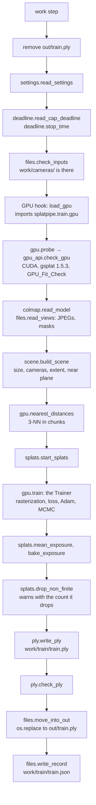

# Design Document: splat-training

## Overview

This spec builds the Train_Step in `splatpipe/train/`, the second entry of the Step_List. It reads the Camera_Solve_Output in `work/cameras/`, checks the GPU, sets up the scene and the Start_Splats, trains with our own Trainer on gsplat 1.5.3's `rasterization()` and `MCMCStrategy`, bakes the Mean_Exposure into the colours, leaves out any splat with a NaN or an infinity and warns with the count (D6), and writes the Trained_Splat to `out/train.ply` once the PLY_Check passes. It also adds the `training` check to the Smoke_Test.

The code is split in three layers:

- **Pure maths** (`schedules.py`, `deadline.py`, `scene.py`, `splats.py`, the pure parts of `gpu_api.py` and `ply.py`): numpy and standard-library functions on arrays and numbers. They read no file and import no torch, so every rule is tested on tiny synthetic data on a laptop.
- **CPU I/O** (`colmap.py`, `files.py`, the file parts of `ply.py`): the Model_Reader, the images and masks, the PLY file, the Train_Record and the move into `out/`.
- **The GPU_Module** (`gpu.py`): the only file that imports torch, gsplat and fused-ssim. It holds the GPU check's facts, the 3-NN search and the Trainer. The step reaches it through one hook, `GPU`, which the tests replace with a GPU_Stand_In.

`__init__.py` ties them together inside the Step_Runner's contract, like the Fake_Step and the Frames_Step. `smoke.py` builds the Smoke_Scene and runs the Train_Smoke_Check's flow with the same scene code and the same Trainer, and `cloud/smoke_runner.py` wraps it.

### Decisions on the open choices

| Choice | Decision |
|---|---|
| The hook (Req 11.6) | `splatpipe/train/__init__.py` holds `GPU: Callable[[], Gpu] = load_gpu`, read when `work` runs, as the Frames_Step reads `TOOLS`. `load_gpu()` imports `splatpipe.train.gpu` with `importlib.import_module` and gives back the module, whose four functions make up the `Gpu` protocol. Tests `monkeypatch` `splatpipe.train.GPU` with a function that gives a `FakeGpu`. So `import splatpipe.train` imports no GPU package (Req 9.12), and the step's whole flow runs on a CPU in the tests. |
| What the GPU_Module decides | Nothing the user sees. `probe()` gives facts (CUDA there or not, gsplat's version, the total memory in bytes), and the CPU function `check_gpu()` decides and raises the Expected_Failures of Req 2.3, 2.5 and 2.10. So every GPU refusal is tested on the CPU with the stand-in's facts. |
| An import that fails (Req 2.2) | `load_gpu()` turns a `ModuleNotFoundError` whose missing module is `torch`, `gsplat` or `fused_ssim` (or a submodule) into the Req 2.2 Expected_Failure. Any other import error, such as a typo in our own module, goes up as an Unexpected_Error, so a bug is never reported as "wrong machine". |
| Out of memory (Req 2.12) | `gpu_api.py`, a CPU module, defines `GpuOutOfMemory(iteration)`. The GPU_Module catches `torch.cuda.OutOfMemoryError` in `nearest_distances()` and `train()` and raises `GpuOutOfMemory` from it, with the Iteration reached, or `None` before the first one. The step catches `GpuOutOfMemory` and raises the Req 2.12 Expected_Failure with the Preset and `max_splats`. No CPU module imports torch. |
| A loss that isn't finite (A7) | After `loss.backward()`, where gsplat's example reads `loss.item()` for its progress bar, the Trainer reads the five terms and the total with one `torch.stack(...).tolist()`, so the CPU waits for the GPU once per Iteration. When the total isn't finite, it raises `NonFiniteLoss`, a `RuntimeError` subclass from `gpu_api.py` whose message `non_finite_message()` writes: the Iteration and each Loss_Term's value. It isn't a `PipelineError`, so the Step_Runner reports an Unexpected_Error with that message in the Technical_Detail (Req 4.16). |
| The Means_LR (Req 4.4, 4.20) | No torch scheduler. `schedules.means_lr_schedule(start, final, planned)` gives the Planned_Iterations + 1 rates: rate 0 is `start` and rate `planned` is `start × final`, both set outright, and each rate between is the closed form `start × final ** (i / planned)`. Then the list goes through a running minimum. Setting the ends outright doesn't lean on `pow(x, 1.0)` giving exactly x, which C doesn't promise. The running minimum keeps the list from rising where a platform's `pow`, which isn't always correctly rounded (Windows' UCRT, glibc's 0.52 ULP), puts a value one ULP above the one before. Elsewhere it changes nothing, and the last rate stays within one rounding of `start × final`. The Trainer sets `optimizers["means"].param_groups[0]["lr"] = rates[i + 1]` after the optimiser steps and passes the same value to `step_post_backward`. So the property test checks the very numbers the Trainer uses. gsplat's `ExponentialLR` gives the same rates up to rounding: it multiplies by `0.01 ** (1 / max_steps)` each step. |
| The 3-NN search (Req 3.13) | On the GPU with `torch.cdist(..., compute_mode="donot_use_mm_for_euclid_dist")`, in chunks of `max(1, neighbour_chunk_pairs // N)` query points against all N points, with each query's own column set to infinity, then `torch.topk(..., k, largest=False)`, so no point counts as its own neighbour. The points are recentred on their mean and sent as float32. The matmul form of `cdist` works out ‖a‖² + ‖b‖² − 2a·b, which loses the distance when points sit close together far from the origin; the difference form doesn't. `neighbour_chunk_pairs` is a new `[train]` setting, 100,000,000 pairs, about 400 MB of float32 distances per chunk (python.md: every size in Config). requirements.md gains it in Req 9.2, Req 9.7's whole numbers above 0 and Req 10.6's count, which becomes 38. |
| Scaling masks (Req 3.4) | numpy index maps, as the frames step's `mask_image` does: training pixel (x, y) takes mask pixel (`(2x + 1)·W // (2w)`, `(2y + 1)·H // (2h)`), the one under its centre. Not `cv2.INTER_NEAREST`, whose `resizeNN` takes `floor(x · W / w)`, the pixel under the training pixel's top-left corner. Colour frames are scaled with `cv2.resize(..., interpolation=cv2.INTER_AREA)`, and only ever down. |
| Reading images | `cv2.imdecode(np.frombuffer(path.read_bytes(), np.uint8), flags)` with `cv2.IMREAD_COLOR \| cv2.IMREAD_IGNORE_ORIENTATION` for a Training_Image and `cv2.IMREAD_GRAYSCALE \| cv2.IMREAD_IGNORE_ORIENTATION` for a Mask_File. `read_bytes` makes a missing or unreadable file an `OSError` with its reason, and ignoring EXIF orientation keeps the pixel grid COLMAP solved. cv2's BGR is turned to RGB with `cv2.cvtColor(..., cv2.COLOR_BGR2RGB)`. cv2 only decodes still images here, never video. |
| Images on the GPU | Each view's pixels go to the GPU once, as a uint8 `[H, W, 3]` tensor, and each masked view's keep mask as a bool `[H, W]` tensor: about 1.7 GB and 0.6 GB for 400 frames at 1600 × 900. An Iteration turns its one image to float32 / 255. A view with no Mask_File holds no mask tensor. |
| The erank term (Req 5.6, 5.8) | `log_q = torch.log_softmax(2 · log_scales, dim=-1)` and `q = log_q.exp()`, which is q = s² / Σ s² worked out from the log scales. `log_q` is finite for any finite log scale, so `q · log_q` is 0 where q underflows to 0, and its gradient is finite too, with no 0 / 0 when all three squares underflow. |
| The Smoke_Scene's shape (Req 12.2) | The cameras on the unit circle in the x–z plane, each looking at the origin, and the points uniform in the cube of half-side 0.25 around the origin, so every point is 1 ± 0.25·√2 (0.65 to 1.35) in front of every camera. fx = fy = `image_pixels`, so each image is as wide as it is far, a view of about 53°, as in the gsplat check. The counts, the image size and the seed come from Config. The radius of 1 and the half-side of 0.25 are the scene's shape in its own unit, as the gsplat check puts its Gaussians one unit from its camera, not numbers anyone tunes, so they stay in `smoke.py`, as Fixed_Constants the requirements' glossary names. |
| Where the smoke flow lives (Req 12.2–12.10) | `splatpipe/train/smoke.py` holds the Smoke_Scene builder and `run_smoke_training(config, sizes, scratch, gpu)`, so the Test_Suite runs the whole check on the CPU with the GPU_Stand_In. `cloud/smoke_runner.py`'s `_check_training` only turns `[cloud.smoke]` into a `SmokeSizes`, calls `load_gpu()` inside the function (Req 12.10) and passes the result on. |
| The GPU check in the smoke check | `run_smoke_training` runs the step's own `check_gpu` on `probe()` for the default Preset before it trains, so a wrong gsplat version or a GPU torch can't see fails the smoke test, not the first Job. |
| The PLY_Check's reads | The header is read from a bounded prefix: `len(splat_header(max(1, size // 236)))` bytes, the longest header a file of that size can have, so a broken file never makes the check scan the body for `end_header`. The body is read whole with `np.fromfile`: 708 MB and a 177 MB finiteness mask for 3,000,000 splats, inside the job machine's 32 GB. No chunk size is needed. |
| Splats with a NaN or an infinity (D6) | `splats.drop_non_finite` runs on the baked splats, just before the PLY_Writer, and judges each value as the float32 the writer will write for it, so a baked value too big for float32 drops its splat instead of failing the PLY_Check. The PLY_Check is unchanged and still refuses any non-finite value, as a second guard. When nothing is dropped, the function gives back the splats it was given, with no copy. Otherwise the kept copy of 3,000,000 baked splats is under 1.5 GB, and the float32 test of the largest array, `sh_rest`, with its finiteness mask, about 0.7 GB more while it runs, inside the job machine's 32 GB. The Train_Smoke_Check drops nothing (Req 12.7). |
| The ratio in the Train_Record (Req 10.7, A3) | Two numbers, `width_ratio` and `height_ratio`, the Training_Size's width and height over the Shared_Camera's. Rounding each edge to a whole pixel can make them differ a little: a 2001 × 1125 camera trains at 1600 × 900, so 0.7996 and 0.8. |
| The Uploader and the splat | Since f67ce0c the Cloud_Runner's Uploader sends a file again only when its size or modified time changed. `out/train.ply` is a new key after the move, so it goes up once, and again only if it changes. A pass can still catch `work/train/train.ply` while it's being written. That copy goes up again on the next pass once the file changes, and nothing reads `work/<Job_Id>/` in the bucket. The step needs nothing more from the Uploader. |
| Dependencies | None. torch, gsplat and fused-ssim are already on the Machine_Image with their Licence_List rows, and numpy and OpenCV are already Project_File dependencies (A1). The Licence_List gains no row. Its `opencv-python-headless` row's "How we use it" gains the step's new use of OpenCV, decoding and scaling the camera solve's JPEG frames and PNG masks, in the commit that brings it in (Req 13.16). |

## Architecture



### Module layout

| File | What it holds | Imports |
|---|---|---|
| `splatpipe/train/__init__.py` | `run()`, `work()`, the hook `GPU`, the warnings, and the step's flow: the counts, the timings and the failures. | stdlib, numpy, `splatpipe.errors`, `splatpipe.step`, the CPU modules below |
| `splatpipe/train/__main__.py` | `main(argv)`, which calls `step_main("train", "splatpipe.train", argv)`. | stdlib, `splatpipe.step` |
| `splatpipe/train/settings.py` | `TrainSettings` and `read_settings()`, the checks of Req 9.7 and 9.8. | stdlib, `splatpipe.errors` |
| `splatpipe/train/colmap.py` | The Model_Reader: `Camera`, `ModelImage`, `SparseModel`, `read_cameras()`, `read_images()`, `read_points()` and `read_model()`. | stdlib, numpy, `splatpipe.errors` |
| `splatpipe/train/scene.py` | Pure: `training_size()`, `scaled_intrinsics()`, `world_to_camera()`, `camera_centres()`, `scene_extent()`, `median_scene_depth()`, `keep_mask()`, `ImagePixels`, `TrainingView`, `Scene` and `build_scene()`. | stdlib, numpy, `splatpipe.errors`, and `colmap.py` and `settings.py` for types |
| `splatpipe/train/splats.py` | Pure: `SH_C0`, `Splats`, `choose_points()`, `need_points()`, `log_start_distances()`, `start_log_scales()`, `start_splats()`, `mean_exposure()`, `bake_exposure()` and `drop_non_finite()`. | stdlib, numpy, `splatpipe.errors`, and `settings.py` for types |
| `splatpipe/train/schedules.py` | Pure: `sh_degree()`, `means_lr_schedule()`, `refine_stop()`, `erank_start()`, `refine_iterations()` and `image_order()`. | stdlib, numpy |
| `splatpipe/train/deadline.py` | `CAP_DEADLINE_ENV`, `read_cap_deadline()`, `stop_time()`, `should_stop()` and `utc_now()`. | stdlib, `splatpipe.errors` |
| `splatpipe/train/ply.py` | The Splat_Layout: `FIELDS`, `RECORD_BYTES`, `splat_header()`, `splat_records()`, `write_ply()`, `read_ply()` and `check_ply()`. | stdlib, numpy, `splatpipe.errors` |
| `splatpipe/train/files.py` | The Fixed_Constant names, `check_inputs()`, `read_views()`, `move_into_out()`, `train_record()` and `write_record()`. | stdlib, numpy, cv2, `splatpipe.errors`, `splatpipe.jsonio` |
| `splatpipe/train/gpu_api.py` | The GPU_Module's interface as the CPU sees it: `GpuInfo`, `TrainResult`, the `Gpu` protocol, `GpuOutOfMemory`, `NonFiniteLoss`, `out_of_memory_failure()`, `non_finite_message()`, `gpu_need_bytes()`, `gpu_fits()`, `check_gpu()` and `load_gpu()`. | stdlib, `splatpipe.errors`, the CPU modules above for types |
| `splatpipe/train/smoke.py` | `SmokeSizes`, `smoke_settings()`, `smoke_scene()` and `run_smoke_training()`. | stdlib, numpy, `splatpipe` |
| `splatpipe/train/gpu.py` | The GPU_Module: `probe()`, `nearest_distances()`, `train()` and `peak_memory_bytes()`, with the Trainer's small helpers. | stdlib, numpy, torch, gsplat, fused_ssim, `splatpipe.train.*` CPU modules |

Every file but `gpu.py` imports only the standard library, numpy, cv2 and `splatpipe` (Req 9.11). `gpu.py` adds torch, gsplat and fused_ssim and nothing else. No file imports `cloud/` or boto3 (Req 9.13). `tests/test_imports.py` checks all three (Req 14.7).

## Components and Interfaces

### The step's flow (`__init__.py`)

```python
GPU: Callable[[], Gpu] = load_gpu  # the hook: work reads it each time it runs, so a test can monkeypatch it

def run(job_id: str, preset: str | None = None, *, config: Config | None = None) -> dict[str, Any]
def work(step: StepContext) -> None
```

`run` calls `run_step("train", "splatpipe.train", job_id, preset=preset, config=config)`, like the Fake_Step. `work(step)` does the step's work in the order of A9 and Req 11.3:

1. **Remove the old splat.** `(step.out_folder / TRAINED_SPLAT).unlink(missing_ok=True)`, first of all (Req 8.1).
2. **Settings.** `cfg = read_settings(step.settings, step.name, step.preset)`. A missing key raises the Step_Runner's own message through `StepSettings.__missing__` (Req 9.6), and a bad value or `max_splats` below `start_scale_neighbours` + 1 an `ExpectedFailure` (Req 9.7, 9.8). Adds `steps_planned`.
3. **Cap_Deadline.** `deadline = read_cap_deadline(os.environ)`, and `stop = stop_time(deadline, cfg.clean_reserve_minutes, cfg.save_margin_minutes)` when it isn't `None` (Req 7.1–7.5).
4. **Inputs there.** `cameras = step.job.folder / "work" / CAMERAS`, then `check_inputs(cameras)` (Req 1.2). It only checks that `images/` is a folder and the three model files are files.
5. **GPU.** `gpu = GPU()` (Req 2.2), `info = gpu.probe()`, then `gpu_memory_bytes` is added when `info.cuda` is true, and `check_gpu(info, cfg, step.preset)` (Req 2.3–2.10). Nothing is read and nothing goes onto the GPU before this (Req 2.1).
6. **Load** (`with step.timed("load")`):
   1. `model = read_model(cameras / SPARSE)` (Req 1.3–1.11). Adds `images` and `sparse_points`, then `need_points(len(model.points), cfg.start_scale_neighbours)` fails the step with the Req 1.18 message when there are too few.
   2. `width, height = training_size(model.camera.width, model.camera.height, cfg.long_edge)` (Req 3.1). Adds `image_width` and `image_height`.
   3. `pixels = read_views(cameras, model, width, height, cfg.mask_threshold)` (Req 1.12–1.17, 3.2, 3.4). Adds `masked_images`.
   4. `scene = build_scene(model, pixels, width, height, cfg)` (Req 3.3, 3.5–3.10).
   5. `points, colours = choose_points(model.points, model.colours, cfg.max_splats, cfg.seed)`, with the Req 3.11 warning when it chose a subset.
   6. `distances = gpu.nearest_distances(points, cfg.start_scale_neighbours, cfg.neighbour_chunk_pairs)` inside `_out_of_memory(step.preset, cfg)`, then `start = start_splats(points, colours, distances, cfg)` (Req 3.12–3.15). Adds `start_splats`.
7. **Train** (`with step.timed("train")`): `result = gpu.train(scene, start, cfg, stop)` inside `_out_of_memory(step.preset, cfg)`. Adds `steps_run`, `sh_degree` and `peak_gpu_memory_bytes`, the last from `gpu.peak_memory_bytes()`. After the block, with `result.steps_run == 0`, the step fails with the Req 7.9 message, and when `steps_run` is above 0 but below `cfg.steps`, it adds the Req 7.8 warning.
8. **Write** (`with step.timed("write_ply")`):
   1. `a, b = mean_exposure(result.exposures)`, then `baked = bake_exposure(result.splats, a, b)` (Req 6.4–6.7).
   2. `kept, dropped = drop_non_finite(baked)`, and when `dropped` is above 0, `step.add_warning(...)` with the Req 8.9 warning, which gives `dropped` (Req 8.9, 10.5, D6). Adds `splats` as `len(kept)`, the splats written.
   3. `write_ply(step.work_folder / TRAINED_SPLAT, kept)` (Req 8.2–8.5). Adds `ply_bytes`.

   When every splat was dropped, `kept` holds 0 splats, so the PLY_Writer writes a file of 0 splats and the PLY_Check below fails the run with its existing "holds no splats" Expected_Failure, with the warning and its count already in the report. There is no new refusal (D6).
9. **Check** (`with step.timed("check_ply")`): `check_ply(step.work_folder / TRAINED_SPLAT)` (Req 8.6, 8.7).
10. **Move.** `move_into_out(step.work_folder / TRAINED_SPLAT, step.out_folder / TRAINED_SPLAT)`, one `os.replace` (Req 8.8).
11. **Record.** `write_record(step.work_folder / RECORD, train_record(...))` (Req 10.7).

`_out_of_memory(preset, cfg)` is a small context manager that turns `GpuOutOfMemory` into `gpu_api.out_of_memory_failure(error, preset, cfg.max_splats)`, the Req 2.12 `ExpectedFailure`, which names the Iteration when the error has one. The Train_Smoke_Check uses the same function.

Every count is added with `int(...)` and every timing comes from `StepContext.timed`, which adds a timing only when its block ends without an error. Each count is added as soon as it's known. So a failed report holds exactly what the step had worked out (Req 10.3, 10.4). The step writes only `work/train/train.ply`, `work/train/train.json` and `out/train.ply` (Req 8.11), and relies on the Step_Runner emptying `work/train/` first (Req 11.8).

The three warnings, with the values filled in:

- Req 3.11: "The camera solve gave `<P>` points, more than this preset's splat budget of `<max_splats>`, so training started from `<max_splats>` of them, chosen at random."
- Req 7.8: "Training stopped early, after `<steps_run>` of `<steps>` iterations, to leave time for the clean step before the job's time cap."
- Req 8.9 and 10.5 (D6): "Splats left out of out/train.ply because they held a NaN or an infinity: `<n>`.", where `<n>` is `dropped`.

### settings.py

```python
@dataclass(frozen=True)
class TrainSettings:
    long_edge: int
    mask_threshold: int
    seed: int
    sh_degree_interval: int
    scene_extent_factor: float
    near_plane_factor: float
    start_opacity: float
    start_scale_factor: float
    start_scale_neighbours: int
    neighbour_chunk_pairs: int   # the most point pairs one 3-NN chunk holds on the GPU
    means_lr: float
    means_lr_final: float
    scales_lr: float
    quats_lr: float
    opacities_lr: float
    sh_dc_lr: float
    sh_rest_lr: float
    adam_eps: float
    exposure_lr: float
    l1_weight: float
    ssim_weight: float
    opacity_reg: float
    scale_reg: float
    erank_reg: float
    erank_epsilon: float
    erank_start_fraction: float
    refine_start_step: int
    refine_every: int
    refine_stop_step: int
    refine_stop_fraction: float
    clean_reserve_minutes: float
    save_margin_minutes: float
    gpu_memory_slack: float
    min_vcpus: int               # cloud-only Step_Needs, checked and kept, never used (Req 2.11)
    min_memory_gb: int
    steps: int                   # the Preset_Settings, from [train.<preset>]
    max_splats: int
    min_gpu_memory_gb: int

def read_settings(settings: Mapping[str, Any], section: str, preset: str) -> TrainSettings
```

It's built like the Frames_Step's: a `_Kind` per kind of value, a dict of every key with its kind, and `type()` checked exactly, so a bool is never a number (Req 9.7). The kinds:

| Kind | Keys |
|---|---|
| whole number above 0 | `long_edge`, `sh_degree_interval`, `start_scale_neighbours`, `neighbour_chunk_pairs`, `refine_every`, `min_vcpus`, `min_memory_gb`, `steps`, `max_splats`, `min_gpu_memory_gb` |
| whole number of 0 or more | `seed`, `refine_start_step`, `refine_stop_step` |
| whole number from 1 to 255 | `mask_threshold` |
| number above 0 | `scene_extent_factor`, `near_plane_factor`, `start_scale_factor`, `means_lr`, `scales_lr`, `quats_lr`, `opacities_lr`, `sh_dc_lr`, `sh_rest_lr`, `adam_eps`, `exposure_lr`, `erank_epsilon` |
| number of 0 or more | `l1_weight`, `ssim_weight`, `opacity_reg`, `scale_reg`, `erank_reg`, `clean_reserve_minutes`, `save_margin_minutes` |
| number above 0 and below 1 | `start_opacity` |
| number above 0 and at most 1 | `means_lr_final`, `gpu_memory_slack` |
| number from 0 to 1 | `erank_start_fraction`, `refine_stop_fraction` |

A refusal names the key, its table (`[train]`, or `[train.<preset>]` for the three Preset_Settings) and what it must be: "The setting `mask_threshold` in [train] is 0, but it must be a whole number from 1 to 255. Change it to a whole number from 1 to 255." Then `max_splats < start_scale_neighbours + 1` is refused naming both settings, their tables and their values (Req 9.8). NaN and infinity never get here, because the Config refuses them. Whole numbers stay ints and other numbers become floats.

The Train_Smoke_Check passes its own mapping, the default Preset's settings with five values replaced, through the same `read_settings`, so its numbers are checked the same way.

### colmap.py (the Model_Reader)

```python
PINHOLE = 1                      # Fixed_Constants: COLMAP's PINHOLE model id and its parameter count
PINHOLE_PARAMS = 4
IMAGE_NAME = re.compile(r"[^/\\:\x00]+\.jpg")   # Req 1.11, checked with fullmatch

@dataclass(frozen=True)
class Camera:
    camera_id: int
    width: int
    height: int
    fx: float
    fy: float
    cx: float
    cy: float

@dataclass(frozen=True)
class ModelImage:
    image_id: int
    quaternion: np.ndarray      # (4,) float64, w x y z, as stored (not yet normalised)
    translation: np.ndarray     # (3,) float64
    camera_id: int
    name: str

@dataclass(frozen=True)
class SparseModel:
    camera: Camera                      # the Shared_Camera
    images: tuple[ModelImage, ...]      # in images.bin's order
    points: np.ndarray                  # (P, 3) float64
    colours: np.ndarray                 # (P, 3) uint8, RGB

def read_cameras(path: Path) -> Camera
def read_images(path: Path, camera_id: int) -> tuple[ModelImage, ...]
def read_points(path: Path) -> tuple[np.ndarray, np.ndarray]
def read_model(sparse: Path) -> SparseModel
```

Each reader reads its file with `Path.read_bytes()` and walks it with `struct.unpack_from` from an offset that it moves forward, through one small `_Cursor` class whose `take(fmt)` checks that the bytes are there before it unpacks. The layout, written fresh from COLMAP's docs and the formats in its `read_write_model.py` (Req 1.3):

| File | Layout, little-endian |
|---|---|
| `cameras.bin` | `<Q` count. Per camera: `<iiQQ` (camera id, model id, width, height), then the model's parameters as float64. PINHOLE has `<4d`: fx, fy, cx, cy. |
| `images.bin` | `<Q` count. Per image: `<idddddddi` (image id, qw, qx, qy, qz, tx, ty, tz, camera id), the name as UTF-8 bytes ending in NUL, `<Q` keypoint count, then 24 bytes per keypoint (`<ddq`: x, y, point id). |
| `points3D.bin` | `<Q` count. Per point: `<QdddBBBd` (point id, x, y, z, r, g, b, error), `<Q` track length, then 8 bytes per track entry (`<ii`: image id, keypoint index). |

- `read_cameras` refuses a count other than 1 straight after reading it, giving the count, and a model id other than `PINHOLE`, giving the id (Req 1.7). It never needs another model's parameter count.
- Keypoints, errors and tracks are skipped by moving the offset, once the cursor has checked that `count × size` bytes are there, so a huge count can't make the reader loop or allocate (Req 1.5, 1.8). The point id is read past too.
- A count that the bytes left can't hold, a record cut short, a name with no NUL, or bytes after the last record are refused with "`<file>` is cut short or isn't a COLMAP binary model" and what was wrong (Req 1.8). Each count is checked against the smallest record it implies before the loop: 73 bytes per image (64 + a NUL + 8) and 51 per point (43 + 8). `cameras.bin`'s count must be 1, so its one record of 24 + 32 bytes is read as it comes.
- `read_images` refuses an image whose name doesn't fullmatch `IMAGE_NAME` or isn't UTF-8, giving its id (Req 1.11), a camera id other than the Shared_Camera's, two images with one name, and no image at all (Req 1.10).
- Values are checked as they're read: width, height, fx and fy above 0, every camera parameter, quaternion, translation and point position finite, and no quaternion whose four values are all 0, which is what a length of 0 means here (Req 1.9). A quaternion of tiny or huge values passes, because `world_to_camera` divides it by its largest absolute value before it scales it to length 1, so its squares can't underflow or overflow. Each message names the file and the camera id, the image's id and name, or the point's place in the file.
- Names are shown in messages with `repr()`, so a control character can't garble the terminal.
- `read_model` reads the three files by name from `sparse/` and nothing else there, so `rigs.bin` and `frames.bin` are ignored (Req 1.6). The world frame isn't touched (Req 1.20).
- 300,000 points take one Python loop of 300,000 short `unpack_from` calls, about a second. The colours become one `(P, 3)` uint8 array and the positions one `(P, 3)` float64 array.

### scene.py (pure)

```python
@dataclass(frozen=True)
class ImagePixels:                 # what files.read_views gives for one image
    pixels: np.ndarray             # (h, w, 3) uint8, RGB, at the Training_Size
    keep: np.ndarray | None        # (h, w) bool, True where the pixel isn't a Masked_Pixel; None: no Mask_File

@dataclass(frozen=True)
class TrainingView:                # one record per Training_Image (Req 5.10)
    name: str                      # its name in images.bin
    pixels: np.ndarray             # (h, w, 3) uint8, RGB
    keep: np.ndarray | None        # (h, w) bool, or None
    intrinsics: np.ndarray         # (3, 3) float64, K scaled to the Training_Size
    world_to_camera: np.ndarray    # (4, 4) float64

@dataclass(frozen=True)
class Scene:
    views: tuple[TrainingView, ...]   # in images.bin's order
    width: int                        # the Training_Size
    height: int
    extent: float                     # the Scene_Extent
    median_depth: float               # the Median_Scene_Depth
    near_plane: float                 # the Near_Plane

def training_size(width: int, height: int, long_edge: int) -> tuple[int, int]
def scaled_intrinsics(camera: Camera, width: int, height: int) -> np.ndarray
def world_to_camera(quaternion: np.ndarray, translation: np.ndarray) -> np.ndarray
def camera_centres(world_to_cameras: np.ndarray) -> np.ndarray
def scene_extent(centres: np.ndarray, factor: float) -> float
def median_scene_depth(world_to_cameras: np.ndarray, points: np.ndarray) -> float
def keep_mask(grey: np.ndarray, width: int, height: int, threshold: int) -> np.ndarray
def build_scene(model: SparseModel, pixels: Sequence[ImagePixels], width: int, height: int,
                settings: TrainSettings) -> Scene
```

- **`training_size`** (Req 3.1) gives `(width, height)` when the longer edge is at most `long_edge`. Otherwise each edge becomes `max(1, (2·v·long_edge + L) // (2·L))` for its length v and the longer length L, which is v × `long_edge` / L rounded half up in integers, so the longer edge is exactly `long_edge`.
- **`scaled_intrinsics`** (Req 3.3) is `[[fx·sx, 0, cx·sx], [0, fy·sy, cy·sy], [0, 0, 1]]` with sx = w / camera width and sy = h / camera height.
- **`world_to_camera`** (Req 3.5) divides the quaternion by its largest absolute value, then scales it to length 1, and builds R from it with the standard formula for (w, x, y, z), as COLMAP does, then `[[R, t], [0, 0, 0, 1]]`.
- **`camera_centres`** gives −Rᵀt for each matrix, and **`scene_extent`** (Req 3.6, 3.7) `factor × max ‖centre − mean‖`, refusing a largest distance of 0 with the Req 3.7 message.
- **`median_scene_depth`** (Req 3.8, 3.9) loops over the cameras, one at a time so no `(V, P)` array is made: z = (R p + t)_z for every point, the median of the z above 0, and the median over the cameras that had any. With none, it refuses with the Req 3.9 message. Both medians are `numpy.median`.
- **`keep_mask`** (Req 3.4) scales the grey Mask_File with the integer index maps of the decisions table, then gives `scaled >= threshold`. A Masked_Pixel is `False`.
- **`build_scene`** makes each `TrainingView` from the model's image and its `ImagePixels`, with one shared `scaled_intrinsics` copy per view, then the extent, the median depth and `near_plane = near_plane_factor × median_depth` (Req 3.8, 3.10).

### splats.py (pure)

```python
SH_C0 = 0.28209479177387814   # Fixed_Constant, 1 / (2√π)
SH_REST = 15                  # Fixed_Constant: coefficients per channel above band 0 at SH_Degree 3

@dataclass(frozen=True)
class Splats:                  # the Start_Splats, and the Trainer's trained splats
    means: np.ndarray          # (N, 3)
    log_scales: np.ndarray     # (N, 3)
    quats: np.ndarray          # (N, 4), w first, as the Trainer holds them
    opacity_logits: np.ndarray # (N,)
    sh0: np.ndarray            # (N, 3): band 0 per channel, the f_dc fields
    sh_rest: np.ndarray        # (N, 15, 3): coefficient first, channel last, as gsplat's shN

    def __len__(self) -> int: ...   # N, the number of splats: means.shape[0]

def choose_points(points: np.ndarray, colours: np.ndarray, budget: int,
                  seed: int) -> tuple[np.ndarray, np.ndarray]
def need_points(count: int, neighbours: int) -> None
def log_start_distances(distances: np.ndarray) -> np.ndarray
def start_log_scales(distances: np.ndarray, factor: float) -> np.ndarray
def start_splats(points: np.ndarray, colours: np.ndarray, distances: np.ndarray,
                 settings: TrainSettings) -> Splats
def mean_exposure(fixes: np.ndarray) -> tuple[np.ndarray, np.ndarray]
def bake_exposure(splats: Splats, a: np.ndarray, b: np.ndarray) -> Splats
def drop_non_finite(splats: Splats) -> tuple[Splats, int]   # the splats kept, the number dropped
```

- **`choose_points`** (Req 3.11) gives every point when there are at most `budget`. Otherwise `np.sort(np.random.default_rng(seed).choice(P, budget, replace=False))`, so the subset keeps the file's order.
- **`need_points`** (Req 1.18) refuses a count below `neighbours + 1`, giving the count and the fewest the step needs. The step calls it on the Sparse_Points and the Train_Smoke_Check on the Smoke_Scene's.
- **`log_start_distances`** (Req 3.14, 3.15) takes the `(N, k)` distances from `nearest_distances` and gives the log of each row's Start_Distance, its root mean square, without ever forming the root mean square: log m + ½ · log(mean((d / m)²)), with m the row's largest distance. With m above 0, every d / m is from 0 to 1 and one of them is 1, so the mean is from 1/k to 1 and both logs are finite, even for m = 5e-324, where m · √(1/k) would round to 0. A row with m = 0, a Start_Distance of 0, takes the smallest log of the rows with m above 0, which is the log of the smallest Start_Distance above 0. When every row has m = 0, it refuses with the Req 3.15 message.
- **`start_log_scales`** (Req 3.12, 3.16) gives `log(factor) + log_start_distances(d)` in each of three equal columns. The log of the product is a sum of two finite logs, so a tiny Start_Distance can't round `factor × d` to 0.
- **`start_splats`** (Req 3.12) gives float32 arrays: the points as means, `(colour / 255 − 0.5) / SH_C0` as `sh0`, zeros as `sh_rest`, `log(p / (1 − p))` of `start_opacity` as every opacity logit, (1, 0, 0, 0) as every quaternion, and `start_log_scales(distances, start_scale_factor)`.
- **`mean_exposure`** (Req 6.4) splits `fixes.mean(axis=0)`, a `(3, 4)` array, into Ā `(3, 3)` and b̄ `(3,)`, in float64.
- **`bake_exposure`** (Req 6.5) works in float64 and keeps everything but the colours: `sh_rest @ Āᵀ`, which multiplies each coefficient's RGB vector by Ā, and `sh0 @ Āᵀ + (Ā @ (0.5·1) + b̄ − 0.5·1) / SH_C0`. The PLY_Writer turns the result into float32.
- **`drop_non_finite`** (Req 8.9, D6) gives back exactly the splats whose 59 values are all finite, in their order, and the number it dropped. A value counts as finite when the float32 the PLY_Writer writes for it is finite. Each of the six arrays is rounded to float32 inside `np.errstate(over="ignore")`, the same rounding `splat_records` does, and `np.isfinite` is reduced over every axis but the first, which gives one boolean `keep` of length N over all 59 values. The splats kept are each array's `[keep]`, with the input's own values and dtypes, and the count is `int(np.count_nonzero(~keep))`. The rounding is there because the bake works in float64, where values that came from float32 can't overflow: the infinity a bake makes only appears when a value too big for float32 is rounded. A check of the float64 values would keep that splat, and the PLY_Check would then refuse the file. A NaN or an infinity that the Trainer gave back, in any field, drops its splat the same way. When nothing is dropped, it gives back the `Splats` it was given, with no copy, and 0 splats in gives 0 splats out and a count of 0.

### schedules.py (pure)

```python
MAX_SH_DEGREE = 3   # Fixed_Constant: the Splat_Layout's 45 f_rest fields hold up to degree 3

def sh_degree(iteration: int, interval: int) -> int
def means_lr_schedule(start: float, final: float, planned: int) -> tuple[float, ...]
def refine_stop(planned: int, refine_stop_step: int, refine_stop_fraction: float) -> int
def erank_start(planned: int, fraction: float) -> int
def refine_iterations(planned: int, refine_start: int, refine_every: int, stop: int) -> list[int]
def image_order(count: int, seed: int) -> Iterator[int]
```

- `sh_degree` is `min(iteration // interval, MAX_SH_DEGREE)` (Req 4.6).
- `means_lr_schedule` gives `planned + 1` rates: `start` first, `start × final` last, and `start × final ** (i / planned)` between, each kept no higher than the rate before it (Req 4.4, the decisions table). Rate i is the rate Iteration i trains at, and rate `planned` the rate once the last Planned_Iteration has ended. The Trainer passes `start = means_lr × scene.extent`.
- `refine_stop` is `min(refine_stop_step, round(refine_stop_fraction × planned))` and `erank_start` is `round(fraction × planned)`, with Python's `round`, which takes a tie to the even neighbour. The real values never tie: 6,300, 13,500 and 25,000, and 1,633, 3,500 and 7,000 (Req 4.8, 5.7, A8).
- `refine_iterations` is the Iterations i below `planned` with `refine_start < i < stop` and `i % refine_every == 0`, which is gsplat 1.5.3's condition for MCMC's relocate and add. The Trainer doesn't need it, because the strategy applies the condition itself. The Train_Smoke_Check's log line counts the refines with it, and the Req 12.6 test uses it.
- `image_order` (Req 4.11) yields `np.random.default_rng(seed).permutation(count)` pass after pass, from one generator, without end. The Trainer takes one index per Iteration.

### deadline.py

```python
CAP_DEADLINE_ENV = "SPLATPIPE_CAP_DEADLINE"   # Fixed_Constant, the name the Cloud_Runner sets
EXAMPLE = "2026-11-21T14:25:30Z"              # the form the messages show

def read_cap_deadline(environ: Mapping[str, str]) -> datetime | None
def stop_time(cap_deadline: datetime, clean_reserve_minutes: float,
              save_margin_minutes: float) -> datetime
def should_stop(now: datetime, stop: datetime | None) -> bool
def utc_now() -> datetime
```

- `read_cap_deadline` (Req 7.1–7.4) gives `None` when the variable isn't set. An empty value, one `datetime.fromisoformat` refuses, and one with no UTC offset are each refused with the Req 7.3 message, which names the variable, gives its value with `repr()` and gives `EXAMPLE`. Python 3.11's `fromisoformat` reads both `2026-11-21T14:25:30Z` and `2026-11-21T14:25:30.123456+00:00`. The result is turned to UTC.
- `stop_time` is `cap_deadline − timedelta(minutes=clean_reserve_minutes + save_margin_minutes)`, the Train_Deadline less the save margin (Req 7.5).
- `should_stop` is `stop is not None and now >= stop` (Req 7.6). Both take the time as an argument, so the tests use a fake clock (Req 7.11).
- `utc_now` is `datetime.now(timezone.utc)`, which the Trainer calls before each Iteration.

### ply.py (the PLY_Writer, the PLY_Reader and the PLY_Check)

```python
FIELDS: tuple[str, ...] = ("x", "y", "z", "f_dc_0", "f_dc_1", "f_dc_2",
                           *(f"f_rest_{k}" for k in range(45)), "opacity",
                           "scale_0", "scale_1", "scale_2", "rot_0", "rot_1", "rot_2", "rot_3")
RECORD_BYTES = 4 * len(FIELDS)   # 236: 59 float32 values (Fixed_Constants of the Splat_Layout)

def splat_header(count: int) -> bytes
def splat_records(splats: Splats) -> np.ndarray          # (N, 59), dtype "<f4"
def write_ply(path: Path, splats: Splats) -> None
def read_ply(path: Path) -> dict[str, np.ndarray]
def check_ply(path: Path) -> int                          # the splat count N
```

- **`splat_header(N)`** is the ASCII bytes of `ply`, `format binary_little_endian 1.0`, `element vertex N`, one `property float <name>` per field in `FIELDS` order and `end_header`, each line ending in `\n` (Req 8.3). For N = 1 it's 1,472 bytes, and for 3,000,000 splats 1,478, so that file is 708,001,478 bytes.
- **`splat_records`** fills one `np.empty((N, 59), "<f4")` by columns: `means`, `sh0`, `sh_rest.transpose(0, 2, 1).reshape(N, 45)`, `opacity_logits`, `log_scales` and `quats`. The transpose makes `f_rest_k` channel k // 15's coefficient k % 15 (Req 8.4). Opacities stay logits, scales logs and quaternions w first, as the Trainer holds them (Req 8.5). A float32 input is copied as it is, bits included, and a float64 one, like the baked colours, is rounded to float32 inside `np.errstate(over="ignore")`, so a baked value too big for float32 becomes an infinity that the PLY_Check then reports. In the step, `drop_non_finite` has already left out every splat that would get one (Req 8.9). The Train_Smoke_Check drops nothing, so there the PLY_Check fails (Req 12.7).
- **`write_ply`** opens the file with `"wb"`, writes the header, then the records' own buffer through `memoryview`, with no extra copy of the up to 708 MB. It writes every splat it's given: the step gives it the splats `drop_non_finite` kept (Req 8.9), and the Train_Smoke_Check every splat the Trainer gave back (Req 12.7). An `OSError` becomes the Req 8.10 failure, naming the file and `error.strerror`, like "No space left on device".
- **The header parse** (`_layout(path) -> tuple[int, int]`, the count and the header's length), which the reader and the check share:
  1. It reads `len(splat_header(max(1, size // RECORD_BYTES)))` bytes from the start, the longest header a file of this size could have, and looks for `end_header\n` in them.
  2. The text up to it must be ASCII, and its lines must be exactly `ply`, `format binary_little_endian 1.0`, `element vertex <N>` with N matching `0|[1-9][0-9]*`, then `property float <name>` lines, then `end_header`.
  3. The names must be `FIELDS` in order. When they aren't, the message lists the fields missing, the fields out of place and any name the layout doesn't have. Any other line, like a comment, a second element or a `property double x`, is named with its line number.
  4. The file's size must be exactly the header's length + N × 236.
- **`read_ply`** (Req 8.13) parses the header, then reads the body with `np.fromfile(path, "<f4", count=N * 59, offset=header_length)` and gives one contiguous float32 array per field, by name. It reads files of 0 splats too.
- **`check_ply`** (Req 8.6, 8.7) parses the header, refuses N = 0 ("holds no splats"), reads the body the same way, and counts `~np.isfinite(body)` per field and per splat. A file with any non-finite value is refused with how many splats hold a NaN or an infinity and in which fields, each with its count. Every refusal names the file. It gives back N.

### files.py

```python
CAMERAS = "cameras"                 # Fixed_Constants: the Camera_Solve_Output (Req 1.1)
IMAGES, MASKS, SPARSE = "images", "masks", "sparse"
MODEL_FILES = ("cameras.bin", "images.bin", "points3D.bin")
TRAINED_SPLAT = "train.ply"         # in work/train/ while it's written and checked, then in out/
RECORD = "train.json"               # the Train_Record, in work/train/

def check_inputs(cameras: Path) -> None
def read_views(cameras: Path, model: SparseModel, width: int, height: int,
               threshold: int) -> list[ImagePixels]
def move_into_out(written: Path, target: Path) -> None
def train_record(*, scene: Scene, means_lr_start: float, width_ratio: float, height_ratio: float,
                 a: np.ndarray, b: np.ndarray, cap_deadline: datetime | None,
                 stop: datetime | None) -> dict[str, Any]
def write_record(path: Path, record: dict[str, Any]) -> None
```

- **`check_inputs`** (Req 1.2) checks `images/` with `is_dir()` and each of `MODEL_FILES` in `sparse/` with `is_file()`, in that order, and refuses the first one missing: "The train step needs `<path>`, which the camera solve step writes, but it isn't there. Run the camera solve step on this job first." It reads nothing.
- **`read_views`**, for each image in `images.bin`'s order:
  1. `images/<name>` must be a file (Req 1.12). Its bytes go through `cv2.imdecode` with `IMREAD_COLOR | IMREAD_IGNORE_ORIENTATION`. An `OSError` or a decode that gives `None` is refused, and so is a size other than the Shared_Camera's, with both sizes (Req 1.13).
  2. It's scaled to the Training_Size with `INTER_AREA` when it's larger, then turned to RGB (Req 3.2).
  3. When `masks/<stem>.png` is a file, it's decoded with `IMREAD_GRAYSCALE | IMREAD_IGNORE_ORIENTATION`. A failed read, a size other than its image's, or a `keep_mask` with no `True` is refused with the file and the reason (Req 1.14, 1.16). Without the file, `keep` is `None` (Req 1.15).
  4. Files that `images.bin` doesn't name are never opened (Req 1.17).
- **`move_into_out`** (Req 8.8, 8.10) is one `os.replace`, and an `OSError` names both paths and the reason.
- **`train_record`** (Req 10.7) gives plain JSON values: `near_plane`, `median_scene_depth`, `scene_extent`, `means_lr_start`, `width_ratio`, `height_ratio`, `mean_exposure` as 3 lists of 4 floats, and `cap_deadline` and `stop_time` as `isoformat()` UTC text, or `None`. Two ratios, not one, because rounding can make the width's and the height's scale differ slightly.
- **`write_record`** writes it with `splatpipe.jsonio.write_json` and turns an `OSError` into the Req 8.10 failure.

### gpu_api.py (the GPU_Module's interface, on the CPU)

```python
GPU_MODULE = "splatpipe.train.gpu"                 # the module load_gpu imports
GPU_PACKAGES = ("torch", "gsplat", "fused_ssim")  # Fixed_Constants: the GPU_Module's GPU imports
GSPLAT_VERSION = "1.5.3"                           # A10
GB = 10**9                                         # D1, as gpu_memory_gb in [cloud.types]

@dataclass(frozen=True)
class GpuInfo:
    cuda: bool                  # torch.cuda.is_available()
    gsplat_version: str         # gsplat.__version__
    total_memory_bytes: int     # torch.cuda.get_device_properties(0).total_memory, 0 with no CUDA

@dataclass(frozen=True)
class TrainResult:
    splats: Splats              # float32 numpy arrays, at most max_splats (Req 4.9)
    exposures: np.ndarray       # (V, 3, 4) float32: each Training_Image's [A | b]
    steps_run: int              # the Iterations run
    sh_degree: int              # the last Iteration's SH_Degree, 0 when none ran

class Gpu(Protocol):
    def probe(self) -> GpuInfo: ...
    def nearest_distances(self, points: np.ndarray, neighbours: int,
                          chunk_pairs: int) -> np.ndarray: ...       # (N, neighbours), ascending
    def train(self, scene: Scene, start: Splats, settings: TrainSettings,
              stop: datetime | None) -> TrainResult: ...
    def peak_memory_bytes(self) -> int: ...

class GpuOutOfMemory(Exception):
    def __init__(self, iteration: int | None) -> None: ...  # the Iteration reached, None before the first
    iteration: int | None

class NonFiniteLoss(RuntimeError): ...

def out_of_memory_failure(error: GpuOutOfMemory, preset: str, max_splats: int) -> ExpectedFailure
def non_finite_message(iteration: int, terms: Mapping[str, float]) -> str
def gpu_need_bytes(min_gpu_memory_gb: int, slack: float) -> float
def gpu_fits(total_bytes: int, min_gpu_memory_gb: int, slack: float) -> bool
def check_gpu(info: GpuInfo, settings: TrainSettings, preset: str) -> None
def load_gpu() -> Gpu
```

- **`gpu_need_bytes`** is `slack × min_gpu_memory_gb × GB`, and **`gpu_fits`** (the GPU_Fit_Check) is `total_bytes >= gpu_need_bytes(...)` (Req 2.6, 2.7). With a slack of 0.9 the need is 21,600,000,000 bytes for 24 and 43,200,000,000 for 48, so 24,146,608,128 bytes pass 24 and fail 48, and 48,305,799,168 bytes pass both (Req 2.8, 2.9).
- **`check_gpu`** refuses, in this order: `info.cuda` false (Req 2.3), a gsplat version other than `GSPLAT_VERSION` (Req 2.5), and a GPU that fails `gpu_fits` (Req 2.10). The last message gives the memory as `total / GB` to one decimal, the Preset, `min_gpu_memory_gb` and the slack. It checks nothing else about the machine (Req 2.11).
- **`load_gpu`** gives `importlib.import_module(GPU_MODULE)`. A `ModuleNotFoundError` whose `name`, up to its first dot, is in `GPU_PACKAGES` becomes the Req 2.2 failure, naming the missing package. Any other error goes up as it is, so a missing `fused_ssim_cuda` extension on a broken image, or a bug in our own module, is an Unexpected_Error and never "wrong machine".
- **`GpuOutOfMemory(iteration)`** keeps the Iteration and has its own short message, "torch ran out of GPU memory at iteration 812" or "... before training started", so it reads well even where nothing turns it into a failure. **`out_of_memory_failure`** gives the Req 2.12 `ExpectedFailure`: "The GPU ran out of memory at iteration 812 of training. The fast preset trains up to 1,000,000 splats. Run the job with a preset that has a smaller splat budget, or on a machine with a GPU that has more memory." Before training it says "while the step set up the scene" in place of the Iteration.
- **`non_finite_message`** gives, for example, "The loss stopped being finite at iteration 812: l1 0.0731, ssim 0.412, opacity_reg 0.31, scale_reg 0.0204, erank nan, total nan. This is a bug in the training, not a problem with your video." The values are each Loss_Term's own, before its weight.
- The module imports `Scene`, `Splats` and `TrainSettings` from the CPU modules, so the protocol's types are real, and nothing from torch.

### gpu.py (the GPU_Module and the Trainer)

The file starts with the licence note the gsplat-training skill gives for code adapted from the example, because the parameter set-up, the optimisers and the loop order follow `examples/simple_trainer.py` (Req 4.15):

```python
# Adapted from gsplat v1.5.3, examples/simple_trainer.py
# https://github.com/nerfstudio-project/gsplat/blob/v1.5.3/examples/simple_trainer.py
#
# Copyright 2025 Nerfstudio Team
#
# Licensed under the Apache License, Version 2.0 (the "License");
# you may not use this file except in compliance with the License.
# You may obtain a copy of the License at
#
#     http://www.apache.org/licenses/LICENSE-2.0
#
# Unless required by applicable law or agreed to in writing, software
# distributed under the License is distributed on an "AS IS" BASIS,
# WITHOUT WARRANTIES OR CONDITIONS OF ANY KIND, either express or implied.
# See the License for the specific language governing permissions and
# limitations under the License.
#
# Changes: cut down to the mcmc preset's training loop on one GPU, with no viewer, evaluation,
# held-out images, pose optimisation, bilateral grid, random background, checkpoints or batch
# scaling. Added: a per-image exposure fix, masked L1 and SSIM losses, the effective-rank term, a
# stop time, and our own numbers from config.toml.

def probe() -> GpuInfo
def nearest_distances(points: np.ndarray, neighbours: int, chunk_pairs: int) -> np.ndarray
def train(scene: Scene, start: Splats, settings: TrainSettings, stop: datetime | None) -> TrainResult
def peak_memory_bytes() -> int
```

It imports `torch`, `gsplat` for `__version__`, `from gsplat import MCMCStrategy, rasterization`, and `from fused_ssim import FusedSSIMMap`, which is the class `fused_ssim()` itself calls, at the commit the Machine_Image builds. It never calls `rasterization_inria_wrapper()`, `rasterization_2dgs_inria_wrapper()` or `export_splats()`, and holds no code from Inria's repo or the MCMC paper's (Req 4.14, 8.2).

**`probe()`** gives `GpuInfo(torch.cuda.is_available(), gsplat.__version__, total)`, with `total = torch.cuda.get_device_properties(0).total_memory` when CUDA is there and 0 otherwise. When CUDA is there, it also calls `torch.cuda.reset_peak_memory_stats()`, so `peak_memory_bytes()`, which is `torch.cuda.max_memory_allocated()`, covers the step's own GPU work and not an earlier step's in the same process (Req 10.1).

**`nearest_distances(points, k, chunk_pairs)`** (Req 3.13) sends `points − points.mean(axis=0)` to the GPU as float32, then, for each chunk of `rows = max(1, chunk_pairs // N)` query points: `torch.cdist(chunk, all, compute_mode="donot_use_mm_for_euclid_dist")`, each query's own column set to `inf`, and `torch.topk(..., k, dim=1, largest=False).values`, ascending. It gives the `(N, k)` result as float64 numpy. Req 1.18 and 9.8 make N at least k + 1, so each point has k others. A `torch.cuda.OutOfMemoryError` becomes `GpuOutOfMemory(None)`. For 300,000 points and the default `neighbour_chunk_pairs`, that's 333 rows a chunk and 901 chunks, a few seconds on an A10G.

**`train(scene, start, settings, stop)`**, the Trainer (Req 4.17). It holds no state between calls. In order:

1. **Seeds.** `torch.manual_seed(settings.seed)`, which seeds every device, for MCMC's sampling and noise (Req 4.12).
2. **Views.** Each `TrainingView` becomes a `_View` on the GPU: `pixels` uint8 `[H, W, 3]`, `keep` bool `[H, W]` or `None`, `keep_count` (its `True` pixels, a Python int worked out on the CPU), `viewmat` `[1, 4, 4]` and `intrinsics` `[1, 3, 3]` as float32, and `index`, its place in the Exposure_Fix tensor. The record is per image, so a depth prior adds a field here and in `TrainingView` (Req 5.10).
3. **Parameters.** A `torch.nn.ParameterDict` on the GPU, as gsplat's example holds it (Req 4.2): `means` `[N, 3]`, `scales` `[N, 3]` (logs), `quats` `[N, 4]`, `opacities` `[N]` (logits), `sh0` `[N, 1, 3]` and `shN` `[N, 15, 3]`, from the Start_Splats.
4. **Rates.** `rates = means_lr_schedule(settings.means_lr * scene.extent, settings.means_lr_final, settings.steps)`.
5. **Optimisers.** One `torch.optim.Adam([{"params": params[name], "lr": lr, "name": name}], eps=settings.adam_eps)` per key, with `rates[0]` for `means` and `scales_lr`, `quats_lr`, `opacities_lr`, `sh_dc_lr` and `sh_rest_lr` for the others, which never change (Req 4.3, 4.5).
6. **Exposure.** `exposure = torch.nn.Parameter(...)` of shape `[V, 3, 4]`, each `[I | 0]` (Req 6.1), with its own `Adam([exposure], lr=settings.exposure_lr, eps=settings.adam_eps)`, which isn't in the dict the strategy gets, because the strategy resizes every optimiser it holds along with the splats (Req 6.3).
7. **Strategy.** `MCMCStrategy(cap_max=settings.max_splats, refine_start_iter=settings.refine_start_step, refine_every=settings.refine_every, refine_stop_iter=refine_stop(...))`, with no `noise_lr` and no `min_opacity` (Req 4.7), then `strategy.check_sanity(params, optimizers)` and `state = strategy.initialize_state()`. MCMC never makes more than `cap_max` splats, so the Trainer holds at most `max_splats` (Req 4.9).
8. **The loop.** `erank_from = erank_start(settings.steps, settings.erank_start_fraction)`, and for `i, index in zip(range(settings.steps), image_order(V, settings.seed))` (Req 4.11):
   1. `if should_stop(utc_now(), stop): break`, before anything else, so no Iteration starts at or after the Stop_Time (Req 7.6). The rates and the Erank_Start stay planned from `settings.steps` (Req 7.10).
   2. **Render.** `rasterization(means=params["means"], quats=params["quats"], scales=torch.exp(params["scales"]), opacities=torch.sigmoid(params["opacities"]), colors=torch.cat([params["sh0"], params["shN"]], 1), viewmats=view.viewmat, Ks=view.intrinsics, width=scene.width, height=scene.height, near_plane=scene.near_plane, sh_degree=sh_degree(i, settings.sh_degree_interval), packed=False, rasterize_mode="classic")`, with no `backgrounds`, so an empty pixel is black (Req 4.1). The render is `colors[0]`, `[H, W, 3]`, and `info` is kept for the strategy.
   3. **Exposure.** `fix = exposure[view.index]`, and `corrected = render @ fix[:, :3].T + fix[:, 3]`, A·c + b at every pixel (Req 6.2).
   4. **Loss.** `target = view.pixels.float() / 255`. Each row of `_TERMS`, a table of (name, weight setting, function), gives one Loss_Term: `l1`, `ssim`, `opacity_reg`, `scale_reg` and `erank`. A term whose weight is 0, or `erank` before `erank_from`, isn't worked out and counts as 0, so a term that's off can't make the loss non-finite (Req 5.7, 9.7). `loss = Σ weight × term` (Req 5.1). A depth prior adds a row (Req 5.10).
   5. `loss.backward()`. When every weight is 0 the loss has no gradient, so the call is skipped and the optimisers step with no gradients, which leaves the splats as they are. gsplat's example calls `strategy.step_pre_backward()` before the loss, and MCMC's is the base class's, which does nothing, so the Trainer leaves it out.
   6. **Finite check.** `values = torch.stack([*terms.values(), loss]).tolist()`, and when `values[-1]` isn't finite, `raise NonFiniteLoss(non_finite_message(i, ...))` (Req 4.16, A7).
   7. **Optimiser steps.** `step()` then `zero_grad(set_to_none=True)` on each of the six optimisers and the exposure optimiser.
   8. **Means_LR.** `optimizers["means"].param_groups[0]["lr"] = rates[i + 1]`.
   9. **Strategy.** `strategy.step_post_backward(params=params, optimizers=optimizers, state=state, step=i, info=info, lr=rates[i + 1])`, the rate just set, as gsplat's example passes `schedulers[0].get_last_lr()[0]` (Req 4.10).
9. **Back to the CPU.** The parameters, read through `params[...]` because the strategy swaps them, become a float32 `Splats` (`sh0` reshaped to `[N, 3]`), the exposure a `(V, 3, 4)` array, and the result holds `steps_run` and `sh_degree(steps_run − 1, ...)`, or 0 when none ran.

The whole of `train`, the upload included, sits in one `try` that turns `torch.cuda.OutOfMemoryError` into `GpuOutOfMemory(i)`, with i the Iteration being run, or `None` before the first one (Req 2.12).

The five term functions, each a few lines, take the Iteration's corrected render, target, `_View`, parameters and settings, and the Scene_Extent, `extent`, so `_TERMS` stays one table of functions with one signature, and the Trainer's loss passes `scene.extent` to each:

| Term | Value (Req 5.2–5.6) |
|---|---|
| `l1` | `diff = (corrected − target).abs()`, its mean over all pixels and channels, or with a mask, `(diff × keep[..., None]).sum() / (3 × keep_count)`, the mean over the kept pixels' 3 channels. |
| `ssim` | Both images as `[1, 3, H, W]`, each multiplied by the keep mask when there is one, so a Masked_Pixel is 0 in both. `ssim_map = FusedSSIMMap.apply(C1, C2, img1.contiguous(), img2.contiguous(), "same", True)` with `C1 = 0.01 ** 2` and `C2 = 0.03 ** 2`, the constants `fused_ssim` passes. The term is 1 − the map's mean over the kept pixels and the 3 channels, worked out like `l1`'s. Only `img1`, the render, gets a gradient. |
| `opacity_reg` | `torch.sigmoid(params["opacities"]).mean()`. |
| `scale_reg` | `(torch.exp(params["scales"]) / extent).mean()`, each scale divided by the Scene_Extent (D7). |
| `erank` | `log_q = torch.log_softmax(2 × params["scales"], -1)`, `erank = exp(−(log_q.exp() × log_q).sum(-1))`, then the mean over splats of `clamp(−log(erank − 1 + erank_epsilon), min=0) + exp(params["scales"]).min(-1).values / extent` (D3, D7). The entropy is 0 or more, so `erank − 1 + erank_epsilon` is at least `erank_epsilon` and its log is finite. Written fresh from D3's formula. |

An Iteration on one 1600 × 900 image holds the uint8 image, its float32 copy and the render, about 39 MB, on top of the splats, MCMC's state and the 2.3 GB of uploaded views.

### smoke.py (the Train_Smoke_Check's flow, on the CPU side)

```python
@dataclass(frozen=True)
class SmokeSizes:            # [cloud.smoke]'s numbers, which cloud/smoke_runner.py passes in
    images: int              # train_images
    points: int              # train_points
    pixels: int              # image_pixels
    splats: int              # train_splats
    steps: int               # train_steps
    refine_start_step: int   # train_refine_start_step
    refine_every: int        # train_refine_every
    sh_degree_interval: int  # train_sh_degree_interval

def smoke_settings(config: Config, sizes: SmokeSizes) -> tuple[str, TrainSettings]
def smoke_scene(sizes: SmokeSizes, seed: int) -> tuple[SparseModel, list[ImagePixels]]
def run_smoke_training(config: Config, sizes: SmokeSizes, scratch: Path, gpu: Gpu) -> str
```

- **`smoke_settings`** (Req 12.3) takes `[jobs].default_preset`, copies `config.step_settings("train", preset)`, replaces `steps`, `max_splats`, `refine_start_step`, `refine_every` and `sh_degree_interval` with the sizes, and checks the result with `read_settings(StepSettings(values, section="train", preset=preset), "train", preset)`. It gives the Preset and the settings.
- **`smoke_scene`** (Req 12.2) uses one `np.random.default_rng(seed)`. The Shared_Camera is PINHOLE, `pixels` square, fx = fy = `pixels`, cx = cy = `pixels` / 2. Camera j of `images` sits at (sin θⱼ, 0, −cos θⱼ) with θⱼ = 2πj / `images`, looking at the origin: its quaternion is (cos θⱼ/2, 0, sin θⱼ/2, 0), a turn about y, and its translation (0, 0, 1). The points are uniform in [−0.25, 0.25]³ with random 8-bit colours, the images random uint8 RGB, and image 0's keep mask is `False` on its left `pixels // 2` columns, so one image has a mask and keeps pixels. With 2 or more images the cameras' mean is the origin and the Scene_Extent is 1.1.
- **`run_smoke_training`** (Req 12.3, 12.7–12.9): `smoke_settings`, `check_gpu(gpu.probe(), ...)`, `smoke_scene`, then the step's own `need_points`, `training_size`, `build_scene`, `choose_points`, `gpu.nearest_distances` and `start_splats`, then `gpu.train(scene, start, settings, None)`. A `GpuOutOfMemory` from either GPU call becomes `out_of_memory_failure(...)`, as in the step. When `steps_run` isn't `steps`, it raises a `PipelineError` saying how many ran. Then it bakes the Mean_Exposure, writes every splat the Trainer gave back to `scratch/train.ply` with `write_ply`, runs `check_ply`, and gives back "trained 30 iterations, with 1 refine, to 210 splats at SH degree 3, and the PLY check passed", the numbers filled in, the refines counted with `refine_iterations`. It calls no `drop_non_finite`, so a splat with a NaN or an infinity fails its PLY_Check, because the Smoke_Scene should never make one (Req 12.7, D6). Any failure goes up with its own message: a `PipelineError` from a check, which the smoke runner prints as it is, or a `NonFiniteLoss` from the Trainer, which it prints with its type.

In `cloud/smoke_runner.py`:

```python
def _check_training(context: SmokeContext) -> str:
    """The Trainer trains the Smoke_Scene on the GPU, and the PLY it gives passes the PLY_Check."""
    checks = context.cloud_config.smoke_checks
    sizes = SmokeSizes(images=checks.train_images, points=checks.train_points,
                       pixels=checks.image_pixels, splats=checks.train_splats,
                       steps=checks.train_steps, refine_start_step=checks.train_refine_start_step,
                       refine_every=checks.train_refine_every,
                       sh_degree_interval=checks.train_sh_degree_interval)
    return run_smoke_training(context.config, sizes, context.scratch, load_gpu())
```

`cloud/smoke_runner.py` imports `SmokeSizes` and `run_smoke_training` from `splatpipe.train.smoke` and `load_gpu` from `splatpipe.train.gpu_api` at the top, and neither module imports a GPU package. `load_gpu()` is called inside the function, so the GPU_Module and torch are imported only there and `cloud/smoke_runner.py` still imports on a laptop (Req 12.10). The function looks `load_gpu` up in its own module when it runs, so a test can `monkeypatch` `cloud.smoke_runner.load_gpu` with a GPU_Stand_In, as the ffmpeg check's tests replace `has_filters`. On a laptop the check fails on its own with the Req 2.2 message, like the other GPU checks. `SMOKE_CHECKS` gains `SmokeCheck("training", _check_training)` just before `cloud-runner`, which stays last (Req 12.1). With the A11 numbers the run turns `erank` on at Iteration 7, reaches SH_Degree 3 at Iteration 15 and refines once, at Iteration 20, where MCMC grows 200 splats to 210 (Req 12.6). It renders 30 images of 64 × 64 pixels, a few seconds' work, well inside the 60 s `check_timeout_seconds`, because the earlier GPU checks have already started torch and CUDA in the same process (Req 12.11). The smoke runner doesn't time Python checks out, as for the gsplat and fused-ssim checks; the log line records each check's seconds.

## Data Models

### The dataclasses between the modules

Every dataclass is frozen and holds numpy arrays or plain values, never a torch tensor, so the CPU modules and the tests build and read them without a GPU.

| Dataclass | Module | Holds | Made by | Read by |
|---|---|---|---|---|
| `TrainSettings` | `settings.py` | The 38 checked settings, ints and floats. | `read_settings`, `smoke_settings` | every step function, the Trainer |
| `Camera` | `colmap.py` | The Shared_Camera: id, width, height, fx, fy, cx, cy. | `read_cameras` | `training_size`, `scaled_intrinsics` |
| `ModelImage` | `colmap.py` | One image of `images.bin`: id, quaternion `(4,)`, translation `(3,)`, camera id, name. | `read_images` | `read_views`, `build_scene` |
| `SparseModel` | `colmap.py` | The camera, the images in file order, the points `(P, 3)` float64 and their colours `(P, 3)` uint8. | `read_model`, `smoke_scene` | `read_views`, `build_scene`, `choose_points` |
| `ImagePixels` | `scene.py` | One image's RGB pixels `(h, w, 3)` uint8 at the Training_Size and its keep mask `(h, w)` bool, or `None`. | `read_views`, `smoke_scene` | `build_scene` |
| `TrainingView` | `scene.py` | The record per Training_Image (Req 5.10): name, pixels, keep mask, intrinsics `(3, 3)`, world-to-camera `(4, 4)`. A depth prior adds a field here. | `build_scene` | the Trainer |
| `Scene` | `scene.py` | The views in file order, the Training_Size, the Scene_Extent, the Median_Scene_Depth and the Near_Plane. | `build_scene` | the Trainer, `train_record` |
| `Splats` | `splats.py` | Means `(N, 3)`, log scales `(N, 3)`, quaternions `(N, 4)` w first, opacity logits `(N,)`, `sh0` `(N, 3)` and `sh_rest` `(N, 15, 3)`. float32 from the Trainer, float64 after the bake. | `start_splats`, the Trainer, `bake_exposure`, `drop_non_finite` | the Trainer, `drop_non_finite`, the PLY_Writer |
| `GpuInfo` | `gpu_api.py` | Whether torch sees CUDA, gsplat's version, and the GPU's total memory in bytes. | `probe` | `check_gpu` |
| `TrainResult` | `gpu_api.py` | The trained `Splats`, the Exposure_Fixes `(V, 3, 4)`, `steps_run` and the last `sh_degree`. | `train` | the step, `run_smoke_training` |
| `SmokeSizes` | `smoke.py` | The Train_Smoke_Check's eight numbers from `[cloud.smoke]`. | `cloud/smoke_runner.py` | `smoke_settings`, `smoke_scene` |

### The Camera_Solve_Output (the contract with the camera solve spec)

```
work/cameras/
  images/<stem>.jpg ...   the undistorted colour frames, one for each image in images.bin
  masks/<stem>.png ...    an image's mask, only when it has one: grey, a value below 128 means ignore
  sparse/
    cameras.bin           one shared PINHOLE camera (model id 1)
    images.bin            each image's id, pose (qw qx qy qz, tx ty tz), camera id, name and keypoints
    points3D.bin          each point's id, position, 8-bit RGB colour, error and track
    rigs.bin, frames.bin  and any other file: ignored
```

`<stem>.jpg` is the image's name in `images.bin`: a stem of one or more characters with no `/`, `\`, `:` or NUL, then `.jpg`. Its mask is `masks/<stem>.png`, with the same stem. The world frame is the Levelled_Frame, which the step keeps as it is. The camera solve step should write masks of only 0 and 255, at its image's size.

### The Work_Folder and `out/`

```
work/train/
  train.ply             the Trained_Splat while it's written and checked, then moved to out/
  train.json            the Train_Record, written last, once out/train.ply is in place
out/
  train.ply             the Trained_Splat, removed when the step starts, there again once it's done
  reports/train.json    the Train_Report, which the Step_Runner writes
```

A done run leaves `work/train/` holding only `train.json`, because the move takes `train.ply` out of it. A run that fails before the move leaves no `out/train.ply` and no `train.json`. Only the Train_Record's write, the last thing the step does, comes after the move. The step writes nothing else, anywhere (Req 8.11).

### The Splat_Layout (`out/train.ply`)

The header is ASCII, each line ending in `\n`, with nothing else in it: no comment, no other element, no normals (Req 8.3).

```
ply
format binary_little_endian 1.0
element vertex <N>
property float x
property float y
property float z
property float f_dc_0
property float f_dc_1
property float f_dc_2
property float f_rest_0
...                          one line for each of f_rest_1 to f_rest_43
property float f_rest_44
property float opacity
property float scale_0
property float scale_1
property float scale_2
property float rot_0
property float rot_1
property float rot_2
property float rot_3
end_header
```

Then N records of 236 bytes, 59 little-endian float32 values each, in this order:

| Fields | Byte offset in the record | Holds | From `Splats` |
|---|---|---|---|
| `x`, `y`, `z` | 0, 4, 8 | the centre, in the Levelled_Frame | `means[:, 0..2]` |
| `f_dc_0` to `f_dc_2` | 12 to 20 | band 0 of R, G and B, with the Mean_Exposure baked in | `sh0[:, 0..2]` |
| `f_rest_0` to `f_rest_44` | 24 to 200 | channel k // 15's coefficient k % 15, band by band: R's 15, then G's, then B's | `sh_rest[:, k % 15, k // 15]` |
| `opacity` | 204 | the logit, before the sigmoid | `opacity_logits` |
| `scale_0` to `scale_2` | 208 to 216 | the log of each axis' size | `log_scales[:, 0..2]` |
| `rot_0` to `rot_3` | 220 to 232 | the quaternion as the Trainer holds it, w first, not scaled to length 1 | `quats[:, 0..3]` |

The header is 1,472 bytes for 1 to 9 splats and one byte longer for each extra digit of N, so a file is 1,471 + digits(N) + 236 × N bytes. At the largest Splat_Budget, 3,000,000 splats, that's 708,001,478 bytes. It's the layout `export_splats(format="ply")` writes and splat-transform 3.8.0 reads, with 45 `f_rest_*` fields for SH_Degree 3.

### The Train_Record (`work/train/train.json`, A3)

```json
{
  "near_plane": 0.0912,
  "median_scene_depth": 3.04,
  "scene_extent": 4.87,
  "means_lr_start": 0.0007792,
  "width_ratio": 1.0,
  "height_ratio": 1.0,
  "mean_exposure": [[1.021, 0.004, -0.008, 0.012],
                    [0.002, 0.993, 0.006, -0.004],
                    [-0.006, 0.001, 1.017, 0.003]],
  "cap_deadline": "2026-11-21T14:25:30+00:00",
  "stop_time": "2026-11-21T14:10:30+00:00"
}
```

| Field | What it holds | Requirement |
|---|---|---|
| `near_plane` | The Near_Plane, `near_plane_factor` × the Median_Scene_Depth. | 3.8 |
| `median_scene_depth` | The Median_Scene_Depth. | 3.8 |
| `scene_extent` | The Scene_Extent. | 3.6 |
| `means_lr_start` | `means_lr` × the Scene_Extent, the Means_LR of Iteration 0. | 4.4 |
| `width_ratio`, `height_ratio` | The Training_Size's width and height over the Shared_Camera's. 1.0 when the step didn't scale. | 3.1 |
| `mean_exposure` | [Ā \| b̄] as 3 rows of 4 numbers, the row for R first, b̄ last in each row. | 6.4 |
| `cap_deadline` | The Cap_Deadline in UTC, as `isoformat()` gives it, or `null` when `SPLATPIPE_CAP_DEADLINE` isn't set. | 7.1 |
| `stop_time` | The Stop_Time in UTC, or `null` with no Cap_Deadline. | 7.5 |

Every value is a plain `float`, `str`, `None` or `list`, so `write_json`'s `check_json_value` never refuses one. Floats keep full precision.

### The Train_Report (`out/reports/train.json`)

The Step_Runner's ordinary report (Req 10.6). Its `settings` holds the 35 Shared_Settings of `[train]` and the Preset's three. Each count is added as an `int` as soon as it's known, and each timing when its block ends without an error, so a failed report holds exactly what the step had worked out (Req 10.3, 10.4).

| Field | What it holds | Added after |
|---|---|---|
| `counts.steps_planned` | The Planned_Iterations, the Preset's `steps`. | the settings |
| `counts.gpu_memory_bytes` | The GPU's total memory, as torch reports it. | the probe, when torch sees CUDA |
| `counts.images`, `counts.sparse_points` | The images in `images.bin` and the points in `points3D.bin`. | `read_model` |
| `counts.image_width`, `counts.image_height` | The Training_Size. | `training_size` |
| `counts.masked_images` | The Training_Images with a Mask_File. | `read_views` |
| `counts.start_splats` | The Start_Splats. | `start_splats` |
| `counts.steps_run`, `counts.sh_degree` | The Iterations run and the last Iteration's SH_Degree. | `train` |
| `counts.splats` | The splats written to the Trained_Splat: those the Trainer gave back, less those `drop_non_finite` dropped (D6). | `drop_non_finite` |
| `counts.peak_gpu_memory_bytes` | `torch.cuda.max_memory_allocated()` since the probe. | `train` |
| `counts.ply_bytes` | The Trained_Splat's size in bytes. | `write_ply` |
| `timings.load` | Reading the Camera_Solve_Output and setting up the scene and the Start_Splats, the 3-NN search included. | the load |
| `timings.train` | The Trainer, the upload to the GPU and the copy back included. | `train` |
| `timings.write_ply`, `timings.check_ply` | The PLY_Writer and the PLY_Check. | each |
| `warnings` | The Req 3.11 subset warning, the Req 7.8 early-stop warning and the Req 8.9 warning with the number of splats dropped (D6), each only when it applies. | when it applies |

The numbers that aren't whole go in the Train_Record instead.

### The `[train]` section of `config.toml`

Appended after `[frames.quality]`, with a comment above every key (Req 9.1–9.4). The values are Req 9.2 and 9.3's.

```toml
[train]
# Longest edge of the images the step trains at, in pixels. A smaller camera isn't scaled up.
long_edge = 1600
# A training pixel whose mask value, from 0 to 255, is below this is left out of the loss.
mask_threshold = 128
# Seed for the random subset of points, the image order and torch's random numbers.
seed = 42
# Iterations between each rise of the spherical harmonics degree, which stops at 3.
sh_degree_interval = 1000
# The scene's size is this times the cameras' largest distance from their mean position.
scene_extent_factor = 1.1
# The renderer leaves out splats nearer a camera than this times the points' median depth.
near_plane_factor = 0.03
# Opacity every splat starts at, above 0 and below 1.
start_opacity = 0.5
# A splat's starting size is this times the RMS distance to its nearest other points.
start_scale_factor = 0.1
# How many nearest other points set a splat's starting size.
start_scale_neighbours = 3
# Most point pairs one chunk of the nearest-point search holds on the GPU (about 400 MB).
neighbour_chunk_pairs = 100000000
# Starting learning rate of the splats' positions, times the scene's size.
means_lr = 0.00016
# Share of its start the positions' learning rate has fallen to after the last iteration.
means_lr_final = 0.01
# Learning rate of the splats' log scales.
scales_lr = 0.005
# Learning rate of the splats' rotations.
quats_lr = 0.001
# Learning rate of the splats' opacity logits.
opacities_lr = 0.05
# Learning rate of the splats' band-0 colours.
sh_dc_lr = 0.0025
# Learning rate of the splats' higher spherical harmonics.
sh_rest_lr = 0.000125
# Adam's epsilon, for every optimiser.
adam_eps = 1e-15
# Learning rate of each image's exposure fix.
exposure_lr = 0.001
# Weight of the L1 colour loss. 0 turns it off.
l1_weight = 0.8
# Weight of the SSIM loss. 0 turns it off.
ssim_weight = 0.2
# Weight of the splats' mean opacity, which fades splats the images don't need. 0 turns it off.
opacity_reg = 0.01
# Weight of the splats' mean scale in units of the scene extent, which keeps them small. 0 turns it off.
scale_reg = 0.01
# Weight of the effective-rank term against needle-shaped splats. 0 turns it off.
erank_reg = 0.01
# Small number inside the effective-rank term's log, so the term stays finite.
erank_epsilon = 1e-5
# Share of the iterations after which the effective-rank term is on: the float nearest 7/30.
erank_start_fraction = 0.23333333333333334
# Iteration after which MCMC starts moving and adding splats.
refine_start_step = 500
# Iterations between MCMC's refines.
refine_every = 100
# Iteration at which MCMC stops refining, at the latest.
refine_stop_step = 25000
# MCMC also stops refining at this share of the iterations, when that comes first.
refine_stop_fraction = 0.9
# Minutes before the job's cap deadline that the splat must be written and checked, for the clean step.
clean_reserve_minutes = 10
# Minutes before that time that the last iteration may start, to save and check the splat.
save_margin_minutes = 5
# Share of the preset's GPU memory the GPU must report, since a "24 GB" card reports a little less.
gpu_memory_slack = 0.9
# Fewest vCPUs the job's cloud machine needs for this step. The step never checks it.
min_vcpus = 4
# Least memory the job's cloud machine needs for this step, in GB. The step never checks it.
min_memory_gb = 32

[train.fast]
# Iterations the step trains for.
steps = 7000
# Most splats the step trains, MCMC's cap.
max_splats = 1000000
# Least GPU memory the job's machine needs for this step, in GB. The step checks it.
min_gpu_memory_gb = 24

[train.default]
# Iterations the step trains for.
steps = 15000
# Most splats the step trains, MCMC's cap.
max_splats = 2000000
# Least GPU memory the job's machine needs for this step, in GB. The step checks it.
min_gpu_memory_gb = 24

[train.quality]
# Iterations the step trains for.
steps = 30000
# Most splats the step trains, MCMC's cap.
max_splats = 3000000
# Least GPU memory the job's machine needs for this step, in GB. The step checks it.
min_gpu_memory_gb = 48
```

### The `[cloud.smoke]` keys (A11)

Appended to `[cloud.smoke]` after `video_seconds`, each with its comment (Req 12.4):

```toml
# Images in the smoke machine's tiny training scene, each image_pixels square.
train_images = 4
# Points the smoke machine's training scene starts from.
train_points = 200
# Most splats the smoke machine's training may grow to, its splat budget.
train_splats = 400
# Iterations the smoke machine trains for.
train_steps = 30
# Iteration after which the smoke training's MCMC starts refining.
train_refine_start_step = 10
# Iterations between the smoke training's refines.
train_refine_every = 10
# Iterations between each rise of the smoke training's spherical harmonics degree.
train_sh_degree_interval = 5
```

`SmokeChecks` in `cloud/config.py` gains seven `int` fields with the keys' names, after `video_seconds`. `_read_smoke_checks` reads each with `_whole(table, key, label(key))`, so a missing key, a float, a bool or a value below 1 is a `CloudError` that names the key, "train_steps for [cloud.smoke]" (Req 12.5).

### The test config's `[train]` (Req 9.15)

`tests/conftest.py` gains `TRAIN`, the 35 Shared_Settings at their real values, and `TRAIN_PRESETS`, the Preset_Settings by Preset, with `steps` 6, 8 and 10, `max_splats` 50, 60 and 70, and `min_gpu_memory_gb` 24, 24 and 48. The small numbers keep the GPU_Stand_In's work tiny and let a test of a dozen points pass the budget, and the GPU memory needs stay real, so the GPU_Fit_Check's byte counts mean what they do on the machine. `train_text(train)` writes `[train]` and its three tables the way `frames_text` writes `[frames]`: a Shared_Setting takes its new value, like `{"seed": 7}`, and a Preset_Setting a dict of the Presets it changes, like `{"max_splats": {"fast": 4}}`. `config_text` gains a `train` argument and writes `[train]` after `[frames]`, so `set_fail`, `set_frames` and the new `set_train(**values)` each write the whole file and leave the other sections at the test config's values.

## Changes outside `splatpipe/train/`

| File | Change | Requirement |
|---|---|---|
| `config.toml` | The `[train]` section above, after `[frames.quality]`, and the seven `[cloud.smoke]` keys. | 9.1–9.4, 12.4 |
| `cloud/config.py` | `SmokeChecks` gains the seven fields, and `_read_smoke_checks` reads them as whole numbers above 0. | 12.5 |
| `cloud/smoke_runner.py` | `_check_training`, its imports, and `SmokeCheck("training", _check_training)` just before `cloud-runner`. The module docstring's list of checks names it. | 12.1, 12.10 |
| `splatpipe/run.py` | `STEP_LIST = (StepEntry("frames", "splatpipe.frames", True), StepEntry("train", "splatpipe.train", True))`, with the comment saying the camera solve spec puts its entry between the two and a later spec adds the Clean_Step's optional entry after the Train_Step's, so the order becomes frames, cameras, train, clean. The Clean_Step stays out of the list for now (D5). `_NO_STEPS` stays for a caller's empty list. | 11.4 |
| `tests/conftest.py` | `TRAIN`, `TRAIN_PRESETS`, `train_text`, `config_text`'s `train` argument and `set_train`. `FakeGpu` and the `fake_gpu` fixture. The autouse fixture `no_cap_deadline`, which runs `monkeypatch.delenv("SPLATPIPE_CAP_DEADLINE", raising=False)` for every test, so a deadline left in the shell or by another test can't reach one. A test that needs it sets it with `monkeypatch.setenv`. The name is written out, so conftest needn't import `splatpipe.train`. | 9.15, 11.6, 14.11 |
| `tests/camera_files.py` (new) | The tests' own writer of the Camera_Solve_Output, written fresh with `struct.pack`: `write_model`, which writes the three model files with keypoints and tracks, and `write_camera_solve_output`, which also writes tiny JPEGs and mask PNGs with `cv2.imencode`. | 1.21, 14.1, 14.12 |
| `tests/test_run.py` | `test_the_step_list_holds_the_frames_step_and_is_the_default_list` becomes `test_the_step_list_holds_the_frames_and_train_steps_and_is_the_default_list` and asserts the two-entry list. | 11.9 |
| `tests/test_frames_step.py` | The real-ffmpeg `run_job` test passes `steps=(StepEntry("frames", "splatpipe.frames", True),)`, so it still expects `done`. A new test, with `fake_tools` and the `walk()` frames, runs `run_job` with the real Step_List and expects the Job `failed` at `train`, the frames step `done`, and the Req 1.2 message, naming `work/cameras/images`, as the Job_Summary's `readable_error`. | 11.5, 11.10, 11.11 |
| `tests/test_imports.py` | A check that every `splatpipe/train/*.py` but `gpu.py` imports only the standard library, numpy, cv2 and splatpipe, and that `gpu.py` imports only those and torch, gsplat and fused_ssim. A fresh process that imports `splatpipe.train` holds none of the three in `sys.modules`. `fused-ssim` joins `NEVER_PACKAGES`. The Step_List check's docstring names the Train_Step. The two docstrings that say which spec can decide scipy, the module's and `test_pyproject_and_uv_lock_hold_numpy_and_headless_opencv_and_no_gpu_or_plain_opencv`'s, say "the clean spec". | 9.10–9.13, 14.7 |
| `tests/test_cloud_imports.py` | The splatpipe check keeps refusing cloud and boto3 in every file, and every GPU package in every file but `splatpipe/train/gpu.py`, which may import torch, gsplat and fused_ssim and no other GPU package. | 14.8 |
| `tests/test_cloud_config.py` | The fixed valid mapping, the corruption cases, `valid_cloud_mappings` and `corruptible_targets` gain the seven keys, and the real-config test checks their A11 values. | 12.5, 12.13 |
| `tests/fake_aws.py` | `_base_cloud_mapping`'s smoke table gains the seven keys at their A11 values. | 12.13 |
| `tests/test_cloud_smoke_runner.py` | The order test gains `training` before `cloud-runner`. The laptop test of the GPU checks includes `training`, with `gpu_api`'s `importlib` replaced to raise for torch, and expects its Req 2.2 message. A new test runs the check with `cloud.smoke_runner.load_gpu` patched to give a `FakeGpu`. | 12.1, 12.9, 12.13, 14.10 |
| `tests/test_docs.py` | The new step list phrases, the frames mask phrase and the `## Step: train` checks below, and the `opencv-python-headless` row's test also looks for the train step's JPEG frames and PNG masks. | 13.14, 13.16 |
| `tests/test_cloud_docs.py` | `STEP_NEEDS_PLAN["Training"]` becomes `("4 vCPUs", "32 GB RAM", "24 GB", "48 GB")`, and the key `"Clean and export"` becomes `"Clean"`, to match the renamed row, with its `("8 vCPUs", "8 GB RAM")` unchanged. | 13.10, 13.15 |
| `docs/pipeline.md` | The `## Step: train` section and the five changed parts below. | 13.1–13.12 |
| `.kiro/skills/gsplat-training/SKILL.md` | The bullet on the step that reads the trained splat, which names `out/splat.ply`, becomes: "The clean step reads `out/train.ply`, which the training step writes, as a binary PLY in the usual 3DGS layout (its requirements, A1), and `export_splats(format="ply")` writes that layout. An MCMC splat has at most `cap_max` Gaussians, and the clean step refuses one with more than its `max_source_splats`, 8,000,000, so keep the cap at or under that setting." | 13.13 |
| `docs/third-party-licences.md` | The `opencv-python-headless` row's "How we use it" also says that the train step decodes the camera solve's JPEG frames and PNG masks and scales them down, and still says that it never reads or writes video. | 13.16 |

Nothing else changes. `pyproject.toml`, `uv.lock`, the Machine_Image, `cloud/image.py` and `cloud/runner.py` stay as they are, and the Licence_List gains no row (A1). The clean spec's files stay as they are, and the Clean_Step stays out of `STEP_LIST` (D5). The cloud-jobs and frames requirements files stay as they are too, and those two specs' checks change only in the tests and the Pipeline_Doc (A14).

### The Pipeline_Doc

The new `## Step: train` section goes after `## Step: frames`, built like the frames section: a short paragraph with the CLI, `uv run python -m splatpipe.train --job <id> [--preset P]`, and `splatpipe.train.run(job_id, preset=None)`, the order of the work as A9 gives it, then the five parts (Req 13.1):

- **What it reads**: the Camera_Solve_Output as the contract the camera solve spec writes, with the layout above: the undistorted JPEGs, the masks matched by stem, where black means ignore and a value below 128 counts as black, so the camera solve step should write only 0 and 255, and the binary model with one shared PINHOLE camera in the Levelled_Frame. Then what the step refuses, from Requirement 1, `SPLATPIPE_CAP_DEADLINE`, and the settings (Req 13.2, 13.3).
- **What it writes**: the Splat_Layout with its 59 fields, `work/train/` and the Train_Record's fields (Req 13.4).
- **Config section**: a table of every key of `[train]` and its Preset tables, with its table, value and meaning, and the Step_Needs: 4 vCPUs, 32 GB of memory, and a 24 GB GPU for `fast` and `default` or a 48 GB GPU for `quality`, of which the step itself checks only the GPU's memory, against the GPU_Need (Req 13.5).
- **Step report fields**: every count and timing, the three warnings and the kinds of Expected_Failure, and that a loss that stops being finite is a bug, with the Iteration and the Loss_Terms in `technical` (Req 13.6). The Req 8.9 warning gives how many splats with a NaN or an infinity were left out of `out/train.ply`, and `counts.splats` counts the splats written. A run that leaves out every splat fails at the PLY_Check's "holds no splats", with the warning in its report (D6).
- **Files in out/**: the step removes `out/train.ply` when it starts and writes it whole once the PLY_Check passes. The Clean_Step reads it from there, and it's the Job's result when the Clean_Step fails or doesn't run. The largest Splat_Budget, 3,000,000 splats, is within the 8,000,000 splats the Clean_Step takes, its `max_source_splats` (Req 13.7, D4).

The five changed parts, each with the words its test looks for:

| Part | New words | Requirement |
|---|---|---|
| The step list | "The list holds the frames step and then the train step, both required", with both entries; "The camera solve spec puts its entry between the two, and a later spec adds the clean step's optional entry after the train step's, so the order becomes frames, cameras, train, clean"; "Until the camera solve spec adds its entry, a job runs the frames step and then fails at the train step, because the camera solve output is missing". The sentences "The list holds the frames step as its first, required entry", "Each later step spec adds its own entry after the frames step" and "a job is done once the frames step is done" go. The planned steps' line "Optional steps: depth priors and clean and export." becomes "Optional steps: depth priors and clean." | 13.8 |
| The cap deadline | "The train step reads it and stops training early, so that `out/train.ply` is written and checked `clean_reserve_minutes` before the cap deadline", in place of "No current step reads it; the training spec will." | 13.9 |
| What each step asks the machine for | The Training row: "4 vCPUs, 32 GB RAM and a GPU with 24 GB (fast and default) or 48 GB (quality)". The row "Clean and export \| 8 vCPUs, 8 GB RAM" below it becomes "Clean \| 8 vCPUs, 8 GB RAM", and `tests/test_cloud_docs.py` keys the row as `"Clean"`. | 13.10 |
| The smoke test | A bullet for the training check: the real trainer trains a tiny made-up scene on the GPU for a few iterations, with one MCMC refine, then the PLY writer and the PLY check run on its splat, with its numbers in `[cloud.smoke]`. The last sentence says the training check is the first of the checks later specs add. | 13.11 |
| The frames section's What it writes | "the camera solve step passes it on to training as one mask per image in `work/cameras/masks/`", in place of "the training loss reads the same file". | 13.12 |

`tests/test_docs.py`'s step list test looks for the three new sentences and that the three old ones are gone. The frames test looks for the new mask words in place of the old. The new train tests check that the section comes after `## Step: frames` with the five parts; that its Config section names every key of the real `[train]`, read by path, and its tables, and "4 vCPUs", "32 GB", "24 GB" and "48 GB"; that its Step report fields part names `counts.<name>` for each of the 13 counts and `timings.<name>` for each of the 4 timings; that its Files in out/ part names `out/train.ply`, "3,000,000 splats", "8,000,000 splats" and `max_source_splats`; that the cap deadline part names `clean_reserve_minutes` and no longer says "No current step reads it"; and that the smoke test part names the training check and `train_steps` (Req 13.14).

## Error Handling

Every failure that Requirements 1, 2, 3, 7, 8 and 9 name is an `ExpectedFailure`, or for a missing key the Step_Runner's own `PipelineError`, so the report's `error.expected` is `true` and `readable` is the step's message (Req 11.7). Each message says what went wrong and what to do, shows any name from a file with `repr()`, and holds no traceback. The table is in the order the step meets them.

| Trigger | Raised in | Readable_Error says | Req |
|---|---|---|---|
| A key missing from `[train]` and its Preset table | `StepSettings.__missing__` | The Step_Runner's message, naming `[train]`, `[train.<preset>]` and the key. | 9.6 |
| A value of the wrong kind, a bool where a number belongs included | `settings.read_settings` | "The setting mask_threshold in [train] is 0, but it must be a whole number from 1 to 255. Change it to a whole number from 1 to 255." | 9.7 |
| `max_splats` below `start_scale_neighbours` + 1 | `settings.read_settings` | Both settings, their tables and values: "The setting max_splats in [train.fast] is 3, but it must be at least start_scale_neighbours in [train] + 1, which is 4. Raise max_splats or lower start_scale_neighbours." | 9.8 |
| `SPLATPIPE_CAP_DEADLINE` empty, not a date and time, or without a UTC offset | `deadline.read_cap_deadline` | The variable, its value and the form: "SPLATPIPE_CAP_DEADLINE is '2026-11-21 14:25', but it must be a date and time with a UTC offset, like 2026-11-21T14:25:30Z. The cloud runner sets it, so on a laptop unset it." | 7.3 |
| `images/` or a model file missing | `files.check_inputs` | "The train step needs `<path>`, which the camera solve step writes, but it isn't there. Run the camera solve step on this job first." | 1.2 |
| torch, gsplat or fused-ssim can't be imported | `gpu_api.load_gpu` | "The train step runs only on the GPU machine image, which has torch, gsplat and fused-ssim, and this machine has no `<package>`. Run the job there with `uv run python -m cloud.start`." | 2.2 |
| torch sees no CUDA GPU | `gpu_api.check_gpu` | "The train step needs an NVIDIA GPU, but torch can't see one on this machine. Check the driver with nvidia-smi, or run the job with `uv run python -m cloud.start`." | 2.3 |
| gsplat isn't 1.5.3 | `gpu_api.check_gpu` | "This machine has gsplat `<version>`, but the train step is written for gsplat 1.5.3. Rebuild the machine image." | 2.5 |
| The GPU_Fit_Check refuses | `gpu_api.check_gpu` | "This GPU has 24.1 GB of memory, but the quality preset needs a 48 GB GPU, and the step accepts 0.9 of that, 43.2 GB, because a card reports a little less than its size. Run the job with a preset that needs less GPU memory, or on a machine with a larger GPU." | 2.10 |
| `cameras.bin` holds other than 1 camera | `colmap.read_cameras` | The file and the count, and that the camera solve step must write one shared PINHOLE camera. | 1.7 |
| The camera's model isn't PINHOLE | `colmap.read_cameras` | The file, the camera's id and the model id found, and that the step needs PINHOLE (1), so the frames must be undistorted. | 1.7 |
| A record cut short, bytes after the last record, a count the file can't hold, or a name with no NUL | `colmap._Cursor` | "`<file>` is cut short or isn't a COLMAP binary model (`<what>`). Run the camera solve step on this job again." | 1.8 |
| Width, height, fx or fy not above 0, a value that isn't finite, or a quaternion of four zeros | `colmap.read_*` | The file, the camera, image (id and name) or point (its place in the file), and the value. | 1.9 |
| No image, an image of another camera, or two images with one name | `colmap.read_images` | The file and the image's id and name, or that `images.bin` holds no image. | 1.10 |
| A name that isn't a stem and `.jpg`, holds `/`, `\`, `:` or NUL, or isn't UTF-8 | `colmap.read_images` | The file and the image's id, never the raw name. | 1.11 |
| Fewer than `start_scale_neighbours` + 1 points | `splats.need_points` | The count and the fewest the step needs, and to film more of the place or run the camera solve step again. | 1.18 |
| An image with no file in `images/` | `files.read_views` | The image's name and the folder. | 1.12 |
| A Training_Image that isn't a readable colour JPEG, or of another size than the Shared_Camera | `files.read_views` | The file, the reason, and both sizes when they differ. | 1.13 |
| A Mask_File that can't be read as grey, has another size than its image, or masks every pixel | `files.read_views` | The file and the reason. | 1.16 |
| Every Camera_Centre in one place | `scene.scene_extent` | "The camera didn't move: every image was taken from the same place, so no splat can be trained. Film while you move through the place, then make a new job from that video." | 3.7 |
| No camera has a Sparse_Point in front of it | `scene.median_scene_depth` | "The camera solve put no point in front of any camera, so the splats have nowhere to start. Run the camera solve step on this job again." | 3.9 |
| Every Start_Distance is 0 | `splats.log_start_distances` | "The camera solve's points all sit on top of each other, so the step can't size the splats. Run the camera solve step on this job again." | 3.15 |
| torch runs out of GPU memory in the 3-NN search or the Trainer | `gpu_api.out_of_memory_failure`, from the step's `_out_of_memory` | That the GPU ran out of memory, at which Iteration or while the step set up the scene, the Preset's `max_splats`, and to use a Preset with a smaller Splat_Budget or a GPU with more memory. | 2.12 |
| The clock is at or after the Stop_Time before the first Iteration (`steps_run` is 0) | the step's `work` | "No time was left to train before the job's time cap. The step stops clean_reserve_minutes plus save_margin_minutes in [train] before the cap, 15 minutes now. Lower them, or run the job with a longer time cap." | 7.9 |
| Writing `work/train/train.ply` fails | `ply.write_ply` | The file and `error.strerror`, like "No space left on device", and to free some space or check that the folder can be written. | 8.10 |
| The written file holds no splats, as when `drop_non_finite` dropped every splat | `ply.check_ply` | "`<file>` holds no splats." When the drop left none, the Req 8.9 warning with the number dropped is already in the report (D6). | 8.7, 8.9 |
| A header line other than the Splat_Layout's | `ply.check_ply` | The file, the fields missing, the fields out of place and any field the layout doesn't have, or the line and its number, like a `comment` line or `property double x`. | 8.7 |
| A size other than the header's plus N × 236 | `ply.check_ply` | The file, its size and the size N splats need. | 8.7 |
| A NaN or an infinity in the body | `ply.check_ply` | The file, how many splats hold one, and each field with its count, like "3 splats hold a NaN or an infinity: opacity (2), scale_1 (1)". | 8.7 |
| Moving the file into `out/` fails | `files.move_into_out` | Both paths and the reason. | 8.10 |
| Writing the Train_Record fails | `files.write_record` | The file and the reason. | 8.10 |

### The Unexpected_Error of A7, and bugs

A loss that isn't finite raises `NonFiniteLoss`, a `RuntimeError` and not a `PipelineError`, from the Trainer after `loss.backward()` and before any optimiser step, so the bad gradient never reaches a splat. The Step_Runner gives it `expected: false` and its general bug message, "The train step stopped because of an error in its code. This is a bug, not a problem with your video. Send out/reports/train.json to the team." Its `technical.message` is `non_finite_message`'s line, with the Iteration and each of the five Loss_Terms' values and the total (Req 4.16). Any other exception, a failed import of our own code included, is a bug the same way.

`GpuOutOfMemory` never reaches the Step_Runner: the step's `_out_of_memory` turns it into the Req 2.12 failure around both GPU calls. The step writes nothing before the PLY_Writer, so a failure before it leaves `work/train/` empty, and Req 8.1 has already removed any earlier `out/train.ply`.

### The Train_Smoke_Check's failures

`run_smoke_training` raises and the smoke runner catches, prints and logs, then runs the next check (Req 12.9). A `PipelineError`, from a setting, `check_gpu`, the scene checks, the Req 2.2 import, the Req 2.12 failure or the PLY_Check, prints as its own message. A run of fewer Iterations than `train_steps` is a `PipelineError` saying how many ran. A `NonFiniteLoss`, or any other error, prints with its type, as `_error_text` does for every check.

## Correctness Properties

*A property is a characteristic or behavior that should hold true across all valid executions of a system-essentially, a formal statement about what the system should do. Properties serve as the bridge between human-readable specifications and machine-verifiable correctness guarantees.*

The nine properties are the ones Req 14.2 names. After the prework I folded these criteria into them:

- Req 1.4 and 1.5 fold into Property 1: the round trip only passes when every field is read and every keypoint, error and track is skipped right.
- Req 3.14 folds into Property 2, and so does the log scale of Req 3.12.
- Req 4.6 folds into Property 3, and Req 4.4 into Property 4.
- Req 6.5 folds into Property 5, which checks the bake by what it does to a colour.
- Req 8.6's pass side folds into Property 6. Req 8.3's body, 8.4, 8.5 and 8.13 fold into Property 9, whose oracle maps each field to its array.

The Training_Size, the mask scaling, the Camera_Centres, the Scene_Extent, the Median_Scene_Depth, the subset, the Refine_Stop, the Erank_Start, the image order, the deadline, the GPU_Fit_Check and the drop of non-finite splats (D6) stay example-based unit tests, as Req 14.1 asks: each is a short formula whose examples pin it, and a property would restate it. The GPU code (Requirement 4's rendering and optimisers, Requirement 5's terms, Requirement 6's fix on the GPU) runs only in the Smoke_Test.

Each property is one Hypothesis test with at least 100 examples, `@settings(max_examples=100, deadline=None)`, tagged in its docstring as `Feature: splat-training, Property N: <title>`. Tests that write files make a `tempfile.TemporaryDirectory()` per example, since a function-scoped `tmp_path` is shared by all of a test's examples. Every oracle is written in the test and doesn't call the function it checks.

### Property 1: The Model_Reader reads back what was written

*For any* PINHOLE Shared_Camera, any list of images with that camera's id, distinct valid names, non-zero quaternions, translations and keypoints, and any list of points with tracks, `read_model` on the files the tests' `write_model` writes gives the same camera id, size and parameters, the same images in the same order with the same ids, quaternions, translations, camera ids and names, and the same point positions and colours, every float equal bit for bit.

Strategy: width and height from 1 to 10,000, fx and fy finite floats above 0, cx and cy any finite floats, 1 to 6 images, 0 to 40 keypoints each with point ids from −1 up, 0 to 60 points with errors and tracks of 0 to 5 entries. Names are 1 to 12 characters from `st.characters` without `/`, `\`, `:`, NUL or surrogates, plus `.jpg`, made unique. Floats include −0.0, subnormals and values near ±1e308, and quaternions are filtered to have a value other than 0. Floats are compared through `.view(np.uint64)`.

**Validates: Requirements 1.21, 1.4, 1.5**

### Property 2: Every Start_Splat gets a finite log scale, the same on all three axes

*For any* `(N, k)` array of distances of 0 or more with at least one distance above 0, and any `start_scale_factor` above 0, `start_log_scales` gives an `(N, 3)` array whose values are all finite and whose three columns are equal. Each row whose distances are all 0 holds the smallest value of the rows with a distance above 0.

Strategy: N from 1 to 40, k from 1 to 5, distances drawn from exact zeros, the subnormal 5e-324, floats up to 1e308 and a few planted equal rows, filtered to have a distance above 0, and factors from 1e-300 to 1e300. The oracle for the zero rows takes the row-wise minimum over the other rows.

**Validates: Requirements 3.16, 3.12, 3.14**

### Property 3: The SH_Degree starts at 0, never goes down and never passes 3

*For any* `sh_degree_interval` of 1 or more and any Iterations i ≤ j, `sh_degree(0, interval)` is 0 and `sh_degree(i, interval) <= sh_degree(j, interval) <= 3`.

Strategy: intervals from 1 to 10⁶ and two Iterations from 0 to 10⁷, sorted, with i = j drawn often.

**Validates: Requirements 4.19, 4.6**

### Property 4: The Means_LR starts at its rate, never rises and ends at means_lr_final of it

*For any* starting rate above 0, `means_lr_final` above 0 and at most 1, and Planned_Iterations from 1 up, `means_lr_schedule(start, final, planned)` gives `planned + 1` rates whose first is exactly `start`, where each rate is no greater than the one before, and whose last is within a relative error of 10⁻⁹ of `final × start`.

Strategy: starts from 1e-30 to 1e30, finals from 1e-30 to 1 with 1 itself drawn often, and Planned_Iterations from 1 to 40,000, which covers the real 30,000. The bounds keep `final × start` a normal float, so the relative error is defined.

**Validates: Requirements 4.20, 4.4**

### Property 5: The Exposure_Bake turns every colour c into Ā·c + b̄

*For any* splats' `sh0` and `sh_rest`, any Mean_Exposure [Ā | b̄] and any vector of 16 spherical harmonic basis values whose first is SH_C0, the colour after `bake_exposure`, 0.5 + SH_C0 · `sh0` + Σₖ basisₖ₊₁ · `sh_rest[:, k, :]`, equals Ā·c + b̄ for the colour c worked out the same way before the bake, within floating-point rounding.

Strategy: 1 to 8 splats with coefficients from −10 to 10, Ā's and b̄'s values from −4 to 4, and basis values from −2 to 2. The check is `np.allclose` with a relative tolerance of 1e-9 and an absolute tolerance of 1e-9 times the largest value involved, all in float64.

**Validates: Requirements 6.8, 6.5**

### Property 6: A file of finite splats passes the PLY_Check

*For any* set of 1 or more splats whose every value is a finite float32, `check_ply` passes the file `write_ply` writes from them and gives back their count.

Strategy: 1 to 20 splats, each field from `st.floats(width=32, allow_nan=False, allow_infinity=False)`, −0.0, subnormals and ±3.4e38 included.

**Validates: Requirements 8.14, 8.6**

### Property 7: One NaN or infinity anywhere fails the PLY_Check

*For any* file that `write_ply` writes from 1 or more finite splats, any one record r and field f, and any of NaN, +inf and −inf, the file with that one value replaced in its bytes is refused by `check_ply` with a message that names field f with a count of 1 and says one splat holds a NaN or an infinity.

Strategy: the splats of Property 6, with r, f and the value drawn, and the four bytes at the header's length + 236 r + 4 f replaced with `struct.pack("<f", value)`.

**Validates: Requirements 8.15**

### Property 8: A file missing any one field fails the PLY_Check

*For any* splats of 1 or more with finite values and any one of the 59 fields, the file written the PLY_Writer's way but with that field's `property` line left out of its header and its 4 bytes left out of every record is refused by `check_ply` with a message that names the field as missing.

Strategy: the splats of Property 6 and an index from 0 to 58. The test writes the file with its own code: `splat_header`'s lines without the one, then `np.delete(records, f, axis=1)`.

**Validates: Requirements 8.16**

### Property 9: The PLY_Reader reads back every value the PLY_Writer wrote, bit for bit

*For any* splats of any count, 0 included, with any float32 values, NaNs with any payload, infinities, −0.0 and subnormals included, `read_ply` of the file `write_ply` writes gives 59 float32 arrays whose bits equal the splats': `x`, `y` and `z` the means, `f_dc_i` `sh0[:, i]`, `f_rest_k` `sh_rest[:, k % 15, k // 15]`, `opacity` the logits, `scale_i` the log scales and `rot_i` the quaternions, w first.

Strategy: 0 to 20 splats whose values are drawn as raw 32-bit patterns, `st.integers(0, 2**32 − 1)` viewed as float32, so every NaN payload and every other float32 can turn up, mixed with ordinary floats. Values are compared through `.view(np.uint32)`.

**Validates: Requirements 8.17, 8.3, 8.4, 8.5, 8.13**

## Testing Strategy

All tests run with `uv run pytest` on the CPU, with no GPU, no network and no AWS account. Every model, image, mask and splat file is tiny and made in the test, under `tmp_path` or a `tempfile.TemporaryDirectory()`, every Job is made in the test config's Jobs_Folder, and nothing goes in `data/` or git (Req 14.12). `SPLATPIPE_CAP_DEADLINE` is removed before every test by conftest's `no_cap_deadline`, and a test that needs it sets it (Req 14.11). Unit tests cover the examples, the edge cases and every message. The nine properties cover the rules that must hold for every input. Both are required in every task, never optional (Req 14.3). The GPU_Module's code runs only in the Smoke_Test, which no task runs (A12).

### Stand-ins

- **`FakeGpu`**, in `tests/conftest.py`, the GPU_Stand_In. It's built with a `GpuInfo`, by default CUDA, gsplat `"1.5.3"` and 24,146,608,128 bytes, and records every call. `probe()` gives the info. `nearest_distances(points, k, chunk_pairs)` is brute force in numpy: every pair's distance with `np.linalg.norm`, each point's own distance set to infinity, then the k smallest per row with `np.sort`, which is fine for the few hundred points a test draws. `train(scene, start, settings, stop)` is a fake Trainer: it counts Iterations up to `settings.steps`, stopping when the real `should_stop(utc_now(), stop)` says so or at its own `stop_after`, and gives back the Start_Splats as float32, an Exposure_Fix per view (`[I | 0]`, or one the test sets), the Iterations it counted and their last SH_Degree from the real `sh_degree`. It can be set to raise an error from either GPU call, like `GpuOutOfMemory(812)` or `NonFiniteLoss`, or to give back one splat with a NaN opacity, or every splat with one. `peak_memory_bytes()` gives a number the test sets. The `fake_gpu` fixture installs each one it builds with `monkeypatch.setattr("splatpipe.train.GPU", lambda: gpu)`, as `fake_tools` installs `TOOLS`, so a run through `splatpipe.train.run`, `run_step`, the CLI or `run_job` uses it.
- **`tests/camera_files.py`**, the tests' own writer of the Camera_Solve_Output (Req 1.21, 14.1). `write_model(sparse, camera, images, points)` packs the three files with `struct.pack("<...")` in COLMAP's layout, keypoints and tracks included, and can cut a file short, add a trailing byte or write a bad count for the refusal tests. `write_camera_solve_output(job_folder, ...)` also writes each image as a JPEG and each mask as a PNG with `cv2.imencode`. Its default scene is 3 images of 8 × 6 pixels from cameras on an arc, 12 points in front of every camera, and a mask on the first image.
- **Fake clocks.** `stop_time` and `should_stop` take the times as arguments, so their tests pass fixed `datetime`s. The step's tests set `SPLATPIPE_CAP_DEADLINE` an hour ahead, so nothing stops, or a minute behind, so the fake Trainer runs no Iteration.
- **Imports and the disk.** `load_gpu`'s tests `monkeypatch` `importlib.import_module` as `gpu_api` sees it, to raise `ModuleNotFoundError` with `name` set to `torch`, `gsplat.strategy`, `fused_ssim` or `fused_ssim_cuda`. The stand-in records the name it's asked to import, so the tests also check that `load_gpu` asks for `GPU_MODULE`, `splatpipe.train.gpu`, the module whose file `tests/test_imports.py` reads. No laptop test imports `gpu.py` itself, so the tests run the same whether or not torch is installed. A full disk is an `OSError(errno.ENOSPC, "No space left on device")` raised from a patched `Path.open`, `os.replace` or `write_json`.

### Tests by file

| File | What it tests |
|---|---|
| `tests/test_train_settings.py` | The real config, read by path, has `[train]` with exactly the 35 Shared_Settings and values of Req 9.2 and the three Preset tables of Req 9.3, each key in one place (9.1–9.4, 14.9). `read_settings` keeps whole numbers as ints and others as floats. Every key with a value outside its kind, and a bool, gives a message naming the key, its table and what it must be (9.7). `max_splats` of 3 with 3 neighbours names both settings (9.8). A missing key gives the Step_Runner's message (9.6). `set_train` changes one shared key and one Preset's key for one test (9.15). With the real Config and the real Step_List, `select_candidates` keeps every type on each Preset's Fallback_List, using the Start_Command's own `step_needs_over` (9.9, 14.9). |
| `tests/test_train_schedules.py` | Properties 3 and 4. `sh_degree` at 0, 999, 1,000, 3,000 and 10⁶ (4.6). `refine_stop` gives 6,300, 13,500 and 25,000 and `erank_start` 1,633, 3,500 and 7,000 for the real Presets (4.8, 5.7). `refine_iterations` for the A11 numbers is `[20]` (12.6). `image_order` gives each pass as a permutation of every index, passes that differ, and the same order again for the same seed (4.11). |
| `tests/test_train_deadline.py` | `read_cap_deadline` gives `None` when the variable isn't set (7.2), reads `2026-11-21T14:25:30Z` and `2026-11-21T14:25:30.123456+00:00` as the same instant give or take the microseconds, and turns `+05:30` into UTC (7.4). An empty value, `"soon"` and `2026-11-21T14:25:30` with no offset are refused with the variable, the value and the example (7.3). `stop_time` is 15 minutes before 14:25:30 with the real numbers (7.5). `should_stop` is false a microsecond before the Stop_Time, true at it and after it, and false with no Stop_Time (7.6, 7.11). `CAP_DEADLINE_ENV` equals `cloud.runner.CAP_DEADLINE_ENV` and `cloud.userdata.CAP_DEADLINE_ENV`. |
| `tests/test_train_colmap.py` | Property 1. Each refusal of Req 1.7 to 1.11, with its file and what it names: 0 and 2 cameras, model ids 0 and 4, a file cut short inside each kind of record, one trailing byte, a count of 2⁶⁰ that returns at once, a name with no NUL, width 0, fx of −1, a NaN translation, an all-zero quaternion, no image, an image of camera 2, two images named `a.jpg`, and the names `x/y.jpg`, `a\b.jpg`, `c:.jpg`, `.jpg`, `a.JPG` and bytes that aren't UTF-8. `rigs.bin` and `frames.bin` holding junk change nothing (1.6). |
| `tests/test_train_scene.py` | `training_size`: 3840 × 2160 gives 1600 × 900, 2001 × 1125 gives 1600 × 900, portrait 2160 × 3840 gives 900 × 1600, and 1600 × 900 and 64 × 48 stay (3.1). `scaled_intrinsics` at half size (3.3). `keep_mask` scales 4 × 4 to 2 × 2 and 3 × 3 to 2 × 2 at the pixel centres, checked against an oracle with `Fraction`s, and 127 is masked while 128 is kept (3.4). `world_to_camera` for the identity and for a turn about y, and the same matrix for a quaternion times 1e-300 and times 1e300; `camera_centres` gives −Rᵀt (3.5). `scene_extent` is 1.1 for four cameras on the unit circle and refuses identical cameras (3.6, 3.7). `median_scene_depth` leaves out a camera that faces away from every point, takes numpy's median, and refuses when no camera has a point in front (3.8, 3.9). `build_scene` gives one view per image in file order with the Near_Plane (3.10, 5.10). |
| `tests/test_train_splats.py` | Properties 2 and 5. `choose_points` gives every point when they fit and, for 10 points with a budget of 4, the same 4 in file order for the same seed (3.11). `need_points` refuses 3 points with 3 neighbours and passes 4 (1.18). `log_start_distances` refuses an all-zero array (3.15). `start_splats` for one splat gives the colour, the zero `sh_rest`, the logit of 0.5, the identity rotation and the log scale worked out by hand (3.12). `mean_exposure` of two fixes is their element-wise mean (6.4). `drop_non_finite` (8.9, 14.1, D6): splats with no non-finite value all come back unchanged, with a count of 0; one NaN in one field, tried in each of the 59 fields in turn, drops that splat alone; +inf and −inf drop theirs; when every splat holds a non-finite value, 0 are kept and the count is all of them; the splats kept stay in their order; and a baked float64 value too big for float32 drops its splat. |
| `tests/test_train_ply.py` | Properties 6 to 9. `splat_header(1)` is 1,472 bytes and `splat_header(3_000_000)` 1,478, with the exact lines of Req 8.3. A file's size is the header's plus 236 per splat. `check_ply` refuses a file of 0 splats, a `comment` line, a second element, `property double x`, two fields swapped, a size one byte short or long, and gives the counts per field for several NaNs (8.7). `write_ply` with a patched `Path.open` that raises ENOSPC names the file and the reason (8.10). A baked value too big for float32 becomes an infinity the check reports. |
| `tests/test_train_files.py` | `check_inputs` refuses each of the four missing paths in turn and reads nothing (1.2). `read_views` on the default scene: RGB order from a JPEG of a known BGR colour, an image larger than `long_edge` scaled with `INTER_AREA`, a keep mask only for the image with a mask, junk files in `images/` and `masks/` never opened (1.12–1.17, 3.2). Each refusal: a missing image file, junk bytes as a JPEG, a JPEG one pixel wider, a mask of another size, a mask that masks every pixel (1.12, 1.13, 1.16). `move_into_out` and `write_record` turn an `OSError` into the Req 8.10 failure. `train_record` passes `check_json_value` with and without a deadline (10.7). |
| `tests/test_train_gpu_api.py` | `gpu_fits` passes 24,146,608,128 bytes for 24 and refuses it for 48, passes 48,305,799,168 bytes for both, and passes exactly 21,600,000,000 bytes for 24 (2.6–2.9). `check_gpu` refuses no CUDA, gsplat 1.5.2 and a small GPU, in that order, each with its message, and ignores `min_vcpus` and `min_memory_gb` (2.3, 2.5, 2.10, 2.11). `load_gpu` turns a missing `torch`, `gsplat.strategy` or `fused_ssim` into the Req 2.2 failure and lets a missing `fused_ssim_cuda` through, and asks for `GPU_MODULE`, `splatpipe.train.gpu` (2.2). `out_of_memory_failure` names the Iteration, or the scene set-up for `None`, the Preset and `max_splats` (2.12). `non_finite_message` names the Iteration and the five terms. |
| `tests/test_train_step.py` | With `FakeGpu` and the default Camera_Solve_Output, through `splatpipe.train.run`: a done run leaves `out/train.ply`, which passes `check_ply`, holds the Start_Splats with the Mean_Exposure baked in and equals what `read_ply` gives back, and `work/train/train.json` holding every field (6.7, 8.2, 8.8, 8.12, 10.7). The report holds every count as an int and the four timings, with the 38 settings (10.1, 10.2, 10.4, 10.6). The order of A9: a bad setting with a bad deadline gives the setting's message, a bad deadline with no `work/cameras/` gives the deadline's, a missing `work/cameras/` gives the camera solve message with no probe call, and a refusing probe with a corrupt `points3D.bin` gives the GPU message (1.2, 2.1, 7.1, 7.3, 9.7, 11.3). Every Expected_Failure that needs no GPU, each named as its requirement says, with `expected: true` and no "Traceback" (11.7, 14.4, 14.6). The stand-in's `GpuOutOfMemory` from the 3-NN search and from training, with its message and the counts worked out so far (2.12, 10.3). `NonFiniteLoss` gives `expected: false` and its message in `technical` (4.16). An early stop after 3 Iterations writes the splat and adds the Req 7.8 warning (7.7, 7.8), and a deadline already past fails with the Req 7.9 message. More points than `max_splats` gives the Req 3.11 warning and the budget's count of Start_Splats. A NaN splat from the stand-in is dropped: the Req 8.9 warning gives the count, 1, and the run is done with a checked `out/train.ply` one splat shorter than the Start_Splats, which `counts.splats` gives (8.9, 10.5, D6). With every splat NaN, the run fails with the PLY_Check's "holds no splats" error, the warning with its count in the failed report and no `out/train.ply` (8.7, 8.9, 14.4, D6). A failed run removes an `out/train.ply` from an earlier run (8.1). Listing the Job_Folder before and after a done run shows only `work/train/train.json`, `out/train.ply` and `out/reports/train.json` new (8.11, 14.5). The stand-in's scene holds every image in file order with the model's poses, and its Start_Splats sit at the model's points (1.19, 1.20). `__main__.main` prints `train: done` and gives 0, or prints the Readable_Error and gives 1 (11.1, 11.2). |
| `tests/test_train_smoke.py` | `smoke_scene` with the A11 numbers passes the step's own checks on the CPU: `need_points`, `build_scene` with a Scene_Extent of 1.1 and every point in front of every camera, one image with a mask that keeps pixels, and the same scene for the same seed (12.2, 14.10). `smoke_settings` takes `fast`, the default Preset, and the five overrides (12.3). The Schedules with the real config and the A11 numbers turn `erank` on at 7, reach SH_Degree 3 at 15 and refine at 20 only (12.6). `run_smoke_training` with `FakeGpu` writes and checks `train.ply` in the scratch folder and gives the log line with the numbers, and fails with a readable message when the stand-in runs fewer Iterations, runs out of memory or gives a NaN splat, which the check writes, dropping none, so its PLY_Check fails (12.7–12.9, D6). |
| `tests/test_imports.py` | The train import checks, the fresh-process `import splatpipe.train`, `fused-ssim` in `NEVER_PACKAGES`, and the Step_List check loading `[train]` from the real config for each Preset (9.10–9.13, 14.7). `gpu.py`'s source starts with the Apache-2.0 note of Req 4.15 and names no `rasterization_inria_wrapper`, `rasterization_2dgs_inria_wrapper` or `export_splats` (4.14, 4.15, 8.2), and `gpu_api.GPU_MODULE` names that file. |
| `tests/test_cloud_imports.py` | The GPU check's exemption for `splatpipe/train/gpu.py` alone, with torch, gsplat and fused_ssim (14.8). |
| `tests/test_run.py` | The two-entry Step_List (11.4, 11.9). |
| `tests/test_frames_step.py` | The real-ffmpeg Job test with the frames entry alone, and the laptop Job through the real Step_List that fails at the Train_Step (11.5, 11.10, 11.11). |
| `tests/test_cloud_config.py`, `tests/fake_aws.py` | The seven `[cloud.smoke]` keys, their A11 values in the real config and their refusals by name (12.4, 12.5). |
| `tests/test_cloud_smoke_runner.py` | `training` just before `cloud-runner` (12.1). With `gpu_api`'s `importlib` replaced to raise for torch, as a laptop would, the check fails on its own with the Req 2.2 message and the next check runs (12.9, 12.10). With `load_gpu` patched to a `FakeGpu`, the check passes the `[cloud.smoke]` numbers through and gives its log line. |
| `tests/test_docs.py`, `tests/test_cloud_docs.py` | The Pipeline_Doc checks above (13.1–13.12, 13.14, 13.15), the gsplat-training skill naming `out/train.ply` and no longer `out/splat.ply` (13.13), and the `opencv-python-headless` row naming the train step's JPEG frames and PNG masks and still saying it never reads or writes video (13.16). |

Req 12.11, the check's time on the g5.xlarge, shows in the Smoke_Test's log, which records each check's seconds. No CPU test can measure it, and no task runs the Smoke_Test (A12).

### Build order (10 tasks, each writing its own tests)

Each task works on `feat/splat-training`, runs the whole suite, and commits its files by name. Its unit tests and property tests are required, never optional.

1. **Settings.** `[train]` in `config.toml`; `splatpipe/train/__init__.py` with its docstring only, and `settings.py`; in `tests/conftest.py`, `TRAIN`, `TRAIN_PRESETS`, `train_text`, `config_text`'s `train` argument, `set_train` and the autouse `no_cap_deadline`; `tests/test_train_settings.py` but its Fallback_List test. The train import check in `tests/test_imports.py` comes here, with `gpu.py`'s three extra names allowed, so every later task's files are checked as they land, and so does `fused-ssim` in `NEVER_PACKAGES`.
2. **Schedules and the deadline.** `schedules.py` and `deadline.py`, with Properties 3 and 4, `tests/test_train_schedules.py` and `tests/test_train_deadline.py`.
3. **The Model_Reader.** `colmap.py`, `tests/camera_files.py`'s `write_model`, and `tests/test_train_colmap.py` with Property 1.
4. **The scene and the splats.** `scene.py` and `splats.py`, `drop_non_finite` included, with Properties 2 and 5, `tests/test_train_scene.py` and `tests/test_train_splats.py`, which holds the drop's unit tests.
5. **The PLY.** `ply.py`, with Properties 6 to 9, in `tests/test_train_ply.py`.
6. **The files and the GPU interface.** `files.py` and `gpu_api.py`, `tests/camera_files.py`'s `write_camera_solve_output`, `tests/test_train_files.py` and `tests/test_train_gpu_api.py`, and the Licence_List's `opencv-python-headless` row with its doc test, in the commit that brings the step's use of OpenCV in (Req 13.16).
7. **The step.** `__init__.py`'s flow, the drop and its warning included, and `__main__.py`, `FakeGpu` and `fake_gpu` in `tests/conftest.py`, and `tests/test_train_step.py`, which holds the drop's step tests.
8. **The GPU_Module.** `gpu.py` with the Apache-2.0 note; `gpu.py`'s source checks and the fresh-process import in `tests/test_imports.py`; the exemption in `tests/test_cloud_imports.py`. Its code runs only in the Smoke_Test, so its tests are these checks.
9. **The smoke check.** `smoke.py`; the seven `[cloud.smoke]` keys; `SmokeChecks` in `cloud/config.py`; `_check_training` and `SMOKE_CHECKS` in `cloud/smoke_runner.py`; `tests/fake_aws.py`, `tests/test_cloud_config.py`, `tests/test_cloud_smoke_runner.py` and `tests/test_train_smoke.py`; and the Pipeline_Doc's smoke test part with its doc test, in the same task as `SMOKE_CHECKS` (Req 12.13). It comes after task 8, so the check it adds calls the finished GPU_Module. Its laptop test, like `load_gpu`'s own tests, replaces `importlib` as `gpu_api` sees it, so it gets the Req 2.2 message on any machine and no laptop test imports `gpu.py`.
10. **The docs and the Step_List.** The `## Step: train` section and the step list, cap deadline, Step_Needs and frames parts of `docs/pipeline.md`; the gsplat-training skill's line; `STEP_LIST`; `tests/test_docs.py`, `tests/test_cloud_docs.py`, `tests/test_run.py`, the two `tests/test_frames_step.py` tests, the three docstrings in `tests/test_imports.py`, and the Fallback_List test in `tests/test_train_settings.py`. The section and the list change in one task, because once `STEP_LIST` holds `train`, the existing doc check needs `## Step: train`, and the real-ffmpeg Job test needs the frames entry alone.
