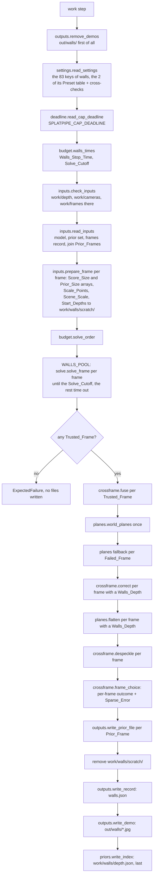
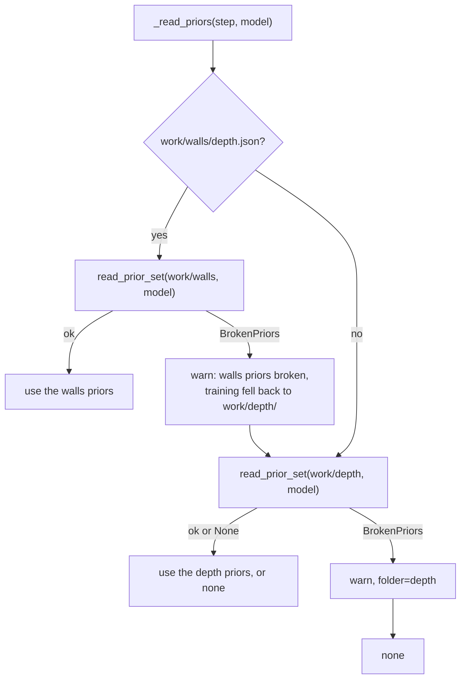

# Design Document: walls

## Overview

This spec builds the Walls_Step in `splatpipe/walls/`, an Optional_Step between the Depth_Step and the Train_Step, and changes one function of the Train_Step so it reads what the Walls_Step writes. The Walls_Step corrects each Prior_Frame's depth prior with Kriegman and Belhumeur's perspective bas-relief family: per frame it searches four numbers (a, b, c, d) of the change 1/z′ = a/z + m·(b·x + c·y + d), scoring each guess with the faint texture a wall still has, summed over 31 × 31 windows and up to 32 other frames. Every change of that family keeps each pixel on its own ray and keeps every plane flat, so a plane corrects to a plane. It writes its own priors to `work/walls/` in exactly the Prior_Format, at the Depth_Step's Prior_Size, leaving `work/depth/` as it is, and the Train_Step reads `work/walls/` when the Walls_Index is there.

The Walls_Step is CPU-only numpy, scipy and OpenCV, so it adds no package and runs the same on a laptop as on the job machine. It uses every vCPU through worker processes, reads the Cap_Deadline as the Train_Step does, and stops solving frames in time to leave the Train_Step its reserve. A frame it can't solve keeps its depth prior, and when the step fails the Job trains on the depth priors.

The code keeps the three layers the Depth_Step and the Train_Step set up:

- **Pure maths** (`geometry.py`, `images.py`, `scoring.py`, `sources.py`, `fit.py`, `passes.py`, `facets.py`, `crossframe.py`, `planes.py`, `budget.py`): numpy, scipy and OpenCV functions on arrays and numbers. They read no file, start no process and hold no clock, so every rule is tested on tiny made-up data on a laptop.
- **CPU I/O** (`inputs.py`, `outputs.py` and the scratch loaders in `solve.py`): decoding frames and masks with the Train_Step's own readers, reading the Frames_Record, the preparation pass that writes each Prior_Frame's arrays to the scratch folder, reading them back in a worker, and writing the Walls_Prior_Files, the Walls_Record, the Walls_Demos and the Walls_Index through the Prior_Format.
- **One hook**, `WALLS_POOL` in `splatpipe/walls/__init__.py`, read when `work` runs, which gives the Worker_Pool. The Test_Suite replaces it with an in-process stand-in, exactly as the Depth_Step reaches its GPU_Module through `DEPTH_GPU` and the Train_Step through `GPU`. `pool.py` holds both the real `spawn` pool and the stand-in, `InlinePool` (C6). The clock comes the same way: `work` reads the time through `splatpipe.walls.utc_now`, which is the Train_Step's `splatpipe.train.deadline.utc_now`, so a test's `monkeypatch` gives the whole step a fake clock (C8).

`splatpipe/walls/__init__.py` ties the step together inside the Step_Runner's contract, like the Fake_Step, the Depth_Step and the Train_Step. It reuses the Train_Step's modules: `read_model` and `observed_rows` (`colmap.py`), `read_training_image`, `scaled_down`, `read_keep_mask`, `CAMERAS`, `SPARSE` (`files.py`), `training_size`, `world_to_camera`, `scaled_intrinsics`, `keep_mask` (`scene.py`), `prior_taps`, `upscale`, `prior_pixel_mask` (`prior_views.py`), the whole Prior_Format (`priors.py`), and `read_cap_deadline` and `utc_now` (`deadline.py`). Only `files.py` changes: its private mask reader `_keep` becomes the public `read_keep_mask`, with a `section` argument that only its all-masked message uses, so the Walls_Step reads and refuses Mask_Files with the Train_Step's own rules (Req 2.12) and the Train_Step's behaviour and messages stay the same (C1). So `splatpipe.walls` imports `splatpipe.train`'s CPU modules and never the other way round, the same one-direction rule the Depth_Step keeps.

### Decisions on the open choices

The requirements fix every number and most behaviour. These are the calls the design makes where the requirements leave room, and the confirmations of the A-assumptions that touch the architecture. The calls the tasks phase made, C1 to C13 in `tasks.md`, and the two the review added, C14 and C15, are folded into the sections they change, each marked with its number. The ones the review should look at are collected again under "Open points and calls made".

| Choice | Decision |
|---|---|
| The hook (Req 5.5, A16) | `WALLS_POOL: Callable[[int], Pool] = open_pool`, read when `work` runs. `open_pool(workers)` gives a `Pool` protocol with `map_frames(fn, tasks)`, which runs each task in a worker process, `map_frames_until(fn, tasks, cutoff, now)`, which stops at the Solve_Cutoff, and `close()`. Tests `monkeypatch` `splatpipe.walls.WALLS_POOL` with a factory giving an `InlinePool` that runs `fn` in the test process. `InlinePool` lives in `pool.py` beside the real pool, so both share one cutoff rule, and `tests/conftest.py` holds only the `walls_pool` fixture and the dead-worker factory (C6). So the step, its `run`, the CLI and `run_job` all use the stand-in (Req 5.5, 22.5, 22.6). |
| What runs in a worker (Req 5.2, 5.3) | A worker task is a pure function plus a small bundle of plain data (a frame's name, its settings, the paths of its scratch arrays and its sources' scratch arrays). The worker loads the arrays from the scratch folder, does the work and gives back plain results (dataclasses of numpy arrays and numbers). No `StepContext`, no `Config` object and no open file handles cross the process boundary, so `spawn` can pickle every task and result. |
| Thread limiting (Req 5.4, A16, C15) | `open_pool` sets `OMP_NUM_THREADS`, `OPENBLAS_NUM_THREADS`, `MKL_NUM_THREADS`, `NUMEXPR_NUM_THREADS` and `VECLIB_MAXIMUM_THREADS` to `"1"` in `os.environ` while it starts each worker, which inherits them, and then puts the main process's own values back, unset ones unset. The Walls_Step runs in the same process as the Train_Step and the Clean_Step after it, so the limits must not stay set there (C15). Each worker first calls `cv2.setNumThreads(1)`. So each worker runs numpy's BLAS and OpenCV on one thread and the workers don't oversubscribe the vCPUs. |
| `spawn`, not `fork` (A16, C7) | The workers are `multiprocessing.get_context("spawn").Process`es, each fed by a task queue and answering on a result queue, not a `multiprocessing.Pool`: that pool waits forever for a task whose worker process was killed, so it can't give Req 5.7's failure, and Python 3.11's `ProcessPoolExecutor` can't end a running task at the Solve_Cutoff (Req 4.6). With plain processes the main process sees a worker that exits with no result, and ends the workers still running at the Solve_Cutoff and starts fresh ones in their place (C7). The Walls_Step runs in the same process as the Depth_Step, which imported torch and MoGe and left CUDA state behind, and `fork` would copy that into every child. `spawn` starts a clean interpreter, so no GPU handle is inherited, and the children import only the CPU modules. `forkserver` would do as well; `spawn` is chosen because it is available on macOS too, so the laptop tests exercise the same path. |
| How arrays reach the workers (cost note 3, C3) | One preparation pass, on the main process, decodes each Prior_Frame once, works out its Scale_Points, its Scene_Scale and both its Start_Depths, and writes its Score_Size arrays (Luma, High_Pass, the four Bands, the Score_Mask, the Start_Depth and the Depth_Pixel mask), its Prior_Size arrays (the Depth_Prior's three arrays, the Start_Depth and the Covered mask), its Scale_Points and its numbers (k, m and the Scale_Point count) to `work/walls/scratch/<stem>/` as `.npy`. Doing the Scene_Scale here, not in the Frame_Solve, gives a Timed_Out_Frame its k and Scale_Points too, for the Walls_Record (Req 7.6) and the Sparse_Error (C3). Each worker loads the arrays it needs for its Prior_Frame and its Source_Frames with `solve.load_frame` and `solve.load_source`, which use `np.load(..., mmap_mode="r")`, so a source decoded once is read, not re-decoded, by every frame that scores against it (C4). A Source_Frame's arrays include its Prior_Size Start_Depth and Covered mask, because the occlusion test compares with the Source_Frame's Start_Depth, k × its Prior_Depth (D24), so each source's k reaches the worker inside that array, from the scratch folder. The cross-frame stages read and rewrite each frame's current depth and normal in the same scratch folder. A Timed_Out_Frame keeps its scratch arrays, so it stays a Source_Frame of the frames still solving (Req 4.8). `work/walls/scratch/` is removed in a `finally`, before the step returns, so no reader and no upload sees it (the Cloud_Runner uploads all of `work/`). |
| The same bits whatever the workers (Req 5.9, 22.6, C14) | A spawned worker runs BLAS and OpenCV on one thread, and `InlinePool` runs in the test process, whose BLAS may use many, and a BLAS call's last bits can change with its thread count. So the code that runs in a worker keeps every sum over many pixels in numpy's own loops: elementwise arithmetic, `np.sum`, `np.median` and `np.einsum` with its default `optimize=False`, which calls no BLAS. It applies a pose to many points elementwise, never with `@` or `np.dot`, and calls LAPACK only on matrices of at most 4 × 4: `tukey_change` builds its 4 × 4 weighted normal equations with `np.einsum` and solves them with `np.linalg.lstsq`, which also copes with the rank-deficient case of a wall seen square on, and `robust_plane` builds its 3 × 3 weighted covariance with `np.einsum` before `np.linalg.eigh`. `InlinePool` runs its tasks with `cv2.setNumThreads(1)` and puts the main process's count back after, as the workers run (C14). |
| Where the Solved_Change lives in size (Req 7.5, 9.1, D9) | The scoring runs at the Score_Size (640 long edge); the Facets, the fuse, the fallback, the correction, the flatten and the despeckle run at the Prior_Size (512 long edge). A frame's `m`, the Median_Inverse_Depth of its Start_Depth, is worked out once at the Prior_Size over its Covered_Pixels and used at both sizes, because it is a property of the depth field, not of the grid. Normalised_Coordinates are worked out per grid from the Shared_Camera by the Prior_Format pixel-centre rule, so the same ray is described at either size. |
| The Walls_Index (D7) | It is the Depth_Index copied unchanged: `write_index(work/walls, depth_index)` writes the same camera, Prior_Size, `metres_per_unit` and every `PriorEntry` in its order. Every Prior_Frame gets exactly one Walls_Prior, so the set of priors is the Depth_Index's set, and `read_prior_set(work/walls, model)` passes the same pose and camera checks. |
| The facet cut (Req 12.1–12.3, A9) | A seed-and-grow, largest-first, on the Prior_Size. Candidates are the Covered_Pixels that are not Jump_Pixels. The pass walks candidates in row-major order; each unassigned candidate seeds a 4-connected region grown by breadth-first search over unassigned candidates, a neighbour joining when the angle between its normal and the region's running mean normal (renormalised as pixels join) is at most `facet_normal_degrees`. After growth, a clean-up pass drops from the region any pixel whose normal is now more than `facet_normal_degrees` from the final mean normal (the normalised mean of the region's pixels); dropped pixels return to the unassigned pool and may seed or join a later region. A region with at least `facet_min_pixels` pixels is a Facet. This is deterministic, 4-connected, Jump-Pixel-free, every kept pixel within the angle of the Facet's normal, and no pixel in two Facets. The exact seeding order is a design call (see Open points). |
| The robust plane fit (Req 13.2) | Tukey-reweighted principal components. Start with weights 1; each round, the weighted mean μ and weighted covariance C of the points, C built with `np.einsum` (C14), the normal n is C's smallest eigenvector (`np.linalg.eigh`), the signed distances r = (X − μ)·n, the scale σ = MAD(r) (median absolute deviation, unscaled), and the Tukey weight w = (1 − (r/(`tukey_constant`·σ))²)² where |r| < `tukey_constant`·σ, else 0; repeat for `tukey_iterations` rounds. The Facet_Plane is (n, δ = n·μ). With σ = 0 the weights stay as they were, so a perfectly planar Facet keeps every point. |
| The Tukey fit of a change (Req 15.2, 15.3, A12) | The four numbers enter the inverse depth **linearly**: inv′ = a·inv0 + m·(b·x + c·y + d). So the fit is iteratively reweighted linear least squares on the design matrix with columns (inv0, m·x, m·y, m) against the target inverse depths, with Tukey weights on the residuals at `tukey_constant` MADs for `tukey_iterations` rounds, and no `fit_bound` (it fits geometry, not a table). Each weighted round builds the 4 × 4 normal equations with `np.einsum` and solves them with `np.linalg.lstsq` (C14). |
| The end-to-end Job outcome (Req 22.10, A21) | On `tests/test_cameras_step.py`'s tiny scene the Job has 5 Prior_Frames, Pick_Numbers 0 to 4. A frame's Source_Frames must be `source_min_gap` (2) Pick_Numbers apart from each other, so from its 4 candidates it can choose at most 2, fewer than `min_sources` (4), even with `source_fallback_seconds`. So every Prior_Frame fails its Self_Check with too few Source_Frames before any pass runs (Req 8.7), and no Prior_Frame is a Trusted_Frame. Its 16 × 12 frames couldn't hold one 31 × 31 Score_Window either. The Walls_Step therefore fails with the Req 18.8 Expected_Failure: 5 Prior_Frames, 0 timed out, 5 failed their Self_Check, all 5 with too few Source_Frames. The Job is `done with warnings`, and the Walls_Step's Job_Summary entry is `failed` with that message. The test uses the `walls_pool` fixture, so no worker process starts, and asserts that entry between `depth` done and `train` done, and the Job trains on the depth priors. This is the natural, deterministic outcome of the real settings on that scene; it needs no special config. |
| The worker count when there is nothing to solve (A16) | `workers` is capped at the number of Prior_Frames, and at least 1. With the in-process stand-in the count is ignored. |
| Dependencies (Req 21.13, A20) | None. numpy, scipy and `opencv-python-headless` are already Project_File dependencies; the Walls_Step adds no package, so `pyproject.toml`, `uv.lock`, `app/pyproject.toml`, `app/uv.lock`, `cloud/image.py`, the Smoke_Test and the Machine_Image stay as they are, and the Licence_List gains no row. The `opencv-python-headless` row's "How we use it" cell adds the step's use. |

## Architecture

### The step's flow



Each per-frame box after the Frame_Solves runs its work in the Worker_Pool too (Req 5.3). Every cross-frame stage is a barrier: all frames finish stage N before stage N + 1 reads any depth, and each stage reads the depths as the stage before left them in the scratch folder, so the order the frames are taken in never changes the result (Req 14.4, A11). The World_Planes are built once, on the main process, from the Trusted_Frames' Facets and Fused_Depths (D15).

### The train step's change



### Module layout

Every file imports only the standard library, numpy, scipy, `cv2` and `splatpipe`, and `pool.py` adds `multiprocessing` and `os` (Req 1.11, 22.8). No file imports torch, gsplat, MoGe, `cloud` or boto3.

| File | What it holds | Imports |
|---|---|---|
| `splatpipe/walls/__init__.py` | `run()`, `work()`, the hooks `WALLS_POOL` and `utc_now` (C8), the step's flow, the counts, the timings, the warnings and the failures. | stdlib, numpy, `splatpipe.errors`, `splatpipe.step`, `splatpipe.train.colmap`, `splatpipe.train.files`, `splatpipe.train.priors`, `splatpipe.train.scene`, `splatpipe.train.deadline`, the walls CPU modules |
| `splatpipe/walls/__main__.py` | `main(argv)`, which calls `step_main("walls", "splatpipe.walls", argv)`. | stdlib, `splatpipe.step` |
| `splatpipe/walls/settings.py` | `WallsSettings` and `read_settings()`, the kind table and the cross-checks of Req 3.4, 3.5. | stdlib, `splatpipe.errors` |
| `splatpipe/walls/budget.py` (pure) | `walls_times()`, `solve_cutoff()`, `may_start()`, `solve_order()`, taking the time as an argument. | stdlib |
| `splatpipe/walls/inputs.py` | `check_inputs()`, `read_frames_record()`, `read_inputs()` joining the model, the Prior_Set and the Pick times into `FrameInput`s, `score_size()`, `score_image()`, `score_mask()`, and, from task 9, `prepare_frame()` and the scratch folder's file names (C3). | stdlib, numpy, cv2, `splatpipe.errors`, `splatpipe.train.*`, `splatpipe.walls.images`, `splatpipe.walls.sources` |
| `splatpipe/walls/geometry.py` (pure) | `normalised_coords()`, `rays()`, `apply_change()`, `depth_factor()`, `compose()`, `changed_normal()`, `back_project()`, `project()`, `warp_maps()`, `zbuffer_project()`, `median_inverse_depth()`. | stdlib, numpy, `splatpipe.train.scene` for `world_to_camera`, `scaled_intrinsics` |
| `splatpipe/walls/images.py` (pure) | `luma()`, `high_pass()`, `bands()`, `band_weights()`, `band_mix()`, `window_centres()`, `window_sums()`, `window_ncc()`. | stdlib, numpy, cv2 |
| `splatpipe/walls/scoring.py` (pure) | `Windows`, `ScoreSource`, `score_windows()`, `valid_pairs()`, `occluded()`, `table_scales()`, `score_table()`, `guess_score()`, `tile_scores()`. | stdlib, numpy, `splatpipe.walls.geometry`, `splatpipe.walls.images` |
| `splatpipe/walls/sources.py` (pure) | `scale_points()`, `scene_scale()`, `start_depth()`, `Candidate`, `overlap()`, `image_motion()`, `source_rank()`, `SourceChoice`, `choose_sources()`. | stdlib, numpy, `splatpipe.walls.geometry`, `splatpipe.train.colmap`, `splatpipe.train.scene`, `splatpipe.train.prior_views` |
| `splatpipe/walls/fit.py` (pure) | `change_fit()` (Nelder-Mead), `tukey_change()` (IRLS). | stdlib, numpy, scipy.optimize, `splatpipe.walls.scoring` |
| `splatpipe/walls/passes.py` (pure) | `first_pass()`, `second_pass()`, `band_coherences()`, `third_pass()`, `self_check()`, `ThirdPass`, `SolveResult`. | stdlib, numpy, the walls pure modules |
| `splatpipe/walls/facets.py` (pure) | `jump_pixels()`, `cut_facets()`, `refit_facet()`, `apply_facet_change()`, `Facet`, `FacetChange`. | stdlib, numpy, scipy, the walls pure modules |
| `splatpipe/walls/solve.py` | Task 6: `FrameArrays`, `FrameSolve` and `solve_arrays()`, one Frame_Solve on arrays in memory, pure. Task 9: `SolveTask`, `solve_frame(task) -> FrameSolve`, the worker's entry point, `load_frame()` and `load_source()`, which read the scratch arrays back, and the worker tasks of the cross-frame stages (C4). | stdlib, numpy, the walls pure modules, `splatpipe.walls.inputs` for the scratch folder's file names only |
| `splatpipe/walls/crossframe.py` (pure) | `neighbours()`, `projected_values()`, `agreeing()`, `agreeing_median()`, `fuse_frame()`, `correct_frame()`, `despeckle_frame()`, `sparse_error()`, `frame_choice()` (C5). | stdlib, numpy, `splatpipe.walls.geometry` |
| `splatpipe/walls/planes.py` (pure) | `robust_plane()`, `world_planes()`, `camera_plane()`, `projection_fallback()`, `plane_registration()`, `flatten_frame()`, `WorldPlane`. | stdlib, numpy, the walls pure modules |
| `splatpipe/walls/pool.py` | `open_pool()`, `worker_count()`, the `Pool` protocol, `MapResult`, `InlinePool` (C6), the worker loop, the thread-limit env vars, `WorkerStopped`. | stdlib, `multiprocessing`, `os`, cv2, `splatpipe.errors` |
| `splatpipe/walls/outputs.py` | `remove_demos()`, `write_prior_file()`, `write_record()`, `demo_panel()`, `write_demo()`, `walls_prior()`, `depth_prior_copy()`, `remove_scratch()`. | stdlib, numpy, cv2, `splatpipe.errors`, `splatpipe.jsonio`, `splatpipe.train.priors`, `splatpipe.train.files` |
| `splatpipe/walls/report.py` | `Counts`, `Timings`, the warnings and the Expected_Failures of Req 18.8, 19.5, 19.6. | stdlib, `splatpipe.errors` |

## Components and Interfaces

### The bas-relief change (`geometry.py`, pure)

```python
def normalised_coords(camera: Camera, width: int, height: int) -> tuple[np.ndarray, np.ndarray]
def rays(x: np.ndarray, y: np.ndarray) -> np.ndarray                      # (..., 3): (x, y, 1)
def median_inverse_depth(depth: np.ndarray, covered: np.ndarray) -> float  # m
def apply_change(inverse_depth: np.ndarray, change: tuple[float, float, float, float],
                 m: float, x: np.ndarray, y: np.ndarray) -> np.ndarray     # new inverse depth
def depth_factor(z: np.ndarray, change, m: float, x, y) -> np.ndarray       # s(p)
def compose(first, second, m1: float, m2: float) -> tuple[float, float, float, float]
def changed_normal(normal, z, x, y, change, m: float) -> np.ndarray
```

Let a change be (a, b, c, d), a depth map z(p) with inverse depth ι(p) = 1/z(p), `m` the Median_Inverse_Depth of that map over its Covered_Pixels, and (x, y) each pixel's Normalised_Coordinates, x = (u − cx)/fx, y = (v − cy)/fy, with (u, v) the pixel centre in the Shared_Camera's full pixels: pixel (i, j) at a size w × h is centred at ((i + 0.5)·W/w, (j + 0.5)·H/h), the Prior_Format's rule.

- **apply_change** (Req 6.1), all in float64: ι′(p) = a·ι(p) + m·(b·x + c·y + d). The Identity_Change (1, 0, 0, 0) gives ι′ = ι bit for bit, because `1.0 * ι + m * 0.0` is ι (Req 6.2). A pixel whose ι′ is not finite or not above 0 gets no new depth (Req 6.3).
- **depth_factor** (Req 6.3): s(p) = z′(p)/z(p) = ι(p)/ι′(p) = 1/(a + m·z(p)·(b·x + c·y + d)).
- **compose** (Req 6.5): the first change on a map of median m₁, the second on the result of median m₂, equal the one change of the first map

  (a₁·a₂, a₂·b₁ + (m₂/m₁)·b₂, a₂·c₁ + (m₂/m₁)·c₂, a₂·d₁ + (m₂/m₁)·d₂).

  Derivation: ι₂ = a₂·ι₁ + m₂·L₂ = a₂(a₁·ι₀ + m₁·L₁) + m₂·L₂ = a₁a₂·ι₀ + m₁(a₂·L₁ + (m₂/m₁)·L₂), with Lₖ = bₖx + cₖy + dₖ. The Walls_Record holds each Prior_Frame's Solved_Change in this one-change form relative to its Start_Depth, with m = m₁ the Start_Depth's median (Req 6.5, 10.8).
- **changed_normal** (Req 6.4, D4): for a pixel at depth z with ray r = (x, y, 1) and unit normal n, the raw new normal is a·n + m·z·(n·r)·(b, c, d); it is set to unit length and, when its dot product with r is above 0, negated, so it faces the camera. A result of length 0 or with a non-finite part gives the pixel no new normal. On a plane this is the new plane's unit normal: a plane n·X = δ not through the centre gives ι = (n·r)/δ affine in (x, y), the change keeps ι affine, and the carried normal is the new plane's normal (see Property 2).

**Why a plane stays a plane.** On a plane n·X = δ (δ ≠ 0), a point X = z·r satisfies z(n·r) = δ, so ι = 1/z = (nₓx + nᵧy + n_z)/δ is affine in (x, y). apply_change adds a·(affine) + m·(affine), still affine, so ι′ is affine in (x, y): the changed points lie on one plane. This is why the step can search just four numbers per frame.

### Back-projection, projection and the warp (`geometry.py`)

```python
def back_project(z: np.ndarray, x: np.ndarray, y: np.ndarray) -> np.ndarray  # (..., 3) camera point z*(x,y,1)
def project(points_camera: np.ndarray, k: np.ndarray) -> tuple[np.ndarray, np.ndarray, np.ndarray]
def warp_maps(prior_depth, factor, prior_pose, source_pose, source_k, x, y
              ) -> tuple[np.ndarray, np.ndarray, np.ndarray, np.ndarray]  # map_x, map_y, source_z, inside
def zbuffer_project(points_camera, k, width, height) -> tuple[np.ndarray, np.ndarray]  # depth, filled
```

- **Warp a Source_Frame into a Prior_Frame at a Depth_Factor s** (Req 9.3). Each Score_Size pixel's point at s·z on its ray is C = (s·z)·(x, y, 1) in the Prior_Frame's camera. The world point is W = Rₚᵀ(C − tₚ), from the Prior_Frame's `world_to_camera` (R_p, t_p). The point in the Source_Frame's camera is C_s = R_s·W + t_s. Its projection with the Shared_Camera scaled to the Score_Size (`scaled_intrinsics`) is u = f_x′·C_sx/C_sz + c_x′, v = f_y′·C_sy/C_sz + c_y′, in COLMAP's convention (pixel centre at (0.5, 0.5)). `warp_maps` returns the OpenCV sample coordinates (map_x = u − 0.5, map_y = v − 0.5), the predicted Source depth C_sz, and `inside`, true where C_sz > 0 and 0 ≤ u < W_s and 0 ≤ v < H_s. `images.window_ncc` samples the Source's score image with `cv2.remap(..., INTER_LINEAR, BORDER_CONSTANT)` at those maps.
- **The predicted Source depth** for the occlusion test is C_sz at the window centre, which the test compares with the Source_Frame's Start_Depth under the warped centre (Req 9.6, D24).
- **zbuffer_project** (Req 14.2, A11): a Neighbour_Frame's points at its current depth, projected into a Prior_Frame, keep per Prior_Size pixel the nearest (frontmost) depth. It sorts the landing (pixel, z) pairs with `np.lexsort((z, flat_index))` and takes the first of each pixel; a pixel no point lands on stays unfilled. The pixel of a projection is the Depth_Step's pixel rule, (min(⌊u·w/W⌋, w−1), min(⌊v·h/H⌋, h−1)).

### Images and scoring (`images.py`, `scoring.py`, pure)

```python
def luma(bgr: np.ndarray) -> np.ndarray                     # (h, w) float64 0..255, cv2 BGR2GRAY
def high_pass(grey: np.ndarray, sigma: float) -> np.ndarray  # grey - GaussianBlur(grey, sigma)
def bands(grey: np.ndarray, sigmas: Sequence[float]) -> list[np.ndarray]   # octave DoG bands
def band_weights(coherences, variances, cap: float) -> np.ndarray
def band_mix(bands: list[np.ndarray], weights: np.ndarray) -> np.ndarray
def window_centres(width, height, window_size, step) -> tuple[np.ndarray, np.ndarray]
def window_sums(image: np.ndarray, centres, window_size) -> np.ndarray     # sum over each window
def window_ncc(prior_image, source_image, map_x, map_y, inside, centres, window_size, flat_variance)
```

- **Luma** (glossary): `cv2.cvtColor(bgr, COLOR_BGR2GRAY)` of the frame scaled to the Score_Size with `scaled_down` (INTER_AREA), as float64 from 0 to 255.
- **High_Pass**: grey − `cv2.GaussianBlur(grey, (0, 0), high_pass_sigma)`, in Score_Size pixels.
- **Bands** (glossary): with `band_sigmas` = [0, 1, 2, 4, 8], each Band is blur(σₖ) − blur(σₖ₊₁), where σ = 0 means the Luma itself; so [0, 1, 2, 4, 8] gives 4 Bands.
- **Window sums** use `cv2.boxFilter(image, CV_64F, (W, W), normalize=False)` read at the window centres, or integral images; the design uses `boxFilter` for the five sums (I, J, I², J², IJ) and integral-image corner reads for the masked/invalid counts. The zero-mean NCC of a window is cov/√(var_I·var_J) with var_I = S_II − S_I²/n, var_J = S_JJ − S_J²/n, cov = S_IJ − S_I·S_J/n and n = window_size² (Req 9.4).
- **Band_Weights** (Req 10.5, A4): ρ_b capped at `band_max_coherence`; w_b = √(ρ_b/((1 − ρ_b²)·var_b)) so w_b²·var_b = ρ_b/(1 − ρ_b²); 0 where ρ_b ≤ 0 or var_b = 0. var_b is over the Prior_Frame's Depth_Pixels no mask hides. When every weight is 0 the Third_Pass scores the High_Pass (Req 10.6). The Source_Frames' Band_Mixes use the Prior_Frame's own weights.

```python
@dataclass(frozen=True)
class Windows:
    centres_x: np.ndarray    # (P,) int, window-centre columns in Score_Size pixels
    centres_y: np.ndarray    # (P,) int
    tile: np.ndarray         # (P,) int, each window's Tile index
    cx: np.ndarray           # (P,) float, Normalised_Coordinates of the centre
    cy: np.ndarray

@dataclass(frozen=True)
class ScoreSource:           # what one Source_Frame brings to the scoring
    name: str
    world_to_camera: np.ndarray   # (4, 4)
    high_pass: np.ndarray         # Score_Size
    bands: np.ndarray             # (4, h, w), Score_Size
    score_mask: np.ndarray        # Score_Size
    start_depth: np.ndarray       # Prior_Size, k × Prior_Depth, NaN off the Covered_Pixels (D24)
    covered: np.ndarray           # Prior_Size
    half: str                     # "A" or "B", its Source_Half

def score_windows(high_pass, score_mask, depth_pixel, windows_grid, window_size, flat_variance) -> Windows
def valid_pairs(window, warp, source_mask, source_start_depth, flat_variance, occlusion_tolerance) -> np.ndarray
def occluded(source_z, warped_centre, source_start_depth, tolerance) -> np.ndarray
def table_scales(min_scale, max_scale, step) -> np.ndarray
def score_table(windows, sources, current_depth, scales, ...) -> np.ndarray     # C(p, s)
def guess_score(table, scales, windows, z, change, m) -> float
def tile_scores(windows, sources, answer_depth, z_scale, z_error_factor, tile_min_windows) -> tuple[float, float, int, int]
```

- **Score_Windows** (Req 9.2, A2): centres on the grid every `window_step` pixels, starting ⌊`window_size`/2⌋ in from the top left, whose pixels all lie inside the image, are all Depth_Pixels and all kept by the Score_Mask, and whose High_Pass variance (S_II − S_I²/n)/n is at least `flat_variance`.
- **Valid_Pair** (Req 9.5, A1, A2): a window and a Source_Frame at a Depth_Factor count only when every window pixel warps in front of the Source camera and inside its image (`inside`), touches no Score_Mask-masked Source pixel (a window-sum of the Source mask over the warped footprint equals the window area), the warped window's High_Pass variance is at least `flat_variance`, and the window is not occluded. The occlusion test is made once per Score_Table at the Current_Depth and holds at every Table_Scale (A1): a window is occluded when the predicted Source depth at its warped centre differs from the Source's Start_Depth under that centre, k × its Prior_Depth, by more than `occlusion_tolerance` of it, or the warped centre lands where the Source has no Start_Depth (D24). The flat test always uses the High_Pass, in every pass, so the same windows are flat in all passes (A2).
- **Table_Scales** (Req 9.7, A3): from `min` to `max` inclusive, evenly spaced in ln(s), with ⌈ln(max/min)/step⌉ + 1 scales. For the real settings that is 94 (First), 43 (Second), 43 (Third) and 97 (Facet) scales.
- **Score_Table** C(p, s) (Req 9.8): the sum over the Valid_Pairs of window p at the Current_Depth × s of their Window_Scores, 0 where p has no Valid_Pair. Built by warping each Source at each Table_Scale and accumulating the window NCCs; the Third_Pass also accumulates the two Half_Tables (Half_A and Half_B) in the same loop, so the halves cost no extra warps.
- **Guess_Score** (Req 9.9, 9.10, A3): F = Σ_p C(p, s(p)) with s(p) the guess's Depth_Factor at p's centre, looked up by linear interpolation in ln(s): q = (ln s(p) − ln s_min)/step, k = min(⌊q⌋, n − 2), f = q − k, value = C[k, p]·(1 − f) + C[k + 1, p]·f. The guess is rejected (F = −∞) when any s(p) is not finite or lies outside the Table_Range, or |b|, |c| or |d| exceeds `fit_bound`.
- **Tile_Score** (Req 11.4–11.6, 11.8, A6): for each of answer × `z_scale` and answer ÷ `z_scale`, a Tile counts when at least `tile_min_windows` of its windows have a Valid_Pair at both the answer and the other depth; the Tile's two means are over those shared Valid_Pairs; Z = (mean_A − mean_B)/(`z_error_factor`·√(var_A/n + var_B/n)) over the n counting Tiles, with sample variances. n < 2 gives no Z (Self_Check fails); a standard error of 0 gives Z = +∞ when mean_A − mean_B > 0 and a failed Self_Check otherwise. The occlusion test is made at the answer, against each Source's Start_Depth with `occlusion_tolerance` (D24).

### Scene scale and sources (`sources.py`, pure)

```python
@dataclass(frozen=True)
class Candidate:              # another Prior_Frame, as source choice sees it
    name: str
    pick_number: int
    frame_time: float
    world_to_camera: np.ndarray

def scale_points(model, image, camera, covered, prior_depth) -> tuple[np.ndarray, np.ndarray, np.ndarray]  # pixels, z, Prior_Depth
def scene_scale(scale_points_z, prior_depth_at_points, mad_gate, min_points) -> tuple[float, int]
def start_depth(prior_inverse_depth, taps, k) -> tuple[np.ndarray, np.ndarray]   # start depth, depth pixels
def overlap(covered_points_world, source_pose, source_k, source_w, source_h) -> float
def image_motion(covered_points_world, start_depth, source_pose, source_k, motion_depth_change) -> float
def source_rank(overlap: float, motion: float, motion_cap: float) -> float
def choose_sources(frame, candidates, settings, seconds_cut) -> list[SourceChoice]
```

- **Scene_Scale** (Req 7.1–7.3, A7): worked out for every Prior_Frame on the main process, in the preparation pass, so a Timed_Out_Frame has it too (C3). The Scale_Points, from `scale_points` through `observed_rows`, are the Prior_Frame's Observed_Points in front of the camera whose projection with the Shared_Camera at full size lands inside the Frame on a Covered_Pixel, by the Depth_Step's pixel rule (the same geometry as `splatpipe.depth.fit.fit_points`, written again here, because no walls file imports `splatpipe.depth`). For each, r = ln(z/Prior_Depth at its pixel). With r̃ = median(r) and D = median(|r − r̃|) (MAD, unscaled), k = exp(median of the r with |r − r̃| ≤ `scale_mad_gate`·D). With D = 0 only the r at the median stay. With fewer than `scale_min_points` Scale_Points, k = 1. The Walls_Record holds k and the Scale_Point count.
- **Start_Depth** (Req 7.4, 7.5): at the Prior_Size, k × Prior_Depth over the Covered_Pixels. At the Score_Size, the Depth_Prior's `inverse_depth` scaled up with `prior_taps`/`upscale`/`prior_pixel_mask` (to the Score_Size), divided by k; a Score_Size pixel is a Depth_Pixel only where that rule gives a prior. `m` for the Solved_Change is the Median_Inverse_Depth of the Prior_Size Start_Depth over the Covered_Pixels.
- **Sources** (Req 8, A8): candidates are the other Prior_Frames whose Frame_Time differs by at least the time cut. Each candidate's Overlap is the share of the Prior_Frame's Covered_Pixels whose point at the Start_Depth lands in front of the candidate and inside it; drop below `source_min_overlap`. Image_Motion is the median, over the Covered_Pixels landing inside, of the pixel distance in the candidate's Score_Size between the projections at the Start_Depth and at (1 + `motion_depth_change`)·Start_Depth; drop below `source_min_motion`. Source_Rank = Overlap × min(Image_Motion, `source_motion_cap`), highest first, ties to the lower Pick_Number. The step takes candidates in rank order whose Pick_Number differs by at least `source_min_gap` from every chosen source, up to `max_sources`. When this gives fewer than `min_sources`, it chooses again with `source_fallback_seconds` in place of `source_min_seconds`. Fewer than `min_sources` then fails the Self_Check with no pass run (Req 8.7).

### The fits (`fit.py`, pure)

```python
def change_fit(table, scales, windows, z, m, settings) -> tuple[tuple[float,float,float,float], float]
def tukey_change(inv0, target_inverse, m, x, y, constant, iterations) -> tuple[float,float,float,float]
```

- **change_fit** (Req 10.3, A5, C10): `scipy.optimize.minimize(method="Nelder-Mead")` on −Guess_Score, from `fit_starts` starts, with `maxiter = fit_max_iterations`, `xatol = fit_x_tolerance`, `fatol = fit_f_tolerance`. The starts are a fixed pattern with no random draw, because `[walls]` holds no seed and Req 5.9 wants the same bits whatever the workers: the Identity_Change, then start j, for j from 1, moves number (j − 1) mod 4 of (a, b, c, d) by +`fit_start_spread` in the first round of four, by −`fit_start_spread` in the next, and so on. Each start's `initial_simplex` is the start and the start moved by `fit_start_spread` along each of the four numbers. A rejected guess scores −∞, worse than every other. It returns the single best guess it evaluated over all starts, so the Guess_Score is at least the Identity_Change's. `m` is the depth map's Median_Inverse_Depth, or the Facet's for a Facet's fit. Every Change_Fit in the Second_Pass, the Third_Pass, the Source_Halves and the Facets uses the same settings and the same `fit_bound`.
- **tukey_change** (Req 15.2, 15.3, A12, C14): the four numbers are linear in the inverse depth, inv′ = a·inv0 + m·(b·x + c·y + d), so this is iteratively reweighted linear least squares. The design matrix columns are (inv0, m·x, m·y, m), the target is the target inverse depth, and each round reweights the rows with Tukey's weights at `tukey_constant` MADs of the residuals, for `tukey_iterations` rounds, with the weights left as they were when the deviation is 0. Each round builds the 4 × 4 weighted normal equations with `np.einsum` and solves them with `np.linalg.lstsq`, so no BLAS call sees the many rows and the bits don't depend on the thread count. No `fit_bound`.

### The three passes and the self-check (`passes.py`, pure)

```python
@dataclass(frozen=True)
class SolveResult:
    k: float
    scale_points: int
    source_count: int
    seconds_cut: float
    first_scale: float
    change: tuple[float, float, float, float]   # the Solved_Change, relative to the Start_Depth
    m: float
    band_weights: np.ndarray                     # (4,)
    halves_difference: float
    tile_low: float                              # Z against ÷ z_scale
    tile_high: float                             # Z against × z_scale
    tile_low_count: int
    tile_high_count: int
    passed: bool

def first_pass(windows, sources, start_depth, m, settings) -> tuple[float, np.ndarray]   # scale, depth
def second_pass(windows, sources, first_depth, m, settings) -> tuple[tuple, np.ndarray]
def band_coherences(windows, sources, second_depth, settings) -> np.ndarray            # (4,) ρ
def third_pass(windows, sources, weights, second_depth, m, settings) -> ThirdPass      # its change, table and Half_Tables
def self_check(third, windows, sources, settings) -> SolveResult
```

- **First_Pass** (Req 10.1): a Score_Table on the High_Pass around the Start_Depth from `first_min_scale` to `first_max_scale` with `first_scale_step`; the Table_Scale s with the highest Σ_p C(p, s), the one nearest 1 in ln(s) on a tie; its change is (1/s, 0, 0, 0) and its depth s × the Start_Depth.
- **Second_Pass** (Req 10.2): a Score_Table on the High_Pass around the First_Pass's depth from `second_*`; the Change_Fit on it.
- **Band_Weights and Third_Pass** (Req 10.4–10.7): each Band's Coherence ρ is its mean Window_Score over the Prior_Frame's Valid_Pairs at the Second_Pass's depth; the weights are the closed form above; the Third_Pass scores the Band_Mix of the Prior_Frame and of each Source (made with the Prior_Frame's own weights), or the High_Pass when every weight is 0, on a Score_Table and the two Half_Tables around the Second_Pass's depth from `third_*`; the Change_Fit on the Score_Table is its change.
- **Solved_Change** (Req 10.8): the First_Pass's, the Second_Pass's and the Third_Pass's changes composed with `compose`, relative to the Start_Depth, so k stays a number of its own.
- **Self_Check** (Req 11, D12, D13, D14, A6): the Source_Halves (ranked 1st/3rd/… and 2nd/4th/…), each refitting the Third_Pass's four numbers on its Half_Table; the Halves_Difference, the median over the Covered_Pixels of |z_A/z_B − 1| with z_A, z_B the Second_Pass's depth through each half's change; the two Tile_Scores at the answer (the Second_Pass's depth through the Third_Pass's change). It passes only when the frame has at least `min_sources` Source_Frames, the Halves_Difference is below `halves_tolerance`, and both Tile_Scores are above `min_z`.

### One Frame_Solve (`solve.py`)

```python
@dataclass(frozen=True)
class FrameArrays:                    # what the preparation pass gives one Prior_Frame
    name: str
    world_to_camera: np.ndarray       # (4, 4)
    score: dict[str, np.ndarray]      # its Score_Size arrays: Luma, High_Pass, Bands, Score_Mask,
                                      # Start_Depth, Depth_Pixel mask
    prior: dict[str, np.ndarray]      # its Prior_Size arrays: the Depth_Prior's three, Start_Depth,
                                      # Covered mask
    k: float
    scale_points: int
    m: float                          # the Prior_Size Start_Depth's Median_Inverse_Depth

@dataclass(frozen=True)
class FrameSolve:
    name: str
    result: SolveResult | None        # None when it failed before any pass (too few sources)
    solved_depth: np.ndarray | None   # (h, w) float64 at the Prior_Size, with Facet_Changes applied
    solved_normal: np.ndarray | None  # (h, w, 3) float32
    facets: tuple[Facet, ...]
    applied: tuple[FacetChange, ...]
    passed: bool

def solve_arrays(frame: FrameArrays, candidates: Sequence[Candidate],
                 load_source: Callable[[str], ScoreSource], settings) -> FrameSolve   # task 6, pure
def load_frame(scratch: Path, name: str) -> FrameArrays                                # task 9
def load_source(scratch: Path, name: str) -> ScoreSource                               # task 9
def solve_frame(task: SolveTask) -> FrameSolve                                         # task 9
```

The Frame_Solve is split in two (C4). `solve_arrays` is the whole Frame_Solve on arrays in memory, pure, so task 6 tests it with no scratch folder: it chooses the Source_Frames, loading only the chosen ones through `load_source`; with fewer than `min_sources` it gives a failed `FrameSolve` whose `result` is `None`, with no pass run (Req 8.7); otherwise it runs the three passes and the Self_Check, cuts the Facets (always, for the flatten later), and, when the Self_Check passes, refits each Facet and applies the ones that pass (Req 12.4–12.7). It builds the Solved_Depth at the Prior_Size by applying the Solved_Change to the Prior_Size Start_Depth and then each applied Facet_Change, in Facet order, on its Facet's pixels, with the Changed_Normal at each touched pixel. It doesn't work out the Scene_Scale: the preparation pass did, on the main process, and `FrameArrays` carries k and both Start_Depths (C3).

`solve_frame(task)` is the worker's entry point and the one function the Worker_Pool runs for a frame. `SolveTask` is plain data a `spawn` worker can pickle: the frame's name, its pose, the settings, the Shared_Camera, the scratch folder and the other Prior_Frames' `Candidate`s. It loads the frame with `load_frame`, calls `solve_arrays` with `load_source`, writes the Solved_Depth and its normals to `current_depth.npy` and `current_normal.npy`, and gives the `FrameSolve` without its arrays. `load_source` gives each Source_Frame's `ScoreSource` its `start_depth.npy` and `covered.npy` from the scratch folder, so the occlusion test gets the Start_Depth the preparation pass worked out, never the raw Prior_Depth (D24). The loaders live in `solve.py`, beside their one caller, and take the scratch file names from `inputs.py`, which writes them, so `inputs.py` never imports `solve.py` and the two can't import each other (C4). Whether a Frame_Solve may start is a main-process decision with `may_start`; a Frame_Solve that is still running at the Solve_Cutoff is ended by the main process (see the pool), so `solve_frame` itself has no clock.

### Facets (`facets.py`, pure)

```python
@dataclass(frozen=True)
class Facet:
    pixels: np.ndarray        # (n, 2) int, (row, col) at the Prior_Size
    normal: np.ndarray        # (3,) float64, the normalised mean of its pixels' normals
    m: float                  # the Facet's Median_Inverse_Depth

@dataclass(frozen=True)
class FacetChange:
    facet: int
    change: tuple[float, float, float, float]
    m: float
    halves_difference: float
    tile_low: float
    tile_high: float

def jump_pixels(inverse_depth, covered, jump, distance) -> np.ndarray
def cut_facets(normal, inverse_depth, covered, settings) -> list[Facet]
def refit_facet(facet, windows, sources, solved_depth, settings) -> FacetChange | None
def apply_facet_change(depth, normal, facet, change, x, y) -> tuple[np.ndarray, np.ndarray]
```

- **Jump_Pixels** (Req 12.2): a Covered_Pixel whose inverse depth and that of a Covered_Pixel `facet_jump_distance` pixels across or down differ by more than `facet_jump` of the smaller.
- **cut_facets** (Req 12.1, 12.3, A9): the seed-and-grow of the decisions table, keeping Facets with at least `facet_min_pixels` pixels, each a 4-connected set of Covered non-Jump pixels whose every normal is within `facet_normal_degrees` of the Facet's normal.
- **refit_facet** (Req 12.4, 12.5, A5, A9): inside a Trusted_Frame's Frame_Solve, a Score_Table and two Half_Tables on the Band_Mix around the Solved_Depth (before any Facet_Change) from `facet_*`, over the Score_Windows whose centres' Prior_Size pixel (the Train_Step's `keep_mask` rule) lies in the Facet, with the occlusion test at the Solved_Depth against each Source's Start_Depth with `facet_occlusion_tolerance` (D24), and the Change_Fit with m the Facet's Median_Inverse_Depth. It returns a FacetChange only when the Halves_Difference over the Facet's pixels is at most `facet_halves_tolerance`, the median over the Facet's pixels of |z_facet/z − 1| is above `facet_min_change_ratio` × that Halves_Difference, and both Tile_Scores (over the Tiles of the Facet's own windows) are at least `facet_min_z`.

### Cross-frame work (`crossframe.py`, `planes.py`, pure)

```python
def neighbours(frame, trusted, window, count) -> list[str]
def projected_values(frame, neighbour_depths, poses, camera) -> np.ndarray   # (h, w, k) with NaN gaps
def agreeing(values, tolerance) -> np.ndarray
def agreeing_median(values, tolerance, min_frames) -> np.ndarray            # NaN where too few agree
def fuse_frame(own_depth, projected, settings) -> np.ndarray
def correct_frame(own_depth, projected, settings) -> np.ndarray
def despeckle_frame(depth, covered, window, min_valid, tolerance) -> np.ndarray
def sparse_error(scale_points_z, walls_depth_at_points) -> float            # C5
def frame_choice(trusted, timed_out, has_fallback, sparse_error, scale_points, settings) -> tuple[str, str | None]  # C5

@dataclass(frozen=True)
class WorldPlane:
    normal: np.ndarray        # (3,) float64, in world
    offset: float             # n·X = offset
    frames: frozenset[str]
    pixels: int

def robust_plane(points, constant, iterations) -> tuple[np.ndarray, float]
def world_planes(trusted_solves, fused_depths, poses, settings) -> list[WorldPlane]
def camera_plane(plane, world_to_camera) -> tuple[np.ndarray, float]        # n_c, δ_c
def projection_fallback(frame, projected_medians, start_depth, m, settings) -> tuple[np.ndarray, np.ndarray] | None
def plane_registration(frame, planes, start_depth, start_normal, m, pose, camera, settings) -> tuple | None
def flatten_frame(frame, facets, planes, walls_depth, pose, camera, settings) -> tuple[np.ndarray, np.ndarray]
```

- **Neighbour_Frames** (Req 14.1, D14, A11): the Trusted_Frames other than the frame within `neighbour_window` Pick_Numbers, the nearest first, ties to the lower Pick_Number, at most `neighbour_frames`.
- **Projected_Value** (Req 14.2, A11): each Neighbour_Frame's points at its current depth, z-buffered into the frame, the nearest per pixel; each Neighbour_Frame gives at most one value per pixel.
- **Agreeing_Values** (glossary, C2): a pixel's Projected_Values within `agree_tolerance` of the nearest of them. "Nearest" is read as nearest the camera: the smallest Projected_Value at the pixel, as each Projected_Value is itself the nearest depth its Neighbour_Frame gives there. `agreeing_median` gives their median where there are at least `agree_min_frames`, and NaN elsewhere.
- **Plane normals** (C11): a fitted plane normal's sign is arbitrary, so every angle between two plane normals, in the merge, the flatten and the registration, is taken from |n₁·n₂|, and two offsets are compared only once the normals face the same way.
- **fuse_frame** (Req 14.3): at each Covered_Pixel, the own Solved_Depth plus the Projected_Values from the Neighbour_Frames' Solved_Depths within `fuse_tolerance` of the own depth; the median when there are at least `fuse_min_values` (own included), else the own depth.
- **world_planes** (Req 13, A10): after the fuse, every Facet of every Trusted_Frame with its points at the Fused_Depth in world; each Facet_Plane by `robust_plane`; merge largest Facet first, a Facet joining the first World_Plane whose normal is within `plane_merge_degrees` and whose offset differs by at most `plane_merge_offset` × its Facet's camera distance, else a new one, refitting the World_Plane through all its Facets' points after each join; keep the World_Planes with Facets from at least `plane_min_frames` Prior_Frames and at least `plane_min_share` of the pixels of the largest such World_Plane.
- **projection_fallback** (Req 15.1, 15.2, A12): when at least `projection_min_coverage` of a Failed_Frame's Covered_Pixels have a median of at least `agree_min_frames` Agreeing_Values (from the Neighbour_Frames' Fused_Depths), one `tukey_change` of the Start_Depth to those medians in inverse depth; each pixel with a median takes the median, each other Covered_Pixel the fitted change's depth, every Covered_Pixel the fitted change's Changed_Normal.
- **plane_registration** (Req 15.3, A12): when the coverage is too low and there are World_Planes, `register_passes` passes whose depth tolerance falls geometrically from `register_start_tolerance` to `register_end_tolerance`; each pass matches every Covered_Pixel to the World_Plane (in the camera frame) nearest its current depth whose normal is within `register_max_degrees` of the pixel's current normal and whose plane depth along the pixel's ray (in front) is within the pass's tolerance, then one `tukey_change` of the Start_Depth to the matched pixels' plane depths; the Fallback_Depth and its normals are the Start_Depth through the last pass's change. A plane's camera-frame form is n_c = R_p·n_w, δ_c = δ_w + n_c·t_p, and the plane depth along a ray r is z = δ_c/(n_c·r). No World_Plane, or fewer than `register_min_pixels` matched in any pass, gives no Fallback_Depth, so the frame gets a Depth_Prior_Copy (Req 15.4).
- **correct_frame** (Req 16.1): at each Covered_Pixel with at least `agree_min_frames` Agreeing_Values (median M) whose own depth z has |ln(z/M)| above `correction_tolerance`, the depth M; depths only, the normal unchanged.
- **flatten_frame** (Req 16.2, 16.3): each Facet's robust normal through its points at the Walls_Depth in the camera frame; the normal n of the World_Plane (camera frame) nearest in angle when within `flatten_degrees`, else the robust normal; the offset δ the median over the Facet's pixels of n·X; a pixel with depth z within `flatten_tolerance` of z_plane = δ/(n·r) (finite, above 0) takes z_plane and the normal n facing the camera, every other pixel unchanged.
- **despeckle_frame** (Req 16.4, 16.7): for each Covered_Pixel, the `despeckle_window` × `despeckle_window` window cut at the border, valid = Covered with finite depth above 0 (self included); when at least `despeckle_min_valid` valid and |z/M − 1| above `despeckle_tolerance` (M the valid median), the depth M; depths only. Reads the depths from before the stage, so no pixel's change moves another's.

Each cross-frame stage reads its inputs from the scratch folder (the depths and normals as the stage before left them) and writes the frame's new depth and, for the flatten, normal back, so the stages are barriers and order-independent (A11, A13). The correction and the despeckle change depths only; a pixel they change keeps the normal its Prior_Frame's or Facet's change gave it (A13).

### The per-frame choice (`crossframe.py`, pure) and the Walls_Prior (`outputs.py`)

```python
def walls_prior(depth_prior: Prior, walls_depth, walls_normal, covered) -> Prior   # outputs.py
def depth_prior_copy(depth_prior: Prior) -> Prior                                   # outputs.py
```

`sparse_error` and `frame_choice` are pure rules on numbers, so they live in `crossframe.py` with the other cross-frame stages and are tested there in task 7; `walls_prior` and `depth_prior_copy` build Prior_Format arrays, so they stay in `outputs.py`, in task 9, with Property 7 (C5).

- **Sparse_Error** (glossary, A14): the median over the Scale_Points of |ln(z/z_point)|, z the Walls_Depth at the point's pixel, z_point the point's camera z. A Prior_Frame with fewer than `scale_min_points` Scale_Points has none (it isn't off its points).
- **The choice** (Req 17.1–17.5, D1, A14): a Trusted_Frame → `walls_prior` from its Walls_Depth; a Failed_Frame with a Fallback_Depth and either a Sparse_Error at most `fallback_max_sparse_error` or fewer than `scale_min_points` Scale_Points → `walls_prior`; a Failed_Frame with a Fallback_Depth, at least `scale_min_points` Scale_Points and a Sparse_Error above `fallback_max_sparse_error` → `depth_prior_copy`; a Timed_Out_Frame or a Failed_Frame with no Fallback_Depth → `depth_prior_copy`.
- **walls_prior** (Req 17.6–17.9, D2, D3, D4): `mask` is the Depth_Prior's `mask` exactly; `inverse_depth` is float32(1/Walls_Depth) where the mask marks and 0 elsewhere, and at a marked pixel whose float32 value is not finite and above 0 it takes the Depth_Prior's `inverse_depth` and `normal`; `normal` is the unit facing-camera normal the change chain gave the pixel, the Depth_Prior's `normal` where that is not finite or length 0, and (0, 0, 0) at unmarked pixels. Every Walls_Prior passes `check_prior` at the Prior_Size. `depth_prior_copy` holds the Depth_Prior's three arrays unchanged, bit for bit.

### The worker pool (`pool.py`)

```python
class WorkerStopped(ExpectedFailure): ...
class Pool(Protocol):
    def map_frames(self, fn: Callable[[T], R], tasks: Sequence[T]) -> list[R]: ...
    def map_frames_until(self, fn, tasks, cutoff: datetime, now: Callable[[], datetime]) -> MapResult: ...
    def close(self) -> None: ...

def worker_count(workers: int, frames: int) -> int
def open_pool(workers: int) -> Pool            # the real spawn workers
class InlinePool(Pool): ...                    # the in-process stand-in, in pool.py too (C6)
```

- `worker_count(workers, frames)` is `workers` when above 0, else `len(os.sched_getaffinity(0))` where the system has it and `os.cpu_count()` otherwise, never more than the number of Prior_Frames and at least 1 (Req 5.1, A16).
- `open_pool(workers)` starts that many `multiprocessing.get_context("spawn").Process` workers, not a `multiprocessing.Pool` (C7). Each reads tasks from its own task queue and puts each result, or the error it raised, on a result queue, and says which task it took before it runs it. Around each worker's start it sets the one-thread env vars in `os.environ`, which the worker inherits, and then puts the main process's own values back, so the Train_Step and the Clean_Step that run after it in the same process keep theirs (C15). Each worker first calls `cv2.setNumThreads(1)`.
- `map_frames` runs every task and returns the results in task order. `map_frames_until` starts tasks in order, each as soon as a worker is free, none at or after the `cutoff`; at the `cutoff` it ends the workers still running and starts fresh ones in their place, for the cross-frame stages; it returns the finished results and the names of the Timed_Out_Frames (Req 4.5, 4.6). The main process decides timing with `budget.may_start` and the `now` it's given, so the clock is testable.
- A worker process that exits without a result raises `WorkerStopped` (Req 5.7): "A worker process stopped while the walls step solved the frame `<name>`. The machine may have run out of memory. The job goes on and trains on the depth priors." (the frame named when known). A worker that raises an `ExpectedFailure` re-raises the same one; any other error becomes an error that isn't an `ExpectedFailure`, which the Step_Runner reports as an Unexpected_Error (Req 5.8). `close()` ends every worker and leaves none running (Req 5.6).
- `InlinePool` runs `fn(task)` in the calling process, so the Test_Suite runs the whole step with no child process (Req 5.5, 22.5). Its `map_frames_until` asks `now()` before each task and starts none at or after the `cutoff`, and asks again when a task ends: a task that ends at or after the `cutoff` counts as timed out, as the real workers would have been ended. It runs its tasks with `cv2.setNumThreads(1)` and puts the count back after (C14).

### The step's flow (`__init__.py`)

```python
WALLS_POOL: Callable[[int], Pool] = open_pool   # the hook, read when work runs
utc_now: Callable[[], datetime] = deadline.utc_now   # the clock, read when work runs (C8)

def run(job_id: str, preset: str | None = None, *, config: Config | None = None) -> dict[str, Any]
def work(step: StepContext) -> None
```

`work` reads `WALLS_POOL` and `utc_now` each time it runs, so a test's `monkeypatch` reaches them through `run`, `run_step`, the CLI and `run_job`, and hands `utc_now` to `map_frames_until` as its `now` (C8). It does the Req 1.4 order: remove `out/walls/`; `read_settings`; `read_cap_deadline`; `walls_times` and `solve_cutoff`, from one `utc_now()` read when the work starts; `check_inputs`; `read_inputs`; the preparation pass, `prepare_frame` per Prior_Frame; `solve_order`; the Frame_Solves in the Worker_Pool until the Solve_Cutoff; fail when no Trusted_Frame; the fuse, the World_Planes, the fallback, the correction, the flatten, the despeckle, the per-frame choice (each per-frame stage in the Worker_Pool); write the Walls_Prior_Files; remove the scratch folder; write the Walls_Record and the Walls_Demos; write the Walls_Index last. Each count is added as an int as soon as it is known and each timing when its block ends, so a failed report holds what the step had worked out (Req 19.3, 19.4). A `finally` removes `work/walls/scratch/` and closes the pool, done or failed.

### Settings (`settings.py`)

`WallsSettings` is a frozen dataclass with one field per key of the settings table, built like `splatpipe/depth/settings.py`: its own small kind table (`_WHOLE_ABOVE_ZERO`, `_NUMBER_ABOVE_ZERO`, `_ZERO_OR_MORE`, `_ZERO_TO_ONE`, `_ODD_AT_LEAST_THREE`, `_WHOLE_0_TO_255`, `_ANGLE`, `_LIST_OF_NUMBERS`, a bool kind), each checking `type()` exactly so a bool is never a number. A missing key raises the Step_Runner's own message (Req 3.6); a wrong kind raises an Expected_Failure naming the key, its table and what it must be, before the Cap_Deadline is read (Req 3.4). After the kinds, `read_settings` makes the cross-checks of Req 3.5, each naming both settings and their values: every `*_min_scale` below 1 and its `*_max_scale` above 1; `source_fallback_seconds` at most `source_min_seconds`; `min_sources` at most `max_sources`; `register_end_tolerance` at most `register_start_tolerance`; `despeckle_min_valid` at most `despeckle_window`²; and `finish_minutes` below the Preset's `max_minutes`. `band_sigmas` is a list of two or more numbers, the first 0, each above the one before. `max_minutes` and `train_reserve_minutes` come from the Preset's table, the rest from `[walls]`.

### The time budget (`budget.py`, pure)

```python
def walls_times(start: datetime, cap_deadline: datetime | None, max_minutes: float,
                train_reserve_minutes: float) -> tuple[datetime, str]      # Walls_Stop_Time, which limit
def solve_cutoff(stop: datetime, finish_minutes: float) -> datetime
def may_start(now: datetime, cutoff: datetime) -> bool
def solve_order(n: int) -> list[int]
```

- **walls_times** (Req 4.2, D18): the Walls_Stop_Time is the earlier of `start + max_minutes` and `cap_deadline − train_reserve_minutes`, or `start + max_minutes` when there is no Cap_Deadline; the second value is `"max_minutes"` or `"train_reserve_minutes"`, whichever set it (ties to `"max_minutes"`, the step's own limit). `start` is read once, when `work` starts its work.
- **solve_cutoff** (Req 4.3): the Walls_Stop_Time − `finish_minutes`.
- **may_start** (Req 4.5): `now < cutoff`.
- **solve_order** (Req 4.4, D17): 0; then n − 1 when n > 1; then, from a FIFO queue that starts with (0, n − 1), for each interval (lo, hi) with hi − lo ≥ 2, the index ⌊(lo + hi)/2⌋, appending (lo, mid) and (mid, hi), until the queue is empty. Pure and total for every n ≥ 1 (Property 5).

### Inputs (`inputs.py`)

- **check_inputs** (Req 2.2–2.5): without reading any file, after the settings and the Cap_Deadline, it checks that `work/depth/depth.json` is a file (else the Req 2.2 Expected_Failure naming it, saying the depth step writes it and the job trains without the walls step), that `work/cameras/images/` and each of the three Sparse_Model files are there (Req 2.3), and that `work/frames/frames.json` is a file (Req 2.4).
- **read_frames_record** (Req 2.7): reads `frames.json` with `json`, uses only `picks`, and of each Pick only `number` (a whole number ≥ 0), `file` (a string) and `seconds` (a finite number); a record that is not an object, a `picks` that is not a list of objects, a missing or wrong-typed field, or a repeated `number` or `file`, each raise an Expected_Failure naming the field and saying to run the frames step again.
- **read_inputs** (Req 2.1, 2.6, 2.8, 2.9): `read_model`, `read_prior_set(work/depth, model)` with every check (a refusal becomes an Expected_Failure giving the reader's message), and `read_frames_record`. It matches each Prior_Frame's name to a Pick's `file`, giving it that Pick's `number` as its Pick_Number and `seconds` as its Frame_Time; a Prior_Frame whose name is no Pick's `file` fails with the Req 2.8 message ("frames.json doesn't match the camera solve … run the job again with --fresh"). Only Prior_Frames are solved, scored against or written (Req 2.10).
- **score_image / score_mask** (Req 2.11, 2.12): each Prior_Frame is decoded with `read_training_image` and scaled to the Score_Size with `scaled_down`, so a missing, undecodable or wrong-sized frame fails with the Train_Step's Expected_Failures; its Score_Mask is `keep_mask` of its Mask_File with `mask_threshold` from `[walls]`, or every pixel kept when it has no Mask_File, with the Train_Step's Mask_File refusals.

The preparation pass writes each Prior_Frame's Score_Size arrays (Luma, High_Pass, the four Bands, the Score_Mask, the Start_Depth and the Depth_Pixel mask) and Prior_Size arrays (the Depth_Prior's `inverse_depth`, `normal`, `mask`, the Start_Depth, the Covered mask and `m`) to `work/walls/scratch/<stem>/*.npy`.

### Outputs (`outputs.py`)

`remove_demos` removes `out/walls/` (Req 1.10). `write_prior_file(folder, name, prior)` calls `write_prior(prior_path(folder, name), prior)`; `write_record` writes `walls.json` with `write_json`; `write_demo` encodes one Walls_Demo with `cv2.imencode(".jpg", panel, [IMWRITE_JPEG_QUALITY, demo_jpeg_quality])` and writes the bytes; each turns an `OSError` into the Req 18.6 Expected_Failure naming the file and the reason. The Walls_Index is written with `write_index(work/walls, depth_index)`, last of all (Req 18.5). A Walls_Demo panel places side by side, at the Prior_Size, the Frame, the Depth_Prior's depth normals and the Walls_Prior's depth normals, the normals worked out from each depth map by finite differences for display only, coloured (n + 1)/2 × 255 in R, G, B, a pixel with no normal black (Req 18.3, D4, A17). `remove_scratch` deletes `work/walls/scratch/`.

## Data Models

### The dataclasses between the modules

Every dataclass is frozen and holds numpy arrays or plain values, never a process handle or an open file, so the CPU modules build and read them and `spawn` pickles them.

| Dataclass | Module | Holds | Made by | Read by |
|---|---|---|---|---|
| `WallsSettings` | `settings.py` | The 83 checked `[walls]` settings and the two Preset settings. | `read_settings` | every walls function |
| `FrameInput` | `inputs.py` | One Prior_Frame's name, Pick_Number, Frame_Time, `ModelImage` with its pose, Depth_Prior and `PriorEntry`. | `read_inputs` | the preparation pass, the step |
| `FrameArrays` | `solve.py` | One Prior_Frame's Score_Size and Prior_Size arrays, k, Scale_Point count and m. | `load_frame` | `solve_arrays` |
| `SolveTask` | `solve.py` | A worker task: the frame's name and pose, the settings, the Shared_Camera, the scratch folder and the other Prior_Frames' `Candidate`s. | the step | `solve_frame` |
| `Candidate`, `SourceChoice` | `sources.py` | Another Prior_Frame as source choice sees it; one chosen Source_Frame with its rank. | the step, `choose_sources` | `choose_sources`, `solve_arrays` |
| `Windows`, `ScoreSource` | `scoring.py` | The Score_Windows' centres, Tiles and Normalised_Coordinates; what one Source_Frame brings to the scoring, its Prior_Size Start_Depth for the occlusion test included (D24). | `score_windows`, `load_source` | the passes, the facets |
| `SolveResult`, `FrameSolve` | `passes.py`, `solve.py` | One frame's numbers and its Solved_Depth, normals, Facets and applied Facet_Changes. | `solve_arrays` | the step, the record |
| `Facet`, `FacetChange` | `facets.py` | A Facet's pixels, normal and m; an applied change's numbers. | `cut_facets`, `refit_facet` | the flatten, the record |
| `WorldPlane` | `planes.py` | A plane's world normal, offset, frames and pixel count. | `world_planes` | the fallback, the flatten |
| `Counts`, `Timings` | `report.py` | The report's six counts and ten timings. | the step | the step |

### The scratch folder (`work/walls/scratch/`, internal)

Per Prior_Frame `<stem>/`: `luma.npy`, `high_pass.npy`, `bands.npy` (4, h, w), `score_mask.npy`, `start_depth_score.npy`, `depth_pixel.npy` at the Score_Size; `prior_inverse.npy`, `prior_normal.npy`, `prior_mask.npy`, `start_depth.npy`, `covered.npy` at the Prior_Size; `scale_points.npy` ((n, 3): each Scale_Point's Prior_Size row and column and its camera-space z) and `numbers.npy` (k, m and the Scale_Point count), from the preparation pass (C3); and, as the stages run, `current_depth.npy` and `current_normal.npy`. `inputs.py` holds these names, and `solve.py`'s loaders read them (C4). A Source_Frame's `start_depth.npy` and `covered.npy` are what its occlusion tests compare with, in every Frame_Solve that scores against it (D24). Removed before the step returns, done or failed, so no reader and no upload sees it.

### The Walls_Record (`work/walls/walls.json`, D7)

Only JSON_Values. `format` 1; `started_utc`; `cap_deadline` (UTC text or null); `walls_stop_time`; `solve_cutoff`; `stop_limit` (`"max_minutes"` or `"train_reserve_minutes"`); `workers`; `world_planes`; `demo_frames` (the names); and `frames`, one object per Prior_Frame in Pick_Number order:

```json
{
  "name": "000000.jpg", "pick_number": 0,
  "scene_scale": 1.03, "scale_points": 42,
  "sources": 28, "source_seconds": 1.0,
  "first_scale": 1.12,
  "change": [0.98, 0.01, -0.02, 0.004], "m": 0.41,
  "band_weights": [1.0, 0.7, 0.3, 0.1],
  "halves_difference": 0.008, "tile_low": 4.1, "tile_high": 3.6,
  "tile_low_count": 40, "tile_high_count": 38, "passed": true,
  "facets": 3, "facet_changes": 2,
  "applied_facets": [{"facet": 0, "change": [1.0, 0.0, 0.01, 0.0], "m": 0.4,
                      "halves_difference": 0.01, "tile_low": 3.4, "tile_high": 3.2}],
  "fallback": null, "fallback_coverage": null, "fallback_change": null,
  "outcome": "passed", "reason": null, "sparse_error": 0.02
}
```

A number that is not finite or was not worked out is null (Req 18.2). `fallback` is `"projection"`, `"planes"` or null (Req 15.5); `outcome` is `"passed"`, `"fallback"` or `"depth_prior"`; `reason` for `"depth_prior"` is `"timed_out"`, `"no_fallback"` or `"sparse_error"` (Req 17.10).

### The Walls_Report (`out/reports/walls.json`)

The Step_Runner's ordinary report. Its `settings` holds every `[walls]` key and the Preset's two. Counts (Req 19.1): `images`, `solved_images`, `passed_images`, `fallback_images`, `depth_prior_images`, `timed_out_images`, with `images` = `passed_images` + `fallback_images` + `depth_prior_images` = `solved_images` + `timed_out_images`. Timings (Req 19.2): `read`, `solve` (first Frame_Solve's start to the last's end or the Solve_Cutoff), `planes`, `fuse`, `fallback`, `correct`, `flatten`, `despeckle`, `write`, `demo`. Warnings (Req 19.5, 19.6): the Timed_Out warning (the counts, the Walls_Stop_Time in UTC and which limit set it, that those frames keep their depth prior) when there are Timed_Out_Frames, and the not-all-passed warning (Trusted, fallback and Depth_Prior_Copy counts out of the Prior_Frames) when fewer than all passed. A failed report holds exactly the counts and timings worked out before the failure (Req 19.3).

### The `[walls]` section of `config.toml`

After `[depth]`'s tables and before `[train]` (Req 3.1), one comment above every key. The Shared_Settings have exactly the values of the settings table; the comments of the D22 keys and of `mask_threshold`, `workers` and `demo_jpeg_quality` say the value is a default untested on real footage, except where the value states a rule (Req 3.9). The three Preset tables `[walls.fast]`, `[walls.default]`, `[walls.quality]` hold exactly `max_minutes` (20, 40, 60) and `train_reserve_minutes` (40, 60, 110). `min_vcpus` (16) and `min_memory_gb` (32) are the Step_Needs `cloud/select.py` already reads; `min_vcpus` stays soft and `min_memory_gb` hard, with no change to the cloud code (Req 3.8, D16).

### Test config

`tests/conftest.py` gains `WALLS`, the Shared_Settings at their real values, `WALLS_PRESETS` (`max_minutes` and `train_reserve_minutes` per Preset), `walls_text(walls)` and a `walls` argument to `config_text`, which writes `[walls]` and its three Preset tables between `[depth]` and `[train]`, and `set_walls(**values)`, built like `set_depth`, so a test can change one setting (Req 3.10). The `walls_pool` fixture that `monkeypatch`es `splatpipe.walls.WALLS_POOL` with `InlinePool`, which lives in `pool.py` (C6), and the dead-worker factory are under "Stand-ins".

## Cost and memory

The scoring is the cost, and it is warps and windowed NCCs. One warp of a Source into a Prior_Frame at one Depth_Factor, plus its window NCC over the Score_Size, is one `cv2.remap` (bilinear) and five `cv2.boxFilter`/integral passes. On a laptop vCPU, measured on one thread at 640 × 360, a warp is about 0.45 ms, an integral/box pass about 0.3 ms, the whole mapping-plus-remap-plus-NCC about 5 ms; a cloud vCPU of an A10G machine is in the same range or slower, and masking and occlusion bookkeeping add some, so the design budgets about 5–10 ms per (Source, scale).

Per Frame_Solve, the warps are Σ over the passes of (scales × Source_Frames), with the Source_Halves and the Tile_Scores folded into the same warps:

| Work | Scales | × Sources | Warps |
|---|---|---|---|
| First_Pass | 94 | 32 | 3,008 |
| Second_Pass | 43 | 32 | 1,376 |
| Third_Pass (+ halves) | 43 | 32 | 1,376 |
| Tile_Scores (× and ÷) | 2 | 32 | 64 |
| Facet refits (≤ 3 facets) | 97 | 32 | ≤ 9,312 |

About 6,000–15,000 warps per frame, so roughly 30–150 s of one vCPU per frame at 5–10 ms each, the Facet refits the single largest term, then the First_Pass. The band blurs, the scene scale and the source selection add a few seconds, and are done once in the preparation pass or once per frame. For 190 frames on 32 vCPUs that is about 190 × 90 s / 32 ≈ 9 min typical and up to about 30 min when every frame has the full three facets and 32 sources, which is why the user's estimate is ~30 min on 32 vCPUs and ~2× on 16. The numbers are untested on real footage; `max_minutes` and the Solve_Cutoff cap the run whatever the real cost, and the Solve_Order spreads a cut-off run over the whole video.

**Memory.** Per worker: its Prior_Frame's Score_Size arrays (Luma, High_Pass, four Bands, Score_Mask, Start_Depth, Depth_Pixel ≈ 8 × 0.9 MB ≈ 7 MB) and its up-to-32 Source_Frames' arrays, loaded with `mmap_mode="r"` so the kernel pages them (Luma, High_Pass, Band_Mix, Start_Depth, mask ≈ 5 × 0.9 MB per source ≈ 145 MB resident at most), the Score_Table and two Half_Tables (12.7k windows × 43 scales × 3 × 4 B ≈ 6.6 MB) and working buffers. About 0.2–0.3 GB per worker, so about 6–10 GB across 32 workers, against `min_memory_gb` 32. The main process holds the 190 frames' current depths and normals in the scratch folder on disk (≈ 190 × 2.5 MB ≈ 0.5 GB), not in memory. The scratch folder is ≈ 190 × 12 MB ≈ 2.3 GB on the 150 GB root volume, removed before the step returns.

## The train change

`_read_priors` in `splatpipe/train/__init__.py` is the one place that picks the Train_Step's prior folder (Req 20.5). Today it reads `work/depth/` through `read_prior_set` and turns a `BrokenPriors` into the `_BROKEN_PRIORS` warning with `folder=PRIOR_FOLDER`. That warning ends "Training ran without depth priors.", which would be wrong for broken walls priors, because training then falls back to `work/depth/` (Req 20.2). So broken walls priors get a warning text of their own, `_BROKEN_WALLS_PRIORS`, which names the file and what failed and says that training fell back to the depth priors in `work/depth/` (C9). The change (Req 20.1, 20.2, 20.6):

```python
WALLS_FOLDER = "walls"   # work/walls/, where the Walls_Step writes

# Broken walls priors (walls spec, Req 20.2, C9): training falls back to work/depth/.
_BROKEN_WALLS_PRIORS = ("The walls priors in work/walls/ weren't used, because {file} {what}. "
                        "Training fell back to the depth priors in work/depth/.")

def _read_priors(step, model):
    walls_index = step.job.folder / "work" / WALLS_FOLDER / PRIOR_INDEX
    if walls_index.is_file():                       # the Walls_Step finished (Req 20.1, D5)
        try:
            priors = read_prior_set(step.job.folder / "work" / WALLS_FOLDER, model)
        except BrokenPriors as error:
            step.add_warning(_BROKEN_WALLS_PRIORS.format(file=error.path, what=error.what))
        else:
            if priors is not None:
                step.add_count("prior_images", int(len(priors.priors)))
            return priors
    try:                                            # no walls index, or the walls priors were broken
        priors = read_prior_set(step.job.folder / "work" / PRIOR_FOLDER, model)
    except BrokenPriors as error:
        step.add_warning(_BROKEN_PRIORS.format(folder=PRIOR_FOLDER, file=error.path, what=error.what))
        return None
    if priors is not None:
        step.add_count("prior_images", int(len(priors.priors)))
    return priors
```

`_BROKEN_WALLS_PRIORS` names `work/walls/`, and `_BROKEN_PRIORS` still names the folder it read, `work/depth/`, so a reader tells a broken walls set from a broken depth set, and with both broken the report holds both warnings (Req 20.2, 20.6). When `work/walls/depth.json` is absent the flow is exactly today's, with no warning about the Walls_Step (Req 20.3). Nothing else in training changes: no new setting, count, timing or Loss_Term, and `prior_images` still counts the Priors of the Prior_Set it trains with, from whichever folder (Req 20.4). The Walls_Index copies the Depth_Index, and the walls priors keep the same camera, Prior_Size and poses, so they pass the same checks and the Train_Step scales them up the same way.

## Changes outside `splatpipe/walls/`

| File | Change | Requirement |
|---|---|---|
| `splatpipe/run.py` | `STEP_LIST` gains `StepEntry("walls", "splatpipe.walls", False)` between the Depth_Step and the Train_Step; the comment names it optional and this spec, so the order is frames, cameras, depth, walls, train, clean. | 1.3 |
| `splatpipe/train/__init__.py` | `_read_priors` above, `WALLS_FOLDER` and `_BROKEN_WALLS_PRIORS` (C9). | 20.1–20.6 |
| `splatpipe/train/files.py` | The private `_keep` becomes the public `read_keep_mask(folder, name, size, width, height, threshold, section="train")`, which `_read_view` calls; `section` names the Config section in the all-masked message only, so the Train_Step reads and refuses its Mask_Files exactly as before (C1). | 2.12 |
| `config.toml` | `[walls]` and its three Preset tables between `[depth]`'s tables and `[train]`; `[cloud.presets.*].expected_minutes` 50, 100, 180. | 3.1–3.3, 21.11 |
| `tests/conftest.py` | `WALLS`, `WALLS_PRESETS`, `walls_text`, `config_text`'s `walls` argument, `set_walls`, the `walls_pool` fixture and the dead-worker factory. `InlinePool` itself is in `splatpipe/walls/pool.py` (C6). | 3.10, 22.5 |
| `tests/camera_files.py` | A textured-plane scene and a small box-room scene seen from a few cameras, rendered on the CPU with a deterministic grey-level noise texture, and `write_walls_job`, which writes a scene as a Job's inputs with the Depth_Priors off by a known scale. | 22.2 |
| `tests/test_run.py` | The Step_List test asserts the six entries of Req 1.3. | 22.10 |
| `tests/test_frames_step.py` | The real-Step_List-without-cameras test expects the Walls_Step failed between the `depth` and `train` entries. | 22.10 |
| `tests/test_cameras_step.py` | The real-Step_List Job, with the `walls_pool` fixture, expects the `walls` entry `failed` (the Req 18.8 message, every frame with too few Source_Frames) between `depth` done and `train` done, and the Job `done with warnings`. | 22.10, A21 |
| `tests/test_imports.py` | The Step_List check's docstring names the Walls_Step, whose `[walls]` it now loads from the real config for each Preset. | 22.9 |
| `tests/test_cloud_docs.py` | `STEP_NEEDS_PLAN` gains `"Correcting walls": ("16 vCPUs", "32 GB RAM")`, and a test checks the sentence on the walls step's needs (C13). | 21.7 |
| `tests/test_cloud_config.py` | `PRESET_MINUTES` becomes `{"fast": (50, 120), "default": (100, 180), "quality": (180, 360)}`; the sample config's `expected_minutes` 50/100/180. | 21.11, 21.12 |
| `tests/test_start_core.py` | The quote's `expected_time` becomes "about 50 min, up to the 120 min time cap" for `fast`. | 21.12 |
| `tests/test_docs.py` | The step-list sentences of Req 21.6, the `## Step: walls` parts naming every `[walls]` key and Preset key, every count and timing of Req 19, `work/walls/depth.json`, `walls.json`, `out/walls/`, and the Kriegman_Belhumeur_Paper citation. | 21.15 |
| `docs/pipeline.md` | The `## Step: walls` section and the changed parts below. | 21.1–21.10 |
| `docs/third-party-licences.md` | The `opencv-python-headless` row's "How we use it" cell adds the walls step's use and still says it never reads or writes video; no new row. | 21.14, A20 |

Nothing else changes outside `splatpipe/walls/` and the new `tests/test_walls_*.py` files. `pyproject.toml`, `uv.lock`, `app/pyproject.toml`, `app/uv.lock`, `cloud/image.py`, `cloud/select.py`, the Smoke_Test and the Fallback_Lists stay as they are (Req 21.13, D16, D20).

### The Pipeline_Doc

A new `## Step: walls` section after `## Step: depth` and before `## Step: train`, with `### What it reads`, `### What it writes`, `### Config section`, `### Step report fields` and `### Files in out/` (Req 21.1). It explains, in our own words, the Bas_Relief_Change and why it keeps every pixel on its ray and every plane flat, the Scene_Scale and Start_Depth, the Source_Frames, the windowed NCC Score_Table, the three passes and the Band_Mix, the Self_Check, the Facets, the World_Planes, the fuse, the fallback, the correction, the flatten, the despeckle and the per-frame choice, and cites the Kriegman_Belhumeur_Paper by its authors, title, "ECCV 1998, pp. 399–414" and its "JOSA A 18(8), 2001" version, quoting no text (Req 21.2). `### What it writes` says the Walls_Prior_Files and the Walls_Index are the Prior_Format at the Depth_Step's Prior_Size, that the Walls_Index copies the Depth_Index, which Prior_Frames get a Depth_Prior_Copy, the Walls_Record's fields, and that the Walls_Index is written last (Req 21.3). `### Config section` gives every `[walls]` and Preset key with its table, value and meaning, and marks the defaults untested on real footage (Req 21.4). `### Step report fields` gives the counts, timings, warnings and Expected_Failures (Req 21.5), and `### Files in out/` says the step writes the Walls_Demos to `out/walls/` and removes that folder at the start of each run.

The changed parts (Req 21.6–21.10), each with the words its test looks for: "The step list" says the list holds the frames step and the cameras step, both required, the depth step and the walls step, both optional, the train step, required, and then the clean step, optional, with each entry as `STEP_LIST` writes it, that a Job is done once all six are done and done with warnings when the three required steps are done and the depth step, the walls step or the clean step fails, and its planned-optional list names the walls step (Req 21.6). The Step_Needs table gains a walls row (16 vCPUs, 32 GB RAM), with the paragraph saying the needs live in `[walls]` as `min_vcpus`, a soft need, and `min_memory_gb`, and that `max_minutes` cuts the step short on a machine with fewer vCPUs (Req 21.7). "The cap deadline" part says the walls step reads `SPLATPIPE_CAP_DEADLINE` too and stops solving frames in time to leave the train step its `train_reserve_minutes` (Req 21.8). `## Step: train` says it reads `work/walls/` when `work/walls/depth.json` is there and `work/depth/` otherwise, with the Req 20.2 fallback warning (Req 21.9). `## Step: depth` says the walls step reads the depth priors too and leaves them as they are (Req 21.10). The new Expected_Times (50, 100, 180) and the rough extra cost the walls step adds (about $0.80, $1.60, $3.00) are stated, and that the Website shows the new times once the account owner redeploys (Req 21.12).

## Error Handling

Every failure that Requirements 2 to 19 name is an `ExpectedFailure`, or for a missing key the Step_Runner's own `PipelineError`, so the report's `error.expected` is `true` and `readable` is the step's message (Req 1.7). Each message says what went wrong and what to do, shows a file name or an image name with `repr()`, and holds no traceback. The Job goes on after any of them, because the Walls_Step is optional, and the Train_Step finds no Walls_Index and reads `work/depth/` (Req 1.5, 18.7). Any other error reaches the Step_Runner as an Unexpected_Error.

| Trigger | Raised in | Readable_Error says | Req |
|---|---|---|---|
| A key missing from `[walls]` or the Preset table | `StepSettings.__missing__` | The Step_Runner's message, naming `[walls]`, `[walls.<preset>]` and the key. | 3.6 |
| A value of the wrong kind, a bool where a number belongs included | `settings.read_settings` | "The setting `<key>` in `[walls]` is `<value>`, but it must be `<kind>`. Change it to `<kind>`." | 3.4 |
| A cross-check fails (e.g. `finish_minutes` not below `max_minutes`) | `settings.read_settings` | Names both settings and their values and what the relation must be. | 3.5 |
| `SPLATPIPE_CAP_DEADLINE` malformed | `deadline.read_cap_deadline` | That function's Expected_Failure. | 4.1 |
| `work/depth/depth.json` not a file | `inputs.check_inputs` | Names the path, says the depth step writes it so the depth step has to run first, and that the job goes on and trains as it would without the walls step. | 2.2 |
| `work/cameras/images/` or a Sparse_Model file missing | `inputs.check_inputs` | Names the missing path and says the camera solve step writes it. | 2.3 |
| `work/frames/frames.json` not a file | `inputs.check_inputs` | Names the path and says the frames step writes it. | 2.4 |
| The Model_Reader or `read_prior_set` refuses its files | `inputs.read_inputs` | The reader's own message, naming the file and what failed. | 2.6 |
| `frames.json` malformed | `inputs.read_frames_record` | Names the field and says to run the frames step on the job again. | 2.7 |
| A Prior_Frame's name is no Pick's `file` | `inputs.read_inputs` | Names the image, says `frames.json` doesn't match the camera solve, and to run the job again with `--fresh`. | 2.8 |
| A Frame missing, undecodable or the wrong size, or a bad Mask_File | `train.files` (reused, `read_keep_mask` from C1) | The Train_Step's own messages; an all-masked Mask_File's names `mask_threshold` in `[walls]`. | 2.11, 2.12 |
| No Prior_Frame is a Trusted_Frame | `report.no_trusted_failure` | The number of Prior_Frames, how many timed out, how many failed their Self_Check and, of those, how many had too few Source_Frames, and that the job goes on and trains on the depth priors. | 18.8, A15 |
| A worker process ends without a result | `pool` | "A worker process stopped while the walls step solved the frame `<name>`. The machine may have run out of memory. The job goes on and trains on the depth priors." | 5.7 |
| Writing a Walls_Prior_File, the Walls_Record, a Walls_Demo or the Walls_Index fails | `outputs` | "The file `<path>` couldn't be written (`<reason>`). Free some space on the disk, or check that you can write to `<folder>`, then run the step again." | 18.6 |

A worker that raises an `ExpectedFailure` re-raises the same one; any other worker error, or any error on the main process that is not an `ExpectedFailure`, is an Unexpected_Error with the Step_Runner's bug message (Req 5.8). A failure at any point before the Walls_Index write leaves no `work/walls/depth.json`, so the Train_Step reads `work/depth/` (Req 18.7). The `finally` removes `work/walls/scratch/` and closes the pool on every path, so no worker is left running and no scratch is left behind (Req 5.6).

## Correctness Properties

*A property is a characteristic or behavior that should hold true across all valid executions of a system-essentially, a formal statement about what the system should do. Properties serve as the bridge between human-readable specifications and machine-verifiable correctness guarantees.*

The seven properties are the ones Req 22.3 and the user named: the four for the Bas_Relief_Change (ray preservation, planes stay flat, the Identity_Change, composition), the Solve_Order permutation, the despeckle safety rule, and the Walls_Prior Prior_Format round trip with the mask kept exactly. After the prework I folded these criteria into them: Req 6.2 folds into Property 3 (the Identity_Change); Req 6.4's facing-normal rule folds into Property 2 (the plane normal); Req 17.6 and 17.7's mask and finite rules fold into Property 7.

Everything else stays example-based, as Req 22.1 asks: the Scene_Scale and its gate, the Source_Frames' rules, the warp and the Window_Scores, the Table_Scales and the interpolation, the Change_Fit, the Bands and Band_Weights, the halves and the Tile_Scores, the Facets and the Facet_Change gates, the World_Planes, the Neighbour_Frames and Projected_Values, the fuse, the fallbacks, the correction, the flatten and the per-frame choice are each a short arithmetic or threshold rule whose examples pin it, and the whole search is covered by the textured-plane end-to-end test (Req 22.2). The worker pool's determinism is the integration test of Req 22.6, not a property.

Each property is one Hypothesis test with `@settings(max_examples=100, deadline=None)`, tagged in its docstring `Feature: walls, Property N: <title>`. Every oracle is written in the test and doesn't call the function it checks. Tests that write files use a `tempfile.TemporaryDirectory()` per example.

### Property 1: A change keeps every pixel on its own ray, in front of the camera

*For any* Shared_Camera, pixel, depth above 0 and Bas_Relief_Change whose new inverse depth at the pixel is finite and above 0, the point at the new depth on the pixel's Ray lies on the same ray from the camera centre as the old point, in front of the camera, within a relative error of 10⁻⁹.

Strategy: fx, fy from 200 to 3000; cx, cy inside the image; the pixel anywhere; z from 0.1 to 50; (a, b, c, d) drawn so a > 0 and |b|, |c|, |d| small, with the new inverse depth recomputed and the example rejected (`hypothesis.assume`) when it isn't finite and above 0. The oracle builds the old camera point z·r and the new point z′·r and checks the cross product is near 0 relative to their lengths and both z, z′ are above 0.

**Validates: Requirements 6.7**

### Property 2: A change keeps a plane flat and carries its normal

*For any* plane that doesn't pass through the camera centre, set of 4 or more pixels whose Rays meet the plane in front of the camera, and Bas_Relief_Change whose new inverse depths at those pixels are finite and above 0, the changed points lie on one plane within a relative error of 10⁻⁶ of their distance from the camera centre, and the Changed_Normal at each pixel is that plane's unit normal facing the camera within 10⁻⁶.

Strategy: a random plane (unit normal, offset away from 0); 4 to 40 pixels; depths read off the plane along each ray; a change with the new inverse depths checked finite and above 0. The oracle fits a plane to the changed points by least squares (or an SVD of the centred points), checks every point's distance to it is within the tolerance, and compares each Changed_Normal to the fitted normal, both oriented to face the camera.

**Validates: Requirements 6.8, 6.4**

### Property 3: The Identity_Change gives the depths and normals back

*For any* depth map of finite depths above 0, unit normals facing the camera and Normalised_Coordinates, the Identity_Change (1, 0, 0, 0) gives back the same inverse depths bit for bit and the same normals within 10⁻⁶.

Strategy: a depth map 1 to 32 pixels wide and high, depths from 0.1 to 50, random unit normals flipped to face the camera, any m from 0.01 to 10. The oracle compares the returned inverse depths to 1.0/z through `struct.pack("<d", ·)` (bit for bit) and the normals component-wise within 10⁻⁶.

**Validates: Requirements 6.9, 6.2**

### Property 4: Composing two changes equals applying them in turn

*For any* pair of Bas_Relief_Changes and depth map on which both changes give finite inverse depths above 0, the composed change of Req 6.5 applied to the first depth map gives the same inverse depths as the two changes applied in turn, within a relative error of 10⁻⁹.

Strategy: a depth map and m₁ its median inverse depth; a first change; the intermediate map and m₂ its median; a second change; both results checked finite and above 0. The oracle applies change 1 then change 2 and compares to `apply_change(map, compose(c1, c2, m1, m2), m1)`.

**Validates: Requirements 6.10, 6.5**

### Property 5: The Solve_Order lists every index once

*For any* N from 1 to 1,000, the Solve_Order lists every index from 0 to N − 1 exactly once, starting with 0 and, when N is above 1, then N − 1.

Strategy: N from 1 to 1,000, with 1, 2 and 3 drawn often. The oracle checks `sorted(solve_order(N)) == list(range(N))`, that the first element is 0, and that the second is N − 1 when N > 1.

**Validates: Requirements 4.12**

### Property 6: The despeckle never moves a steady pixel

*For any* depth map of finite depths above 0 with any mask, any `despeckle_window` and `despeckle_min_valid` settings and any `despeckle_tolerance` of 0 or more, the despeckle leaves unchanged, bit for bit, every pixel whose depth is within `despeckle_tolerance` of its window's median, and every pixel whose window has fewer than `despeckle_min_valid` valid pixels.

Strategy: a depth map 3 to 20 pixels wide and high; a random Covered mask; `despeckle_window` an odd number from 3 to 7; `despeckle_min_valid` from 1 to window²; `despeckle_tolerance` from 0 to 1. The oracle recomputes each pixel's window median and valid count and, for the pixels the property names, compares the before and after through `struct.pack("<d", ·)`.

**Validates: Requirements 16.7**

### Property 7: A Walls_Prior round-trips through the Prior_Format and keeps the mask

*For any* Depth_Prior at any Prior_Size with finite float32 arrays, and any Walls_Depth and facing-camera normals on its Covered_Pixels, the Walls_Prior that `walls_prior` makes and `write_prior`/`read_prior_set` carry back has the Depth_Prior's `mask` bit for bit, `inverse_depth` finite and above 0 exactly where the mask is true and 0 elsewhere, passes `check_prior`, and reads back bit for bit; and a `depth_prior_copy` equals its Depth_Prior's three arrays bit for bit.

Strategy: a Prior_Size from 1 × 1 to 8 × 8; a `mask` of random bools with at least one true; `inverse_depth` above 0 under the mask; `normal` random unit vectors; a Walls_Depth of positive float64 on the Covered_Pixels, with a few pixels forced to a non-finite or non-positive inverse so the fallback-to-Depth_Prior branch is exercised; the written file read back with `read_prior_set` against a one-image Sparse_Model whose camera and pose match the index. The oracle compares `mask` bit for bit, checks `inverse_depth > 0` exactly under the mask and `== 0` elsewhere, and compares every array through `.view(np.uint32)`/`.view(np.uint8)`.

**Validates: Requirements 17.6, 17.7, 18.9**

## Testing Strategy

All tests run with `uv run pytest` on the CPU, with no GPU, no network and no AWS account. Every model, image, Prior and scene is tiny and made in the test, under `tmp_path` or a `tempfile.TemporaryDirectory()`, every Job in the test config's Jobs_Folder, and nothing goes in `data/` or git (Req 22.12). Unit tests cover the examples, the edge cases and every message; the seven properties cover the rules that hold for every input; both are required in every task, never optional (Req 22.4). No task runs an Image_Build or a Smoke_Test or sets `APPROVED_SPEND`.

### Stand-ins

- **`InlinePool`**, in `splatpipe/walls/pool.py` (C6): runs `fn(task)` in the test process, with `map_frames_until` honouring the fake clock exactly as the real pool does. The `walls_pool` fixture in `tests/conftest.py` `monkeypatch`es `splatpipe.walls.WALLS_POOL` with a factory giving it, so a run through `splatpipe.walls.run`, `run_step`, the CLI or `run_job` uses it (Req 22.5). A second factory in `tests/conftest.py` raises `WorkerStopped` for the dead-worker test.
- **`tests/camera_files.py`** gains a textured-plane scene and a small box-room scene: a few cameras looking at a plane (or two walls and a floor), a deterministic grey-level noise texture of a few levels painted on the surfaces, the Observed_Points on them, and `write_walls_job`, which writes each Frame's Depth_Prior at the true geometry scaled by a known factor inside the First_Pass's range. The textured plane's cameras keep the plane's middle in view as they walk, so every frame, the first and last included, finds `min_sources` Source_Frames under the real time, spacing, Overlap and Image_Motion rules. The box room gives the Facets, the World_Planes and the cross-frame stages their geometry.
- **Priors off by one scale.** The occlusion test compares the depth a warp predicts with the Source_Frame's Start_Depth (Req 9.6, A1, D24), once per pass at the pass's Current_Depth, with `occlusion_tolerance` (15%). A Job whose Depth_Priors are all off by one known factor and whose Observed_Points are true gives each frame a Scene_Scale of about 1 / that factor, so every Start_Depth starts near the true depth. That's what `write_walls_job` writes, and the step's tests run on it, so they check the Scene_Scale and not a search from far off. The tests that start the search off by a known scale, the textured-plane tests in `tests/test_walls_passes.py` and `tests/test_walls_solve.py`, set the Start_Depths themselves and don't call `scene_scale`: the Prior_Frame's at 1.1 × the true depth, and its Source_Frames' at the true depth, as true Observed_Points would make them. 1.1 is inside the First_Pass's range, and about 9% off the Source_Frames' Start_Depths, inside the 15%, so the First_Pass still has Valid_Pairs to score. The later passes and the Tile_Score, at about the true depth, match the Source_Frames' Start_Depths. A gap of 25% would leave no Valid_Pair in whichever pass met it: in the First_Pass with only the Prior_Frame off, or in the Second_Pass, the Third_Pass and the Tile_Score, once the First_Pass had found the scale, with every frame off.
- **A fake clock**: a callable returning a fixed sequence of `datetime`s, passed to `may_start`/`map_frames_until` and put in place of `splatpipe.walls.utc_now` (C8), so the cut-off tests take no real time.

### Tests by file

| File | What it tests |
|---|---|
| `tests/test_walls_settings.py` | The real config has `[walls]` with exactly the Shared_Settings and values of the table and three Preset tables with `max_minutes` and `train_reserve_minutes`, for each Preset (3.1–3.3, 22.9). Each key with a value outside its kind, a bool where a number belongs, gives the Req 3.4 message naming the key, `[walls]` and the kind. Each cross-check of Req 3.5 refused naming both settings. A missing key gives the Step_Runner's message (3.6). `set_walls` changes one key. In task 10, once the Walls_Step is in the real Step_List: with the real Config and Step_List, every type on each Preset's Fallback_List still meets the Step_Needs (22.9, C12). |
| `tests/test_walls_inputs.py` (C13) | `check_inputs` refuses each missing path, opening no file; `read_frames_record` refuses each malformed case of Req 2.7; `read_inputs` joins Pick_Numbers and Frame_Times, leaves out an image with no Depth_Prior and refuses a Prior_Frame with no Pick; `score_image` and `score_mask` scale and refuse with the Train_Step's messages, an all-black Mask_File naming `[walls]` (2.1–2.12). |
| `tests/test_walls_budget.py` | Property 5. `walls_times` with and without a Cap_Deadline, and which limit set it, with a fake clock (4.2, 4.11). `solve_cutoff` and `may_start` at, just before and just after the cutoff (4.3, 4.5). `solve_order` for N = 1, 2, 3, 7 against the spelled-out order (4.4). |
| `tests/test_walls_geometry.py` | Properties 1, 2, 3, 4. `apply_change`, `depth_factor`, `compose`, `changed_normal` on hand cases (6.1–6.5); a non-finite or non-positive new inverse depth gives no new depth or normal (6.3, 6.4); the warp of the plane scene takes a pixel at its true depth to the Source pixel that sees the same point, sub-pixel (9.3); `zbuffer_project` keeps the nearest point per pixel (14.2). |
| `tests/test_walls_images.py` | `luma` against `cv2.cvtColor`; `high_pass` of a ramp and a step; `bands` of `[0,1,2,4,8]` gives 4 Bands summing back to the Luma's low/high split; `window_ncc` is 1 for a matched window and 0 for an uncorrelated one; `band_weights` equals the closed form and is 0 where ρ ≤ 0 or var = 0 (10.5, A4). |
| `tests/test_walls_scoring.py` | `window_centres` and `score_windows` leave out a window touching the border, a non-Depth_Pixel, a masked pixel and a flat one (9.2); `valid_pairs` leaves out each reason: outside, masked, flat, occluded against the Source_Frame's Start_Depth (9.5, 9.6, A1, D24); `table_scales` gives 94/43/43/97 for the real settings and is evenly spaced in ln(s) (9.7); `guess_score` interpolates in ln(s), hits a node exactly, and rejects a factor outside the range and a \|b\| above `fit_bound` (9.9, 9.10); `tile_scores` against a hand z-test, n < 2 fails, SE = 0 gives +∞ or fail by sign (11.6, 11.8, A6). |
| `tests/test_walls_sources.py` | `scene_scale` recovers a known scale, drops a point outside the MAD gate, gives k = 1 for 9 points and for D = 0 keeps only the median points (7.1–7.3, A7); `start_depth` is k × Prior_Depth (7.4, 7.5); `overlap`, `image_motion`, `source_rank` and `choose_sources` on crafted candidates: a too-close-in-time one dropped, below-threshold overlap/motion dropped, the rank order with a tie to the lower Pick_Number, the spacing, and the drop to `source_fallback_seconds` (8.1–8.8, A8). |
| `tests/test_walls_passes.py` | The textured-plane end-to-end scoring (22.2), with each frame's Start_Depth at 1.1 × the true depth and its Source_Frames' Start_Depths at the true depth (D24, "Priors off by one scale" above): the passes' depth is within 1% of the true depth (median of \|z/z_true − 1\|), the Self_Check passes, and the same plane with no texture fails. `first_pass` picks the best scale, tie nearest 1 (10.1); `change_fit` gives at least the Identity_Change's score and respects `fit_bound` (10.3); the Solved_Change equals the three composed (10.8); all-zero weights score the High_Pass (10.6); the Source_Halves and the Halves_Difference on a hand case (11.1–11.3). |
| `tests/test_walls_solve.py` (C13) | `solve_arrays` on the textured plane, the frame's Start_Depth 1.1 × the true depth and its Source_Frames' at the true depth, passes with a Solved_Depth within 1% of the true depth and unit normals facing the camera; on the plain plane it fails with its Facets cut and none refitted; with too few candidates it fails with `result` `None` and loads no source (8.7, 12.7). |
| `tests/test_walls_facets.py` | The box room: `jump_pixels` marks the wall edge; `cut_facets` gives one Facet per wall, drops a sub-`facet_min_pixels` patch, excludes Jump_Pixels and puts no pixel in two Facets (12.1–12.3, A9); `refit_facet` returns a FacetChange only when the three gates pass, and the applied change's depth and Changed_Normal replace only the Facet's pixels (12.4–12.6). |
| `tests/test_walls_crossframe.py` | Property 6. `neighbours` by Pick_Number distance, tie to lower, capped (14.1); `projected_values` gives one value per pixel per neighbour, the nearest (14.2); `fuse_frame` takes the median when ≥ `fuse_min_values` agree else the own depth (14.3); `correct_frame` moves only pixels off by > `correction_tolerance` toward M and keeps the normal (16.1, 16.6); `despeckle_frame` example cases (16.4); each stage reads pre-stage depths (16.5, A11). `agreeing` keeps the values within `agree_tolerance` of the smallest (C2). The per-frame choice table, `frame_choice` (C5): trusted → walls prior; failed with a Fallback_Depth and a Sparse_Error at most `fallback_max_sparse_error` → walls prior; failed with a Fallback_Depth, enough Scale_Points and a Sparse_Error above it → Depth_Prior_Copy (`sparse_error`); failed with a Fallback_Depth and too few Scale_Points → walls prior; failed with no Fallback_Depth → copy (`no_fallback`); timed out → copy (`timed_out`) (17.1–17.5, A14); `sparse_error` on a hand case. |
| `tests/test_walls_planes.py` | `robust_plane` fits a plane and resists an added outlier (13.2); `world_planes` on the box room merges Facets from ≥ `plane_min_frames` frames into the room's planes and drops a plane below `plane_min_share` (13.1, 13.3–13.5, A10); `projection_fallback` recovers a plane from agreeing medians and `plane_registration` from the World_Planes, with the geometric tolerance; no planes and too few matches give no fallback (15.1–15.4, A12); `flatten_frame` snaps only within `flatten_tolerance` and changes the normal only where it moves (16.2, 16.3, A13). |
| `tests/test_walls_outputs.py` | Property 7. `walls_prior` keeps the mask exactly, uses the Depth_Prior's value and normal at a non-finite pixel (17.6–17.8, D3); `depth_prior_copy` is bit for bit (17.6, D2); the demo panel is a decodable JPEG of the right width with a flat wall as one colour (18.3, A17); a full disk gives the Req 18.6 message; `no_trusted_failure` and the two warnings give their counts. The per-frame choice is tested in `tests/test_walls_crossframe.py` (C5). |
| `tests/test_walls_step.py` | Through `splatpipe.walls.run` with the `InlinePool` and a fake clock (22.5): a done run whose Walls_Prior_Files and Walls_Index `read_prior_set` reads back, and whose report holds the six counts (with the identity), the ten timings and the settings (18.1–18.5, 19.1–19.4); no `work/depth/depth.json`, missing camera solve, missing `frames.json`, broken depth priors, and a `frames.json` that doesn't match, each the right Expected_Failure with no traceback (2.2–2.8, 22.7); a run with no Trusted_Frame leaves no Walls_Index and fails with the Req 18.8 message (18.8, A15); a run cut off at the Solve_Cutoff whose Timed_Out_Frames get Depth_Prior_Copies (4.6, 4.7); a worker that ends without a result fails with the Req 5.7 message (5.7); `out/walls/` from an earlier run removed (1.10); listing the Job_Folder before and after shows only `work/walls/`, `out/walls/` and the report changed, and `work/walls/scratch/` gone (1.8, 22.7); `__main__.main` prints `walls: done` and gives 0, or the Readable_Error and 1 (1.1, 1.2). |
| `tests/test_walls_workers.py` | From task 1: a fresh process that imports `splatpipe.walls` loads no torch, gsplat or moge, every file under `splatpipe/walls/` imports only the standard library, numpy, scipy, cv2 and splatpipe, nothing from `splatpipe.depth`, and names no cv2 video class, and no `splatpipe/train/*.py` imports `splatpipe.walls` (22.8, C13). From task 9: `worker_count`; `InlinePool`'s cutoff rule with a fake clock; with `open_pool(2)`, a worker that exits gives `WorkerStopped`, an `ExpectedFailure` comes back as itself, another error as an Unexpected_Error, `close()` leaves no child, and the thread-limit variables are back to the main process's values once the workers have started (C15); one tiny run with the `InlinePool` and with 2 real `spawn` worker processes writes the same Walls_Priors, bit for bit (5.9, 22.6, C14). |
| `tests/test_train_step.py` | The `_read_priors` branches with `FakeGpu` (22.11): `work/walls/depth.json` present → the Train_Step reads `work/walls/`; broken walls priors → the Req 20.2 warning naming `work/walls/` and a read of `work/depth/`; no `work/walls/` → exactly today's counts, timings and warnings (20.1–20.6). |
| `tests/test_run.py`, `tests/test_frames_step.py`, `tests/test_cameras_step.py` | The Step_List of Req 1.3; the no-cameras run expecting walls failed between depth and train; the real-Step_List Job expecting walls `failed` and the Job `done with warnings` (22.10, A21). |
| `tests/test_docs.py`, `tests/test_cloud_config.py`, `tests/test_start_core.py` | The Pipeline_Doc checks of Req 21.15, the new `PRESET_MINUTES`, and the new `expected_time` quote (21.11, 21.12, 21.15). |

## Open points and calls made

The requirements settle most things. These are the calls the design makes, each small to change at review:

1. **The facet-cut algorithm (A9).** The requirements fix the Facet's properties (4-connected, no Jump_Pixel, every normal within `facet_normal_degrees` of the Facet's normal, ≥ `facet_min_pixels`) but not the clustering. The design uses a deterministic, largest-first seed-and-grow with a running mean normal and a clean-up pass, and the box-room test only needs near-constant-normal walls, so any reasonable clustering passes. Changing it is a change to `cut_facets` and its test alone.
2. **The end-to-end Job outcome (A21).** The design has the Walls_Step fail on `test_cameras_step.py`'s scene, because its 5 Prior_Frames, Pick_Numbers 0 to 4, can't give any frame 4 Source_Frames 2 Pick_Numbers apart, and its 16 × 12 frames couldn't hold a 31 × 31 window anyway, so the Job is `done with warnings`. If the review wants the walls step to pass there, the test would need a scene with more frames, a larger Shared_Camera and real parallax, which is a bigger test to build; the design chooses the smaller, deterministic outcome.
3. **`spawn` vs `forkserver` (A16).** The design uses `spawn` so the laptop tests run the real start method and no CUDA state is inherited from the Depth_Step. `forkserver` would also work on Linux; `spawn` is chosen for the shared laptop/cloud path.
4. **The scratch folder (cost note 3).** The design prepares per-frame arrays to `work/walls/scratch/` and removes it before the step returns, rather than decoding per worker, so a Source decoded once is read by every frame that scores against it. The alternative, decoding per worker, is a change to `solve_frame`'s loading and the preparation pass.
5. **m computed at the Prior_Size (Req 7, 10.8).** A frame's `m` is the Median_Inverse_Depth of its Prior_Size Start_Depth, used at both sizes. The Score_Size Start_Depth has essentially the same median; computing `m` per grid instead would change the fitted numbers by the tiny grid-resampling difference and is the only other reading of "the depth map it changes".
6. **The cost estimate is untested on real footage.** The warp counts are exact; the per-warp time (5–10 ms on one vCPU) is a laptop measurement, so the ~30 min figure has wide error bars. `max_minutes` and the Solve_Cutoff bound the run whatever the real cost.
7. **The tasks phase's calls, C1 to C13**, are in `tasks.md` and folded in above: the public mask reader (C1), "nearest" as the smallest Projected_Value (C2), the Scene_Scale on the main process (C3), `solve.py` over two tasks with its loaders (C4), the per-frame choice in `crossframe.py` (C5), `InlinePool` in `pool.py` (C6), plain `spawn` processes with queues in place of `multiprocessing.Pool` (C7), the clock hook (C8), the walls fallback warning (C9), the fixed Change_Fit starts (C10), plane normals by |n₁·n₂| (C11), the Fallback_List test in task 10 (C12) and three more test files (C13).
8. **Bits that don't depend on the thread count (C14, added at review).** Req 22.6 compares a run in the test process, whose BLAS may use many threads, with one in spawned one-thread workers, bit for bit. So worker code keeps its sums over many pixels out of BLAS: elementwise numpy, `np.einsum` and LAPACK only on 4 × 4 and 3 × 3 matrices. The cost is that `tukey_change` solves normal equations, whose conditioning is the square of the direct fit's; with four well-scaled columns that's far inside float64, and `np.linalg.lstsq` on the 4 × 4 still handles the rank-deficient square-on wall.
9. **The thread limits don't leak (C15, added at review).** `open_pool` sets the one-thread variables only while it starts the workers, then puts the main process's values back, because the Train_Step and the Clean_Step run in the same process afterwards and anything they start would inherit them.

All ten tasks fit the budget: (1) settings + config + the public mask reader + inputs + budget + conftest + the import checks; (2) geometry; (3) images + scoring; (4) scene scale + sources; (5) fits + passes + Self_Check + the textured-plane test; (6) facets + the box room + `solve_arrays`; (7) cross-frame I (neighbours, projected, fuse, correction, despeckle, per-frame choice); (8) cross-frame II (world planes, projection fallback, plane registration, flatten); (9) the step, the pool, the preparation pass, the scratch loaders, the outputs, the report and the CLI; (10) the train change, `STEP_LIST`, the docs, the preset times and their tests, the licence cell, the Fallback_List test and the end-to-end tests. Each task writes its own unit tests and, where it owns one, its property test.
