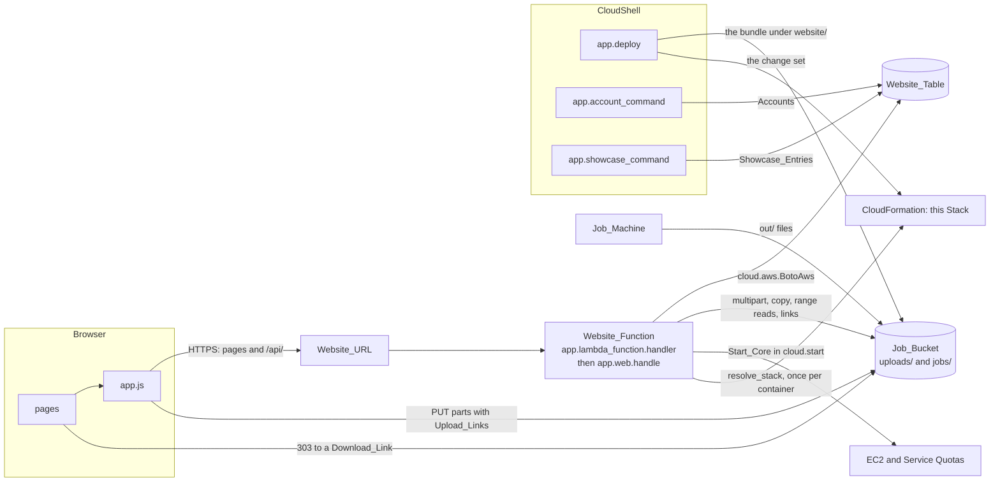
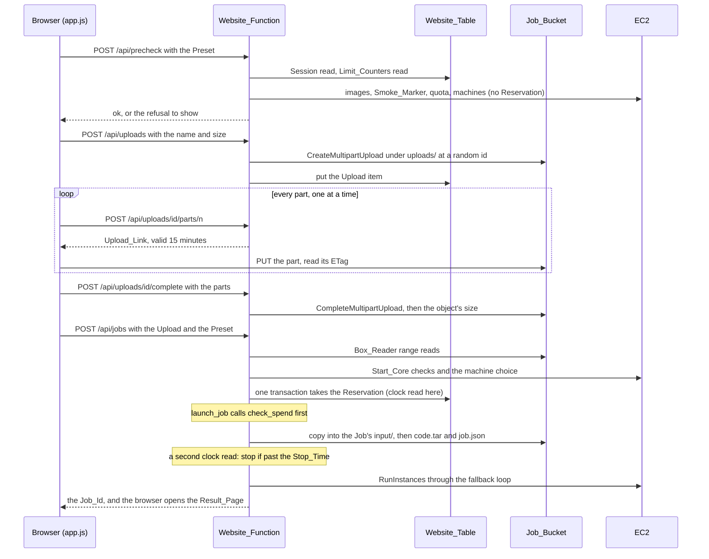

# Design Document: Website

## Overview

The Website is a small web app in `app/` that runs as one Lambda function behind a function URL. A judge signs in with the shared Account, picks a video and a Preset, and presses Start. The browser sends the video straight to `uploads/` in the Job_Bucket in parts, the Website checks it with range reads, takes a Reservation and starts the Job through the same Start_Core as `uv run python -m cloud.start`. The job list and the Result_Page read each Job's status from its files in the Job_Bucket, and the one download is a short-lived link to `out/clean.sog`, or `out/train.ply` when there's no clean copy.

The design's parts:

- **A pure request handler.** `app/lambda_function.py` builds the real dependencies once per container and calls `app.web.handle(event, deps, now)`, a pure function of a Lambda payload-2.0 event, a `Deps` bundle (the `Aws`, the configs, the Baked_Commit, the static files, a random source and a clock) and the time. Every test drives `handle` with plain dicts and the Fake_AWS. The web parts use only the standard library: routing is a table of regular expressions, pages are `str` templates escaped with `html.escape`, and the Page_Script is one plain JavaScript file.
- **One table.** The Website_Table holds the Accounts, the Sessions, the Sign_In_Failures, the Uploads, the Job_Owner records, the Limit_Counters and the Showcase_Entries under string keys `pk` and `sk`. A new boto3-free module, `cloud/table.py`, holds typed keys, conditions and updates, so `app/` builds its conditional writes and transactions without boto3 and the Fake_AWS evaluates the same values. A Reservation is one `TransactWriteItems`. A Session check is one `TransactGetItems`.
- **The Start_Core split.** `cloud/start.py` keeps `start_job` with its signature, messages and call order, and splits its body into public functions: `require_step_list`, `check_image`, `choose_machine` and `launch_job`. `launch_job` takes the caller's `environ` and calls the Spend_Guard itself, as its first statement, before any upload, copy or launch, so there's no separate `approve` step. The Laptop_Caller (`start_job`) and the Website_Caller (`app/website_start.py`) compose the same functions. Typed `CloudError` subclasses with unchanged messages let the Website tell "busy" from "can't start" from "may have started".
- **The Stack additions.** `cloud/aws-setup.yaml` gains the Website_Function, its URL, its log group, the Website_Table, the Website_Role and its managed policy, one CORS rule and one lifecycle rule on the Job_Bucket, and two code parameters. The CORS rule names the function URL's exact origin, and the design cuts every reference from the function's side back to the bucket so the template has no cycle.
- **Three CloudShell_Commands.** `app/deploy.py` builds the Website_Bundle from a clean commit under `/tmp`, calls the Spend_Guard with the Website_Limits, uploads the bundle and makes, but doesn't execute, a change set. `app/account_command.py` and `app/showcase_command.py` manage Accounts and Showcase_Entries. All three refuse to run outside CloudShell and take their environment, AWS client and repo folder from their caller, so the tests run them against the Fake_AWS.

Nothing under `splatpipe/` changes, and the root `pyproject.toml` and `uv.lock` stay as they are. The Website reaches AWS only through the `Aws` protocol in `cloud/aws.py`, and `app/` imports neither boto3 nor botocore. `app/pyproject.toml` is the App_Project `voxelis-website`; it lists `boto3==1.44.9` as its only dependency and pins the packages boto3 pulls in to the root `uv.lock`'s versions through `[tool.uv] constraint-dependencies` (botocore 1.44.9, s3transfer 0.19.3, jmespath 1.1.0, python-dateutil 2.9.0.post0, six 1.17.0 and urllib3 2.8.0), so `app/uv.lock` ships the same versions as the root lock, and a test checks every `app/uv.lock` version against the root `uv.lock` (Req 1.2, 18.13).

The Website costs about nothing while nobody uses it. Lambda bills per request, the table is on demand, the function URL is free, and nothing bills by the hour. Only the GPU machines it starts cost real money, and the Website_Limits cap them at 10 Jobs and $52 a UTC_Day and $500 in total until the Stop_Time.

### Decisions on the open choices

| # | Choice | Decision | Why |
|---|---|---|---|
| 1 | The CORS loop (Req 14, note) | The CORS rule names the exact origin, `https://` plus the host part of `WebsiteFunctionUrl.FunctionUrl`. The function's side holds no reference to the bucket: its code comes from two parameters, its environment holds only the table name, it reads the bucket and the rest from the Stack at run time, its policy attaches itself with `Roles:`, and its logs go to a named log group through `LoggingConfig`. | One change set deploys it, and the CORS rule stays exact. A `WebsiteOrigin` parameter would need two change sets on the first deploy. |
| 2 | Where the code comes from | Two parameters, `WebsiteCodeBucket` and `WebsiteCodeKey`, both `""` by default. `WebsiteCodeKey`'s `AllowedPattern` lets it be only empty or `website/` plus 40 lowercase hex plus `.zip`. An empty key gives the inline Placeholder_Function. The Deploy_Command fills `WebsiteCodeBucket` only from the Stack's own `BucketName` output and `WebsiteCodeKey` only as `website/<HEAD's commit>.zip`, and refuses anything else. | A first create works with no bundle (Req 14.13). Settled by R2 (Req 14.1, 14.17, 15.12). |
| 3 | The Start_Core's shape (Req 9) | Public functions in `cloud/start.py`, called through that module's globals, so the cloud-jobs tests' monkeypatches of `cloud.start.check_spend` and `cloud.start.make_job` still work for both callers. | Every cloud-jobs test stays unchanged (Req 9.2). |
| 4 | Telling refusals apart (Req 11) | New `CloudError` subclasses `NoGpuQuota`, `QuotaFull`, `CapacityExhausted` and `QuotaRefused`, raised where today's plain `CloudError`s are, with the same messages. | The laptop's output doesn't change, and the Website maps each type to its message and to keeping or giving back the Reservation. |
| 5 | The Stack lookup | `cloud.stack.resolve_stack`, called lazily by the first request that needs S3 or EC2 and cached per container. Never called for a signed-out request. The Website_Role gets `cloudformation:DescribeStacks` on this Stack only. | Requirement 1.7 wants the values from the Stack. Settled by R2: Requirement 14.9 now names this right. |
| 6 | Table keys | One table, string keys `pk` and `sk`, TTL attribute `expires_at` in epoch seconds. Typed conditions and updates in `cloud/table.py`. | One table is the requirement (Q8). Typed values keep boto3 inside `cloud/` and make the fake faithful. |
| 7 | The Session check (Req 4, 5) | The Session_Cookie holds `<account name>.<43-character base64url id>`. One `TransactGetItems` of the Account's profile item and the session item decides a Valid_Session: both exist, the session isn't ended or expired, and its `uid` equals the profile's. | Assumption L's "one read" stays exact. The cookie carries the Account's name, which goes to review. |
| 8 | Ending Sessions | Every new password and every re-made Account gets a new random `uid`. A Session whose `uid` differs is signed out. | A removed and re-made Account never revives old Sessions. A counter could repeat after a removal. |
| 9 | The sign-in limit (Req 4.4, 4.5) | One item per Sign_In_Failure and one lock item per Sign_In_Address. After a failure, the Website counts the failures in the last 15 minutes and writes the lock at the fifth. | Each failure is its own `PutItem`, so concurrent failures can't overwrite each other's counts. |
| 10 | Taking a Reservation (Req 10) | One `TransactWriteItems` with the Job_Id as its `ClientRequestToken`: the UTC_Day's counters, the total counter, a new job item, and the Upload marked as used. Giving it back is one transaction conditioned on the job item still being held. | All or nothing (Req 10.4), at most one give-back (Req 10.9), no deletes (Req 14.11). |
| 11 | The Worst_Case_Cost (Req 10.2, R1) | `rough_cost` of the dearest type on the Preset's whole Fallback_List, run for its Time_Cap plus `[website].boot_margin_minutes` (5), rounded up to the next cent with `math.ceil(round(cost * 100, 6))`, which rounds away float noise before the ceiling. | Gives 515, 762 and 1841 today. The boot margin and the round-up keep it at or above the laptop quote's worst case, which omits both. |
| 12 | Uploads (Req 7) | The browser `PUT`s each part to its Upload_Link with `XMLHttpRequest`, one part at a time, and sends the part numbers and `ETag`s to the Website, which completes the upload. A part that gets a 403 asks for a new link, up to a number of times set in `[website]`. | CORS needs only `PUT` and `ETag`. The browser sets no header of its own, so the rule lists no `AllowedHeaders`. `XMLHttpRequest` reports progress within a part. |
| 13 | Presigned_Links | SigV4, virtual-hosted style, on the regional endpoint `https://<bucket>.s3.<region>.amazonaws.com`. The Content-Security-Policy's `connect-src` comes from the same function. | The CSP can't drift from the links. |
| 14 | Missing keys under the Website_Role | `BotoAws.s3_exists` falls back on a 403 to an exact-key `list_objects_v2(Prefix=key, MaxKeys=1)`. The new `s3_size` uses that list call alone. | The Website_Role's `s3:ListBucket` has an `s3:prefix` condition, so a `HeadObject` of a missing key answers 403. The laptop's behaviour doesn't change. |
| 15 | Script_Requests | All under `/api/`, JSON in and out, a 401 when signed out, the CSRF_Token in an `X-CSRF-Token` header. Every POST is also refused when `Origin` or `Sec-Fetch-Site` shows another site. | Pages get redirects and the Page_Script gets 401s (Req 5.2). |
| 16 | The sign-in form's CSRF_Token | A double-submit cookie, `__Host-voxelis-signin`, set by the sign-in page's GET and compared with the form field. | The Open_Routes read nothing from the table until the POST. |
| 17 | One Upload, one Job | The Reservation transaction marks the Upload as used, and a give-back clears the mark. | A double press of Start can't start two Jobs. Settled by R7 (Req 9.11). |
| 18 | Removing an Account | The Account_Command also deletes the Account's own table items (its profile, Sessions, Uploads and job items). It leaves the Job_Bucket's files, the Limit_Counters, the Sign_In_Failures and the Showcase_Entries. | A re-made Account with the same name starts with an empty job list. |
| 19 | Python 3.11 in CloudShell | `sudo dnf install -y python3.11 python3.11-pip`, then `pip install --target` with hashes into the deploy folder. A standard-library exporter, `app/lockfile.py`, turns `app/uv.lock` into a hashed requirements file before boto3 is installed. | Amazon Linux 2023 packages Python 3.11 as `/usr/bin/python3.11` ([AL2023 user guide](https://docs.aws.amazon.com/linux/al2023/ug/python.html)). No uv is needed in CloudShell. |
| 20 | Lambda's memory and timeout | 1024 MB and 300 seconds, as template constants. | The slowest request is a start: a copy of up to 4 GB inside S3 plus the fallback launch loop. 300 s leaves margin under Lambda's 900 s. 1024 MB covers a 32 MiB `moov`, scrypt's 32 MiB and boto3. |
| 21 | The table's backups | Point-in-time recovery on, and `DeletionPolicy: RetainExceptOnCreate` with `UpdateReplacePolicy: Retain`. Settled by R3. | It costs about nothing at this size, and the Limit_Counters must outlast mistakes. |
| 22 | Where the clock comes from (Req 10.5, 10.12, 10.14) | `Deps` holds a `clock()` callable. `limits.take` reads it right before building its transaction, for the Stop_Time check and the UTC_Day. The Website_Caller's `place_inputs`, after the copy and the uploads and before the launch, reads it again (D2). | The Reservation's day and Stop_Time come from transaction time, not request arrival, and Property 1's state machine can move the clock between steps. |
| 23 | Losing the table (Req 15.14, 17.2) | After creating its change set, the Deploy_Command reads the changes; once the Website is deployed (the Stack has a `WebsiteTableName` output), it deletes the change set and refuses when it would remove, add or replace `WebsiteTable`, or remove or replace `WebsiteFunction` or `WebsiteFunctionUrl`. The seam gains `delete_change_set`. | A new Website_Table would reset the Limit_Counters; a replaced function or URL would change the judges' address. On the first website deploy, adding them is expected. |
| 24 | Ended without a result (Req 12.3, 12.14, 12.15, R4) | A Job with no Job_Summary is Ended only when `[website].ended_check_minutes` (10) have passed since it started, every machine with its `job_id` tag and the Project_Tag is `terminated` or none is found, and a second read of `out/job.json` still finds none. A failed machine lookup keeps Starting or Running. The seam gains `job_machines(job_id)`. | A machine still launching or just finished isn't counted dead. This replaces assumption C's Time_Cap rule. |

## Architecture

### Where each part runs

| Place | Runs | AWS identity | Changes in this spec |
|---|---|---|---|
| Browser | the pages, `app.js`, the part `PUT`s, the downloads | none: only Presigned_Links | new |
| Website_Function (Lambda, Python 3.11) | `app.lambda_function.handler` → `app.web.handle` | the Website_Role | new |
| CloudShell, as the Admin_Login | `app.deploy`, `app.account_command`, `app.showcase_command` | the Admin_Login's own | new |
| A laptop | `cloud.start` and the other cloud commands | the Runner_Profile and the Read_Profile | `start_job` is split, with the same behaviour |
| Job_Machine | the Cloud_Runner | the Job_Role | none |

### The runtime picture



### A start, end to end



The Start_Precheck repeats inside the start, so a precheck that passed and a start that fails a minute later still refuse cleanly.

### Module layout

```
app/
  __init__.py           empty
  pyproject.toml        the App_Project: boto3 is its only dependency
  uv.lock               from `uv lock --project app`
  config.py             WebsiteConfig and ScryptSettings, the [website] reader
  errors.py             PublicRefusal, the refusals a person may see
  lambda_function.py    handler(event, context): builds Deps once per container, calls web.handle
  web.py                Request, Response, Deps, the route table, handle, cookies, headers, CSP
  pages.py              every HTML page, each value escaped with html.escape
  static/style.css      the stylesheet, one column
  static/app.js         the Page_Script: Start_Precheck, part upload, status refresh
  static/favicon.ico    a 16 by 16 icon, under 1 KB
  accounts.py           Password_Hash, password checks, Account items
  sessions.py           the Session_Cookie, the one-read Session check, sign-in, sign-out, CSRF
  signin_limit.py       the Sign_In_Failure items and the lock
  limits.py             Worst_Case_Cost, the Limit_Counters, taking and giving back a Reservation
  video.py              the Box_Reader and the Video_Check, pure over read(offset, length)
  uploads.py            begin, part links, complete, abort
  website_start.py      the Start_Precheck and the Website_Caller
  statuses.py           the Website_Status, the Result_File and the timings
  showcase.py           Showcase_Entry items and the Footage_Licence list
  baked.py              the Baked_Commit: commit.json and code.tar inside the bundle
  lockfile.py           the standard-library exporter of app/uv.lock to a hashed requirements file
  cloudshell.py         the CloudShell guard and run_cloudshell_cli
  account_command.py    python -m app.account_command
  showcase_command.py   python -m app.showcase_command
  deploy.py             python -m app.deploy
cloud/
  table.py              new: typed keys, conditions, updates, transaction items, ConditionFailed
  aws.py                new methods on Aws and BotoAws, website_aws, cloudshell_aws, the 403 fallback
  errors.py             new: NoGpuQuota, QuotaFull, CapacityExhausted, QuotaRefused
  select.py             admit raises NoGpuQuota and QuotaFull
  launch.py             launch_with_fallback raises CapacityExhausted
  start.py              the Start_Core split; start_job unchanged in behaviour
  aws-setup.yaml        the Website parts
tests/
  fake_aws.py           FakeAws gains the new operations
  fake_table.py         new: the fake table's condition and update evaluator
  website_helpers.py    new: website_config(**overrides), make_deps(...), event(...) builders
  test_website_*.py     new, one file per task area
```

### Import rules

- `app/` imports the standard library, `app`, `cloud` and the top-level modules of `splatpipe` (`splatpipe.config`, `splatpipe.jobs`, `splatpipe.make`, `splatpipe.run`, `splatpipe.errors`, `splatpipe.jsonio`). It never imports a Step package like `splatpipe.frames`, boto3 or botocore (Req 1.3, 1.4).
- `app/` uses only public names of `cloud` and `splatpipe`: no imported name starts with `_` (Req 1.5).
- `cloud/table.py` imports only the standard library, so the tests and `app/` can import it without boto3.
- `splatpipe/` imports neither `app` nor `cloud`, as today.
- The CloudShell_Commands import only the standard library, `app`, `cloud` and boto3 through `cloud.aws` (Req 3.9, 13.9).

### Lambda specifics

- The bundle unpacks to `/var/task`, with `config.toml` at its root, so `splatpipe.config.CONFIG_PATH`, `cloud.spend.CONFIG_PATH` and `cloud.aws.CONFIG_PATH`, which each look two folders above their own file, all find the bundle's `config.toml`. A Config change takes effect only through a redeploy (Req 16.2).
- `handler` builds `Deps` on the first request of a container and keeps it: the `Aws` from `cloud.aws.website_aws(region)`, the `Config`, the `CloudConfig`, the `WebsiteConfig`, the Baked_Commit, the static files read into memory, and the clock `lambda: datetime.now(timezone.utc)`. The Stack's outputs are resolved on the first request that needs S3 or EC2 and cached in `Deps`.
- The only writable folder is `/tmp`. The Website_Caller writes `job.json` there with `splatpipe.jobs.write_record` and removes it after the upload.
- The handler never reads `APPROVED_SPEND` from the environment. The template gives the function only `WEBSITE_TABLE` (Req 14.14, 16.3).
- Lambda deprecates `python3.11` on 30 June 2027, blocks creates from 29 July 2027 and updates from 31 August 2027, all after the Stop_Time ([Lambda runtimes](https://docs.aws.amazon.com/lambda/latest/dg/lambda-runtimes.html), Req 16.6).
- On Lambda, `AWS_EXECUTION_ENV` is `AWS_Lambda_python3.11` ([Lambda environment variables](https://docs.aws.amazon.com/lambda/latest/dg/configuration-envvars.html)), so the CloudShell guard refuses there too.

## Components and Interfaces

### `cloud/table.py` (new)

Typed values for the Website_Table, with no boto3. `app/` builds every read and write from them, `BotoAws` turns them into DynamoDB expressions, and the Fake_AWS evaluates them directly.

```python
Scalar = str | int | bool          # no floats: money is whole cents, times are epoch seconds

@dataclass(frozen=True)
class Key:
    pk: str
    sk: str

@dataclass(frozen=True)
class Prefix:                      # sk begins with value
    value: str

@dataclass(frozen=True)
class Between:                     # low <= sk <= high
    low: str
    high: str

KeyRange = Prefix | Between

# Conditions. A comparison with a missing attribute is false, as in DynamoDB.
@dataclass(frozen=True)
class Exists:   attr: str
@dataclass(frozen=True)
class NotExists: attr: str
@dataclass(frozen=True)
class Equals:   attr: str; value: Scalar
@dataclass(frozen=True)
class AtMost:   attr: str; limit: int          # attr <= limit
@dataclass(frozen=True)
class AtLeast:  attr: str; limit: int          # attr >= limit
@dataclass(frozen=True)
class And:      parts: tuple[Condition, ...]
@dataclass(frozen=True)
class Or:       parts: tuple[Condition, ...]
Condition = Exists | NotExists | Equals | AtMost | AtLeast | And | Or

# Updates. Add on a missing attribute starts from 0, as DynamoDB's ADD does.
@dataclass(frozen=True)
class Set:    attr: str; value: Scalar
@dataclass(frozen=True)
class Add:    attr: str; amount: int
@dataclass(frozen=True)
class Remove: attr: str
Update = Set | Add | Remove

# Transaction items, at most 100 in one transaction.
@dataclass(frozen=True)
class Put:    item: Mapping[str, Scalar]; condition: Condition | None = None   # item holds pk and sk
@dataclass(frozen=True)
class Change: key: Key; updates: tuple[Update, ...]; condition: Condition | None = None
@dataclass(frozen=True)
class Check:  key: Key; condition: Condition
TransactItem = Put | Change | Check

class ConditionFailed(Exception):
    """A condition failed, so nothing changed. `index` is the failing transaction item, in
    request order, or None for a single put or update."""
    index: int | None

class TransactionConflict(Exception):
    """Another write touched one of the items at the same moment, so nothing changed."""

ITEM_THERE = Exists("pk")       # the item exists
ITEM_ABSENT = NotExists("pk")   # the item doesn't exist yet
```

### `cloud/aws.py` (changed)

`Aws`, `BotoAws` and `FakeAws` gain the same new methods. The table name, like the bucket, is set on the client by its caller before the first table call, and `BotoAws` refuses a table call while it's unset.

```python
class Aws(Protocol):
    region: str
    bucket: str | None
    table: str | None                                   # new

    # DynamoDB, the Website_Table
    def table_get(self, key: Key) -> dict[str, Scalar] | None: ...
    def table_get_many(self, keys: Sequence[Key]) -> list[dict[str, Scalar] | None]: ...  # one TransactGetItems
    def table_query(self, pk: str, sk: KeyRange) -> list[dict[str, Scalar]]: ...        # every page
    def table_put(self, item: Mapping[str, Scalar], condition: Condition | None = None) -> None: ...
    def table_update(self, key: Key, updates: Sequence[Update],
                     condition: Condition | None = None) -> None: ...
    def table_transact(self, items: Sequence[TransactItem], token: str | None = None) -> None: ...
    def table_delete(self, key: Key) -> None: ...                     # the Account_Command only

    # EC2 addition, for "Ended without a result" (Req 12.14)
    def job_machines(self, job_id: str) -> list[InstanceInfo]: ...    # every state, by job_id tag

    # S3 additions
    def s3_start_upload(self, key: str) -> str: ...                   # the multipart upload id
    def s3_part_link(self, key: str, upload_id: str, part: int, seconds: int) -> str: ...
    def s3_complete_upload(self, key: str, upload_id: str,
                           parts: Sequence[tuple[int, str]]) -> None: ...
    def s3_abort_upload(self, key: str, upload_id: str) -> None: ...
    def s3_download_link(self, key: str, filename: str, seconds: int) -> str: ...
    def s3_copy(self, source_key: str, key: str, *, part_bytes: int) -> None: ...
    def s3_size(self, key: str) -> int | None: ...                     # None when there's no such key
    def s3_read_range(self, key: str, offset: int, length: int) -> bytes: ...

    # CloudFormation additions, for the Deploy_Command. Both name the change set by its name and
    # the Stack's name, never by its id, which is an ARN.
    def create_change_set(self, request: Mapping[str, Any]) -> None: ...   # waits until created
    def change_set_changes(self, stack_name: str,
                           change_set_name: str) -> list[tuple[str, str, str]]: ...
    def delete_change_set(self, stack_name: str, change_set_name: str) -> None: ...

def s3_origin(bucket: str, region: str) -> str:
    """https://<bucket>.s3.<region>.amazonaws.com, the host of every Presigned_Link and the
    Job_Bucket's entry in the Content-Security-Policy."""

def website_aws(region: str) -> BotoAws: ...     # region only: the Website_Role, through Lambda
def cloudshell_aws(region: str) -> BotoAws: ...  # region only: the Admin_Login, through CloudShell
```

How `BotoAws` carries them out:

- **The table** uses the low-level `dynamodb` client and `boto3.dynamodb.types`' serializers. Each condition and update becomes an expression with `#n0`-style names and `:v0`-style values, so no attribute name or value is ever pasted into an expression. `table_get` and `table_get_many` read strongly consistent. `table_query` follows `LastEvaluatedKey` to the end.
- **Errors.** A `ConditionalCheckFailedException` becomes `ConditionFailed(index=None)`. A `TransactionCanceledException` is read through its `CancellationReasons`, which come in request order with the code `None` for the items that passed ([TransactWriteItems](https://docs.aws.amazon.com/amazondynamodb/latest/APIReference/API_TransactWriteItems.html)). The first `ConditionalCheckFailed` gives `ConditionFailed(index=i)`, and otherwise any `TransactionConflict` gives `TransactionConflict`. A `TransactionConflictException` on a single write also gives `TransactionConflict`. Every other AWS error stays a `CloudError` with `account_redaction(str(error))`. A unit test with botocore's `Stubber` checks this translation.
- **`table_transact`** passes `token` as the `ClientRequestToken`, so repeating one request within ten minutes applies it once ([transactions](https://docs.aws.amazon.com/amazondynamodb/latest/developerguide/transaction-apis.html)).
- **Presigned_Links** come from a second S3 client made for links only, with `signature_version="s3v4"`, `addressing_style="virtual"` and `endpoint_url=f"https://s3.{region}.amazonaws.com"`, so every link's host is `s3_origin(bucket, region)`. `BotoAws` builds this client lazily, on the first link, never in `__init__`, because it needs a keyword `config=` and `endpoint_url=` that the existing fake sessions can't take. Every client `__init__` itself makes, the new `dynamodb` one included, is a positional `session.client("dynamodb")`, so `tests/test_cloud_aws.py`'s fake sessions, whose `client(self, name)` takes no keywords, keep working unchanged. A part link signs `upload_part` for `PUT`. A download link signs `get_object` with `ResponseContentDisposition` set to `attachment; filename="<filename>"`.
- **`s3_copy`** uses boto3's managed `copy` with a `TransferConfig` whose threshold and chunk size are `part_bytes`, so a copy above it runs as `UploadPartCopy` parts inside S3. A single `CopyObject` takes at most 5 GB ([CopyObject](https://docs.aws.amazon.com/AmazonS3/latest/API/API_CopyObject.html)), so the managed copy keeps working if `[jobs].max_video_bytes` ever grows past that.
- **`s3_size`** is one `list_objects_v2(Prefix=key, MaxKeys=1)`: the exact key, when it exists, sorts first among the keys it prefixes, so the first result is it or nothing.
- **`s3_exists` gains a 403 fallback.** A `HeadObject` of a missing key answers 403 without `s3:ListBucket` on the bucket ([HeadObject](https://docs.aws.amazon.com/AmazonS3/latest/API/API_HeadObject.html)). The Website_Role's `s3:ListBucket` has an `s3:prefix` condition, which the implicit check doesn't meet. So on a 403, `s3_exists` asks `s3_size`. It returns `False` when that finds no key, and raises a `CloudError` when the list is refused too, or when it finds the key that `HeadObject` refused. This fallback changes the Job_Machine's path too, because the Job_Role's `s3:ListBucket` carries the same `s3:prefix` condition (`jobs/*`, `work/*`), so a `HeadObject` of a missing key under it also answers 403 and falls back to the exact-key list. On a laptop, the Read_Policy lists with no condition, so a missing key still answers 404 there and nothing changes.
- **`s3_read_range`** sends `Range: bytes=<offset>-<offset+length-1>`.
- **`run_instances`** turns the codes `VcpuLimitExceeded` and `InstanceLimitExceeded` into `QuotaRefused(account_redaction(str(error)))`, the same text as today's plain `CloudError`. No machine starts on either.
- **`job_machines`** is one `describe_instances` filtered by the Project_Tag and `tag:job_id` equal to `job_id`, in every state (no state filter), returning an `InstanceInfo` for each. The "Ended without a result" check reads their states. The right is the existing `ec2:DescribeInstances`.
- **`create_change_set`** waits with the `change_set_create_complete` waiter. **`change_set_changes`** follows `NextToken` and returns each change's `Action`, `LogicalResourceId` and `Replacement`, never a physical id. **`delete_change_set`** deletes a change set by its name and the Stack's name, so the Deploy_Command can delete one it refuses to keep.

### `cloud/errors.py` (changed)

```python
class NoGpuQuota(CloudError): ...        # admit: the G_Quota is 0
class QuotaFull(CloudError): ...         # admit: no candidate fits the G_Quota's room
class CapacityExhausted(CloudError):     # launch_with_fallback: every attempt had no capacity
    tried: tuple[tuple[str, str], ...]   # (instance_type, zone), in order
class QuotaRefused(CloudError): ...      # run_instances: EC2 refused for the vCPU limit
```

`cloud/select.py`'s `admit` raises `NoGpuQuota` and `QuotaFull` with today's messages. `cloud/launch.py`'s `launch_with_fallback` raises `CapacityExhausted` with today's message when it tried at least one attempt, and a plain `CloudError` with today's message when the plan was empty, because an empty plan is a setup problem, not a busy moment. `QuotaRefused` is a `CloudError`, not a `CapacityUnavailable`, so it stops the launch loop as today's error does. Every `except CloudError` and `pytest.raises(CloudError)` still catches all four.

### `cloud/start.py` (split)

`start_job` keeps its signature, its messages, its refusal order and its Fake_AWS call order. Its body becomes calls to four public functions, which the Website_Caller composes too. The Spend_Guard is no longer a step of its own: `launch_job` takes the caller's `environ` and calls `check_spend` as its first statement, before `place_inputs` and the launch, so `check_spend` still runs in exactly today's place in the call order. Every call to `check_spend` and `make_job` reads `cloud.start`'s module globals at call time, so the cloud-jobs tests' monkeypatches reach both callers. `_smoke_marker_key` stays as it is.

```python
@dataclass(frozen=True)
class Code:
    """The code a Job runs: its commit, its Code_Archive on disk and its two lock-file hashes."""
    commit: str
    archive: Path
    uv_lock_hash: str
    package_lock_hash: str

@dataclass(frozen=True)
class Gate:
    """What check_image found: the Stack's outputs and the image every gate passed for."""
    outputs: StackOutputs
    image: ImageInfo

@dataclass(frozen=True)
class Choice:
    """The machine choice and the money quote for one Job."""
    preset: str
    plan: PresetPlan
    candidates: tuple[str, ...]
    admitted: tuple[str, ...]
    attempts: tuple[tuple[str, str, str], ...]    # (instance_type, subnet_id, zone)
    machine: str                                  # the three Spend_Guard strings
    expected_time: str
    rough_cost: str

@dataclass(frozen=True)
class Launched:
    instance: InstanceInfo
    instance_type: str
    zone: str

def require_step_list() -> tuple[StepEntry, ...]:
    """splatpipe.run.STEP_LIST, read at call time, or today's PipelineError when it's empty. Named
    require_step_list, not check_step_list, so it doesn't clash with splatpipe.run.check_step_list."""

def check_image(aws: Aws, config: Config, code: Code) -> Gate:
    """Resolve the Stack and set aws.bucket, take the newest available Machine_Image, refuse a
    lock-hash drift against code's hashes, and refuse a missing Smoke_Marker (today's steps 4-7)."""

def choose_machine(aws: Aws, gate: Gate, entries: Sequence[StepEntry], preset: str,
                   config: Config, cc: CloudConfig) -> Choice:
    """The needs, the candidates, the quota, the running vCPUs, admit, the launch plan and the
    quote (today's steps 9-10, up to check_spend)."""

def launch_job(aws: Aws, gate: Gate, choice: Choice, job_id: str, code: Code,
               place_inputs: Callable[[str, str], None], config: Config, cc: CloudConfig,
               environ: Mapping[str, str] | None) -> Launched:
    """Call the module-global check_spend with the Choice's three strings first, before anything
    paid, so the Spend_Guard is the first gate that can stop a paid run; then place_inputs(prefix,
    code_key) puts the video, the Code_Archive and job.json under jobs/<job_id>/input/ in the
    caller's order; then the User_Data and launch_with_fallback."""

def worst_case_cost(preset: str, cc: CloudConfig, extra_minutes: float = 0.0) -> float:
    """rough_cost of the dearest type on the Preset's whole Fallback_List, run for its Time_Cap
    plus extra_minutes. New, for the Website's Reservations; start_job doesn't call it. The Website
    passes [website].boot_margin_minutes as extra_minutes, because a hung machine runs its boot
    minutes before the Time_Cap's shutdown is scheduled (R1)."""
```

`start_job` after the split, in today's order:

1. `entries = require_step_list()`, then the configs and the repo root.
2. The uncommitted-change check on `splatpipe/`, `cloud/` and `config.toml`.
3. In a temporary folder: `head_commit`, `archive_head` and `lock_hashes`, giving a `Code`.
4. The Runner_Profile `Aws` unless a test passed one, then `gate = check_image(aws, config, code)`.
5. `make_job(...)` and `open_job(...)`, giving the Job and its Preset.
6. `choice = choose_machine(aws, gate, entries, preset, config, cloud_config)`.
7. `launch_job(...)` with `environ` and a `place_inputs` that uploads the video, then `code.tar`, then `job.json`. `launch_job` calls `check_spend` first, exactly where `start_job` called it before, so the laptop's Fake_AWS call order is unchanged.
8. Today's "Launched a … for job …" line, and the Job_Id.

### `app/config.py`

```python
@dataclass(frozen=True)
class ScryptSettings:                    # lives here, so app/accounts.py imports it from app.config
    n: int
    r: int
    p: int
    dklen: int
    salt_bytes: int

@dataclass(frozen=True)
class WebsiteConfig:
    stop_starting_at: datetime          # aware, UTC
    daily_jobs: int
    daily_cost_cents: int               # from daily_cost_usd, through dollars_to_cents
    total_cost_cents: int               # from total_cost_usd, through dollars_to_cents
    boot_margin_minutes: int            # added to the Time_Cap for the Worst_Case_Cost (R1)
    upload_part_bytes: int
    upload_link_seconds: int
    part_link_retries: int
    download_link_seconds: int
    copy_part_bytes: int
    upload_record_hours: int
    max_boxes: int
    max_moov_bytes: int
    ended_check_minutes: int            # wait before a Job can be Ended without a result (R4)
    signin_max_failures: int
    signin_window_minutes: int
    signin_wait_minutes: int
    signin_token_minutes: int
    session_days: int
    token_bytes: int
    password_length: int
    scrypt: ScryptSettings               # n, r, p, dklen, salt_bytes
    cloudshell_modules: tuple[str, ...]  # the CloudShell_Commands' modules, read by the Guard_Hook (R9)
    max_body_bytes: int
    max_listed_jobs: int
    max_title_chars: int
    max_credit_chars: int
    max_name_chars: int
    deploy_folder: PurePosixPath
    max_bundle_bytes: int

    @classmethod
    def from_mapping(cls, data: Mapping[str, Any]) -> WebsiteConfig: ...

def load_website_config(path: Path | None = None) -> WebsiteConfig:
    """Validate the whole file with splatpipe's Config_Loader, then read [website]."""

def dollars_to_cents(value: float) -> int:
    """Whole cents from the .2f text of value, as the Start_Command's quote prints it. Used for the
    dollar limits (daily_cost_usd, total_cost_usd); the Worst_Case_Cost rounds up its own way."""
```

`from_mapping` refuses with a `PipelineError` that names the key and says what it must be: a missing key, a `bool` where a number belongs, a number below its floor, a Stop_Time that isn't `YYYY-MM-DDTHH:MM:SSZ`, a `cloudshell_modules` that isn't a non-empty list of dotted module names, or a `deploy_folder` outside `/tmp` (Req 2.8). It builds `WebsiteConfig.scrypt` from the `scrypt_*` keys as a `ScryptSettings`, which lives in this module so `app/accounts.py` imports it from `app.config` with no import cycle. The floors that come from AWS stay in code with their source: a part of at least 5 MiB for both `upload_part_bytes` and `copy_part_bytes`, at most 10,000 parts for `[jobs].max_video_bytes`, and link lifetimes of at most 7 days ([S3 quick facts](https://docs.aws.amazon.com/AmazonS3/latest/userguide/qfacts.html)). It refuses a key it doesn't know too, so a typo can't silently fall back to nothing. `load_config()` already refuses NaN, infinity and TOML dates in `[website]`, because `[website]` isn't in `NOT_PIPELINE` (Req 2.1). Settings that other sections hold are read from there (Req 2.7): `[jobs]` through `Config.jobs()`, `[clean]` through `Config.step_settings("clean", preset)`, and `[cloud]` through `CloudConfig`.

### `app/web.py`: the handler

```python
@dataclass(frozen=True)
class Request:
    method: str
    path: str
    query: Mapping[str, str]
    headers: Mapping[str, str]           # names lowercased
    cookies: Mapping[str, str]
    body: bytes
    source_ip: str                       # requestContext.http.sourceIp, the Sign_In_Address
    host: str                            # requestContext.domainName

@dataclass
class Response:
    status: int
    content_type: str
    body: bytes
    headers: dict[str, str] = field(default_factory=dict)
    cookies: list[str] = field(default_factory=list)

class Random(Protocol):
    def token_bytes(self, n: int) -> bytes: ...
    def choice(self, alphabet: str) -> str: ...

@dataclass
class Deps:
    aws: Aws
    config: Config
    cloud: CloudConfig
    website: WebsiteConfig
    baked: BakedCommit
    static: Mapping[str, bytes]
    random: Random                       # secrets on Lambda, a seeded one in tests
    clock: Callable[[], datetime]        # aware UTC now; read at the Reservation and before launch
    log: logging.Logger
    stack: StackOutputs | None = None    # resolved by need, cached per container

def handle(event: Mapping[str, Any], deps: Deps, now: datetime) -> dict[str, Any]: ...
def stack_for(deps: Deps) -> StackOutputs: ...   # resolve once, set deps.aws.bucket
```

`SecretsRandom`, a `Random` backed by `secrets.token_bytes` and `secrets.choice`, is the real implementation on Lambda and in the CloudShell_Commands; tests pass a seeded `Random`.

`handle` works in this order:

1. **Parse** the payload-2.0 event: `requestContext.http.method`, `rawPath`, `rawQueryString`, `cookies` (a list of `name=value`), the lowercased `headers`, and `body` with `isBase64Encoded` ([invocation payloads](https://docs.aws.amazon.com/lambda/latest/dg/urls-invocation.html)). The Sign_In_Address is `requestContext.http.sourceIp` and nothing else (Req 4.6).
2. **Route.** The route table below gives the handler and the kind: open, page or script. An unknown path, or a known path with the wrong method, is a 404 for a Valid_Session.
3. **Session.** An Open_Route runs with no Session check. Every other request, unknown paths included, runs `sessions.current(request, deps, now)` first. With no Valid_Session, a path under `/api/` gets a 401 with `{"error": "signed_out"}` and every other path gets a 303 to `/signin`, whatever the body's size (Req 5.2, 5.5). That's all a signed-out request gets.
4. **Size.** The Session is checked before the body's size, so only an Open_Route or a request with a Valid_Session reaches here. A body whose length, worked out from the event's text before any decoding, is over `max_body_bytes` gets a 413 (Req 6.6).
5. **CSRF.** Every POST is refused with a 403 and changes nothing when its CSRF_Token is missing or wrong (a form field `csrf` on pages, the `X-CSRF-Token` header on Script_Requests, the double-submit cookie on the sign-in form), when its `Origin` header is there and isn't `https://<requestContext.domainName>`, or when `Sec-Fetch-Site` is there and isn't `same-origin` or `none` (Req 4.12). Tokens compare with `hmac.compare_digest`.
6. **Run** the route's handler. Only POST handlers write to the table, start an upload or start a Job (Req 4.13). A GET makes Download_Links and reads, nothing else.
7. **Errors.** A `PublicRefusal` from a handler becomes its page or its JSON with the right status. Any other `Exception` becomes a 500 page, or `{"error": "server"}` for a Script_Request, that says something went wrong and to try again. The log line holds the error's type and its Account_Redacted message, never a traceback, an AWS error text or an ARN in the response (Req 6.8).
8. **Headers.** Every response gets the Content-Security-Policy, `X-Content-Type-Options: nosniff` and `Referrer-Policy: no-referrer`, and every signed-in page and Script_Request answer also gets `Cache-Control: no-store` (Req 6.4, 6.5).

The Content-Security-Policy is `default-src 'none'; script-src 'self'; style-src 'self'; img-src 'self'; connect-src 'self' <s3_origin>; form-action 'self'; frame-ancestors 'none'; base-uri 'none'`. Every signed-in page calls `stack_for` before its headers, even one that makes no S3 call, so its `connect-src` always names `s3_origin(bucket, region)` from the same resolved Stack; a signed-out answer leaves the `<s3_origin>` out, because it never resolves the Stack. No page has an inline script or style, so `'self'` is enough. The download is a link to a GET that answers 303, never a form post, because some browsers apply `form-action` to a form's redirect.

### The routes

| Method | Path | Kind | What it does |
|---|---|---|---|
| GET | `/signin` | open | the sign-in page, setting the sign-in token cookie |
| POST | `/signin` | open | sign in, then 303 to `/jobs` |
| GET | `/static/style.css` | open | the stylesheet |
| GET | `/favicon.ico` | open | the favicon |
| GET | `/` | page | 303 to `/jobs` |
| GET | `/jobs` | page | the job list |
| GET | `/start` | page | the start page |
| GET | `/jobs/<job_id>` | page | the Result_Page |
| GET | `/jobs/<job_id>/download` | page | 303 to a Download_Link for the Result_File |
| GET | `/showcase` | page | the Showcase |
| GET | `/static/app.js` | page | the Page_Script |
| POST | `/signout` | page | end the Session, then 303 to `/signin` |
| POST | `/api/precheck` | script | the Start_Precheck for a Preset |
| POST | `/api/uploads` | script | begin an Upload |
| POST | `/api/uploads/<upload_id>/parts/<n>` | script | an Upload_Link for part n |
| POST | `/api/uploads/<upload_id>/complete` | script | complete an Upload |
| POST | `/api/uploads/<upload_id>/abort` | script | abort an Upload |
| POST | `/api/jobs` | script | start a Job from an Upload |
| GET | `/api/jobs/<job_id>/status` | script | one Job's Website_Status, for the refresh |

A `<job_id>` segment is any text without `/` in the route table, and the handler passes it through `splatpipe.jobs.check_job_id` before it touches a key, answering 404 when that refuses (Req 12.13). An `<upload_id>` must be 32 lowercase hex digits and `<n>` a decimal part number, or the answer is a 404.

### `app/lambda_function.py`

```python
def handler(event: Mapping[str, Any], context: object) -> dict[str, Any]:
    """Build Deps on the container's first request, keep it, and return handle(event, deps, now)."""
```

It reads the table name from `WEBSITE_TABLE`, builds `website_aws(region)` with `[aws].region`, loads the three configs from the bundle's `config.toml`, reads the Baked_Commit and the static files, uses `SecretsRandom()` (backed by `secrets`) for `Random`, and sets `clock` to `lambda: datetime.now(timezone.utc)`, which it also passes as `handle`'s `now`. The standard `logging` module writes to the function's log group, and a filter applies `account_redaction` to every record (Req 6.9).

### `app/pages.py`

One function per page, each returning a `str` of HTML. A value enters a page only through `esc(value)`, which is `html.escape(str(value), quote=True)`, in text and in attributes alike, so titles, credits, file names, Account names and Readable_Errors can't add markup (Req 6.3).

- `layout(title, body, *, csrf, signed_in)`: the viewport meta tag, the stylesheet, and for a signed-in page the CSRF_Token in `<meta name="csrf-token">`, `app.js` loaded with `defer`, the links to Jobs, Start and Showcase, and a sign-out form with its CSRF_Token (Req 4.10, 6.2).
- `signin_page(token, error)`, `job_list_page(rows)`, `start_page(presets, chosen, stopped, upload)`, `result_page(view)`, `showcase_page(entries)`, `not_found_page()` and `error_page()`.
- The start page offers one file input with `accept=".mp4,.mov,video/mp4,video/quicktime"`, the three Presets as radio buttons with their Expected_Times, the Preset in `[jobs].default_preset` checked, a Start button, a `<progress>` element and a message area. After the Stop_Time it shows the stop line in place of the form (Req 7.1, 11.3).
- The Result_Page has one `<section id="viewer-slot" aria-labelledby="viewer-label">` that holds only its heading, "3D viewer", for the Viewer_Spec to fill (Req 12.11).
- Signed-in pages carry the numbers the Page_Script needs as `data-` attributes on `<main>`: `data-part-retries` and `data-poll-seconds` (`[cloud].poll_seconds`). `data-job-id` is set only on a Result_Page whose status is Starting or Running, which is what tells the Page_Script to refresh, so a finished Job's page never polls itself.

### `app/static/`

- `style.css`: one column with `max-width: 40rem`, no width above 360 px, and inputs and buttons at full width, so a 360-pixel phone screen fits (Req 6.2).
- `app.js`, plain JavaScript with no build step and no inline handlers:
  - **Start:** disable the Start button, `POST /api/precheck`, show its refusal or go on (Req 7.2); `POST /api/uploads` with the file's name and size; then for each part in order, `POST …/parts/<n>` for a link and `PUT` `file.slice(a, b)` to it with `XMLHttpRequest`, setting no header, so the preflight asks for none; keep each response's `ETag`; update the `<progress>` from the request's upload events (Req 7.5, 7.8).
  - **Expired links:** a part whose `PUT` answers 403 gets a new link and is sent again, at most `data-part-retries` times, and then the Page_Script aborts the Upload and shows a message (Req 7.7).
  - **Finish:** `POST …/complete` with the parts and their `ETag`s, then `POST /api/jobs`, then open `/jobs/<Job_Id>`. A refusal is shown and nothing is sent again by itself (Req 11.7).
  - **Refresh:** on a Result_Page whose status is Starting or Running, `GET /api/jobs/<id>/status` every `data-poll-seconds` seconds, updating the status text and reloading the page once the Job reaches a final status (Req 12.4). A 401 opens `/signin`.
- `favicon.ico`: a 16 by 16 icon, under 1 KB.

### `app/accounts.py`

```python
# The Account_Name_Pattern, checked with fullmatch. It stays in code because it's a safety check.
ACCOUNT_NAME = re.compile(r"[a-z][a-z0-9-]{0,31}")
PASSWORD_ALPHABET = string.ascii_letters + string.digits

from app.config import ScryptSettings    # defined in app/config.py, so WebsiteConfig and this share it

@dataclass(frozen=True)
class Account:
    name: str
    uid: str                    # new random value with every password and every re-made Account
    password_hash: bytes
    salt: bytes
    settings: ScryptSettings    # the settings this hash was made with

def check_account_name(value: object) -> str: ...
def new_password(length: int, random: Random) -> str: ...           # secrets on CloudShell
def hash_password(password: str, salt: bytes, settings: ScryptSettings) -> bytes: ...
def password_matches(password: str, account: Account | None, configured: ScryptSettings) -> bool: ...
def profile_key(name: str) -> Key: ...                               # account#<name> / profile
def read_account(item: Mapping[str, Scalar]) -> Account: ...
def make_account(aws: Aws, name: str, wc: WebsiteConfig, random: Random) -> str: ...
def replace_password(aws: Aws, name: str, wc: WebsiteConfig, random: Random) -> str: ...
def remove_account(aws: Aws, name: str) -> int: ...
```

- `hash_password` is `hashlib.scrypt(password.encode("utf-8"), salt=salt, n=…, r=…, p=…, dklen=…, maxmem=256 * r * (n + p + 2))`, worked out from the hash's own settings, so a later change of `[website]`'s scrypt settings still checks the Accounts made before it (Req 3.3). That's twice what OpenSSL allocates for those settings, `128 * r * (n + 2)` for the working arrays plus `128 * r * p`. The shorter `256 * r * n` is too small when `n < p + 2`, as with the tests' `scrypt_n=2, scrypt_p=1`, where OpenSSL refuses the hash.
- `password_matches` runs exactly one scrypt either way. With an Account it uses the Account's salt and settings. With `None`, an unknown or malformed name, it hashes with a fixed dummy salt and the configured settings and returns `False`. The comparison is `hmac.compare_digest` (Req 4.1, 4.2).
- `make_account` puts the profile item on the condition `ITEM_ABSENT`, so a taken name fails with `ConditionFailed` and changes nothing, and the Account_Command turns that into its refusal naming `--new-password` (Req 3.6).
- `replace_password` updates the hash, the salt, the settings and the `uid` on the condition `ITEM_THERE`. The new `uid` ends every Session of that Account at once (Req 3.7).
- `remove_account` queries the partition `account#<name>` and deletes each item: the profile, its Sessions, its Uploads and its job items. It leaves the Job_Bucket's files, the Limit_Counters, the Sign_In_Failures and the Showcase_Entries (Req 3.8). Only the Account_Command calls it, as the Admin_Login, because the Website_Role deletes nothing.

### `app/sessions.py`

```python
SESSION_COOKIE = "__Host-voxelis-session"
SIGNIN_COOKIE = "__Host-voxelis-signin"

@dataclass(frozen=True)
class Session:
    account: str
    key: Key                    # account#<name> / session#<sha256 hex of the id>
    csrf: str
    uid: str

def parse_session_cookie(value: str | None, token_bytes: int) -> tuple[str, str] | None: ...
def current(request: Request, deps: Deps, now: datetime) -> Session | None: ...
def sign_in(request: Request, deps: Deps, now: datetime) -> Response: ...
def sign_out(session: Session, deps: Deps, now: datetime) -> Response: ...
def set_cookie(name: str, value: str, max_age: int, same_site: str) -> str: ...
def clear_cookie(name: str) -> str: ...
```

- **The cookie.** The Session_Cookie's value is `<account name>.<id>`, where the id is `token_bytes` random bytes in unpadded base64url. `parse_session_cookie` accepts a value only when the name part matches the Account_Name_Pattern and the id part is exactly the base64url length of `token_bytes` bytes. Anything else is signed out with no AWS call (Req 5.4).
- **The one read.** `current` reads the profile item and the session item in one `table_get_many`, a single `TransactGetItems`. The request has a Valid_Session when both exist, the session isn't `ended`, its `expires_at` is after `now` by the handler's clock, and its `uid` equals the profile's (Req 4.9, 5.3). DynamoDB deletes expired items only "typically within a few days" ([TTL](https://docs.aws.amazon.com/amazondynamodb/latest/developerguide/howitworks-ttl.html)), so the clock decides.
- **Signing in** runs, in order: the sign-in token check (the form field `csrf` against the `__Host-voxelis-signin` cookie), a 403 of kind `csrf` when it fails; the lock check of `signin_limit.locked_until`, a 429 of kind `signin_wait` with the minutes to wait and no password check (Req 4.4); one read of the profile item, skipped for a malformed name; `password_matches`; and on a failure, `signin_limit.record_failure` and a 400 of kind `bad_request`, "That name and password don't match an account." (Req 4.3). `sign_in` raises each of these as a `PublicRefusal`, and `POST /signin`'s handler catches it and re-renders the sign-in page with the message and a fresh sign-in token.
- **A Session** gets an id and a CSRF_Token from `token_bytes` random bytes each, drawn from `secrets` on Lambda. The session item holds the SHA-256 hex of the id in its key, never the id, with the CSRF_Token, the `uid`, `created_at` and `expires_at` 7 days later, written on the condition `ITEM_ABSENT` (Req 4.7). The answer sets `__Host-voxelis-session` with `Path=/; Secure; HttpOnly; SameSite=Lax; Max-Age=<7 days>` and no `Domain`, clears the sign-in cookie and sends a 303 to `/jobs` (Req 4.8).
- **The sign-in page** sets `__Host-voxelis-signin` to a fresh token with `Path=/; Secure; HttpOnly; SameSite=Strict; Max-Age=<signin_token_minutes>`, and puts the same token in the form. No sibling host can set a `__Host-` cookie for the Website's host, so the double-submit holds without relying on the Public Suffix List.
- **Signing out** sets `ended` on the session item, clears the Session_Cookie and sends a 303 to `/signin` (Req 4.10). Nothing is deleted.

### `app/signin_limit.py`

```python
def locked_until(aws: Aws, address: str, now: datetime, wc: WebsiteConfig) -> datetime | None: ...
def record_failure(aws: Aws, address: str, now: datetime, wc: WebsiteConfig,
                   random: Random) -> datetime | None: ...
```

Each Sign_In_Failure is its own item, `signin#<address>` / `failure#<10-digit epoch seconds>#<8 hex digits>`, with `expires_at` one window later. The address's lock is the item `signin#<address>` / `lock`, holding `until`. `locked_until` is one query of that partition from `failure#<now − window + 1 s>` to `lock`, which returns the window's failures and the lock together. `record_failure` puts the new failure, queries again and, when the window holds `signin_max_failures` failures or more, puts the lock with `until = now + wait`. The address is the partition, so one address's failures can't touch another's, and nothing is counted per Account (Req 4.5). Separate items mean two failures at the same moment can't overwrite each other's count. An attacker with many addresses gets 5 tries per address per 15 minutes, so the real defence is the long random password.

### `app/limits.py`

```python
@dataclass(frozen=True)
class Reservation:
    job_id: str
    account: str
    upload_id: str
    preset: str
    cents: int
    day: str                    # the UTC_Day it was taken in, YYYY-MM-DD

class LimitFull(PublicRefusal):  # names the limit; says "after 00:00 UTC" for a daily one
    limit: str                   # "daily_jobs", "daily_cost" or "total_cost"

def worst_case_cents(preset: str, cc: CloudConfig, wc: WebsiteConfig) -> int: ...
def utc_day(now: datetime) -> str: ...
def check_room(aws: Aws, cents: int, now: datetime, wc: WebsiteConfig) -> None: ...
def take(aws: Aws, draft: Reservation, steps: int, clock: Callable[[], datetime],
         wc: WebsiteConfig) -> Reservation: ...   # reads the clock, returns the day-stamped Reservation
def give_back(aws: Aws, reservation: Reservation) -> bool: ...
def stop_line(wc: WebsiteConfig) -> str: ...      # the Stop_Time message, from stop_starting_at
```

- **`worst_case_cents`** is `math.ceil(round(cloud.start.worst_case_cost(preset, cc, wc.boot_margin_minutes) * 100, 6))`: the dearest type on the Preset's whole Fallback_List by `price_per_hour_usd`, through `cloud.spend_file.rough_cost` run for the Time_Cap plus `[website].boot_margin_minutes`, in dollars, rounded up to the next cent after the inner `round(…, 6)` clears float noise. That's 515 for fast, 762 for default and 1841 for quality today, each at or above the laptop quote's worst case, which omits the boot margin and rounds to `.2f` (Req 10.2, R1).
- **`check_room`** refuses at or after the Stop_Time, then refuses when one Reservation alone can't fit a limit, then reads the UTC_Day's item and the total item in one `table_get_many` and refuses when the Reservation wouldn't fit. The Start_Precheck and `take` both call it, so a refusal names its limit before any machine choice.
- **`take`** reads `now = clock()` right before building its transaction, never the request's arrival time, so the Reservation's UTC_Day and the Stop_Time check come from transaction time (Req 10.5, 10.12). It stamps the Reservation's `day` with `utc_day(now)`, runs `check_room(aws, draft.cents, now, wc)` with that `now`, and returns the day-stamped Reservation for a later give-back. The write is one `table_transact` with the Job_Id as its token, of four items in this order:
  0. `Change(Key("limits", "day#<day>"), (Add("jobs", 1), Add("cents", c)), And(Or(NotExists("jobs"), AtMost("jobs", daily_jobs − 1)), Or(NotExists("cents"), AtMost("cents", daily_cents − c))))`
  1. `Change(Key("limits", "total"), (Add("cents", c),), Or(NotExists("cents"), AtMost("cents", total_cents − c)))`
  2. `Put(job item, held, with the Preset, the cents, the day, started_at, the Step count and the Upload's id, ITEM_ABSENT)`
  3. `Change(the Upload's key, (Set("used_by", job_id),), And(Equals("state", "complete"), NotExists("used_by")))`

  A `NotExists` branch lets a missing counter item pass, which is why `check_room` first checks that one Reservation fits alone. `ConditionFailed(index=0)` reads the day item once to tell the Daily_Job_Limit from the Daily_Cost_Limit, because one transaction can't hold two writes to one item. `index=1` is the Total_Cost_Limit, `index=3` an Upload already used or unfinished, and `index=2` or a `TransactionConflict` is "someone started a job at the same moment, press Start again". Nothing loops (Req 10.3, 10.4, 11.2).
- **`give_back`** is one `table_transact` of three items: the job item from `held` to `released` on `Equals("state", "held")`; the job's own UTC_Day item, `Add("jobs", −1)` and `Add("cents", −c)` on `AtLeast` conditions; and the total item, `Add("cents", −c)` on `AtLeast("cents", c)`. A second give-back fails its first condition, changes nothing and returns `False` (Req 10.5, 10.9). A `TransactionConflict` during a give-back also changes nothing and returns `False`, so the Reservation stays held, which can only overcount, never pass a limit. Then a separate update removes `used_by` from the Upload on `Equals("used_by", job_id)`, and a failed condition there is ignored, because the Upload item may have expired.
- **The Stop_Time.** `stop_line(wc)` renders "The website stopped starting jobs at 08:00 UTC on 4 February 2027." from `stop_starting_at`, with an English month name and no platform-specific `%-d`, which Windows lacks. `check_room`, and the Website_Caller's clock reads, raise a `PublicRefusal` of status 409 and kind `stopped` carrying `stop_line(wc)` at or after the Stop_Time, and the start page shows the same line in place of the form (Req 10.12, 10.14, 11.3).
- **Never settled.** Nothing else writes the counters: no upload, download or storage touches them, and no Job's real cost is written back (Req 10.6, 10.10).

### `app/video.py`: the Box_Reader and the Video_Check

```python
VIDEO_FILES = {".mp4": "video.mp4", ".mov": "video.mov"}   # the Job_Record's video_file names
Read = Callable[[int, int], bytes]                         # read(offset, length)

@dataclass(frozen=True)
class MovieFacts:
    has_video: bool
    video_seconds: float | None           # None when it can't be read

@dataclass(frozen=True)
class VideoFacts:
    video_file: str                       # "video.mp4" or "video.mov"
    size: int
    video_seconds: float
    start_seconds: float                  # the Used_Part with no Trim
    end_seconds: float

def find_moov(read: Read, size: int, max_boxes: int, max_moov_bytes: int) -> tuple[int, int]: ...
def read_movie(moov: bytes) -> MovieFacts: ...
def check_video(read: Read, size: int | None, stated_size: int, name: str, wc: WebsiteConfig,
                jobs: JobsSettings) -> VideoFacts: ...        # size is s3_size's answer, None when gone
```

- **`find_moov`** walks the top-level Boxes from offset 0 (Req 8.2). At each offset it reads `min(16, size − offset)` bytes. Fewer than 8 is a broken file. The 32-bit size 1 means the next 8 bytes are the 64-bit `largesize` and the header is 16 bytes. Size 0 means the Box runs to the end of the file. A Box smaller than its own header, or one that runs past the end, is a broken file. A `moov` Box returns its offset and length, after the refusal for one larger than `max_moov_bytes`. Any other Box is skipped by its size, and a size-0 Box that isn't `moov` ends the walk with no `moov`. Walking more than `max_boxes` Boxes is a refusal (Req 8.5). Only headers are read, never a payload (Req 8.4).
- **`read_movie`** walks the `moov` Box's children with the same header rules, bounded by their parent. It reads the movie header `mvhd` and each `trak`'s `mdia/hdlr` and `mdia/mdhd`. The handler type is the 4 bytes after the `hdlr` payload's version, flags and pre-defined field, which is where both MP4 and QuickTime keep `vide`. For both headers, version 0 keeps the time scale and duration as 32-bit values 12 and 16 bytes into the payload, and version 1 keeps them 20 bytes in, the duration then 64-bit. A duration of all ones means unknown and counts as 0. The Video_Length is the first `vide` track's `mdhd` duration over its time scale, or the `mvhd` duration over its time scale when that's 0 (Req 8.3).
- **`check_video`** runs the Video_Check in this order. The name must end in `.mp4` or `.mov` in any letter case, the object must still exist (Req 9.9), and its size must be within `[jobs].max_video_bytes` and equal to the stated size. Then `find_moov`, one range read of the whole `moov`, and `read_movie`. Then the facts must hold: a video track, a Video_Length above 0 and at most `[jobs].max_video_seconds`, and `splatpipe.make.used_part(video_seconds, None, None, jobs.min_used_seconds)` must accept the whole video (Req 8.7). Each refusal is a `PublicRefusal` with the Website's own words for what to do on a phone, meaning the same as the Job_Maker's. For example, a broken file gets "This file isn't an MP4 or MOV video the pipeline can read. Save it again as MP4 on your phone and upload it again." (Req 8.6).

The Website_Caller passes `read = lambda offset, length: aws.s3_read_range(key, offset, length)`. The tests pass a sparse reader that serves only header bytes and the `moov`, and fails when asked for any byte inside another Box's payload.

### `app/uploads.py`

```python
UPLOAD_ID = re.compile(r"[0-9a-f]{32}")

@dataclass(frozen=True)
class Upload:
    id: str
    account: str
    key: str                  # uploads/<id>
    s3_upload_id: str
    name: str                 # the cleaned file name, the future source_name
    size: int                 # the stated size
    parts: int
    state: str                # "open", "complete", "refused" or "aborted"
    used_by: str | None       # the Job_Id that this Upload started

def clean_source_name(name: str, max_chars: int) -> str: ...
def parts_needed(size: int, part_bytes: int) -> int: ...
def read_upload(aws: Aws, account: str, upload_id: str) -> Upload | None: ...
def begin(deps: Deps, session: Session, name: str, size: int, now: datetime) -> Upload: ...
def part_link(deps: Deps, session: Session, upload_id: str, part: int) -> str: ...
def complete(deps: Deps, session: Session, upload_id: str,
             parts: Sequence[tuple[int, str]]) -> Upload: ...
def abort(deps: Deps, session: Session, upload_id: str) -> None: ...
```

- **`clean_source_name`** keeps the part after the last `/` or `\`, drops every control character (Unicode category `Cc`), strips spaces at both ends and cuts the result to `max_name_chars` characters (Req 9.6). An empty result is refused. The extension check runs on the cleaned name.
- **`begin`** refuses after the Stop_Time (Req 11.3), refuses a name or size that the Job_Maker would refuse (Req 7.3), draws a new 16-byte id, starts the multipart upload at `uploads/<id>` (the key never holds the file's name), and puts the Upload item on `ITEM_ABSENT` with `expires_at` `upload_record_hours` later (Req 7.4).
- **`read_upload`** reads only `account#<session's Account>` / `upload#<id>`, so another Account's Upload is simply not there (Req 7.6, 9.8).
- **`part_link`** makes an Upload_Link only for an `open` Upload and a part number from 1 to `parts_needed(size, part_bytes)`, valid for `upload_link_seconds` (Req 7.6).
- **`complete`** takes only the part numbers 1 to N in order, each with an `ETag` that looks like S3's quoted hex digest, then completes the multipart upload, reads the object's size with `s3_size` and sets the state to `complete`, or to `refused` with the refusal when the size is over `[jobs].max_video_bytes` or differs from the stated size (Req 7.9). Each state change is conditioned on the state it comes from.
- **`abort`** aborts an `open` Upload in S3 and marks it `aborted`. The lifecycle rule removes what's left after a day.

### `app/website_start.py`: the Start_Precheck and the Website_Caller

```python
@dataclass(frozen=True)
class Started:
    job_id: str
    outcome: str                  # "launched", or "unknown" when the launch may have started a machine

def precheck(deps: Deps, session: Session, preset: str, now: datetime) -> None: ...
def start(deps: Deps, session: Session, upload_id: str, preset: str, now: datetime) -> Started: ...
```

**`precheck`** (assumption K) takes no Reservation and starts nothing: the Stop_Time; `check_preset`; `limits.check_room` for the Preset's Worst_Case_Cost (`worst_case_cents(preset, cc, wc)`); then `require_step_list()`, `check_image(aws, config, baked.code())` and `choose_machine(...)`, refusing an empty launch plan. Each refusal maps through the table in Error Handling.

**`start`**, the Website_Caller, in this order:

1. The Stop_Time, `check_preset`, and the Account's own `complete`, unused Upload (Req 9.8, 11.3).
2. `entries = require_step_list()`, `code = deps.baked.code()`, and `gate = check_image(aws, config, code)`, so the Baked_Commit's hashes meet the Machine_Image's tags (Req 9.3).
3. `check_video(...)` over range reads of `uploads/<id>` (Req 8.1).
4. The Job_Record: `new_job_id(now)`, the Preset, the whole video as the Used_Part, the cleaned `source_name`, the object's size, the Video_Length and `video_file`. The caller makes the Job folder's `input/` subfolder before `splatpipe.jobs.write_record` writes `job.json` into it, in a temporary folder under `/tmp`, removed after the upload (Req 9.4, 9.7).
5. `choice = choose_machine(aws, gate, entries, preset, config, cc)`. An empty launch plan is a can't-start refusal, before any Reservation.
6. `reservation = limits.take(aws, draft, len(entries), deps.clock, wc)`, where `draft` carries `worst_case_cents(preset, cc, wc)`; `take` reads the clock, checks the room and the Stop_Time, writes the Reservation and returns it day-stamped (Req 9.10, 10.1).
7. `launch_job(..., environ={aws_setting(config, "spend_variable"): "1"})`, an environment built in code for this one call, never read from the process (Req 16.3). `launch_job` calls the module-global `check_spend` first, then runs `place_inputs`, then launches. `place_inputs` runs `s3_copy("uploads/<id>", "jobs/<Job_Id>/input/<video_file>", part_bytes=copy_part_bytes)`, uploads the Baked_Commit's `code.tar`, uploads `job.json`, then reads `deps.clock()` again (D2): if the Stop_Time has passed it raises a `stopped` refusal and launches nothing; otherwise it sets a local `placed` flag (Req 9.5, 10.14).
8. On a launch, a `table_update` sets the job item's `launch = "launched"`, the type and the zone.

Steps 6 to 8 decide the Reservation's fate from what was raised and whether `placed` was set. The Reservation is always given back through the day-stamped Reservation that `take` returned:

| Raised | `placed` | Reservation | Job item | Shown |
|---|---|---|---|---|
| nothing | yes | kept | `launched` | the Result_Page |
| `SpendRefused` (from `check_spend`) | no | given back | `released` | can't start right now |
| a `stopped` refusal from the D2 clock read | no | given back | `released` | the Stop_Time message (Req 10.14) |
| `CloudError` from the copy or an upload | no | given back | `released` | couldn't copy the video, try again |
| `CapacityExhausted` or `QuotaRefused` | yes | given back | `released` | busy |
| any other `CloudError` | yes | kept | `unknown` | may or may not have started |
| any other `Exception` | no | given back | `released` | the 500 page |
| any other `Exception` | yes | kept | `unknown` | the 500 page |

`cloud/aws.py` gains one public helper for this, `aws_setting(config, key) -> str`, which reads a non-empty string from the parsed `[aws]` table, so `app/` reads `region`, `stack_name` and `spend_variable` without a private name.

### `app/statuses.py`

```python
@dataclass(frozen=True)
class StepTime:
    step: str
    outcome: str
    seconds: float | None

@dataclass(frozen=True)
class JobView:
    job_id: str
    preset: str
    started_at: datetime | None
    status: str                    # "starting", "running", "done", "done_with_warnings", "failed", "ended"
    step: int | None               # n of "Running (step n of N)"
    steps: int | None              # N
    readable_error: str | None     # for Failed
    warnings: tuple[tuple[str, str], ...]   # (Step, Readable_Error) of each failed Optional_Step
    run_seconds: float | None
    step_times: tuple[StepTime, ...]
    result_file: str | None        # the [clean].clean_sog or [clean].train_ply name, or None

def website_status(out_keys: Sequence[str], summary: Mapping[str, Any] | None,
                   steps: int | None) -> tuple[str, int | None]: ...   # pure; never "ended"
def ended_check_due(started_at: datetime | None, now: datetime, minutes: int) -> bool: ...  # pure
def result_file(out_keys: Sequence[str], clean: Mapping[str, Any]) -> str | None: ...
def job_view(aws: Aws, job_id: str, job_item: Mapping[str, Scalar] | None, config: Config,
             cc: CloudConfig, wc: WebsiteConfig, now: datetime, *, timings: bool) -> JobView: ...
def may_see(aws: Aws, account: str, job_id: str) -> tuple[Mapping[str, Scalar] | None,
                                                          ShowcaseEntry | None]: ...
def list_jobs(aws: Aws, account: str, config: Config, cc: CloudConfig, wc: WebsiteConfig,
              now: datetime) -> list[JobView]: ...
```

- **`website_status`** is pure (Req 12.3). With a Job_Summary, `out/job.json`, the status is the summary's `status`, and Failed carries its `readable_error`. With no Job_Summary, it's Starting while `out/` holds no key, and Running otherwise, with n the number of `out/reports/*.json` keys plus 1, at most N. It never returns Ended on its own. A Job_Summary that can't be read as JSON counts as none, because the machine may be halfway through uploading it.
- **Ended without a result** is decided in `job_view`, not in the pure `website_status`, because it needs a machine lookup (Req 12.14, 12.15). When `website_status` gives Starting or Running and `ended_check_due(started_at, now, wc.ended_check_minutes)` is true, so at least `ended_check_minutes` have passed since the Job started, `job_view` calls `aws.job_machines(job_id)`: if that raises, the Job keeps its Starting or Running status (Req 12.15); if it finds every machine `terminated` or finds none, `job_view` reads `out/job.json` a second time, and the status becomes `ended` only when that second read still finds no Job_Summary, or the summary's status when one has appeared. Nothing caches a status in the job item, so each read recomputes it from the files and the machines.
- **`job_view`** lists `jobs/<Job_Id>/out/` once, reads `out/job.json` when it's there, and with `timings` reads each listed Step_Report's `duration_seconds`. The start time and the Preset come from the job item, or from the Job_Summary's `started_utc` and `preset` for a Showcase_Entry started from a laptop. When the status is Starting or Running and the ended-check is due, it applies the Ended rule above, which may read `out/job.json` a second time. The warnings are the summary's `steps` whose `required` is false and whose `outcome` is `failed` (Req 12.6). The run's time is the summary's `duration_seconds` (Req 12.5).
- **`result_file`** reads the two names from `config.step_settings("clean", preset)` and picks `out/<clean_sog>` when it's listed, else `out/<train_ply>` when that is, else nothing (Req 12.7, 12.8).
- **`may_see`** reads `account#<name>` / `job#<Job_Id>` and `showcase` / `job#<Job_Id>` in one `table_get_many`. An Account may see a Job when the first is its held job item or the second exists (Req 12.2). Every other answer is the same 404 as for a Job that doesn't exist (Req 12.12).
- **The job list** (`list_jobs`) queries `account#<name>` from `job#`, keeps the held items, sorts them by Job_Id, newest first, takes `max_listed_jobs` and builds a `JobView` for each without timings (Req 12.1). A held item is a Job whose machine launched or might have.
- **The download** (`GET /jobs/<job_id>/download`) runs `check_job_id`, `may_see`, and `job_view`. It needs Done or Done with warnings and a Result_File, and answers a 303 to `s3_download_link("jobs/<Job_Id>/out/<file>", "<Job_Id>-<file>", download_link_seconds)`. It never makes a link for any other key (Req 12.9, 12.10).

### `app/showcase.py`

```python
FOOTAGE_LICENCES = {"own": "our own video", "cc0": "CC0", "cc-by": "CC BY",
                    "cc-by-sa": "CC BY-SA", "pexels": "the Pexels licence"}
NEEDS_CREDIT = frozenset({"cc-by", "cc-by-sa"})

@dataclass(frozen=True)
class ShowcaseEntry:
    job_id: str
    title: str
    licence: str                   # a key of FOOTAGE_LICENCES
    credit: str | None
    added_at: int                  # epoch seconds

def entry_key(job_id: str) -> Key: ...                     # showcase / job#<Job_Id>
def check_entry(job_id: str, title: str, licence: str, credit: str | None,
                wc: WebsiteConfig, now: datetime) -> ShowcaseEntry: ...
def add_entry(aws: Aws, entry: ShowcaseEntry, config: Config) -> None: ...
def list_entries(aws: Aws) -> list[ShowcaseEntry]: ...     # newest first
def remove_entry(aws: Aws, job_id: str) -> bool: ...
def licence_line(entry: ShowcaseEntry) -> str | None: ...  # the credit line shown beside it
```

`check_entry` runs `check_job_id`, refuses an empty title, a title over `max_title_chars` or a control character in it, an unknown licence, a credit over `max_credit_chars`, and a missing credit for CC BY or CC BY-SA (Req 13.3, 13.4). `add_entry` reads the Job's `out/job.json` and lists its `out/`, and refuses unless the status is `done` or `done_with_warnings` and a Result_File is there (Req 13.1). It takes any Job in the Job_Bucket, from the Website or a laptop (Req 13.2), and puts the entry on `ITEM_ABSENT`, so an entry already there is refused with a pointer to `remove`. The Showcase page and a Showcase_Entry's Result_Page read the entries live, so a change shows on the next load (Req 13.5). `licence_line` gives "Footage: <credit>, CC BY" or "Footage: <credit>, CC BY-SA. This splat is shared under CC BY-SA 4.0." for the two licences that need a credit, and the credit alone when another licence's entry has one (Req 13.6, 13.7).

### `app/baked.py`

```python
@dataclass(frozen=True)
class BakedCommit:
    commit: str
    uv_lock_hash: str
    package_lock_hash: str
    archive: Path                  # <bundle>/baked/code.tar

    def code(self) -> Code: ...    # the cloud.start.Code the Start_Core takes

def read_baked(root: Path) -> BakedCommit: ...   # <root>/baked/commit.json and code.tar
def write_baked(folder: Path, commit: str, uv_lock_hash: str, package_lock_hash: str,
                archive: Path) -> None: ...
```

The bundle's `splatpipe/run.py` comes from the same commit, so `len(require_step_list())` on the Website_Function is the Baked_Commit's Step count.

### `app/cloudshell.py`

```python
def require_cloudshell(environ: Mapping[str, str]) -> None: ...
def run_cloudshell_cli(action: Callable[[], int]) -> int: ...
```

`require_cloudshell` raises a `CloudError` unless `environ.get("AWS_EXECUTION_ENV") == "CloudShell"`: "This command runs only in AWS CloudShell, signed in as the account owner. Open CloudShell in us-east-1 and follow docs/aws-setup.md." Each CloudShell_Command calls it first, before it builds any AWS client (Req 1.9). CloudShell's default `.bashrc` sets the variable, but the only public record of that is a published copy of the dotfiles ([gist](https://gist.github.com/goodjack/01b45447f0d0eda041a1dc44c11b8345)), not AWS's documentation. So the check guards against running a command on a laptop by mistake. It isn't a security boundary, because anyone can set the variable. `run_cloudshell_cli` is `cloud.errors.run_cloud_cli`, so every message is printed Account_Redacted, with no traceback (Req 15.10).

### `scripts/hooks/guard.py` (changed): block the CloudShell_Commands on a laptop

The Guard_Hook gains a second layer over `require_cloudshell`'s `AWS_EXECUTION_ENV` check, which anyone can set: it blocks any shell command Kiro sends on a laptop that runs one of the CloudShell_Commands' modules (Req 1.11, R9). The modules come from `[website].cloudshell_modules` (`app.deploy`, `app.account_command`, `app.showcase_command`), so changing them needs no code change. Today the guard judges only `aws` and `git` calls; the module block is additive and leaves that behaviour and its tests unchanged.

- **A new message**, `CLOUDSHELL`: "guard: blocked `{}`, a CloudShell command. Only the account owner runs the deploy, account and showcase commands, in AWS CloudShell signed in as the account owner, and Kiro never runs them. See docs/aws-setup.md."
- **`calls(text)` grows a third kind.** Besides `("aws", args)` and `("git", args)`, it yields `("module", [name])` for each module run it finds in a parsed command: a `-m` option whose next word is a dotted name (that name), or a word that is a script path ending in `.py` or `.pyw` (normalised to a module by dropping the suffix and turning `/` and `\` into `.`, so `app/deploy.py` becomes `app.deploy`). It stays config-free: it yields every module run and lets `judge` decide. Its shell recursion (into `bash -c "…"` and the other `SHELLS`) now also fires when the rest mentions `-m`, `.py` or `.pyw`, as it already does for `aws` and `git`, so a module run wrapped in a shell is caught too.
- **`judge_module(names, modules)`** returns the `CLOUDSHELL` message, formatted with the matched module, when any `name` is in `modules`, else `None`. A `-m 1` from `grep -m 1` yields the harmless name `1`, which is in no set.
- **`judge` and `reason` dispatch** on the kind: `aws` to `judge_aws`, `git` to `judge_git`, `module` to `judge_module` with `config["website"]["cloudshell_modules"]`.
- **When `config.toml` can't be read**, `judge_unreadable` blocks module runs with a module-level `FALLBACK_CLOUDSHELL_MODULES = ("app.deploy", "app.account_command", "app.showcase_command")`, the way it judges git with `FALLBACK_MAIN_BRANCH`, so a corrupted Config can't let a CloudShell_Command through.

`tests/test_guard.py` gains cases for each module run through `python -m`, `python3.11 -m`, `uv run python -m`, a script path like `app/deploy.py`, and inside `bash -c "…"`, and a case that a `[website].cloudshell_modules` module is read from Config, plus the fallback when Config is unreadable (Req 18.16). The existing aws, git and "unrelated command" tests still pass unchanged.

### `app/account_command.py`

`python3.11 -m app.account_command <name> [--new-password | --remove]`, run in CloudShell from the clone with the CloudShell_Steps' `PYTHONPATH`.

```python
def account_main(argv: Sequence[str], *, environ: Mapping[str, str],
                 make_aws: Callable[[str], Aws], random: Random, out: TextIO,
                 config_path: Path) -> int: ...
```

It runs `require_cloudshell(environ)`, builds the client with `make_aws(region)` (the real one is `cloudshell_aws`), reads `WebsiteTableName` with `aws.stack_outputs(stack_name)` and sets `aws.table`. The `region` and `stack_name` come from `[aws]` in `config_path`; the real caller passes the bundle's `config.toml`, and the tests pass `REPO_ROOT / "config.toml"`, because the autouse `temp_config` has no `[aws]`. With no option it makes the Account; `--new-password` replaces the password; `--remove` removes the Account (Req 3.2, 3.6–3.8). A new password is printed once, alone on its line, to `out`, and goes nowhere else (Req 3.4). A name that doesn't match the Account_Name_Pattern is refused with the pattern (Req 3.5).

### `app/showcase_command.py`

`python3.11 -m app.showcase_command add <job_id> --title T --licence L [--credit C]`, `… list` and `… remove <job_id>`.

```python
def showcase_main(argv: Sequence[str], *, environ: Mapping[str, str],
                  make_aws: Callable[[str], Aws], out: TextIO, config_path: Path,
                  now: datetime) -> int: ...
```

It takes the same keyword-only arguments as `account_main` except `random`, plus `now` for a new entry's `added_at`. It runs `require_cloudshell(environ)` first, reads `BucketName` and `WebsiteTableName` from the Stack's outputs and calls `app.showcase` (Req 13.1–13.4, 13.8). `list` prints each entry's Job_Id, title, licence and credit.

### `app/deploy.py`: the Deploy_Command

`APPROVED_SPEND=1 python3.11 -m app.deploy`, run in CloudShell from the clone under `[website].deploy_folder`.

```python
Installer = Callable[[Path, Path, Mapping[str, str]], None]   # install(requirements, target, env)

@dataclass(frozen=True)
class Bundle:
    zip_path: Path
    commit: str
    uv_lock_hash: str
    package_lock_hash: str
    template_body: str            # cloud/aws-setup.yaml from the same commit

def deploy_main(argv: Sequence[str], *, environ: Mapping[str, str],
                make_aws: Callable[[str], Aws], repo_root: Path, install: Installer,
                out: TextIO, now: datetime, folder: Path | None = None) -> int: ...
def build_bundle(repo_root: Path, wc: WebsiteConfig, install: Installer, folder: Path) -> Bundle: ...
def spend_strings(wc: WebsiteConfig) -> tuple[str, str, str]: ...
def change_set_request(stack_name: str, change_set_name: str, bundle: Bundle, bucket: str,
                       key: str, project_tag: tuple[str, str]) -> dict[str, Any]: ...
def would_lose_table(changes: Sequence[tuple[str, str, str]], deployed: bool) -> str | None: ...
def pip_installer(python: str) -> Installer: ...      # the real one
```

`folder` is the real folder standing for `[website].deploy_folder`; `None` means that folder itself, and `deploy_main` passes it to `build_bundle`, so the tests build under `tmp_path` rather than `/tmp` (which a laptop lacks).

`deploy_main` runs these steps in order, and each refusal is a Readable_Error, printed Account_Redacted:

1. `require_cloudshell(environ)`, before any AWS client (Req 1.9).
2. Load the repo's Config and `[website]`, and refuse unless `repo_root` resolves inside `deploy_folder` (Req 15.1, 15.2).
3. Refuse uncommitted changes under `app/`, `splatpipe/`, `cloud/` or `config.toml` with `cloud.repo.uncommitted`, naming the paths, before building anything (Req 15.4).
4. `build_bundle(repo_root, wc, install, folder)`, in a fresh `<folder>/build/`:
   - `head_commit`, `archive_head` to `baked/code.tar` and `lock_hashes`, all from `HEAD` (Req 15.5);
   - from that archive, extract `app/` (but not `app/uv.lock` or `app/pyproject.toml`), the top-level `cloud/*.py`, the top-level `splatpipe/*.py` and `config.toml` into the build folder, and `cloud/aws-setup.yaml` beside it as the template body, so every file comes from the commit and not from the working tree; no test or doc is extracted, so the bundle holds none outside the Baked_Commit's `code.tar`;
   - write `baked/commit.json` with `app.baked.write_baked`;
   - turn `app/uv.lock` into `<folder>/requirements.txt` with `app.lockfile.export_requirements`, and `install` it into the build folder with `--no-compile`, so no `.pyc` file varies the bytes (Req 15.3);
   - refuse any `.so`, `.pyd` or `.dylib` file in the tree, because boto3's tree is pure Python and a compiled file would mean the wrong package came in;
   - refuse a tree over `max_bundle_bytes`, Lambda's 262,144,000-byte unzipped limit ([Lambda quotas](https://docs.aws.amazon.com/lambda/latest/dg/gettingstarted-limits.html));
   - zip it with sorted entries, fixed 1980-01-01 times and mode 644, so one commit always gives the same bytes (Req 15.6).
5. `check_spend(machine=…, expected_time=…, rough_cost=…, environ=environ)` with `spend_strings(wc)`, before any AWS client, upload or change set (Req 15.7). With today's Config the three strings are "website GPU jobs (up to 10 and $52 a UTC day)", "every day until 2027-02-04 08:00 UTC" and "at most $500 in total", so a refusal reads "Refused to start website GPU jobs (up to 10 and $52 a UTC day) for every day until 2027-02-04 08:00 UTC (at most $500 in total): this run costs money and APPROVED_SPEND isn't set to exactly 1. …".
6. `aws = make_aws(region)`, the Stack's outputs with `aws.stack_outputs(stack_name)`, and `aws.bucket` from `BucketName`. The Deploy_Command fills `WebsiteCodeBucket` only from that `BucketName` output and `WebsiteCodeKey` only as `website/<commit>.zip`, and refuses any other value before it uploads anything (Req 15.12). It never sets `aws.table` and makes no table call (Req 15.9).
7. Upload the zip to `website/<commit>.zip` (Req 15.8). No expiration rule reaches `website/`. The bucket-wide abort rule only aborts unfinished uploads, and no role but the Admin_Login can write there.
8. `create_change_set` with the request below, which waits until the change set is made, then `change_set_changes`.
9. Guard against losing the table (Req 15.14). `would_lose_table(changes, deployed)` is truthy when the Stack is already a deployed Website (its outputs hold `WebsiteTableName`) and the changes would remove, add or replace `WebsiteTable`, or remove or replace `WebsiteFunction` or `WebsiteFunctionUrl`. When it's truthy, the Deploy_Command calls `aws.delete_change_set(...)` and stops with a Readable_Error naming the change. On the first website deploy the Stack has no `WebsiteTableName` output, so `deployed` is false and adding the resources is expected.
10. Print one line per change, `<Action> <LogicalResourceId> <Replacement>`, then the change set's name and the Setup_Guide's `describe-change-set` and `execute-change-set` commands with that name. The change set's id is an ARN, so it's never printed (Req 15.10).

The change set request:

```python
{
    "StackName": stack_name,
    "ChangeSetName": f"website-{commit[:12]}-{now:%Y%m%d%H%M%S}",
    "ChangeSetType": "UPDATE",
    "TemplateBody": bundle.template_body,          # refused first when over 51,200 bytes
    "Capabilities": ["CAPABILITY_IAM"],
    "Parameters": [
        {"ParameterKey": "DefaultVpcId", "UsePreviousValue": True},
        {"ParameterKey": "WebsiteCodeBucket", "ParameterValue": bucket},
        {"ParameterKey": "WebsiteCodeKey", "ParameterValue": f"website/{commit}.zip"},
    ],
    "Tags": [{"Key": "project", "Value": "voxelis-kiroween"}],   # from [aws].project_tag
    "Description": f"Website at commit {commit[:12]}",
}
```

Before any upload, `deploy_main` refuses when `bundle.template_body` is over 51,200 bytes, the most `--template-body` takes, held as a named constant with its AWS source (Req 15.13), and `change_set_request` fills `WebsiteCodeBucket` only from the Stack's `BucketName` output and `WebsiteCodeKey` only as `website/<commit>.zip`, refusing any other value (Req 15.12). The template is always sent inline as `TemplateBody`, never a `TemplateURL`.

`pip_installer(python)` runs `python -m pip install --target <target> --no-deps --require-hashes --only-binary=:all: --no-compile --no-cache-dir --disable-pip-version-check -r <requirements>`, with `XDG_CACHE_HOME` and `PIP_CACHE_DIR` pointed under `deploy_folder`, so no cache goes in the home folder (Req 15.2). `--no-compile` keeps pip from writing `.pyc` files, so the bundle's bytes don't change from build to build. The tests pass an installer that writes a tiny fake package instead, so they need no network.

### `app/lockfile.py`

```python
def export_requirements(lock_text: str) -> str: ...
def main(argv: Sequence[str] | None = None) -> int: ...    # python3.11 -m app.lockfile app/uv.lock
```

Standard library only, so it runs before boto3 is installed. It reads `app/uv.lock` with `tomllib` and writes one `name==version` line per package from a registry, each with a `--hash=sha256:…` for every wheel. The App_Project itself, whose source is `virtual` or `editable`, is skipped. It refuses a lock that holds a package twice, which `requires-python = ">=3.11,<3.12"` in `app/pyproject.toml` keeps from happening, and a package with no wheel, because the install takes wheels only.

### The CloudShell_Steps

The Setup_Guide gives these, to run again in each CloudShell session, because CloudShell keeps only the 1 GB home folder and recycles everything else when a session ends ([CloudShell limits](https://docs.aws.amazon.com/cloudshell/latest/userguide/limits.html)):

```bash
export VOXELIS=/tmp/voxelis-website                       # [website].deploy_folder
export XDG_CACHE_HOME="$VOXELIS/cache" PIP_CACHE_DIR="$VOXELIS/cache/pip"
mkdir -p "$VOXELIS"
sudo dnf install -y python3.11 python3.11-pip
git clone --depth 1 <repo URL> "$VOXELIS/repo"
cd "$VOXELIS/repo"
python3.11 -m app.lockfile app/uv.lock > "$VOXELIS/requirements.txt"
python3.11 -m pip install --target "$VOXELIS/site" --no-deps --require-hashes \
  --only-binary=:all: --no-cache-dir -r "$VOXELIS/requirements.txt"
export PYTHONPATH="$VOXELIS/site"
```

Then `APPROVED_SPEND=1 python3.11 -m app.deploy`, `python3.11 -m app.account_command judges` or `python3.11 -m app.showcase_command list`. Nothing here runs a `uv sync` of the root project (Req 15.3). CloudShell has 1 vCPU and 2 GiB of RAM ([CloudShell VM](https://docs.aws.amazon.com/cloudshell/latest/userguide/vm-specs.html)), plenty for a pip install and a zip.

### `tests/fake_aws.py`, `tests/fake_table.py` and `tests/website_helpers.py`

`FakeAws` gains every new method, each recording `(op, key)` in `calls` (Req 18.3):

- **The table.** `items: dict[tuple[str, str], dict[str, Scalar]]`. `table_get_many` is one call. `table_transact` applies all its items or none, refuses two items on one key as DynamoDB does, and can be seeded to raise `TransactionConflict` for its next n transactions. Conditions and updates are evaluated by `tests/fake_table.py`, a small pure evaluator over dicts, so Property 12 can test it on its own (Req 18.2).
- **Multipart uploads and links.** `multipart: dict[str, FakeMultipart]` holds each upload's key and parts. A link is a URL on `s3_origin(bucket, region)` that the fake remembers with its kind, key, part and expiry. The tests' browser calls `fake.put_part(url, data)` and `fake.follow_link(url)`, which answer 403 for an expired or unknown link, judged by the fake's settable `now`.
- **Objects.** `s3_copy`, `s3_size` and `s3_read_range` work on `objects`. `object_sizes` lets a test claim a large size without holding the bytes.
- **Launch refusals.** `quota_refused` holds `(type, zone)` pairs whose launch raises `QuotaRefused`.
- **Job machines.** `run_instances` remembers each launched instance's `job_id` from the request's `TagSpecifications`, so `job_machines(job_id)` returns the instances carrying that tag in every state. A test can seed machines and their states (terminated, running, …) to drive the "Ended without a result" check, and `job_machines` can be seeded to raise, for the failed-lookup case.
- **Change sets.** `create_change_set` records the request, `change_set_changes` returns seeded lines, and `delete_change_set` records its call.

`tests/website_helpers.py` holds `website_config(**overrides)`, built from the real `[website]` shape like `cloud_config`; `make_deps(fake, **overrides)`, which loads the repo's real `config.toml` by path because the autouse `temp_config` fixture's Config has no `[aws]`, `[cloud]` or `[website]`, and sets `Deps.clock` to a settable test clock a test can advance; `event(method, path, *, cookies, headers, body, source_ip)`, a payload-2.0 event; `sign_in_as(deps, name, now)`, which seeds an Account and a Session and returns the cookie and the CSRF_Token; and `mp4(boxes)`, which builds small MP4 and MOV files for the Video_Check.

## Data Models

### The Website_Table's items

Every key is a string. Numbers are whole numbers: cents, bytes, counts and epoch seconds.

| Item | `pk` | `sk` | Attributes | TTL | Written by |
|---|---|---|---|---|---|
| Account profile | `account#<name>` | `profile` | `hash` and `salt` (base64), `n`, `r`, `p`, `dklen`, `uid` (32 hex digits), `created_at` | none | Account_Command |
| Session | `account#<name>` | `session#<SHA-256 hex of the id>` | `csrf`, `uid`, `created_at`, `expires_at`, `ended` | `expires_at` | Website |
| Upload | `account#<name>` | `upload#<32 hex digits>` | `key`, `s3_upload_id`, `name`, `size`, `parts`, `state`, `used_by`, `created_at`, `expires_at` | `expires_at` | Website |
| Job_Owner record | `account#<name>` | `job#<Job_Id>` | `state` (`held` or `released`), `preset`, `cents`, `day`, `started_at`, `steps`, `upload`, `launch` (`pending`, `launched` or `unknown`), `instance_type`, `zone` | none | Website |
| Sign_In_Failure | `signin#<address>` | `failure#<10-digit epoch seconds>#<8 hex digits>` | `expires_at` | `expires_at` | Website |
| Sign-in lock | `signin#<address>` | `lock` | `until`, `expires_at` | `expires_at` | Website |
| A UTC_Day's Limit_Counters | `limits` | `day#<YYYY-MM-DD>` | `jobs`, `cents` | none | Website |
| The total Limit_Counter | `limits` | `total` | `cents` | none | Website |
| Showcase_Entry | `showcase` | `job#<Job_Id>` | `title`, `licence`, `credit`, `added_at` | none | Showcase_Command |

The Limit_Counters' invariant: for every UTC_Day d, `day#d.jobs` is the number of Reservations taken in d and not given back, and `day#d.cents` their cents; `total.cents` is the cents of every Reservation not given back. A Reservation and its counters change together in one transaction, and a give-back only once, so the invariant holds after every write. Removing an Account deletes its job items but no counter, so the counters can only stay above the held items, never below.

### The cookies

| Cookie | Value | Attributes |
|---|---|---|
| `__Host-voxelis-session` | `<account name>.<id>`, the id `token_bytes` random bytes in unpadded base64url (43 characters for 32 bytes) | `Path=/; Secure; HttpOnly; SameSite=Lax; Max-Age=<session_days in seconds>` |
| `__Host-voxelis-signin` | the sign-in form's token, the same length | `Path=/; Secure; HttpOnly; SameSite=Strict; Max-Age=<signin_token_minutes in seconds>` |

Neither has a `Domain`. Clearing one sends the same name with `Max-Age=0`.

### Keys in the Job_Bucket

| Key | Written by | Read by |
|---|---|---|
| `uploads/<32 hex digits>` | the browser through Upload_Links, completed by the Website | the Website: its size, range reads and the copy |
| `jobs/<Job_Id>/input/video.mp4` or `video.mov` | the Website's copy inside S3 | the Job_Machine |
| `jobs/<Job_Id>/input/code.tar` and `job.json` | the Website | the Job_Machine |
| `jobs/<Job_Id>/out/…` | the Job_Machine | the Website: the statuses, the timings and the Result_File |
| `jobs/_smoke/<image id>.json` | the Smoke_Command | the Start_Core's Smoke_Marker check |
| `website/<commit>.zip` | the Deploy_Command | Lambda, when the change set runs |

### The Website_Bundle

```
config.toml                  at the root, where every CONFIG_PATH looks
app/                         from the commit, without pyproject.toml and uv.lock
cloud/*.py                   the top-level modules only
splatpipe/*.py               the top-level modules only, never a Step package
baked/commit.json            {"commit": "<40 hex>", "uv_lock_hash": "<64 hex>", "package_lock_hash": "<64 hex>"}
baked/code.tar               git archive HEAD
boto3/ botocore/ s3transfer/ jmespath/ dateutil/ six.py urllib3/ and their *.dist-info
```

The extracted `app/`, `cloud/*.py` and `splatpipe/*.py` carry no test or doc, so the bundle holds none outside the Baked_Commit's `code.tar`, and the installed packages are pure Python, written with `pip --no-compile`, so one commit always builds the same bytes.

### The Website_Status words

| `JobView.status` | Shown |
|---|---|
| `starting` | Starting |
| `running` | Running (step n of N) |
| `done` | Done |
| `done_with_warnings` | Done with warnings, with each failed Optional_Step's Readable_Error |
| `failed` | Failed, with the Job_Summary's Readable_Error |
| `ended` | Ended without a result |

### The Script_Requests' bodies

Every body is JSON. Every refusal is `{"error": "<kind>", "message": "<Readable_Error>"}`.

| Request | Body | Answer |
|---|---|---|
| `POST /api/precheck` | `{"preset": "fast"}` | `{"ok": true}` |
| `POST /api/uploads` | `{"name": "IMG_0042.MOV", "size": 123456789}` | `{"upload": "<id>", "parts": 8, "part_bytes": 16777216}` |
| `POST /api/uploads/<id>/parts/<n>` | `{}` | `{"url": "<Upload_Link>"}` |
| `POST /api/uploads/<id>/complete` | `{"parts": [[1, "\"<etag>\""], …]}` | `{"ok": true}` |
| `POST /api/uploads/<id>/abort` | `{}` | `{"ok": true}` |
| `POST /api/jobs` | `{"upload": "<id>", "preset": "fast"}` | `{"job": "<Job_Id>", "outcome": "launched"}`, or `"unknown"` with the may-have-started message |
| `GET /api/jobs/<id>/status` | none | `{"status": "running", "text": "Running (step 1 of 1)", "final": false}` |

The part size goes to the browser in the answer to `POST /api/uploads`, so a Config change can't leave the Page_Script with a stale size.

## Sections added to `config.toml`

One new Pipeline_Section, `[website]`, after `[clean]`. Every key has its comment on the line above, which the existing comment test checks (Req 2.1). `[git]`, `[aws]`, `[paid]` and `[devlog]` stay as they are (Req 2.10). The Stop_Time is text, because the Config_Loader refuses TOML dates in a Pipeline_Section (Req 2.2).

```toml
[website]
# When the website stops starting jobs, in UTC, as text like "2027-02-04T08:00:00Z".
stop_starting_at = "2027-02-04T08:00:00Z"
# Most website jobs that may start in one UTC day.
daily_jobs = 10
# Most money that website jobs may reserve in one UTC day, in US dollars.
daily_cost_usd = 52
# Most money that website jobs may reserve in total, across every redeploy, in US dollars.
total_cost_usd = 500
# Minutes added to a preset's time cap for the worst-case reservation: a hung machine runs its boot minutes before the cap's shutdown is scheduled.
boot_margin_minutes = 5
# Size of each part the browser uploads, in bytes (16 MiB). S3 takes 5 MiB up to 5 GiB per part.
upload_part_bytes = 16777216
# How long an upload link stays valid, in seconds (15 minutes).
upload_link_seconds = 900
# How many times the browser asks for a new link for one part before it gives up.
part_link_retries = 3
# How long a download link stays valid, in seconds (5 minutes).
download_link_seconds = 300
# Size of each part when the website copies a video inside S3, in bytes (64 MiB).
copy_part_bytes = 67108864
# How long the table keeps an upload's record, in hours. S3 deletes the video itself after 1 day.
upload_record_hours = 48
# Most top-level boxes the video check walks before it finds the moov box.
max_boxes = 100
# Largest moov box the video check reads, in bytes (32 MiB).
max_moov_bytes = 33554432
# Minutes since a job started before a job with no summary can be shown as ended without a result, once its machines are gone.
ended_check_minutes = 10
# Failed sign-ins from one address that start a wait.
signin_max_failures = 5
# The window those failed sign-ins must fall within, in minutes.
signin_window_minutes = 15
# How long an address waits after too many failed sign-ins, in minutes.
signin_wait_minutes = 15
# How long the sign-in page's form token stays valid, in minutes.
signin_token_minutes = 60
# How long a sign-in lasts, in days.
session_days = 7
# Random bytes in each session id, CSRF token and sign-in form token.
token_bytes = 32
# Length of the passwords the account command makes, in letters and digits.
password_length = 24
# scrypt's cost N, a power of 2. With r = 8 it uses N kibibytes of memory per hash.
scrypt_n = 32768
# scrypt's block size r.
scrypt_r = 8
# scrypt's parallelism p.
scrypt_p = 3
# Length of each password hash, in bytes.
scrypt_dklen = 32
# Length of each password's random salt, in bytes.
scrypt_salt_bytes = 16
# Largest request body the website reads, in bytes. The video never passes through the website.
max_body_bytes = 65536
# Most jobs the job list shows.
max_listed_jobs = 20
# Longest showcase title, in characters.
max_title_chars = 80
# Longest footage credit on a showcase entry, in characters.
max_credit_chars = 200
# Longest original file name kept with a job, in characters.
max_name_chars = 120
# The CloudShell commands' modules. The guard hook blocks running one of these on a laptop.
cloudshell_modules = ["app.deploy", "app.account_command", "app.showcase_command"]
# Folder under /tmp in CloudShell that the deploy command clones, builds and caches in.
deploy_folder = "/tmp/voxelis-website"
# Largest unzipped website bundle, in bytes: Lambda's limit of 250 MB.
max_bundle_bytes = 262144000
```

Why these numbers:

- **The limits and the Stop_Time** are the settled answers to Q2 and Q3, with R1's $52. `$52` a day covers 10 fast Jobs at 515 cents (5150), 6 default at 762 (4572) or 2 quality at 1841 (3682); `$500` covers 97 fast, 65 default or 27 quality. The boot margin (5 minutes) and the round-up are why a fast Job reserves 515 rather than the laptop quote's 494 (Req 2.3, R1).
- **The part size.** 16 MiB gives 256 parts for a 4 GiB video, well inside S3's 10,000, and each Upload_Link covers a part a slow phone connection sends in a few minutes. `from_mapping` refuses a size under 5 MiB, or one that would need more than 10,000 parts for `[jobs].max_video_bytes`.
- **scrypt.** N = 2^15, r = 8 and p = 3 is one of the settings the [OWASP Password Storage Cheat Sheet](https://cheatsheetseries.owasp.org/cheatsheets/Password_Storage_Cheat_Sheet.html) lists as equal in strength to its minimum, using 32 MiB per hash. The build task checks the page again before it commits the numbers. The Account_Command's passwords are 24 letters and digits, about 143 bits, so the hash's cost guards a stolen table rather than a guessable password.
- **The body limit.** The largest body is the `complete` call's part list, about 45 bytes a part, so 64 KiB covers more than 1,400 parts.
- **The Box_Reader's bounds.** Phone videos have 3 to 6 top-level Boxes, and a 10-minute phone video's `moov` is a few MB, so 100 Boxes and 32 MiB leave room without letting a crafted file make the Website read much.

## The Stack_Template additions

`cloud/aws-setup.yaml` stays the one template. Its header comment gains the new numbers it holds: the 1-day `uploads/` rule, the 30-day log retention, the function's 1024 MB and 300 seconds, and the `website/` prefix of the bundles (Req 2.9). The YAML below is compact; the real file keeps the existing style, with a comment above each resource and a `Description` on each role and policy.

```yaml
Parameters:
  # DefaultVpcId stays as it is.
  WebsiteCodeBucket:
    Type: String
    Default: ""
    AllowedPattern: "^[a-z0-9.-]{0,63}$"
    Description: Bucket that holds the website bundle. The deploy command sets it. Empty until the first deploy.
  WebsiteCodeKey:
    Type: String
    Default: ""
    AllowedPattern: "^(website/[0-9a-f]{40}\\.zip)?$"
    Description: Key of the website bundle in that bucket. Empty gives the placeholder page.

Conditions:
  HasWebsiteCode: !Not [!Equals [!Ref WebsiteCodeKey, ""]]

Resources:
  JobBucket:                                   # existing; two additions under Properties
    Properties:
      CorsConfiguration:
        CorsRules:
          - Id: website-part-uploads
            AllowedMethods: [PUT]
            AllowedOrigins:
              - !Join ["", ["https://", !Select [2, !Split ["/", !GetAtt WebsiteFunctionUrl.FunctionUrl]]]]
            ExposedHeaders: [ETag]
      LifecycleConfiguration:
        Rules:
          # the two existing rules, then:
          - Id: delete-uploads-after-1-day
            Status: Enabled
            Prefix: uploads/
            ExpirationInDays: 1
            AbortIncompleteMultipartUpload:
              DaysAfterInitiation: 1

  WebsiteTable:
    Type: AWS::DynamoDB::Table
    DeletionPolicy: RetainExceptOnCreate
    UpdateReplacePolicy: Retain
    Metadata:
      guard:
        SuppressedRules:
          - DYNAMODB_TABLE_ENCRYPTED_KMS  # DynamoDB encrypts every table at rest by default. A customer key would add a monthly cost for a tiny table.
    Properties:
      BillingMode: PAY_PER_REQUEST
      AttributeDefinitions:
        - {AttributeName: pk, AttributeType: S}
        - {AttributeName: sk, AttributeType: S}
      KeySchema:
        - {AttributeName: pk, KeyType: HASH}
        - {AttributeName: sk, KeyType: RANGE}
      TimeToLiveSpecification: {AttributeName: expires_at, Enabled: true}
      PointInTimeRecoverySpecification: {PointInTimeRecoveryEnabled: true}
      Tags: [{Key: project, Value: voxelis-kiroween}]

  WebsiteLogGroup:
    Type: AWS::Logs::LogGroup
    Metadata:
      guard:
        SuppressedRules:
          - CLOUDWATCH_LOG_GROUP_ENCRYPTED  # CloudWatch Logs encrypts log data by default, and the website logs no secrets. A customer key would add a monthly cost.
    Properties:
      LogGroupName: !Sub "/voxelis-kiroween/${AWS::StackName}/website"
      RetentionInDays: 30
      Tags: [{Key: project, Value: voxelis-kiroween}]

  WebsiteRole:
    Type: AWS::IAM::Role
    Properties:
      Description: The role the website function runs as. Only Lambda can assume it.
      AssumeRolePolicyDocument:
        Version: "2012-10-17"
        Statement:
          - Sid: LambdaAssumesThisRole
            Effect: Allow
            Principal: {Service: lambda.amazonaws.com}
            Action: sts:AssumeRole
      Tags: [{Key: project, Value: voxelis-kiroween}]
      # No ManagedPolicyArns: WebsitePolicy attaches itself with Roles, so nothing on the
      # function's side refers to the policy, and the policy may refer to the bucket.

  WebsitePolicy:
    Type: AWS::IAM::ManagedPolicy
    Metadata:
      guard:
        SuppressedRules:
          - IAM_POLICYDOCUMENT_NO_WILDCARD_RESOURCE  # EC2's describe actions only take "*". That statement is limited to this stack's region.
    Properties:
      Description: Lets the website use its own table and log group, read this stack, the GPU quota, EC2 in this region and the job bucket's jobs/ and uploads/, upload to uploads/ and to jobs/<job id>/input/, and launch job machines from our own tagged image. It stops, terminates, images and deletes nothing.
      Roles: [!Ref WebsiteRole]
      PolicyDocument:
        Version: "2012-10-17"
        Statement:
          - Sid: UseWebsiteTable
            Effect: Allow
            Action: [dynamodb:GetItem, dynamodb:PutItem, dynamodb:UpdateItem, dynamodb:Query]
            Resource: !GetAtt WebsiteTable.Arn
          - Sid: WriteWebsiteLogs
            Effect: Allow
            Action: [logs:CreateLogStream, logs:PutLogEvents]
            Resource: !GetAtt WebsiteLogGroup.Arn
          - Sid: ReadThisStack
            Effect: Allow
            Action: cloudformation:DescribeStacks
            Resource: !Ref AWS::StackId
          - Sid: ReadGpuQuota
            Effect: Allow
            Action: servicequotas:GetServiceQuota
            Resource: !Sub "arn:${AWS::Partition}:servicequotas:${AWS::Region}:${AWS::AccountId}:ec2/L-DB2E81BA"
          - Sid: DescribeEc2InThisRegion
            Effect: Allow
            Action: [ec2:DescribeInstances, ec2:DescribeImages, ec2:DescribeSubnets, ec2:DescribeInstanceTypeOfferings]
            Resource: "*"
            Condition: {StringEquals: {aws:RequestedRegion: !Ref AWS::Region}}
          - Sid: LaunchJobMachine           # the Runner's conditions, word for word
            Effect: Allow
            Action: ec2:RunInstances
            Resource: !Sub "arn:${AWS::Partition}:ec2:${AWS::Region}:${AWS::AccountId}:instance/*"
            Condition:
              StringEquals:
                ec2:InstanceType: [g5.xlarge, g5.2xlarge, g5.4xlarge, g5.8xlarge, g6.2xlarge, g6.4xlarge, g6e.2xlarge, g6e.4xlarge]
                ec2:MetadataHttpTokens: required
                aws:RequestTag/project: voxelis-kiroween
              ArnEquals:
                ec2:InstanceProfile: !GetAtt JobInstanceProfile.Arn
          - Sid: LaunchFromMachineImage     # our own tagged image only, never an Amazon image
            Effect: Allow
            Action: ec2:RunInstances
            Resource: !Sub "arn:${AWS::Partition}:ec2:${AWS::Region}::image/*"
            Condition:
              StringEquals:
                ec2:Owner: !Ref AWS::AccountId
                aws:ResourceTag/project: voxelis-kiroween
          - Sid: LaunchInDefaultVpc
            Effect: Allow
            Action: ec2:RunInstances
            Resource:
              - !Sub "arn:${AWS::Partition}:ec2:${AWS::Region}:${AWS::AccountId}:subnet/*"
              - !Sub "arn:${AWS::Partition}:ec2:${AWS::Region}:${AWS::AccountId}:network-interface/*"
            Condition:
              ArnEquals:
                ec2:Vpc: !Sub "arn:${AWS::Partition}:ec2:${AWS::Region}:${AWS::AccountId}:vpc/${JobSecurityGroup.VpcId}"
          - Sid: LaunchWithJobSecurityGroup
            Effect: Allow
            Action: ec2:RunInstances
            Resource: !Sub "arn:${AWS::Partition}:ec2:${AWS::Region}:${AWS::AccountId}:security-group/${JobSecurityGroup.GroupId}"
          - Sid: LaunchVolumes
            Effect: Allow
            Action: ec2:RunInstances
            Resource: !Sub "arn:${AWS::Partition}:ec2:${AWS::Region}:${AWS::AccountId}:volume/*"
          - Sid: TagOnlyWhenLaunching
            Effect: Allow
            Action: ec2:CreateTags
            Resource:
              - !Sub "arn:${AWS::Partition}:ec2:${AWS::Region}:${AWS::AccountId}:instance/*"
              - !Sub "arn:${AWS::Partition}:ec2:${AWS::Region}:${AWS::AccountId}:volume/*"
              - !Sub "arn:${AWS::Partition}:ec2:${AWS::Region}:${AWS::AccountId}:network-interface/*"
            Condition: {StringEquals: {ec2:CreateAction: RunInstances}}
          - Sid: PassJobRole
            Effect: Allow
            Action: iam:PassRole
            Resource: !GetAtt JobRole.Arn
            Condition: {StringEquals: {iam:PassedToService: ec2.amazonaws.com}}
          - Sid: ListJobsAndUploads
            Effect: Allow
            Action: s3:ListBucket
            Resource: !GetAtt JobBucket.Arn
            Condition: {StringLike: {s3:prefix: ["jobs/*", "uploads/*"]}}
          - Sid: ReadJobsAndUploads
            Effect: Allow
            Action: s3:GetObject
            Resource: [!Sub "${JobBucket.Arn}/jobs/*", !Sub "${JobBucket.Arn}/uploads/*"]
          - Sid: WriteUploadsAndJobInputs   # ? matches one character, / included
            Effect: Allow
            Action: [s3:PutObject, s3:AbortMultipartUpload]
            Resource:
              - !Sub "${JobBucket.Arn}/uploads/*"
              - !Sub "${JobBucket.Arn}/jobs/????????-??????-??????/input/*"

  WebsiteFunction:
    Type: AWS::Lambda::Function
    Metadata:
      guard:
        SuppressedRules:
          - LAMBDA_INSIDE_VPC  # The function reaches only AWS APIs. A VPC would need a NAT gateway or endpoints, which bill by the hour.
          - LAMBDA_DLQ_CHECK  # The function URL calls it synchronously, so a dead-letter queue would never receive anything.
          - LAMBDA_CONCURRENCY_CHECK  # A reservation fails on accounts whose Lambda limit can't spare it, and the website limits paid work itself.
    Properties:
      Description: The website. It signs judges in, takes uploads, starts jobs and shows their results.
      Runtime: python3.11
      Architectures: [x86_64]
      MemorySize: 1024
      Timeout: 300
      Role: !GetAtt WebsiteRole.Arn
      Handler: !If [HasWebsiteCode, app.lambda_function.handler, index.handler]
      Code: !If
        - HasWebsiteCode
        - {S3Bucket: !Ref WebsiteCodeBucket, S3Key: !Ref WebsiteCodeKey}
        - ZipFile: |
            def handler(event, context):
                return {"statusCode": 503,
                        "headers": {"Content-Type": "text/html; charset=utf-8",
                                    "Cache-Control": "no-store",
                                    "X-Content-Type-Options": "nosniff"},
                        "body": "<!doctype html><title>Not deployed yet</title>"
                                "<p>The website isn't deployed yet.</p>"}
      Environment:
        Variables:
          WEBSITE_TABLE: !Ref WebsiteTable
      LoggingConfig:
        LogGroup: !Ref WebsiteLogGroup
        LogFormat: Text
      Tags: [{Key: project, Value: voxelis-kiroween}]

  WebsiteFunctionUrl:
    Type: AWS::Lambda::Url
    Properties:
      TargetFunctionArn: !GetAtt WebsiteFunction.Arn
      AuthType: NONE
      InvokeMode: BUFFERED

  WebsiteUrlPermission:
    Type: AWS::Lambda::Permission
    Metadata:
      guard:
        SuppressedRules:
          - LAMBDA_FUNCTION_PUBLIC_ACCESS_PROHIBITED  # The website has to answer browsers. It does its own sign-in.
    Properties:
      FunctionName: !Ref WebsiteFunction
      Action: lambda:InvokeFunctionUrl
      Principal: "*"
      FunctionUrlAuthType: NONE

  WebsiteInvokePermission:
    Type: AWS::Lambda::Permission
    Metadata:
      guard:
        SuppressedRules:
          - LAMBDA_FUNCTION_PUBLIC_ACCESS_PROHIBITED  # Only through the function URL, by its InvokedViaFunctionUrl condition.
    Properties:
      FunctionName: !Ref WebsiteFunction
      Action: lambda:InvokeFunction
      Principal: "*"
      InvokedViaFunctionUrl: true

Outputs:
  # the seven existing outputs, then:
  WebsiteUrl:
    Description: The website's address, to give to the judges.
    Value: !GetAtt WebsiteFunctionUrl.FunctionUrl
  WebsiteTableName:
    Description: Name of the website's table, for the account and showcase commands.
    Value: !Ref WebsiteTable
```

### The function URL

`AWS::Lambda::Url` gives `FunctionUrl` as `https://<id>.lambda-url.<region>.on.aws/` ([AWS::Lambda::Url](https://docs.aws.amazon.com/AWSCloudFormation/latest/TemplateReference/aws-resource-lambda-url.html)), so `!Split ["/", …]` puts the host at index 2. A function URL made since October 2025 needs both `lambda:InvokeFunctionUrl` and `lambda:InvokeFunction`, AWS recommends conditioning the second on `lambda:InvokedViaFunctionUrl` for the `NONE` auth type, and a template must add both statements itself ([function URL access](https://docs.aws.amazon.com/lambda/latest/dg/urls-auth.html)). `AWS::Lambda::Permission`'s `FunctionUrlAuthType` and `InvokedViaFunctionUrl` properties do that ([AWS::Lambda::Permission](https://docs.aws.amazon.com/AWSCloudFormation/latest/TemplateReference/aws-resource-lambda-permission.html)), and the repo's cfn-lint knows both (Req 14.2). `LoggingConfig.LogGroup` points the function at its own log group ([LoggingConfig](https://docs.aws.amazon.com/AWSCloudFormation/latest/TemplateReference/aws-properties-lambda-function-loggingconfig.html)).

### Why the template has no cycle

The CORS rule makes `JobBucket` depend on `WebsiteFunctionUrl`, so nothing that `WebsiteFunctionUrl` depends on may refer to the bucket. This is the whole template's graph after the change, each resource with what it refers to:

| Resource | Refers to |
|---|---|
| `WebsiteTable`, `WebsiteLogGroup`, `WebsiteRole` | nothing |
| `WebsiteFunction` | `WebsiteRole`, `WebsiteTable`, `WebsiteLogGroup`, the two code parameters |
| `WebsiteFunctionUrl`, `WebsiteUrlPermission`, `WebsiteInvokePermission` | `WebsiteFunction` |
| `JobBucket` | `WebsiteFunctionUrl` |
| `JobBucketPolicy`, `JobPolicy`, `ReadPolicy`, `RunnerManagePolicy` | `JobBucket` |
| `JobSecurityGroup` | `DefaultVpcId` |
| `JobRole` | `JobPolicy` |
| `JobInstanceProfile` | `JobRole` |
| `RunnerLaunchPolicy` | `JobInstanceProfile`, `JobSecurityGroup`, `JobRole` |
| `RunnerRole` | `ReadPolicy`, `RunnerLaunchPolicy`, `RunnerManagePolicy` |
| `AssumeRunnerPolicy` | `RunnerRole` |
| `ProjectGroup` | `ReadPolicy`, `AssumeRunnerPolicy` |
| `WebsitePolicy` | `WebsiteRole`, `WebsiteTable`, `WebsiteLogGroup`, `JobBucket`, `JobRole`, `JobInstanceProfile`, `JobSecurityGroup` |

Every path from `JobBucket` ends at `WebsiteTable`, `WebsiteLogGroup` or `WebsiteRole`, which refer to nothing, so no path comes back to the bucket. cfn-lint reports a cycle as E3004, and the Template_Test runs cfn-lint (Req 14.16). No `DependsOn` goes from the function or the URL to `WebsitePolicy`, because that would close the loop through the bucket. So the policy may attach a few seconds after the function exists, which can only affect the first request after the first deploy, and that request gets the 500 page and works when tried again.

### One change set, and a URL that stays

The first deploy needs one change set: it creates the website resources, and the bucket gains its CORS rule once the URL exists. On a fresh copy's first create, the code parameters are empty and the Placeholder_Function answers (Req 14.13). A later deploy changes only `Code` and `Handler`, which update the function in place, so the function and the URL keep their ids and the Website_URL stays the same. Nothing in the template forces either to be replaced: neither has a name property, and the URL's `TargetFunctionArn` doesn't change. The Setup_Guide's change-set review also looks for a `Replacement` of `True` on `WebsiteTable`, `WebsiteFunction` or `WebsiteFunctionUrl` (Req 17.2).

### The write pattern can't reach a Job's results

`jobs/????????-??????-??????/input/*` matches a key exactly when its characters 6 to 13 are any 8 characters, character 14 is `-`, characters 15 to 20 are any 6, character 21 is `-`, characters 22 to 27 are any 6, and characters 28 to 34 are `/input/`. A `?` matches one character, `/` included, and a `*` matches the rest ([IAM resource element](https://docs.aws.amazon.com/IAM/latest/UserGuide/reference_policies_elements_resource.html)). There's no `*` before `/input/`, so the positions are fixed:

- **A real Job's `out/` file**, `jobs/<Job_Id>/out/…`, has `/out/` at characters 28 to 32, never `/input/`.
- **A Bucket_Work_Folder file**, `work/…`, doesn't start with `jobs/`.
- **A Smoke_Marker**, `jobs/_smoke/ami-….json`, has `m`, the second letter of `ami`, as character 14, not `-`.
- **A bundle**, `website/…`, doesn't start with `jobs/`.

A key with slashes in the `?` places, like `jobs/a/b/c/d/-…`, can match, but no Job, marker or bundle lives at such a key. The Test_Suite checks these cases with an IAM-style matcher, `?` as one character and `*` as any run (Req 14.10).

### What each right is for

| Right | Used by |
|---|---|
| `dynamodb:GetItem` | `table_get`, and each read of `TransactGetItems` |
| `dynamodb:PutItem`, `dynamodb:UpdateItem` | the single writes and each write of `TransactWriteItems` ([transaction IAM](https://docs.aws.amazon.com/amazondynamodb/latest/developerguide/transaction-apis-iam.html)) |
| `dynamodb:Query` | the job list, the Showcase, the sign-in failures |
| `logs:CreateLogStream`, `logs:PutLogEvents` | the function's own log group |
| `cloudformation:DescribeStacks` on this Stack | `resolve_stack`, once per container |
| `servicequotas:GetServiceQuota`, the four EC2 describes | the Start_Core's quota, machines, images, subnets and zones, and `job_machines` for the "Ended without a result" check |
| `ec2:RunInstances`, `ec2:CreateTags`, `iam:PassRole` | the fallback launch, under the Runner's conditions but with no Amazon image and no `CreateImage` tag action |
| `s3:ListBucket` on `jobs/*` and `uploads/*` | the statuses, `s3_size` and the `s3_exists` fallback |
| `s3:GetObject` on `jobs/*` and `uploads/*` | the Job_Summary, the Step_Reports, the Smoke_Marker, the range reads, the copy's source and the Download_Links |
| `s3:PutObject`, `s3:AbortMultipartUpload` on `uploads/*` and the input pattern | the multipart Upload and its Upload_Links, the copy, `code.tar` and `job.json` |

The role has no `Delete*`, `TerminateInstances`, `StopInstances`, `CreateImage`, `DeregisterImage`, `DeleteSnapshot`, `ssm:StartSession` or `iam:Get*` or `iam:List*`, and no `dynamodb:DeleteItem`, `Scan` or `ConditionCheckItem` (Req 14.11). `cloud/table.py` keeps a `Check` item type for completeness, and the Website uses none.

### The Compliance_Check

The Compliance_Check is the aws-infrastructure-as-code power's `check_cloudformation_template_compliance` tool. The expected Unfit_Rules are the suppressions above: the KMS rules for the table and the log group, public access to the function (on both permissions), a VPC, a dead-letter queue and reserved concurrency for the function, and the EC2 describe wildcard. Their rule ids are written as the tool names them when the task runs. Point-in-time recovery is turned on rather than suppressed. If another rule fails that the Builder can't fix, or the tool isn't available when the template task runs, the task stops and asks the user (Req 14.16).

## Error Handling

### Refusals the Website shows

`app/errors.py` defines one exception for every refusal a person may see:

```python
class PublicRefusal(Exception):
    """A refusal whose message is a Readable_Error that's safe to show in a browser."""
    status: int       # the HTTP status
    kind: str         # "bad_request", "busy", "limit", "stopped", "video", "cant_start", ...
    message: str
```

A page shows the message in its message area, and a Script_Request gets `{"error": kind, "message": message}` with the status. Every message passes `account_redaction` and `esc` before it reaches a page (Req 6.3, 6.9).

| Status | Kind | When |
|---|---|---|
| 303 | none | signed out on a page; after sign-in, sign-out and a download |
| 400 | `bad_request` | a malformed body, an unknown Preset, a refused name or size, an Upload in the wrong state |
| 401 | `signed_out` | a Script_Request with no Valid_Session |
| 403 | `csrf` | a missing or wrong CSRF_Token, or a cross-site `Origin` or `Sec-Fetch-Site` |
| 404 | `not_found` | an unknown path, a refused Job_Id, a Job the Account may not see |
| 409 | `busy`, `limit`, `stopped`, `conflict` | the start refusals below |
| 413 | `too_large` | a body over `max_body_bytes` |
| 422 | `video` | a Video_Check refusal |
| 429 | `signin_wait` | the sign-in limit's wait |
| 500 | `server` | anything unforeseen |
| 503 | `cant_start` | a problem a judge can't fix |

### Why a start can fail, and what happens to the Reservation

| Raised | By | Shown | Reservation | Req |
|---|---|---|---|---|
| `QuotaFull` | `admit`, in the precheck or the start | "All GPU machines are busy right now, so your job didn't start. Try again later." | none taken | 11.1 |
| `CapacityExhausted` | `launch_with_fallback` | the busy message | given back | 10.7, 11.1 |
| `QuotaRefused` | `BotoAws.run_instances` | the busy message | given back | 10.7, 11.1 (M) |
| `NoGpuQuota` | `admit` | "The website can't start jobs right now." | none taken | 11.4 |
| No available Machine_Image, a lock-hash drift, no Smoke_Marker | `check_image` | the can't-start message | none taken | 11.4 |
| An empty Step_List | `require_step_list` | the can't-start message | none taken | 11.4 |
| No type fits the Step_Needs | `select_candidates` | the can't-start message | none taken | 11.4 |
| A missing Stack value | `resolve_stack` | the can't-start message | none taken | 11.4 |
| An empty launch plan | the Website_Caller, after `choose_machine` | the can't-start message | none taken | 11.4 |
| `LimitFull` | `check_room` or `take` | the limit's name and that no Job started; for a daily limit, "Jobs can start again after 00:00 UTC." | none taken | 11.2 |
| The Stop_Time has passed | the precheck, `begin` and `start` | "The website stopped starting jobs at 08:00 UTC on 4 February 2027.", written from `stop_starting_at` | none taken | 11.3 |
| A Video_Check refusal | `check_video` | its own Readable_Error | none taken | 11.5 |
| The Upload is gone | `check_video` | "That upload isn't there any more. Upload the video again." | none taken | 9.9 |
| `TransactionConflict`, or a job item that already exists | `take` | "Another job started at the same moment, so yours didn't. Press Start again." | none taken | 10.4 |
| `SpendRefused` | `launch_job` (its first statement, `check_spend`) | the can't-start message | given back | 10.7, 11.4 |
| The Stop_Time has passed after the copy and uploads (D2) | `place_inputs`'s second clock read | the Stop_Time message | given back | 10.14 |
| A `CloudError` from the copy or an upload | `place_inputs` | "The video couldn't be copied for the job, so it didn't start. Press Start again." | given back | 10.7 |
| Any other `CloudError` from the launch loop | `launch_with_fallback` | "Your job may or may not have started. Its status below will show which." | kept | 10.8, 11.6 |

Every can't-start refusal logs its reason, the `CloudError`'s or `PipelineError`'s own message after `account_redaction` (Req 11.4). No row retries, relaunches or queues anything: each start launches at most one machine (Req 11.7). The busy and can't-start texts are constants in `app/website_start.py`, and the tests compare them with Requirement 11's words.

### When the function dies mid-start

Lambda can time out or crash between steps. The design keeps the money safe in every gap:

- **After the Reservation, before `place_inputs` finishes.** The Reservation stays held and the job item says `launch = "pending"`. The job list shows the Job as Starting, then Ended without a result once the "Ended" rule holds: at least `ended_check_minutes` since it started, no machine carrying its `job_id` tag (none ever launched, so the lookup finds none), and a second read of `out/job.json` still empty. The counters overcount by one Reservation, which never lets a limit be passed.
- **During the launch loop.** The same, which is right, because a machine may have started. EC2's client token, the Job_Id plus the attempt index, means a repeat of the same attempt starts nothing new.
- **During the Reservation transaction.** botocore retries a failed call with the same `ClientRequestToken`, and DynamoDB applies one token's transaction once.

### Table errors

- `ConditionFailed` is always an expected outcome with its own refusal: a taken Account name, a used Upload, a full limit, a second give-back, a lost race on an Upload's state.
- `TransactionConflict` refuses with "press Start again" and never loops.
- Any other table error is a `CloudError` and becomes the 500 page. A failed Session read is a 500 too, never "signed out", so a table outage can't look like a password problem.

### Logs

Each request writes one line: the method, the route's name, the status and the time it took. A line never holds a password, a Session id, a CSRF_Token, a cookie, a query string, a body or a Presigned_Link (Req 6.9). A logging filter applies `account_redaction` to every record, the handler's own lines and boto3's alike. A 500 logs the error's type and its redacted message, with no traceback.

### The CloudShell_Commands

They run their bodies through `run_cloudshell_cli`, so a `PipelineError`, a `CloudError` or a `SpendRefused` prints its Readable_Error on stderr, Account_Redacted, and returns 1, and a bug prints its type and redacted message with no traceback. They never prompt (Req 15.10). The Account_Command prints a new password on stdout alone, and an error never holds it.

## Correctness Properties

*A property is a characteristic or behavior that should hold true across all valid executions of a system-essentially, a formal statement about what the system should do. Properties serve as the bridge between human-readable specifications and machine-verifiable correctness guarantees.*

The two properties the requirements ask for come first. The rest come from the criteria analysis's reflection, which folded overlapping criteria into one property each.

### Property 1: The Website_Limits are never passed

*For any* interleaving of any number of Website starts, each made of its steps (the room check, taking the Reservation, a give-back after a refusal, a launch failure that keeps the Reservation, and a repeated give-back), with UTC_Day changes and the Stop_Time passing between any two steps, after every step: no UTC_Day's Limit_Counters show more than `daily_jobs` Reservations or more than `daily_cost_cents`, the total shows no more than `total_cost_cents`, no counter is below 0, no Reservation was taken at or after the Stop_Time, and each counter equals the cents and count of the Reservations taken in its UTC_Day, or in total, minus those given back.

**Validates: Requirements 10.3, 10.4, 10.5, 10.6, 10.7, 10.8, 10.9, 10.12, 10.13, 18.8**

### Property 2: A signed-out request gets nothing

*For any* request outside the Open_Routes, with any method, any path, any headers, any cookies and any body size, large bodies included, including malformed Session_Cookies, Session_Cookies of unknown Accounts, ended, expired or stale-`uid` Sessions and Sessions of removed Accounts, `handle` answers with a 303 to `/signin`, or with a 401 when the path is under `/api/`, whatever the body's size and never a 413, because the Session is checked before the size; it makes no Presigned_Link, no Stack lookup and no AWS call other than at most one `table_get_many` of the cookie's profile and session items; it makes no AWS call at all when the cookie isn't well-formed; and every answer carries the Content-Security-Policy, `nosniff` and `no-referrer` headers.

**Validates: Requirements 5.1, 5.2, 5.3, 5.4, 5.5, 4.9, 6.6, 3.7, 3.8, 18.9**

### Property 3: The Box_Reader finds `moov` anywhere and refuses a broken file

*For any* layout of top-level Boxes with any types and sizes, 32-bit or 64-bit `largesize` headers and an optional size-0 last Box, holding one `moov` Box at any position, with or without a video track and with any time scales and durations, within the bounds in `[website]`: `find_moov` returns that Box's offset and length, `read_movie` returns the layout's video-track flag and its Video_Length (the `mvhd` value when the track's duration is 0), and no read touches a byte inside another Box's payload. *For any* layout with a Box smaller than its header, a Box that runs past the end, no `moov`, more than `max_boxes` Boxes before `moov`, or a `moov` larger than `max_moov_bytes`, `check_video` refuses with a `PublicRefusal`.

**Validates: Requirements 8.2, 8.3, 8.4, 8.5, 8.6, 8.8, 18.10**

### Property 4: Nothing paid happens before the Reservation and the Spend_Guard

*For any* Website start, Preset and Upload, and any outcome at each step (a refusal at any check, a full limit, a transaction conflict, a Spend_Guard refusal, a failed copy, a capacity or quota refusal, or another launch error), the Fake_AWS's ordered call list holds no `s3_copy`, `s3_upload` or `run_instances` unless the Reservation's `table_transact` came first and then the Spend_Guard returned without raising.

**Validates: Requirements 16.4, 10.1, 18.10**

### Property 5: A Reservation's cents cover the quote's worst case

*For any* valid `CloudConfig`, with any types, prices, Fallback_Lists, Time_Caps and IPv4 and storage prices, any non-negative margin in minutes, and any hard needs that leave at least one candidate, `math.ceil(round(worst_case_cost(preset, cc, margin) * 100, 6))`, which is how `app.limits.worst_case_cents` turns the cost into a Reservation's cents, is at least the cents of the worst case in the `rough_cost` string that `choose_machine` builds for the same Preset, because it runs the dearest Fallback_List type for the Time_Cap plus a non-negative margin and rounds up.

**Validates: Requirements 10.2**

### Property 6: Every value in a page is escaped

*For any* strings, including `<`, `>`, `&`, both quote marks, `</script>`, control characters and non-ASCII text, used as the titles, credits, file names, Account names, Readable_Errors and Job fields of every page function, the HTML holds each value only in its `html.escape(value, quote=True)` form, and `html.parser` finds in it exactly the tags and attributes that the same page has with plain values.

**Validates: Requirements 6.3, 1.10**

### Property 7: The sign-in limit counts per address

*For any* sequence of sign-in attempts from several Sign_In_Addresses at non-decreasing times, each with the right password, a wrong one or an unknown name, each attempt's outcome (signed in, refused, or told to wait) equals that of a sliding-window model of its own address alone: an attempt is told to wait, with no password check and no scrypt, while a lock is running, and a lock starts at a counted failure that brings the address's counted failures within the last `signin_window_minutes` to `signin_max_failures` and runs for `signin_wait_minutes`. No address's outcomes change when another address's attempts are added or removed.

**Validates: Requirements 4.4, 4.5**

### Property 8: Links and Jobs reach only what the Account may see

*For any* table and bucket holding several Accounts' Uploads, held and released job items and Showcase_Entries, and any request by a signed-in Account for an Upload_Link, a Result_Page, a status or a download, with any Upload id, part number and Job_Id text, malformed ones included: a link is made only for the Account's own `open` Upload and a part number from 1 to its `parts_needed`, or for the Result_File of a Job that is the Account's held job or a Showcase_Entry; every other request gets a 404 that's the same whether or not the Job exists; and no recorded AWS call holds a key built from text that `check_job_id` refuses.

**Validates: Requirements 7.6, 12.2, 12.9, 12.10, 12.12, 12.13**

### Property 9: CSRF is checked, and only POSTs change anything

*For any* route and any request with a Valid_Session, a POST whose CSRF_Token is missing or differs from the Session's, or from the sign-in cookie for the sign-in form, or whose `Origin` or `Sec-Fetch-Site` header shows another site, gets a 403 and leaves the table, the bucket's objects and the multipart uploads unchanged; and *for any* GET, whatever its path and query, the table, the objects and the multipart uploads stay unchanged.

**Validates: Requirements 4.12, 4.13**

### Property 10: The `[website]` reader refuses a corrupted key by name

*For any* key of `[website]` and any corruption of it (removed, the wrong type, a `bool` for a number, a number below its floor, NaN, infinity, a TOML date, or a Stop_Time not written as `YYYY-MM-DDTHH:MM:SSZ`), loading the Config refuses with a `PipelineError` whose message names that key.

**Validates: Requirements 2.1, 2.8**

### Property 11: The kept `source_name`

*For any* file name text, `clean_source_name` returns text with no `/`, no `\` and no control character, at most `max_name_chars` characters long, equal to the start of what follows the name's last separator once its control characters are dropped and its outer spaces stripped; and cleaning that result again changes nothing.

**Validates: Requirements 9.6**

### Property 12: The fake table is faithful

*For any* table state and any put, update or transaction with generated keys, conditions and updates: a write whose conditions all hold leaves the state equal to applying each item's updates in turn, with `Add` on a missing attribute starting from 0; a write with a failing condition raises `ConditionFailed`, naming the first failing item of a transaction, and leaves the state exactly as it was; and a comparison with a missing attribute is false.

**Validates: Requirements 18.2**

### Property 13: The Website_Role's writes can't reach a Job's results

*For any* Job_Id, relative path, image id and commit id, the Website_Policy's write resources, matched the IAM way with `?` as one character and `*` as any run, match `uploads/<id>` and `jobs/<Job_Id>/input/<name>`, and match none of `jobs/<Job_Id>/out/<path>`, `work/<path>`, `jobs/_smoke/<image id>.json` and `website/<commit>.zip`.

**Validates: Requirements 14.10**

### Property 14: The bundle's zip and the lock export round-trip

*For any* small file tree, zipping it with the Deploy_Command's zip writer and unzipping gives back the same paths and bytes, and zipping it again gives the same zip bytes. *For any* generated `uv.lock` with distinct registry packages and one virtual project, `export_requirements` gives one line per registry package whose name, version and wheel hashes parse back to the lock's, and none for the project.

**Validates: Requirements 15.3, 15.6**

## Testing Strategy

### Two kinds of tests

- **Unit tests** check the examples, edge cases and error cases: each refusal, each message, each status and each page part, and the order of AWS calls in each flow. They use tiny synthetic data and the Fake_AWS.
- **Property tests** check the 14 properties with Hypothesis, each with `@settings(max_examples=100)` at least and a comment that names it, like `# Feature: website, Property 1: The Website_Limits are never passed`.

Both kinds are required in every task, never optional (Req 18.11). The whole suite runs on a laptop CPU with `uv run pytest`, with no network, no account and no real AWS call (Req 18.1, 18.12). No test sets `APPROVED_SPEND` in the process environment: the Website builds its own environment for `check_spend`, and the Deploy_Command's tests pass a dict.

### Keeping the tests fast

- `website_config(scrypt_n=2, scrypt_r=1, scrypt_p=1)` keeps scrypt to microseconds. One test hashes once with the real settings, to show `maxmem` is big enough.
- The Box_Reader's property test passes a sparse reader, so a Box that claims 4 GiB costs nothing.
- `FakeAws.object_sizes` claims large sizes for the size checks without holding the bytes.
- The handler's property tests call `handle` with plain dicts, never a server. `make_deps` gives `Deps` a tiny Baked_Commit over a small `code.tar` (or a test patches `read_baked`) and a settable test clock, so no real bundle or wall-clock is needed.

### How each property is generated

| Property | Generator and check | Test file |
|---|---|---|
| 1 | A Hypothesis `RuleBasedStateMachine` over one Fake_AWS table and a clock. Rules: begin a start for a Preset (the room check), take its Reservation, give it back, give it back again, keep it after an unknown launch, seed a `TransactionConflict`, move the clock by minutes or days, and move it past the Stop_Time. An `@invariant` checks the limits, the floor of 0, the Stop_Time and the equality with a model sum after every step. | `test_website_limits.py` |
| 2 | Methods from the real ones plus random text, paths from the route table plus random text, cookies drawn from none, malformed, unknown Account, ended, expired, stale-`uid` and removed-Account Sessions. The check reads `fake.calls` and the answer's headers. | `test_website_handler.py` |
| 3 | A list of Box specs (type, size, `largesize` or not), a `moov` position, a track list, time scales and durations, and an optional size-0 last Box, built into a sparse file. Broken layouts come from one mutation of a good one: a too-small size, an overrun, a missing `moov`, too many Boxes, a too-large `moov`. | `test_website_video.py` |
| 4 | A failure point drawn from every row of the Error Handling start table. `cloud.start.check_spend` is patched to append `("check_spend", "")` to `fake.calls` and to raise when the draw says so, as `tests/test_cloud_start.py`'s Property 6 does. | `test_website_start.py` |
| 5 | `cloud_config(**overrides)` with random prices, Fallback_Lists drawn from the real types, Time_Caps and expected times, a random non-negative margin in minutes, and random hard needs. | `test_start_core.py` |
| 6 | `st.text()` values, hostile ones mixed in, through every page function. `html.parser` lists the tags and attributes. | `test_website_pages.py` |
| 7 | Up to 40 attempts from up to 3 addresses at increasing times, each right, wrong or an unknown name, against a plain-Python model. A patched `hash_password` counts scrypt runs. | `test_website_signin.py` |
| 8 | Two or three Accounts with seeded Uploads, held and released job items, Showcase_Entries and `out/` files, and requests with ids drawn from real, other-Account, missing and malformed values. | `test_website_start.py` |
| 9 | Every POST route with the token missing, wrong, from another Session, or with a cross-site `Origin` or `Sec-Fetch-Site`, and every GET route with random queries. The table, the objects and the multipart uploads are compared before and after. | `test_website_handler.py` |
| 10 | A key of the real `[website]` and a corruption, written to a temporary `config.toml`. | `test_website_config.py` |
| 11 | `st.text()` names with separators and control characters mixed in. | `test_website_uploads.py` |
| 12 | Random items, then a put, an update or a transaction of up to 5 items with random conditions, compared with applying each item alone in a copy of the state. | `test_website_table.py` |
| 13 | Random Job_Ids from the Job_Id pattern, random relative paths, image ids and commit ids, against an IAM-style matcher over the template's write resources. | `test_website_template.py` |
| 14 | Random small trees of names and bytes, and random lock files built as TOML. | `test_website_deploy.py` |

### The unit tests

- **Config and project** (`test_website_config.py`, `test_website_project.py`): the settled values, among them the $52 Daily_Cost_Limit, the 5-minute boot margin, the 10-minute ended-check and the two link lifetimes (Req 2.2–2.5, 2.11); `[website]`'s keys share none with `[jobs]`, `[clean]` or `[cloud]` (Req 2.7); `app/pyproject.toml` pins `boto3==1.44.9` with `[tool.uv] constraint-dependencies` and `app/uv.lock` holds only boto3's closure, with every version equal to the root `uv.lock`'s; the root `pyproject.toml` and `uv.lock` match the SHA-256 hashes recorded when this spec began, each hashed after turning `\r\n` into `\n` (Req 1.2, 18.13).
- **Imports** (`test_website_imports.py`): an AST scan of `app/` finds no boto3 or botocore, nothing outside the standard library, `app`, `cloud` and `splatpipe`'s top-level modules, no imported name starting with `_`, no use of Secrets Manager or Parameter Store (the string constants `"secretsmanager"` and `"ssm"`), and no number outside an allow list of protocol constants, which covers every literal the code needs (S3's 5 MiB part floor and 10,000-part limit, 100 cents a dollar, the power-of-2 check, and the upload-id and commit-id lengths that aren't config keys); a scan of `splatpipe/` finds no `app` or `cloud`; a scan of the tests finds no write of `APPROVED_SPEND` to `os.environ` (Req 1.3–1.5, 2.6, 4.11, 18.12, 18.13).
- **The seam** (`test_website_table.py`, `test_website_aws.py`): every new Fake_AWS operation records its call (Req 18.3); botocore's `Stubber` checks the expression building, the `CancellationReasons` mapping, the `VcpuLimitExceeded` mapping, `job_machines`' job_id-tag filter, `delete_change_set`, and that the link client is built lazily (not in `__init__`) so the existing fake sessions still work; the 403 fallback of `s3_exists` is checked for both the Website_Role prefix condition and the Job_Role's same prefix condition, the Job_Machine's path; the typed errors keep today's messages word for word; `website_aws` and `cloudshell_aws` name the region and no profile (Req 1.6, 1.8).
- **The Start_Core** (`test_start_core.py`): `start_job`'s Fake_AWS timeline and stdout are the same as before the split for a full run and for each refusal, with the run's own commit id swapped for a placeholder in the snapshot before comparing, since it varies per run; the Website's composition calls the same functions in the order of Requirement 9.1, with `check_spend` run as `launch_job`'s first statement; `dollars_to_cents(worst_case_cost(preset, cc))` with no margin gives 494, 741 and 1815 (the laptop quote's worst case), while the margined Reservation cents 515, 762 and 1841 are checked in `test_website_limits.py` (Req 9.1, 9.2, 10.2). Every file in `tests/test_cloud_*.py` stays unchanged.
- **Signing in** (`test_website_signin.py`, `test_website_accounts.py`): the right password, a wrong password, an unknown name with one scrypt, the wait, a spoofed `X-Forwarded-For`, the session item's fields, the cookie attributes, expiry, sign-out, the sign-in token, the Account_Command's make, taken name, new password and remove, the password printed once and nowhere else, and the refusal outside CloudShell (Req 3, 4, 18.4).
- **The limits** (`test_website_limits.py`): `worst_case_cents` gives 515, 762 and 1841 with today's Config; each limit's refusal and its words, a Reservation just inside each limit, the UTC_Day boundary at 23:59:59 and 00:00:00 read from the clock `take` calls, a give-back to the right day after midnight, a kept Reservation, a second give-back and a give-back conflict that both leave it held, and the Stop_Time (Req 10, 11.2, 18.5).
- **Pages and handler** (`test_website_pages.py`, `test_website_handler.py`): the viewport and stylesheet, the start page's Presets and Expected_Times, the Viewer_Slot, the headers on every kind of answer, 413 at the limit plus one byte in plain and base64 bodies, the 404 page, the 500 page with a log line that holds no ARN, and a full flow whose captured logs hold no password, token, cookie or link (Req 6, 18.6).
- **Statuses and Showcase** (`test_website_statuses.py`, `test_website_showcase.py`): each Website_Status from seeded `out/` files; Ended without a result with each of its three conditions in turn (the ended-check elapsed, every machine terminated or none found, the second read still empty) and the failed-lookup case that keeps Starting or Running; the Result_File's choice and the no-splat case; the job list's order and cap; the Showcase_Command's checks and the Showcase page's credit lines (Req 12, 13, 18.6).
- **Uploads and starts** (`test_website_uploads.py`, `test_website_start.py`): a simulated browser that begins an Upload, gets links, `PUT`s parts to the fake, gets a 403 on an expired link and a new link, and completes; the size refusals; one flow per row of the Error Handling start table, with its message, its Reservation and its job item; the copy inside S3; the Job_Record read back with `splatpipe.jobs`' rules (Req 7, 8.1, 8.7, 9, 11, 18.7).
- **The template** (`test_website_template.py`): the resource types and nothing excluded (Req 14.1), the URL's auth type and both permissions, the outputs, the table's billing, TTL and recovery, the log retention, the lifecycle rule's prefix, the CORS rule's method, origin and header, every policy statement against a list of allowed actions, the function's environment, the tags, the size under 51,200 bytes, the suppression reasons, and the Read_Policy, the Runner's policies, the Job_Role's policy and the Project_Group equal to a snapshot taken before the change (Req 14, 18.14). `tests/test_aws_setup.py` still runs cfn-lint on the whole file.
- **The Deploy_Command and docs** (`test_website_deploy.py`, `test_website_docs.py`): with a temporary git repo under `tmp_path` as the `folder`, a fake installer and the Fake_AWS, the refusal outside CloudShell, the refusal outside `deploy_folder`, the dirty-tree refusal, the zip's entries (no test or doc, same bytes twice with `--no-compile`), the `.so` and size refusals, `check_spend` before any AWS call with the $52 spend strings, the bundle's key, the change set request, the change-set loss guard that deletes the change set and refuses a replaced `WebsiteTable`, `WebsiteFunction` or `WebsiteFunctionUrl` once deployed, the printed lines with no ARN, no table call; and the lines each doc, steering file and skill gains (Req 15, 17, 18.15).

## Build order

Ten tasks, each a vertical slice. Every task writes its own unit tests and property tests, both required and never optional, runs the whole suite with `uv run pytest`, and commits its files by name on `feat/website`. No task deploys, runs a CloudShell_Command, calls AWS or starts anything paid.

1. **The `[website]` Config and the App_Project.** `config.toml`'s `[website]` (with `boot_margin_minutes`, `ended_check_minutes` and `cloudshell_modules`); `app/__init__.py`; `app/pyproject.toml` (`name = "voxelis-website"`, `requires-python = ">=3.11,<3.12"`, `dependencies = ["boto3==1.44.9"]`, and `[tool.uv] constraint-dependencies` pinning boto3's closure to the root lock) and `app/uv.lock` from `uv lock --project app`, which writes only that lock; `app/config.py` with `ScryptSettings` and `WebsiteConfig`; `app/errors.py` with `PublicRefusal`; `app/web.py`'s data classes (`Request`, `Response`, `Random`, `SecretsRandom`, `Deps` with its `clock`); `tests/website_helpers.py` with `website_config`; `tests/test_website_config.py`, `tests/test_website_project.py` and `tests/test_website_imports.py`. Property 10. Requirements 1.1–1.5, 2, 18.13.
2. **The AWS seam and its fake.** `cloud/table.py`; the new `Aws` methods, `BotoAws`'s versions, `s3_origin`, `website_aws`, `cloudshell_aws`, `aws_setting`, the 403 fallback and `QuotaRefused` in `cloud/aws.py`; the typed errors in `cloud/errors.py`, raised by `cloud/select.py` and `cloud/launch.py` with today's messages; `tests/fake_aws.py` and `tests/fake_table.py`; `tests/test_website_table.py` and `tests/test_website_aws.py`. Property 12. Requirements 1.6, 1.8, 18.1–18.3.
3. **The Start_Core split.** `cloud/start.py`'s `Code`, `Gate`, `Choice`, `Launched`, the four functions (`require_step_list`, `check_image`, `choose_machine`, `launch_job` with its `environ` and `check_spend` first) and `worst_case_cost`, with `start_job` composing them in today's order; `app/baked.py`; `tests/test_start_core.py` with the commit-id placeholder in its snapshot. Every `tests/test_cloud_*.py` passes unchanged. Property 5. Requirements 9.1–9.3, 10.2.
4. **The Box_Reader and the Video_Check.** `app/video.py`; the `mp4` builder in `tests/website_helpers.py`; `tests/test_website_video.py`. Property 3. Requirement 8.
5. **Accounts, Sessions and the sign-in limit, with the Account_Command and the guard block.** `app/accounts.py`, `app/sessions.py`, `app/signin_limit.py`, `app/cloudshell.py` and `app/account_command.py`; the CloudShell-module block in `scripts/hooks/guard.py`; `make_deps` and `sign_in_as` in the helpers; `tests/test_website_accounts.py`, `tests/test_website_signin.py` and the new cases in `tests/test_guard.py`. Property 7. Requirements 1.9, 1.11, 3, 4, 18.4, 18.16.
6. **The Website_Limits and Reservations.** `app/limits.py`; `tests/test_website_limits.py`. Property 1. Requirements 10, 11.2, 18.5, 18.8.
7. **The handler, the pages, the statuses and the Showcase.** `app/web.py`'s `handle`, routes, headers and CSP; `app/lambda_function.py`; `app/pages.py`; `app/static/`; `app/statuses.py`; `app/showcase.py` and `app/showcase_command.py`; `tests/test_website_handler.py`, `tests/test_website_pages.py`, `tests/test_website_statuses.py` and `tests/test_website_showcase.py`. Properties 2, 6 and 9. Requirements 5, 6, 12.1–12.8, 12.11, 12.14, 12.15, 13, 16.7, 18.6, 18.9.
8. **Uploads, the Start_Precheck, starting a Job and downloads.** `app/uploads.py`, `app/website_start.py` (the Website_Caller with the Reservation, the Spend_Guard inside `launch_job` and the D2 clock read before the launch), the upload, start and download routes, and the start and upload parts of `app.js`; `tests/test_website_uploads.py` and `tests/test_website_start.py`. Properties 4, 8 and 11. Requirements 7.1–7.9, 9.4–9.11, 10.1, 10.7, 10.8, 10.14, 11, 12.9, 12.10, 12.12, 12.13, 16.3, 16.4, 18.7, 18.10.
9. **The Stack_Template's website parts.** `cloud/aws-setup.yaml` and its header comment; `tests/snapshots/stack_kept.json`, recorded from today's file before the edit; `tests/test_website_template.py`; cfn-lint through `tests/test_aws_setup.py`; then the Compliance_Check, with each failing rule fixed or suppressed as an Unfit_Rule. If the tool isn't available, or a rule fails that isn't on the expected list, the task stops and asks the user. Property 13. Requirements 2.9, 7.10, 14, 18.14.
10. **The Deploy_Command, the bundle and the docs.** `app/lockfile.py` and `app/deploy.py`; `tests/test_website_deploy.py`; then the docs, the steering and the skill listed below, and `tests/test_website_docs.py`. Property 14. Requirements 15, 16.1, 16.2, 16.5, 16.6, 17, 18.15.

### What task 10 writes in the docs

- **`docs/aws-setup.md`** gains "The website", with the CloudShell_Steps, which tell the Account_Owner to check that `echo $AWS_EXECUTION_ENV` prints `CloudShell` before any CloudShell_Command; deploying with `APPROVED_SPEND=1 python3.11 -m app.deploy` and reviewing and executing its change set, which also checks for a replacement of `WebsiteTable`, `WebsiteFunction` or `WebsiteFunctionUrl`; making the judges' one shared Account; adding and removing Showcase_Entries; the Website_Limits, the Stop_Time and the one yes; what the Website costs; that the Project_Group's Read_Policy, and so the Read_Profile Kiro uses, can read `uploads/` and the Website_Jobs' inputs; clearing the Website_Jobs' `jobs/<Job_Id>/` and `work/<Job_Id>/` after judging; and taking the Website down after the Stop_Time (Req 17.1). "Updating the stack" gives two commands: before the first website deploy, today's; after it, the same with `ParameterKey=WebsiteCodeBucket,UsePreviousValue=true` and `ParameterKey=WebsiteCodeKey,UsePreviousValue=true`, so an update doesn't swap the Website for the Placeholder_Function (Req 17.2). "Removing the setup" says the function, its URL, its permissions, the Website_Role, its policy and the log group are deleted with the Stack; the table is kept, with its Accounts, Limit_Counters and Showcase_Entries; and the bundles under `website/` stay in the kept bucket (Req 17.3).
- **`.kiro/steering/rules.md`** gives the exception for Jobs started through the app its numbers, 10 Jobs and $52 a UTC_Day and $500 in total until the Stop_Time, set in `[website]`; says the Account_Owner's `APPROVED_SPEND=1` on the Deploy_Command is the one yes for them, that they count against the Website_Limits whoever starts them, the team included, while a Job started by hand with `cloud.start` still needs its own yes, that a limit change needs a redeploy and a new yes, and that the Website never holds the Spend_Variable; and says the CloudShell_Commands are the Account_Owner's alone and Kiro never runs them (Req 17.4, 17.5).
- **`.kiro/steering/tech.md`** describes the Website: one Lambda function on Python 3.11 with a function URL, one on-demand DynamoDB table, the standard library for the web parts, AWS only through `cloud/`, the App_Project with only boto3, and the Start_Core shared with `cloud.start` (Req 17.6).
- **`.kiro/steering/structure.md`** lists `app/` and the App_Project, and says the Website's packages never go in the root `pyproject.toml` or `uv.lock` (Req 17.7).
- **`.kiro/steering/product.md`** replaces "The app around the pipeline comes later" with a paragraph on signing in, uploading, picking a Preset, starting a Job, the job list, the Result_Page and its download, the Showcase and the viewer to come (Req 17.8).
- **`.kiro/steering/cloud.md`** gains a line that the Website takes its Reservation, a free write to the Website_Table, just before the Spend_Guard, which still comes before any upload, copy or launch (Req 17.15).
- **The AWS_Jobs_Skill** gets the same numbers and the same one yes as the Rules_Steering, including that app Jobs count against the Website_Limits whoever starts them, the team included, while a hand-started `cloud.start` Job still needs its own yes, and the line that Kiro never runs the CloudShell_Commands (Req 17.9).
- **`docs/third-party-licences.md`** updates "How we use it" for boto3, botocore, s3transfer, jmespath, python-dateutil, six and urllib3, which the Website_Bundle now ships to Lambda, and adds a row for Python (PSF-2.0), whose `python3.11` runs the CloudShell_Commands and whose Lambda runtime runs the Website, and a row for pip (MIT), which installs the Website_Bundle's packages in CloudShell. uv isn't used in CloudShell, so its row stays (Req 17.10, 17.16).
- **`README.md`** says the Website exists, that the Setup_Guide documents its deploy, and that the CloudShell_Commands are the Account_Owner's (Req 17.11).
- **`docs/pipeline.md`**'s "Running a job in the cloud" says the Website starts Jobs through the same Start_Core, reads a Job's Website_Status from its Job_Summary and Step_Reports and its Result_File by the names in `[clean]`, and that the Viewer_Spec decides the splat-transform version the viewer is pinned to (Req 17.12, 17.13).

## Points for review

The clarify step's and the review's open choices are now settled (R1–R11): the two Website_Code_Parameters and the Website_Role's `cloudformation:DescribeStacks` (R2), the Website_Table's point-in-time recovery and retain policies (R3), the "Ended without a result" machine-lookup rule (R4), the Session_Cookie carrying the Account's name, one Upload starting at most one Job, removing an Account deleting its table items, `QuotaRefused` also covering `InstanceLimitExceeded`, and the Spend_Guard's text split across `check_spend`'s three fields with R1's $52 (R7). Each is folded into the design above.

One addition goes beyond the requirements and is flagged for the user to confirm:

- **The second Stop_Time check before the launch (D2).** Right before the launch, after the copy inside S3 and the uploads, the Website_Caller's `place_inputs` reads the clock again; if the Stop_Time has passed, it gives the Reservation back, launches nothing and shows the Stop_Time message (Req 10.14). The rest of the clock fix, the Reservation's Stop_Time check and UTC_Day coming from a clock read right before the transaction, needs no confirming.
